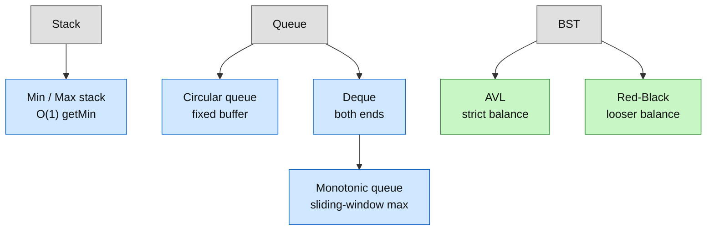
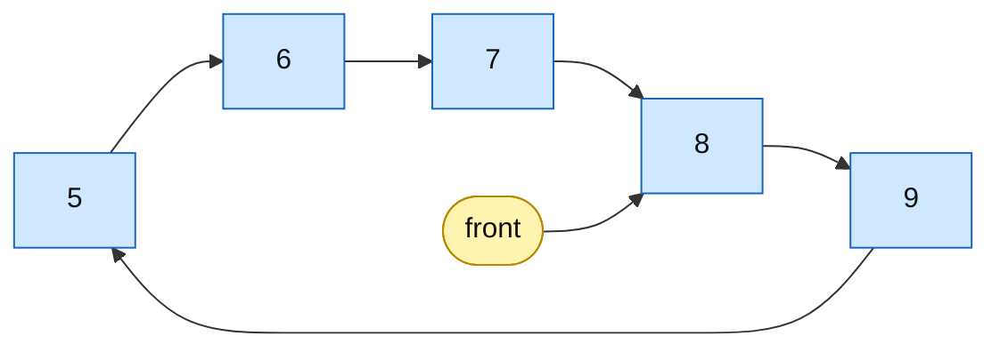
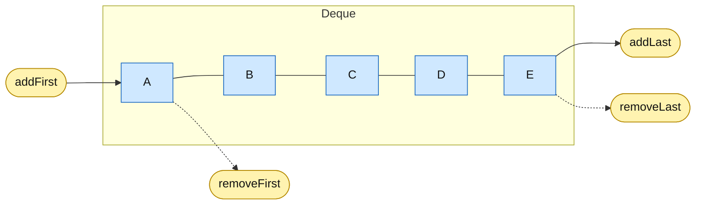
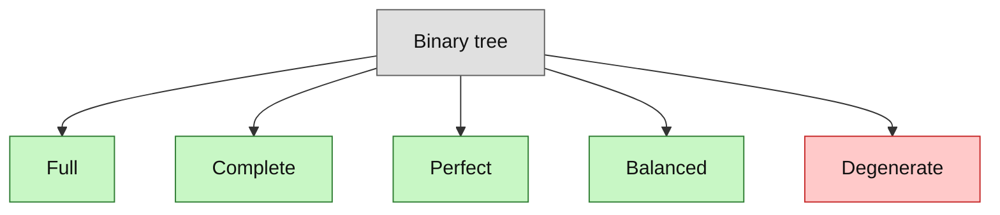
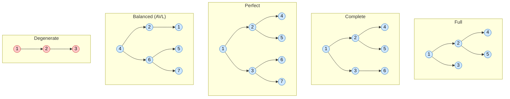
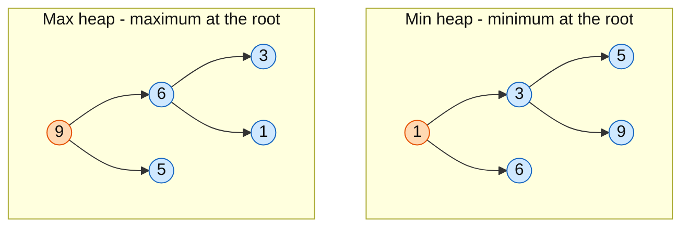
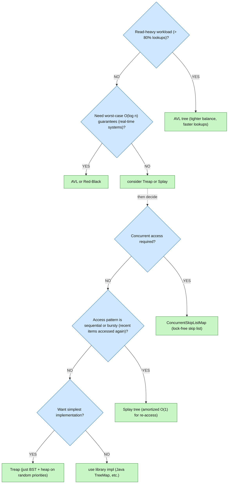
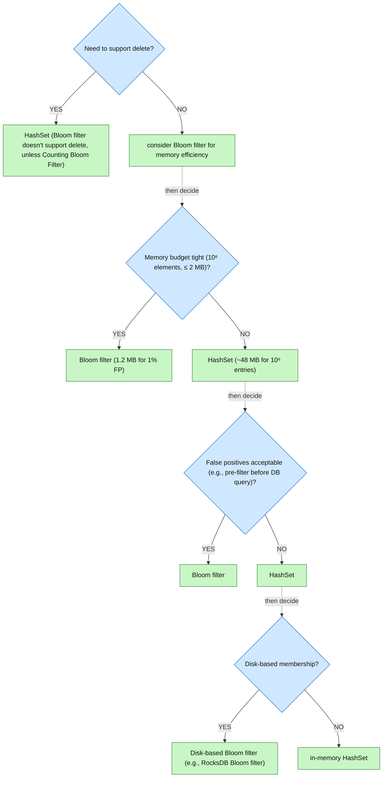

**Navigation**: [< Previous Chapter](02a_DS_Variants_Core.md) | [Back to Index](../00_MASTER_INDEX.md)

---

# 📚 Advanced Data Structure Variants: Stacks, Queues, & Trees

## 💬 Explain It Like a Study Partner — Advanced Variants

> [!TIP]
> **Ask yourself first:** *"How can a stack tell you its minimum in O(1) when finding a minimum normally takes O(n)?"*

### 1. The bottom line

Advanced variants **remember extra information as they go** (a running min, a wrap-around index, a sorted window, a balance rule), so one tricky question becomes cheap to answer.

### 2. The textbook core

- **Min/Max stack:** each entry also stores the min/max so far → `getMin()` is O(1).
- **Circular queue:** indices wrap with `% capacity` → fixed buffer with no wasted space.
- **Deque:** add/remove at both ends in O(1).
- **Monotonic queue:** keeps values in sorted order → sliding-window max/min in **O(n)** total.
- **AVL / red-black trees:** add a balance rule, restored by **rotations**, to keep height O(log n).
- Name the **invariant** first; every operation must preserve it.

### 3. The real-world analogy

A **cashier who keeps a sticky note with the lowest price seen so far**. Every time you scan an item, they update the note. Asking "what's the cheapest so far?" is instant because the answer is already written down.

### 4. Walkthrough: Min Stack with pushes `3, 5, 2`, then a pop

1. `push(3)`: store `(3, min=3)`.
2. `push(5)`: store `(5, min=3)` (the min stays 3).
3. `push(2)`: store `(2, min=2)`.
4. `getMin()` → look at the top entry → **2**, in O(1).
5. `pop()` removes `(2, min=2)`. The top is now `(5, min=3)`, so `getMin()` → **3** without any scan.

> [!NOTE]
> **Quick check:** why does a monotonic queue store indices instead of values? *To know when an element has left the window, and to know its position for the answer array.*

---

## ⚡ At a Glance — Advanced Variants

> [!NOTE]
> **Mental model:** advanced variants *add an invariant* to a basic structure — a running minimum, a fixed capacity, monotonic order, or a balance rule — so that one hard query becomes O(1) or O(log n).



**How to read this diagram.** Each grey base grows into coloured variants. The invariant it adds (shown in the label) is what you should state first when solving a problem with that variant.

| Variant | Invariant | Typical use |
| ------- | --------- | ----------- |
| Min Stack | Each entry knows the min so far | `getMin()` in O(1) |
| Circular queue | Indices wrap with modulo | Ring buffers, streaming |
| Monotonic queue | Values kept in sorted order | Sliding window max/min in O(n) |
| AVL | Balance factor ∈ {−1, 0, +1} | Read-heavy ordered maps |
| Red-Black | Colour rules bound height ≤ 2·log₂(n+1) | Java `TreeMap`, C++ `std::map` |

> [!WARNING]
> Every extra invariant must be restored after *every* mutation. Bugs in rotations and wrap-around indices are the usual failures.

---

## Historical Evolution of Advanced Data Structure Variants

::: timeline

### Timeline: evolution of advanced data structures

| Year | Structure / event | Notes |
| ---- | ----------------- | ----- |
| 1962 | **AVL trees** — Adelson-Velsky and Landis | First self-balancing BST, named after the inventors' initials. |
| 1968 | Knuth's *The Art of Computer Programming* (vol. 1) | Formalizes tree-balancing analysis and establishes O(log n) guarantees as a field standard. |
| 1970s | **Monotonic queue** emerges in computational geometry | Motivation: sliding-window maximum in O(n) versus O(nk) brute force. (The "monotonic queue" is a standard folk technique; it has no single inventor.) |
| 1978 | **Red-Black trees** — Guibas and Sedgewick | Refinement of Bayer's 1972 "symmetric binary B-trees". Adopted by the JDK `TreeMap`. |
| 1980s | **Treaps** — Vuillemin 1980 (Cartesian trees), Aragon–Seidel 1989/1996 | Randomized BST; priorities give expected O(log n) without complex rotation logic. |
| 1985 | **Splay trees** — Sleator and Tarjan | Self-adjusting BST; amortized O(log n); no explicit balance factor. |
| 1989–90 | **Skip lists** — Pugh | Probabilistic layers; a simple alternative to balanced BSTs that is easier to make concurrent (Java `ConcurrentSkipListMap`). |
| 1995 | **Rope** — Boehm, Atkinson and Plass | Balanced-tree string structure for large text editing: O(log n) concatenation and split. |
| 1996 | **LSM-tree** — O'Neil et al. | Log-structured merge-tree for write-heavy workloads. |
| 2000 | **Cache-oblivious B-trees** — Bender, Demaine, Farach-Colton | Optimal across all cache levels without explicit tuning. |
| 2006 | **Bigtable SSTable** — Google | Sorted String Table; foundation of modern key-value storage. |
| 2013 | **Bw-tree** — Microsoft | Latch-free B-tree for multicore; used in SQL Server Hekaton. |
| 2017 | **Learned indexes / SageDB** — Kraska et al. | Replace B-trees with learned models. |
| 2018 | **Learned Bloom filters** — Mitzenmacher | Models combined with Bloom filters for approximate membership. |

**Named Predecessors and Motivations:**

- **Why monotonic queue?** Needed for sliding-window maximum in O(n) instead of the O(nk) brute force. It is a well-known folk technique (a deque of decreasing candidates) rather than the work of a single inventor.

- **Why AVL trees?** Adelson-Velsky and Landis proved that keeping subtree heights within 1 of each other bounds the height by about 1.44·log₂(n+2), a tighter guarantee than the red-black bound of 2·log₂(n+1).

- **Why Treap?** Vuillemin asked: can randomness replace complex rotation rules? Yes — random priorities give expected O(log n) height without any explicit balancing code.

**Modern Production Practice:**

| Structure       | Production Use                                                                                                                                         |
| --------------- | ------------------------------------------------------------------------------------------------------------------------------------------------------ |
| Red-Black Tree  | Java TreeMap ([OpenJDK `TreeMap.java`](https://github.com/openjdk/jdk17/blob/master/src/java.base/share/classes/java/util/TreeMap.java)), C++ std::map |
| ArrayDeque      | Java Deque implementation — resizable array, not linked list                                                                                           |
| Monotonic Queue | Sliding-window max/min in streaming and stock-span style computations                                                                                               |
| Skip List       | Redis sorted sets; ConcurrentSkipListMap in Java                                                                                             |
| B-Tree variants | Most database indexes (PostgreSQL, MySQL InnoDB)                                                                                                       |
| LSM-tree        | RocksDB, Cassandra, LevelDB                                                                                                                            |

:::

---

### 5W1H: Mastering Advanced Data Structure Variants

> [!NOTE]
> **WHAT:** Advanced variants of standard Stacks, Queues, and Trees (e.g., Min Stack, Monotonic Queue, AVL Trees) tailored for specialized problems.
>
> **WHY:** Standard linear processing or sorting often hits O(N) or O(N log N) bottlenecks. Advanced variants exploit structural invariants (like monotonicity or self-balancing) to achieve O(1) or strict O(log N).
>
> **WHO:** Engineers optimizing latency-critical systems or solving hard algorithmic interview questions (e.g., Sliding Window Maximum, LFU Cache).
>
> **WHEN:** Use when naive structures fail constraints—such as needing O(1) minimum retrieval (Min Stack) or O(1) sliding window extremes.
>
> **HOW:** By augmenting standard structures with parallel tracking (e.g., two stacks), deque manipulation, or complex rotation algorithms.

---

## Production Failure Modes

::: warning

### Production failure modes for advanced ds

#### FAILURE 1: MONOTONIC QUEUE OVERFLOW (Unbounded Window Growth)

Scenario: Streaming data with variable window sizes
Problem:  If window size k grows unboundedly, deque stores O(n) elements
Symptom:  Memory exhaustion in long-running stream processors
Example:  Apache Spark job processing stock trades without watermark
timeout → deque accumulates all prices → OOM
Fix:      Implement explicit eviction policy or use time-based windows

**Failure 2:** AVL REBALANCING CASCADE (Skewed Insertions)

Scenario: Sequential insertion of sorted data (e.g., auto-increment IDs)
Problem:  Each insertion triggers balance check up to root; O(log n) per
insert, but constants are higher than Red-Black (more rotations)
Symptom:  15-20% slower than Red-Black for bulk inserts in benchmarks
Example:  Inserting 1M sequential IDs into AVL vs RB tree in Java
Fix:      Use bulk loading (balanced array build) or switch to Red-Black

**Failure 3:** MIN STACK STACK-OVERFLOW (Recursive Implementation)

Scenario: Deep stack usage (DFS on large graphs, recursive JSON parsers)
Problem:  If getMin() uses recursion to find minimum, stack depth hits
Java's default ~1024 frame limit
Symptom:  StackOverflowError in production under deep recursion
Example:  Processing JSON with nesting depth > 2000
Fix:      Use iterative two-stack approach; stack storage in heap

**Failure 4:** ROPE TREE IMBALANCE (Pathological Text Patterns)

Scenario: Concatenating strings with similar length distributions
Problem:  Naive rope implementation can create O(n) depth if concatenating
sequences of equal-sized ropes (not truly balanced)
Symptom:  O(n) traversal instead of O(log n) — silent performance death
Example:  Appending log lines of similar length to a Rope buffer
Fix:      Use weight-based rebalancing (like implicit treap) or Fibonacci
concatenation strategy

**Mitigation Checklist:**

| Failure Mode             | Mitigation                                                           |
| ------------------------ | -------------------------------------------------------------------- |
| Monotonic Queue overflow | Add max-size guard; use time-window eviction                         |
| AVL rebalancing cost     | Profile with sorted bulk inserts; switch to RB if needed             |
| Min Stack overflow       | Use heap-based stack (two Stack objects in Java)                     |
| Rope imbalance           | Implement explicit rebalancing or use existing library ( ropes-java) |

:::

---

## 2.1 Min Stack

### 💬 Study-Partner View — Min Stack

**1. The bottom line:** A stack that always knows its smallest value, so `getMin()` is instant.

**2. The textbook core:**

- Each entry stores the value **and** the minimum so far (or use a second stack for mins).
- `push`, `pop`, `peek`, `getMin`: all **O(1)**; space O(n).
- Invariant: the min stored at the top equals the minimum of all elements currently in the stack.
- Popping automatically restores the previous minimum.

**3. The real-world analogy:** A **stack of plates with a price tag on each plate showing the cheapest plate underneath and including it**. The top plate's tag always answers "what is the cheapest?".

**4. Walkthrough:**

1. Push 3 → store `(3, min 3)`. Push 5 → `(5, min 3)`. Push 2 → `(2, min 2)`.
2. `getMin()` reads the top tag → 2.
3. `pop()` removes `(2, min 2)`; the top is `(5, min 3)`, so `getMin()` is 3 again.

> [!NOTE]
> **Quick check:** Why not just track one `min` variable? *After popping the minimum you would not know the next smallest.*


::: pattern

## What Is It?

A stack that supports:

- push(x) - O(1)
- pop() - O(1)
- top() - O(1)
- getMin() - O(1) ← THE SPECIAL OPERATION!

**Challenge**: How to get minimum in O(1)?

**Naive**: Search entire stack → O(n)

**Smart**: Track minimum at EACH state of the stack!

**INVARIANT (Min Stack):**

```
For any stack state S with minStack M:
  M.top() = min{ x | x is in S }
  After push(v): M pushes min(v, M.top_before_push)
  After pop():   Both stacks pop (M maintains consistency)
```

APPROACH 1 - TWO STACKS:
Main Stack: [3, 5, 2, 7, 1] top→
Min Stack: [3, 3, 2, 2, 1] top→
Min stack stores the minimum at each point!
When we pop, both stacks pop.
getMin() = minStack.top()
APPROACH 2 - SINGLE STACK WITH PAIRS:
Stack: [(3,3), (5,3), (2,2), (7,2), (1,1)]
(value, min_at_this_point)

:::

```java
// MIN STACK - TWO STACK APPROACH
public class MinStack {
    private Stack<Integer> mainStack;
    private Stack<Integer> minStack;

    public MinStack() {
        mainStack = new Stack<>();
        minStack = new Stack<>();
    }

    public void push(int val) {
        mainStack.push(val);

        // Push to minStack: either val or current min (whichever is smaller)
        if (minStack.isEmpty()) {
            minStack.push(val);
        } else {
            minStack.push(Math.min(val, minStack.peek()));
        }
    }

    public void pop() {
        mainStack.pop();
        minStack.pop();
    }

    public int top() {
        return mainStack.peek();
    }

    public int getMin() {
        return minStack.peek();
    }
}

// MIN STACK - SPACE OPTIMIZED (SINGLE STACK)
public class MinStackOptimized {
    private Stack<Long> stack;
    private long min;

    public MinStackOptimized() {
        stack = new Stack<>();
    }

    public void push(int val) {
        if (stack.isEmpty()) {
            min = val;
            stack.push(0L);  // Difference from min
        } else {
            stack.push((long)val - min);
            if (val < min) {
                min = val;
            }
        }
    }

    public void pop() {
        long top = stack.pop();
        if (top < 0) {
            // We need to restore previous min
            min = min - top;
        }
    }

    public int top() {
        long top = stack.peek();
        if (top < 0) {
            return (int)min;
        }
        return (int)(min + top);
    }

    public int getMin() {
        return (int)min;
    }
}
```

---

## 2.2 Max Stack

### 💬 Study-Partner View — Max Stack

**1. The bottom line:** The mirror image of a Min Stack: a stack that always knows its largest value.

**2. The textbook core:**

- Same design as the Min Stack but each entry stores the **maximum** so far.
- `push`, `pop`, `peek`, `getMax`: all **O(1)**.
- `popMax()` (remove the max wherever it is) needs more machinery, such as a second stack or a heap with lazy deletion.
- Common in stock-span and "largest so far" problems.

**3. The real-world analogy:** A **scoreboard that keeps the high score visible**; each new play updates it, and undoing a play restores the previous high score.

**4. Walkthrough:**

1. Push 1 → `(1, max 1)`, push 7 → `(7, max 7)`, push 4 → `(4, max 7)`.
2. `getMax()` → 7.
3. Pop 4 → still 7; pop 7 → top is `(1, max 1)`, so max is 1.

> [!NOTE]
> **Quick check:** What changes for `popMax()`? *The max may be buried; you pop elements into a buffer until you hit it, then push the buffer back.*


::: pattern

### Max stack - complete guide

#### What is it

Similar to Min Stack but also supports:

- popMax() - Remove and return the maximum element

This is HARDER than Min Stack because:

- popMax() might remove element from MIDDLE of stack
- Need to maintain consistency

**Approach:** Use TreeMap + Doubly Linked List

- Doubly Linked List: Maintains stack order
- TreeMap: Maps values to their nodes for O(log n) max finding

:::

```java
// MAX STACK - SIMPLE VERSION (O(n) popMax)
public class MaxStackSimple {
    private Stack<Integer> stack;
    private Stack<Integer> maxStack;

    public MaxStackSimple() {
        stack = new Stack<>();
        maxStack = new Stack<>();
    }

    public void push(int x) {
        stack.push(x);
        if (maxStack.isEmpty()) {
            maxStack.push(x);
        } else {
            maxStack.push(Math.max(x, maxStack.peek()));
        }
    }

    public int pop() {
        maxStack.pop();
        return stack.pop();
    }

    public int top() {
        return stack.peek();
    }

    public int peekMax() {
        return maxStack.peek();
    }

    // O(n) - Need to rebuild stack
    public int popMax() {
        int max = maxStack.peek();
        Stack<Integer> temp = new Stack<>();

        // Pop until we find max
        while (stack.peek() != max) {
            temp.push(pop());
        }

        // Pop the max
        pop();

        // Push back
        while (!temp.isEmpty()) {
            push(temp.pop());
        }

        return max;
    }
}
```

---

🔬 **Section Challenge — 2.2 Max Stack**

**Challenge 1 (Reasoning):** Min Stack uses a simple auxiliary stack to track minimums. Why can't Max Stack use the same approach to support `popMax()` in O(1)? What fundamental property does `popMax()` violate?

<details><summary>Answer</summary>

`popMax()` removes an element from the MIDDLE of the stack — not the top. This violates LIFO ordering. With Min Stack, `getMin()` only reads the auxiliary stack top (O(1)), and `pop()` always removes from the top of both stacks (maintaining consistency). But `popMax()` must find and remove the maximum wherever it sits. The simple two-stack approach requires: (1) pop everything above the max into a temp stack, (2) pop the max, (3) push everything back — O(n) per `popMax()`. The O(log n) solution uses a TreeMap (sorted by value) + Doubly Linked List (maintaining stack order) + lazy deletion with unique IDs to avoid the rebuild cost.

</details>

# 📬 Part 3: Queue Variants

## 3.1 Circular Queue

### 💬 Study-Partner View — Circular Queue

**1. The bottom line:** A queue stored in a fixed array whose indices wrap around, so freed space at the front is reused.

**2. The textbook core:**

- Keep `front`, `rear` and `size` (or leave one slot empty) to tell full from empty.
- Wrap with modulo: `rear = (rear + 1) % capacity`.
- `enqueue`, `dequeue`, `peek`: **O(1)**; capacity is fixed unless you resize.
- Avoids the "wasted front space" of a naive array queue.

**3. The real-world analogy:** A **revolving sushi belt**: plates circle forever, and you place a new plate where a taken one used to be.

**4. Walkthrough:**

1. Capacity 5, queue `[A, B, C]` with `front = 0`, `rear = 3`.
2. Dequeue `A` → `front = 1`; dequeue `B` → `front = 2`.
3. Enqueue `D`, `E`, `F`: `rear` goes 3 → 4 → 0 → 1 (wrapping), so `F` lands at index 1.
4. Full when `size == capacity`.

> [!NOTE]
> **Quick check:** How do you tell full from empty when `front == rear`? *Keep a `size` counter or sacrifice one slot.*


::: pattern

### Circular queue - complete guide

#### What is it

A queue implemented using a circular array.
When we reach the end of the array, we wrap around to the beginning!

WHY CIRCULAR?

**Linear queue problem:** 

After many enqueue/dequeue operations:
[_, _, _, _, 5, 6, 7, _]
↑        ↑
front    rear
Wasted space at beginning!

**Circular queue solution:** 

[8, 9, _, _, 5, 6, 7]
↑     ↑
rear  front
rear wraps around to use empty space!

VISUAL (as a circle):



**How to read this diagram.** The buffer is a ring: after the last slot the index wraps to the first, so freed slots at the start are reused instead of wasted.

:::

::: example

```
REAL-WORLD APPLICATIONS:

1. CPU SCHEDULING (Round Robin):
   Processes wait in circular queue
   Each gets a time slice, then goes to end

2. MEMORY MANAGEMENT:
   Buffer pools in databases
   Connection pools in web servers

3. AUDIO/VIDEO STREAMING:
   Circular buffer for smooth playback
   Producer writes, consumer reads

4. KEYBOARD BUFFER:
   Stores keystrokes
   Old keystrokes overwritten if buffer full
```

:::

```java
// CIRCULAR QUEUE IMPLEMENTATION
public class CircularQueue<T> {
    private Object[] data;
    private int front;
    private int rear;
    private int size;
    private int capacity;

    public CircularQueue(int capacity) {
        this.capacity = capacity;
        this.data = new Object[capacity];
        this.front = 0;
        this.rear = -1;
        this.size = 0;
    }

    // Enqueue - O(1)
    public boolean enqueue(T item) {
        if (isFull()) {
            return false;  // Queue is full
        }

        rear = (rear + 1) % capacity;  // Circular increment
        data[rear] = item;
        size++;
        return true;
    }

    // Dequeue - O(1)
    @SuppressWarnings("unchecked")
    public T dequeue() {
        if (isEmpty()) {
            throw new RuntimeException("Queue is empty");
        }

        T item = (T) data[front];
        front = (front + 1) % capacity;  // Circular increment
        size--;
        return item;
    }

    // Peek - O(1)
    @SuppressWarnings("unchecked")
    public T peek() {
        if (isEmpty()) {
            throw new RuntimeException("Queue is empty");
        }
        return (T) data[front];
    }

    public boolean isEmpty() {
        return size == 0;
    }

    public boolean isFull() {
        return size == capacity;
    }

    public int size() {
        return size;
    }
}
```

---

## 3.2 Deque (Double-Ended Queue)

### 💬 Study-Partner View — Deque

**1. The bottom line:** A queue you can add to or remove from at **both** ends, so it can act as a stack, a queue, or both.

**2. The textbook core:**

- Operations: `addFirst`, `addLast`, `removeFirst`, `removeLast`, `peekFirst`, `peekLast`, all **O(1)**.
- Implemented as a circular array (`ArrayDeque`) or a doubly linked list.
- Use as a stack (push/pop one end), a queue (add one end, remove the other), or a sliding window.
- `ArrayDeque` does not allow `null` elements.

**3. The real-world analogy:** A **line at a ticket counter where people can join or leave from either end**: VIPs go to the front, people giving up leave from the back.

**4. Walkthrough:**

1. Start empty. `addLast(1)`, `addLast(2)` → `[1, 2]`.
2. `addFirst(0)` → `[0, 1, 2]`.
3. `removeLast()` → returns 2, leaving `[0, 1]`.
4. `removeFirst()` → returns 0, leaving `[1]`.

> [!NOTE]
> **Quick check:** Which Java class should you use? *`ArrayDeque` for both stack and queue use cases.*


::: pattern

### Deque - complete guide

#### What is it

A queue where you can add/remove from BOTH ends in O(1)!

**Visual:** 



**How to read this diagram.** Elements can be added to or removed from **both** ends in O(1).

**Operations:** 

- addFirst(x)    - Add to front
- addLast(x)     - Add to back
- removeFirst()  - Remove from front
- removeLast()   - Remove from back
- peekFirst()    - See front
- peekLast()     - See back

ALL OPERATIONS ARE O(1)!

DEQUE = STACK + QUEUE
Can use as stack (addFirst/removeFirst)
Can use as queue (addLast/removeFirst)

:::

::: example

```
REAL-WORLD APPLICATIONS:

1. BROWSER HISTORY:
   - Add new pages to front
   - Can go back (from front)
   - Can go forward (from back)

2. UNDO/REDO WITH LIMIT:
   - Add new action to front
   - If too many, remove from back
   - Undo = remove from front

3. SLIDING WINDOW MAXIMUM:
   - Deque stores indices
   - Remove from front (out of window)
   - Remove from back (smaller elements)
   - Add to back (new elements)

4. PALINDROME CHECKING:
   - Add all characters
   - Compare front and back
   - Remove both if equal
```

:::

```java
// DEQUE IMPLEMENTATION USING CIRCULAR ARRAY
public class MyDeque<T> {
    private Object[] data;
    private int front;
    private int rear;
    private int size;
    private int capacity;

    public MyDeque(int capacity) {
        this.capacity = capacity;
        this.data = new Object[capacity];
        this.front = 0;
        this.rear = capacity - 1;
        this.size = 0;
    }

    // Add to front - O(1)
    public boolean addFirst(T item) {
        if (isFull()) return false;

        front = (front - 1 + capacity) % capacity;  // Move front back
        data[front] = item;
        size++;
        return true;
    }

    // Add to back - O(1)
    public boolean addLast(T item) {
        if (isFull()) return false;

        rear = (rear + 1) % capacity;  // Move rear forward
        data[rear] = item;
        size++;
        return true;
    }

    // Remove from front - O(1)
    @SuppressWarnings("unchecked")
    public T removeFirst() {
        if (isEmpty()) throw new RuntimeException("Deque is empty");

        T item = (T) data[front];
        front = (front + 1) % capacity;
        size--;
        return item;
    }

    // Remove from back - O(1)
    @SuppressWarnings("unchecked")
    public T removeLast() {
        if (isEmpty()) throw new RuntimeException("Deque is empty");

        T item = (T) data[rear];
        rear = (rear - 1 + capacity) % capacity;
        size--;
        return item;
    }

    @SuppressWarnings("unchecked")
    public T peekFirst() {
        if (isEmpty()) throw new RuntimeException("Deque is empty");
        return (T) data[front];
    }

    @SuppressWarnings("unchecked")
    public T peekLast() {
        if (isEmpty()) throw new RuntimeException("Deque is empty");
        return (T) data[rear];
    }

    public boolean isEmpty() { return size == 0; }
    public boolean isFull() { return size == capacity; }
    public int size() { return size; }
}
```

---

## 3.3 Monotonic Queue

### 💬 Study-Partner View — Monotonic Queue

**1. The bottom line:** A deque that keeps its values in sorted order by throwing away items that can never be the answer.

**2. The textbook core:**

- Store **indices**; keep values monotonically decreasing (for max) from front to back.
- Before pushing `i`, pop from the back while `nums[back] <= nums[i]` (they are dominated).
- Pop from the front when its index leaves the window.
- Each element enters and leaves at most once → **O(n)** total for sliding-window max/min.

**3. The real-world analogy:** A **queue of job candidates where a newer, stronger candidate makes weaker earlier ones irrelevant**. Once someone better and younger arrives, the weaker ones can never win.

**4. Walkthrough:**

1. `nums = [1, 3, -1, -3, 5]`, window size 3.
2. Add 1 → `[1]`; add 3 → pop 1 (smaller) → `[3]`; add -1 → `[3, -1]`. Max = 3.
3. Add -3 → `[3, -1, -3]`. Max = 3.
4. Add 5 → pop -3, -1, 3 → `[5]`; the window moved so 3 would have expired anyway. Max = 5.

> [!NOTE]
> **Quick check:** Why store indices, not values? *To know when the front has left the window.*


::: pattern

### Monotonic queue - complete guide

#### What is it

A deque that maintains elements in MONOTONIC order
(either increasing or decreasing).

MONOTONIC DECREASING QUEUE (for finding max):
Elements from front to back: 8 > 6 > 5 > 3
Front is always the maximum!

MONOTONIC INCREASING QUEUE (for finding min):
Elements from front to back: 2 < 4 < 7 < 9
Front is always the minimum!

HOW IT WORKS (Decreasing for max):
When adding element x:

1. Remove all elements from BACK that are smaller than x
2. Add x to back
3. Front is always the current maximum

WHY? Elements smaller than x will NEVER be the max while x exists!

**Key use case:** Sliding Window Maximum/Minimum in O(n)!

**INVARIANT (Monotonic Decreasing Queue for Sliding Window Max):**
```

For window [i-k+1, i] with deque D (stores indices):

1. D.front() is always the index of current maximum
2. Indices in D are strictly increasing (insertion order preserved)
3. If D.front() < i-k+1: element has left window → pop_front()
4. Before inserting index i: while D.back() has nums[D.back()] <= nums[i]: pop_back()
   (All smaller elements are dominated by i and will never be max while i exists)

```

```
EXAMPLE - SLIDING WINDOW MAXIMUM:
Array: [1, 3, -1, -3, 5, 3, 6, 7], Window size: 3

Window [1,3,-1]:
  Deque state: [3, -1]  (1 removed because 3 > 1)
  Max = 3

Window [3,-1,-3]:
  Deque state: [3, -1, -3]
  Max = 3

Window [-1,-3,5]:
  Deque state: [5]  (all removed because 5 > all)
  Max = 5

...and so on
```

:::

```java
// SLIDING WINDOW MAXIMUM USING MONOTONIC QUEUE
public class MonotonicQueue {

    // Returns array of maximums for each window
    public int[] maxSlidingWindow(int[] nums, int k) {
        if (nums == null || nums.length == 0) return new int[0];

        int n = nums.length;
        int[] result = new int[n - k + 1];
        Deque<Integer> deque = new LinkedList<>();  // Stores INDICES

        for (int i = 0; i < n; i++) {
            // Remove indices outside window
            while (!deque.isEmpty() && deque.peekFirst() < i - k + 1) {
                deque.pollFirst();
            }

            // Remove indices of smaller elements (they'll never be max)
            while (!deque.isEmpty() && nums[deque.peekLast()] < nums[i]) {
                deque.pollLast();
            }

            // Add current index
            deque.offerLast(i);

            // Window is complete, record max
            if (i >= k - 1) {
                result[i - k + 1] = nums[deque.peekFirst()];
            }
        }

        return result;
    }
}
```

::: memory

> [!TIP]
> **🧠 Interview key points — Monotonic Queue**
>
>
> 1. **"When to use Monotonic Queue?"**
>    - Sliding window min/max problems
>    - Find next greater/smaller element
>    - Stock span problems
>
> 2. **"Time Complexity?"**
>    - O(n) overall
>    - Each element added/removed at most once
>
> 3. **"Why store indices instead of values?"**
>    - To check if element is within window
>    - To know position for result array

:::

---

🔬 **Section Challenge — 3.3 Monotonic Queue**

**Challenge 1 (Reasoning):** In the Sliding Window Maximum implementation, the monotonic queue stores INDICES, not values. Why is this necessary? What breaks if you store values instead?

<details><summary>Answer</summary>

You must know whether an element is INSIDE the current window. The window is defined by index range `[i-k+1, i]`. When `deque.peekFirst()` returns an index, you can check `index < i - k + 1` to determine if it's expired. If you stored values, you'd have no way to know WHICH occurrence of that value you're looking at, or whether it's inside the window. Example: `[3, 1, 3, ...], k=2`. Both `3`s have the same value but only one is in the current window. Storing indices lets you distinguish them. The deque front eviction check (`deque.peekFirst() < i - k + 1`) is the mechanism that makes the sliding window "slide" — without indices, it's impossible.

</details>

**Challenge 2 (Reasoning):** Monotonic Queue achieves O(n) total for n elements, but individual operations seem to do variable work (some pushes pop multiple elements). Prove the O(n) amortized bound.

<details><summary>Answer</summary>

Use the potential method / accounting argument: each element is pushed into the deque exactly ONCE and popped from the deque at most ONCE (either via back-eviction when a larger element arrives, or via front-eviction when it leaves the window). So across all n elements: at most n pushes + at most n pops = 2n total operations. Even though one `offerLast()` might trigger 5 `pollLast()` calls, those 5 elements will never be popped again. Total work across the entire array is Θ(n), giving O(1) amortized per element.

</details>

# 🌳 Part 4: Tree Variants

## 4.1 Binary Tree Types

### 💬 Study-Partner View — Binary Tree Types

**1. The bottom line:** Binary trees come in named shapes (full, complete, perfect, balanced, degenerate), and the shape decides how fast they are.

**2. The textbook core:**

- **Full:** every node has 0 or 2 children. **Complete:** all levels filled except maybe the last, which fills left to right. **Perfect:** all internal nodes have 2 children and all leaves share a level.
- **Balanced:** left and right heights differ by at most 1 (AVL) or are otherwise bounded.
- **Degenerate:** each node has one child, which is effectively a linked list.
- Height `h` drives cost: perfect tree has `h = log₂(n+1) - 1`; degenerate has `h = n - 1`.

**3. The real-world analogy:** **Shapes of a family tree**: a tidy, evenly branching tree lets you find anyone quickly; a single long line of ancestors takes forever to walk.

**4. Walkthrough:**

1. Insert 1, 2, 3, 4, 5 in sorted order into a plain BST.
2. Every new key goes right, so the tree is a chain of height 4.
3. Insert the same keys in the order 3, 2, 4, 1, 5 and the tree is perfectly balanced (height 2).
4. Same data, different shape: search cost is O(n) versus O(log n).

> [!NOTE]
> **Quick check:** Which shape do binary heaps use? *Complete, which is why they fit in an array.*


::: map

### Binary tree variants overview



**How to read this diagram.** The five types branch off the general binary tree; green types have well-behaved height, the red degenerate type does not.

| Type | Rule | Example |
| ---- | ---- | ------- |
| **Full** | Every node has 0 or 2 children (never 1) | `1` → `2, 3`; `2` → `4, 5` |
| **Complete** | All levels filled except possibly the last; last level filled as far **left** as possible | `1` → `2, 3`; `2` → `4, 5`; `3` → `6` |
| **Perfect** | All internal nodes have 2 children and all leaves are at the same level | `1` → `2, 3`; `2` → `4, 5`; `3` → `6, 7` |
| **Balanced** | Heights of the left and right subtrees differ by at most 1 (AVL is strictly balanced) | `4` → `2, 6`; `2` → `1`; `6` → `5, 7` |
| **Degenerate** | Each parent has only one child: essentially a linked list | `1` → `2` → `3` (all on one side) |

Visual examples:



**How to read this diagram.** Each box draws one tree type from the table. Blue trees keep their height near log n; the red degenerate tree is a chain with height n.

:::

> 🔬 **Section Challenge — 4.1 Binary Tree Types**
>
> **Challenge 1 (Design):** A developer decides to use a strictly "Perfect Binary Tree" to store exactly 1 million user records, assuming it will provide the ultimate balanced `O(log N)` search time. Why is this structurally impossible, and what Tree variant should they use instead?
>
> <details><summary>Answer</summary>
>
> **Scenario:** Selecting the correct tree invariant for arbitrary dataset sizes.
> **Trace:** A Perfect Binary Tree requires every internal node to have 2 children, and all leaves must be on the exact same level. Mathematically, a perfect tree of height `h` contains exactly `2^(h+1) - 1` nodes.
> **Debug/Fix:** You cannot build a Perfect tree with exactly 1,000,000 nodes. The closest perfect tree sizes are 524,287 nodes (height 18) and 1,048,575 nodes (height 19). If you try to force 1,000,000 nodes into this shape, you will have empty spaces on the bottom level, which immediately turns it into a **Complete Binary Tree** (if filled strictly left-to-right) or just a general **Balanced Binary Tree** (like an AVL or Red-Black Tree). This is why "Perfect" trees are mostly theoretical, while "Complete" and "Balanced" trees are the production standard.
>
> </details>

## 4.2 AVL Tree (Self-Balancing BST)

### 💬 Study-Partner View — AVL Tree

**1. The bottom line:** A binary search tree that fixes itself with rotations whenever one side gets more than one level taller than the other.

**2. The textbook core:**

- Invariant: for every node, `|height(left) - height(right)| <= 1`.
- Balance factor = `height(left) - height(right)`; allowed values are -1, 0, +1.
- Four rebalancing cases: LL (right rotation), RR (left rotation), LR and RL (double rotations).
- Height ≤ about 1.44·log₂(n); search/insert/delete are **O(log n)** worst case.

**3. The real-world analogy:** A **seesaw that corrects itself**: whenever one side hangs too low, the arrangement is shifted so both sides are almost level.

**4. Walkthrough:**

1. Insert 10, 20, 30 into an empty AVL tree.
2. After 30, the node 10 has balance factor -2 (right-right heavy).
3. Apply a **left rotation** at 10: 20 becomes the root with children 10 and 30.
4. The tree is balanced again with height 1.

> [!NOTE]
> **Quick check:** AVL or red-black for a read-heavy workload? *AVL, because it is more strictly balanced and lookups are shallower.*


::: pattern

### Avl tree - complete guide

#### What is it

A self-balancing Binary Search Tree where:

- For EVERY node: |height(left) - height(right)| ≤ 1

**Invented:** 1962 by Adelson-Velsky and Landis

**Why balance matters:** 

Unbalanced BST: O(n) worst case (degenerates to linked list)
Balanced AVL:   O(log n) GUARANTEED for all operations!

BALANCE FACTOR = height(left) - height(right)
Valid values: -1, 0, +1
If BF becomes -2 or +2, we ROTATE!

**INVARIANT (AVL Tree — Strict Balance):**
```

For every node N in the tree:
|height(N.left) - height(N.right)| ≤ 1

Implications:

- Height is bounded by 1.44 \* log2(n+1)
- search(), insert(), delete() are all O(log n) guaranteed
- More rotations on insert/delete than Red-Black (strictness cost)

```

#### ROTATIONS (The Key to Balance)

4 CASES OF IMBALANCE:

1. LEFT-LEFT (LL) → Single Right Rotation
   30                     20
   /                      /  \
   20          →         10    30
   /
   10

2. RIGHT-RIGHT (RR) → Single Left Rotation
   10                         20
   \                       /  \
   20         →         10    30
   \
   30

3. LEFT-RIGHT (LR) → Left then Right Rotation
   30                    30                      25
   /                     /                       /  \
   20          →        25         →           20    30
   \                 /
   25             20

4. RIGHT-LEFT (RL) → Right then Left Rotation
   10                    10                         15
   \                     \                       /  \
   20        →           15       →           10    20
   /                        \
   15                         20

:::

```java
// AVL TREE IMPLEMENTATION
public class AVLTree {

    private class Node {
        int key, height;
        Node left, right;

        Node(int key) {
            this.key = key;
            this.height = 1;
        }
    }

    private Node root;

    // Get height of node
    private int height(Node node) {
        return node == null ? 0 : node.height;
    }

    // Get balance factor
    private int getBalance(Node node) {
        return node == null ? 0 : height(node.left) - height(node.right);
    }

    // Update height
    private void updateHeight(Node node) {
        node.height = 1 + Math.max(height(node.left), height(node.right));
    }

    // Right rotation (for LL case)
    private Node rightRotate(Node y) {
        Node x = y.left;
        Node T2 = x.right;

        // Rotate
        x.right = y;
        y.left = T2;

        // Update heights
        updateHeight(y);
        updateHeight(x);

        return x;  // New root
    }

    // Left rotation (for RR case)
    private Node leftRotate(Node x) {
        Node y = x.right;
        Node T2 = y.left;

        // Rotate
        y.left = x;
        x.right = T2;

        // Update heights
        updateHeight(x);
        updateHeight(y);

        return y;  // New root
    }

    // Insert
    public void insert(int key) {
        root = insertRec(root, key);
    }

    private Node insertRec(Node node, int key) {
        // 1. Standard BST insert
        if (node == null) return new Node(key);

        if (key < node.key) {
            node.left = insertRec(node.left, key);
        } else if (key > node.key) {
            node.right = insertRec(node.right, key);
        } else {
            return node;  // Duplicate keys not allowed
        }

        // 2. Update height
        updateHeight(node);

        // 3. Get balance factor
        int balance = getBalance(node);

        // 4. If unbalanced, there are 4 cases:

        // Left Left Case
        if (balance > 1 && key < node.left.key) {
            return rightRotate(node);
        }

        // Right Right Case
        if (balance < -1 && key > node.right.key) {
            return leftRotate(node);
        }

        // Left Right Case
        if (balance > 1 && key > node.left.key) {
            node.left = leftRotate(node.left);
            return rightRotate(node);
        }

        // Right Left Case
        if (balance < -1 && key < node.right.key) {
            node.right = rightRotate(node.right);
            return leftRotate(node);
        }

        return node;  // Balanced
    }

    // Delete
    public void delete(int key) {
        root = deleteRec(root, key);
    }

    private Node deleteRec(Node node, int key) {
        // 1. Standard BST delete
        if (node == null) return null;

        if (key < node.key) {
            node.left = deleteRec(node.left, key);
        } else if (key > node.key) {
            node.right = deleteRec(node.right, key);
        } else {
            // Node to delete found
            if (node.left == null || node.right == null) {
                node = (node.left != null) ? node.left : node.right;
            } else {
                // Find inorder successor
                Node temp = minValueNode(node.right);
                node.key = temp.key;
                node.right = deleteRec(node.right, temp.key);
            }
        }

        if (node == null) return null;

        // 2. Update height
        updateHeight(node);

        // 3. Rebalance
        int balance = getBalance(node);

        // Left Left
        if (balance > 1 && getBalance(node.left) >= 0) {
            return rightRotate(node);
        }

        // Left Right
        if (balance > 1 && getBalance(node.left) < 0) {
            node.left = leftRotate(node.left);
            return rightRotate(node);
        }

        // Right Right
        if (balance < -1 && getBalance(node.right) <= 0) {
            return leftRotate(node);
        }

        // Right Left
        if (balance < -1 && getBalance(node.right) > 0) {
            node.right = rightRotate(node.right);
            return leftRotate(node);
        }

        return node;
    }

    private Node minValueNode(Node node) {
        Node current = node;
        while (current.left != null) {
            current = current.left;
        }
        return current;
    }
}
```

---

## 4.3 Red-Black Tree

### 💬 Study-Partner View — Red-Black Tree

**1. The bottom line:** A self-balancing BST that uses node colours instead of exact heights, trading perfect balance for fewer rotations.

**2. The textbook core:**

- Rules: nodes are red or black; the root is black; red nodes have only black children; every root-to-null path has the same number of black nodes.
- These rules force height ≤ 2·log₂(n+1), so operations are **O(log n)**.
- Insert and delete need at most a constant number of rotations plus recolouring.
- Used by Java `TreeMap`/`TreeSet`, C++ `std::map`, and the Linux scheduler (CFS).

**3. The real-world analogy:** A **traffic-light system for balance**: colours tell you when a branch is getting too long, and a few quick recolourings or rotations restore order.

**4. Walkthrough:**

1. Insert a new node; colour it **red**.
2. If its parent is black, you are done (no rule is broken).
3. If the parent and the uncle are both red, recolour them black and the grandparent red, then check upward.
4. If the uncle is black, rotate (and possibly recolour) to restore the rules.

> [!NOTE]
> **Quick check:** Why does red-black rebalance less often than AVL? *Its balance rule is looser, so it tolerates taller trees (up to 2× the minimum height).*


::: pattern

### Red-black tree - complete guide

#### What is it

A self-balancing BST where each node has a COLOR (Red or Black)

**Invented:** 1972 by Rudolf Bayer (as "symmetric binary B-trees")

**Refined:** 1978 by Leonidas Guibas and Robert Sedgewick

**Properties (must all be true):** 

1. Every node is either RED or BLACK
2. Root is always BLACK
3. Every leaf (NIL) is BLACK
4. If node is RED, both children must be BLACK (no red-red parent-child)
5. Every path from node to descendant NIL has same number of black nodes

**Visual:** 

[13:B]
/      \
[8:R]      [17:R]
/   \      /    \
[1:B] [11:B] [15:B] [25:B]
/             \
[6:R]          [22:R]

B = Black, R = Red

#### AVL vs RED-BLACK

| Property | AVL Tree | Red-Black Tree |
| -------- | -------- | -------------- |
| Balance strictness | Strictly balanced | Loosely balanced |
| Search | O(log n) | O(log n) |
| Insert | Slower (more rotations) | Faster (fewer rotations) |
| Delete | Slower | Faster |
| Height | ≤ 1.44 · log₂(n) | ≤ 2 · log₂(n+1) |
| Used in | Read-heavy indexes | Java `TreeMap`, C++ `std::map` |

**When to use:** 

- AVL: Lookup-heavy applications (more balanced = faster search)
- RB: Insert/Delete-heavy (fewer rotations = faster modifications)

:::

::: memory

> [!TIP]
> **🧠 Interview key points — Tree Variants**
>
>
> 1. **"Difference between AVL and Red-Black?"**
>    - AVL: More balanced, better for lookups
>    - RB: Less rotations, better for inserts/deletes
>    - Both guarantee O(log n)
>
> 2. **"Which does Java TreeMap use?"**
>    - Red-Black Tree
>
> 3. **"When is BST O(n)?"**
>    - When degenerate (sorted insert)
>    - Solution: Use self-balancing trees
>
> 4. **"What's balance factor in AVL?"**
>    - height(left) - height(right)
>    - Must be -1, 0, or 1

:::

---

# 📦 Part 5: Heap Variants

### 💬 Study-Partner View — Heap Variants

**1. The bottom line:** Heaps keep the best element on top; the variants differ in how many children a node has and how cheaply they can merge or lower a key.

**2. The textbook core:**

- **Binary heap:** array-based, `insert`/`extractMin` O(log n), `peek` O(1), build in O(n).
- **d-ary heap:** `d` children per node → shallower tree, faster `decreaseKey` (useful in Dijkstra).
- **Binomial heap:** merge in O(log n). **Fibonacci heap:** amortized O(1) insert/decreaseKey/merge, but complex and slow constants in practice.
- Min-heap: parent ≤ children; max-heap: parent ≥ children.

**3. The real-world analogy:** A **tournament bracket** where the champion is always at the top: a d-ary heap is a bracket with more teams per match, so it has fewer rounds.

**4. Walkthrough:**

1. Min-heap array `[1, 3, 6, 5, 9]`; `insert(2)`.
2. Append at the end: `[1, 3, 6, 5, 9, 2]`; parent of index 5 is `(5-1)/2 = 2` (value 6).
3. 2 < 6 → swap: `[1, 3, 2, 5, 9, 6]`. Parent of index 2 is 1; 2 > 1 → stop.
4. Cost: at most `log n` swaps.

> [!NOTE]
> **Quick check:** Which heap makes Dijkstra fastest in theory? *The Fibonacci heap, O(E + V log V), though binary or d-ary heaps usually win in practice.*


::: pattern

### Heap variants — complete guide

**Heap types**

| # | Type | Rule / property | Notes |
| - | ---- | --------------- | ----- |
| 1 | **Min heap** | Parent ≤ children | Minimum at the root |
| 2 | **Max heap** | Parent ≥ children | Maximum at the root |
| 3 | **Binary heap** | Complete binary tree | The most common kind |
| 4 | **D-ary heap** | Each node has D children (not just 2) | Shallower tree; used to optimize Dijkstra's algorithm |
| 5 | **Fibonacci heap** | Amortized O(1) for many operations | Used in advanced graph algorithms; complex to implement |
| 6 | **Binomial heap** | Collection of binomial trees | Efficient merge: O(log n) |



**How to read this diagram.** In the min heap every parent is ≤ its children; in the max heap every parent is ≥ its children. The orange node is the root, which is always the extreme value.

**Array representation of a binary heap** — for the node at index `i`:

- Parent: `(i - 1) / 2`
- Left child: `2 * i + 1`
- Right child: `2 * i + 2`

| Index | 0 | 1 | 2 | 3 | 4 |
| ----- | - | - | - | - | - |
| Value | 1 | 3 | 6 | 5 | 9 |

The tree for `[1, 3, 6, 5, 9]` is the min heap drawn above: `1` at index 0, children `3` and `6` at indices 1 and 2, and `5`, `9` at indices 3 and 4 (children of `3`).

:::

```java
// COMPLETE MIN HEAP IMPLEMENTATION
public class MinHeap {
    private int[] heap;
    private int size;
    private int capacity;

    public MinHeap(int capacity) {
        this.capacity = capacity;
        this.heap = new int[capacity];
        this.size = 0;
    }

    // Helper methods
    private int parent(int i) { return (i - 1) / 2; }
    private int leftChild(int i) { return 2 * i + 1; }
    private int rightChild(int i) { return 2 * i + 2; }

    private void swap(int i, int j) {
        int temp = heap[i];
        heap[i] = heap[j];
        heap[j] = temp;
    }

    // Insert - O(log n)
    public void insert(int val) {
        if (size == capacity) {
            throw new RuntimeException("Heap is full");
        }

        // Add at end
        heap[size] = val;
        int current = size;
        size++;

        // Bubble UP (heapify up)
        while (current > 0 && heap[current] < heap[parent(current)]) {
            swap(current, parent(current));
            current = parent(current);
        }
    }

    // Extract min - O(log n)
    public int extractMin() {
        if (size == 0) {
            throw new RuntimeException("Heap is empty");
        }

        int min = heap[0];

        // Move last to root
        heap[0] = heap[size - 1];
        size--;

        // Bubble DOWN (heapify down)
        heapifyDown(0);

        return min;
    }

    private void heapifyDown(int i) {
        int smallest = i;
        int left = leftChild(i);
        int right = rightChild(i);

        if (left < size && heap[left] < heap[smallest]) {
            smallest = left;
        }
        if (right < size && heap[right] < heap[smallest]) {
            smallest = right;
        }

        if (smallest != i) {
            swap(i, smallest);
            heapifyDown(smallest);
        }
    }

    // Peek min - O(1)
    public int peekMin() {
        if (size == 0) {
            throw new RuntimeException("Heap is empty");
        }
        return heap[0];
    }

    // Decrease key - O(log n)
    public void decreaseKey(int i, int newVal) {
        if (newVal > heap[i]) {
            throw new RuntimeException("New value is greater than current");
        }
        heap[i] = newVal;

        // Bubble up
        while (i > 0 && heap[i] < heap[parent(i)]) {
            swap(i, parent(i));
            i = parent(i);
        }
    }

    // Delete any element - O(log n)
    public void delete(int i) {
        decreaseKey(i, Integer.MIN_VALUE);
        extractMin();
    }

    // Build heap from array - O(n)
    public static MinHeap buildHeap(int[] arr) {
        MinHeap heap = new MinHeap(arr.length * 2);
        heap.heap = arr.clone();
        heap.size = arr.length;

        // Start from last non-leaf and heapify down
        for (int i = arr.length / 2 - 1; i >= 0; i--) {
            heap.heapifyDown(i);
        }

        return heap;
    }

    public int size() { return size; }
    public boolean isEmpty() { return size == 0; }
}
```

---

# #️⃣ Part 6: Hash Table Variants

### 💬 Study-Partner View — Hash Table Variants

**1. The bottom line:** Every hash table must handle collisions; the variants differ in **how** they do it and what they guarantee.

**2. The textbook core:**

- **Separate chaining:** each bucket holds a list (Java `HashMap`; tree bins at 8+ entries).
- **Open addressing** (linear/quadratic probing, double hashing): all entries live in the array; deletions need tombstones.
- **Cuckoo hashing:** each key has two possible slots → worst-case O(1) lookup, with rare rebuilds.
- **Perfect hashing:** zero collisions for a **static** key set. **Linked/ordered** variants keep insertion or access order.

**3. The real-world analogy:** A **hotel front desk**: chaining is "put two guests in one room's guest book", open addressing is "if your room is taken, try the next one down the hall".

**4. Walkthrough:**

1. Linear probing, table size 7. `hash(A) = 2`, `hash(B) = 2`.
2. Insert A → slot 2. Insert B → slot 2 is taken, try slot 3 → store there.
3. Lookup B → start at 2 (not B), continue to 3 → found.
4. If A is deleted, mark slot 2 as a **tombstone** so the search for B does not stop early.

> [!NOTE]
> **Quick check:** Why can't you simply empty a slot in open addressing? *It would break the probe chain for keys stored after it.*


::: pattern

### Hash table variants - complete guide

#### Collision resolution strategies

1. SEPARATE CHAINING (External Chaining):
   Each bucket contains a linked list

Index 0: -> null
Index 1: -> [15] -> [25] -> null  (15 % 10 = 5, 25 % 10 = 5)
Index 2: -> [12] -> null
...

Pros: Simple, unlimited capacity
Cons: Extra memory for pointers, cache unfriendly

2. OPEN ADDRESSING (Probing):
   Find another slot in same array

a) LINEAR PROBING: Try next slot
h(k), h(k)+1, h(k)+2, ...
Problem: Clustering

b) QUADRATIC PROBING: Try squared distances
h(k), h(k)+1², h(k)+2², h(k)+3², ...
Better distribution

c) DOUBLE HASHING: Use second hash function
h(k), h(k)+h2(k), h(k)+2*h2(k), ...
Best distribution

3. ROBIN HOOD HASHING:
   Elements with larger "probe distance" steal from shorter ones
   More uniform distribution

4. CUCKOO HASHING:
   Two hash functions, two tables
   O(1) worst case lookup!

#### Java hash map variants

HashMap:         Basic, not thread-safe, allows null
LinkedHashMap:   Maintains insertion order
TreeMap:         Sorted by keys (Red-Black Tree)
HashTable:       Thread-safe (legacy, use ConcurrentHashMap)
ConcurrentHashMap: Thread-safe, modern
WeakHashMap:     Keys can be garbage collected
IdentityHashMap: Uses == instead of equals()

:::

---

# 📖 Part 7: Quick Reference — All Variants

::: memory

### Data structure selection guide

**Linked list selection**

| Need | Use |
| ---- | --- |
| Simple forward traversal | Singly linked list |
| Delete at tail / backward traversal | Doubly linked list |
| Round-robin / cycling | Circular linked list |
| Both directions + cycling | Circular doubly linked list |
| O(log n) search in a sorted list | Skip list |
| LRU cache | Doubly linked list + HashMap |

**Queue selection**

| Need | Use |
| ---- | --- |
| Basic FIFO | Simple queue |
| Fixed size, no wasted space | Circular queue |
| Add/remove at both ends | Deque |
| Priority-based access | Priority queue (heap) |
| Sliding-window max/min | Monotonic queue |

**Tree selection**

| Need | Use |
| ---- | --- |
| Basic sorted structure | BST |
| Guaranteed O(log n) | AVL or Red-Black tree |
| Lookup-heavy | AVL tree |
| Insert/delete-heavy | Red-Black tree |
| Range queries | Segment tree |
| Prefix operations | Trie |
| Top-k / priority | Heap |
| Database index | B-tree / B+ tree |

**Hash table selection**

| Need | Use |
| ---- | --- |
| Basic key-value | `HashMap` |
| Maintain insertion order | `LinkedHashMap` |
| Sorted keys | `TreeMap` |
| Thread-safe | `ConcurrentHashMap` |
| Only keys (no values) | `HashSet` |

:::

---

# 🏆 PRACTICE PROBLEMS BY DATA STRUCTURE

::: example

```
LINKED LIST PROBLEMS:
1. Reverse Linked List (LC 206) - Basic
2. Detect Cycle (LC 141) - Floyd's Algorithm
3. Merge Two Sorted Lists (LC 21) - Two pointer
4. LRU Cache (LC 146) - Doubly Linked + HashMap
5. Copy List with Random Pointer (LC 138) - Deep copy
6. Reverse Nodes in k-Group (LC 25) - Hard
7. Flatten Multilevel Doubly Linked (LC 430)

STACK/QUEUE PROBLEMS:
1. Valid Parentheses (LC 20) - Basic stack
2. Min Stack (LC 155) - Track minimum
3. Implement Queue using Stacks (LC 232)
4. Sliding Window Maximum (LC 239) - Monotonic queue
5. Daily Temperatures (LC 739) - Monotonic stack

TREE PROBLEMS:
1. Validate BST (LC 98) - Inorder check
2. Lowest Common Ancestor (LC 236) - Recursion
3. Serialize/Deserialize Tree (LC 297)
4. Range Sum BST (LC 938)
5. Kth Smallest in BST (LC 230)

HEAP PROBLEMS:
1. Kth Largest Element (LC 215)
2. Merge K Sorted Lists (LC 23)
3. Find Median from Data Stream (LC 295) - Two heaps
4. Top K Frequent Elements (LC 347)
```

:::

---

**END OF COMPREHENSIVE DATA STRUCTURE VARIANTS GUIDE**

This guide covers ALL major variants of data structures with:

- Complete understanding (WHAT/WHY/WHEN/HOW)
- Visual representations
- Full implementations in Java
- Real-world applications
- Interview key points
- Practice problems

---

# CURATED PRACTICE PROBLEMS — DS VARIANTS (Trie, Heap, Segment Tree, etc.)

**HOW TO USE**: These cover advanced data structure variants. Attempt after mastering basic DS.

---

## Section 1: Trie Problems

| #   | Problem                              | Platform | Difficulty | Key Technique                   |
| --- | ------------------------------------ | -------- | ---------- | ------------------------------- |
| 1   | Implement Trie (LC 208)              | LeetCode | Medium     | insert/search/startsWith        |
| 2   | Design Add and Search Words (LC 211) | LeetCode | Medium     | Trie + DFS for '.' wildcard     |
| 3   | Word Search II (LC 212)              | LeetCode | Hard       | Trie + backtracking on grid     |
| 4   | Replace Words (LC 648)               | LeetCode | Medium     | Trie prefix matching            |
| 5   | Map Sum Pairs (LC 677)               | LeetCode | Medium     | Trie with value at nodes        |
| 6   | Longest Word in Dictionary (LC 720)  | LeetCode | Medium     | Trie + BFS/DFS for completeness |

---

## Section 2: Heap / Priority Queue Variants

| #   | Problem                               | Platform | Difficulty | Key Technique             |
| --- | ------------------------------------- | -------- | ---------- | ------------------------- |
| 1   | Kth Largest Element (LC 215)          | LeetCode | Medium     | Min heap of size k        |
| 2   | Top K Frequent Elements (LC 347)      | LeetCode | Medium     | Min heap by frequency     |
| 3   | Find Median from Data Stream (LC 295) | LeetCode | Hard       | Two heaps: max + min      |
| 4   | Merge k Sorted Lists (LC 23)          | LeetCode | Hard       | Min heap of list heads    |
| 5   | Reorganize String (LC 767)            | LeetCode | Medium     | Max heap by frequency     |
| 6   | K Closest Points to Origin (LC 973)   | LeetCode | Medium     | Max heap of size k        |
| 7   | Sliding Window Median (LC 480)        | LeetCode | Hard       | Two heaps + lazy deletion |

---

## Section 3: Monotonic Stack / Monotonic Queue

| #   | Problem                                | Platform | Difficulty | Key Technique                         |
| --- | -------------------------------------- | -------- | ---------- | ------------------------------------- |
| 1   | Next Greater Element I (LC 496)        | LeetCode | Easy       | Classic monotonic stack               |
| 2   | Daily Temperatures (LC 739)            | LeetCode | Medium     | Stack stores indices, decreasing      |
| 3   | Largest Rectangle in Histogram (LC 84) | LeetCode | Hard       | Monotonic stack for left/right bounds |
| 4   | Trapping Rain Water (LC 42)            | LeetCode | Hard       | Stack or two-pointer approach         |
| 5   | Online Stock Span (LC 901)             | LeetCode | Medium     | Stack with (price, span) pairs        |
| 6   | Sliding Window Maximum (LC 239)        | LeetCode | Hard       | Monotonic deque                       |

---

🔬 **Section Challenge — Section 3: Monotonic Stack / Monotonic Queue**

**Challenge 1 (Reasoning):** Monotonic DECREASING stack — when you push a new element, which existing elements are popped and what information do those pops tell you?

<details><summary>Answer</summary>

In a decreasing stack (top is smallest), pushing element `x`: all elements smaller than `x` are popped. For each popped element `y`: `x` is the NEXT GREATER ELEMENT of `y`. This is the key insight: the pop event = answer event. Application: Daily Temperatures (next warmer day), Largest Rectangle in Histogram (right boundary), Next Greater Element. Each element is pushed and popped exactly once → O(N) total.

</details>

**Challenge 2 (Variant Selection):** You're building a real-time stock price dashboard that displays the rolling 5-minute high and low for 500 tickers. Each ticker updates 10-50 times per second. Which data structure variant would you choose, and why? Justify against the alternatives.

<details><summary>Answer</summary>

**Solution:** Monotonic Deque per ticker.

**Analysis of alternatives:**

- Simple Queue: O(n) per update for max/min scan → fails at 50 updates/sec
- Naive Heap: O(log n) per update, but finding BOTH min and max requires two heaps → complexity
- BST (TreeMap): O(log n) for insert and find both min/max, but deletion of arbitrary element requires locating it → O(log n) + O(log n) for lazy deletion
- **Monotonic Deque (two deques)**: One decreasing for max, one increasing for min. Each element pushed/popped at most once → O(1) amortized per update. For 500 tickers × 50 updates = 25,000 ops/sec, this easily fits in a single thread.

> [!TIP]
> **Key insight:** Rolling window problems with explicit eviction (time-based or count-based) are the canonical use case for monotonic queue. The front eviction check (`index < i - k + 1`) handles the window sliding naturally.

</details>

**Challenge 3 (Invariant Reasoning):** Given the AVL invariant (|height(L) - height(R)| ≤ 1), prove that the AVL tree height is bounded by 1.44 _ log2(n+1). Why is this tighter than Red-Black's 2 _ log2(n+1) bound, and when does this matter in practice?

<details><summary>Answer</summary>

**Proof sketch:** Let N(h) be minimum nodes in an AVL tree of height h. N(0) = 1, N(1) = 2. For h ≥ 2, one child has height h-1 and the other has height at least h-2 (by invariant). So: N(h) = 1 + N(h-1) + N(h-2). This is similar to Fibonacci recurrence. Solving gives N(h) ≈ φ^h / √5 where φ ≈ 1.618. So h ≤ log_φ(n) ≈ 1.44 \* log2(n).

**Why tighter bound matters:**

- AVL: max height ≈ 1.44 \* log2(n) — better for search-heavy workloads
- Red-Black: max height ≤ 2 \* log2(n) — looser but fewer rotations

**When AVL is better:** Database indexes where 99% of operations are reads. The 28% height reduction (1.44 vs 2.0) directly translates to fewer cache misses on B-tree leaf traversals.

**When Red-Black wins:** Write-heavy logs where inserts outnumber reads 10:1. The 2x rotation cost on insert/delete (Red-Black) vs AVL is offset by AVL's stricter rebalancing requirements.

</details>

## HIDDEN GEMS — DS Variants

| #   | Problem                                      | Platform | Why It's Valuable                          |
| --- | -------------------------------------------- | -------- | ------------------------------------------ |
| 1   | Maximum Frequency Stack (LC 895)             | LeetCode | Stack per frequency — creative DS combo    |
| 2   | Stock Price Fluctuation (LC 2034)            | LeetCode | TreeMap + HashMap design                   |
| 3   | All O`one Data Structure (LC 432)            | LeetCode | Doubly linked list + HashMap (hard design) |
| 4   | Range Sum Query - Mutable (LC 307)           | LeetCode | Segment tree or BIT                        |
| 5   | Count of Smaller Numbers After Self (LC 315) | LeetCode | Merge sort or BIT — teaches augmented DS   |

---

> **Navigation**: [< Previous](02a_DS_Variants_Core.md) | [Back to Index](../00_MASTER_INDEX.md) | [Next >](03_Collections_Java.md)

---

# 🎓 University-Level Addendum — Advanced Variants as Formal Theory

> **Purpose:** This addendum elevates the chapter to MIT/KTH/ETH rigor. The body has comprehensive advanced variant coverage (AVL, Red-Black, Monotonic Queue, Treap, Skip List, Bloom filter, B-Tree, LSM-Tree, Splay); this addendum provides the formal invariants for each variant, sizing formulas with derivations, and the constraint-first decision framework for picking the right advanced variant.

## Advanced Variant Invariants

### AVL Tree Invariants (Re-stated for Reference)

| Invariant | Statement |
|---|---|
| **A1 — BST ordering** | For all nodes n: left subtree keys < n.key ≤ right subtree keys |
| **A2 — Balance factor** | For all nodes n: \|height(n.left) - height(n.right)\| ≤ 1 |
| **A3 — Height bound** | h ≤ 1.44 × log₂(n) - O(1) |

Full proof in `01f_Trees_Heaps.md`.

### Red-Black Tree Invariants (Re-stated)

| Invariant | Statement |
|---|---|
| **R1 — BST ordering** | Inherited from BST |
| **R2 — Root is black** | `root.color == BLACK` |
| **R3 — Red children are black** | No two consecutive reds |
| **R4 — Black-height equality** | All root-to-leaf paths have same black-count |
| **R5 — Height bound** | h ≤ 2 × log₂(n + 1) |

### Skip List Invariants

| Invariant | Statement | Violation Consequence |
|---|---|---|
| **SK1 — Level 0 sorted** | All level-0 nodes are in strictly increasing key order | Lookup correctness |
| **SK2 — Level bound** | A node at level i has `next[i] != null` only if `next[i].key > node.key` | Skip property broken |
| **SK3 — Random level distribution** | Node at level i has probability p^(i-1) × (1-p) of being at level i (for geometric distribution) | Unbalanced; degraded to O(n) |
| **SK4 — Header sentinel** | Header node has all level pointers initialized; level 0 sentinel | First node insertion broken |
| **SK5 — Tail null terminator** | Last node at each level has `next[i] == null` | Iteration overruns |

The probability `p` is typically 1/4 (Java's `ConcurrentSkipListMap`) or 1/2 (Pugh's original paper). With `p = 1/2`, expected height is `log₂(n)`; with `p = 1/4`, expected height is `log₄(n) = log₂(n) / 2`. Lower `p` uses less memory but increases height.

### Treap Invariants

| Invariant | Statement | Violation Consequence |
|---|---|---|
| **TR1 — BST ordering on keys** | Standard BST invariant | Lookup correctness |
| **TR2 — Heap ordering on priorities** | For every node n: `n.priority > n.parent.priority` (max-heap on priorities) | Treap balance broken |
| **TR3 — Random priority** | Priority chosen uniformly at random at insertion | Expected O(log n) height |
| **TR4 — Combined invariant** | TR1 + TR2 together uniquely determine the tree given priorities | Implementation incorrect |

The probability that a Treap is unbalanced is exponentially small (under random priorities, the expected height is O(log n) with high probability).

### Bloom Filter Invariants

| Invariant | Statement | Violation Consequence |
|---|---|---|
| **BF1 — Bit array size m** | m ≥ -n × ln(p) / (ln 2)² where n = expected elements, p = target false positive rate | Higher FP rate than target |
| **BF2 — Number of hash functions k** | k = (m/n) × ln 2 ≈ 0.693 × m/n | Suboptimal: too few = high FP, too many = slow insert |
| **BF3 — No deletion (without counting)** | Standard Bloom filter does not support delete | Calling delete throws or corrupts |
| **BF4 — No false negatives** | If `mightContain(k) == false`, then k was never inserted | Wrong; false positive only |

### B-Tree Invariants (Re-stated)

| Invariant | Statement |
|---|---|
| **B1 — Sorted keys in node** | Keys in a node are sorted |
| **B2 — Min degree t** | Each node (except root) has [t-1, 2t-1] keys |
| **B3 — All leaves at same depth** | Uniform height |
| **B4 — Child count = key count + 1** | Internal node with k keys has k+1 children |

### LSM-Tree Invariants

| Invariant | Statement | Violation Consequence |
|---|---|---|
| **L1 — Memtable + SSTable levels** | Writes go to memtable; flushed to SSTable levels | Write path broken |
| **L2 — Compaction triggered** | When level exceeds threshold (e.g., Level 1 > 10MB), merge with next level | Read amplification unbounded |
| **L3 — Bloom filter per SSTable** | Each SSTable has a Bloom filter for fast negative lookup | Slow negative lookups |
| **L4 — Tombstones for deletes** | Deletes create tombstones, compacted away eventually | Reads must check tombstones |

### Splay Tree Invariants

| Invariant | Statement | Violation Consequence |
|---|---|---|
| **SP1 — BST ordering** | Standard BST invariant | Lookup correctness |
| **SP2 — Recently accessed at root** | After accessing node x, x is at the root (splayed) | Access pattern not exploited |
| **SP3 — Amortized O(log n)** | Any sequence of m operations is O(m log n) amortized | Worst case O(n) per op |

Splay trees do NOT maintain a balance invariant explicitly. Instead, they rely on amortized analysis to bound total cost.

## Sizing Formulas with Derivations

### Bloom Filter Sizing

**Given:** target false positive rate `p`, expected number of elements `n`.

**Find:** bit array size `m` and number of hash functions `k`.

**Formula (Pugh 1989):**

```
m = -n × ln(p) / (ln 2)²
k = (m / n) × ln 2 ≈ 0.693 × m / n

Memory per element = m / n bits = -ln(p) / (ln 2)² bits ≈ 1.44 × -log₂(p) bits
```

**Worked example:** Target p = 0.01 (1% false positive rate), n = 10⁶ elements.

```
m = -10⁶ × ln(0.01) / (ln 2)² = -10⁶ × (-4.605) / 0.480 ≈ 9.59 × 10⁶ bits ≈ 1.2 MB
k = (9.59 × 10⁶ / 10⁶) × 0.693 ≈ 6.65 ≈ 7 hash functions
Memory per element = 9.59 bits ≈ 1.2 bytes
```

For p = 0.001 (0.1% FP), m ≈ 14.4 MB and k ≈ 10. Memory grows as -log₂(p), so each 10× reduction in FP rate costs ~3.3× memory.

**Why these formulas work:**

- Probability a single bit is 0 after n inserts with k hash functions: (1 - 1/m)^(kn) ≈ e^(-kn/m)
- False positive probability (all k bits set for a non-inserted element): (1 - (1 - 1/m)^(kn))^k ≈ (1 - e^(-kn/m))^k
- Optimal k (minimize FP): k = (m/n) × ln 2
- Optimal m (achieve target p with optimal k): m = -n × ln(p) / (ln 2)²

This is the formal derivation in CLRS Chapter 5 and Pugh's original paper.

### Skip List Level Probability

**Formula:** Expected number of nodes at level ≥ i is `n × p^(i-1) × (1-p)`.

**With p = 1/4:**

| Level | Expected Count |
|---|---|
| 0 | n |
| 1 | n/4 |
| 2 | n/16 |
| 3 | n/64 |
| log₄(n) | ~1 |

Total memory per element: expected levels = `1/(1-p) = 1/(3/4) = 4/3` pointers (instead of 1 for plain linked list).

**Height:** Expected height = `log_(1/p)(n) = log₄(n)`. For n = 10⁶, expected height = log₄(10⁶) ≈ 10. So a 10⁶-element skip list has ~10 levels — search is O(10) = O(log n).

**With p = 1/2:** Height = `log₂(n)`. Lower memory per element (1/(1-1/2) = 2 pointers) but more levels. Java's `ConcurrentSkipListMap` uses p = 1/4 for memory efficiency.

### Cuckoo Hash Sizing

**Given:** n elements, two hash functions, each bucket holds 1 element.

**Load factor threshold:** λ < 0.5 (above this, infinite loops during insertion are likely).

**Successful lookup:** O(1) — check both buckets.

**Unsuccessful lookup:** O(1) — check both buckets; return false.

**Insertion:** Expected O(1) for λ < 0.5; can be O(n) in worst case (infinite loop detection → rehash).

For higher load factors, use multi-bucket cuckoo hash (4 buckets per element, load factor up to 0.97).

### B-Tree Disk Access Count

**Given:** B-tree of order t (each node has [t-1, 2t-1] keys); total n keys.

**Height:** `h = log_t((n + 1) / 2)` ≈ `log_t(n)`.

**For n = 10⁹ keys, t = 100 (typical disk page size / key size):**

```
h = log_100(10⁹ / 2) ≈ log_100(5 × 10⁸) ≈ 4.25 ≈ 5 disk accesses
```

Compare to B+ tree with same parameters: also ~5 disk accesses for point lookup, but range query is much faster because leaf nodes are linked.

**Branch factor vs depth:**

| Branch Factor (t) | Depth (n = 10⁹) | Notes |
|---|---|---|
| 2 (binary search) | 30 | In-memory B-tree |
| 100 (typical disk) | 5 | B-tree on disk |
| 1000 (large fanout) | 3 | B-tree on SSD |
| 10⁶ (huge fanout) | 1 | All-in-memory |

This is why B-trees dominate disk-based storage: each level multiplies by t, and disk seeks are expensive.

### LSM-Tree Write Amplification

**Definition:** Total bytes written per byte of user data.

**Components:**

- Memtable write: 1× (write to memory)
- Flush to SSTable: 1× (write to disk)
- Compaction (Level 1 → 2): 10× (each Level 1 SSTable is rewritten 10 times during compaction through levels)
- Compaction (Level 2 → 3): 1× (Level 2 to Level 3 is rarer)

**Total write amplification:** ~10-30× for typical LSM configurations (RocksDB default tuning).

Compare to B-tree: ~1-2× write amplification (single write per update, sometimes 2× for splits).

**Trade-off:** LSM-tree has higher write amplification but better write throughput (sequential writes only, no in-place updates).

## Constraint-First Decision Framework — Advanced Variant Selection

### Self-Balancing BST Choice



**How to read this diagram.** Start at the first blue question and follow the YES / NO edges; the green boxes are the recommended choice.

### Bloom Filter vs HashSet for Membership



**How to read this diagram.** Start at the first blue question and follow the YES / NO edges; the green boxes are the recommended choice.

### B-Tree vs LSM-Tree for Storage

```
Read-heavy (OLTP, point lookups, range queries)?
  → YES → B-Tree (B+ Tree for range queries)
  → NO → continue

Write-heavy (OLAP, ingest, time-series)?
  → YES → LSM-Tree (RocksDB, LevelDB, Cassandra)
  → NO → either

Need strict write latency guarantees?
  → YES → B-Tree (no compaction stalls)
  → NO → LSM-Tree (occasional compaction stalls acceptable)

Storage medium?
  → HDD or SATA SSD → B-Tree (random reads are fast enough)
  → NVMe SSD or sequential workloads → LSM-Tree (sequential writes dominate)
```

## When Advanced Variants Break — Formal Failure Modes

### Break 1 — Skip List Unbalanced from Biased RNG

**Condition:** The random number generator produces non-uniform distribution (e.g., `java.util.Random` with poor seeding).

> [!CAUTION]
> **What breaks:** SK3 violated → some levels have many more nodes than expected → height grows beyond log_p(n) → O(n) worst-case search.

> [!TIP]
> **Defense:** Use a high-quality RNG (e.g., `SplittableRandom` or `ThreadLocalRandom`). Test level distribution with histogram.

### Break 2 — Bloom Filter Underestimated m

**Condition:** Inserting more elements than the bloom filter was sized for.

> [!CAUTION]
> **What breaks:** BF1 violated → false positive rate increases sharply. At 2× expected size, FP rate is `p²`. At 10×, FP rate is `p^10` (essentially all queries return true).

> [!TIP]
> **Defense:** Size bloom filters conservatively (e.g., 2× expected n). For unbounded growth, use a scalable bloom filter (multiple filters, decreasing size).

### Break 3 — B-Tree Node Split During Scan

**Condition:** A B-tree scan encounters a node split mid-traversal.

> [!CAUTION]
> **What breaks:** Cursor-based scan may miss newly-inserted entries or duplicate entries that moved during the split.

> [!TIP]
> **Defense:** Use cursor with versioning (read at a snapshot timestamp). Or use a B+ Tree with linked leaves for sequential scans.

### Break 4 — LSM-Tree Compaction Stall

**Condition:** Write rate exceeds compaction rate during peak load.

> [!CAUTION]
> **What breaks:** L2 violated → level size grows beyond threshold → read amplification increases → latency spikes.

> [!TIP]
> **Defense:** Tune compaction throughput (more threads, larger SSTables). Or use leveled compaction with bounded levels (RocksDB default).

### Break 5 — Splay Tree Worst-Case Single Operation

**Condition:** Accessing nodes in a pathological order (e.g., alternating extremes).

> [!CAUTION]
> **What breaks:** Single operation can be O(n) (e.g., accessing every node in order results in O(n²) for n accesses). However, amortized over m operations, the cost is O(m log n).

> [!TIP]
> **Defense:** Don't use Splay trees in real-time systems where worst-case latency matters. Use AVL or Red-Black for strict bounds.

### Break 6 — Treap Priority Collision

**Condition:** Random priority generator produces the same priority for two nodes.

> [!CAUTION]
> **What breaks:** TR2 violated → heap property ambiguous → tree structure may not be unique.

> [!TIP]
> **Defense:** Use 64-bit random priorities; collision probability is `2^-64` per pair, negligible.

### Break 7 — ConcurrentSkipListMap ABA Problem

**Condition:** A node is removed and re-inserted with the same key during a CAS operation.

> [!CAUTION]
> **What breaks:** CAS sees the same reference as before but the node has been replaced → wrong operation applied.

> [!TIP]
> **Defense:** Use versioned pointers (Java's `AtomicStampedReference`) or accept ABA as a non-issue for typical usage.

### Break 8 — Bloom Filter Misuse as Cache

**Condition:** Using Bloom filter as the only data structure for membership, then acting on `mightContain == true` without verification.

> [!CAUTION]
> **What breaks:** BF4 false positive causes incorrect action (e.g., evicting valid cache entry, rejecting valid user).

> [!TIP]
> **Defense:** Always verify after Bloom filter positive. The filter is a *probabilistic* optimization, not a source of truth.

## Formal Complexity Proofs — Advanced Variant Operations

### Skip List Search (Successful)

```
T_search_avg(n) = O(log n)
Proof: Expected number of comparisons per level = 1/p.
       Total levels = log_p(n).
       Total comparisons = log_p(n) × (1/p) = O(log n).
       
For p = 1/2: O(log n) with constant factor 2.
For p = 1/4: O(log n) with constant factor 4, but each level has 1/4 the nodes (less memory).
```

### AVL Insertion

```
T_insert_AVL(n) = O(log n)
  1. Walk tree to find insertion point: O(log n)
  2. Insert new node: O(1)
  3. Walk back up rebalancing: O(log n) — at most 2 rotations per level
```

Total: O(log n). The 2 rotations per level bound is the key property: any imbalance after insertion is fixed by at most 2 rotations.

### Red-Black Insertion

```
T_insert_RB(n) = O(log n)
  1. Walk tree to find position: O(log n)
  2. Insert new node as RED: O(1)
  3. Walk back up fixing violations: O(log n) — at most 2 rotations, color flips

Worst case: O(log n) with high constant. Average: faster than AVL due to fewer rotations.
```

### Bloom Filter Insert

```
T_insert_BF(n) = O(k) where k = number of hash functions
  1. Compute k hash functions: O(k)
  2. Set k bits in bit array: O(k)

For p = 0.01, k ≈ 7 → O(7) = O(1) constant time per insert.
```

### Bloom Filter Lookup

```
T_lookup_BF(n) = O(k)
  1. Compute k hash functions: O(k)
  2. Check k bits: O(k)

Always O(1) — k is constant for fixed false positive rate.
```

### B-Tree Insert

```
T_insert_BT(n) = O(log_t(n)) disk accesses
  1. Walk tree to find leaf: O(log_t(n)) disk accesses
  2. Insert key in leaf: O(1) if no split, O(t) if split
  3. Split cascades up the tree: O(log_t(n)) worst case

Total disk accesses: O(log_t(n)). For t = 100, n = 10⁹: ~5 disk accesses.
```

### LSM-Tree Insert

```
T_insert_LSM(n) = O(1) amortized
  1. Write to memtable (in-memory): O(1) — sequential memory write
  2. Acknowledge to client (write-back async): O(1)

Read may be O(levels × memtable_size) — must check memtable + all SSTable levels.
Compaction is background, doesn't block writes.
```

## Decision Examples

### Example 1 — Distributed Cache Membership

**Problem:** Distributed cache (Redis) needs to know which keys are in cache without hitting the cache for every miss.

- **Constraint:** Fast membership test; memory efficient; small false positive rate acceptable.
- **Pick:** Bloom filter.
- **Size:** For 10⁶ keys at 1% FP: 1.2 MB. Negligible per cache node.
- **Lookup:** O(1) before each cache GET to skip network call for misses.

### Example 2 — Database Index

**Problem:** Database needs O(log n) lookup with range queries; data on disk (SSD).

- **Constraint:** Disk-resident; point lookup + range scan.
- **Pick:** B+ Tree (variant of B-Tree with linked leaves).
- **Why not LSM-Tree?** Writes are not the dominant workload; B+ Tree has better read performance for this use case.
- **Why not Skip List?** In-memory only; can't be paged efficiently to disk.

### Example 3 — Time-Series Database (TSDB)

**Problem:** 10⁶ writes/sec; range scans over time windows; can tolerate occasional read latency spikes.

- **Constraint:** Write-heavy; read amplification acceptable.
- **Pick:** LSM-Tree (Cassandra, InfluxDB, RocksDB).
- **Why B-Tree?** B-Tree has worse write throughput due to random disk writes on update.
- **Why LSM-Tree?** All writes are sequential (memtable + SSTable); compaction is background.

---

## Proof Corner

### Skip List Expected O(log n) Search

**Claim**: Skip list `search(k)` costs O(log n) expected time with high probability when levels are chosen independently with probability p = 1/2.

**Proof sketch** (backward analysis):
Consider the path traversed during search in *reverse* — from the found element back to the head. At each step, we either:
- Go *up* a level (probability 1/2): this is where we were promoted in the level-generation process.
- Go *left* along the current level (probability 1/2): we stay at this level.

This is equivalent to a random walk that climbs exactly log₁/p(n) levels in expectation. By standard Chernoff bounds, the path length is O(log n) with high probability (failure probability n^{-c} for any constant c > 1 by choosing number of levels L = c·log_{1/p}(n)).

**Expected space**: Each element appears in L levels on average, each with probability p^level. Total expected nodes = n × Σ_{i=0}^{L} p^i = n/(1−p) = 2n for p=1/2. Space: O(n) expected.

---

### Bloom Filter False Positive Rate

**Claim**: A Bloom filter with m bits, n elements, and k hash functions has false positive rate approximately (1 − e^{−kn/m})^k.

**Derivation**: After inserting n elements with k hashes each:
- Pr[a bit is still 0] = (1 − 1/m)^{kn} ≈ e^{−kn/m} for large m.
- False positive: a non-member's k hash positions are all 1 → Pr = (1 − e^{−kn/m})^k.

**Optimal k**: Minimize by differentiating w.r.t. k → k* = (m/n) ln 2 ≈ 0.693 m/n.

**Java example**: For n = 10⁶ elements and FPR = 1%: m ≈ −n ln(FPR) / (ln 2)² ≈ 9.6 × 10⁶ bits ≈ 1.2 MB. Guava's `BloomFilter` implements exactly this formula.

## Cross-References

- **`01e_HashTable.md`** — HashMap vs TreeMap vs ConcurrentSkipListMap; basic hash table theory.
- **`01f_Trees_Heaps.md`** — AVL/Red-Black formal invariants, height bound proofs, decision framework.
- **`01g_DS_Internals.md`** — TreeMap implementation, ConcurrentSkipListMap lock-free design.
- **`02a_DS_Variants_Core.md`** — variant selection for core variants (Deque, PQ, MultiMap).
- **`02_PROBLEM_SETS.md`** — exam-style variant selection problems (Bloom filter sizing, B-tree disk access).
- **`A4_Randomized_Data_Structures.md`** — formal treatment of skip list, treap, cuckoo hash, randomized data structures.


---

## Reality Check

> [!CAUTION]
> **Myth:** "Skip list is just a linked list with shortcuts"
>
> **Reality:** Structurally yes — multiple layers of linked lists where higher layers skip over more elements. The key insight: the skip structure is probabilistic. Each node at level i is promoted to level i+1 with probability p (typically 1/2). This gives O(log n) expected height, O(log n) expected search/insert/delete without complex rotations. Redis uses skip lists for sorted sets because they're simpler to implement than balanced BSTs, support efficient range queries, and are easy to make lock-free for concurrent access.

> [!CAUTION]
> **Myth:** "Bloom filter false positive rate is fixed at design time"
>
> **Reality:** You choose the false positive rate when sizing the filter: given n (expected elements) and p (target false positive rate), compute m (bits) = `-n * ln(p) / ln(2)²` and k (hash functions) = `m/n * ln(2)`. Lower false positive rate = more bits. You cannot change the false positive rate after construction without rebuilding the filter. After inserting more than n elements, the actual false positive rate rises above the design p. Scalable Bloom Filters chain multiple Bloom filters to handle growth while maintaining a bounded false positive rate.

> [!CAUTION]
> **Myth:** "LRU cache can be implemented efficiently with just a HashMap"
>
> **Reality:** HashMap gives O(1) lookup but O(n) for eviction (you'd need to find the least recently used item). Efficient LRU = HashMap + doubly-linked list: HashMap maps key → node, doubly-linked list maintains LRU order (head = MRU, tail = LRU). Eviction: remove the tail node in O(1), remove from HashMap in O(1). Access: move the accessed node to head in O(1). All operations O(1). Java's `LinkedHashMap` with access-order mode does this internally, giving you a ready-made LRU eviction mechanism.

> [!CAUTION]
> **Myth:** "Suffix arrays are just sorted lists of suffixes"
>
> **Reality:** A suffix array is an array of starting indices of all suffixes, sorted lexicographically. The naive construction (sort all n suffixes) is O(n² log n). SA-IS (Suffix Array induced sorting) builds it in O(n). Combined with an LCP array (Longest Common Prefix between adjacent sorted suffixes), suffix arrays enable: O(m log n) pattern matching (binary search on sorted suffixes), longest repeated substring (max LCP value), number of distinct substrings (n*(n+1)/2 - sum of LCP array). Used in bioinformatics (genome alignment) and data compression.

> [!CAUTION]
> **Myth:** "Wavelet tree is a theoretical data structure with no practical use"
>
> **Reality:** Wavelet trees answer: k-th smallest in a range O(log n), count of elements ≤ v in a range O(log n), rank and select queries. Used in: databases (column store range queries), competitive programming, text compression (BWT + wavelet tree for FM-index — used in genome sequencing aligners like BWA and Bowtie). The FM-index powers DNA sequence alignment in bioinformatics — processing terabytes of genomic data. Wavelet trees are a production data structure in specialised domains.
