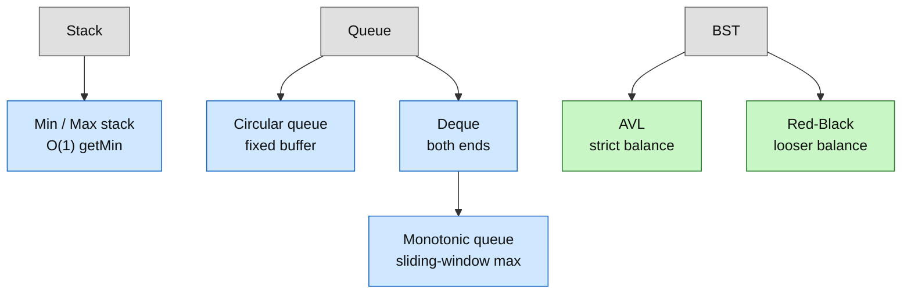

> **Navigation**: [← Data Structures: ALL VARIANTS](02a_DS_Variants_Core.md) | [Chapter index](00_INDEX.md) | [Java Collections: Complete Method… →](03_Collections_Java.md)

---

# 📚 Advanced Data Structure Variants: Stacks, Queues, & Trees

## 💬 Explain It Like a Study Partner — Advanced Variants

> [!TIP]
> **Ask yourself first:** *"How can a stack tell you its minimum in O(1) when finding a minimum normally takes O(n)?"*

### 1. The bottom line

Advanced variants **remember extra information as they go** (a running min, a wrap-around index, a sorted window, a balance rule), so one tricky question becomes cheap to answer.

### 2. The textbook core

- **Min/Max stack:** each entry also stores the min/max so far → `getMin()` is O(1).
- **Circular queue:** indices wrap with `% capacity` → fixed buffer with no wasted space.
- **Deque:** add/remove at both ends in O(1).
- **Monotonic queue:** keeps values in sorted order → sliding-window max/min in **O(n)** total.
- **AVL / red-black trees:** add a balance rule, restored by **rotations**, to keep height O(log n).
- Name the **invariant** first; every operation must preserve it.

### 3. The real-world analogy

A **cashier who keeps a sticky note with the lowest price seen so far**. Every time you scan an item, they update the note. Asking "what's the cheapest so far?" is instant because the answer is already written down.

### 4. Walkthrough: Min Stack with pushes `3, 5, 2`, then a pop

1. `push(3)`: store `(3, min=3)`.
2. `push(5)`: store `(5, min=3)` (the min stays 3).
3. `push(2)`: store `(2, min=2)`.
4. `getMin()` → look at the top entry → **2**, in O(1).
5. `pop()` removes `(2, min=2)`. The top is now `(5, min=3)`, so `getMin()` → **3** without any scan.

> [!NOTE]
> **Quick check:** why does a monotonic queue store indices instead of values? *To know when an element has left the window, and to know its position for the answer array.*

---

## ⚡ At a Glance — Advanced Variants

> [!NOTE]
> **Mental model:** advanced variants *add an invariant* to a basic structure — a running minimum, a fixed capacity, monotonic order, or a balance rule — so that one hard query becomes O(1) or O(log n).

**How to read this diagram.** Each grey base grows into coloured variants. The invariant it adds (shown in the label) is what you should state first when solving a problem with that variant.

| Variant | Invariant | Typical use |
| ------- | --------- | ----------- |
| Min Stack | Each entry knows the min so far | `getMin()` in O(1) |
| Circular queue | Indices wrap with modulo | Ring buffers, streaming |
| Monotonic queue | Values kept in sorted order | Sliding window max/min in O(n) |
| AVL | Balance factor ∈ {−1, 0, +1} | Read-heavy ordered maps |
| Red-Black | Colour rules bound height ≤ 2·log₂(n+1) | Java `TreeMap`, C++ `std::map` |

> [!WARNING]
> Every extra invariant must be restored after *every* mutation. Bugs in rotations and wrap-around indices are the usual failures.

---

## Historical Evolution of Advanced Data Structure Variants

### Timeline: evolution of advanced data structures

| Year | Structure / event | Notes |
| ---- | ----------------- | ----- |
| 1962 | **AVL trees** — Adelson-Velsky and Landis | First self-balancing BST, named after the inventors' initials. |
| 1968 | Knuth's *The Art of Computer Programming* (vol. 1) | Formalizes tree-balancing analysis and establishes O(log n) guarantees as a field standard. |
| 1970s | **Monotonic queue** emerges in computational geometry | Motivation: sliding-window maximum in O(n) versus O(nk) brute force. (The "monotonic queue" is a standard folk technique; it has no single inventor.) |
| 1978 | **Red-Black trees** — Guibas and Sedgewick | Refinement of Bayer's 1972 "symmetric binary B-trees". Adopted by the JDK `TreeMap`. |
| 1980s | **Treaps** — Vuillemin 1980 (Cartesian trees), Aragon–Seidel 1989/1996 | Randomized BST; priorities give expected O(log n) without complex rotation logic. |
| 1985 | **Splay trees** — Sleator and Tarjan | Self-adjusting BST; amortized O(log n); no explicit balance factor. |
| 1989–90 | **Skip lists** — Pugh | Probabilistic layers; a simple alternative to balanced BSTs that is easier to make concurrent (Java `ConcurrentSkipListMap`). |
| 1995 | **Rope** — Boehm, Atkinson and Plass | Balanced-tree string structure for large text editing: O(log n) concatenation and split. |
| 1996 | **LSM-tree** — O'Neil et al. | Log-structured merge-tree for write-heavy workloads. |
| 2000 | **Cache-oblivious B-trees** — Bender, Demaine, Farach-Colton | Optimal across all cache levels without explicit tuning. |
| 2006 | **Bigtable SSTable** — Google | Sorted String Table; foundation of modern key-value storage. |
| 2013 | **Bw-tree** — Microsoft | Latch-free B-tree for multicore; used in SQL Server Hekaton. |
| 2017 | **Learned indexes / SageDB** — Kraska et al. | Replace B-trees with learned models. |
| 2018 | **Learned Bloom filters** — Mitzenmacher | Models combined with Bloom filters for approximate membership. |

**Named Predecessors and Motivations:**

- **Why monotonic queue?** Needed for sliding-window maximum in O(n) instead of the O(nk) brute force. It is a well-known folk technique (a deque of decreasing candidates) rather than the work of a single inventor.

- **Why AVL trees?** Adelson-Velsky and Landis proved that keeping subtree heights within 1 of each other bounds the height by about 1.44·log₂(n+2), a tighter guarantee than the red-black bound of 2·log₂(n+1).

- **Why Treap?** Vuillemin asked: can randomness replace complex rotation rules? Yes — random priorities give expected O(log n) height without any explicit balancing code.

**Modern Production Practice:**

| Structure       | Production Use                                                                                                                                         |
| --------------- | ------------------------------------------------------------------------------------------------------------------------------------------------------ |
| Red-Black Tree  | Java TreeMap ([OpenJDK `TreeMap.java`](https://github.com/openjdk/jdk17/blob/master/src/java.base/share/classes/java/util/TreeMap.java)), C++ std::map |
| ArrayDeque      | Java Deque implementation — resizable array, not linked list                                                                                           |
| Monotonic Queue | Sliding-window max/min in streaming and stock-span style computations                                                                                               |
| Skip List       | Redis sorted sets; ConcurrentSkipListMap in Java                                                                                             |
| B-Tree variants | Most database indexes (PostgreSQL, MySQL InnoDB)                                                                                                       |
| LSM-tree        | RocksDB, Cassandra, LevelDB                                                                                                                            |

---

### 5W1H: Mastering Advanced Data Structure Variants

> [!NOTE]
> **WHAT:** Advanced variants of standard Stacks, Queues, and Trees (e.g., Min Stack, Monotonic Queue, AVL Trees) tailored for specialized problems.
>
> **WHY:** Standard linear processing or sorting often hits O(N) or O(N log N) bottlenecks. Advanced variants exploit structural invariants (like monotonicity or self-balancing) to achieve O(1) or strict O(log N).
>
> **WHO:** Engineers optimizing latency-critical systems or solving hard algorithmic interview questions (e.g., Sliding Window Maximum, LFU Cache).
>
> **WHEN:** Use when naive structures fail constraints—such as needing O(1) minimum retrieval (Min Stack) or O(1) sliding window extremes.
>
> **HOW:** By augmenting standard structures with parallel tracking (e.g., two stacks), deque manipulation, or complex rotation algorithms.

---

## 📚 Topic Pages in This Chapter

This chapter is split into focused pages so each topic can be read on its own. Read them in order the first time; use the table to jump back later.

| # | Page | What is inside | Lines |
| --- | --- | --- | --- |
| 1 | [Production Failure Modes](02b_DS_Variants_Advanced/01_production_failure_modes.md) | Production Failure Modes · 2.1 Min Stack · What Is It? · 2.2 Max Stack | 310 |
| 2 | [Queue Variants](02b_DS_Variants_Advanced/02_queue_variants.md) | Queue Variants | 489 |
| 3 | [Tree Variants](02b_DS_Variants_Advanced/03_tree_variants.md) | Tree Variants | 482 |
| 4 | [Heap Variants](02b_DS_Variants_Advanced/04_heap_variants.md) | Heap Variants · Hash Table Variants · Quick Reference — All Variants · PRACTICE PROBLEMS BY DATA STRUCTURE | 380 |
| 5 | [University-Level Addendum — Advanced Variants as Formal Theory](02b_DS_Variants_Advanced/05_university_level_addendum_advanced_variants_as.md) | University-Level Addendum — Advanced Variants… | 507 |

## CURATED PRACTICE PROBLEMS — DS VARIANTS (Trie, Heap, Segment Tree, etc.)

**HOW TO USE**: These cover advanced data structure variants. Attempt after mastering basic DS.

---

### Section 1: Trie Problems

| #   | Problem                              | Platform | Difficulty | Key Technique                   |
| --- | ------------------------------------ | -------- | ---------- | ------------------------------- |
| 1   | Implement Trie (LC 208)              | LeetCode | Medium     | insert/search/startsWith        |
| 2   | Design Add and Search Words (LC 211) | LeetCode | Medium     | Trie + DFS for '.' wildcard     |
| 3   | Word Search II (LC 212)              | LeetCode | Hard       | Trie + backtracking on grid     |
| 4   | Replace Words (LC 648)               | LeetCode | Medium     | Trie prefix matching            |
| 5   | Map Sum Pairs (LC 677)               | LeetCode | Medium     | Trie with value at nodes        |
| 6   | Longest Word in Dictionary (LC 720)  | LeetCode | Medium     | Trie + BFS/DFS for completeness |

---

### Section 2: Heap / Priority Queue Variants

| #   | Problem                               | Platform | Difficulty | Key Technique             |
| --- | ------------------------------------- | -------- | ---------- | ------------------------- |
| 1   | Kth Largest Element (LC 215)          | LeetCode | Medium     | Min heap of size k        |
| 2   | Top K Frequent Elements (LC 347)      | LeetCode | Medium     | Min heap by frequency     |
| 3   | Find Median from Data Stream (LC 295) | LeetCode | Hard       | Two heaps: max + min      |
| 4   | Merge k Sorted Lists (LC 23)          | LeetCode | Hard       | Min heap of list heads    |
| 5   | Reorganize String (LC 767)            | LeetCode | Medium     | Max heap by frequency     |
| 6   | K Closest Points to Origin (LC 973)   | LeetCode | Medium     | Max heap of size k        |
| 7   | Sliding Window Median (LC 480)        | LeetCode | Hard       | Two heaps + lazy deletion |

---

### Section 3: Monotonic Stack / Monotonic Queue

| #   | Problem                                | Platform | Difficulty | Key Technique                         |
| --- | -------------------------------------- | -------- | ---------- | ------------------------------------- |
| 1   | Next Greater Element I (LC 496)        | LeetCode | Easy       | Classic monotonic stack               |
| 2   | Daily Temperatures (LC 739)            | LeetCode | Medium     | Stack stores indices, decreasing      |
| 3   | Largest Rectangle in Histogram (LC 84) | LeetCode | Hard       | Monotonic stack for left/right bounds |
| 4   | Trapping Rain Water (LC 42)            | LeetCode | Hard       | Stack or two-pointer approach         |
| 5   | Online Stock Span (LC 901)             | LeetCode | Medium     | Stack with (price, span) pairs        |
| 6   | Sliding Window Maximum (LC 239)        | LeetCode | Hard       | Monotonic deque                       |

---

🔬 **Section Challenge — Section 3: Monotonic Stack / Monotonic Queue**

**Challenge 1 (Reasoning):** Monotonic DECREASING stack — when you push a new element, which existing elements are popped and what information do those pops tell you?

Answer

In a decreasing stack (top is smallest), pushing element `x`: all elements smaller than `x` are popped. For each popped element `y`: `x` is the NEXT GREATER ELEMENT of `y`. This is the key insight: the pop event = answer event. Application: Daily Temperatures (next warmer day), Largest Rectangle in Histogram (right boundary), Next Greater Element. Each element is pushed and popped exactly once → O(N) total.

**Challenge 2 (Variant Selection):** You're building a real-time stock price dashboard that displays the rolling 5-minute high and low for 500 tickers. Each ticker updates 10-50 times per second. Which data structure variant would you choose, and why? Justify against the alternatives.

Answer

**Solution:** Monotonic Deque per ticker.

**Analysis of alternatives:**

- Simple Queue: O(n) per update for max/min scan → fails at 50 updates/sec
- Naive Heap: O(log n) per update, but finding BOTH min and max requires two heaps → complexity
- BST (TreeMap): O(log n) for insert and find both min/max, but deletion of arbitrary element requires locating it → O(log n) + O(log n) for lazy deletion
- **Monotonic Deque (two deques)**: One decreasing for max, one increasing for min. Each element pushed/popped at most once → O(1) amortized per update. For 500 tickers × 50 updates = 25,000 ops/sec, this easily fits in a single thread.

> [!TIP]
> **Key insight:** Rolling window problems with explicit eviction (time-based or count-based) are the canonical use case for monotonic queue. The front eviction check (`index < i - k + 1`) handles the window sliding naturally.

**Challenge 3 (Invariant Reasoning):** Given the AVL invariant (|height(L) - height(R)| ≤ 1), prove that the AVL tree height is bounded by 1.44 _ log2(n+1). Why is this tighter than Red-Black's 2 _ log2(n+1) bound, and when does this matter in practice?

Answer

**Proof sketch:** Let N(h) be minimum nodes in an AVL tree of height h. N(0) = 1, N(1) = 2. For h ≥ 2, one child has height h-1 and the other has height at least h-2 (by invariant). So: N(h) = 1 + N(h-1) + N(h-2). This is similar to Fibonacci recurrence. Solving gives N(h) ≈ φ^h / √5 where φ ≈ 1.618. So h ≤ log_φ(n) ≈ 1.44 \* log2(n).

**Why tighter bound matters:**

- AVL: max height ≈ 1.44 \* log2(n) — better for search-heavy workloads
- Red-Black: max height ≤ 2 \* log2(n) — looser but fewer rotations

**When AVL is better:** Database indexes where 99% of operations are reads. The 28% height reduction (1.44 vs 2.0) directly translates to fewer cache misses on B-tree leaf traversals.

**When Red-Black wins:** Write-heavy logs where inserts outnumber reads 10:1. The 2x rotation cost on insert/delete (Red-Black) vs AVL is offset by AVL's stricter rebalancing requirements.

### HIDDEN GEMS — DS Variants

| #   | Problem                                      | Platform | Why It's Valuable                          |
| --- | -------------------------------------------- | -------- | ------------------------------------------ |
| 1   | Maximum Frequency Stack (LC 895)             | LeetCode | Stack per frequency — creative DS combo    |
| 2   | Stock Price Fluctuation (LC 2034)            | LeetCode | TreeMap + HashMap design                   |
| 3   | All O`one Data Structure (LC 432)            | LeetCode | Doubly linked list + HashMap (hard design) |
| 4   | Range Sum Query - Mutable (LC 307)           | LeetCode | Segment tree or BIT                        |
| 5   | Count of Smaller Numbers After Self (LC 315) | LeetCode | Merge sort or BIT — teaches augmented DS   |

---

---

## Reality Check

> [!CAUTION]
> **Myth:** "Skip list is just a linked list with shortcuts"
>
> **Reality:** Structurally yes — multiple layers of linked lists where higher layers skip over more elements. The key insight: the skip structure is probabilistic. Each node at level i is promoted to level i+1 with probability p (typically 1/2). This gives O(log n) expected height, O(log n) expected search/insert/delete without complex rotations. Redis uses skip lists for sorted sets because they're simpler to implement than balanced BSTs, support efficient range queries, and are easy to make lock-free for concurrent access.

> [!CAUTION]
> **Myth:** "Bloom filter false positive rate is fixed at design time"
>
> **Reality:** You choose the false positive rate when sizing the filter: given n (expected elements) and p (target false positive rate), compute m (bits) = `-n * ln(p) / ln(2)²` and k (hash functions) = `m/n * ln(2)`. Lower false positive rate = more bits. You cannot change the false positive rate after construction without rebuilding the filter. After inserting more than n elements, the actual false positive rate rises above the design p. Scalable Bloom Filters chain multiple Bloom filters to handle growth while maintaining a bounded false positive rate.

> [!CAUTION]
> **Myth:** "LRU cache can be implemented efficiently with just a HashMap"
>
> **Reality:** HashMap gives O(1) lookup but O(n) for eviction (you'd need to find the least recently used item). Efficient LRU = HashMap + doubly-linked list: HashMap maps key → node, doubly-linked list maintains LRU order (head = MRU, tail = LRU). Eviction: remove the tail node in O(1), remove from HashMap in O(1). Access: move the accessed node to head in O(1). All operations O(1). Java's `LinkedHashMap` with access-order mode does this internally, giving you a ready-made LRU eviction mechanism.

> [!CAUTION]
> **Myth:** "Suffix arrays are just sorted lists of suffixes"
>
> **Reality:** A suffix array is an array of starting indices of all suffixes, sorted lexicographically. The naive construction (sort all n suffixes) is O(n² log n). SA-IS (Suffix Array induced sorting) builds it in O(n). Combined with an LCP array (Longest Common Prefix between adjacent sorted suffixes), suffix arrays enable: O(m log n) pattern matching (binary search on sorted suffixes), longest repeated substring (max LCP value), number of distinct substrings (n*(n+1)/2 - sum of LCP array). Used in bioinformatics (genome alignment) and data compression.

> [!CAUTION]
> **Myth:** "Wavelet tree is a theoretical data structure with no practical use"
>
> **Reality:** Wavelet trees answer: k-th smallest in a range O(log n), count of elements ≤ v in a range O(log n), rank and select queries. Used in: databases (column store range queries), competitive programming, text compression (BWT + wavelet tree for FM-index — used in genome sequencing aligners like BWA and Bowtie). The FM-index powers DNA sequence alignment in bioinformatics — processing terabytes of genomic data. Wavelet trees are a production data structure in specialised domains.
