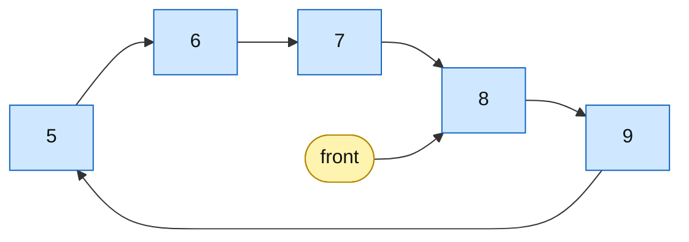
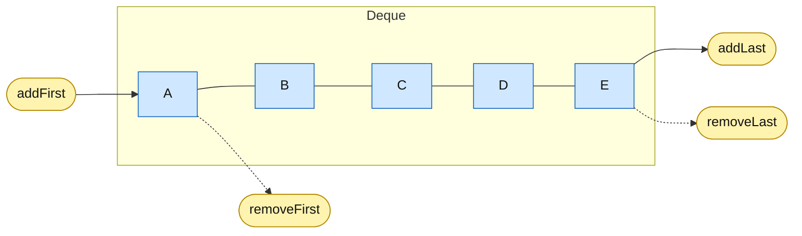

# 📬 Part 3: Queue Variants

> **Navigation**: [← Production Failure Modes](01_production_failure_modes.md) | [Chapter overview](../02b_DS_Variants_Advanced.md) | [Tree Variants →](03_tree_variants.md)
> Page 2 of 5 in **Advanced Data Structure Variants: Stacks, Queues, & Trees**


## 3.1 Circular Queue

### 💬 Study-Partner View — Circular Queue

**1. The bottom line:** A queue stored in a fixed array whose indices wrap around, so freed space at the front is reused.

**2. The textbook core:**

- Keep `front`, `rear` and `size` (or leave one slot empty) to tell full from empty.
- Wrap with modulo: `rear = (rear + 1) % capacity`.
- `enqueue`, `dequeue`, `peek`: **O(1)**; capacity is fixed unless you resize.
- Avoids the "wasted front space" of a naive array queue.

**3. The real-world analogy:** A **revolving sushi belt**: plates circle forever, and you place a new plate where a taken one used to be.

**4. Walkthrough:**

1. Capacity 5, queue `[A, B, C]` with `front = 0`, `rear = 3`.
2. Dequeue `A` → `front = 1`; dequeue `B` → `front = 2`.
3. Enqueue `D`, `E`, `F`: `rear` goes 3 → 4 → 0 → 1 (wrapping), so `F` lands at index 1.
4. Full when `size == capacity`.

> [!NOTE]
> **Quick check:** How do you tell full from empty when `front == rear`? *Keep a `size` counter or sacrifice one slot.*


### Circular queue - complete guide

#### What is it

A queue implemented using a circular array.
When we reach the end of the array, we wrap around to the beginning!

WHY CIRCULAR?

**Linear queue problem:**

After many enqueue/dequeue operations the front has moved right, and the cells before it can never be reused:

| Index | 0 | 1 | 2 | 3 | 4 | 5 | 6 | 7 |
| --- | --- | --- | --- | --- | --- | --- | --- | --- |
| Value | _ | _ | _ | _ | 5 | 6 | 7 | _ |
| Marker | | | | | front | | | rear |

Wasted space at the beginning.

**Circular queue solution:**

When `rear` reaches the end it wraps around to index 0 and reuses the empty cells:

| Index | 0 | 1 | 2 | 3 | 4 | 5 | 6 |
| --- | --- | --- | --- | --- | --- | --- | --- |
| Value | 8 | 9 | _ | _ | 5 | 6 | 7 |
| Marker | | | rear | | front | | |

VISUAL (as a circle):



**How to read this diagram.** The buffer is a ring: after the last slot the index wraps to the first, so freed slots at the start are reused instead of wasted.


```
REAL-WORLD APPLICATIONS:

1. CPU SCHEDULING (Round Robin):
   Processes wait in circular queue
   Each gets a time slice, then goes to end

2. MEMORY MANAGEMENT:
   Buffer pools in databases
   Connection pools in web servers

3. AUDIO/VIDEO STREAMING:
   Circular buffer for smooth playback
   Producer writes, consumer reads

4. KEYBOARD BUFFER:
   Stores keystrokes
   Old keystrokes overwritten if buffer full
```


```java
// CIRCULAR QUEUE IMPLEMENTATION
public class CircularQueue<T> {
    private Object[] data;
    private int front;
    private int rear;
    private int size;
    private int capacity;

    public CircularQueue(int capacity) {
        this.capacity = capacity;
        this.data = new Object[capacity];
        this.front = 0;
        this.rear = -1;
        this.size = 0;
    }

    // Enqueue - O(1)
    public boolean enqueue(T item) {
        if (isFull()) {
            return false;  // Queue is full
        }

        rear = (rear + 1) % capacity;  // Circular increment
        data[rear] = item;
        size++;
        return true;
    }

    // Dequeue - O(1)
    @SuppressWarnings("unchecked")
    public T dequeue() {
        if (isEmpty()) {
            throw new RuntimeException("Queue is empty");
        }

        T item = (T) data[front];
        front = (front + 1) % capacity;  // Circular increment
        size--;
        return item;
    }

    // Peek - O(1)
    @SuppressWarnings("unchecked")
    public T peek() {
        if (isEmpty()) {
            throw new RuntimeException("Queue is empty");
        }
        return (T) data[front];
    }

    public boolean isEmpty() {
        return size == 0;
    }

    public boolean isFull() {
        return size == capacity;
    }

    public int size() {
        return size;
    }
}
```

---

## 3.2 Deque (Double-Ended Queue)

### 💬 Study-Partner View — Deque

**1. The bottom line:** A queue you can add to or remove from at **both** ends, so it can act as a stack, a queue, or both.

**2. The textbook core:**

- Operations: `addFirst`, `addLast`, `removeFirst`, `removeLast`, `peekFirst`, `peekLast`, all **O(1)**.
- Implemented as a circular array (`ArrayDeque`) or a doubly linked list.
- Use as a stack (push/pop one end), a queue (add one end, remove the other), or a sliding window.
- `ArrayDeque` does not allow `null` elements.

**3. The real-world analogy:** A **line at a ticket counter where people can join or leave from either end**: VIPs go to the front, people giving up leave from the back.

**4. Walkthrough:**

1. Start empty. `addLast(1)`, `addLast(2)` → `[1, 2]`.
2. `addFirst(0)` → `[0, 1, 2]`.
3. `removeLast()` → returns 2, leaving `[0, 1]`.
4. `removeFirst()` → returns 0, leaving `[1]`.

> [!NOTE]
> **Quick check:** Which Java class should you use? *`ArrayDeque` for both stack and queue use cases.*


### Deque - complete guide

#### What is it

A queue where you can add/remove from BOTH ends in O(1)!

**Visual:** 



**How to read this diagram.** Elements can be added to or removed from **both** ends in O(1).

**Operations:** 

- addFirst(x)    - Add to front
- addLast(x)     - Add to back
- removeFirst()  - Remove from front
- removeLast()   - Remove from back
- peekFirst()    - See front
- peekLast()     - See back

ALL OPERATIONS ARE O(1)!

DEQUE = STACK + QUEUE

- Can use as stack (addFirst/removeFirst)
- Can use as queue (addLast/removeFirst)


```
REAL-WORLD APPLICATIONS:

1. BROWSER HISTORY:
   - Add new pages to front
   - Can go back (from front)
   - Can go forward (from back)

2. UNDO/REDO WITH LIMIT:
   - Add new action to front
   - If too many, remove from back
   - Undo = remove from front

3. SLIDING WINDOW MAXIMUM:
   - Deque stores indices
   - Remove from front (out of window)
   - Remove from back (smaller elements)
   - Add to back (new elements)

4. PALINDROME CHECKING:
   - Add all characters
   - Compare front and back
   - Remove both if equal
```


```java
// DEQUE IMPLEMENTATION USING CIRCULAR ARRAY
public class MyDeque<T> {
    private Object[] data;
    private int front;
    private int rear;
    private int size;
    private int capacity;

    public MyDeque(int capacity) {
        this.capacity = capacity;
        this.data = new Object[capacity];
        this.front = 0;
        this.rear = capacity - 1;
        this.size = 0;
    }

    // Add to front - O(1)
    public boolean addFirst(T item) {
        if (isFull()) return false;

        front = (front - 1 + capacity) % capacity;  // Move front back
        data[front] = item;
        size++;
        return true;
    }

    // Add to back - O(1)
    public boolean addLast(T item) {
        if (isFull()) return false;

        rear = (rear + 1) % capacity;  // Move rear forward
        data[rear] = item;
        size++;
        return true;
    }

    // Remove from front - O(1)
    @SuppressWarnings("unchecked")
    public T removeFirst() {
        if (isEmpty()) throw new RuntimeException("Deque is empty");

        T item = (T) data[front];
        front = (front + 1) % capacity;
        size--;
        return item;
    }

    // Remove from back - O(1)
    @SuppressWarnings("unchecked")
    public T removeLast() {
        if (isEmpty()) throw new RuntimeException("Deque is empty");

        T item = (T) data[rear];
        rear = (rear - 1 + capacity) % capacity;
        size--;
        return item;
    }

    @SuppressWarnings("unchecked")
    public T peekFirst() {
        if (isEmpty()) throw new RuntimeException("Deque is empty");
        return (T) data[front];
    }

    @SuppressWarnings("unchecked")
    public T peekLast() {
        if (isEmpty()) throw new RuntimeException("Deque is empty");
        return (T) data[rear];
    }

    public boolean isEmpty() { return size == 0; }
    public boolean isFull() { return size == capacity; }
    public int size() { return size; }
}
```

---

## 3.3 Monotonic Queue

### 💬 Study-Partner View — Monotonic Queue

**1. The bottom line:** A deque that keeps its values in sorted order by throwing away items that can never be the answer.

**2. The textbook core:**

- Store **indices**; keep values monotonically decreasing (for max) from front to back.
- Before pushing `i`, pop from the back while `nums[back] <= nums[i]` (they are dominated).
- Pop from the front when its index leaves the window.
- Each element enters and leaves at most once → **O(n)** total for sliding-window max/min.

**3. The real-world analogy:** A **queue of job candidates where a newer, stronger candidate makes weaker earlier ones irrelevant**. Once someone better and younger arrives, the weaker ones can never win.

**4. Walkthrough:**

1. `nums = [1, 3, -1, -3, 5]`, window size 3.
2. Add 1 → `[1]`; add 3 → pop 1 (smaller) → `[3]`; add -1 → `[3, -1]`. Max = 3.
3. Add -3 → `[3, -1, -3]`. Max = 3.
4. Add 5 → pop -3, -1, 3 → `[5]`; the window moved so 3 would have expired anyway. Max = 5.

> [!NOTE]
> **Quick check:** Why store indices, not values? *To know when the front has left the window.*


### Monotonic queue - complete guide

#### What is it

A deque that maintains elements in MONOTONIC order
(either increasing or decreasing).

MONOTONIC DECREASING QUEUE (for finding max):

- Elements from front to back: 8 > 6 > 5 > 3
- Front is always the maximum!

MONOTONIC INCREASING QUEUE (for finding min):

- Elements from front to back: 2 < 4 < 7 < 9
- Front is always the minimum!

HOW IT WORKS (Decreasing for max):
When adding element x:

1. Remove all elements from BACK that are smaller than x
2. Add x to back
3. Front is always the current maximum

WHY? Elements smaller than x will NEVER be the max while x exists!

**Key use case:** Sliding Window Maximum/Minimum in O(n)!

**INVARIANT (Monotonic Decreasing Queue for Sliding Window Max):**
```

For window [i-k+1, i] with deque D (stores indices):

1. D.front() is always the index of current maximum
2. Indices in D are strictly increasing (insertion order preserved)
3. If D.front() < i-k+1: element has left window → pop_front()
4. Before inserting index i: while D.back() has nums[D.back()] <= nums[i]: pop_back()
   (All smaller elements are dominated by i and will never be max while i exists)

```

```
EXAMPLE - SLIDING WINDOW MAXIMUM:
Array: [1, 3, -1, -3, 5, 3, 6, 7], Window size: 3

Window [1,3,-1]:
  Deque state: [3, -1]  (1 removed because 3 > 1)
  Max = 3

Window [3,-1,-3]:
  Deque state: [3, -1, -3]
  Max = 3

Window [-1,-3,5]:
  Deque state: [5]  (all removed because 5 > all)
  Max = 5

...and so on
```


```java
// SLIDING WINDOW MAXIMUM USING MONOTONIC QUEUE
public class MonotonicQueue {

    // Returns array of maximums for each window
    public int[] maxSlidingWindow(int[] nums, int k) {
        if (nums == null || nums.length == 0) return new int[0];

        int n = nums.length;
        int[] result = new int[n - k + 1];
        Deque<Integer> deque = new LinkedList<>();  // Stores INDICES

        for (int i = 0; i < n; i++) {
            // Remove indices outside window
            while (!deque.isEmpty() && deque.peekFirst() < i - k + 1) {
                deque.pollFirst();
            }

            // Remove indices of smaller elements (they'll never be max)
            while (!deque.isEmpty() && nums[deque.peekLast()] < nums[i]) {
                deque.pollLast();
            }

            // Add current index
            deque.offerLast(i);

            // Window is complete, record max
            if (i >= k - 1) {
                result[i - k + 1] = nums[deque.peekFirst()];
            }
        }

        return result;
    }
}
```


> [!TIP]
> **🧠 Interview key points — Monotonic Queue**
>
>
> 1. **"When to use Monotonic Queue?"**
>    - Sliding window min/max problems
>    - Find next greater/smaller element
>    - Stock span problems
>
> 2. **"Time Complexity?"**
>    - O(n) overall
>    - Each element added/removed at most once
>
> 3. **"Why store indices instead of values?"**
>    - To check if element is within window
>    - To know position for result array


---

🔬 **Section Challenge — 3.3 Monotonic Queue**

**Challenge 1 (Reasoning):** In the Sliding Window Maximum implementation, the monotonic queue stores INDICES, not values. Why is this necessary? What breaks if you store values instead?

<details><summary>Answer</summary>

You must know whether an element is INSIDE the current window. The window is defined by index range `[i-k+1, i]`. When `deque.peekFirst()` returns an index, you can check `index < i - k + 1` to determine if it's expired. If you stored values, you'd have no way to know WHICH occurrence of that value you're looking at, or whether it's inside the window. Example: `[3, 1, 3, ...], k=2`. Both `3`s have the same value but only one is in the current window. Storing indices lets you distinguish them. The deque front eviction check (`deque.peekFirst() < i - k + 1`) is the mechanism that makes the sliding window "slide" — without indices, it's impossible.

</details>

**Challenge 2 (Reasoning):** Monotonic Queue achieves O(n) total for n elements, but individual operations seem to do variable work (some pushes pop multiple elements). Prove the O(n) amortized bound.

<details><summary>Answer</summary>

Use the potential method / accounting argument: each element is pushed into the deque exactly ONCE and popped from the deque at most ONCE (either via back-eviction when a larger element arrives, or via front-eviction when it leaves the window). So across all n elements: at most n pushes + at most n pops = 2n total operations. Even though one `offerLast()` might trigger 5 `pollLast()` calls, those 5 elements will never be popped again. Total work across the entire array is Θ(n), giving O(1) amortized per element.

</details>

---

[← Production Failure Modes](01_production_failure_modes.md) | [Chapter overview](../02b_DS_Variants_Advanced.md) | [Tree Variants →](03_tree_variants.md)
