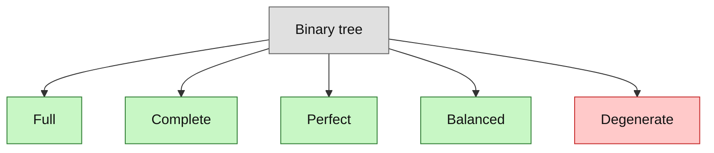
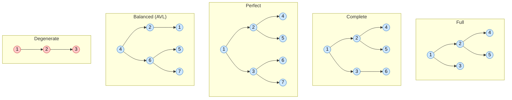
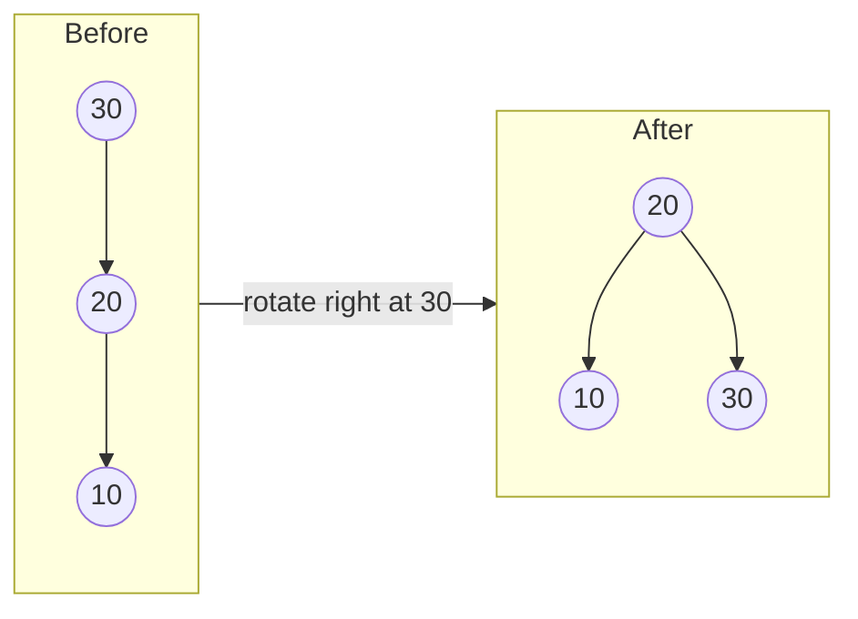
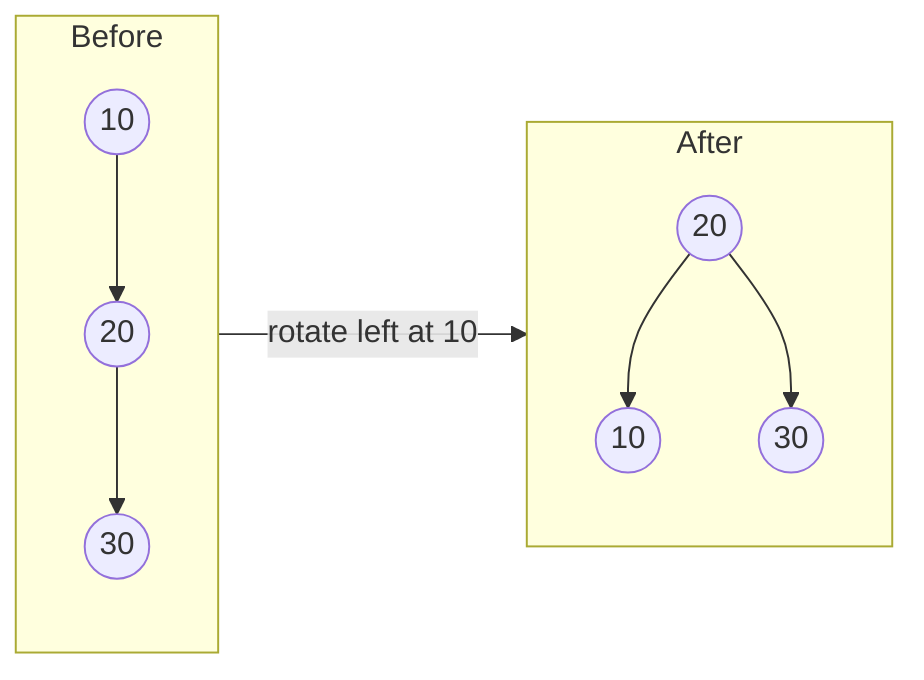
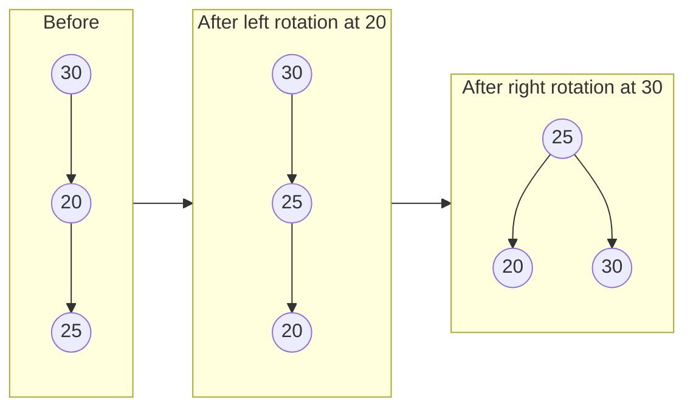
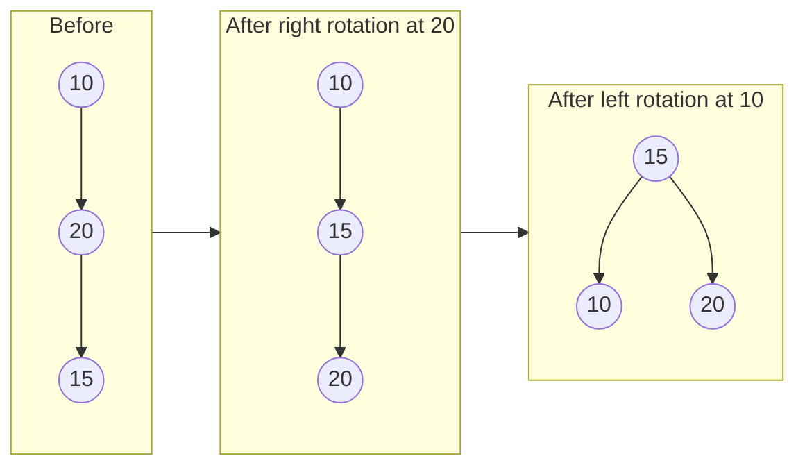
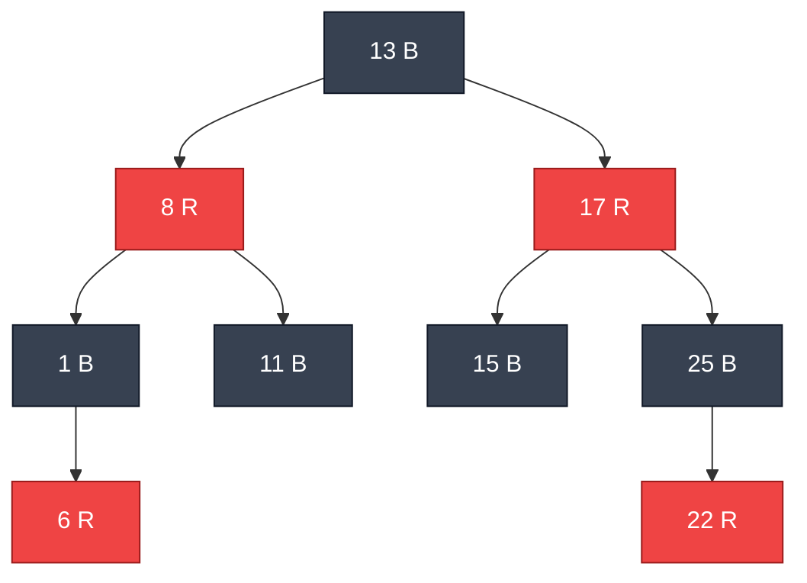

# 🌳 Part 4: Tree Variants

> **Navigation**: [← Queue Variants](02_queue_variants.md) | [Chapter overview](../02b_DS_Variants_Advanced.md) | [Heap Variants →](04_heap_variants.md)
> Page 3 of 5 in **Advanced Data Structure Variants: Stacks, Queues, & Trees**


## 4.1 Binary Tree Types

### 💬 Study-Partner View — Binary Tree Types

**1. The bottom line:** Binary trees come in named shapes (full, complete, perfect, balanced, degenerate), and the shape decides how fast they are.

**2. The textbook core:**

- **Full:** every node has 0 or 2 children. **Complete:** all levels filled except maybe the last, which fills left to right. **Perfect:** all internal nodes have 2 children and all leaves share a level.
- **Balanced:** left and right heights differ by at most 1 (AVL) or are otherwise bounded.
- **Degenerate:** each node has one child, which is effectively a linked list.
- Height `h` drives cost: perfect tree has `h = log₂(n+1) - 1`; degenerate has `h = n - 1`.

**3. The real-world analogy:** **Shapes of a family tree**: a tidy, evenly branching tree lets you find anyone quickly; a single long line of ancestors takes forever to walk.

**4. Walkthrough:**

1. Insert 1, 2, 3, 4, 5 in sorted order into a plain BST.
2. Every new key goes right, so the tree is a chain of height 4.
3. Insert the same keys in the order 3, 2, 4, 1, 5 and the tree is perfectly balanced (height 2).
4. Same data, different shape: search cost is O(n) versus O(log n).

> [!NOTE]
> **Quick check:** Which shape do binary heaps use? *Complete, which is why they fit in an array.*


### Binary tree variants overview



**How to read this diagram.** The five types branch off the general binary tree; green types have well-behaved height, the red degenerate type does not.

| Type | Rule | Example |
| ---- | ---- | ------- |
| **Full** | Every node has 0 or 2 children (never 1) | `1` → `2, 3`; `2` → `4, 5` |
| **Complete** | All levels filled except possibly the last; last level filled as far **left** as possible | `1` → `2, 3`; `2` → `4, 5`; `3` → `6` |
| **Perfect** | All internal nodes have 2 children and all leaves are at the same level | `1` → `2, 3`; `2` → `4, 5`; `3` → `6, 7` |
| **Balanced** | Heights of the left and right subtrees differ by at most 1 (AVL is strictly balanced) | `4` → `2, 6`; `2` → `1`; `6` → `5, 7` |
| **Degenerate** | Each parent has only one child: essentially a linked list | `1` → `2` → `3` (all on one side) |

Visual examples:



**How to read this diagram.** Each box draws one tree type from the table. Blue trees keep their height near log n; the red degenerate tree is a chain with height n.


> 🔬 **Section Challenge — 4.1 Binary Tree Types**
>
> **Challenge 1 (Design):** A developer decides to use a strictly "Perfect Binary Tree" to store exactly 1 million user records, assuming it will provide the ultimate balanced `O(log N)` search time. Why is this structurally impossible, and what Tree variant should they use instead?
>
> <details><summary>Answer</summary>
>
> **Scenario:** Selecting the correct tree invariant for arbitrary dataset sizes.
> **Trace:** A Perfect Binary Tree requires every internal node to have 2 children, and all leaves must be on the exact same level. Mathematically, a perfect tree of height `h` contains exactly `2^(h+1) - 1` nodes.
> **Debug/Fix:** You cannot build a Perfect tree with exactly 1,000,000 nodes. The closest perfect tree sizes are 524,287 nodes (height 18) and 1,048,575 nodes (height 19). If you try to force 1,000,000 nodes into this shape, you will have empty spaces on the bottom level, which immediately turns it into a **Complete Binary Tree** (if filled strictly left-to-right) or just a general **Balanced Binary Tree** (like an AVL or Red-Black Tree). This is why "Perfect" trees are mostly theoretical, while "Complete" and "Balanced" trees are the production standard.
>
> </details>

## 4.2 AVL Tree (Self-Balancing BST)

### 💬 Study-Partner View — AVL Tree

**1. The bottom line:** A binary search tree that fixes itself with rotations whenever one side gets more than one level taller than the other.

**2. The textbook core:**

- Invariant: for every node, `|height(left) - height(right)| <= 1`.
- Balance factor = `height(left) - height(right)`; allowed values are -1, 0, +1.
- Four rebalancing cases: LL (right rotation), RR (left rotation), LR and RL (double rotations).
- Height ≤ about 1.44·log₂(n); search/insert/delete are **O(log n)** worst case.

**3. The real-world analogy:** A **seesaw that corrects itself**: whenever one side hangs too low, the arrangement is shifted so both sides are almost level.

**4. Walkthrough:**

1. Insert 10, 20, 30 into an empty AVL tree.
2. After 30, the node 10 has balance factor -2 (right-right heavy).
3. Apply a **left rotation** at 10: 20 becomes the root with children 10 and 30.
4. The tree is balanced again with height 1.

> [!NOTE]
> **Quick check:** AVL or red-black for a read-heavy workload? *AVL, because it is more strictly balanced and lookups are shallower.*


### Avl tree - complete guide

#### What is it

A self-balancing Binary Search Tree where:

- For EVERY node: |height(left) - height(right)| ≤ 1

**Invented:** 1962 by Adelson-Velsky and Landis

**Why balance matters:** 

Unbalanced BST: O(n) worst case (degenerates to linked list)
Balanced AVL:   O(log n) GUARANTEED for all operations!

BALANCE FACTOR = height(left) - height(right)

- Valid values: -1, 0, +1
- If BF becomes -2 or +2, we ROTATE!

**INVARIANT (AVL Tree — Strict Balance):**
```

For every node N in the tree:
|height(N.left) - height(N.right)| ≤ 1

Implications:

- Height is bounded by 1.44 \* log2(n+1)
- search(), insert(), delete() are all O(log n) guaranteed
- More rotations on insert/delete than Red-Black (strictness cost)

```

#### ROTATIONS (The Key to Balance)

There are four cases of imbalance. Each diagram shows the tree before and after the fix.

**1. Left-left (LL) → single right rotation**



**How to read this diagram.** Arrows show the direction of flow from one step or component to the next.

**2. Right-right (RR) → single left rotation**



**How to read this diagram.** Arrows show the direction of flow from one step or component to the next.

**3. Left-right (LR) → left rotation at the child, then right rotation at the root**



**How to read this diagram.** Arrows show the direction of flow from one step or component to the next.

**4. Right-left (RL) → right rotation at the child, then left rotation at the root**



**How to read these diagrams.** Arrows inside a box point from parent to child, drawn left-heavy or right-heavy exactly as the tree leans. The arrow between boxes is the rotation. Every case ends with the middle value of the three nodes at the top.


```java
// AVL TREE IMPLEMENTATION
public class AVLTree {

    private class Node {
        int key, height;
        Node left, right;

        Node(int key) {
            this.key = key;
            this.height = 1;
        }
    }

    private Node root;

    // Get height of node
    private int height(Node node) {
        return node == null ? 0 : node.height;
    }

    // Get balance factor
    private int getBalance(Node node) {
        return node == null ? 0 : height(node.left) - height(node.right);
    }

    // Update height
    private void updateHeight(Node node) {
        node.height = 1 + Math.max(height(node.left), height(node.right));
    }

    // Right rotation (for LL case)
    private Node rightRotate(Node y) {
        Node x = y.left;
        Node T2 = x.right;

        // Rotate
        x.right = y;
        y.left = T2;

        // Update heights
        updateHeight(y);
        updateHeight(x);

        return x;  // New root
    }

    // Left rotation (for RR case)
    private Node leftRotate(Node x) {
        Node y = x.right;
        Node T2 = y.left;

        // Rotate
        y.left = x;
        x.right = T2;

        // Update heights
        updateHeight(x);
        updateHeight(y);

        return y;  // New root
    }

    // Insert
    public void insert(int key) {
        root = insertRec(root, key);
    }

    private Node insertRec(Node node, int key) {
        // 1. Standard BST insert
        if (node == null) return new Node(key);

        if (key < node.key) {
            node.left = insertRec(node.left, key);
        } else if (key > node.key) {
            node.right = insertRec(node.right, key);
        } else {
            return node;  // Duplicate keys not allowed
        }

        // 2. Update height
        updateHeight(node);

        // 3. Get balance factor
        int balance = getBalance(node);

        // 4. If unbalanced, there are 4 cases:

        // Left Left Case
        if (balance > 1 && key < node.left.key) {
            return rightRotate(node);
        }

        // Right Right Case
        if (balance < -1 && key > node.right.key) {
            return leftRotate(node);
        }

        // Left Right Case
        if (balance > 1 && key > node.left.key) {
            node.left = leftRotate(node.left);
            return rightRotate(node);
        }

        // Right Left Case
        if (balance < -1 && key < node.right.key) {
            node.right = rightRotate(node.right);
            return leftRotate(node);
        }

        return node;  // Balanced
    }

    // Delete
    public void delete(int key) {
        root = deleteRec(root, key);
    }

    private Node deleteRec(Node node, int key) {
        // 1. Standard BST delete
        if (node == null) return null;

        if (key < node.key) {
            node.left = deleteRec(node.left, key);
        } else if (key > node.key) {
            node.right = deleteRec(node.right, key);
        } else {
            // Node to delete found
            if (node.left == null || node.right == null) {
                node = (node.left != null) ? node.left : node.right;
            } else {
                // Find inorder successor
                Node temp = minValueNode(node.right);
                node.key = temp.key;
                node.right = deleteRec(node.right, temp.key);
            }
        }

        if (node == null) return null;

        // 2. Update height
        updateHeight(node);

        // 3. Rebalance
        int balance = getBalance(node);

        // Left Left
        if (balance > 1 && getBalance(node.left) >= 0) {
            return rightRotate(node);
        }

        // Left Right
        if (balance > 1 && getBalance(node.left) < 0) {
            node.left = leftRotate(node.left);
            return rightRotate(node);
        }

        // Right Right
        if (balance < -1 && getBalance(node.right) <= 0) {
            return leftRotate(node);
        }

        // Right Left
        if (balance < -1 && getBalance(node.right) > 0) {
            node.right = rightRotate(node.right);
            return leftRotate(node);
        }

        return node;
    }

    private Node minValueNode(Node node) {
        Node current = node;
        while (current.left != null) {
            current = current.left;
        }
        return current;
    }
}
```

---

## 4.3 Red-Black Tree

### 💬 Study-Partner View — Red-Black Tree

**1. The bottom line:** A self-balancing BST that uses node colours instead of exact heights, trading perfect balance for fewer rotations.

**2. The textbook core:**

- Rules: nodes are red or black; the root is black; red nodes have only black children; every root-to-null path has the same number of black nodes.
- These rules force height ≤ 2·log₂(n+1), so operations are **O(log n)**.
- Insert and delete need at most a constant number of rotations plus recolouring.
- Used by Java `TreeMap`/`TreeSet`, C++ `std::map`, and the Linux scheduler (CFS).

**3. The real-world analogy:** A **traffic-light system for balance**: colours tell you when a branch is getting too long, and a few quick recolourings or rotations restore order.

**4. Walkthrough:**

1. Insert a new node; colour it **red**.
2. If its parent is black, you are done (no rule is broken).
3. If the parent and the uncle are both red, recolour them black and the grandparent red, then check upward.
4. If the uncle is black, rotate (and possibly recolour) to restore the rules.

> [!NOTE]
> **Quick check:** Why does red-black rebalance less often than AVL? *Its balance rule is looser, so it tolerates taller trees (up to 2× the minimum height).*


### Red-black tree - complete guide

#### What is it

A self-balancing BST where each node has a COLOR (Red or Black)

**Invented:** 1972 by Rudolf Bayer (as "symmetric binary B-trees")

**Refined:** 1978 by Leonidas Guibas and Robert Sedgewick

**Properties (must all be true):** 

1. Every node is either RED or BLACK
2. Root is always BLACK
3. Every leaf (NIL) is BLACK
4. If node is RED, both children must be BLACK (no red-red parent-child)
5. Every path from node to descendant NIL has same number of black nodes

**Visual:** 



**How to read this diagram.** Dark nodes are black, red nodes are red. Every path from the root to an empty child passes through two black nodes (13 and one of 1, 11, 15, 25), and no red node has a red child.

#### AVL vs RED-BLACK

| Property | AVL Tree | Red-Black Tree |
| -------- | -------- | -------------- |
| Balance strictness | Strictly balanced | Loosely balanced |
| Search | O(log n) | O(log n) |
| Insert | Slower (more rotations) | Faster (fewer rotations) |
| Delete | Slower | Faster |
| Height | ≤ 1.44 · log₂(n) | ≤ 2 · log₂(n+1) |
| Used in | Read-heavy indexes | Java `TreeMap`, C++ `std::map` |

**When to use:** 

- AVL: Lookup-heavy applications (more balanced = faster search)
- RB: Insert/Delete-heavy (fewer rotations = faster modifications)


> [!TIP]
> **🧠 Interview key points — Tree Variants**
>
>
> 1. **"Difference between AVL and Red-Black?"**
>    - AVL: More balanced, better for lookups
>    - RB: Less rotations, better for inserts/deletes
>    - Both guarantee O(log n)
>
> 2. **"Which does Java TreeMap use?"**
>    - Red-Black Tree
>
> 3. **"When is BST O(n)?"**
>    - When degenerate (sorted insert)
>    - Solution: Use self-balancing trees
>
> 4. **"What's balance factor in AVL?"**
>    - height(left) - height(right)
>    - Must be -1, 0, or 1

---

[← Queue Variants](02_queue_variants.md) | [Chapter overview](../02b_DS_Variants_Advanced.md) | [Heap Variants →](04_heap_variants.md)
