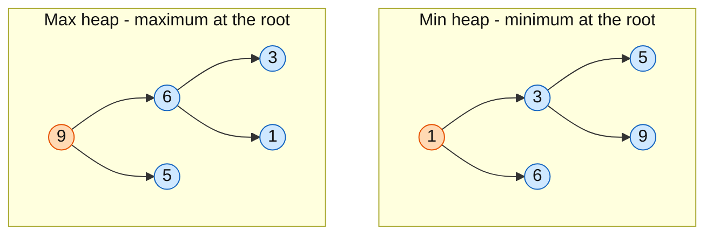

# 📦 Part 5: Heap Variants

> **Navigation**: [← Tree Variants](03_tree_variants.md) | [Chapter overview](../02b_DS_Variants_Advanced.md) | [University-Level Addendum — Advanced… →](05_university_level_addendum_advanced_variants_as.md)
> Page 4 of 5 in **Advanced Data Structure Variants: Stacks, Queues, & Trees**


## 💬 Study-Partner View — Heap Variants

**1. The bottom line:** Heaps keep the best element on top; the variants differ in how many children a node has and how cheaply they can merge or lower a key.

**2. The textbook core:**

- **Binary heap:** array-based, `insert`/`extractMin` O(log n), `peek` O(1), build in O(n).
- **d-ary heap:** `d` children per node → shallower tree, faster `decreaseKey` (useful in Dijkstra).
- **Binomial heap:** merge in O(log n). **Fibonacci heap:** amortized O(1) insert/decreaseKey/merge, but complex and slow constants in practice.
- Min-heap: parent ≤ children; max-heap: parent ≥ children.

**3. The real-world analogy:** A **tournament bracket** where the champion is always at the top: a d-ary heap is a bracket with more teams per match, so it has fewer rounds.

**4. Walkthrough:**

1. Min-heap array `[1, 3, 6, 5, 9]`; `insert(2)`.
2. Append at the end: `[1, 3, 6, 5, 9, 2]`; parent of index 5 is `(5-1)/2 = 2` (value 6).
3. 2 < 6 → swap: `[1, 3, 2, 5, 9, 6]`. Parent of index 2 is 1; 2 > 1 → stop.
4. Cost: at most `log n` swaps.

> [!NOTE]
> **Quick check:** Which heap makes Dijkstra fastest in theory? *The Fibonacci heap, O(E + V log V), though binary or d-ary heaps usually win in practice.*


## Heap variants — complete guide

**Heap types**

| # | Type | Rule / property | Notes |
| - | ---- | --------------- | ----- |
| 1 | **Min heap** | Parent ≤ children | Minimum at the root |
| 2 | **Max heap** | Parent ≥ children | Maximum at the root |
| 3 | **Binary heap** | Complete binary tree | The most common kind |
| 4 | **D-ary heap** | Each node has D children (not just 2) | Shallower tree; used to optimize Dijkstra's algorithm |
| 5 | **Fibonacci heap** | Amortized O(1) for many operations | Used in advanced graph algorithms; complex to implement |
| 6 | **Binomial heap** | Collection of binomial trees | Efficient merge: O(log n) |



**How to read this diagram.** In the min heap every parent is ≤ its children; in the max heap every parent is ≥ its children. The orange node is the root, which is always the extreme value.

**Array representation of a binary heap** — for the node at index `i`:

- Parent: `(i - 1) / 2`
- Left child: `2 * i + 1`
- Right child: `2 * i + 2`

| Index | 0 | 1 | 2 | 3 | 4 |
| ----- | - | - | - | - | - |
| Value | 1 | 3 | 6 | 5 | 9 |

The tree for `[1, 3, 6, 5, 9]` is the min heap drawn above: `1` at index 0, children `3` and `6` at indices 1 and 2, and `5`, `9` at indices 3 and 4 (children of `3`).


```java
// COMPLETE MIN HEAP IMPLEMENTATION
public class MinHeap {
    private int[] heap;
    private int size;
    private int capacity;

    public MinHeap(int capacity) {
        this.capacity = capacity;
        this.heap = new int[capacity];
        this.size = 0;
    }

    // Helper methods
    private int parent(int i) { return (i - 1) / 2; }
    private int leftChild(int i) { return 2 * i + 1; }
    private int rightChild(int i) { return 2 * i + 2; }

    private void swap(int i, int j) {
        int temp = heap[i];
        heap[i] = heap[j];
        heap[j] = temp;
    }

    // Insert - O(log n)
    public void insert(int val) {
        if (size == capacity) {
            throw new RuntimeException("Heap is full");
        }

        // Add at end
        heap[size] = val;
        int current = size;
        size++;

        // Bubble UP (heapify up)
        while (current > 0 && heap[current] < heap[parent(current)]) {
            swap(current, parent(current));
            current = parent(current);
        }
    }

    // Extract min - O(log n)
    public int extractMin() {
        if (size == 0) {
            throw new RuntimeException("Heap is empty");
        }

        int min = heap[0];

        // Move last to root
        heap[0] = heap[size - 1];
        size--;

        // Bubble DOWN (heapify down)
        heapifyDown(0);

        return min;
    }

    private void heapifyDown(int i) {
        int smallest = i;
        int left = leftChild(i);
        int right = rightChild(i);

        if (left < size && heap[left] < heap[smallest]) {
            smallest = left;
        }
        if (right < size && heap[right] < heap[smallest]) {
            smallest = right;
        }

        if (smallest != i) {
            swap(i, smallest);
            heapifyDown(smallest);
        }
    }

    // Peek min - O(1)
    public int peekMin() {
        if (size == 0) {
            throw new RuntimeException("Heap is empty");
        }
        return heap[0];
    }

    // Decrease key - O(log n)
    public void decreaseKey(int i, int newVal) {
        if (newVal > heap[i]) {
            throw new RuntimeException("New value is greater than current");
        }
        heap[i] = newVal;

        // Bubble up
        while (i > 0 && heap[i] < heap[parent(i)]) {
            swap(i, parent(i));
            i = parent(i);
        }
    }

    // Delete any element - O(log n)
    public void delete(int i) {
        decreaseKey(i, Integer.MIN_VALUE);
        extractMin();
    }

    // Build heap from array - O(n)
    public static MinHeap buildHeap(int[] arr) {
        MinHeap heap = new MinHeap(arr.length * 2);
        heap.heap = arr.clone();
        heap.size = arr.length;

        // Start from last non-leaf and heapify down
        for (int i = arr.length / 2 - 1; i >= 0; i--) {
            heap.heapifyDown(i);
        }

        return heap;
    }

    public int size() { return size; }
    public boolean isEmpty() { return size == 0; }
}
```

---

## #️⃣ Part 6: Hash Table Variants

### 💬 Study-Partner View — Hash Table Variants

**1. The bottom line:** Every hash table must handle collisions; the variants differ in **how** they do it and what they guarantee.

**2. The textbook core:**

- **Separate chaining:** each bucket holds a list (Java `HashMap`; tree bins at 8+ entries).
- **Open addressing** (linear/quadratic probing, double hashing): all entries live in the array; deletions need tombstones.
- **Cuckoo hashing:** each key has two possible slots → worst-case O(1) lookup, with rare rebuilds.
- **Perfect hashing:** zero collisions for a **static** key set. **Linked/ordered** variants keep insertion or access order.

**3. The real-world analogy:** A **hotel front desk**: chaining is "put two guests in one room's guest book", open addressing is "if your room is taken, try the next one down the hall".

**4. Walkthrough:**

1. Linear probing, table size 7. `hash(A) = 2`, `hash(B) = 2`.
2. Insert A → slot 2. Insert B → slot 2 is taken, try slot 3 → store there.
3. Lookup B → start at 2 (not B), continue to 3 → found.
4. If A is deleted, mark slot 2 as a **tombstone** so the search for B does not stop early.

> [!NOTE]
> **Quick check:** Why can't you simply empty a slot in open addressing? *It would break the probe chain for keys stored after it.*


### Hash table variants - complete guide

#### Collision resolution strategies

1. SEPARATE CHAINING (External Chaining):
   Each bucket contains a linked list

| Bucket (`key % 10`) | Chain |
| --- | --- |
| 0 | empty |
| 2 | 12 → null |
| 5 | 15 → 25 → null (both keys hash to 5) |
| … | … |

Pros: Simple, unlimited capacity
Cons: Extra memory for pointers, cache unfriendly

2. OPEN ADDRESSING (Probing):
   Find another slot in same array

a) LINEAR PROBING: Try next slot

- h(k), h(k)+1, h(k)+2, ...
- Problem: Clustering

b) QUADRATIC PROBING: Try squared distances

- h(k), h(k)+1², h(k)+2², h(k)+3², ...
- Better distribution

c) DOUBLE HASHING: Use second hash function

- h(k), h(k)+h2(k), h(k)+2*h2(k), ...
- Best distribution

3. ROBIN HOOD HASHING:
   Elements with larger "probe distance" steal from shorter ones
   More uniform distribution

4. CUCKOO HASHING:
   Two hash functions, two tables
   O(1) worst case lookup!

#### Java hash map variants

| Class | Characteristics |
| --- | --- |
| HashMap | Basic, not thread-safe, allows null |
| LinkedHashMap | Maintains insertion order |
| TreeMap | Sorted by keys (Red-Black Tree) |
| HashTable | Thread-safe (legacy, use ConcurrentHashMap) |
| ConcurrentHashMap | Thread-safe, modern |
| WeakHashMap | Keys can be garbage collected |
| IdentityHashMap | Uses == instead of equals() |


---

## 📖 Part 7: Quick Reference — All Variants


### Data structure selection guide

**Linked list selection**

| Need | Use |
| ---- | --- |
| Simple forward traversal | Singly linked list |
| Delete at tail / backward traversal | Doubly linked list |
| Round-robin / cycling | Circular linked list |
| Both directions + cycling | Circular doubly linked list |
| O(log n) search in a sorted list | Skip list |
| LRU cache | Doubly linked list + HashMap |

**Queue selection**

| Need | Use |
| ---- | --- |
| Basic FIFO | Simple queue |
| Fixed size, no wasted space | Circular queue |
| Add/remove at both ends | Deque |
| Priority-based access | Priority queue (heap) |
| Sliding-window max/min | Monotonic queue |

**Tree selection**

| Need | Use |
| ---- | --- |
| Basic sorted structure | BST |
| Guaranteed O(log n) | AVL or Red-Black tree |
| Lookup-heavy | AVL tree |
| Insert/delete-heavy | Red-Black tree |
| Range queries | Segment tree |
| Prefix operations | Trie |
| Top-k / priority | Heap |
| Database index | B-tree / B+ tree |

**Hash table selection**

| Need | Use |
| ---- | --- |
| Basic key-value | `HashMap` |
| Maintain insertion order | `LinkedHashMap` |
| Sorted keys | `TreeMap` |
| Thread-safe | `ConcurrentHashMap` |
| Only keys (no values) | `HashSet` |


---

## 🏆 PRACTICE PROBLEMS BY DATA STRUCTURE


```
LINKED LIST PROBLEMS:
1. Reverse Linked List (LC 206) - Basic
2. Detect Cycle (LC 141) - Floyd's Algorithm
3. Merge Two Sorted Lists (LC 21) - Two pointer
4. LRU Cache (LC 146) - Doubly Linked + HashMap
5. Copy List with Random Pointer (LC 138) - Deep copy
6. Reverse Nodes in k-Group (LC 25) - Hard
7. Flatten Multilevel Doubly Linked (LC 430)

STACK/QUEUE PROBLEMS:
1. Valid Parentheses (LC 20) - Basic stack
2. Min Stack (LC 155) - Track minimum
3. Implement Queue using Stacks (LC 232)
4. Sliding Window Maximum (LC 239) - Monotonic queue
5. Daily Temperatures (LC 739) - Monotonic stack

TREE PROBLEMS:
1. Validate BST (LC 98) - Inorder check
2. Lowest Common Ancestor (LC 236) - Recursion
3. Serialize/Deserialize Tree (LC 297)
4. Range Sum BST (LC 938)
5. Kth Smallest in BST (LC 230)

HEAP PROBLEMS:
1. Kth Largest Element (LC 215)
2. Merge K Sorted Lists (LC 23)
3. Find Median from Data Stream (LC 295) - Two heaps
4. Top K Frequent Elements (LC 347)
```


---

**END OF COMPREHENSIVE DATA STRUCTURE VARIANTS GUIDE**

This guide covers ALL major variants of data structures with:

- Complete understanding (WHAT/WHY/WHEN/HOW)
- Visual representations
- Full implementations in Java
- Real-world applications
- Interview key points
- Practice problems

---

[← Tree Variants](03_tree_variants.md) | [Chapter overview](../02b_DS_Variants_Advanced.md) | [University-Level Addendum — Advanced… →](05_university_level_addendum_advanced_variants_as.md)
