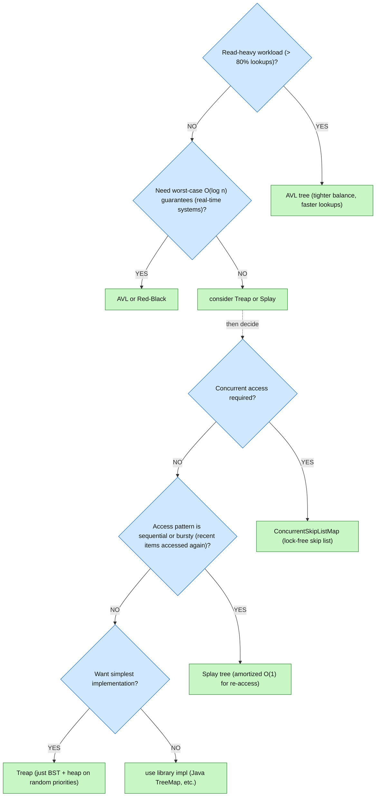
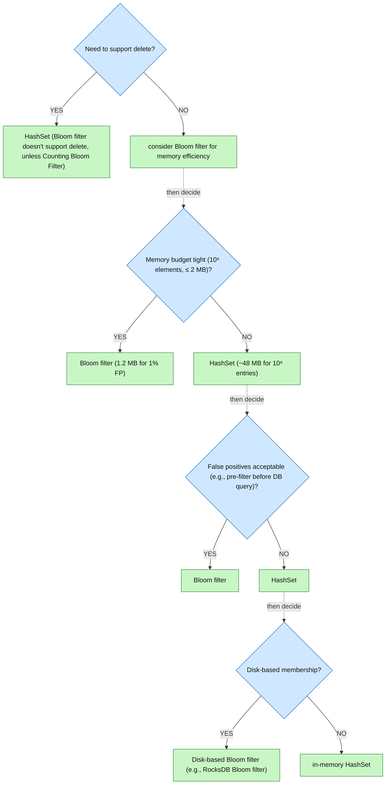

# 🎓 University-Level Addendum — Advanced Variants as Formal Theory

> **Navigation**: [← Heap Variants](04_heap_variants.md) | [Chapter overview](../02b_DS_Variants_Advanced.md)
> Page 5 of 5 in **Advanced Data Structure Variants: Stacks, Queues, & Trees**


> **Purpose:** This addendum elevates the chapter to MIT/KTH/ETH rigor. The body has comprehensive advanced variant coverage (AVL, Red-Black, Monotonic Queue, Treap, Skip List, Bloom filter, B-Tree, LSM-Tree, Splay); this addendum provides the formal invariants for each variant, sizing formulas with derivations, and the constraint-first decision framework for picking the right advanced variant.

## Advanced Variant Invariants

### AVL Tree Invariants (Re-stated for Reference)

| Invariant | Statement |
|---|---|
| **A1 — BST ordering** | For all nodes n: left subtree keys < n.key ≤ right subtree keys |
| **A2 — Balance factor** | For all nodes n: \|height(n.left) - height(n.right)\| ≤ 1 |
| **A3 — Height bound** | h ≤ 1.44 × log₂(n) - O(1) |

Full proof in `01f_Trees_Heaps.md`.

### Red-Black Tree Invariants (Re-stated)

| Invariant | Statement |
|---|---|
| **R1 — BST ordering** | Inherited from BST |
| **R2 — Root is black** | `root.color == BLACK` |
| **R3 — Red children are black** | No two consecutive reds |
| **R4 — Black-height equality** | All root-to-leaf paths have same black-count |
| **R5 — Height bound** | h ≤ 2 × log₂(n + 1) |

### Skip List Invariants

| Invariant | Statement | Violation Consequence |
|---|---|---|
| **SK1 — Level 0 sorted** | All level-0 nodes are in strictly increasing key order | Lookup correctness |
| **SK2 — Level bound** | A node at level i has `next[i] != null` only if `next[i].key > node.key` | Skip property broken |
| **SK3 — Random level distribution** | Node at level i has probability p^(i-1) × (1-p) of being at level i (for geometric distribution) | Unbalanced; degraded to O(n) |
| **SK4 — Header sentinel** | Header node has all level pointers initialized; level 0 sentinel | First node insertion broken |
| **SK5 — Tail null terminator** | Last node at each level has `next[i] == null` | Iteration overruns |

The probability `p` is typically 1/4 (Java's `ConcurrentSkipListMap`) or 1/2 (Pugh's original paper). With `p = 1/2`, expected height is `log₂(n)`; with `p = 1/4`, expected height is `log₄(n) = log₂(n) / 2`. Lower `p` uses less memory but increases height.

### Treap Invariants

| Invariant | Statement | Violation Consequence |
|---|---|---|
| **TR1 — BST ordering on keys** | Standard BST invariant | Lookup correctness |
| **TR2 — Heap ordering on priorities** | For every node n: `n.priority > n.parent.priority` (max-heap on priorities) | Treap balance broken |
| **TR3 — Random priority** | Priority chosen uniformly at random at insertion | Expected O(log n) height |
| **TR4 — Combined invariant** | TR1 + TR2 together uniquely determine the tree given priorities | Implementation incorrect |

The probability that a Treap is unbalanced is exponentially small (under random priorities, the expected height is O(log n) with high probability).

### Bloom Filter Invariants

| Invariant | Statement | Violation Consequence |
|---|---|---|
| **BF1 — Bit array size m** | m ≥ -n × ln(p) / (ln 2)² where n = expected elements, p = target false positive rate | Higher FP rate than target |
| **BF2 — Number of hash functions k** | k = (m/n) × ln 2 ≈ 0.693 × m/n | Suboptimal: too few = high FP, too many = slow insert |
| **BF3 — No deletion (without counting)** | Standard Bloom filter does not support delete | Calling delete throws or corrupts |
| **BF4 — No false negatives** | If `mightContain(k) == false`, then k was never inserted | Wrong; false positive only |

### B-Tree Invariants (Re-stated)

| Invariant | Statement |
|---|---|
| **B1 — Sorted keys in node** | Keys in a node are sorted |
| **B2 — Min degree t** | Each node (except root) has [t-1, 2t-1] keys |
| **B3 — All leaves at same depth** | Uniform height |
| **B4 — Child count = key count + 1** | Internal node with k keys has k+1 children |

### LSM-Tree Invariants

| Invariant | Statement | Violation Consequence |
|---|---|---|
| **L1 — Memtable + SSTable levels** | Writes go to memtable; flushed to SSTable levels | Write path broken |
| **L2 — Compaction triggered** | When level exceeds threshold (e.g., Level 1 > 10MB), merge with next level | Read amplification unbounded |
| **L3 — Bloom filter per SSTable** | Each SSTable has a Bloom filter for fast negative lookup | Slow negative lookups |
| **L4 — Tombstones for deletes** | Deletes create tombstones, compacted away eventually | Reads must check tombstones |

### Splay Tree Invariants

| Invariant | Statement | Violation Consequence |
|---|---|---|
| **SP1 — BST ordering** | Standard BST invariant | Lookup correctness |
| **SP2 — Recently accessed at root** | After accessing node x, x is at the root (splayed) | Access pattern not exploited |
| **SP3 — Amortized O(log n)** | Any sequence of m operations is O(m log n) amortized | Worst case O(n) per op |

Splay trees do NOT maintain a balance invariant explicitly. Instead, they rely on amortized analysis to bound total cost.

## Sizing Formulas with Derivations

### Bloom Filter Sizing

**Given:** target false positive rate `p`, expected number of elements `n`.

**Find:** bit array size `m` and number of hash functions `k`.

**Formula (Pugh 1989):**

```
m = -n × ln(p) / (ln 2)²
k = (m / n) × ln 2 ≈ 0.693 × m / n

Memory per element = m / n bits = -ln(p) / (ln 2)² bits ≈ 1.44 × -log₂(p) bits
```

**Worked example:** Target p = 0.01 (1% false positive rate), n = 10⁶ elements.

```
m = -10⁶ × ln(0.01) / (ln 2)² = -10⁶ × (-4.605) / 0.480 ≈ 9.59 × 10⁶ bits ≈ 1.2 MB
k = (9.59 × 10⁶ / 10⁶) × 0.693 ≈ 6.65 ≈ 7 hash functions
Memory per element = 9.59 bits ≈ 1.2 bytes
```

For p = 0.001 (0.1% FP), m ≈ 14.4 MB and k ≈ 10. Memory grows as -log₂(p), so each 10× reduction in FP rate costs ~3.3× memory.

**Why these formulas work:**

- Probability a single bit is 0 after n inserts with k hash functions: (1 - 1/m)^(kn) ≈ e^(-kn/m)
- False positive probability (all k bits set for a non-inserted element): (1 - (1 - 1/m)^(kn))^k ≈ (1 - e^(-kn/m))^k
- Optimal k (minimize FP): k = (m/n) × ln 2
- Optimal m (achieve target p with optimal k): m = -n × ln(p) / (ln 2)²

This is the formal derivation in CLRS Chapter 5 and Pugh's original paper.

### Skip List Level Probability

**Formula:** Expected number of nodes at level ≥ i is `n × p^(i-1) × (1-p)`.

**With p = 1/4:**

| Level | Expected Count |
|---|---|
| 0 | n |
| 1 | n/4 |
| 2 | n/16 |
| 3 | n/64 |
| log₄(n) | ~1 |

Total memory per element: expected levels = `1/(1-p) = 1/(3/4) = 4/3` pointers (instead of 1 for plain linked list).

**Height:** Expected height = `log_(1/p)(n) = log₄(n)`. For n = 10⁶, expected height = log₄(10⁶) ≈ 10. So a 10⁶-element skip list has ~10 levels — search is O(10) = O(log n).

**With p = 1/2:** Height = `log₂(n)`. Lower memory per element (1/(1-1/2) = 2 pointers) but more levels. Java's `ConcurrentSkipListMap` uses p = 1/4 for memory efficiency.

### Cuckoo Hash Sizing

**Given:** n elements, two hash functions, each bucket holds 1 element.

**Load factor threshold:** λ < 0.5 (above this, infinite loops during insertion are likely).

**Successful lookup:** O(1) — check both buckets.

**Unsuccessful lookup:** O(1) — check both buckets; return false.

**Insertion:** Expected O(1) for λ < 0.5; can be O(n) in worst case (infinite loop detection → rehash).

For higher load factors, use multi-bucket cuckoo hash (4 buckets per element, load factor up to 0.97).

### B-Tree Disk Access Count

**Given:** B-tree of order t (each node has [t-1, 2t-1] keys); total n keys.

**Height:** `h = log_t((n + 1) / 2)` ≈ `log_t(n)`.

**For n = 10⁹ keys, t = 100 (typical disk page size / key size):**

```
h = log_100(10⁹ / 2) ≈ log_100(5 × 10⁸) ≈ 4.25 ≈ 5 disk accesses
```

Compare to B+ tree with same parameters: also ~5 disk accesses for point lookup, but range query is much faster because leaf nodes are linked.

**Branch factor vs depth:**

| Branch Factor (t) | Depth (n = 10⁹) | Notes |
|---|---|---|
| 2 (binary search) | 30 | In-memory B-tree |
| 100 (typical disk) | 5 | B-tree on disk |
| 1000 (large fanout) | 3 | B-tree on SSD |
| 10⁶ (huge fanout) | 1 | All-in-memory |

This is why B-trees dominate disk-based storage: each level multiplies by t, and disk seeks are expensive.

### LSM-Tree Write Amplification

**Definition:** Total bytes written per byte of user data.

**Components:**

- Memtable write: 1× (write to memory)
- Flush to SSTable: 1× (write to disk)
- Compaction (Level 1 → 2): 10× (each Level 1 SSTable is rewritten 10 times during compaction through levels)
- Compaction (Level 2 → 3): 1× (Level 2 to Level 3 is rarer)

**Total write amplification:** ~10-30× for typical LSM configurations (RocksDB default tuning).

Compare to B-tree: ~1-2× write amplification (single write per update, sometimes 2× for splits).

**Trade-off:** LSM-tree has higher write amplification but better write throughput (sequential writes only, no in-place updates).

## Constraint-First Decision Framework — Advanced Variant Selection

### Self-Balancing BST Choice



**How to read this diagram.** Start at the first blue question and follow the YES / NO edges; the green boxes are the recommended choice.

### Bloom Filter vs HashSet for Membership



**How to read this diagram.** Start at the first blue question and follow the YES / NO edges; the green boxes are the recommended choice.

### B-Tree vs LSM-Tree for Storage

```
Read-heavy (OLTP, point lookups, range queries)?
  → YES → B-Tree (B+ Tree for range queries)
  → NO → continue

Write-heavy (OLAP, ingest, time-series)?
  → YES → LSM-Tree (RocksDB, LevelDB, Cassandra)
  → NO → either

Need strict write latency guarantees?
  → YES → B-Tree (no compaction stalls)
  → NO → LSM-Tree (occasional compaction stalls acceptable)

Storage medium?
  → HDD or SATA SSD → B-Tree (random reads are fast enough)
  → NVMe SSD or sequential workloads → LSM-Tree (sequential writes dominate)
```

## When Advanced Variants Break — Formal Failure Modes

### Break 1 — Skip List Unbalanced from Biased RNG

**Condition:** The random number generator produces non-uniform distribution (e.g., `java.util.Random` with poor seeding).

> [!CAUTION]
> **What breaks:** SK3 violated → some levels have many more nodes than expected → height grows beyond log_p(n) → O(n) worst-case search.

> [!TIP]
> **Defense:** Use a high-quality RNG (e.g., `SplittableRandom` or `ThreadLocalRandom`). Test level distribution with histogram.

### Break 2 — Bloom Filter Underestimated m

**Condition:** Inserting more elements than the bloom filter was sized for.

> [!CAUTION]
> **What breaks:** BF1 violated → false positive rate increases sharply. At 2× expected size, FP rate is `p²`. At 10×, FP rate is `p^10` (essentially all queries return true).

> [!TIP]
> **Defense:** Size bloom filters conservatively (e.g., 2× expected n). For unbounded growth, use a scalable bloom filter (multiple filters, decreasing size).

### Break 3 — B-Tree Node Split During Scan

**Condition:** A B-tree scan encounters a node split mid-traversal.

> [!CAUTION]
> **What breaks:** Cursor-based scan may miss newly-inserted entries or duplicate entries that moved during the split.

> [!TIP]
> **Defense:** Use cursor with versioning (read at a snapshot timestamp). Or use a B+ Tree with linked leaves for sequential scans.

### Break 4 — LSM-Tree Compaction Stall

**Condition:** Write rate exceeds compaction rate during peak load.

> [!CAUTION]
> **What breaks:** L2 violated → level size grows beyond threshold → read amplification increases → latency spikes.

> [!TIP]
> **Defense:** Tune compaction throughput (more threads, larger SSTables). Or use leveled compaction with bounded levels (RocksDB default).

### Break 5 — Splay Tree Worst-Case Single Operation

**Condition:** Accessing nodes in a pathological order (e.g., alternating extremes).

> [!CAUTION]
> **What breaks:** Single operation can be O(n) (e.g., accessing every node in order results in O(n²) for n accesses). However, amortized over m operations, the cost is O(m log n).

> [!TIP]
> **Defense:** Don't use Splay trees in real-time systems where worst-case latency matters. Use AVL or Red-Black for strict bounds.

### Break 6 — Treap Priority Collision

**Condition:** Random priority generator produces the same priority for two nodes.

> [!CAUTION]
> **What breaks:** TR2 violated → heap property ambiguous → tree structure may not be unique.

> [!TIP]
> **Defense:** Use 64-bit random priorities; collision probability is `2^-64` per pair, negligible.

### Break 7 — ConcurrentSkipListMap ABA Problem

**Condition:** A node is removed and re-inserted with the same key during a CAS operation.

> [!CAUTION]
> **What breaks:** CAS sees the same reference as before but the node has been replaced → wrong operation applied.

> [!TIP]
> **Defense:** Use versioned pointers (Java's `AtomicStampedReference`) or accept ABA as a non-issue for typical usage.

### Break 8 — Bloom Filter Misuse as Cache

**Condition:** Using Bloom filter as the only data structure for membership, then acting on `mightContain == true` without verification.

> [!CAUTION]
> **What breaks:** BF4 false positive causes incorrect action (e.g., evicting valid cache entry, rejecting valid user).

> [!TIP]
> **Defense:** Always verify after Bloom filter positive. The filter is a *probabilistic* optimization, not a source of truth.

## Formal Complexity Proofs — Advanced Variant Operations

### Skip List Search (Successful)

```
T_search_avg(n) = O(log n)
Proof: Expected number of comparisons per level = 1/p.
       Total levels = log_p(n).
       Total comparisons = log_p(n) × (1/p) = O(log n).
       
For p = 1/2: O(log n) with constant factor 2.
For p = 1/4: O(log n) with constant factor 4, but each level has 1/4 the nodes (less memory).
```

### AVL Insertion

```
T_insert_AVL(n) = O(log n)
  1. Walk tree to find insertion point: O(log n)
  2. Insert new node: O(1)
  3. Walk back up rebalancing: O(log n) — at most 2 rotations per level
```

Total: O(log n). The 2 rotations per level bound is the key property: any imbalance after insertion is fixed by at most 2 rotations.

### Red-Black Insertion

```
T_insert_RB(n) = O(log n)
  1. Walk tree to find position: O(log n)
  2. Insert new node as RED: O(1)
  3. Walk back up fixing violations: O(log n) — at most 2 rotations, color flips

Worst case: O(log n) with high constant. Average: faster than AVL due to fewer rotations.
```

### Bloom Filter Insert

```
T_insert_BF(n) = O(k) where k = number of hash functions
  1. Compute k hash functions: O(k)
  2. Set k bits in bit array: O(k)

For p = 0.01, k ≈ 7 → O(7) = O(1) constant time per insert.
```

### Bloom Filter Lookup

```
T_lookup_BF(n) = O(k)
  1. Compute k hash functions: O(k)
  2. Check k bits: O(k)

Always O(1) — k is constant for fixed false positive rate.
```

### B-Tree Insert

```
T_insert_BT(n) = O(log_t(n)) disk accesses
  1. Walk tree to find leaf: O(log_t(n)) disk accesses
  2. Insert key in leaf: O(1) if no split, O(t) if split
  3. Split cascades up the tree: O(log_t(n)) worst case

Total disk accesses: O(log_t(n)). For t = 100, n = 10⁹: ~5 disk accesses.
```

### LSM-Tree Insert

```
T_insert_LSM(n) = O(1) amortized
  1. Write to memtable (in-memory): O(1) — sequential memory write
  2. Acknowledge to client (write-back async): O(1)

Read may be O(levels × memtable_size) — must check memtable + all SSTable levels.
Compaction is background, doesn't block writes.
```

## Decision Examples

### Example 1 — Distributed Cache Membership

**Problem:** Distributed cache (Redis) needs to know which keys are in cache without hitting the cache for every miss.

- **Constraint:** Fast membership test; memory efficient; small false positive rate acceptable.
- **Pick:** Bloom filter.
- **Size:** For 10⁶ keys at 1% FP: 1.2 MB. Negligible per cache node.
- **Lookup:** O(1) before each cache GET to skip network call for misses.

### Example 2 — Database Index

**Problem:** Database needs O(log n) lookup with range queries; data on disk (SSD).

- **Constraint:** Disk-resident; point lookup + range scan.
- **Pick:** B+ Tree (variant of B-Tree with linked leaves).
- **Why not LSM-Tree?** Writes are not the dominant workload; B+ Tree has better read performance for this use case.
- **Why not Skip List?** In-memory only; can't be paged efficiently to disk.

### Example 3 — Time-Series Database (TSDB)

**Problem:** 10⁶ writes/sec; range scans over time windows; can tolerate occasional read latency spikes.

- **Constraint:** Write-heavy; read amplification acceptable.
- **Pick:** LSM-Tree (Cassandra, InfluxDB, RocksDB).
- **Why B-Tree?** B-Tree has worse write throughput due to random disk writes on update.
- **Why LSM-Tree?** All writes are sequential (memtable + SSTable); compaction is background.

---

## Proof Corner

### Skip List Expected O(log n) Search

**Claim**: Skip list `search(k)` costs O(log n) expected time with high probability when levels are chosen independently with probability p = 1/2.

**Proof sketch** (backward analysis):
Consider the path traversed during search in *reverse* — from the found element back to the head. At each step, we either:
- Go *up* a level (probability 1/2): this is where we were promoted in the level-generation process.
- Go *left* along the current level (probability 1/2): we stay at this level.

This is equivalent to a random walk that climbs exactly log₁/p(n) levels in expectation. By standard Chernoff bounds, the path length is O(log n) with high probability (failure probability n^{-c} for any constant c > 1 by choosing number of levels L = c·log_{1/p}(n)).

**Expected space**: Each element appears in L levels on average, each with probability p^level. Total expected nodes = n × Σ_{i=0}^{L} p^i = n/(1−p) = 2n for p=1/2. Space: O(n) expected.

---

### Bloom Filter False Positive Rate

**Claim**: A Bloom filter with m bits, n elements, and k hash functions has false positive rate approximately (1 − e^{−kn/m})^k.

**Derivation**: After inserting n elements with k hashes each:
- Pr[a bit is still 0] = (1 − 1/m)^{kn} ≈ e^{−kn/m} for large m.
- False positive: a non-member's k hash positions are all 1 → Pr = (1 − e^{−kn/m})^k.

**Optimal k**: Minimize by differentiating w.r.t. k → k* = (m/n) ln 2 ≈ 0.693 m/n.

**Java example**: For n = 10⁶ elements and FPR = 1%: m ≈ −n ln(FPR) / (ln 2)² ≈ 9.6 × 10⁶ bits ≈ 1.2 MB. Guava's `BloomFilter` implements exactly this formula.

## Cross-References

- **`01e_HashTable.md`** — HashMap vs TreeMap vs ConcurrentSkipListMap; basic hash table theory.
- **`01f_Trees_Heaps.md`** — AVL/Red-Black formal invariants, height bound proofs, decision framework.
- **`01g_DS_Internals.md`** — TreeMap implementation, ConcurrentSkipListMap lock-free design.
- **`02a_DS_Variants_Core.md`** — variant selection for core variants (Deque, PQ, MultiMap).
- **`02_PROBLEM_SETS.md`** — exam-style variant selection problems (Bloom filter sizing, B-tree disk access).
- **`A4_Randomized_Data_Structures.md`** — formal treatment of skip list, treap, cuckoo hash, randomized data structures.

---

[← Heap Variants](04_heap_variants.md) | [Chapter overview](../02b_DS_Variants_Advanced.md)
