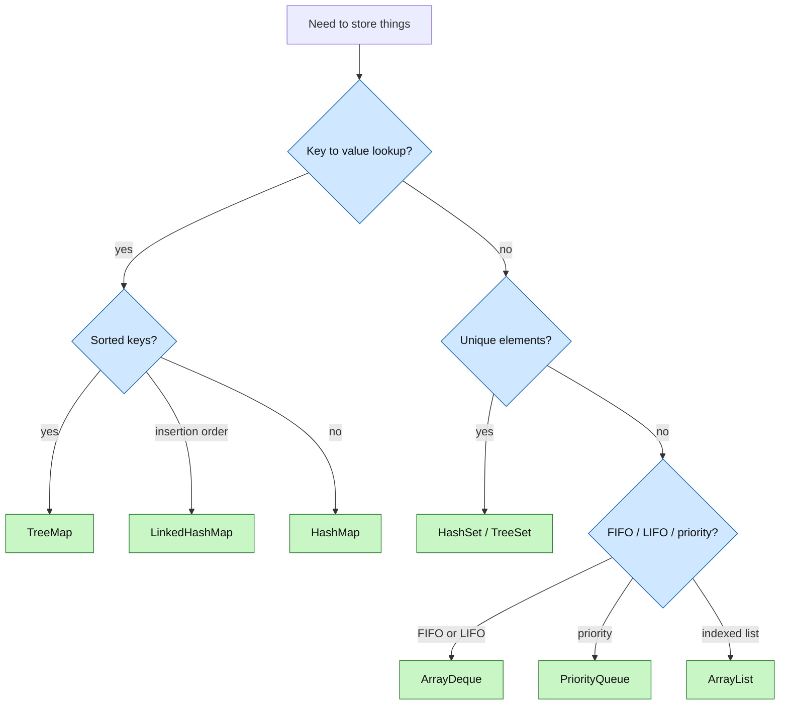

> **Navigation**: [← Advanced Data Structure Variants…](02b_DS_Variants_Advanced.md) | [Chapter index](00_INDEX.md) | [2D Arrays & Matrix: Complete Deep… →](04_2D_Arrays_Matrix.md)

# 📊 Java Collections: Complete Method Reference Tables

## Your Quick-Reference Guide for Every Collection Method

---

## 💬 Explain It Like a Study Partner — Java Collections

> [!TIP]
> **Ask yourself first:** *"When you type `new ArrayList<>()` instead of `new LinkedList<>()`, what are you really deciding?"*

### 1. The bottom line

Java's collections are a ready-made toolbox: you pick the **interface** for what you need to do and an **implementation** for how fast you need it.

### 2. The textbook core

- **Interfaces:** `List` (ordered, duplicates), `Set` (unique), `Queue`/`Deque` (FIFO/LIFO), `Map` (key → value; not a `Collection`).
- **Implementations:** `ArrayList`, `LinkedList`, `HashSet`/`LinkedHashSet`/`TreeSet`, `HashMap`/`LinkedHashMap`/`TreeMap`, `ArrayDeque`, `PriorityQueue`.
- **Naming rule:** `Hash*` = fastest, unordered; `Linked*` = insertion order; `Tree*` = sorted, O(log n).
- Program to the interface (`List<Integer> xs = new ArrayList<>()`) so you can swap implementations.
- Removing from a collection while iterating it throws `ConcurrentModificationException`; use `Iterator.remove()` or `removeIf`.

### 3. The real-world analogy

A **kitchen drawer organiser**: the labelled compartment (interface) says what goes in it (cutlery, spices); which organiser you buy (implementation) depends on how fast you need to grab things and how much room you have.

### 4. Walkthrough: counting word frequencies

1. You need key → count, so the interface is `Map<String, Integer>`.
2. You do not care about order, so use `HashMap` (O(1) average).
3. For each word: `map.merge(word, 1, Integer::sum)`.
4. Need the words printed alphabetically? Switch to `TreeMap` by changing one word on the declaration line. The rest of the code stays the same.

> [!NOTE]
> **Quick check:** which collection would you use for an LRU cache? *`LinkedHashMap` in access-order mode (hash map + doubly linked list).*

---

## ⚡ At a Glance — Which Java Collection?

> [!NOTE]
> **Mental model:** choose by *what you must do fastest* (index, lookup, order, priority), then by whether duplicates, null and thread-safety matter.

**How to read this diagram.** Answer the blue questions top-down; the green leaf is the default collection to reach for.

| Collection | Get/lookup | Add | Remove | Ordered? |
| ---------- | ---------- | --- | ------ | -------- |
| `ArrayList` | O(1) by index | O(1) amortized end | O(n) | by index |
| `LinkedList` | O(n) | O(1) at ends | O(1) at ends | by index |
| `HashMap` / `HashSet` | O(1) avg | O(1) avg | O(1) avg | no |
| `LinkedHashMap` | O(1) avg | O(1) avg | O(1) avg | insertion/access |
| `TreeMap` / `TreeSet` | O(log n) | O(log n) | O(log n) | sorted |
| `ArrayDeque` | O(1) ends | O(1) | O(1) | FIFO/LIFO |
| `PriorityQueue` | O(1) peek | O(log n) | O(log n) | heap order |

> [!WARNING]
> Never modify a collection while iterating it with a for-each loop (`ConcurrentModificationException`); use the iterator's `remove()` or `removeIf`.

---

## 📚 Topic Pages in This Chapter

This chapter is split into focused pages so each topic can be read on its own. Read them in order the first time; use the table to jump back later.

| # | Page | What is inside | Lines |
| --- | --- | --- | --- |
| 1 | [Complete Understanding of Java Collections](03_Collections_Java/01_complete_understanding_of_java_collections.md) | Complete Understanding of Java Collections · Section 1: List Interface | 233 |
| 2 | [Section 2: Map Interface](03_Collections_Java/02_section_2_map_interface.md) | Section 2: Map Interface · Section 3: Set Interface · Section 4: Queue Interface · Section 5: Stack Operations · Section 6: String Builder · … | 694 |
| 3 | [University-Level Addendum — Java Collections as…](03_Collections_Java/03_university_level_addendum_java_collections_as.md) | University-Level Addendum — Java Collections… | 406 |

## 💪 Curated Practice Problems — Java Collections in Action

**HOW TO USE**: These problems specifically test your knowledge of Java Collections API.
Focus on choosing the RIGHT collection for each problem.

---

### Collection Choice Problems

| #   | Problem                         | Platform | Difficulty | Best Collection       | Why                             |
| --- | ------------------------------- | -------- | ---------- | --------------------- | ------------------------------- |
| 1   | Two Sum (LC 1)                  | LeetCode | Easy       | HashMap               | O(1) lookup by complement       |
| 2   | Group Anagrams (LC 49)          | LeetCode | Medium     | HashMap<String, List> | Sorted key grouping             |
| 3   | Kth Largest Element (LC 215)    | LeetCode | Medium     | PriorityQueue         | Min heap of size k              |
| 4   | LRU Cache (LC 146)              | LeetCode | Medium     | LinkedHashMap         | Insertion order + removeEldest  |
| 5   | Merge Intervals (LC 56)         | LeetCode | Medium     | ArrayList + sort      | Collections.sort by start       |
| 6   | Sliding Window Max (LC 239)     | LeetCode | Hard       | ArrayDeque            | Monotonic deque                 |
| 7   | Top K Frequent Words (LC 692)   | LeetCode | Medium     | HashMap + TreeMap     | Sorted by freq then alpha       |
| 8   | Contains Duplicate III (LC 220) | LeetCode | Hard       | TreeSet               | floor/ceiling for range check   |
| 9   | My Calendar I (LC 729)          | LeetCode | Medium     | TreeMap               | floorKey/ceilingKey for overlap |
| 10  | Task Scheduler (LC 621)         | LeetCode | Medium     | PriorityQueue         | Max heap by remaining count     |

---

_This reference is your go-to guide during practice!_

---

> **Navigation**: [< Previous](02b_DS_Variants_Advanced.md) | [Back to Index](../00_MASTER_INDEX.md) | [Next >](04_2D_Arrays_Matrix.md)

---

## Reality Check

> [!CAUTION]
> **Myth:** "Collections.sort() and Arrays.sort() use the same algorithm"
>
> **Reality:** They use the same underlying strategy (Timsort for objects) but `Arrays.sort(int[])` (primitive array) uses a *dual-pivot quicksort* — different algorithm, no stability guarantee, faster in practice because no boxing. `Collections.sort()` and `Arrays.sort(Integer[])` use Timsort, which IS stable. Choosing between primitives and boxed types affects both performance and sort stability.

> [!CAUTION]
> **Myth:** "Removing elements from a List while iterating with a for-each loop is fine"
>
> **Reality:** `ConcurrentModificationException`. The for-each loop uses an `Iterator` that checks a `modCount` field. Calling `list.remove()` during iteration modifies `modCount`, causing the iterator to throw. Fix: use `iterator.remove()`, `removeIf()`, or collect into a new list.

> [!CAUTION]
> **Myth:** "Unmodifiable collection = immutable collection"
>
> **Reality:** `Collections.unmodifiableList(list)` returns a *view* that prevents mutations through the wrapper — but the backing list is still mutable. If someone holds a reference to the original list and modifies it, the "unmodifiable" view reflects those changes. `List.copyOf()` (Java 10+) creates a truly immutable snapshot.

> [!CAUTION]
> **Myth:** "EnumSet and EnumMap are just sugar over HashSet/HashMap"
>
> **Reality:** `EnumSet` is backed by a `long` bitmask (or multiple longs for > 64 values). Membership test = bitwise AND, O(1) with zero GC overhead. For enum-typed sets, `EnumSet` is both faster and more memory-efficient than `HashSet` by orders of magnitude. Same principle for `EnumMap`. Always use these when keys/elements are enums.

> [!CAUTION]
> **Myth:** "Map.getOrDefault() and computeIfAbsent() do the same thing"
>
> **Reality:** `getOrDefault(key, default)` returns the default without inserting it — map is unchanged. `computeIfAbsent(key, fn)` inserts `fn.apply(key)` into the map if absent and returns it — map IS modified. For building multimap-style structures (`map.computeIfAbsent(k, k -> new ArrayList<>()).add(v)`), only `computeIfAbsent` works correctly.
