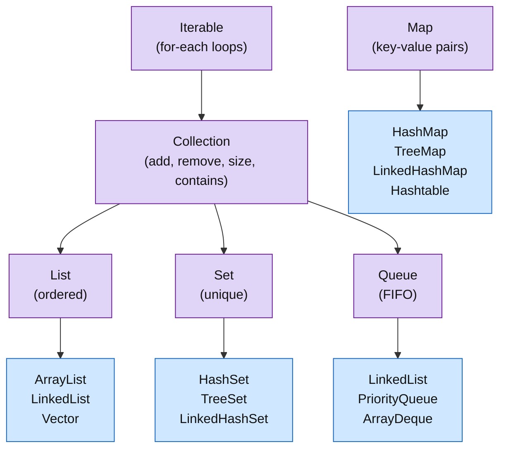

# ☕ Part 0: Complete Understanding of Java Collections

> **Navigation**: [Chapter overview](../03_Collections_Java.md) | [Section 2: Map Interface →](02_section_2_map_interface.md)
> Page 1 of 3 in **Java Collections: Complete Method Reference Tables**


## 5W1H: Mastering Java Collections

> [!NOTE]
> **WHAT:** A unified architecture (interfaces, implementations, and algorithms) for storing, retrieving, and manipulating groups of objects.
>
> **WHY:** Raw arrays have fixed sizes and lack built-in operations. The Collections framework provides robust, tested, high-performance data structures out-of-the-box, saving massive development time.
>
> **WHO:** Every Java developer. It is the absolute foundation of production Java code and 90% of Data Structure & Algorithm interviews.
>
> **WHEN:** Use whenever you need to store variable amounts of data, guarantee uniqueness (Set), map keys to values (Map), or process in specific orders (Queue/Stack/Tree).
>
> **HOW:** By understanding the interface hierarchy (Iterable -> Collection -> List/Set/Queue) and choosing the implementation (ArrayList, HashMap, etc.) that provides optimal O(1) or O(log N) operations for your use case.

## Java Collections — complete understanding

> [!NOTE]
> **What is it?** A unified architecture for representing and manipulating collections of objects.

| Part | Meaning | Examples |
| ---- | ------- | -------- |
| **Interfaces** | Define behaviour | `List`, `Set`, `Map`, `Queue` |
| **Implementations** | Actual classes | `ArrayList`, `HashMap`, ... |
| **Algorithms** | Static utility methods | `sort`, `search`, `shuffle` |

**Historical evolution:**

| Version | Year | What arrived |
| ------- | ---- | ------------ |
| Java 1.0 | 1996 | Only `Vector`, `Hashtable`, `Stack` (plus arrays) |
| Java 1.2 | 1998 | **Collections Framework introduced** |
| Java 1.4 | 2002 | `LinkedHashMap` / `LinkedHashSet` |
| Java 1.5 | 2004 | Generics: no more casting |
| Java 1.6 | 2006 | `NavigableSet`, `NavigableMap` |
| Java 1.7 | 2011 | Diamond operator `<>` |
| Java 1.8 | 2014 | Streams, `forEach`, `removeIf` |
| Java 9+ | 2017+ | Immutable factories (`List.of`, `Set.of`) |

**What problem does it solve?**

| Before Collections (Java 1.0) | Problems | The Collections solution |
| ----------------------------- | -------- | ------------------------ |
| Arrays: fixed size, primitive operations only | No standard way to group objects | Standard interfaces (`List`, `Set`, `Map`) that work anywhere |
| `Vector`: thread-safe but slow, inconsistent API | Code not reusable across projects | Multiple implementations to choose from |
| `Hashtable`: no null keys, synchronized (slow) | Algorithms rewritten for each type | Generic algorithms that work with any implementation |
| Every company wrote its own data structures | No common interface, so generic code was hard | Type safety with generics |

**The big picture — collections hierarchy:**



**How to read this diagram.** Purple boxes are interfaces, blue boxes list their main implementations. `Map` is separate from the `Collection` tree.

> [!IMPORTANT]
> **Key insight:** same interface, *different* implementations. `List<E> list = new ArrayList<>();` can be swapped to `LinkedList` by changing one word.

**When to use which collection? (decision guide)**

| Question | If yes | If no |
| -------- | ------ | ----- |
| 1. Do you need **key-value** pairs? | Use a **Map** (`HashMap`, `TreeMap`, `LinkedHashMap`) | Go to question 2 |
| 2. Do you need **unique** elements only? | Use a **Set** (`HashSet`, `TreeSet`, `LinkedHashSet`) | Go to question 3 |
| 3. Do you need **FIFO / LIFO** ordering? | FIFO → `Queue` (`LinkedList`, `ArrayDeque`); LIFO → `ArrayDeque` (preferred over the `Stack` class); priority → `PriorityQueue` | Use a **List** |
| 4. (Lists) Which operation dominates? | Random access by index → `ArrayList`; insert/delete in the middle → `LinkedList` | |
| 5. (Sets/Maps) Do you need ordering? | None → hash variant (fastest); sorted → tree variant (O(log n)); insertion order → `LinkedHash` variant | |

**Difficulties in using collections:**

| # | Difficulty | Solution |
| - | ---------- | -------- |
| 1 | **Too many choices:** "ArrayList or LinkedList?" | `ArrayList` for ~95% of cases (better cache locality) |
| 2 | **Generics confusion:** what are `<E>`, `<K,V>`, `<?>`? | `E` = element type, `K` = key, `V` = value, `?` = unknown |
| 3 | **Concurrent modification:** removing while iterating throws | Use `Iterator.remove()` or `removeIf()` |
| 4 | **equals/hashCode:** custom objects misbehave in `HashSet`/`HashMap` | Override **both** `equals()` and `hashCode()` |
| 5 | **Mutability:** `Arrays.asList()` returns a fixed-size list | `new ArrayList<>(Arrays.asList(...))` |

**Expected outcomes of mastering collections:**

- ✅ **Instant choice:** see a requirement → know which collection to use
- ✅ **Efficient code:** pick the implementation with the best time complexity
- ✅ **Clean code:** use streams and built-in methods
- ✅ **Bug-free:** avoid common pitfalls (concurrent modification, etc.)
- ✅ **Interview ready:** explain trade-offs between implementations

---

## 📌 Section 1: List Interface

### 💬 Study-Partner View — List Interface

**1. The bottom line:** `List` is an ordered collection with positions: you can ask for the item at index `i` and duplicates are allowed.

**2. The textbook core:**

- `ArrayList`: array-backed; `get(i)` O(1), `add(x)` amortized O(1), `add(i, x)`/`remove(i)` O(n).
- `LinkedList`: doubly linked; `get(i)` O(n), add/remove at ends O(1); also a `Deque`.
- `List.of(...)` is immutable; `Arrays.asList(...)` is fixed-size.
- Prefer `ArrayList` by default; use `ArrayDeque` for queue/stack use.

**3. The real-world analogy:** A **numbered to-do list**: you can jump to item 5, repeat items, and insert in the middle (everything below moves down).

**4. Walkthrough:**

1. `List<String> xs = new ArrayList<>();`
2. `xs.add("a"); xs.add("b"); xs.add(1, "x");` → `[a, x, b]`.
3. `xs.get(2)` → `"b"` in O(1).
4. `xs.remove("x")` removes by value (O(n) search), `xs.remove(0)` removes by index.

> [!NOTE]
> **Quick check:** Why is `ArrayList.remove(0)` slow? *Every later element shifts one place left.*


### ArrayList Methods (Most Used for Arrays/DSA)

| Method        | Return Type | Signature                   | Description                           | Time       |
| ------------- | ----------- | --------------------------- | ------------------------------------- | ---------- |
| `add`         | boolean     | `add(E e)`                  | Appends element to end                | O(1)\*     |
| `add`         | void        | `add(int index, E e)`       | Inserts at position                   | O(n)       |
| `get`         | E           | `get(int index)`            | Returns element at index              | O(1)       |
| `set`         | E           | `set(int index, E e)`       | Replaces element, returns old         | O(1)       |
| `remove`      | E           | `remove(int index)`         | Removes at index, returns element     | O(n)       |
| `remove`      | boolean     | `remove(Object o)`          | Removes first occurrence              | O(n)       |
| `size`        | int         | `size()`                    | Returns number of elements            | O(1)       |
| `isEmpty`     | boolean     | `isEmpty()`                 | Returns true if size == 0             | O(1)       |
| `contains`    | boolean     | `contains(Object o)`        | Returns true if element exists        | O(n)       |
| `indexOf`     | int         | `indexOf(Object o)`         | Index of first occurrence, -1 if none | O(n)       |
| `lastIndexOf` | int         | `lastIndexOf(Object o)`     | Index of last occurrence              | O(n)       |
| `clear`       | void        | `clear()`                   | Removes all elements                  | O(n)       |
| `toArray`     | Object[]    | `toArray()`                 | Returns array of elements             | O(n)       |
| `subList`     | List<E>     | `subList(int from, int to)` | Returns view of portion               | O(1)       |
| `sort`        | void        | `sort(Comparator<E> c)`     | Sorts using comparator                | O(n log n) |

\*O(1) amortized, O(n) when resize needed

#### Usage Examples

```java
ArrayList<Integer> list = new ArrayList<>();

// Adding elements
list.add(10);                    // [10]
list.add(20);                    // [10, 20]
list.add(0, 5);                  // [5, 10, 20] - insert at index 0

// Accessing
int first = list.get(0);         // 5
int last = list.get(list.size() - 1);  // 20

// Modifying
list.set(1, 15);                 // [5, 15, 20]

// Removing
list.remove(0);                  // [15, 20] - by index
list.remove(Integer.valueOf(20)); // [15] - by value

// Checking
boolean has15 = list.contains(15);  // true
int idx = list.indexOf(15);         // 0

// Iterating - DSA Pattern!
for (int i = 0; i < list.size(); i++) {
    System.out.println(list.get(i));
}

// Enhanced for
for (int num : list) {
    System.out.println(num);
}
```

🔬 **Section Challenge — ArrayList Methods (Most Used for Arrays/DSA)**

**Challenge 1 (Reasoning):** `ArrayList.remove(Object o)` vs `ArrayList.remove(int index)` — you call `list.remove(1)`. Which overload is called and why?

<details><summary>Answer</summary>

`remove(int index)` — `1` is an `int` literal, not an `Integer`. Java resolves to the exact-match primitive overload first. To call `remove(Object)`, use `list.remove(Integer.valueOf(1))` or `list.remove((Integer)1)`. This is a classic Java gotcha that changes behavior silently.

</details>

### LinkedList Methods (Queue + Deque operations)

| Method        | Return Type | Signature       | Description                    | Time |
| ------------- | ----------- | --------------- | ------------------------------ | ---- |
| `addFirst`    | void        | `addFirst(E e)` | Adds to beginning              | O(1) |
| `addLast`     | void        | `addLast(E e)`  | Adds to end                    | O(1) |
| `getFirst`    | E           | `getFirst()`    | Returns first element          | O(1) |
| `getLast`     | E           | `getLast()`     | Returns last element           | O(1) |
| `removeFirst` | E           | `removeFirst()` | Removes and returns first      | O(1) |
| `removeLast`  | E           | `removeLast()`  | Removes and returns last       | O(1) |
| `offer`       | boolean     | `offer(E e)`    | Adds to end (queue)            | O(1) |
| `poll`        | E           | `poll()`        | Removes first (queue)          | O(1) |
| `peek`        | E           | `peek()`        | Returns first without removing | O(1) |
| `push`        | void        | `push(E e)`     | Adds to beginning (stack)      | O(1) |
| `pop`         | E           | `pop()`         | Removes first (stack)          | O(1) |

```java
LinkedList<Integer> list = new LinkedList<>();

// As a Queue (FIFO)
list.offer(1);    // Add to back
list.offer(2);    // [1, 2]
int first = list.poll();  // Remove from front: 1

// As a Stack (LIFO)
list.push(10);    // Add to front
list.push(20);    // [20, 10]
int top = list.pop();  // Remove from front: 20

// As a Deque (Double-ended)
list.addFirst(5);   // Add to front
list.addLast(15);   // Add to back
list.removeFirst(); // Remove from front
list.removeLast();  // Remove from back
```

---

[Chapter overview](../03_Collections_Java.md) | [Section 2: Map Interface →](02_section_2_map_interface.md)
