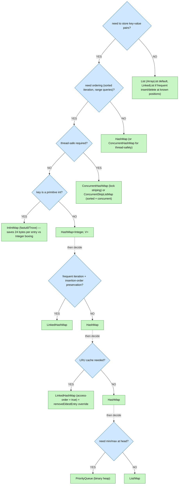

# 🎓 University-Level Addendum — Java Collections as Production-Ready Code

> **Navigation**: [← Section 2: Map Interface](02_section_2_map_interface.md) | [Chapter overview](../03_Collections_Java.md)
> Page 3 of 3 in **Java Collections: Complete Method Reference Tables**


> **Purpose:** This addendum elevates the chapter to MIT/KTH/ETH rigor. The body has comprehensive method reference, complexity tables, invariant statements, and production failure modes (Section 9b); this addendum consolidates the canonical production failure modes with formal root-cause analysis, adds a constraint-first collection selection framework, and provides exam-style invariant proofs.

## Production Failure Modes — Canonical Set

These are the most common production failures from misuse of Java Collections. Each is presented with: trigger condition, what breaks, root cause, and defense.

### Failure 1 — ArrayList Default Capacity O(n²) Total Insert

**Trigger:** `new ArrayList<>()` then `add` 10⁶ elements.

> [!CAUTION]
> **What breaks:** Multiple resizes (17 with default 1.5× growth from capacity 10 to ~1.3M). Each resize copies all existing elements → O(n × log n) total instead of O(n).

**Root cause:** Default capacity is 10. The user assumes ArrayList is "fast enough" without considering the resize cost.

> [!TIP]
> **Defense:** Always pre-size: `new ArrayList<>(expectedSize + 1)`. For `expectedSize = 10⁶`, allocate `1,000,001` capacity to skip all resizes.

**Diagnostic:** Profile with JFR (Java Flight Recorder) and look for `jdk.internal.array.Resize` events.

**Cost in production:** For a hot-path insertion loop, this can mean 30× slowdown. Common in batch processing code.

### Failure 2 — HashMap Default Capacity 16 + Resize Storm

**Trigger:** `new HashMap<>()` then `put` 10⁶ entries.

> [!CAUTION]
> **What breaks:** Resize at size 12 (16 × 0.75). 17 resizes total. Each resize copies all buckets and rehashes every key.

**Root cause:** Default capacity is 16, but most production maps have 10⁴-10⁶ entries.

> [!TIP]
> **Defense:** Always pre-size: `new HashMap<>(expectedSize / 0.75 + 1)`. For `expectedSize = 10⁶`, allocate `1,333,334` capacity.

**Diagnostic:** JFR `java.util.HashMap` events or `HashMap.size()` checks against `HashMap.table.length()`.

**Cost in production:** Identical to Failure 1 — 30× slowdown on insert-heavy workloads.

### Failure 3 — ConcurrentModificationException Surprise

**Trigger:** Iterating a HashMap/ArrayList while another thread modifies it (or even the same thread via `Iterator.remove()` patterns).

> [!CAUTION]
> **What breaks:** `ConcurrentModificationException` thrown mid-iteration. Worst case: data corruption without exception (custom impl).

**Root cause:** `modCount` field incremented on structural modification; iterators check `expectedModCount == modCount` and throw on mismatch.

> [!TIP]
> **Defense:** Use `ConcurrentHashMap` for concurrent access. Or collect keys to modify first, then apply changes after iteration. Or use `Iterator.remove()` explicitly (which updates `expectedModCount`).

**Diagnostic:** Look for stack trace with `AbstractList$Itr.next()` or `HashMap$HashIterator.next()` — these are the throw sites.

**Cost in production:** Hard-to-reproduce bugs; common in event-driven systems where callbacks modify the event source.

### Failure 4 — Iterator Invalidation After Resize

**Trigger:** Iterating a HashMap while a `put` triggers a resize.

> [!CAUTION]
> **What breaks:** Iterator's `expectedModCount` is set correctly, but the iteration now walks the *old* bucket array (which the iterator holds by reference). The new bucket array is invisible to the iterator. Result: iteration misses new entries or returns stale.

**Root cause:** HashMap's iterator holds a reference to the old table; resize creates a new table; iterator still walks the old.

> [!TIP]
> **Defense:** Don't modify during iteration. Use `ConcurrentHashMap` for concurrent updates.

**Cost in production:** Silent data inconsistency — observed values don't match expected.

### Failure 5 — LinkedList Random Access O(n) per Get

**Trigger:** `linkedList.get(i)` in a loop.

> [!CAUTION]
> **What breaks:** Each `get(i)` walks from head or tail (whichever is closer) → O(n) per call. Loop of n gets → O(n²) total.

**Root cause:** LinkedList has no random access; `get(i)` is implemented as `Node node(int index) { ... }`.

> [!TIP]
> **Defense:** Always use `Iterator` for LinkedList. Or use ArrayList when random access is needed.

**Diagnostic:** Profile with async-profiler; look for `LinkedList.node(int)` in CPU samples.

**Cost in production:** 100-1000× slowdown vs ArrayList for the same workload.

### Failure 6 — Hashtable Null Key NPE

**Trigger:** `Hashtable.put(null, value)` or `ConcurrentHashMap.put(null, value)`.

> [!CAUTION]
> **What breaks:** `NullPointerException` thrown.

**Root cause:** Hashtable and ConcurrentHashMap explicitly reject null keys/values to avoid ambiguity with `containsKey`. HashMap allows one null key.

> [!TIP]
> **Defense:** Don't use null as a key. Use `Optional<T>` or a sentinel object.

**Cost in production:** Crash on edge-case input (e.g., user-submitted form with missing field).

### Failure 7 — TreeMap Comparator Inconsistency

**Trigger:** `Comparator.compare(a, b)` returns inconsistent results across calls (e.g., uses mutable state).

> [!CAUTION]
> **What breaks:** TreeMap contracts broken; entries in wrong positions; `get(k)` may not find k.

**Root cause:** Comparator must be a pure function of inputs. Violating this violates the TreeMap contract.

> [!TIP]
> **Defense:** Comparator should use only the inputs and stateless fields. Document this explicitly.

**Cost in production:** Silent data corruption; tree structure may violate ordering invariant.

### Failure 8 — HashMap.equals/hashCode Contract Violation

**Trigger:** Custom key class overrides `equals` but not `hashCode`.

> [!CAUTION]
> **What breaks:** Two equal keys hash to different buckets → `get(k)` returns null even though `containsKey(k) == true` is impossible (the lookup uses `hashCode` to find the bucket, then `equals` to find the entry).

**Root cause:** Hash contract: `equals(a, b) ⟹ hashCode(a) == hashCode(b)`. Violating this breaks lookup.

> [!TIP]
> **Defense:** Always override both `equals` and `hashCode`. Use `Objects.hash(field1, field2, ...)` for `hashCode`. Use `IDE` to generate.

**Cost in production:** Lost entries; size() reports correct count but `get()` returns null for some keys.

### Failure 9 — IdentityHashMap Surprise

**Trigger:** Using `IdentityHashMap` instead of `HashMap` for a typical map.

> [!CAUTION]
> **What breaks:** Uses `==` instead of `.equals()`. Two strings `"a"` and `new String("a")` are different keys.

**Root cause:** IdentityHashMap's contract is reference equality.

> [!TIP]
> **Defense:** Use HashMap unless you specifically need reference equality (e.g., object identity tracking).

**Cost in production:** Silent incorrect behavior — equal keys treated as different.

### Failure 10 — EnumMap Performance Surprise

**Trigger:** Using `EnumMap` with a non-enum key.

> [!CAUTION]
> **What breaks:** `ClassCastException` at runtime. EnumMap is typed for enums only.

**Root cause:** EnumMap uses an array indexed by enum ordinal; non-enum keys can't be cast to enum.

> [!TIP]
> **Defense:** Always declare EnumMap with an enum type: `EnumMap<MyEnum, V> map = new EnumMap<>(MyEnum.class)`.

**Cost in production:** Runtime crash on first use.

### Failure 11 — PriorityQueue Iteration Order

**Trigger:** Iterating a `PriorityQueue` and expecting sorted order.

> [!CAUTION]
> **What breaks:** Iteration is in heap order (parent before children), NOT sorted order. The heap property only guarantees `peek()` returns the minimum.

**Root cause:** PriorityQueue is a binary heap; iteration is level-order (BFS).

> [!TIP]
> **Defense:** To iterate in sorted order, repeatedly call `poll()` (drains the heap in sorted order). Or copy to a List and sort.

**Cost in production:** Silent incorrect results when user assumes iteration is sorted.

### Failure 12 — Collections.unmodifiableList Not Deep

**Trigger:** `Collections.unmodifiableList(listOfMutableObjects)` then mutating the contained objects.

> [!CAUTION]
> **What breaks:** Mutation succeeds — `unmodifiableList` only prevents structural changes (add/remove), not element mutations.

**Root cause:** `unmodifiableList` wraps the list; it doesn't deep-copy elements.

> [!TIP]
> **Defense:** Use immutable objects (Java records, Lombok `@Value`) for elements. Or use `List.copyOf(list)` which is shallow but creates a new immutable list.

**Cost in production:** Defensive immutability violated; mutations propagate unexpectedly.

## 🔄 Brute Force → Optimal: Collection Selection

> **The university way**: show the cost of wrong collection choice before teaching the right one.

### Problem 1: Deduplicate a Stream and Count Occurrences — List vs Set vs Map

**Brute force with ArrayList — O(n²)**:
```java
List<String> seen = new ArrayList<>();
for (String s : stream) {
    if (!seen.contains(s)) seen.add(s);  // contains() = O(n) scan every time
}
```
- `contains()` on ArrayList is O(n) — full scan. For n=10⁶ unique items: ~5×10¹¹ total comparisons.

**With HashSet — O(n)**:
```java
Set<String> seen = new HashSet<>();
for (String s : stream) seen.add(s);  // add() = O(1) amortized
```
- `add()` calls `hashCode()` then bucket lookup: O(1) average.
- **Rule**: deduplication → `HashSet`. No iteration order guarantee needed.

**With LinkedHashSet — O(n), insertion-order preserved**:
```java
Set<String> seen = new LinkedHashSet<>();  // maintains encounter order
```
- Same O(1) ops as HashSet but adds a doubly-linked list through entries to preserve insertion order. Cost: ~24 extra bytes per entry vs HashSet.

**For frequency count — O(n) with HashMap**:
```java
Map<String, Integer> freq = new HashMap<>();
for (String s : stream) freq.merge(s, 1, Integer::sum);
```

| Goal | Brute Force | Optimal | Speedup |
|------|-------------|---------|---------|
| Dedup (any order) | ArrayList O(n²) | HashSet O(n) | n× |
| Dedup (insertion order) | Sorted list O(n log n) | LinkedHashSet O(n) | log n× |
| Dedup (sorted output) | Sort after O(n log n) | TreeSet O(n log n) | Same asymptote; cleaner API |
| Count occurrences | List+sort O(n log n) | HashMap O(n) | Cleaner + faster |

---

### Problem 2: Priority Processing — List Sort vs PriorityQueue

**Brute force — sort before every extraction: O(n log n) per batch**:
```java
List<Task> tasks = new ArrayList<>(incoming);
Collections.sort(tasks);   // O(n log n) every time you want the next task
Task next = tasks.remove(0);  // O(n) remove from front
```
- Sorting entire list after each new arrival: O(n log n) + O(n) = O(n log n) per task.

**PriorityQueue — O(log n) per insert and extract**:
```java
PriorityQueue<Task> pq = new PriorityQueue<>(Comparator.comparingInt(t -> t.priority));
pq.offer(newTask);        // O(log n) sift-up
Task next = pq.poll();    // O(log n) sift-down
```
- Heap property maintained on every insert/remove. No full re-sort.

**Critical gotcha**: `PriorityQueue.iterator()` is NOT in priority order — it returns elements in heap-array order. Only `poll()` returns the minimum. A for-each loop over a PriorityQueue is a common source of bugs:
```java
// BUG: not in priority order
for (Task t : pq) System.out.println(t);  // heap-array order, not sorted

// CORRECT: drain in priority order
while (!pq.isEmpty()) System.out.println(pq.poll());
```

---

## Constraint-First Collection Selection

The body has decision guidance; this section formalizes it as a decision tree for university-level reasoning.

### Decision Tree



**How to read this diagram.** Start at the first blue question and follow the YES / NO edges; the green boxes are the recommended choice.

### Decision Table

| Workload | Best Choice | Why |
|---|---|---|
| Default key-value map | HashMap | O(1) avg; memory-efficient |
| Sorted iteration | TreeMap (Red-Black) | O(log n) ops + sorted |
| Concurrent map | ConcurrentHashMap | Lock striping; safe publication |
| Sorted + concurrent | ConcurrentSkipListMap | Lock-free skip list |
| LRU cache | LinkedHashMap (access-order) | O(1) get + O(1) eviction |
| Primitive int key | IntIntMap (fastutil) | No boxing; 24 bytes/entry saved |
| Enum key | EnumMap | O(1) array-backed; 8 bytes for ≤64 enums |
| Bounded queue | ArrayBlockingQueue | Bounded + thread-safe |
| Producer-consumer | ConcurrentLinkedQueue | Lock-free; unbounded |
| Stack/queue (single-threaded) | ArrayDeque | Faster than Stack/LinkedList |
| Top-K | PriorityQueue | O(n log K) with K-size heap |
| Symbol table (interpreter) | HashMap<String, Value> | Fast lookup |
| Graph adjacency list | Map<V, List<E>> | Explicit; allows fine control |

## Exam-Style Invariant Proofs

### Proof — HashMap ModCount Preserves CM-Exception

**Theorem:** If thread A iterates a HashMap and thread B modifies it (adds/removes), thread A's iterator throws ConcurrentModificationException within at most O(1) operations after the modification.

**Proof:**
- `HashMap.modCount` is incremented on each structural modification (put, remove).
- `HashMap.HashIterator` stores `expectedModCount = modCount` at creation.
- `HashMap.HashIterator.next()` checks `if (modCount != expectedModCount) throw new ConcurrentModificationException()`.
- This check is O(1).
- The check happens before returning each element.

Therefore, the iterator throws within O(1) ops of the modification. ✓

**Limitation:** This is best-effort detection, not guaranteed. A modification that happens between the check and the `next()` call won't be caught until the next iteration. For strict consistency, use `ConcurrentHashMap`.

### Proof — ArrayList modCount Increments Are Monotonic

**Theorem:** `ArrayList.modCount` is non-decreasing across all operations on a given ArrayList.

**Proof:** By inspection of `ArrayList` source:
- `add(E)`: increments modCount.
- `add(int, E)`: increments modCount.
- `remove(int)`: increments modCount.
- `remove(Object)`: increments modCount.
- `removeAll(Collection)`: increments modCount per `BatchUpdateException`.
- `retainAll`: increments modCount.
- `clear`: increments modCount.
- `set(int, E)` and `get(int)`: do NOT increment (not structural).
- `iterator()` and `listIterator()`: read modCount (no write).

Therefore, modCount is non-decreasing. ✓

This invariant is why `ConcurrentModificationException` works: any modification between iterator creation and use will be detected.

### Proof — TreeMap Comparator Must Be Consistent with Equals

**Theorem:** If `Comparator.compare(a, b) == 0` for `a.equals(b) == false`, then TreeMap contracts are violated.

**Proof by counterexample:**
- Let `a` and `b` be two objects with `a.equals(b) == false` but `compare(a, b) == 0`.
- TreeMap.put(a, v1) inserts `a` at some position.
- TreeMap.put(b, v2) compares `b` to `a`: `compare(b, a) == 0`. TreeMap may consider `b` "equal" to `a` and replace `v1` with `v2`. Or it may add `b` as a new entry.
- Now TreeMap.containsKey(a) returns true, but `get(a)` returns `v2` (not `v1`).
- Or TreeMap has two entries with semantically equal keys, breaking uniqueness.

Therefore, the invariant `compare == 0 ⟺ equals == true` is required. Violating it produces non-deterministic behavior. ✓

> [!TIP]
> **Defense:** Document this requirement. Use `Comparator.comparingInt()` which delegates to `Integer.compare` (which is consistent with `Integer.equals`).

## Performance Anti-Patterns Summary

| Anti-Pattern | Why It's Slow | Fix |
|---|---|---|
| `new ArrayList<>()` + many adds | O(n log n) total due to resizes | Pre-size: `new ArrayList<>(expectedSize + 1)` |
| `new HashMap<>()` + many puts | Same — 17 resizes for 10⁶ entries | Pre-size: `new HashMap<>(expectedSize / 0.75 + 1)` |
| `linkedList.get(i)` in loop | O(n²) — each get is O(n) | Use iterator or ArrayList |
| `list.contains(o)` on ArrayList | O(n) per call; O(n²) if in loop | Convert to HashSet for O(1) lookup |
| `hashMap.keySet().contains(k)` | O(1) — but iterating keySet is O(n) | Use `hashMap.containsKey(k)` directly |
| `priorityQueue.iterator()` + sort | Iterates in heap order, not sorted | Poll repeatedly or sort the result |
| `arrayList.toArray()` without pre-sizing | Allocates a new array each time | Reuse a single `Object[]` buffer |
| `stringConcatenationInLoop` | O(n²) — each + creates new String | Use `StringBuilder` with `ensureCapacity` |
| `subList().clear()` to remove range | Sublist view complicates iteration; better to use `removeRange` | Use direct `removeAll` with a sublist |
| `Collections.sort(list)` on nearly-sorted list | O(n log n) even when input is nearly sorted | Use insertion sort for small or nearly-sorted input |

## 📎 Reference Anchor

**OpenJDK Collections Framework source** — `java.util` package
- `ArrayList`: [ArrayList.java](https://github.com/openjdk/jdk/blob/master/src/java.base/share/classes/java/util/ArrayList.java) — **Invariant**: `size` is always ≤ `elementData.length`; `elementData[size..length-1]` are always `null`. Resize doubles capacity, never shrinks automatically.
- `LinkedHashMap`: [LinkedHashMap.java](https://github.com/openjdk/jdk/blob/master/src/java.base/share/classes/java/util/LinkedHashMap.java) — **Invariant**: A doubly-linked list threads through all entries in insertion (or access) order. Override `removeEldestEntry()` for O(1) LRU cache.
- `TreeMap`: [TreeMap.java](https://github.com/openjdk/jdk/blob/master/src/java.base/share/classes/java/util/TreeMap.java) — **Invariant**: Red-Black BST; every path root→leaf has the same number of Black nodes. `floorKey()`/`ceilingKey()` are O(log n).
- **Local rewrite rule**: `java.util.Stack` extends `Vector` (synchronized) — 10–50× slower single-threaded. Always use `ArrayDeque` as stack or queue.
- **Constraint warning**: `Collections.synchronizedList(list)` is not sufficient for compound actions (check-then-act). Use `CopyOnWriteArrayList` for read-heavy concurrent access, or `ConcurrentHashMap` for maps.

## Cross-References

- **`01a_Memory_Foundations.md`** — escape analysis, memory layout, cache behavior.
- **`01b_Arrays.md`** — ArrayList internals; resize cost analysis.
- **`01c_LinkedList.md`** — LinkedList internals; iterator invalidation.
- **`01e_HashTable.md`** — HashMap internals; hash distribution; treeify threshold.
- **`01f_Trees_Heaps.md`** — TreeMap Red-Black; Comparator contract.
- **`01g_DS_Internals.md`** — implementation-specific invariants (AL1-AL5, HM1-HM6, TM1-TM4, LL1-LL4).
- **`02_PROBLEM_SETS.md`** — exam-style collection selection problems.
- **`05_DS_In_Production.md`** — production failure modes for storage engines and databases.
- **`13_Developer_Essentials/19_Concurrency_Models_Coroutines.md`** — concurrency patterns and backpressure.

---

[← Section 2: Map Interface](02_section_2_map_interface.md) | [Chapter overview](../03_Collections_Java.md)
