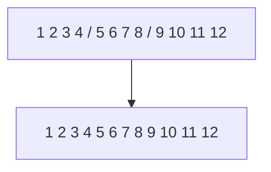
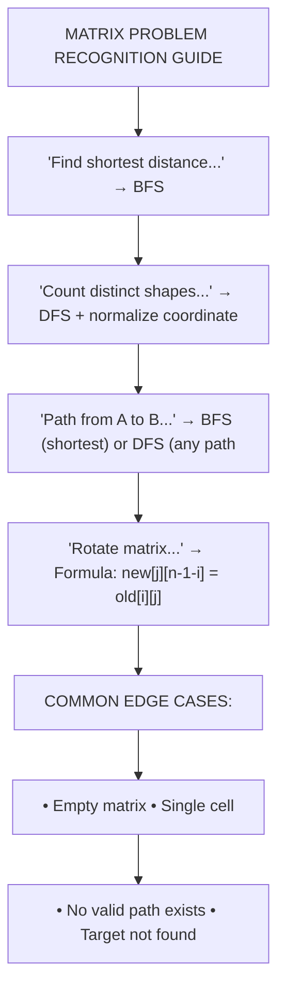

> **Navigation**: [< Previous](03_Collections_Java.md) | [Back to Index](../00_MASTER_INDEX.md)

# 🔲 2D Arrays & Matrix: Complete Deep Dive

## From Memory Layout to Complex Traversals

---

# 📊 Part 0: Complete Understanding of 2d Arrays

## What Is A 2D Array?

A 2D array is a COLLECTION OF ARRAYS, organized in rows and columns.
Think of it as a TABLE or GRID.

> 💡 **KEY INSIGHT: In memory, it's still LINEAR!**
The "2D" is just an abstraction for human understanding.

> 💡 **ANALOGY:**
- Excel Spreadsheet: Rows and columns of cells
- Chess Board: 8x8 grid of squares
- Seating Chart: Rows of seats in a theater
- Pixel Grid: Image = matrix of color values

**Historical Context**:
- 1958: FORTRAN introduced multidimensional arrays
- 1979: VisiCalc (first spreadsheet) = 2D array in action
- 1980s: Image processing using matrices
- Today: Every screen you see is a 2D array of pixels!
## What Problem Do 2D Arrays Solve

PROBLEM 1: Representing GRID-BASED data
- Maps: Geographic data in grid form
- Games: Chess, Sudoku, Tic-Tac-Toe boards
- Images: Pixels arranged in grid
PROBLEM 2: Representing RELATIONSHIPS between two sets
- Graph adjacency matrix: connections between nodes
- Distance matrix: distances between cities
- Transition matrix: state changes in systems
PROBLEM 3: Table-structured data
- Spreadsheets: Rows of records, columns of fields
- Databases: Conceptually stored as tables
WITHOUT 2D ARRAYS:
- Would need multiple 1D arrays with manual coordination
- Prone to index mismatch errors
- Harder to visualize and reason about
## Why Learn 2D Arrays Deeply

1. INTERVIEW ESSENTIAL:
30-40% of DSA interview questions involve matrices
Spiral traversal, island counting, path finding, etc.
2. FOUNDATION FOR ADVANCED TOPICS:
- Graph algorithms use adjacency matrices
- Dynamic Programming often uses 2D tables
- Image processing is matrix operations
3. REAL-WORLD UBIQUITY:
- Every image, video frame, game board
- Machine learning uses matrices extensively
- Scientific computing relies on matrix math
4. PATTERN RECOGNITION:
Matrix problems have common patterns:
- Traversal patterns (row, column, diagonal, spiral)
- Search patterns (DFS, BFS on grid)
- Transform patterns (rotate, flip, transpose)
## When To Use 2D Arrays

USE 2D ARRAY WHEN:
- Data naturally has ROW and COLUMN structure
- You need RANDOM ACCESS by two indices
- Problems involve NEIGHBORS (up, down, left, right)
- You're modeling a GRID or BOARD

**Common Problem Patterns**:
- "Given a matrix..." → 2D array
- "Given a grid..." → 2D array
- "Given a board..." → 2D array
- "Find path in maze..." → 2D array + BFS/DFS
- "Count islands..." → 2D array + flood fill
- "Rotate image..." → 2D array transformation

**Alternative Representations**:
- Sparse matrix → Use HashMap of coordinates
- Very large grid → Use coordinate compression
- Dynamic size → Use ArrayList of ArrayLists
## Difficulties & Common Mistakes

1. INDEX CONFUSION:
"Is it [row][col] or [col][row]?"
Solution: ALWAYS use [row][col] in Java. Row = y, Col = x
2. BOUNDARY CHECKING:
ArrayIndexOutOfBounds is common
Solution: Always check 0 <= row < rows && 0 <= col < cols
3. TRAVERSAL ORDER:
"Which direction first?"
Solution: Use direction arrays: dx = {0,0,1,-1}, dy = {1,-1,0,0}
4. MODIFYING WHILE TRAVERSING:
Changing values affects later iterations
Solution: Use visited array or mark with special value
5. JAGGED ARRAYS:
"Rows have different lengths!"
Solution: Use matrix[i].length for each row's column count
## Expected Outcomes

- ✅ INSTANT TRAVERSAL: Write any traversal pattern without thinking
- ✅ BOUNDARY MASTERY: Never get IndexOutOfBounds again
- ✅ PATTERN LIBRARY: Know spiral, diagonal, zigzag, layer-by-layer
- ✅ PROBLEM RECOGNITION: See "grid" → Know 5+ approaches instantly
- ✅ TRANSFORMATION SKILLS: Rotate, flip, transpose without confusion
- ✅ ADVANCED READY: Ready for graph theory and DP on grids

---

# 📊 Part 1: Understanding 2d Arrays From Scratch

## 🧬 What is a 2D Array REALLY?

```
MENTAL MODEL - It's NOT actually "2D" in memory!

YOUR BRAIN THINKS:            COMPUTER STORES:
┌───┬───┬───┬───┐            ┌───┬───┬───┬───┬───┬───┬───┬───┬───┬───┬───┬───┐
│ 1 │ 2 │ 3 │ 4 │   Row 0    │ 1 │ 2 │ 3 │ 4 │ 5 │ 6 │ 7 │ 8 │ 9 │10 │11 │12 │
├───┼───┼───┼───┤            └───┴───┴───┴───┴───┴───┴───┴───┴───┴───┴───┴───┘
│ 5 │ 6 │ 7 │ 8 │   Row 1     ↑Row0 ends↑    ↑Row1 ends↑    ↑Row2 ends↑
├───┼───┼───┼────────────────────────────────────────────────────────────────┤
│ 9 │10 │11 │12 │   Row 2    Memory is LINEAR! Rows stored CONSECUTIVELY.
└───┴───┴───┴────────────────────────────────────────────────────────────────┘

WHY THIS MATTERS:
- arr[i][j] = baseAddress + (i × numColumns + j) × elementSize
- arr[1][2] = base + (1 × 4 + 2) × 4 = base + 24
- This is still O(1) access!

ROW-MAJOR ORDER (Java, C, Python):
arr[0][0], arr[0][1], arr[0][2], arr[1][0], arr[1][1]...

COLUMN-MAJOR ORDER (Fortran, MATLAB):
arr[0][0], arr[1][0], arr[2][0], arr[0][1], arr[1][1]...
```

**Flow:**
- 1 2 3 4 / 5 6 7 8 / 9 10 11 12
- ↓
- 1 2 3 4 5 6 7 8 9 10 11 12



## 🔴 Real-World Origin: Spreadsheets & Images (1970s)

```
PROBLEM 1 - VisiCalc (1979, First Spreadsheet):
- Dan Bricklin needed to represent accounting tables
- Rows = Records, Columns = Fields
- Solution: 2D Array for spreadsheet cells

PROBLEM 2 - Digital Images:
- Each pixel has a position (x, y)
- Image = Grid of pixels
- Solution: 2D Array where arr[row][col] = pixel color

YOUR PHONE CAMERA:
- 12 megapixels = 4000 × 3000 array
- Each cell = RGB values (another array!)
- Photo editing = Matrix operations
```

---

# 📌 Part 2: Declaration & Initialization

## Different Ways to Create 2D Arrays

```java
// METHOD 1: Declare then Initialize (Most Common)
int[][] matrix = new int[3][4];  // 3 rows, 4 columns
// All values initialized to 0

// METHOD 2: Inline Initialization
int[][] matrix = {
    {1, 2, 3, 4},
    {5, 6, 7, 8},
    {9, 10, 11, 12}
};

// METHOD 3: Jagged Array (Different column sizes!)
int[][] jagged = new int[3][];
jagged[0] = new int[2];  // Row 0 has 2 columns
jagged[1] = new int[4];  // Row 1 has 4 columns
jagged[2] = new int[3];  // Row 2 has 3 columns

// VISUAL OF JAGGED:
// Row 0: [_, _]
// Row 1: [_, _, _, _]
// Row 2: [_, _, _]

// METHOD 4: Dynamic Size
int rows = 5, cols = 10;
int[][] dynamic = new int[rows][cols];
```

## ⚠️ EDGE CASES TO ALWAYS CHECK

```java
// EDGE CASE 1: Empty Matrix
int[][] empty = new int[0][0];
// empty.length = 0
// empty[0] → ArrayIndexOutOfBoundsException!

// EDGE CASE 2: Single Row
int[][] singleRow = {{1, 2, 3}};
// singleRow.length = 1
// singleRow[0].length = 3

// EDGE CASE 3: Single Column
int[][] singleCol = {{1}, {2}, {3}};
// singleCol.length = 3
// singleCol[0].length = 1

// EDGE CASE 4: Single Element
int[][] single = {{42}};

// ALWAYS CHECK BEFORE ACCESSING:
if (matrix == null || matrix.length == 0 || matrix[0].length == 0) {
    return; // Handle empty case
}

int rows = matrix.length;
int cols = matrix[0].length;  // ⚠️ Only safe after checking matrix.length > 0
```

---

# 🎨 Part 3: Traversal Patterns

## Pattern 1: Row-by-Row (Standard)

```java
// LEFT TO RIGHT, TOP TO BOTTOM
for (int i = 0; i < rows; i++) {
    for (int j = 0; j < cols; j++) {
        System.out.print(matrix[i][j] + " ");
    }
    System.out.println();
}

// TRACING:
// matrix = {{1,2,3}, {4,5,6}, {7,8,9}}
// i=0: j=0→1, j=1→2, j=2→3  Output: 1 2 3
// i=1: j=0→4, j=1→5, j=2→6  Output: 4 5 6
// i=2: j=0→7, j=1→8, j=2→9  Output: 7 8 9
```

## Pattern 2: Column-by-Column

```java
// TOP TO BOTTOM, LEFT TO RIGHT
for (int j = 0; j < cols; j++) {
    for (int i = 0; i < rows; i++) {
        System.out.print(matrix[i][j] + " ");
    }
    System.out.println();
}

// TRACING:
// matrix = {{1,2,3}, {4,5,6}, {7,8,9}}
// j=0: i=0→1, i=1→4, i=2→7  Output: 1 4 7
// j=1: i=0→2, i=1→5, i=2→8  Output: 2 5 8
// j=2: i=0→3, i=1→6, i=2→9  Output: 3 6 9
```

## Pattern 3: Diagonal Traversal

```java
// MAIN DIAGONAL (Top-left to Bottom-right)
// Only works for square matrix!
for (int i = 0; i < n; i++) {
    System.out.print(matrix[i][i] + " ");
}
// For {{1,2,3}, {4,5,6}, {7,8,9}} → 1 5 9

// ANTI-DIAGONAL (Top-right to Bottom-left)
for (int i = 0; i < n; i++) {
    System.out.print(matrix[i][n-1-i] + " ");
}
// For {{1,2,3}, {4,5,6}, {7,8,9}} → 3 5 7

// ALL DIAGONALS (Diagonal Traverse Problem)
// Complex pattern - see below
```

## Pattern 4: Spiral Traversal (⭐ COMMON INTERVIEW QUESTION)

```java
public List<Integer> spiralOrder(int[][] matrix) {
    List<Integer> result = new ArrayList<>();
    if (matrix.length == 0) return result;

    int top = 0, bottom = matrix.length - 1;
    int left = 0, right = matrix[0].length - 1;

    while (top <= bottom && left <= right) {
        // RIGHT: traverse top row
        for (int j = left; j <= right; j++) {
            result.add(matrix[top][j]);
        }
        top++;

        // DOWN: traverse right column
        for (int i = top; i <= bottom; i++) {
            result.add(matrix[i][right]);
        }
        right--;

        // LEFT: traverse bottom row (if exists)
        if (top <= bottom) {
            for (int j = right; j >= left; j--) {
                result.add(matrix[bottom][j]);
            }
            bottom--;
        }

        // UP: traverse left column (if exists)
        if (left <= right) {
            for (int i = bottom; i >= top; i--) {
                result.add(matrix[i][left]);
            }
            left++;
        }
    }
    return result;
}

// VISUAL TRACING:
// Matrix:
// 1  2  3  4
// 5  6  7  8
// 9  10 11 12
//
// Step 1 (RIGHT): 1→2→3→4, top becomes 1
// Step 2 (DOWN): 8→12, right becomes 2
// Step 3 (LEFT): 11→10→9, bottom becomes 1
// Step 4 (UP): 5, left becomes 1
// Step 5 (RIGHT): 6→7, top becomes 2
// Step 6 (DOWN): nothing (top > bottom)
// Result: [1,2,3,4,8,12,11,10,9,5,6,7]
```

## Pattern 5: Boundary Traversal

```java
// Print only boundary elements
public void printBoundary(int[][] matrix) {
    int rows = matrix.length, cols = matrix[0].length;

    // Top row
    for (int j = 0; j < cols; j++) {
        System.out.print(matrix[0][j] + " ");
    }

    // Right column (excluding top-right)
    for (int i = 1; i < rows; i++) {
        System.out.print(matrix[i][cols-1] + " ");
    }

    // Bottom row (excluding bottom-right)
    if (rows > 1) {
        for (int j = cols-2; j >= 0; j--) {
            System.out.print(matrix[rows-1][j] + " ");
        }
    }

    // Left column (excluding top-left and bottom-left)
    if (cols > 1) {
        for (int i = rows-2; i >= 1; i--) {
            System.out.print(matrix[i][0] + " ");
        }
    }
}
```

---

# 📌 Part 4: Matrix Transformations

## Rotate Matrix 90° Clockwise (⭐ AMAZON FAVORITE)

```java
// METHOD 1: Using Extra Space O(n²)
public int[][] rotate90(int[][] matrix) {
    int n = matrix.length;
    int[][] rotated = new int[n][n];

    for (int i = 0; i < n; i++) {
        for (int j = 0; j < n; j++) {
            rotated[j][n-1-i] = matrix[i][j];
        }
    }
    return rotated;
}

// METHOD 2: In-Place O(1) Space (OPTIMAL)
// TRICK: Transpose + Reverse each row
public void rotate90InPlace(int[][] matrix) {
    int n = matrix.length;

    // Step 1: Transpose (swap rows and columns)
    for (int i = 0; i < n; i++) {
        for (int j = i + 1; j < n; j++) {  // j = i+1 to avoid double swap
            int temp = matrix[i][j];
            matrix[i][j] = matrix[j][i];
            matrix[j][i] = temp;
        }
    }

    // Step 2: Reverse each row
    for (int i = 0; i < n; i++) {
        int left = 0, right = n - 1;
        while (left < right) {
            int temp = matrix[i][left];
            matrix[i][left] = matrix[i][right];
            matrix[i][right] = temp;
            left++;
            right--;
        }
    }
}

// VISUAL TRACING:
// Original:     After Transpose:   After Reverse:
// 1 2 3         1 4 7              7 4 1
// 4 5 6    →    2 5 8         →    8 5 2
// 7 8 9         3 6 9              9 6 3
```

## Other Rotations

```java
// 90° COUNTER-CLOCKWISE: Transpose + Reverse each COLUMN
// 180°: Reverse each row, then reverse order of rows
// Horizontal Flip: Reverse each row
// Vertical Flip: Reverse order of rows
```

---

# 📊 Part 5: Common 2d Array Problems

## Problem 1: Search in Sorted Matrix

```java
// BRUTE FORCE: O(m × n)
// Check every element

// OPTIMAL: O(m + n) - Start from top-right or bottom-left
public boolean searchMatrix(int[][] matrix, int target) {
    if (matrix.length == 0) return false;

    int rows = matrix.length, cols = matrix[0].length;
    int i = 0, j = cols - 1;  // Start from top-right

    while (i < rows && j >= 0) {
        if (matrix[i][j] == target) {
            return true;
        } else if (matrix[i][j] > target) {
            j--;  // Move left (smaller values)
        } else {
            i++;  // Move down (larger values)
        }
    }
    return false;
}

// WHY THIS WORKS:
// From top-right corner:
// - Everything to LEFT is smaller
// - Everything BELOW is larger
// - Each step eliminates a row or column!
//
// TRACING for target = 5:
// Matrix (sorted rows and columns):
// 1  4  7  11
// 2  5  8  12
// 3  6  9  16
//
// Start: (0,3) = 11 > 5, move left
// (0,2) = 7 > 5, move left
// (0,1) = 4 < 5, move down
// (1,1) = 5 = target, FOUND!
```

## Problem 2: Set Matrix Zeroes

```java
// If any cell is 0, set entire row and column to 0

// BRUTE: O(m×n) space - store positions of 0s
// BETTER: O(m+n) space - store which rows/cols have 0
// OPTIMAL: O(1) space - use first row/col as markers

public void setZeroes(int[][] matrix) {
    int rows = matrix.length, cols = matrix[0].length;
    boolean firstRowZero = false, firstColZero = false;

    // Check if first row has zero
    for (int j = 0; j < cols; j++) {
        if (matrix[0][j] == 0) firstRowZero = true;
    }

    // Check if first col has zero
    for (int i = 0; i < rows; i++) {
        if (matrix[i][0] == 0) firstColZero = true;
    }

    // Use first row/col as markers
    for (int i = 1; i < rows; i++) {
        for (int j = 1; j < cols; j++) {
            if (matrix[i][j] == 0) {
                matrix[i][0] = 0;  // Mark row
                matrix[0][j] = 0;  // Mark col
            }
        }
    }

    // Zero out based on markers
    for (int i = 1; i < rows; i++) {
        for (int j = 1; j < cols; j++) {
            if (matrix[i][0] == 0 || matrix[0][j] == 0) {
                matrix[i][j] = 0;
            }
        }
    }

    // Handle first row and column
    if (firstRowZero) {
        for (int j = 0; j < cols; j++) matrix[0][j] = 0;
    }
    if (firstColZero) {
        for (int i = 0; i < rows; i++) matrix[i][0] = 0;
    }
}
```

## Problem 3: Maximum Sum Rectangle (⭐ NETCRACKER LEVEL)

```java
// Find rectangle with maximum sum in 2D array
// Uses Kadane's Algorithm for 1D extended to 2D

public int maxSumRectangle(int[][] matrix) {
    int rows = matrix.length, cols = matrix[0].length;
    int maxSum = Integer.MIN_VALUE;

    // Try all possible left boundaries
    for (int left = 0; left < cols; left++) {
        int[] temp = new int[rows];  // Compress columns into 1D

        // Extend right boundary
        for (int right = left; right < cols; right++) {
            // Add current column to temp
            for (int i = 0; i < rows; i++) {
                temp[i] += matrix[i][right];
            }

            // Apply Kadane's on temp to find max sum subarray
            int currentMax = kadane(temp);
            maxSum = Math.max(maxSum, currentMax);
        }
    }
    return maxSum;
}

private int kadane(int[] arr) {
    int maxSoFar = arr[0], maxEndingHere = arr[0];
    for (int i = 1; i < arr.length; i++) {
        maxEndingHere = Math.max(arr[i], maxEndingHere + arr[i]);
        maxSoFar = Math.max(maxSoFar, maxEndingHere);
    }
    return maxSoFar;
}

// TIME: O(cols² × rows) - Much better than O(rows² × cols²) brute force
```

---

# 🕸️ Part 6: Matrix in Graph Problems

## Grid as Graph

```java
// 2D Grid can be treated as a GRAPH!
// Each cell is a NODE
// Adjacent cells (up, down, left, right) are EDGES

// DIRECTION ARRAYS - Memorize this!
int[] dx = {-1, 1, 0, 0};  // row changes
int[] dy = {0, 0, -1, 1};  // col changes
// dx[0],dy[0] = (-1,0) = UP
// dx[1],dy[1] = (1,0)  = DOWN
// dx[2],dy[2] = (0,-1) = LEFT
// dx[3],dy[3] = (0,1)  = RIGHT

// 8 DIRECTIONS (including diagonals):
int[] dx8 = {-1, -1, -1, 0, 0, 1, 1, 1};
int[] dy8 = {-1, 0, 1, -1, 1, -1, 0, 1};

// BOUNDARY CHECK HELPER:
boolean isValid(int i, int j, int rows, int cols) {
    return i >= 0 && i < rows && j >= 0 && j < cols;
}

// BFS ON GRID:
public void bfsOnGrid(int[][] grid, int startRow, int startCol) {
    int rows = grid.length, cols = grid[0].length;
    boolean[][] visited = new boolean[rows][cols];
    Queue<int[]> queue = new LinkedList<>();

    queue.offer(new int[]{startRow, startCol});
    visited[startRow][startCol] = true;

    while (!queue.isEmpty()) {
        int[] cell = queue.poll();
        int r = cell[0], c = cell[1];

        // Process current cell
        System.out.println("Visiting: (" + r + "," + c + ")");

        // Explore all 4 neighbors
        for (int d = 0; d < 4; d++) {
            int newR = r + dx[d];
            int newC = c + dy[d];

            if (isValid(newR, newC, rows, cols) && !visited[newR][newC]) {
                visited[newR][newC] = true;
                queue.offer(new int[]{newR, newC});
            }
        }
    }
}
```

## Number of Islands (Classic)

```java
public int numIslands(char[][] grid) {
    if (grid == null || grid.length == 0) return 0;

    int count = 0;
    int rows = grid.length, cols = grid[0].length;

    for (int i = 0; i < rows; i++) {
        for (int j = 0; j < cols; j++) {
            if (grid[i][j] == '1') {
                count++;
                dfs(grid, i, j);  // Sink the island
            }
        }
    }
    return count;
}

private void dfs(char[][] grid, int i, int j) {
    // Boundary check + water check
    if (i < 0 || i >= grid.length || j < 0 || j >= grid[0].length
        || grid[i][j] == '0') {
        return;
    }

    grid[i][j] = '0';  // Mark as visited (sink)

    // Explore all 4 directions
    dfs(grid, i - 1, j);  // Up
    dfs(grid, i + 1, j);  // Down
    dfs(grid, i, j - 1);  // Left
    dfs(grid, i, j + 1);  // Right
}

// TRACING:
// Grid:
// 1 1 0 0 0
// 1 1 0 0 0
// 0 0 1 0 0
// 0 0 0 1 1
//
// i=0,j=0: Found '1', count=1, DFS sinks all connected 1s
// DFS path: (0,0)→(0,1)→(1,0)→(1,1) all become '0'
// i=2,j=2: Found '1', count=2, DFS sinks (2,2)
// i=3,j=3: Found '1', count=3, DFS sinks (3,3)→(3,4)
// Final count: 3
```

---

# 💪 Part 7: Practice Problems

## Difficulty Progression

| Level  | Problem               | Key Concept          |
| ------ | --------------------- | -------------------- |
| Easy   | Transpose Matrix      | Basic nested loops   |
| Easy   | Diagonal Traverse     | Index manipulation   |
| Easy   | Matrix Diagonal Sum   | Main + Anti diagonal |
| Medium | Spiral Matrix         | Boundary management  |
| Medium | Rotate Image          | In-place transform   |
| Medium | Set Matrix Zeroes     | Space optimization   |
| Medium | Search 2D Matrix      | Binary search        |
| Medium | Number of Islands     | DFS on grid          |
| Medium | Word Search           | Backtracking         |
| Hard   | Maximal Rectangle     | DP + Stack           |
| Hard   | Shortest Path in Grid | BFS with obstacles   |

## Netcracker-Style Questions

```java
// Q1: Count all paths from top-left to bottom-right
// (can only move right or down)
public int countPaths(int m, int n) {
    int[][] dp = new int[m][n];

    // First row: only 1 way to reach each cell
    for (int j = 0; j < n; j++) dp[0][j] = 1;

    // First col: only 1 way to reach each cell
    for (int i = 0; i < m; i++) dp[i][0] = 1;

    // Fill rest: ways = from top + from left
    for (int i = 1; i < m; i++) {
        for (int j = 1; j < n; j++) {
            dp[i][j] = dp[i-1][j] + dp[i][j-1];
        }
    }

    return dp[m-1][n-1];
}

// Q2: Minimum path sum from top-left to bottom-right
public int minPathSum(int[][] grid) {
    int m = grid.length, n = grid[0].length;

    // Modify first row (cumulative sum)
    for (int j = 1; j < n; j++) {
        grid[0][j] += grid[0][j-1];
    }

    // Modify first col
    for (int i = 1; i < m; i++) {
        grid[i][0] += grid[i-1][0];
    }

    // Fill rest: min of top or left + current
    for (int i = 1; i < m; i++) {
        for (int j = 1; j < n; j++) {
            grid[i][j] += Math.min(grid[i-1][j], grid[i][j-1]);
        }
    }

    return grid[m-1][n-1];
}
```

---

# 🎤 Part 7.5: Coderbyte & Interview Matrix Challenges

## Challenge 1: Closest Enemy with Wrap-Around (BFS)

```
Problem: Find shortest distance from '1' to nearest '2' in a matrix.
         Can wrap around edges (toroidal grid).

Example:
0 0 0 0
1 0 0 0    Answer: 2 (wrap left + move down)
0 0 0 2
0 0 0 2

Key Insight: BFS guarantees shortest path. Use modulo for wrap-around.
```

```java
public class ClosestEnemy {
    public static int findClosestEnemy(String[] strArr) {
        int rows = strArr.length;
        int cols = strArr[0].length();

        // Find position of 1
        int startRow = -1, startCol = -1;
        for (int i = 0; i < rows; i++) {
            for (int j = 0; j < cols; j++) {
                if (strArr[i].charAt(j) == '1') {
                    startRow = i;
                    startCol = j;
                    break;
                }
            }
            if (startRow != -1) break;
        }

        // BFS with wrap-around
        boolean[][] visited = new boolean[rows][cols];
        Queue<int[]> queue = new LinkedList<>();
        queue.offer(new int[]{startRow, startCol, 0}); // row, col, distance
        visited[startRow][startCol] = true;

        int[][] directions = {{-1, 0}, {1, 0}, {0, -1}, {0, 1}};

        while (!queue.isEmpty()) {
            int[] curr = queue.poll();
            int r = curr[0], c = curr[1], dist = curr[2];

            // Found enemy?
            if (strArr[r].charAt(c) == '2') {
                return dist;
            }

            // Explore neighbors with WRAP-AROUND using modulo
            for (int[] dir : directions) {
                int newR = (r + dir[0] + rows) % rows;  // Wrap vertically
                int newC = (c + dir[1] + cols) % cols;  // Wrap horizontally

                if (!visited[newR][newC]) {
                    visited[newR][newC] = true;
                    queue.offer(new int[]{newR, newC, dist + 1});
                }
            }
        }

        return 0; // No enemy found
    }

    // Test
    public static void main(String[] args) {
        String[] test1 = {"0000", "1000", "0002", "0002"};
        System.out.println(findClosestEnemy(test1)); // Output: 2

        String[] test2 = {"000", "100", "200"};
        System.out.println(findClosestEnemy(test2)); // Output: 1
    }
}

// PATTERN: BFS on Grid with Wrap-Around
// Key formula: newPos = (pos + delta + size) % size
// This handles both positive and negative deltas!
```

---

## Challenge 2: Vowel Square (2x2 Pattern Matching)

```
Problem: Find top-left position of first 2x2 square containing only vowels.
         Return "row-col" format or "not found".

Example:
a b c d
e i k r    Answer: "1-0" (the 2x2 square: ei/ou)
o u f j

Key Insight: Check every possible 2x2 starting position.
             Iterate top-left to ensure "most top-left" requirement.
```

```java
public class VowelSquare {
    public static String findVowelSquare(String[] strArr) {
        Set<Character> vowels = new HashSet<>(Arrays.asList(
            'a', 'e', 'i', 'o', 'u', 'A', 'E', 'I', 'O', 'U'));

        int rows = strArr.length;
        int cols = strArr[0].length();

        // Check each possible 2x2 starting position
        for (int i = 0; i < rows - 1; i++) {
            for (int j = 0; j < cols - 1; j++) {
                // Check all 4 cells of the 2x2 square
                if (vowels.contains(strArr[i].charAt(j)) &&
                    vowels.contains(strArr[i].charAt(j + 1)) &&
                    vowels.contains(strArr[i + 1].charAt(j)) &&
                    vowels.contains(strArr[i + 1].charAt(j + 1))) {
                    return i + "-" + j;
                }
            }
        }

        return "not found";
    }

    public static void main(String[] args) {
        String[] test1 = {"abcd", "eikr", "oufj"};
        System.out.println(findVowelSquare(test1)); // "1-0"

        String[] test2 = {"aqrst", "ukaei", "ffooo"};
        System.out.println(findVowelSquare(test2)); // "1-2"

        String[] test3 = {"gg", "ff"};
        System.out.println(findVowelSquare(test3)); // "not found"
    }
}
```

---

## Challenge 3: Find NxN Submatrix Pattern (Generalized)

```java
// Generalized: Find first MxM square matching a condition
public static String findSquare(String[] strArr, int size, Predicate<Character> condition) {
    int rows = strArr.length;
    int cols = strArr[0].length();

    for (int i = 0; i <= rows - size; i++) {
        for (int j = 0; j <= cols - size; j++) {
            if (checkSquare(strArr, i, j, size, condition)) {
                return i + "-" + j;
            }
        }
    }
    return "not found";
}

private static boolean checkSquare(String[] strArr, int startR, int startC,
                                    int size, Predicate<Character> condition) {
    for (int i = startR; i < startR + size; i++) {
        for (int j = startC; j < startC + size; j++) {
            if (!condition.test(strArr[i].charAt(j))) {
                return false;
            }
        }
    }
    return true;
}

// Usage:
// findSquare(arr, 2, c -> "aeiouAEIOU".indexOf(c) != -1);  // Vowel square
// findSquare(arr, 3, c -> Character.isDigit(c));           // 3x3 digit square
```

---

## Challenge 4: Matrix Rotation with Queries

```java
// Rotate matrix 90° clockwise, then answer position queries
public class MatrixRotation {

    // Rotate 90° clockwise: new[j][n-1-i] = old[i][j]
    public static int[][] rotate90Clockwise(int[][] matrix) {
        int n = matrix.length;
        int[][] rotated = new int[n][n];

        for (int i = 0; i < n; i++) {
            for (int j = 0; j < n; j++) {
                rotated[j][n - 1 - i] = matrix[i][j];
            }
        }
        return rotated;
    }

    // After K 90° rotations, where does (r, c) end up?
    public static int[] positionAfterKRotations(int n, int r, int c, int k) {
        k = k % 4; // Only 4 unique rotations

        for (int i = 0; i < k; i++) {
            int newR = c;
            int newC = n - 1 - r;
            r = newR;
            c = newC;
        }
        return new int[]{r, c};
    }
}
```

---

## Challenge 5: Shortest Path in Grid with Obstacles

```java
// BFS to find shortest path in grid avoiding obstacles
public static int shortestPath(int[][] grid, int[] start, int[] end) {
    int rows = grid.length, cols = grid[0].length;

    if (grid[start[0]][start[1]] == 1 || grid[end[0]][end[1]] == 1) {
        return -1; // Start or end is blocked
    }

    boolean[][] visited = new boolean[rows][cols];
    Queue<int[]> queue = new LinkedList<>();
    queue.offer(new int[]{start[0], start[1], 0});
    visited[start[0]][start[1]] = true;

    int[][] dirs = {{0,1}, {0,-1}, {1,0}, {-1,0}};

    while (!queue.isEmpty()) {
        int[] curr = queue.poll();
        int r = curr[0], c = curr[1], dist = curr[2];

        if (r == end[0] && c == end[1]) return dist;

        for (int[] d : dirs) {
            int nr = r + d[0], nc = c + d[1];

            if (nr >= 0 && nr < rows && nc >= 0 && nc < cols &&
                !visited[nr][nc] && grid[nr][nc] == 0) {
                visited[nr][nc] = true;
                queue.offer(new int[]{nr, nc, dist + 1});
            }
        }
    }

    return -1; // No path exists
}
```

---

## Challenge 6: Count Distinct Islands (DFS + Normalization)

```java
// Count distinct island shapes in a grid
public static int numDistinctIslands(int[][] grid) {
    Set<String> uniqueIslands = new HashSet<>();
    int rows = grid.length, cols = grid[0].length;

    for (int i = 0; i < rows; i++) {
        for (int j = 0; j < cols; j++) {
            if (grid[i][j] == 1) {
                StringBuilder shape = new StringBuilder();
                dfsIsland(grid, i, j, i, j, shape);
                uniqueIslands.add(shape.toString());
            }
        }
    }

    return uniqueIslands.size();
}

private static void dfsIsland(int[][] grid, int r, int c,
                               int baseR, int baseC, StringBuilder shape) {
    if (r < 0 || r >= grid.length || c < 0 || c >= grid[0].length ||
        grid[r][c] != 1) {
        return;
    }

    grid[r][c] = 0; // Mark visited

    // Store relative position from starting point
    shape.append((r - baseR) + "," + (c - baseC) + ";");

    dfsIsland(grid, r + 1, c, baseR, baseC, shape);
    dfsIsland(grid, r - 1, c, baseR, baseC, shape);
    dfsIsland(grid, r, c + 1, baseR, baseC, shape);
    dfsIsland(grid, r, c - 1, baseR, baseC, shape);
}
```

---

## Matrix Challenge Patterns Summary

```
┌─────────────────────────────────────────────────────────────────────────────────┐
│                    MATRIX PROBLEM RECOGNITION GUIDE                             │
├─────────────────────────────────────────────────────────────────────────────────┤
│                                                                                 │
│  "Find shortest distance..."          → BFS                                     │
│  "Can wrap around edges..."           → Use modulo: (pos + delta + size) % size │
│  "Find NxN square with property..."   → Nested loops, check all positions       │
│  "Count distinct shapes..."           → DFS + normalize coordinates             │
│  "Path from A to B..."                → BFS (shortest) or DFS (any path)        │
│  "Rotate matrix..."                   → Formula: new[j][n-1-i] = old[i][j]      │
│  "Transform based on neighbors..."    → Need copy or process in specific order  │
│                                                                                 │
│  COMMON EDGE CASES:                                                             │
│  • Empty matrix                  • Single cell                                  │
│  • No valid path exists          • Target not found                             │
│  • All cells are same value      • Wrap-around boundaries                       │
│                                                                                 │
└─────────────────────────────────────────────────────────────────────────────────┘
```

**Flow:**
- MATRIX PROBLEM RECOGNITION GUIDE
- ↓
- 'Find shortest distance...'
- ↓
- BFS
- ↓
- 'Find shortest distance...'
- ↓
- BFS
- ↓
- 'Count distinct shapes...'
- ↓
- DFS + normalize coordinate
- ↓
- 'Count distinct shapes...'
- ↓
- DFS + normalize coordinate
- ↓
- 'Path from A to B...'
- ↓
- BFS (shortest) or DFS (any path
- ↓
- 'Path from A to B...'
- ↓
- BFS (shortest) or DFS (any path
- ↓
- 'Rotate matrix...'
- ↓
- Formula: new[j][n-1-i] = old[i][j]
- ↓
- 'Rotate matrix...'
- ↓
- Formula: new[j][n-1-i] = old[i][j]
- ↓
- COMMON EDGE CASES:
- ↓
- • Empty matrix • Single cell



---

# 📌 Part 8: Edge Cases Checklist

```
⬜ Empty matrix: matrix.length == 0 or matrix[0].length == 0
⬜ Single element: 1×1 matrix
⬜ Single row: 1×n matrix
⬜ Single column: n×1 matrix
⬜ Square vs rectangular: n×n vs m×n
⬜ Jagged array: rows have different lengths
⬜ All same values: what if all 0s or all 1s?
⬜ Negative values: don't assume positive
⬜ Integer overflow: sum of large values
⬜ Boundary access: i-1, j-1, i+1, j+1 in bounds?
```

---

# 📌 Part 9: Real — World Applications

```
1. IMAGE PROCESSING
   - Filters use matrix convolution
   - Blur = average of neighbors
   - Edge detection = difference from neighbors

2. GAME DEVELOPMENT
   - Chess board, Sudoku grid
   - Collision detection
   - Pathfinding (A* algorithm)

3. SPREADSHEETS
   - Excel is a giant 2D array
   - Formulas reference cells by [row][col]

4. DATABASES
   - Tables can be viewed as 2D arrays
   - Rows = records, Columns = fields

5. MACHINE LEARNING
   - Neural networks use matrix multiplication
   - Images fed as pixel matrices
```

---

# 📊 Curated Practice Problems — 2d Arrays & Matrix

> **HOW TO USE**: Section 1 = traversal basics. Section 2 = search/transform. Section 3 = advanced.

---

## Section 1: Matrix Traversal & Basics

| # | Problem | Platform | Difficulty | Key Technique |
|---|---------|----------|------------|---------------|
| 1 | Reshape the Matrix (LC 566) | LeetCode | Easy | row = idx/cols, col = idx%cols |
| 2 | Transpose Matrix (LC 867) | LeetCode | Easy | Swap [i][j] → [j][i] |
| 3 | Rotate Image (LC 48) | LeetCode | Medium | Transpose + reverse rows (or layers) |
| 4 | Spiral Matrix (LC 54) | LeetCode | Medium | 4-boundary shrink traversal |
| 5 | Spiral Matrix II (LC 59) | LeetCode | Medium | Fill in spiral order |
| 6 | Diagonal Traverse (LC 498) | LeetCode | Medium | Direction flip on boundaries |
| 7 | Toeplitz Matrix (LC 766) | LeetCode | Easy | Each diagonal has same value |

---

## Section 2: Matrix Search & Transform

| # | Problem | Platform | Difficulty | Key Technique |
|---|---------|----------|------------|---------------|
| 1 | Search a 2D Matrix (LC 74) | LeetCode | Medium | Treat as 1D sorted → binary search |
| 2 | Search a 2D Matrix II (LC 240) | LeetCode | Medium | Start top-right, eliminate row/col |
| 3 | Set Matrix Zeroes (LC 73) | LeetCode | Medium | Use first row/col as markers |
| 4 | Game of Life (LC 289) | LeetCode | Medium | Encode states in bits for in-place |
| 5 | Valid Sudoku (LC 36) | LeetCode | Medium | Row/col/box constraint sets |
| 6 | Island Perimeter (LC 463) | LeetCode | Easy | Count edges not shared with land |

---

## Section 3: Advanced Matrix (DP/BFS on Grid)

| # | Problem | Platform | Difficulty | Key Technique |
|---|---------|----------|------------|---------------|
| 1 | Maximal Square (LC 221) | LeetCode | Medium | DP: min(top,left,diag) + 1 |
| 2 | Maximal Rectangle (LC 85) | LeetCode | Hard | Histogram per row + largest rect |
| 3 | Longest Increasing Path in Matrix (LC 329) | LeetCode | Hard | DFS + memo (topological) |
| 4 | Number of Islands (LC 200) | LeetCode | Medium | Flood fill DFS/BFS |
| 5 | Word Search (LC 79) | LeetCode | Medium | Backtracking on grid |
| 6 | Shortest Path in Binary Matrix (LC 1091) | LeetCode | Medium | BFS 8-directional |

---

## HIDDEN GEMS — Matrix Problems

| # | Problem | Platform | Why It's Valuable |
|---|---------|----------|-------------------|
| 1 | Count Negative Numbers in a Sorted Matrix (LC 1351) | LeetCode | Staircase search O(m+n) |
| 2 | Lucky Numbers in a Matrix (LC 1380) | LeetCode | Row min ∩ col max |
| 3 | Kth Smallest Element in a Sorted Matrix (LC 378) | LeetCode | Binary search on value range |
| 4 | Pacific Atlantic Water Flow (LC 417) | LeetCode | Reverse BFS from borders |
| 5 | Minimum Path Sum (LC 64) | LeetCode | Classic 2D DP on grid |

---

_Master 2D arrays = Master half of interview problems!_ 🔲


---

> **Navigation**: [< Previous](03_Collections_Java.md) | [Back to Index](../00_MASTER_INDEX.md)