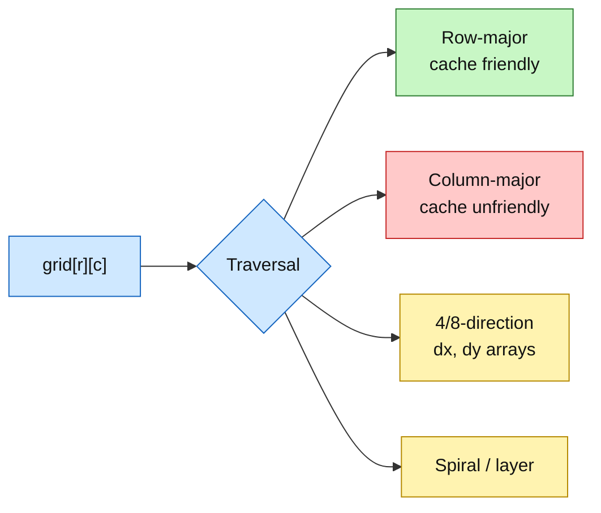

> **Navigation**: [← Java Collections: Complete Method…](03_Collections_Java.md) | [Chapter index](00_INDEX.md) | [Data Structures in the Real World… →](05_DS_In_Production.md)

# 🔲 2D Arrays & Matrix: Complete Deep Dive

## From Memory Layout to Complex Traversals

---

## 💬 Explain It Like a Study Partner — 2D Arrays & Matrices

> [!TIP]
> **Ask yourself first:** *"A grid has rows and columns, but memory is one long line. How does `grid[r][c]` find its cell?"*

### 1. The bottom line

A 2D array is a grid in your head but a **line in memory**, and every grid problem is really about walking that grid in the right order and staying inside its edges.

### 2. The textbook core

- In Java, `int[][]` is an array of row arrays; each row is contiguous.
- Row-major address (for a flat layout): `base + (r × numCols + c) × elementSize`.
- Traversing **row by row** is cache-friendly; column by column on a large grid is not.
- Grids model images, boards, maps and DP tables. Neighbours come from direction arrays (`dx`, `dy`).
- Always check bounds: `0 <= r < rows && 0 <= c < cols`.
- Grid BFS/DFS is O(R·C) time and space.

### 3. The real-world analogy

A **parking garage**: each floor (row) is a long strip of spots. To find spot 5 on floor 3, you go to floor 3 and walk five spots. Visiting every spot floor by floor is quick; visiting "spot 5 on every floor" means constant elevator rides.

### 4. Walkthrough: count the islands in a grid of `1` (land) and `0` (water)

1. Scan cells row by row.
2. On an unvisited `1`, count one island and start a BFS/DFS from there.
3. The search visits the four neighbours (`dx = {0,0,1,-1}`, `dy = {1,-1,0,0}`), skipping out-of-bounds cells and water, and marks land as visited.
4. When the search ends, the whole island is marked, so the scan will not count it again.
5. Continue the scan; the final count is the number of islands.

> [!NOTE]
> **Quick check:** how do you rotate a square matrix 90° in place? *Transpose it, then reverse each row.*

---

## ⚡ At a Glance — 2D Arrays & Matrices

> [!NOTE]
> **Mental model:** a 2D array is a grid addressed by `[row][col]`. In Java it is an array of row arrays, so rows are contiguous but different rows may not be adjacent in memory.



**How to read this diagram.** Green is the access order the hardware prefers, red is the order that causes cache misses on large grids, yellow are the standard traversal patterns you will reuse.

| Task | Time | Space | Note |
| ---- | ---- | ----- | ---- |
| Full traversal | O(R·C) | O(1) | Loop rows outer, columns inner |
| Transpose (square, in place) | O(n²) | O(1) | Swap `a[i][j]` and `a[j][i]` |
| Rotate 90° (in place) | O(n²) | O(1) | Transpose then reverse rows |
| Prefix-sum build | O(R·C) | O(R·C) | Then any rectangle sum in O(1) |
| Grid BFS/DFS | O(R·C) | O(R·C) | Mark visited; bound-check first |

> [!TIP]
> Always bound-check with `0 <= r < rows && 0 <= c < cols` before touching a neighbour, and keep direction arrays (`dx`, `dy`) instead of copy-pasted `if` branches.

---

## 📊 Part 0: Complete Understanding of 2D Arrays

### 5W1H: Mastering 2D Arrays & Matrices

> [!NOTE]
> **WHAT:** A collection of arrays organized in rows and columns. In memory, it is fundamentally a 1D contiguous block of memory abstracted as a grid.
>
> **WHY:** Essential for representing grid-based data, relationships (graphs), and table-structured records. Many real-world problems (images, maps, games) naturally map to a 2D coordinate system.
>
> **WHO:** Developers implementing UI layouts, processing images, designing games, or solving algorithmic graph and grid problems.
>
> **WHEN:** Use when data has natural row/column relationships, when modeling neighbors (up/down/left/right), or mapping (x,y) coordinates.
>
> **HOW:** By manipulating indices (e.g., `matrix[row][col]`), traversing via nested loops or BFS/DFS, and transforming the matrix in-place.

### What Is A 2D Array?

A 2D array is a COLLECTION OF ARRAYS, organized in rows and columns.
Think of it as a TABLE or GRID.

💡 **KEY INSIGHT: In memory, it's still LINEAR!**
The "2D" is just an abstraction for human understanding.

💡 **ANALOGY:**

- Excel Spreadsheet: Rows and columns of cells
- Chess Board: 8x8 grid of squares
- Seating Chart: Rows of seats in a theater
- Pixel Grid: Image = matrix of color values

**Historical Context**:

- 1958: FORTRAN introduced multidimensional arrays
- 1979: VisiCalc (first spreadsheet) = 2D array in action
- 1980s: Image processing using matrices
- Today: Every screen you see is a 2D array of pixels!

---

## Historical Evolution of 2D Arrays

### Timeline: From Punch Cards to GPU Tensors

| Year | Milestone | Why it matters for 2D arrays |
| ---- | --------- | ---------------------------- |
| Pre-1958 | Actuarial hand-computed tables → punch-card matrices → magnetic drum storage | Tabular data existed long before code |
| 1958 | FORTRAN introduces multi-dimensional arrays (John Backus, IBM) | Matrix algebra becomes expressible in code, not just mathematical notation |
| 1979 | VisiCalc on Apple II (Dan Bricklin, Bob Frankston) | First killer app for 2D arrays on consumer hardware: spreadsheets make 2D arrays accessible to non-programmers |
| 1979 | BLAS (Basic Linear Algebra Subprograms) | Standard library for matrix multiplication and other linear-algebra primitives; Fortran's column-major layout is the default |
| c. 1990 | SPARSKIT (Yousef Saad, University of Minnesota) | Toolkit for sparse-matrix computation; CSR/CSC formats become standard |
| 1990s | OpenGL texture storage | 2D arrays map directly to GPU memory; pixels are accessed via (u, v) coordinates while hardware handles filtering |
| 1995 / 2006 | Numeric, then NumPy (Travis Oliphant) | True N-dimensional arrays in Python; the memory model is exposed to scripting-language programmers |
| 2010s | TensorFlow / PyTorch | N-dimensional arrays (tensors) on GPU/TPU; CUDA memory coalescing requires understanding row vs column layout |
| 2017 | Tile-based GPU architectures (NVIDIA Volta, AMD Vega) | Blocked/tiled 2D layouts become critical for performance; tile sizes are chosen to match shared-memory capacity and warp size |

### Predecessor Systems

| Era         | Storage Medium          | How 2D Structure Was Managed                |
| ----------- | ----------------------- | ------------------------------------------- |
| Pre-1900    | Actuarial ledger books  | Row/column labeling by hand                 |
| 1890s-1920s | Punch cards             | 80-column cards stacked; cards = rows       |
| 1920s-1950s | Magnetic drum           | Data laid out in tracks = "rows"            |
| 1958+       | Core memory / later RAM | Contiguous allocation enables random access |

### What Drove Each Era

1. **Scientific computing (1958)**: Physical simulations (weather, nuclear) required dense linear algebra. FORTRAN's `DIMENSION` statement was revolutionary.
2. **Business computing (1979)**: Ledger-to-spreadsheet transition made 2D arrays visible to non-programmers. VisiCalc was called "the first personal computer software killer app."
3. **Graphics/ML (1990s-present)**: Pixel grids and weight matrices in neural nets drove the GPU tensor era.

---

#### Invariant Statements (Memory Layout Contracts)

These equations are guarantees the compiler/runtime makes about 2D array storage:

```
INVARIANT 1 — Row-Major Offset (C, Java, Python NumPy row-major mode):
    addr(matrix[i][j]) = base + (i × num_cols + j) × element_size

    Example: 1000×1000 int[500][500] with 4-byte ints
        = base + (500 × 1000 + 500) × 4
        = base + 500,500 × 4
        = base + 2,002,000 bytes offset

INVARIANT 2 — Column-Major Offset (Fortran, MATLAB, R, NumPy default for column_stack):
    addr(matrix[i][j]) = base + (j × num_rows + i) × element_size

    Example: 1000×1000 double[500][500] with 8-byte doubles
        = base + (500 × 1000 + 500) × 8
        = base + 500,500 × 8
        = base + 4,004,000 bytes offset

INVARIANT 3 — CSR (Compressed Sparse Row) Array Lengths:
    row_ptr.length  = num_rows + 1
    col_idx.length  = num_nonzeros
    values.length   = num_nonzeros

    The invariant `row_ptr[k] <= row_ptr[k+1]` holds for all k,
    and col_idx is sorted within each row for binary search.
```

### What Problem Do 2D Arrays Solve

**Problem 1: Representing GRID-BASED data**

- Maps: Geographic data in grid form
- Games: Chess, Sudoku, Tic-Tac-Toe boards
- Images: Pixels arranged in grid

**Problem 2: Representing RELATIONSHIPS between two sets**

- Graph adjacency matrix: connections between nodes
- Distance matrix: distances between cities
- Transition matrix: state changes in systems

**Problem 3: Table-structured data**

- Spreadsheets: Rows of records, columns of fields
- Databases: Conceptually stored as tables

**Without 2D arrays:**

- Would need multiple 1D arrays with manual coordination
- Prone to index mismatch errors
- Harder to visualize and reason about

### Why Learn 2D Arrays Deeply

1. INTERVIEW ESSENTIAL:
   30-40% of DSA interview questions involve matrices
   Spiral traversal, island counting, path finding, etc.
2. FOUNDATION FOR ADVANCED TOPICS:

- Graph algorithms use adjacency matrices
- Dynamic Programming often uses 2D tables
- Image processing is matrix operations

3. REAL-WORLD UBIQUITY:

- Every image, video frame, game board
- Machine learning uses matrices extensively
- Scientific computing relies on matrix math

4. PATTERN RECOGNITION:
   Matrix problems have common patterns:

- Traversal patterns (row, column, diagonal, spiral)
- Search patterns (DFS, BFS on grid)
- Transform patterns (rotate, flip, transpose)

### When To Use 2D Arrays

USE 2D ARRAY WHEN:

- Data naturally has ROW and COLUMN structure
- You need RANDOM ACCESS by two indices
- Problems involve NEIGHBORS (up, down, left, right)
- You're modeling a GRID or BOARD

**Common Problem Patterns**:

- "Given a matrix..." → 2D array
- "Given a grid..." → 2D array
- "Given a board..." → 2D array
- "Find path in maze..." → 2D array + BFS/DFS
- "Count islands..." → 2D array + flood fill
- "Rotate image..." → 2D array transformation

**Alternative Representations**:

- Sparse matrix → Use HashMap of coordinates
- Very large grid → Use coordinate compression
- Dynamic size → Use ArrayList of ArrayLists

### Difficulties & Common Mistakes

1. **Index confusion** — "Is it `[row][col]` or `[col][row]`?"
   **Solution:** ALWAYS use `[row][col]` in Java. Row = y, Col = x.
2. **Boundary checking** — `ArrayIndexOutOfBounds` is common.
   **Solution:** Always check `0 <= row < rows && 0 <= col < cols`.
3. **Traversal order** — "Which direction first?"
   **Solution:** Use direction arrays: `dx = {0,0,1,-1}`, `dy = {1,-1,0,0}`.
4. **Modifying while traversing** — changing values affects later iterations.
   **Solution:** Use a visited array or mark with a special value.
5. **Jagged arrays** — "Rows have different lengths!"
   **Solution:** Use `matrix[i].length` for each row's column count.

### Expected Outcomes

- ✅ INSTANT TRAVERSAL: Write any traversal pattern without thinking
- ✅ BOUNDARY MASTERY: Never get IndexOutOfBounds again
- ✅ PATTERN LIBRARY: Know spiral, diagonal, zigzag, layer-by-layer
- ✅ PROBLEM RECOGNITION: See "grid" → Know 5+ approaches instantly
- ✅ TRANSFORMATION SKILLS: Rotate, flip, transpose without confusion
- ✅ ADVANCED READY: Ready for graph theory and DP on grids

---

## 📚 Topic Pages in This Chapter

This chapter is split into focused pages so each topic can be read on its own. Read them in order the first time; use the table to jump back later.

| # | Page | What is inside | Lines |
| --- | --- | --- | --- |
| 1 | [Understanding 2d Arrays From Scratch](04_2D_Arrays_Matrix/01_understanding_2d_arrays_from_scratch.md) | Understanding 2d Arrays From Scratch · Declaration & Initialization | 351 |
| 2 | [Traversal Patterns](04_2D_Arrays_Matrix/02_traversal_patterns.md) | Traversal Patterns · Matrix Transformations | 261 |
| 3 | [Common 2d Array Problems](04_2D_Arrays_Matrix/03_common_2d_array_problems.md) | Common 2d Array Problems · Matrix in Graph Problems · Practice Problems | 383 |
| 4 | [5: Coderbyte & Interview Matrix Challenges](04_2D_Arrays_Matrix/04_coderbyte_interview_matrix_challenges.md) | 5: Coderbyte & Interview Matrix Challenges · Edge Cases Checklist · Real — World Applications | 364 |
| 5 | [University-Level Addendum — 2D Arrays & Matrix as Formal Theory](04_2D_Arrays_Matrix/05_university_level_addendum_2d_arrays_matrix.md) | University-Level Addendum — 2D Arrays &… | 287 |

## 📊 Curated Practice Problems — 2d Arrays & Matrix

**HOW TO USE**: Section 1 = traversal basics. Section 2 = search/transform. Section 3 = advanced.

---

### Section 1: Matrix Traversal & Basics

| #   | Problem                     | Platform | Difficulty | Key Technique                        |
| --- | --------------------------- | -------- | ---------- | ------------------------------------ |
| 1   | Reshape the Matrix (LC 566) | LeetCode | Easy       | row = idx/cols, col = idx%cols       |
| 2   | Transpose Matrix (LC 867)   | LeetCode | Easy       | Swap [i][j] → [j][i]                 |
| 3   | Rotate Image (LC 48)        | LeetCode | Medium     | Transpose + reverse rows (or layers) |
| 4   | Spiral Matrix (LC 54)       | LeetCode | Medium     | 4-boundary shrink traversal          |
| 5   | Spiral Matrix II (LC 59)    | LeetCode | Medium     | Fill in spiral order                 |
| 6   | Diagonal Traverse (LC 498)  | LeetCode | Medium     | Direction flip on boundaries         |
| 7   | Toeplitz Matrix (LC 766)    | LeetCode | Easy       | Each diagonal has same value         |

---

### Section 2: Matrix Search & Transform

| #   | Problem                        | Platform | Difficulty | Key Technique                      |
| --- | ------------------------------ | -------- | ---------- | ---------------------------------- |
| 1   | Search a 2D Matrix (LC 74)     | LeetCode | Medium     | Treat as 1D sorted → binary search |
| 2   | Search a 2D Matrix II (LC 240) | LeetCode | Medium     | Start top-right, eliminate row/col |
| 3   | Set Matrix Zeroes (LC 73)      | LeetCode | Medium     | Use first row/col as markers       |
| 4   | Game of Life (LC 289)          | LeetCode | Medium     | Encode states in bits for in-place |
| 5   | Valid Sudoku (LC 36)           | LeetCode | Medium     | Row/col/box constraint sets        |
| 6   | Island Perimeter (LC 463)      | LeetCode | Easy       | Count edges not shared with land   |

---

🔬 **Section Challenge — Section 2: Matrix Search & Transform**

**Challenge 1 (Reasoning):** In "Search a 2D Matrix II" (where both rows and columns are sorted, but rows don't strictly wrap around), why do we start our search at the top-right (or bottom-left) corner instead of the top-left or bottom-right?

<details><summary>Answer</summary>

We start at the top-right or bottom-left because those corners provide deterministic binary decisions. If you start at the top-right: moving left always decreases the value, and moving down always increases the value. It acts as a binary search tree root. If you started at the top-left, moving right and moving down BOTH increase the value, giving you no logical way to decide which path to eliminate when searching for a target.

</details>

**Challenge 2 (Design):** You are tasked with rotating an NxN image matrix by 90 degrees in-place. If you reverse the rows first, what mathematical operation must you perform next to complete the rotation?

<details><summary>Answer</summary>

If you reverse the rows first (flip upside down), you must then perform a matrix transpose (swap `matrix[i][j]` with `matrix[j][i]`) to achieve a 90-degree clockwise rotation. Alternatively, the standard pattern is Transpose first, then reverse the elements of each row. Both combinations map the coordinate `(i, j)` to `(j, N-1-i)`.

</details>

### Section 3: Advanced Matrix (DP/BFS on Grid)

| #   | Problem                                    | Platform | Difficulty | Key Technique                    |
| --- | ------------------------------------------ | -------- | ---------- | -------------------------------- |
| 1   | Maximal Square (LC 221)                    | LeetCode | Medium     | DP: min(top,left,diag) + 1       |
| 2   | Maximal Rectangle (LC 85)                  | LeetCode | Hard       | Histogram per row + largest rect |
| 3   | Longest Increasing Path in Matrix (LC 329) | LeetCode | Hard       | DFS + memo (topological)         |
| 4   | Number of Islands (LC 200)                 | LeetCode | Medium     | Flood fill DFS/BFS               |
| 5   | Word Search (LC 79)                        | LeetCode | Medium     | Backtracking on grid             |
| 6   | Shortest Path in Binary Matrix (LC 1091)   | LeetCode | Medium     | BFS 8-directional                |

---

### HIDDEN GEMS — Matrix Problems

| #   | Problem                                             | Platform | Why It's Valuable            |
| --- | --------------------------------------------------- | -------- | ---------------------------- |
| 1   | Count Negative Numbers in a Sorted Matrix (LC 1351) | LeetCode | Staircase search O(m+n)      |
| 2   | Lucky Numbers in a Matrix (LC 1380)                 | LeetCode | Row min ∩ col max            |
| 3   | Kth Smallest Element in a Sorted Matrix (LC 378)    | LeetCode | Binary search on value range |
| 4   | Pacific Atlantic Water Flow (LC 417)                | LeetCode | Reverse BFS from borders     |
| 5   | Minimum Path Sum (LC 64)                            | LeetCode | Classic 2D DP on grid        |

---

_Master 2D arrays = Master half of interview problems!_ 🔲

---

## Reality Check

> [!CAUTION]
> **Myth:** "Accessing matrix[row][col] and matrix[col][row] are equivalent"
>
> **Reality:** They are semantically equivalent only if the matrix is square. For an n×m matrix with n≠m, transposing indices accesses a different row — likely an ArrayIndexOutOfBoundsException. Beyond correctness: `matrix[row][col]` iterating row-by-row is cache-friendly (C-order / row-major). `matrix[col][row]` iterating column-by-column causes a cache miss per access — can be 10× slower for large matrices.

> [!CAUTION]
> **Myth:** "A 2D array in Java is stored as a contiguous 2D grid in memory"
>
> **Reality:** Java's `int[][]` is an array of *references to* `int[]` arrays. The rows are separate heap objects at arbitrary memory addresses. Only within a single row is memory contiguous. For numerical computing (matrix multiply, image processing), use a 1D array of size n*m and compute index as `row * cols + col` — truly contiguous, cache-optimal.

> [!CAUTION]
> **Myth:** "In-place matrix rotation requires a temporary matrix"
>
> **Reality:** Classic 90° clockwise rotation can be done in-place in two passes: (1) transpose (swap `[i][j]` with `[j][i]`) (2) reverse each row. No extra matrix needed, O(1) space. Understanding these geometric operations comes from recognizing the composition of reflections.

> [!CAUTION]
> **Myth:** "Matrix multiplication is O(n²) like element-wise operations"
>
> **Reality:** Element-wise multiplication (Hadamard product) is O(n²). Matrix multiplication (dot product, used in linear algebra and ML) is O(n³) for naive implementation. Strassen's algorithm is O(n^2.807). Modern ML frameworks use highly optimised BLAS routines and GPU parallelism — naive loops are 100-1000× slower than cuBLAS for large matrices.

> [!CAUTION]
> **Myth:** "Diagonal traversal and anti-diagonal traversal are the same"
>
> **Reality:** Main diagonal: `matrix[i][i]` — top-left to bottom-right. Anti-diagonal: `matrix[i][n-1-i]` — top-right to bottom-left. The common "diagonals of a matrix" interview problem (print all diagonals) requires tracking which diagonal group each cell belongs to: `row - col` (constant on each main diagonal), `row + col` (constant on each anti-diagonal).
