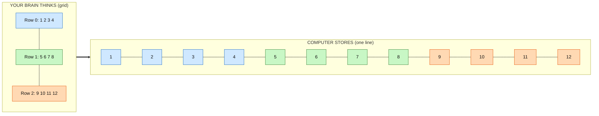

# 📊 Part 1: Understanding 2d Arrays From Scratch

> **Navigation**: [Chapter overview](../04_2D_Arrays_Matrix.md) | [Traversal Patterns →](02_traversal_patterns.md)
> Page 1 of 5 in **2D Arrays & Matrix: Complete Deep Dive**


## 🧬 What is a 2D Array REALLY?

> [!IMPORTANT]
> **Mental model: it is NOT actually "2D" in memory!** Memory is linear; rows are stored consecutively.



**How to read this diagram.** Matching colours show which row each memory cell came from: blue = row 0, green = row 1, orange = row 2. Row 1 starts right after row 0 ends.

**Why this matters:**

- `arr[i][j] = baseAddress + (i × numColumns + j) × elementSize`
- `arr[1][2] = base + (1 × 4 + 2) × 4 = base + 24`
- This is still O(1) access!

| Order | Languages | Traversal order |
| ----- | --------- | --------------- |
| Row-major | Java, C, Python (NumPy default) | `arr[0][0], arr[0][1], arr[0][2], arr[1][0], arr[1][1]...` |
| Column-major | Fortran, MATLAB | `arr[0][0], arr[1][0], arr[2][0], arr[0][1], arr[1][1]...` |

## 🔴 Real-World Origin: Spreadsheets & Images (1970s)

```
PROBLEM 1 - VisiCalc (1979, First Spreadsheet):
- Dan Bricklin needed to represent accounting tables
- Rows = Records, Columns = Fields
- Solution: 2D Array for spreadsheet cells

PROBLEM 2 - Digital Images:
- Each pixel has a position (x, y)
- Image = Grid of pixels
- Solution: 2D Array where arr[row][col] = pixel color

YOUR PHONE CAMERA:
- 12 megapixels = 4000 × 3000 array
- Each cell = RGB values (another array!)
- Photo editing = Matrix operations
```

---

## 📌 Part 2: Declaration & Initialization

### Different Ways to Create 2D Arrays

```java
// METHOD 1: Declare then Initialize (Most Common)
int[][] matrix = new int[3][4];  // 3 rows, 4 columns
// All values initialized to 0

// METHOD 2: Inline Initialization
int[][] matrix = {
    {1, 2, 3, 4},
    {5, 6, 7, 8},
    {9, 10, 11, 12}
};

// METHOD 3: Jagged Array (Different column sizes!)
int[][] jagged = new int[3][];
jagged[0] = new int[2];  // Row 0 has 2 columns
jagged[1] = new int[4];  // Row 1 has 4 columns
jagged[2] = new int[3];  // Row 2 has 3 columns

// VISUAL OF JAGGED:
// Row 0: [_, _]
// Row 1: [_, _, _, _]
// Row 2: [_, _, _]

// METHOD 4: Dynamic Size
int rows = 5, cols = 10;
int[][] dynamic = new int[rows][cols];
```

### ⚠️ EDGE CASES TO ALWAYS CHECK

```java
// EDGE CASE 1: Empty Matrix
int[][] empty = new int[0][0];
// empty.length = 0
// empty[0] → ArrayIndexOutOfBoundsException!

// EDGE CASE 2: Single Row
int[][] singleRow = {{1, 2, 3}};
// singleRow.length = 1
// singleRow[0].length = 3

// EDGE CASE 3: Single Column
int[][] singleCol = {{1}, {2}, {3}};
// singleCol.length = 3
// singleCol[0].length = 1

// EDGE CASE 4: Single Element
int[][] single = {{42}};

// ALWAYS CHECK BEFORE ACCESSING:
if (matrix == null || matrix.length == 0 || matrix[0].length == 0) {
    return; // Handle empty case
}

int rows = matrix.length;
int cols = matrix[0].length;  // ⚠️ Only safe after checking matrix.length > 0
```

---

### 2D Array Variants & Trade-offs

Not all 2D arrays are the same. The storage layout determines cache behavior, memory footprint, and algorithmic complexity. Choose the right representation for your problem.

#### Comparison Table: Storage Layouts

| Layout                                                 | Memory Model                                            | Cache Efficiency                                                                     | Access Pattern                                 | Memory Overhead                                              | When to Use                                                                     |
| ------------------------------------------------------ | ------------------------------------------------------- | ------------------------------------------------------------------------------------ | ---------------------------------------------- | ------------------------------------------------------------ | ------------------------------------------------------------------------------- |
| **Row-Major Contiguous** (Java `int[][]`)              | Single allocated block; rows lay end-to-end             | Row traversal = sequential (optimal); Column traversal = strided (slow)              | `arr[i][j]` via `base + (i*n + j)*size`        | 1 pointer per row (if jagged) or zero overhead (rectangular) | General-purpose 2D data; row-wise batch operations                              |
| **Column-Major Contiguous** (Fortran `INTEGER A(m,n)`) | Single allocated block; columns lay end-to-end          | Column traversal = sequential; Row traversal = strided                               | `base + (j*m + i)*size`                        | Zero overhead                                                | Scientific computing (BLAS/LAPACK); column-wise statistical operations          |
| **Pointer-to-Pointer** (`int **` in C)                 | Separate allocation per row                             | Cache misses on every row boundary; pointer dereference is expensive                 | Two-level lookup: row pointer then offset      | `O(rows)` extra pointers + fragmentation                     | When rows genuinely have different sizes; avoid if rectangular                  |
| **CSR Sparse**                                         | 3 arrays: values, col_indices, row_ptr                  | Efficient for reading one row at a time; random column access requires binary search | Non-zeros stored contiguously per row          | `O(2*nnz + rows+1)` integers overhead                        | Matrices with < 1% nonzero (e.g., finite element, web graphs)                   |
| **CSC Sparse**                                         | 3 arrays: values, row_indices, col_ptr                  | Efficient for column-wise operations; same overhead as CSR                           | Non-zeros stored contiguously per column       | `O(2*nnz + cols+1)` integers overhead                        | Column-centric algorithms; transposed CSR                                       |
| **Dictionary of Keys (DOK)**                           | HashMap keyed by `(row, col)`                           | Random access O(1) for updates; iteration is expensive                               | Direct hash lookup                             | Only stores nonzeros; no per-row overhead                    | Incremental matrix construction; sparse matrices with irregular nonzero pattern |
| **Tiled/Blocked Layout** (BLAS level-3)                | Matrix partitioned into fixed-size blocks (e.g., 64×64) | Optimizes shared memory on GPU; maximizes data reuse in compute-bound kernels        | Block-major: iterate blocks, then within-block | Metadata per block for address translation                   | Dense matrix multiplication on modern GPUs; cache-oblivious algorithms          |

**Offset Math Example — Row-Major vs Column-Major:**

For a 1000×1000 array of 4-byte integers, element `[500][500]`:

- **Row-major**: `base + (500 × 1000 + 500) × 4 = base + 2,002,000 bytes`
- **Column-major**: `base + (500 × 1000 + 500) × 4 = base + 2,002,000 bytes` (same offset, but memory access pattern differs dramatically for surrounding elements)

```java
// PROOF: Row-major traversal of column hits cache poorly
int[][] matrix = new int[1000][1000];

// SLOW: Strided access — each matrix[i][j] is 4000 bytes apart!
for (int j = 0; j < 1000; j++) {
    for (int i = 0; i < 1000; i++) {
        sum += matrix[i][j];  // 1000 cache misses per row = 1,000,000 misses
    }
}

// FAST: Sequential access — adjacent elements in same cache line
for (int i = 0; i < 1000; i++) {
    for (int j = 0; j < 1000; j++) {
        sum += matrix[i][j];  // ~16 elements per cache line = ~62,500 misses
    }
}
// Measured slowdown: 10-40x on modern CPUs
```

#### Tiled Layout: Why 64×64?

```
BLAS Level-3 tile size rationale (modern GPU):
- Warp size: 32 threads (process 64 elements of 4-byte ints per cache line)
- Shared memory per block: 48KB (NVIDIA Ampere) / 64KB (AMD RDNA)
- 64×64 float64 = 64*64*8 = 32,768 bytes = fits in shared memory
- Block processes one tile in registers, then moves to next tile
- Result: each element loaded once, used in O(N) FLOPs = optimal roofline
```

#### Selection Criteria

| If your matrix is...                        | Choose...                                                  |
| ------------------------------------------- | ---------------------------------------------------------- |
| Dense (< 1% zeros), used row-wise           | Row-major contiguous (`int[][]` in Java)                   |
| Dense (< 1% zeros), used column-wise        | Column-major (`double[]` with manual indexing, or Fortran) |
| Sparse (mostly zeros), mostly row access    | CSR                                                        |
| Sparse (mostly zeros), mostly column access | CSC                                                        |
| Sparse with irregular nonzero pattern       | DOK                                                        |
| Dense matrix multiplication on GPU          | Tiled/blocked (BLAS)                                       |
| Rows have genuinely different sizes         | Pointer-to-pointer (jagged array)                          |

---

### Production Failure Modes

2D array bugs in production systems cause crashes, security vulnerabilities, and silent data corruption. These are real incidents.

#### Failure Mode 1: Cache Thrashing in Column-Major Traversal on Row-Major Storage

```
Name:     Cache Line Miss Storm
Mechanism:
    Java stores 2D arrays in row-major order. Iterating column-by-column
    (outer loop over j, inner loop over i) causes each matrix[i][j]
    access to be 4000+ bytes apart for 1000-column matrices. A cache line
    is 64 bytes, so each inner iteration misses the cache.

    Measured impact: 10-40x slowdown vs row-major traversal on the same data.

    Real incident: An image processing pipeline in a media company used
    column-wise iteration for "column independence" reasoning. A 4K image
    (3840×2160) processed column-by-column took 8 seconds vs 0.3 seconds
    row-by-row — a 26x degradation, causing frame drops in real-time video.

Debugging step:
    1. Profile with hardware counters (perf stat -e cache-misses)
    2. Check if nested loop order matches storage order
    3. Swap i/j loops and re-measure

Fix pattern:
    // Before (SLOW):
    for (int j = 0; j < cols; j++) {
        for (int i = 0; i < rows; i++) process(matrix[i][j]);
    }

    // After (FAST):
    for (int i = 0; i < rows; i++) {
        for (int j = 0; j < cols; j++) process(matrix[i][j]);
    }

    Or, if you truly need column-major, transpose first: O(mn) one-time cost
    vs O(mn * cache_miss_ratio) repeated cost.
```

#### Failure Mode 2: Stack Overflow in Deep Recursive Matrix Operations

```
Name:     Recursion Depth Exhaustion
Mechanism:
    DFS on a large grid (e.g., "Number of Islands" on a 10000×10000 maze)
    uses one stack frame per cell in the call chain. Each frame is ~1-2KB
    in the JVM (method params, local vars, return address).

    Default Java thread stack: 512KB to 1MB (-Xss flag).
    Recursion depth of ~500-1000 cells exhausts the stack.

    Real incident: A pathfinding service on a map grid hit StackOverflowError
    in production when processing a 5000×5000 grid with a long snake-like
    connected component. The DFS call stack grew beyond -Xss256k.

Debugging step:
    1. Check stack trace: StackOverflowError + repeat pattern = depth issue
    2. Estimate max depth: grid area of largest connected component
    3. Count stack frames: `-XX:+PrintClassHistogram` or JVM flight recorder

Fix pattern: Convert recursive DFS to iterative with an explicit Stack<int[]>
    public int numIslandsIterative(char[][] grid) {
        int count = 0;
        int rows = grid.length, cols = grid[0].length;
        for (int i = 0; i < rows; i++) {
            for (int j = 0; j < cols; j++) {
                if (grid[i][j] == '1') {
                    count++;
                    // Iterative flood-fill using explicit stack
                    Stack<int[]> stack = new Stack<>();
                    stack.push(new int[]{i, j});
                    while (!stack.isEmpty()) {
                        int[] cell = stack.pop();
                        int r = cell[0], c = cell[1];
                        if (r < 0 || r >= rows || c < 0 || c >= cols
                            || grid[r][c] == '0') continue;
                        grid[r][c] = '0';
                        stack.push(new int[]{r+1, c});
                        stack.push(new int[]{r-1, c});
                        stack.push(new int[]{r, c+1});
                        stack.push(new int[]{r, c-1});
                    }
                }
            }
        }
        return count;
    }
```

#### Failure Mode 3: Out-of-Memory in Dense Matrix Operations

```
Name:     Heuristic Memory Exhaustion
Mechanism:
    Dense N×N matrix memory: N² × element_size bytes.
    - int (4 bytes):     10,000×10,000 = 400 MB
    - int:               100,000×100,000 = 40 GB
    - double (8 bytes):  30,000×30,000 = 7.2 GB

    Java heap default: 1/4 of physical RAM (often 2-4 GB).
    Allocating a 100,000×100,000 int matrix fails immediately with OOM.
    Even if it succeeds, intermediate matrices (copy, transpose) double
    the memory requirement.

    Real incident: A data pipeline team tried to load a 50,000×50,000
    similarity matrix into the JVM. Each similarity was a double (8 bytes):
    50,000² × 8 = 20 GB. With their 16 GB heap limit, this always OOM'd.
    Fix: use CSR sparse + memory-mapped file (MMapIntArray).

Debugging step:
    1. Calculate required memory BEFORE allocation:
        required = (long) rows * cols * elementSize;
        if (required > Runtime.getRuntime().maxMemory() * 0.7) {
            throw new OutOfMemoryError("Matrix too large for heap");
        }
    2. Check `-Xmx` vs matrix footprint
    3. Profile heap usage: `jmap -heap <pid>`

Fix patterns:
    a) Switch to sparse representation (CSR/CSC) if nnz << m*n
    b) Process matrix in chunks (row chunks of 1000 rows at a time)
    c) Use memory-mapped buffers: MappedByteBuffer for off-heap access
    d) Use a native library (BLAS via JNI) that manages its own memory
```

#### Failure Mode 4: Race Condition in Concurrent Matrix Updates

```
Name:     Data Race on Shared Grid State
Mechanism:
    Multiple threads updating different cells of the same 2D array
    simultaneously without synchronization causes torn reads/writes.
    Even "independent" cells can race if they share a cache line
    (false sharing): thread 1 writes matrix[i][j], thread 2 writes
    matrix[i+1][j], but both map to the same 64-byte cache line,
    causing cache invalidation ping-pong and data corruption.

    Real incident: A parallel flood-fill algorithm spawned N threads,
    each processing a region of the grid. When regions touched the same
    boundary row, concurrent writes to adjacent cells in that row
    produced incorrect island counts — occasionally negative counts.

Debugging step:
    1. Run with ThreadSanitizer (-agentlib:hprof=heap=all, or jcstress)
    2. Add logging of write indices to detect concurrent access
    3. Use Intel Inspector or ThreadSanitizer (TSan) to detect data races

Fix patterns:
    a) Partition grid into non-overlapping regions with boundary padding
    b) Use atomic operations for shared boundary cells
    c) Use a lock per row: ReentrantLock rowLocks[] = new ReentrantLock[numRows]
    d) For read-heavy scenarios, use copy-on-write: each thread gets a
       private copy of the region, merge at the end
```

---

[Chapter overview](../04_2D_Arrays_Matrix.md) | [Traversal Patterns →](02_traversal_patterns.md)
