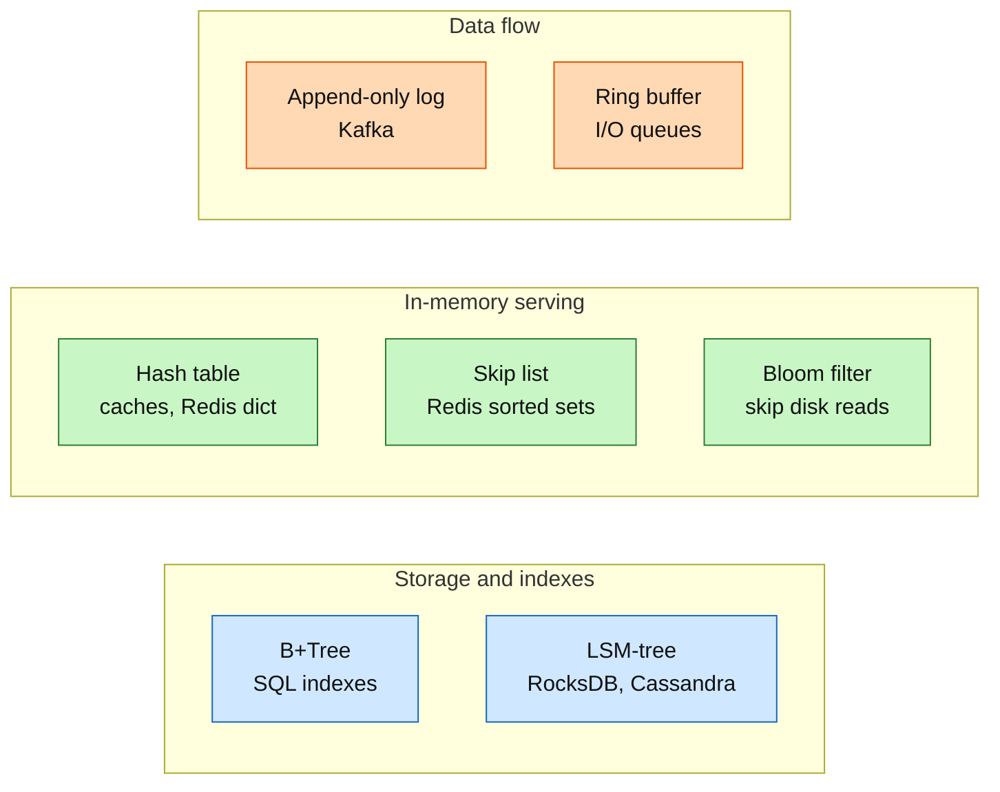

> **Navigation**: [← 2D Arrays](04_2D_Arrays_Matrix.md) | [Back to Index](00_INDEX.md)

# 🏗️ Data Structures in the Real World — Where DS Concepts Appear in Production Systems

> _"You won't be asked to implement a B-Tree in an interview. But knowing that PostgreSQL uses B-Trees for indexes, that Redis is a hash table, and that Kafka is a distributed log — THAT is what separates a developer from an engineer."_

---

## Where Every DS Lives in Modern Tech

### 5W1H: Mastering Data Structures in Production

> [!NOTE]
> **WHAT:** The application of theoretical data structures (Hash Tables, B-Trees, LSM-Trees, Bloom Filters) inside real-world production systems.
>
> **WHY:** Knowing Big-O is for coding interviews; knowing how to design system architecture using the right storage primitives is for Staff/Principal Engineering. It bridges the gap between code and infrastructure.
>
> **WHO:** Backend engineers, systems architects, and DevOps professionals who need to optimize databases, caches, and high-throughput systems.
>
> **WHEN:** During System Design interviews or when diagnosing performance bottlenecks at scale (e.g., choosing Redis vs. PostgreSQL).
>
> **HOW:** By studying the memory/disk trade-offs, cache-line physics, and read/ write amplification characteristics of foundational data structures.

---

## 💬 Explain It Like a Study Partner — Data Structures in Production

> [!TIP]
> **Ask yourself first:** *"Interview Big-O says O(1) lookups are great. Why do real databases still keep B-trees and Bloom filters around?"*

### 1. The bottom line

In production you do not pick the structure with the best Big-O; you pick the one whose **worst day** you can survive, given disks, caches and traffic.

### 2. The textbook core

- **B+Trees** store many keys per node to match disk pages → few I/Os for lookups and range scans (SQL indexes).
- **LSM-trees** buffer writes in memory (a MemTable), flush them as sorted immutable files (SSTables) and merge them later → fast, sequential writes (Cassandra, RocksDB).
- **Bloom filters** answer "definitely not here" cheaply, so you can skip disk reads.
- **Hash map + doubly linked list** gives an O(1) LRU cache.
- Real systems add **sizing rules** (load factors, capacity limits) and **monitoring**, because unbounded structures cause incidents.

### 3. The real-world analogy

A **busy restaurant kitchen**: orders are written on the ticket rail first (fast, sequential, like the commit log), prepared at stations (memory), and the pantry (disk) is only visited when necessary. A quick "do we have saffron?" sign on the pantry door (Bloom filter) saves a trip when the answer is no.

### 4. Walkthrough: one write and one read in an LSM database

1. **Write:** append to the commit log (sequential disk write), then insert into the in-memory MemTable (often a skip list).
2. When the MemTable is full, flush it as an immutable sorted SSTable (Level 0).
3. Background compaction merges small SSTables into larger ones.
4. **Read:** check the MemTable, then for each SSTable ask its Bloom filter first. If it says "no", skip that file entirely; if "maybe", read the file.
5. Result: writes stay fast and sequential, and most absent-key reads cost zero disk seeks.

> [!NOTE]
> **Quick check:** why does an LSM-tree read slower than a B-tree on average? *A read may need to check several SSTables, while a B-tree usually needs one traversal.*

---

## ⚡ At a Glance — Where Each DS Lives in Production

> [!NOTE]
> **Mental model:** production systems rarely use a textbook structure unchanged. They pick the structure whose *worst case matches the failure they cannot afford*, then add sizing rules and monitoring.



**How to read this diagram.** Blue groups the structures that sit on disk, green the ones that serve requests from memory, orange the ones that move data. The rest of this chapter walks real incidents for each.

| Need | Typical structure | Why |
| ---- | ----------------- | --- |
| Range queries on disk | B+Tree | High fan-out, few page reads |
| Write-heavy storage | LSM-tree | Sequential writes, compaction later |
| "Probably not present" check | Bloom filter | Tiny memory, no false negatives |
| Cache with eviction | Hash map + doubly linked list (LRU) | O(1) lookup and O(1) reorder |
| Leaderboards | Skip list / balanced tree | Ordered, range-capable |

> [!WARNING]
> Capacity planning matters as much as Big-O: unbounded maps, queues and caches are the most common production memory incidents.

---

## 📚 Topic Pages in This Chapter

This chapter is split into focused pages so each topic can be read on its own. Read them in order the first time; use the table to jump back later.

| # | Page | What is inside | Lines |
| --- | --- | --- | --- |
| 1 | [Conceptual Framing: Why Production DS Literacy Matters](05_DS_In_Production/01_conceptual_framing_why_production_ds_literacy.md) | Conceptual Framing: Why Production DS… | 45 |
| 2 | [The History of DS in Computing](05_DS_In_Production/02_the_history_of_ds_in_computing.md) | The History of DS in Computing · Production Failure Modes & Debugging · Performance Characteristics — The Full Picture · Choosing the Right Data Structure — Decision… · System Design Interview → DS Mapping · … | 394 |
| 3 | [THE GRAND UNIFIED THEORY OF PRODUCTION DATA STRUCTURES…](05_DS_In_Production/03_the_grand_unified_theory_of_production.md) | THE GRAND UNIFIED THEORY OF PRODUCTION DATA… | 213 |
| 4 | [University-Level Addendum — DS in Production as Forensic…](05_DS_In_Production/04_university_level_addendum_ds_in_production.md) | University-Level Addendum — DS in Production… | 283 |

## Historical Evolution of Production Data Systems

Understanding _why_ each system was built — and what it was designed to replace — makes the DS choices obvious in retrospect.

### Timeline: From Hierarchical DBs to Learned Indexes

| Era | System / paper | DS motivation |
| --- | -------------- | ------------- |
| 1960s | IBM IMS (hierarchical); CODASYL (network DB) | First production DBs: tree and graph traversal; slow ad-hoc queries |
| 1970 | Codd's Relational Model (IBM) | Set-based algebra; query optimization beats navigation |
| 1974 | System R (IBM San Jose) | First SQL implementation; B-Tree indexes prototyped here |
| 1979 | Oracle v2 (Relational Software Inc.) | First commercial RDBMS; B-Tree indexing adopted |
| 1986 / 1996 | POSTGRES (Stonebraker, UC Berkeley) → PostgreSQL | Object-relational model + B-Tree indexes; renamed PostgreSQL in 1996 |
| 1996 / 1998 | Java 1.0 → Collections Framework (JDK 1.2) | `Hashtable`/`Vector` first; `HashMap`/`ArrayList` and the unified Collection/Map APIs arrived in 1.2 |
| 2003 | Memcached (Danga Interactive) | In-memory hash cache; no persistence; stateless reads |
| 2008 | Apache Cassandra (Facebook → Apache) | LSM-Tree + Dynamo ring; wide partitions, tunable consistency |
| 2009 | Redis (Salvatore Sanfilippo) | Memcached + persistence; multiple data structures |
| 2009 | Riak (Basho Technologies) | Dynamo paper in production; consistent hashing + CRDTs |
| 2011 | LevelDB (Google, Jeff Dean and Sanjay Ghemawat) | LSM-Tree design; skip-list memtable + SSTables |
| 2012 | RocksDB (Facebook) | LevelDB fork; column families; compaction tuning for SSDs |
| 2015 | CockroachDB (Spencer Kimball et al.) | Spanner-influenced; global distributed SQL + Raft consensus |
| 2016 | HNSW (Malkov & Yashunin) | Hierarchical navigable small world; graph-based approximate nearest-neighbour search |
| 2017+ | Learned indexes (Kraska et al.; later SageDB) | ML models replace or augment the B-Tree index structure |

### Predecessors and Motivations: Why Each System Exists

**Why Redis instead of Memcached?**

- Memcached had no persistence. Server restart = cold cache = thundering herd on the database.
- Antirez (Salvatore Sanfilippo) wanted a persistent, single-threaded, multi-DS in-memory store.
- Redis added persistence (RDB snapshots, AOF logs) in 2009–2011, making it both cache and store.

**Why LSM-Tree revival in 2007–2010?**

- SSDs made _sequential_ writes cheap (no moving heads), but random writes still had erase-cycle overhead.
- B-Trees perform random page splits on every insert — catastrophic for write-heavy IoT/financial workloads.
- LSM-Trees convert every write to a sequential flush — ideal for NAND flash erase granularity.

**Why PostgreSQL forked from Ingres (1973–1985)?**

- Stonebraker wanted object-relational features: user-defined types, inheritance, rules.
- Postgres (1986) added the POSTQUEL query language; PostgreSQL (1996) replaced it with SQL.
- B-Tree remained the default index because ACID + secondary indexes favor read stability.

**Why Kafka uses a partition log instead of a traditional message queue?**

- Traditional queues (RabbitMQ, SQS) delete messages on consumption — no replay.
- LinkedIn needed to replay events for new consumer groups without producer code changes.
- Kafka's append-only log with offset-based consumer groups became the foundation for event streaming.

### Modern Practice Anchors: PostgreSQL, Redis, and Kafka

**PostgreSQL index variants (and when to override B-Tree):**

```
Index Type  │ When It Was Added │ Use Case                          │ DS Internals
────────────┼───────────────────┼───────────────────────────────────┼──────────────────
B-Tree      │ 1997 (v6.0)       │ Primary keys, equality, range     │ Multi-level B+
            │                   │ queries on sortable data          │ tree, 4 KB pages
GIN         │ 200200517 (v7.2)  │ Full-text search, JSONB, arrays   │ Inverted index
GiST        │ 2001 (v7.1)       │ Geometric types, ranges, full-text│ Generalized search
            │                   │                                   │ tree (balanced)
BRIN        │ 2015 (v9.5)       │ Time-series, append-only tables   │ Block range index
            │                   │ (log entries, sensor data)        │ (O(n) scan, tiny)
Hash        │ 2017 (v10)        │ Equality-only on large keys       │ Non-sorted hash
            │                   │ (UUID, JSON)                      │ table, no range qry
```

**Redis persistence (RDB vs AOF):**

```
RDB (Redis Database):  Forked child process snapshots DB every N minutes/seconds.
  Pros: Compact single-file backup; fast restore on restart.
  Cons: Possible data loss between snapshots; fork() pauses on large heaps.
  DS invariant: Snapshot captures hash table state at point-in-time.

AOF (Append Only File): Every write command appended to a file.
  Pros: Near-zero data loss (with fsync=everysec); command-level replay.
  Cons: Larger file than RDB; slower startup replay.
  DS invariant: Append-only log preserves insert order; replay is deterministic.

Recommendation: Use both — AOF for durability, RDB for fast restarts.
```

**Kafka offset-based replay (vs traditional queue deletion):**

| | Traditional queue | Kafka |
| --- | ----------------- | ----- |
| On acknowledgement | **Deletes** the message | **Commits an offset** to the `__consumer_offsets` topic (a compacted map: group → topic → offset) |
| New consumer group | Misses all history | Can replay from any offset in the retained log window |
| Producers | Hand messages to the broker | Write to an append-only partition log; brokers never modify records |

> [!IMPORTANT]
> **DS invariant:** the partition log is immutable; each consumer's position is tracked separately.

---

| Data structure | Where you've already used it (unknowingly) |
| -------------- | ------------------------------------------ |
| **Hash table** | Redis (its keyspace is a hash table) <br> Python `dict` / JavaScript objects (V8 hidden classes) <br> Database hash indexes (O(1) lookup by key) <br> Load balancers: consistent hashing for server selection <br> DNS cache: hostname → IP address <br> Session storage: `sessionId` → user data <br> React reconciliation: `key` prop identifies elements when diffing |
| **Array / buffer** | NumPy `ndarray` (contiguous memory blocks for ML) <br> TCP receive buffer (kernel stores incoming bytes) <br> GPU VRAM: texture buffers, vertex arrays, tensors <br> Database buffer pool: array of page-sized slots <br> Ring buffers: network-card queues, audio buffers, the LMAX Disruptor |
| **Linked list** | React Fiber hooks (a linked list per component) <br> LRU cache (doubly-linked list + hash map) <br> Memory allocators (free list of available blocks) <br> Undo/redo history in editors (each state links to the previous) <br> Blockchain: each block references the previous block's hash |
| **Stack** | Call stack (function execution in every language) <br> Browser history (back/forward navigation) <br> Compiler: parsing expressions (shunting-yard) <br> DFS traversal (BFS uses a queue, DFS uses a stack) |
| **Queue** | Message queues: Kafka, RabbitMQ, SQS (FIFO processing) <br> Print spooler: documents queued for printing <br> BFS in graph traversal (shortest path) <br> Task schedulers: OS run queue, Celery worker queue <br> Rate limiting: sliding-window log (a queue of timestamps) |
| **Tree** | DOM tree (HTML document structure) <br> React Fiber tree (work-in-progress tree of the UI) <br> B-Tree: the default index in PostgreSQL and MySQL <br> File system: directory tree (inodes + hierarchy) <br> JSON/XML: hierarchical data <br> AST: compilers parse code into abstract syntax trees <br> Trie: autocomplete, spell checkers, IP routing tables |
| **Heap / priority queue** | OS scheduler: highest-priority process runs next <br> Dijkstra's algorithm (min-heap for shortest path) <br> Kubernetes scheduler: priority-based scheduling queue <br> Streaming top-K: "most popular tweets right now" <br> Huffman coding (compression used in ZIP/GZIP/PNG) |
| **Graph** | Social networks (friend connections = edges) <br> Google Maps (roads = weighted graph, Dijkstra/A*) <br> Microservice dependency graph (service A calls B, C) <br> Package managers: dependency resolution (topological sort) <br> Git: commit history is a DAG <br> Neural networks: computation graph (PyTorch autograd) |
| **Bloom filter** | Databases: quick "does this key exist?" before a disk read <br> CDNs: has this URL been cached? (probabilistic check) <br> Spell checkers: is this word in the dictionary? <br> Chrome Safe Browsing (is this URL malicious?) <br> Cassandra/HBase: skip SSTable reads if the key is probably absent |
| **Skip list** | Redis sorted sets (`ZRANGEBYSCORE` is backed by a skip list) <br> LevelDB / RocksDB: in-memory memtable index <br> A probabilistic alternative to balanced BSTs |
| **LSM-tree** (log-structured merge-tree) | Cassandra, LevelDB, RocksDB, ScyllaDB <br> Write-optimized: sequential writes only → very high throughput <br> Read: check memtable → check SSTables (multiple levels) <br> vs B-Tree (PostgreSQL): read-optimized, random I/O for writes |

---

## Reality Check

> [!CAUTION]
> **Myth:** "Production code uses textbook data structures directly"
>
> **Reality:** Libraries like Java's `HashMap`, `TreeMap`, `ArrayDeque` ARE textbook data structures. But production code typically uses them through higher-level abstractions: JPA repositories (not raw HashMaps for entity lookup), message queues (not raw queues for async work), Redis sorted sets (not hand-rolled skip lists for leaderboards). The textbook understanding tells you WHICH abstraction to reach for and WHY — it doesn't mean you implement red-black trees in production code.

> [!CAUTION]
> **Myth:** "CPU cache effects don't matter in Java"
>
> **Reality:** Java objects are heap-allocated. Object fields in the same class share a cache line (64 bytes). Two longs in the same object: one cache line fetch for both. A `HashMap` entry with a `String` key: the HashMap array holds references, not values — to access the key and value you follow two pointers, causing two cache misses per entry. This is why arrays of primitives outperform arrays of boxed types: arrays of int are contiguous in memory; arrays of Integer are arrays of references each pointing elsewhere.

> [!CAUTION]
> **Myth:** "Memory usage is the JVM heap size you configured"
>
> **Reality:** JVM memory = heap + metaspace + thread stacks + JIT compiled code cache + off-heap (direct ByteBuffers). With `-Xmx2G`: heap is 2GB. Metaspace (class metadata): 200-500MB in large applications. Thread stacks (each thread gets ~256KB–1MB): 500 threads × 256KB = 128MB. Code cache (JIT compiled code): 200MB default. Total JVM process = 3-4GB for a `-Xmx2G` application. Monitoring: `Runtime.getRuntime().totalMemory()`/`freeMemory()` see heap; `ps`/`top`/`jcmd <pid> VM.native_memory` see the full picture.

> [!CAUTION]
> **Myth:** "Profiling is only needed when there's a performance problem"
>
> **Reality:** Profiling should be part of the normal development cycle for performance-sensitive applications: baseline profile in CI (alert if a key metric regresses), periodic profiling of production under real load (synthetic benchmarks miss real access patterns), flame graphs before and after performance-impacting changes. Waiting until production is slow means diagnosing under pressure. JFR (Java Flight Recorder) has near-zero overhead and can run in production continuously. VisualVM and async-profiler for development.

> [!CAUTION]
> **Myth:** "Thread-local storage eliminates contention"
>
> **Reality:** `ThreadLocal<T>` gives each thread its own instance — no synchronisation needed. But: ThreadLocal values are stored in the Thread object and persist until the thread is reused or terminated. In thread pool environments (servlet containers, Java EE app servers), threads are reused across requests. A forgotten `ThreadLocal.remove()` in a request filter → the next request on the same thread sees the previous request's data (user ID, transaction context, tenant ID). Always `remove()` in a `finally` block. Spring's `TransactionSynchronizationManager` uses ThreadLocal for this — it handles cleanup properly; your own ThreadLocal must too.
