# The History of DS in Computing

> **Navigation**: [← Conceptual Framing: Why Production DS…](01_conceptual_framing_why_production_ds_literacy.md) | [Chapter overview](../05_DS_In_Production.md) | [THE GRAND UNIFIED THEORY OF PRODUCTION DATA… →](03_the_grand_unified_theory_of_production.md)
> Page 2 of 4 in **Data Structures in the Real World — Where DS Concepts Appear in…**


| Era | Milestone |
| --- | --------- |
| 1940s | Von Neumann architecture → arrays (contiguous memory) emerge naturally |
| 1950s | Linked lists (Newell, Shaw & Simon, RAND Corp, for AI research); hash tables (Luhn 1953, Dumey 1956): O(1) lookup changes everything |
| 1962 | AVL tree (Adelson-Velsky & Landis): the first self-balancing BST |
| 1964 | Heaps (J. W. J. Williams, heapsort): priority queues become fundamental |
| 1970 | Bloom filters (Burton Bloom): probabilistic set membership |
| 1970–72 | B-Trees (Bayer & McCreight): designed for databases and file systems |
| 1972–78 | Red-Black trees (Bayer 1972 as symmetric binary B-trees; Guibas & Sedgewick 1978): used in Java `TreeMap` and the Linux kernel |
| 1989–90 | Skip lists (William Pugh): probabilistic balanced structure |
| 1990s | Trie variants (Patricia trees, radix trees): IP routing, autocomplete; consistent hashing (Karger et al., 1997) enables distributed systems |
| 2000s | LSM-trees go mainstream via Google Bigtable (2006) → Cassandra, LevelDB |
| 2010s | CRDTs (conflict-free replicated data types) for distributed collaboration; Count-Min sketch for streaming frequency estimation |
| 2017+ | Learned indexes (Kraska et al.): ML models replacing B-Trees; vector databases (FAISS, Pinecone) for nearest-neighbour search over embeddings |

---

> 🔬 **Section Challenge — The History of DS in Computing**
>
> **Challenge 1 (System Design):** A senior engineer claims: "B-Trees were invented in 1970–72 for slow spinning hard drives. We have NVMe SSDs now, so we should replace all PostgreSQL B-Tree indexes with modern LSM-Trees." Trace the fundamental difference between Read-Optimized and Write-Optimized structures. Why do relational databases still use B-Trees today?
>
> <details><summary>Answer</summary>
>
> **Scenario:** Choosing the right storage engine index (B-Tree vs. LSM-Tree).
> **Trace:**
>
> - **B-Trees (Read-Optimized):** They enforce a strict, balanced structure where finding any record takes exactly `O(log N)` disk page reads. However, inserting a record might cause a slow "page split" (Random I/O).
> - **LSM-Trees (Write-Optimized):** They buffer writes in RAM and flush them sequentially to disk as immutable SSTables. This is blazing fast for writes (Sequential I/O), but reading requires checking the MemTable and potentially multiple SSTable files (Read Amplification).
> **Debug/Fix:** NVMe SSDs are fast, but Sequential I/O is _still_ faster than Random I/O. We use LSM-Trees (Cassandra, Kafka) for extreme write-heavy workloads (e.g., millions of IoT telemetry events per second). However, PostgreSQL still uses B-Trees because relational data relies on complex `JOIN`s, immediate consistency, and secondary indexes. For workloads that are read-heavy (90% reads, 10% writes), the stable, singular `O(log N)` lookup guarantee of a B-Tree outperforms searching through multiple LSM SSTable files.
> </details>

---

## Production Failure Modes & Debugging

> _"Every data structure that ships in production has at least one way to silently corrupt, bloat, or stall under real load. The engineers who know these failure modes fix them in minutes; everyone else pages the on-call team at 3 AM."_

### Redis Cluster Resharding Storm

- **Name:** Hash Slot Migration Latency Spike
- **Mechanism:** When a Redis Cluster node is added or removed, slots are reassigned across nodes. Until both source and destination nodes complete the migration, a client may receive a `MOVED` redirect for any key in the affected slot. Under high write load, this causes a cascade of `ASKING` protocol overhead, pipeline starvation, and latency spikes.

**Debug step (metric):**

```bash
# Check cluster state for migrating slots
redis-cli cluster nodes | grep migrating
# Check for MOVED/ASK latency in slowlog
redis-cli slowlog get 50 | grep -i moved
# Monitor in-flight commands during migration
redis-cli --latency-history
# Metric to watch: cluster_slots_assigned (should be 16384 when stable)
```

> [!TIP]
> **Fix:** Use `redis-cli cluster set-slot` with `--pipeline` for batch slot ownership transfer; throttle client retry with exponential backoff; pre-warm destination node before switching traffic.

---

### PostgreSQL B-Tree Page Bloat

- **Name:** Dead Tuple Accumulation in Heap and Index Pages
- **Mechanism:** PostgreSQL uses MVCC (Multi-Version Concurrency Control). An `UPDATE` does not overwrite the row — it inserts a new version and marks the old one as dead. Until `VACUUM` runs, dead tuples occupy space in both the heap and every B-Tree index pointing to them. This causes table bloat (disk grows), index bloat (fan-out degrades), and slower index-only scans (more pages to read).

**Debug step (command):**

```sql
-- Check table bloat (requires pgstattuple extension)
SELECT pg_size_pretty(pg_total_relation_size('orders') - pg_relation_size('orders')) AS bloat;

-- Check index bloat
SELECT indexname, pg_size_pretty(pg_relation_size(indexrelid)) AS index_size
FROM pg_stat_user_indexes
WHERE idx_scan = 0  -- never used? consider dropping
ORDER BY pg_relation_size(indexrelid) DESC;

-- Check autovacuum activity
SELECT relname, n_dead_tup, n_live_tup, last_autovacuum
FROM pg_stat_user_tables
WHERE n_dead_tup > 10000
ORDER BY n_dead_tup DESC;

-- Force vacuum on the bloated table
VACUUM VERBOSE ANALYZE orders;
```

> [!TIP]
> **Fix:** Tune `autovacuum_vacuum_scale_factor` (lower to 0.01 for large tables); schedule `VACUUM ANALYZE` during off-peak hours; consider `pg_repack` to defragment without table lock.

---

### Kafka Under-Replicated Partition (ISR Shrinkage)

- **Name:** In-Sync Replica Set Contraction Causing Producer Throttling
- **Mechanism:** Kafka guarantees durability by replicating writes to all in-sync replicas (ISRs). If a broker goes down or a network partition occurs, replicas fall out of ISR. The leader continues accepting writes, but the under-replicated partition metric increments. If `min.insync.replicas=2` and ISR drops to 1, the broker starts rejecting produce requests with `NotEnoughReplicasException`.

**Debug step (command):**

```bash
# Check under-replicated partitions across all brokers
kafka-topics.sh --describe --topic orders --bootstrap-server $KAFKA_BROKER \
  --under-min-isr                          # partitions below min.isr
  --under-replicated-partition             # replicas behind leader

# Check ISR size per partition
kafka-topics.sh --describe --topic orders --bootstrap-server $KAFKA_BROKER
# Output shows Leader, Replicas, Isr columns

# Check producer errors in application logs
# Pattern: NotEnoughReplicasException / CorruptedRecordException
# Metric: kafka_server_FetchThrottleRate_avg (producer throttling)

# Check broker disk I/O (follower fetch stalls)
iostat -x 1 | grep sd  # look for %util > 80% on follower brokers
```

> [!TIP]
> **Fix:** Restart the lagging broker; increase `replica.lag.max.messages`; add brokers to the cluster; set `unclean.leader.election=false` to prevent data loss on network partitions.

---

### Memcached Thundering Herd

- **Name:** Cache Stampede After TTL Expiry
- **Mechanism:** When a popular cache key expires (TTL reaches 0), all concurrent requests for that key miss the cache simultaneously and hit the backend database. With thousands of requests in flight, this can generate a database stampede that takes down the primary store, which then cascades to other services.

**Debug step (command):**

```bash
# Check memcached hit/miss ratio (requires stats endpoint)
echo "stats" | nc -w 2 $MEMCACHED_HOST 11211 | grep -E "get_hits|get_misses"
# Ratio: hits / (hits + misses) — healthy is > 0.9 for read-heavy workloads

# Check for cache miss storm: spike in MySQL/PostgreSQL slow queries
# Pattern in slow query log: same SELECT repeated thousands of times in < 1 second
# Command: tail -f /var/log/mysql/slow.log | cut -f1-3

# Check connection pool saturation
# Memcached: watch evicted_items (should be 0; non-zero = items expired under pressure)
echo "stats" | nc -w 2 $MEMCACHED_HOST 11211 | grep evicted_items
```

> [!TIP]
> **Fix:** Implement probabilistic early expiration (extend TTL with jitter before expiry); use a distributed lock (Redis SETNX) so only one request fetches from the database; pre-warm hot keys before TTL expiry.

---

### Production DS Comparison Table

| System            | Internal DS                                                     | Read Pattern                                       | Write Pattern                                     | Durability                     | Consistency Model                    | Typical Latency | Primary Use Case                            |
| ----------------- | --------------------------------------------------------------- | -------------------------------------------------- | ------------------------------------------------- | ------------------------------ | ------------------------------------ | --------------- | ------------------------------------------- |
| **PostgreSQL**    | B-Tree (default), GIN, BRIN, GiST                               | Point + range scan; index-only scan                | Random page I/O; page split on overflow           | ACID (WAL + buffer pool)       | Strict serializable                  | 0.5–5 ms        | Transactional apps; analytical queries      |
| **MySQL InnoDB**  | B+Tree (clustered PK)                                           | Clustered index seeks; secondary index lookups     | Double-write buffer; adaptive hash index          | Crash-safe redo log            | MVCC; RC/RR isolation                | 0.5–3 ms        | Web apps; OLTP workloads                    |
| **Redis**         | Hash table (keys); Skip list (sorted sets); Linked list (lists) | O(1) by key; O(log n) range queries on sorted sets | Incremental rehashing; AOF/RDB persistence        | Optional (RDB + AOF)           | Single-node strong; cluster eventual | 0.1–1 ms        | Cache; sessions; pub/sub; rate limiting     |
| **Memcached**     | Hash table (consistent hashing distribution)                    | O(1) by key across cluster                         | LRU eviction in each slab class                   | None (pure RAM)                | No replication                       | 0.1–0.5 ms      | Simple cache; read-heavy web layers         |
| **Cassandra**     | LSM-Tree (SSTable + MemTable)                                   | Bloom filter → SSTable merge; read repair          | Append-only MemTable flush; sequential compaction | Tunable (QUORUM/ALL/LOCAL_ONE) | Eventual (tunable strong)            | 2–10 ms         | Wide-column write-heavy workloads; IoT      |
| **Kafka**         | Append-only partition log; offset consumer map                  | Offset seek (O(1) by offset); log retention        | Sequential append; ISR replication                | ISR replication + acks         | At-least-once (idempotent)           | 1–5 ms          | Event streaming; audit logs; event sourcing |
| **RocksDB**       | LSM-Tree (Skip list memtable + SSTable levels)                  | Bloom filter + SSTable merge                       | MemTable flush; leveled compaction                | WAL + SSTable                  | Configurable (single-raft node)      | 0.5–2 ms        | Embedded KV store; time-series; analytics   |
| **Elasticsearch** | Inverted index (term → posting list) + B-Tree (fielddata)       | Full-text search; aggregations                     | Translog + segment flush (Lucene)                 | Translog + replica shards      | Eventually consistent                | 5–50 ms         | Full-text search; log analytics; security   |

---

### Section Challenges — Expanded

> **Challenge 2 (DS Design): Why does Redis use a hash table for keys but a skip list for sorted sets?**
>
> <details><summary>Hint</summary>
>
> _Hint: A hash table can store `key → score` pairs, but can it support `ZRANGEBYSCORE min max` efficiently? Think about what operation a skip list enables that a hash table cannot._
>
> </details>
>
> <details><summary>Answer</summary>
>
> **Scenario:** Understanding why each Redis data structure was chosen for its specific access pattern.
> **Trace:**
>
> - **Hash table (String keys):** `GET/SET key` needs O(1) lookup by key. Hash table provides this with a single slot access. No ordering needed — hash collision chaining is fine.
> - **Skip list (Sorted Sets `ZADD/ZRANGEBYSCORE`):** The _value_ of a sorted set is a _score_ used for ordering. `ZRANGEBYSCORE 90 100` needs to traverse all elements with scores in [90, 100]. A hash table has no sorted ordering — you would need to scan all elements (O(N)). A skip list maintains elements in sorted order by score, enabling O(log N) range queries and O(log N) insertion with probabilistic balance guarantees (no rigid rebalancing like a Red-Black tree).
> - **Why not a B-Tree?** Skip lists have simpler implementation than B-Trees and consume less memory for in-memory sorted access (no page-level overhead). Since Redis is an in-memory store, skip lists are the practical choice.
> **Debug/Fix:** Use `TYPE mykey` to confirm `zset` uses a skip list; `DEBUG STRUCT` reveals the actual DS layout. For workloads that only need point lookups by member name, a hash table would suffice — but the range query requirement forces the skip list.
> </details>

---

> **Challenge 3 (System Design): PostgreSQL chooses B-tree for primary keys by default. When would you override with BRIN or GIN?**
>
> <details><summary>Hint</summary>
>
> _Hint: BRIN (Block Range Index) is designed for naturally correlated, append-only data. GIN (Generalized Inverted Index) handles containment queries. Think about time-series sensor data vs. full-text search._
>
> </details>
>
> <details><summary>Answer</summary>
>
> **Scenario:** Choosing the right PostgreSQL index type for a specific data distribution.
> **Trace:**
>
> - **BRIN (Block Range Index):** Stores min/max summaries per 128–2048 page block. For a time-series table with `created_at TIMESTAMPTZ`, rows inserted chronologically are physically clustered — all records from hour 1 are in one block range, hour 2 in the next. A BRIN scan skips entire blocks when `WHERE created_at > '2024-01-01'`. Storage cost is ~1/100th of a B-Tree. Override B-Tree with BRIN when: table is append-only (no updates/deletes in the middle), data is physically ordered by the indexed column, table is very large (>100M rows).
> - **GIN (Generalized Inverted Index):** Inverts the index: instead of row → terms, it stores term → [list of rows with that term]. Perfect for full-text search (`tsvector`), JSONB containment (`@>`), array membership (`ANY`), and IP prefix matching. Override B-Tree with GIN when: you need to find all rows _containing_ a value (containment queries), not just equality.
>   **Debug/Fix:**
>
> ```sql
> -- BRIN: for append-only event_log table
> CREATE INDEX idx_events_brin ON event_log USING BRIN (created_at)
>   WITH (pages_per_range = 32);
>
> -- GIN: for full-text search on articles
> CREATE INDEX idx_articles_gin ON articles USING GIN (to_tsvector('english', body));
>
> -- Verify index is used
> EXPLAIN ANALYZE SELECT * FROM articles
>   WHERE to_tsvector('english', body) @@ to_tsquery('postgres');
> ```
>
> </details>

---

> **Challenge 4 (System Operations): A production Kafka cluster shows consumer lag growing. Trace 3 possible root causes and the metric/command to diagnose each.**
>
> <details><summary>Hint</summary>
>
> _Hint: Consumer lag = difference between the latest producer offset and the consumer's committed offset. Lag grows when the consumer cannot keep up. Three categories: throughput mismatch, partition skew, and broker-side throttling._
>
> </details>
>
> <details><summary>Answer</summary>
>
> **Scenario:** Diagnosing a growing consumer lag alert in a production Kafka cluster.
> **Trace:**
>
> - **Root Cause 1 — Throughput Mismatch (consumer too slow):** The consumer's processing logic (DB writes, API calls) is slower than the message production rate. The consumer thread is CPU-bound or I/O-bound.
>   **Diagnose:**
>
>   ```bash
>   # Check consumer group lag (all topics, all partitions)
>   kafka-consumer-groups.sh --bootstrap-server $KAFKA_BROKER \
>     --group order-processor --describe
>   # Look at: CURRENT-OFFSET, LOG-END-OFFSET, LAG (LAG > 0 = behind)
>   # Metric: consumer_record_lag_seconds (Prometheus/JMX)
>
>   # Check consumer processing time per message
>   # Pattern in logs: messages/sec < producer rate
>   ```
>
> - **Root Cause 2 — Partition Skew (uneven key distribution):** Using a partition key with low cardinality (e.g., `userId` with 90% of events from 10 users) causes one partition to receive 90% of messages. Single-threaded consumption of that partition creates a lag bottleneck while other partitions sit idle.
>   **Diagnose:**
>
>   ```bash
>   # Check per-partition end offsets
>   kafka-log-dirs.sh --describe --bootstrap-server $KAFKA_BROKER \
>     --topic-list orders
>   # Look for: one partition with 10x the end offset of others
>
>   # Check key distribution (if using keys)
>   # Metric: partition.record_lag_bytes (Prometheus) — large skew = bad partitioner
>   ```
>
> - **Root Cause 3 — Broker-Side Throttling (ISR shrinkage or fetch limits):** The follower broker is slow (disk I/O, GC pause), causing ISR to shrink and `max.poll.interval.ms` to expire on the consumer. Or the broker's `fetch.min.bytes` / `max.partition.fetch.bytes` settings cause the consumer to receive fewer messages per poll, limiting throughput.
>   **Diagnose:**
>
>   ```bash
>   # Check ISR sizes — lag on under-replicated partitions = broker bottleneck
>   kafka-topics.sh --describe --topic orders --bootstrap-server $KAFKA_BROKER
>
>   # Check fetch latency (broker side)
>   # Metric: kafka_network_RequestMetrics_FetchConsumerMean
>   # Check for GC pauses on broker: jstat -gc <broker_pid> 1000
>
>   # Check consumer poll timing
>   # Metric: consumer_poll_ratio (records returned / max.poll.records)
>   ```
>
>   **Fix:** Add consumer instances (scale horizontally); rekey messages with high-cardinality keys; reduce `max.poll.records` if processing time per message is high; increase consumer threads with partition assignment.
>   </details>

## Performance Characteristics — The Full Picture

| Data Structure | Access   | Search     | Insert   | Delete   | Space      |
| -------------- | -------- | ---------- | -------- | -------- | ---------- |
| Array          | O(1)     | O(n)       | O(n)\*   | O(n)     | O(n)       |
| Sorted Array   | O(1)     | O(log n)   | O(n)     | O(n)     | O(n)       |
| Linked List    | O(n)     | O(n)       | O(1)\*\* | O(1)\*\* | O(n)       |
| Hash Table     | N/A      | O(1) avg   | O(1) avg | O(1) avg | O(n)       |
| BST (balanced) | N/A      | O(log n)   | O(log n) | O(log n) | O(n)       |
| B-Tree         | N/A      | O(log n)   | O(log n) | O(log n) | O(n)       |
| Heap           | O(1) max | O(n)       | O(log n) | O(log n) | O(n)       |
| Trie           | N/A      | O(k)\*\*\* | O(k)     | O(k)     | O(n·k)     |
| Skip List      | N/A      | O(log n)   | O(log n) | O(log n) | O(n log n) |
| Bloom Filter   | N/A      | O(k)       | O(k)     | ❌       | O(m)       |
| LSM-Tree       | N/A      | O(log n)   | O(1)     | O(1)     | O(n)       |

- O(1) amortized for append. O(n) for arbitrary insert (shift elements).
- O(1) if you have the node reference. O(n) to find the node first.
- k = key length (number of characters).

CACHE BEHAVIOR (often more important than BigO!):

- Array: L1/L2 cache FRIENDLY — contiguous memory, prefetching works.
- LinkedList: cache HOSTILE — nodes scattered in memory, many cache misses.
- Hash Table: moderate — depends on implementation (open addressing > chaining).
- B-Tree: designed for disk pages — each node = one I/O = one page.

WHY THIS MATTERS:

- Linked list O(1) insert SOUNDS better than array O(n) insert.
- But: array operations per second are 10-100x faster because of cache locality!
- For < 1000 elements: arrays beat everything due to cache efficiency.

---

## Choosing the Right Data Structure — Decision Flowchart

```mermaid
flowchart TD
    START{"START:<br/>what operation is<br/>most frequent?"}
    START --> A{"O(1) lookup by key?"}
    A --> A1["Keys are strings →<br/>Hash table (dict / map)"]
    A --> A2["Need ordering too? →<br/>TreeMap (Red-Black) or Skip list"]
    A --> A3["Probabilistic OK? →<br/>Bloom filter ('might exist?')"]
    START --> B{"Sorted data?"}
    B --> B1["Frequent reads →<br/>Sorted array + binary search"]
    B --> B2["Frequent inserts/deletes →<br/>BST (AVL / Red-Black) or Skip list"]
    B --> B3["On disk →<br/>B-Tree (database index)"]
    START --> C{"FIFO processing?"}
    C --> C1["Single-threaded →<br/>Queue (array or linked)"]
    C --> C2["Priority →<br/>Heap (priority queue)"]
    C --> C3["Distributed →<br/>Message queue (Kafka, SQS)"]
    START --> D{"LIFO processing?"}
    D --> D1["Stack<br/>(array-based for cache efficiency)"]
    START --> E{"Relationships between entities?"}
    E --> E1["Hierarchical → Tree"]
    E --> E2["Arbitrary connections →<br/>Graph (adjacency list or matrix)"]
    E --> E3["Grouping → Union-Find"]
    START --> F{"Duplicates or counts?"}
    F --> F1["Count occurrences →<br/>HashMap&lt;item, count&gt;"]
    F --> F2["Top-K frequent →<br/>Heap + HashMap"]
    F --> F3["Approximate count →<br/>Count-Min sketch"]
    START --> G{"Evict old items?"}
    G --> G1["Least recently used →<br/>LRU (HashMap + doubly linked list)"]
    G --> G2["Time-based →<br/>TTL map or timer wheel"]
    G --> G3["Size-limited →<br/>Bounded priority queue"]
    classDef ask fill:#cfe8ff,stroke:#1565c0,color:#111
    classDef ans fill:#c8f7c5,stroke:#2e7d32,color:#111
    class START,A,B,C,D,E,F,G ask
    class A1,A2,A3,B1,B2,B3,C1,C2,C3,D1,E1,E2,E3,F1,F2,F3,G1,G2,G3 ans
```



**How to read this diagram.** Pick the blue question that matches your dominant operation, then choose the green structure for your constraint.

---

## System Design Interview → DS Mapping

| System Design Problem        | Key Data Structures Needed                                                   |
| ---------------------------- | ---------------------------------------------------------------------------- |
| URL Shortener                | Hash table (short → long)<br><br>Base62 encoding                             |
| Rate Limiter                 | Sliding window (array)<br><br>Token bucket (queue)                           |
| LRU Cache                    | Doubly linked list + hash map                                                |
| Message Queue (Kafka-like)   | Circular buffer (ring buffer)<br><br>LSM-tree for persistence                |
| Search Engine                | Inverted index (hash map of word → doc list)<br><br>Trie for autocomplete    |
| Social Network (Feed)        | Graph (adjacency list)<br><br>Heap (merge k sorted feeds)                    |
| Key-Value Store (Redis-like) | Hash table<br><br>Skip list (sorted sets)<br><br>Linked list (lists)         |
| Database Engine              | B-Tree (indexes)<br><br>Buffer pool (array)<br><br>WAL (append-only log)     |
| Distributed File System      | Trie (path lookup)<br><br>Hash ring (consistent hashing)                     |
| Autocomplete/Typeahead       | Trie<br><br>PQ (top-K results)                                               |
| Web Crawler                  | Queue (BFS)<br><br>Bloom filter (visited URLs)<br><br>Graph (link structure) |
| Notification System          | Priority queue<br><br>Hash map (user subscriptions)                          |
| Video Streaming              | Buffer (ring buffer)<br><br>Tree (CDN routing)<br><br>Hash (cache)           |
| Real-Time Leaderboard        | Skip list or balanced BST (sorted set)                                       |

---

## Memory Trade-Off Analysis

| Structure     | Overhead Per Element  | When To Worry                       |
| ------------- | --------------------- | ----------------------------------- |
| int[] (Java)  | 4 bytes/element       | Never (densest format)              |
| Integer[]     | 16+ bytes/element     | Millions of elements (4x overhead!) |
| HashMap entry | ~48 bytes per entry   | >100K entries → hundreds of MB      |
| LinkedList    | ~40 bytes per node    | Consider ArrayList for <10K         |
| TreeMap entry | ~56 bytes per entry   | Use if you need sorted access       |
| Bloom Filter  | ~10 bits/element (1%) | Almost never (ultra compact)        |
| Trie          | Per character → large | Compressed trie for dictionaries    |

REAL EXAMPLE:

- Store 10M user IDs (long):
- long[] → 80 MB (10M × 8 bytes), cache-friendly with fast iteration.
- HashSet<Long> → ~400 MB (10M × ~40 bytes overhead), about 5x more memory.

LESSON:
When scale matters, choose data structures based on memory, not just Big-O.

---

[← Conceptual Framing: Why Production DS…](01_conceptual_framing_why_production_ds_literacy.md) | [Chapter overview](../05_DS_In_Production.md) | [THE GRAND UNIFIED THEORY OF PRODUCTION DATA… →](03_the_grand_unified_theory_of_production.md)
