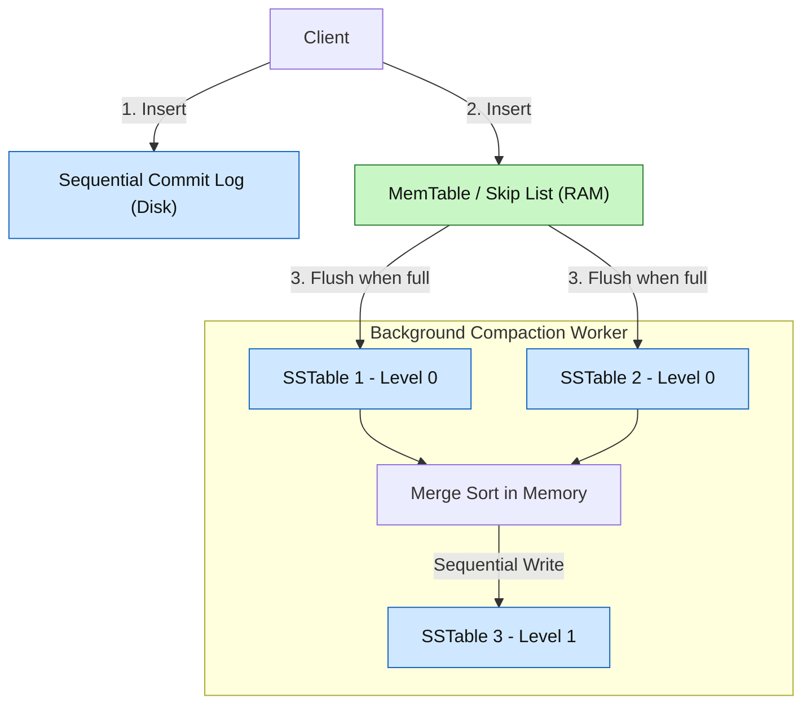

# PART 8: THE GRAND UNIFIED THEORY OF PRODUCTION DATA STRUCTURES (Deconstructed)

> **Navigation**: [← The History of DS in Computing](02_the_history_of_ds_in_computing.md) | [Chapter overview](../05_DS_In_Production.md) | [University-Level Addendum — DS in… →](04_university_level_addendum_ds_in_production.md)
> Page 3 of 4 in **Data Structures in the Real World — Where DS Concepts Appear in…**

> _"Big O notation is the biggest lie taught in Computer Science. It assumes that every operation in memory takes exactly the same amount of time. In physical reality, CPU Caches and Hard Disk sectors make an O(N) Array traversal up to 100x faster than an O(1) Hash Map lookup. If you do not understand the hardware, you do not understand data structures."_

This section strips away the theoretical abstractions of "Nodes" and "Pointers" and looks at exactly what the CPU, the L1/L2 caches, and the NVMe SSD are doing when you manipulate a data structure in a modern backend system.

---

## 8.1 The Abstraction: Big O vs. The Reality of CPU Cache Lines

### 💬 Study-Partner View — Big-O vs Cache Lines

**1. The bottom line:** Two algorithms with the same Big-O can differ by 10× because Big-O ignores how far apart the memory reads are.

**2. The textbook core:**

- Big-O counts operations, not memory latency.
- Contiguous access uses whole cache lines; pointer-chasing wastes them.
- Real costs: L1 ≈ 1 ns, RAM ≈ 100 ns.
- Rule of thumb: for small/medium `n`, arrays often beat "better" structures.

**3. The real-world analogy:** Two delivery drivers with the same number of stops: one has all addresses on one street, the other crosses town for each. Same count of stops, very different day.

**4. Walkthrough:**

1. Sum 1M ints in `int[]`: ~62,500 cache misses (1 per 16 ints).
2. Sum 1M `Integer` nodes in a linked list: up to ~1M misses.
3. At ~100 ns each the second is up to ~16× more miss time.
4. Measure with a benchmark (JMH), do not guess.

> [!NOTE]
> **Quick check:** Can an O(n) array scan beat an O(1) hash lookup? *Yes for small n, because of cache effects and constant factors.*

**The Abstraction Taught:** "A Hash Map lookup is O(1). Searching an Array is O(N). Therefore, for fast lookups, always use a Hash Map, and never use a Linked List or an Array if you need to search."

**The Naked Truth:** The CPU does not read "Nodes" or "Variables." The CPU only reads **Cache Lines** (typically 64 Bytes).

**The Mechanical Execution (The Physics of Memory):**

1. When your program asks for `Array[0]`, the CPU issues a fetch to RAM. RAM is incredibly slow (about 100 nanoseconds away).
2. The CPU does not just fetch the 4 bytes for `Array[0]`. It fetches the entire 64-Byte Cache Line, pulling `Array[0]` through `Array[15]` into the hyper-fast **L1 Cache** (which is less than 1 nanosecond away).
3. The CPU's **Hardware Prefetcher** sees that you accessed `Array[0]`. It guesses you will want the rest of the array. While the CPU is processing `Array[0]`, the prefetcher asynchronously pulls the next 500 Cache Lines into L2 and L3 caches.
4. When your loop asks for `Array[1]`, `Array[2]`, `Array[3]`, the data is _already sitting directly on the CPU die_. Access time is effectively zero.

**The Hash Map / Linked List Catastrophe (Cache Misses):**
A Linked List is a series of nodes scattered randomly across RAM.

1. The CPU fetches `Node 1`. It pulls a 64-byte Cache Line containing `Node 1` and a bunch of garbage data from other programs into L1.
2. `Node 1` has a pointer: `next = 0x8F9B2`.
3. The CPU looks in L1. `0x8F9B2` is not there (Cache Miss). It looks in L2 (Miss). L3 (Miss).
4. The CPU halts. It physically waits 100 nanoseconds for RAM to fetch `Node 2`.
5. Repeat for every single node.

**The Mathematical Reality:**
If you have 1,000 items, searching an unsorted contiguous Array (O(N)) is physically faster than traversing a Linked List or executing the Hash Function and jumping to a random memory bucket (O(1)). The cache misses in the Hash Map/Linked List cause the CPU to stall for hundreds of cycles, whereas the Array flows through the ALUs at the maximum clock speed.

---

## 8.2 The Abstraction: B-Trees vs. The Reality of LSM-Trees (Cassandra/Kafka)

### 💬 Study-Partner View — B-Trees vs LSM-Trees

**1. The bottom line:** B-trees update data in place (great for reads), LSM-trees append and merge (great for writes).

**2. The textbook core:**

- **B-tree/B+tree:** high fan-out, few disk reads per lookup; updates are random writes.
- **LSM-tree:** writes go to a log and MemTable, flush as sorted SSTables, background **compaction** merges them; reads may check several files (Bloom filters help).
- Trade-off triangle: read, write and space amplification.
- Examples: PostgreSQL/MySQL (B+tree); Cassandra/RocksDB (LSM).

**3. The real-world analogy:** A B-tree is a **neatly organized filing cabinet** (filing each paper takes time, finding it is quick). An LSM-tree is an **inbox pile that you sort in batches** (dropping paper is instant, finding may require checking several piles).

**4. Walkthrough:**

1. Write `k1=v1`: append to the commit log, put in the MemTable.
2. When the MemTable is full, flush as SSTable L0; later compaction merges L0 files into L1.
3. Read `k1`: MemTable → each SSTable (Bloom filter first) → found in L0.
4. Result: sequential writes, slightly slower reads.

> [!NOTE]
> **Quick check:** Which would you pick for a write-heavy logging workload? *An LSM-tree.*

**The Abstraction Taught:** "To make a database fast, you put an Index on the table. The Index is a B-Tree. B-Trees are the ultimate database data structure."

**The Naked Truth:** B-Trees are Read-Optimized structures introduced in 1970–72 for spinning hard drives. They are catastrophic for high-throughput write workloads (like IoT sensor data or global financial ledgers).

**The Mechanical Execution of a B-Tree Write (Postgres/MySQL):**

1. You execute an `INSERT`. The database traverses the B-Tree to find the correct 8KB Page.
2. The DB modifies the 8KB Page in the in-memory Buffer Pool.
3. Because B-Trees are sorted, if the Page is full, the DB must perform a **Page Split**. It locks the parent node, allocates a new 8KB Page, and moves half the data over.
4. Eventually, the DB flushes this 8KB page to the disk.
   **The Catastrophe:** If you insert 1,000 random UUIDs, the DB has to modify 1,000 different 8KB pages scattered randomly across the disk. This is known as **Random I/O**, and it is the physical bottleneck of every RDBMS on earth.

### The Solution: The Log-Structured Merge-Tree (LSM-Tree)

To achieve infinite write scaling (Cassandra, ScyllaDB, LevelDB, DynamoDB), we must abandon Random I/O completely and use **Sequential I/O**.

**The Mechanical Execution of an LSM-Tree:**

1. **The MemTable:** When you `INSERT`, the data is NOT written to a tree on disk. It is inserted into a self-balancing tree (Red-Black/Skip List) located purely in RAM. This is instantaneous.
2. **The Commit Log:** To prevent data loss on crash, the raw bytes are appended to a sequential log file on disk. Sequential disk appends are blazing fast (100x faster than Random I/O).
3. **The Flush (SSTable):** When the RAM MemTable gets full (e.g., 32MB), the DB freezes it, allocates a new one, and flushes the full MemTable to disk as an **SSTable** (Sorted String Table). An SSTable is an immutable, purely sequential file.
4. **The Compaction:** Background threads periodically read multiple small SSTables, merge them together like a zipper (Merge Sort), and write a new, larger SSTable, deleting the old ones.

**How to read this diagram.** Every write goes to the commit log (disk, sequential) and the MemTable (RAM). When the MemTable fills it is flushed as an immutable Level-0 SSTable, and a background worker merges SSTables into larger ones. Green is memory, blue is disk.

**The Reality:** LSM-Trees mathematically convert all Random I/O into Sequential I/O. This is why Cassandra can handle 1,000,000 writes per second, while PostgreSQL chokes at 20,000.

---

## 8.3 The Abstraction: Existence Checks vs. The Reality of Bloom Filters

### 💬 Study-Partner View — Existence Checks and Bloom Filters

**1. The bottom line:** A hash set stores every key, a Bloom filter stores a tiny fingerprint of them, and the fingerprint is often enough to avoid a slow lookup.

**2. The textbook core:**

- Exact set of 1 billion 64-bit keys ≈ 8 GB+; Bloom filter at 1% false positives ≈ 1.2 GB (~9.6 bits/key).
- "No" is certain; "yes" is probable.
- Placed in front of disk reads/network calls to skip impossible lookups.
- Sizing: `m = -n ln ε / (ln 2)²`, `k = (m/n) ln 2`.

**3. The real-world analogy:** A **sign on the pantry door** listing initials of what is inside: if the initial for saffron is missing, do not bother going in.

**4. Walkthrough:**

1. A request arrives for key `K`.
2. Check the Bloom filter: "no" → return "not found" immediately (zero disk reads).
3. "Maybe" → read the SSTable/disk.
4. With ε = 1%, 99% of absent keys never touch disk.

> [!NOTE]
> **Quick check:** What happens when the filter says "maybe" for an absent key? *You pay one wasted lookup (a false positive).*

**The Catastrophe of Read Amplification in LSM-Trees:**

If LSM-Trees write data to dozens of different immutable SSTable files, how do you `SELECT` data?

You have to check the RAM MemTable, then check SSTable 1, then SSTable 2...

If the data _doesn't exist_, you just forced the database to physically read 50 files from the hard drive, destroying your disk I/O bandwidth.

**The Mechanical Solution: The Bloom Filter.**
A Bloom Filter is a probabilistic data structure that takes almost zero memory and answers one question: _"Is this item in the set?"_

**The Rules:**

1. It can return **"Definitely Not."** (100% accurate).
2. It can return **"Probably Yes."** (There is a small chance of a false positive).

**The Execution in Cassandra/Redis:**
Every single SSTable file has a tiny Bloom Filter (a few kilobytes of RAM) sitting in memory.

1. `SELECT user_id=99`.
2. The DB checks the Bloom Filter for SSTable 1.
3. The Bloom Filter says: "Definitely Not."
4. The DB skips SSTable 1 completely. **Zero Disk I/O consumed.**
5. The DB checks the Bloom Filter for SSTable 2. It says: "Probably Yes."
6. The DB reads SSTable 2 from the physical SSD.

**The Math of a Bloom Filter:**
It is just a massive Bit Array (e.g., `[0,0,0,0,0,0,0,0]`) and multiple Hash Functions.

- **Insert 'dog':** Hash1('dog') = 2. Hash2('dog') = 5. Set bits 2 and 5 to `1`. `[0,0,1,0,0,1,0,0]`
- **Check 'cat':** Hash1('cat') = 2. Hash2('cat') = 7. Bit 7 is `0`. Therefore, 'cat' is **Definitely Not** in the set.
- **Check 'fox':** Hash1('fox') = 2. Hash2('fox') = 5. Both bits are `1`. Therefore, 'fox' is **Probably Yes** (even though we never inserted it. This is a Hash Collision / False Positive).

By tuning the size of the Bit Array and the number of hash functions, engineers mathematically guarantee a false-positive rate of less than 1%, saving millions of unnecessary disk reads per second.

---

## 🔗 Cross-References

| Topic                                | Detailed Guide                                                             |
| ------------------------------------ | -------------------------------------------------------------------------- |
| **Hash Table internals**             | [HashTable DS](../01e_HashTable.md) — collision resolution, load factor       |
| **B-Tree and database indexing**     | [SQL Internals Deep](../../08_SQL/49_SQL_Internals_Deep.md) — B-Tree math     |
| **LRU cache (LinkedList + HashMap)** | [DS Variants Advanced](../02b_DS_Variants_Advanced.md)                        |
| **Graph algorithms**                 | [Algorithms — Graphs](../../03_Algorithms/05c_Graphs_Fundamentals.md)         |
| **Redis internals (skip list)**      | [Enterprise Systems](../../10_Enterprise_Systems/02_ERP_Advanced.md)          |
| **React Fiber tree**                 | [React Hooks Deep Dive](../../15_React_Frontend/03_Hooks_Deep_Dive.md)        |
| **V8 Hidden Classes**                | [JavaScript V8 Internals](../../16_JavaScript/06_JS_Modern_ES6Plus.md)        |
| **Docker (cgroups = tree)**          | [DevOps Docker](../../22_DevOps/17_Docker_Complete.md) — namespace trees      |
| **K8s (scheduler = heap)**           | [DevOps K8s](../../22_DevOps/18_Kubernetes_Complete.md) — priority scheduling |
| **Consistent hashing**               | [DevOps Load Balancing](../../22_DevOps/11_Load_Balancing_Proxies.md)         |

---

[← The History of DS in Computing](02_the_history_of_ds_in_computing.md) | [Chapter overview](../05_DS_In_Production.md) | [University-Level Addendum — DS in… →](04_university_level_addendum_ds_in_production.md)
