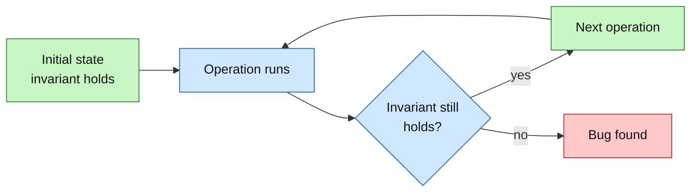

# A1. Data Structure Correctness — Proving Invariants Hold

> **Navigation**: [Chapter index](00_INDEX.md) | [A2. Data Structure Complexity… →](A2_DS_Complexity_FirstPrinciples.md)

> **MIT 6.006 / KTH DD1352 / RWTH Aachen Algo I foundation**
>
> "The task of the programmer is to devise a formal system in which the observation that the program works is deduced from the premises that are true before it runs, rather than from observing that it does work." — C.A.R. Hoare
>
> This chapter teaches the methodology for proving that a data structure maintains its defining property after every operation. The algorithm is correct only if every mutator preserves the structural invariant. Where algorithm correctness (A1 in the Algorithms folder) proves that a computation produces the right *output*, data structure correctness proves that the *state* of a structure is always consistent with its specification.

---

## Table of Contents

1. [The Invariant Methodology — What Are We Proving?](A1_DS_Correctness_Invariants/01_the_invariant_methodology_what_are_we.md#1-the-invariant-methodology--what-are-we-proving)
2. [Arrays — Contiguous Layout Invariant](A1_DS_Correctness_Invariants/01_the_invariant_methodology_what_are_we.md#2-arrays--contiguous-layout-invariant)
3. [Linked Lists — Reachability, Acyclicity, Order](A1_DS_Correctness_Invariants/01_the_invariant_methodology_what_are_we.md#3-linked-lists--reachability-acyclicity-order)
4. [Stacks & Queues — Capacity, Order Discipline](A1_DS_Correctness_Invariants/01_the_invariant_methodology_what_are_we.md#4-stacks--queues--capacity-order-discipline)
5. [Hash Tables — Key Distribution, Load Factor, No-Cycle Invariant](A1_DS_Correctness_Invariants/01_the_invariant_methodology_what_are_we.md#5-hash-tables--key-distribution-load-factor-no-cycle-invariant)
6. [BSTs — BST Property + Balance Invariant (AVL, Red-Black)](A1_DS_Correctness_Invariants/02_bsts_bst_property_balance_invariant_avl.md#6-bsts--bst-property--balance-invariant-avl-red-black)
7. [Heaps — Heap-Order + Complete-Tree Invariant](A1_DS_Correctness_Invariants/02_bsts_bst_property_balance_invariant_avl.md#7-heaps--heap-order--complete-tree-invariant)
8. [Tries — Prefix Invariant](A1_DS_Correctness_Invariants/02_bsts_bst_property_balance_invariant_avl.md#8-tries--prefix-invariant)
9. [Union-Find — Parent-Pointer Invariant](A1_DS_Correctness_Invariants/02_bsts_bst_property_balance_invariant_avl.md#9-union-find--parent-pointer-invariant)
10. How to State an Invariant in an Interview

---

## 💬 Explain It Like a Study Partner — Proving Invariants

> [!TIP]
> **Ask yourself first:** *"How can you be sure a data structure is correct after a million operations, when you only tested a hundred?"*

### 1. The bottom line

Instead of checking every operation, you prove **one rule stays true** (the invariant) after each operation, and then everything that depends on that rule is correct.

### 2. The textbook core

- An **invariant** is a property that holds before and after every public operation.
- A **representation invariant** says what makes an instance valid (e.g. a BST's left < node < right).
- Proof pattern: **initialization** (it holds when empty), **preservation** (each mutator keeps it), **correctness** (if it holds, queries return right answers).
- It is mathematical induction applied to operations.
- In interviews: state the invariant first, then show each operation keeps it.

### 3. The real-world analogy

A **bank vault's ledger rule**: "total deposits minus withdrawals always equals the cash on hand." Every transaction must keep that equation true. If you can show each type of transaction keeps it true, you do not need to audit every transaction ever made.

### 4. Walkthrough: prove `ArrayList.add` preserves "elements are in `0..size-1`"

1. **Initial state:** empty list, `size = 0`, so the range is empty and the invariant holds.
2. **Assume** it holds before `add(x)`.
3. `add` writes `x` at index `size`, then increments `size`.
4. Now the elements occupy `0..size-1` for the new `size`, with no gap, so the invariant **still holds**.
5. If capacity was full, the resize copies the old elements to the same indices first, so the argument still applies.

> [!NOTE]
> **Quick check:** what invariant does a min-heap rely on after `insert`? *Each parent ≤ its children, restored by bubbling the new element up.*

---

## ⚡ At a Glance — Invariant Proofs

> [!NOTE]
> **Mental model:** an invariant is a fact that is true before and after every operation. To prove a structure correct you show it holds **initially**, is **preserved** by each operation, and **implies** the result you want.

**How to read this diagram.** The loop is induction: if every operation preserves the invariant, it holds forever. The red exit is what a failing proof or test looks like.

| Structure | Core invariant |
| --------- | -------------- |
| Array | Elements occupy `0..size-1` contiguously |
| Linked list | Every node reachable from head; no cycle (unless circular) |
| Hash table | Each key is in the bucket given by its hash |
| BST | Left subtree < node < right subtree |
| Heap | Parent ≤ children (min-heap) and the tree is complete |
| Union-Find | Following parents always reaches a root |

---

## 📚 Topic Pages in This Chapter

This chapter is split into focused pages so each topic can be read on its own. Read them in order the first time; use the table to jump back later.

| # | Page | What is inside | Lines |
| --- | --- | --- | --- |
| 1 | [1. The Invariant Methodology — What Are We Proving?](A1_DS_Correctness_Invariants/01_the_invariant_methodology_what_are_we.md) | 1. The Invariant Methodology — What Are We… · 2. Arrays — Contiguous Layout Invariant · 3. Linked Lists — Reachability, Acyclicity… · 4. Stacks & Queues — Capacity, Order… · 5. Hash Tables — Key Distribution, Load… | 418 |
| 2 | [6. BSTs — BST Property + Balance Invariant (AVL, Red-Black)](A1_DS_Correctness_Invariants/02_bsts_bst_property_balance_invariant_avl.md) | 6. BSTs — BST Property + Balance Invariant… · 7. Heaps — Heap-Order + Complete-Tree… · 8. Tries — Prefix Invariant · 9. Union-Find — Parent-Pointer Invariant · 10. How to State an Invariant in an Interview · … | 626 |

## Reality Check

> [!CAUTION]
> **Myth:** "Testing proves correctness"
>
> **Reality:** Testing shows the ABSENCE of bugs for tested inputs, not the absence of bugs for ALL inputs. A binary search implementation that fails only when the array has exactly 2^31-1 elements will pass every reasonable test suite. Invariant-based reasoning proves correctness for ALL inputs: if the invariant holds before and after each iteration and implies the postcondition at termination, the algorithm is correct for every valid input.

> [!CAUTION]
> **Myth:** "Invariants are just assertions"
>
> **Reality:** Assertions check that a condition holds at a specific point in execution. Invariants are LOGICAL PROPERTIES that hold throughout an operation: the BST invariant (left < root < right) must hold before and after every insertion, deletion, and rotation. An assertion is a runtime check at one moment. An invariant is a mathematical claim about every reachable state of the data structure.

> [!CAUTION]
> **Myth:** "Off-by-one errors are minor bugs"
>
> **Reality:** Off-by-one errors in data structure implementations can violate structural invariants: a heap with an off-by-one parent index formula accesses the wrong children, corrupting the heap property silently. The heap APPEARS to work for small inputs but produces incorrect results for specific configurations. Invariant checking (is heap property satisfied after every operation) catches these immediately.

> [!CAUTION]
> **Myth:** "Representation invariants are implementation details"
>
> **Reality:** A representation invariant defines what makes a data structure instance VALID. For a Red-Black tree: every path from root to null has the same number of black nodes, red nodes have black children, and root is black. Violating any of these means the tree is corrupt — operations will produce wrong results or crash. The rep invariant is the CONTRACT between the data structure and its operations.

> [!CAUTION]
> **Myth:** "Formal verification is impractical"
>
> **Reality:** Lightweight formal reasoning (writing preconditions, postconditions, and loop invariants as comments, then mentally checking them) catches bugs that testing misses, costs minutes, and requires no tools. Full formal verification with proof assistants (Coq, Isabelle) is expensive, but the REASONING DISCIPLINE of formal methods — stating exactly what must be true and why — is practical and immediately useful in everyday programming.
