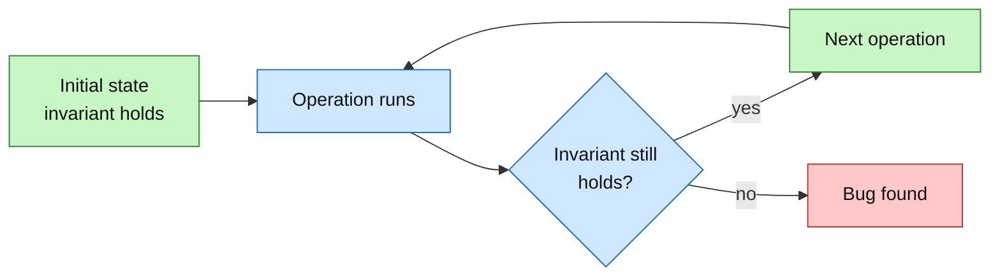
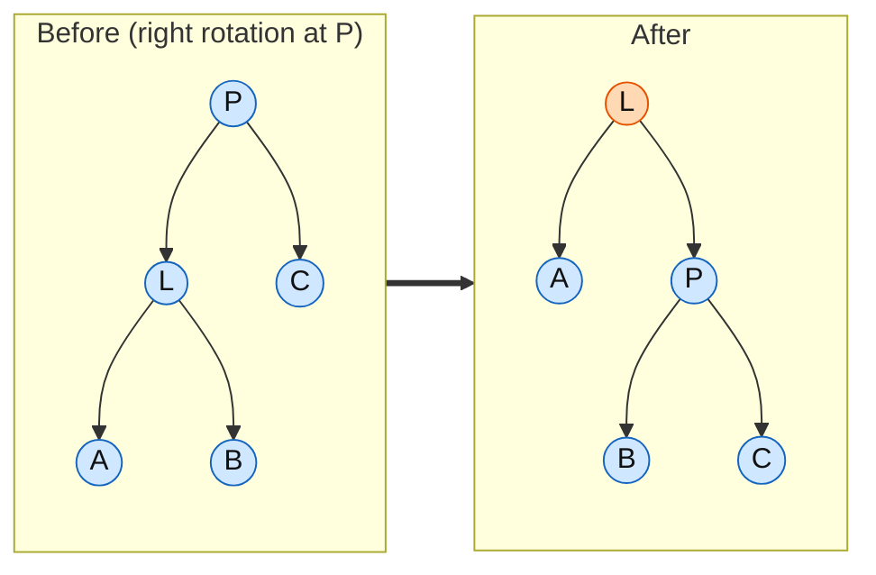

# A1. Data Structure Correctness — Proving Invariants Hold

**Navigation**: [← DS Index](00_INDEX.md) | [📚 Master Index](../00_MASTER_INDEX.md) | [A2: DS Complexity from First Principles →](A2_DS_Complexity_FirstPrinciples.md)

> **MIT 6.006 / KTH DD1352 / RWTH Aachen Algo I foundation**
>
> "The task of the programmer is to devise a formal system in which the observation that the program works is deduced from the premises that are true before it runs, rather than from observing that it does work." — C.A.R. Hoare
>
> This chapter teaches the methodology for proving that a data structure maintains its defining property after every operation. The algorithm is correct only if every mutator preserves the structural invariant. Where algorithm correctness (A1 in the Algorithms folder) proves that a computation produces the right *output*, data structure correctness proves that the *state* of a structure is always consistent with its specification.

---

## Table of Contents

1. [The Invariant Methodology — What Are We Proving?](#1-the-invariant-methodology--what-are-we-proving)
2. [Arrays — Contiguous Layout Invariant](#2-arrays--contiguous-layout-invariant)
3. [Linked Lists — Reachability, Acyclicity, Order](#3-linked-lists--reachability-acyclicity-order)
4. [Stacks & Queues — Capacity, Order Discipline](#4-stacks--queues--capacity-order-discipline)
5. [Hash Tables — Key Distribution, Load Factor, No-Cycle Invariant](#5-hash-tables--key-distribution-load-factor-no-cycle-invariant)
6. [BSTs — BST Property + Balance Invariant (AVL, Red-Black)](#6-bsts--bst-property--balance-invariant-avl-red-black)
7. [Heaps — Heap-Order + Complete-Tree Invariant](#7-heaps--heap-order--complete-tree-invariant)
8. [Tries — Prefix Invariant](#8-tries--prefix-invariant)
9. [Union-Find — Parent-Pointer Invariant](#9-union-find--parent-pointer-invariant)
10. [How to State an Invariant in an Interview](#10-how-to-state-an-invariants-in-an-interview)

---

## 💬 Explain It Like a Study Partner — Proving Invariants

> [!TIP]
> **Ask yourself first:** *"How can you be sure a data structure is correct after a million operations, when you only tested a hundred?"*

### 1. The bottom line

Instead of checking every operation, you prove **one rule stays true** (the invariant) after each operation, and then everything that depends on that rule is correct.

### 2. The textbook core

- An **invariant** is a property that holds before and after every public operation.
- A **representation invariant** says what makes an instance valid (e.g. a BST's left < node < right).
- Proof pattern: **initialization** (it holds when empty), **preservation** (each mutator keeps it), **correctness** (if it holds, queries return right answers).
- It is mathematical induction applied to operations.
- In interviews: state the invariant first, then show each operation keeps it.

### 3. The real-world analogy

A **bank vault's ledger rule**: "total deposits minus withdrawals always equals the cash on hand." Every transaction must keep that equation true. If you can show each type of transaction keeps it true, you do not need to audit every transaction ever made.

### 4. Walkthrough: prove `ArrayList.add` preserves "elements are in `0..size-1`"

1. **Initial state:** empty list, `size = 0`, so the range is empty and the invariant holds.
2. **Assume** it holds before `add(x)`.
3. `add` writes `x` at index `size`, then increments `size`.
4. Now the elements occupy `0..size-1` for the new `size`, with no gap, so the invariant **still holds**.
5. If capacity was full, the resize copies the old elements to the same indices first, so the argument still applies.

> [!NOTE]
> **Quick check:** what invariant does a min-heap rely on after `insert`? *Each parent ≤ its children, restored by bubbling the new element up.*

---

## ⚡ At a Glance — Invariant Proofs

> [!NOTE]
> **Mental model:** an invariant is a fact that is true before and after every operation. To prove a structure correct you show it holds **initially**, is **preserved** by each operation, and **implies** the result you want.



**How to read this diagram.** The loop is induction: if every operation preserves the invariant, it holds forever. The red exit is what a failing proof or test looks like.

| Structure | Core invariant |
| --------- | -------------- |
| Array | Elements occupy `0..size-1` contiguously |
| Linked list | Every node reachable from head; no cycle (unless circular) |
| Hash table | Each key is in the bucket given by its hash |
| BST | Left subtree < node < right subtree |
| Heap | Parent ≤ children (min-heap) and the tree is complete |
| Union-Find | Following parents always reaches a root |

---

## 1. The Invariant Methodology — What Are We Proving?

### Structural Invariant vs. Operational Invariant

An **algorithm** correctness proof concerns *state transitions*: starting from a precondition, after each step the algorithm's state satisfies some invariant, and upon termination the invariant implies the output is correct (loop invariant — Init / Maintenance / Termination). This is the subject of `03_Algorithms/A1_Correctness_Proofs.md`.

A **data structure** correctness proof concerns *structural preservation*: the data structure begins life in a valid state, and every mutator operation (insert, delete, resize, rotate) must transform the state while preserving the defining invariant. The proof has a different shape:

| Step | What you must show |
| ---- | ------------------ |
| **Initialization** | The constructor builds an empty or initial DS that satisfies the invariant. |
| **Preservation** (maintenance) | Every mutator (insert/delete/update/rotate/resize) preserves the invariant, proved by case analysis. |
| **Correctness** (termination) | If the invariant holds, every query operation returns the correct answer (by structural induction). |

The two invariants differ:

- **Structural (or representation) invariant** — a property of the *physical layout* of the data structure (e.g., `data[0..size-1]` contains live elements). It never depends on inputs; it is about internal consistency.
- **Operational (or abstraction) invariant** — a property guaranteed by the data structure's *abstraction* (e.g., the stack always returns the most-recently pushed element on pop). This connects the internal representation to the logical contract.

### Why This Differs from Algorithm Correctness

| Dimension          | Algorithm Proof                          | Data Structure Proof                      |
| ------------------ | ---------------------------------------- | ----------------------------------------- |
| What changes       | Execution state (variables, memory)      | Memory layout / pointer graph             |
| What is invariant  | A predicate on execution progress        | A predicate on the structural state       |
| Termination        | Loop ends → extract answer               | Every operation ends → structural check   |
| Induction base     | Before first loop iteration              | After constructor / before first mutator  |
| Induction step     | One loop iteration preserves invariant   | One mutator preserves invariant           |
| Result extraction  | Invariant + loop condition → answer      | Invariant + query algorithm → answer      |

### The Pattern: Induction on Operation Count

Let `P(k)` be the predicate: "After executing any sequence of `k` mutators on an initially-valid data structure, the invariant holds." We prove:

1. **Base case** `P(0)`: The constructor creates a structure that satisfies the invariant.
2. **Inductive step**: Assume `P(k)` holds (after `k` operations the structure is valid). Consider operation `k+1`. Show by case analysis that this operation transforms a valid structure into another valid structure — i.e., `P(k)` implies `P(k+1)`.
3. **Conclusion**: By induction, the invariant holds after any number of operations.

This is structurally identical to proving a loop invariant, but the "loop" is the sequence of mutator calls and the "iteration" is a single mutator. The critical difference is that the state being reasoned about is a *graph of memory cells*, not a set of scalar variables.

### What Each Section Does

Each section below follows the same three-part pattern:

1. **Invariant Statement** — precisely define the property (written in formal English and/or Java).
2. **Mutator Preservation** — prove each mutator (insert, delete, resize, rotate, rebalance) preserves the invariant. Where relevant, prove the auxiliary lemmas (e.g., rotation preserves BST property).
3. **Operational Correctness** — prove that because the invariant holds, query operations (`get`, `search`, `extract-min`, `find`) return correct results.

---

## 2. Arrays — Contiguous Layout Invariant

### Invariant Statement

For a resizable array `data` with logical size field `size`:

> **Invariant (Array Layout):** `data[0..size-1]` stores exactly the live elements of the collection, in insertion order. Positions `data[size..capacity-1]` are unused scratch space. No `null` values exist among `data[0..size-1]`.

Formally: for all `i` such that `0 ≤ i < size`, `data[i]` is defined and non-null. For all `i` such that `size ≤ i < capacity`, `data[i]` may be anything.

### Initialization

The constructor `ArrayList()` creates `data = new Object[16]`, `size = 0`. Trivially, the empty range `data[0..-1]` is valid. ✓

### Mutator Preservation — `add(e)`

```java
public void add(E e) {
    if (size == data.length) resize(data.length * 2);
    data[size++] = e;
}
```

**Case 1 — No resize needed (`size < data.length`):**

`data[size]` is in the unused region `data[size..capacity-1]`. The write `data[size] = e` assigns a defined value to the first unused slot. After `size++`, `data[0..size-1]` contains all elements in order; the unused region is now `data[size..capacity-1]`. Invariant holds. ✓

**Case 2 — Resize triggered (`size == data.length`):**

Resize creates a new array `newData` of length `2 * capacity`. Then it copies `data[i]` to `newData[i]` for all `i < size`. After copying, `newData[0..size-1]` contains exactly the live elements in order (induction on the copy loop). The `e` is placed at `newData[size]`. After `size++`, `newData[0..size-1]` contains all elements. The invariant holds for the new array. ✓

### Mutator Preservation — `remove(index)`

```java
public E remove(int index) {
    E removed = (E) data[index];
    System.arraycopy(data, index + 1, data, index, size - index - 1);
    data[--size] = null;   // avoid memory leak
    return removed;
}
```

The `System.arraycopy` shifts `data[index+1..size-1]` left by one position, so after the copy:

- `data[0..index-1]` unchanged — still correct.
- `data[index]` now holds what `data[index+1]` held — the element after the removed one.
- `data[index+1..size-2]` now hold `data[index+2..size-1]`.
- `data[size-1]` is set to `null` — removed from the live range.

After `--size`, the live range is `data[0..size-1]`, which now contains exactly the original elements except the removed one. The invariant holds. ✓

### Operational Correctness — `get(index)`

Because `data[0..size-1]` is exactly the element sequence, `get(i)` returns `data[i]`, which is the `i`th inserted element. No false positives; no skipped elements. ✓

### Why the Invariant Matters

Without the layout invariant, an `ArrayList` could develop "holes" (nulls in the live range) or "leaks" (old data beyond `size`). `get(0)` might return stale data, `size` would no longer equal the true element count, and `iterator.remove()` could corrupt the structure. The invariant is what makes the array a list, not just a blob of memory.

---

## 3. Linked Lists — Reachability, Acyclicity, Order

### Invariant Statement

For a singly linked list with `head` pointer:

> **Invariant (Singly Linked List):** Every node reachable from `head` by following `next` pointers is a live element. The terminal node's `next` is `null`. No node appears in more than one chain. The `size` field equals the number of reachable nodes.

For a doubly linked list with `head` and `tail`:

> **Invariant (Doubly Linked List):** Every node reachable from `head` has `prev` pointing to its predecessor (or `null` for the head). Every node reachable from `tail` has `next` pointing to its successor (or `null` for the tail). The `size` field equals the number of nodes in the chain. No node has both `prev == null` and `next == null` unless it is the sole node.

### Initialization

Constructor sets `head = null`, `size = 0`. The empty set of reachable nodes vacuously satisfies the invariant: there is no node to violate reachability, acyclicity, or order. ✓

### Mutator Preservation — `addFirst(e)` on a singly linked list

```java
public void addFirst(E e) {
    Node n = new Node(e);
    n.next = head;
    head = n;
    size++;
}
```

**Reachability**: Before insertion, the reachable set is exactly `{ nodes reachable from head }`. After `n.next = head`, the chain is `n → old_head → ...`. All nodes formerly reachable remain reachable (by going through `n`). Node `n` is reachable from `head` (the new head). No other nodes are affected. ✓

**Acyclicity**: The only new `next` pointer is `n.next = head`. Since `head` was already in the chain (or `null`), `n` cannot point into a node already reachable from `n` (that would create a cycle). This is because we assigned `n.next` to a node that was not reachable from `n` before the assignment. ✓

**Size**: `size++` correctly reflects the addition of one node. ✓

### Mutator Preservation — `removeFirst()`

```java
public E removeFirst() {
    E result = head.element;
    head = head.next;
    size--;
    return result;
}
```

After `head = head.next`, the chain starting at the new `head` contains all formerly reachable nodes except the old head. The removed node is no longer reachable from `head`. Size is decremented. ✓

### Acyclicity Proof — Floyd's Tortoise-and-Hare for Cycle Detection

The invariant that the list is acyclic is worth proving explicitly, because client code can break it (e.g., if `next` is mutated directly):

> **Lemma**: If the list was acyclic at the end of the last mutator, and no mutator directly creates a cycle, the list remains acyclic.

**Proof**: Consider the singly linked list as a directed graph where each node is a vertex and the `next` pointers are directed edges. A cycle exists iff there is a path `v₀ → v₁ → ... → vₖ → v₀`. The only mutator that creates edges is `addFirst`, which creates exactly one edge `n → old_head`. If `old_head` were reachable from `n` before the link, a cycle would be created. `n` is a fresh node with no outgoing edges before linking, so `old_head` cannot be reachable from `n`. Therefore no cycle is created. ✓

The Floyd cycle detection algorithm can *detect* an existing cycle in O(n) time: run a slow pointer (1 step) and a fast pointer (2 steps) from `head`. If they meet, a cycle exists. If fast reaches `null`, the list is acyclic.

### Doubly Linked List — Mutual Consistency Proof

> **Lemma (Bidirectional Consistency)**: In a doubly linked list, `node.next.prev == node` for every non-tail node, and `node.prev.next == node` for every non-head node.

**Proof by induction on the sequence of operations**: Base case — empty list has no node pairs to check. Inductive step: `addFirst(n)`: set `n.next = head` (null or old_head). If `head != null`, set `old_head.prev = n`. Set `n.prev = null`, `head = n`. After the link, `n.next` is old_head (or null), and if old_head exists, `old_head.prev` is `n`. The invariants hold for all affected pairs. Other pairs are unchanged. ✓

Similar reasoning applies to `removeFirst`, `addLast`, and `removeLast` — each operation updates at most four pointer fields, and each update preserves the bidirectional invariant.

### Size Field Consistency

> **Invariant**: `size` equals the number of nodes reachable from `head`.

**Proof**: Base case: `size = 0`, no nodes reachable. ✓ Inductive step: every mutator that adds a node increments `size`; every mutator that removes a node decrements `size`. No other operation changes `size`. By induction, the equality holds after any sequence of operations. ✓

### Operational Correctness — `get(index)`

Traversing `index` steps from `head` follows exactly the `index`-th node in the chain. Because the invariant guarantees that all reachable nodes are live elements in order, `get(i)` returns the `i`th inserted element. ✓

---

## 4. Stacks & Queues — Capacity, Order Discipline

### Stack Invariant Statement

> **Invariant (Stack)**: The top of the stack is always the most recently pushed element that has not yet been popped. The stack contents below `top` are exactly the elements pushed in LIFO order, with the bottom being the oldest unpopped element. `size ≤ capacity` at all times.

### Stack Mutator Preservation — `push(e)`

```java
public void push(E e) {
    if (size == capacity) resize(capacity * 2);
    data[size++] = e;
}
```

The array layout invariant from Section 2 guarantees `data[0..size-1]` are the live elements. By construction, `data[size]` is the first unused slot. Writing `e` there and incrementing `size` makes `e` the new top. Since `e` was pushed most recently, it is at the top — the LIFO discipline holds. ✓

### Stack Mutator Preservation — `pop()`

```java
public E pop() {
    E top = data[--size];
    data[size] = null;   // avoid memory leak
    return top;
}
```

After `--size`, the live range is `data[0..size-1]`. The element at `data[size]` (old top) is removed. The new top is `data[size-1]`, which was the second-most-recently pushed unpopped element. LIFO discipline holds. ✓

### Queue Invariant Statement

For an array-backed circular queue:

> **Invariant (Circular Queue)**: `head` points to the oldest element; `tail` points to the slot where the next element will be inserted. Elements in `data[head..tail-1]` (wrapping around modulo `capacity`) appear in FIFO order. The queue is empty when `head == tail`. The queue is full when `(tail + 1) % capacity == head`.

### The `head == tail` Ambiguity — Proving the Invariant Resolves It

The classic design choice: with a fixed-capacity circular buffer, `(head == tail)` is used to mean "empty." This means one slot is always reserved (the queue can hold at most `capacity - 1` elements). The proof:

- **Why reserve one slot**: If `head == tail` were allowed to mean both empty and full, every operation would need extra state to distinguish. The design choice is to sacrifice one slot and guarantee unambiguous state.
- **Empty check**: `head == tail` means no elements are between `head` and `tail`. The number of elements is `(tail - head + capacity) % capacity = 0`. ✓
- **Full check**: `(tail + 1) % capacity == head` means exactly `capacity - 1` slots are occupied. Adding one more element would make `tail` cycle to `head`, creating the `head == tail` condition while the queue is actually full. We prevent this by checking the full condition before `enqueue`. ✓

### Queue Mutator Preservation — `enqueue(e)`

```java
public void enqueue(E e) {
    if ((tail + 1) % capacity == head) resize(capacity * 2);
    data[tail] = e;
    tail = (tail + 1) % capacity;
}
```

**Order preservation**: `data[tail]` is the insertion point by definition. After writing `e` and advancing `tail` circularly, `e` is placed after all previously enqueued elements. Since `head` is unchanged, all elements from `head` to the old `tail-1` retain their relative order. The new element is at the tail position, the correct FIFO position. ✓

**Size correctness**: The number of elements is `(tail - head + capacity) % capacity`. Each `enqueue` increments `tail` (mod `capacity`), which increases this count by exactly 1 unless the queue was full (caught by the resize guard). ✓

### Queue Mutator Preservation — `dequeue()`

```java
public E dequeue() {
    E result = data[head];
    data[head] = null;
    head = (head + 1) % capacity;
    return result;
}
```

`data[head]` is the oldest enqueued element (by definition of `head`). The assignment advances `head` circularly, removing the oldest element from the FIFO sequence. The remaining elements shift forward in the logical sequence — their logical positions become `(head..tail-1)` modulo `capacity`, which is exactly the FIFO order of the remaining elements. ✓

### Why the Invariant Matters

Without the circular queue invariant, `dequeue()` might return the wrong element (not the oldest), and `head == tail` would be ambiguous. The invariant is what makes the queue implement FIFO semantics correctly over an *infinite* sequence of enqueue/dequeue operations on a finite buffer.

---

## 5. Hash Tables — Key Distribution, Load Factor, No-Cycle Invariant

### Invariant Statement (Chaining)

> **Invariant (Hash Table — Chaining)**: Every key-value pair inserted into the table is stored in the bucket returned by `hash(k) mod capacity`. For any bucket `i`, the linked chain starting at `buckets[i]` contains exactly the pairs whose keys hash to `i`. No key appears in more than one bucket. The `size` field equals the total number of stored pairs.

> **Invariant (Load Factor)**: At all times, `loadFactor = size / capacity ≤ MAX_LOAD_FACTOR` (typically `0.75`). If an insert would violate this, a resize to `2 * capacity` occurs first.

> **Invariant (Probe Sequence — Open Addressing)**: For any key `k` being inserted, the probe sequence `(hash(k) + c₁·i + c₂·i²) mod capacity` (or equivalent) visits each slot at most once before finding an empty one. No slot is skipped.

### Initialization

`capacity = 16`, `size = 0`, `buckets = new Entry[capacity]`. All buckets are `null`. No pairs exist. `size/capacity = 0 ≤ 0.75`. All invariants hold. ✓

### Mutator Preservation — `put(k, v)` with chaining

```java
public void put(K k, V v) {
    if ((size + 1.0) / capacity > LOAD_FACTOR) resize(capacity * 2);
    int i = hash(k) % capacity;
    for (Entry e = buckets[i]; e != null; e = e.next)
        if (e.key.equals(k)) { e.value = v; return; }
    Entry n = new Entry(k, v);
    n.next = buckets[i];
    buckets[i] = n;
    size++;
}
```

**Load factor**: The guard `if ((size + 1.0) / capacity > LOAD_FACTOR)` ensures that after the optional resize, `size/capacity ≤ 0.75`. In the resize case, every pair is re-inserted into a new bucket array, so the bucket invariant holds (proved by the insertion logic below). ✓

**Bucket placement**: `i = hash(k) mod capacity` is computed. The `for` loop traverses the chain at `buckets[i]`. If a matching key is found, the value is updated — the pair remains in the same bucket, invariant unchanged. If no match is found, a new entry `n` is created and inserted at the head of the chain: `n.next = buckets[i]`. The new entry's `next` points to the former first element (or `null`). All elements previously in the chain remain reachable through `n.next`. No key is duplicated across buckets. ✓

### `get(k)` Correctness — No False Negatives

**Claim**: `get(k)` returns `v` if and only if `(k, v)` was previously inserted and not removed.

*If direction*: Suppose `(k, v)` was inserted. After insertion, it is in bucket `i = hash(k) mod capacity`. `get(k)` computes the same `i` (hash function is deterministic). It traverses the chain at `buckets[i]`. Since `(k, v)` is in that chain, the traversal finds it and returns `v`. ✓

*Only-if direction*: Suppose `get(k)` returns a value `v`. The traversal only examines keys in bucket `i`. Since the bucket invariant guarantees that exactly the keys that hash to `i` are in that chain, `k` must be one of those keys — i.e., `k` was inserted. ✓

### Probe Sequence Invariance (Open Addressing)

For linear probing (`h(k, i) = (hash(k) + i) mod capacity`):

> **Lemma**: Every slot `s` in `0..capacity-1` is probed at most once per `put(k, v)` call.

**Proof**: The probe sequence is `h₀ = hash(k) mod capacity`, `h₁ = (hash(k) + 1) mod capacity`, ..., `hᵢ = (hash(k) + i) mod capacity`. Modulo `capacity`, adding 1 cycles through all values. The sequence cannot repeat until it has visited all `capacity` slots, at which point the table is full. Since we resize before inserting into a full table, the probe terminates at an empty slot after probing at most `capacity` distinct slots. ✓

For double hashing (`h(k, i) = (hash₁(k) + i · hash₂(k)) mod capacity`): the invariant holds if `hash₂(k)` and `capacity` are coprime. If `capacity` is prime, this is guaranteed for any `hash₂(k) ≠ 0`. The proof uses number theory: the step size `hash₂(k)` generates the entire additive group modulo `capacity`, so all `capacity` slots are visited exactly once before repeating.

### Load Factor Preservation After Resize

> **Lemma**: After `resize(newCapacity)` where `newCapacity = 2 * capacity`, the load factor is at most half the previous load factor.

**Proof**: Let `size = s` before resize. `s / capacity ≤ MAX_LOAD_FACTOR` (otherwise resize would have been triggered earlier). After resize, `size` is unchanged. `newSize = s`. `newCapacity = 2 * capacity`. Therefore `newSize / newCapacity = s / (2 * capacity) = (1/2) * (s / capacity) ≤ (1/2) * MAX_LOAD_FACTOR`. Since `MAX_LOAD_FACTOR = 0.75`, after resize the load factor is at most `0.375`, well within the threshold. ✓

---

## 6. BSTs — BST Property + Balance Invariant (AVL, Red-Black)

### BST Property Invariant

> **Invariant (BST)**: For every node `N` with `N.key = k`, all keys in `N.left` are `< k`, and all keys in `N.right` are `> k`. This holds recursively for all nodes in the tree.

### Initialization

Empty tree (`root = null`) vacuously satisfies the invariant. ✓

### Mutator Preservation — `insert(k)`

```java
Node insert(Node node, int key) {
    if (node == null) return new Node(key);
    if (key < node.key) node.left = insert(node.left, key);
    else if (key > node.key) node.right = insert(node.right, key);
    else node.key = key; // update value, tree unchanged
    return node;
}
```

**Proof by structural induction on `node`**:

*Base case*: If `node == null`, a new leaf is created with `key`. Since it has no children, the BST property is vacuously satisfied for this leaf. ✓

*Inductive step*: Assume the recursive call `insert(node.left, key)` returns a subtree that satisfies the BST property and where all keys in `node.left` are `< key` (because `key < node.key`). Setting `node.left` to this subtree preserves `node.key > all keys in node.left`. The right-subtree case is symmetric. The current node's key is unchanged, so `node.key > all in left` and `node.key < all in right`. ✓

Therefore, by structural induction, the entire tree satisfies the BST property after `insert`. ✓

### AVL Balance Invariant

> **Invariant (AVL Balance)**: For every node `N`, `|height(N.left) - height(N.right)| ≤ 1`. This holds after every insert and delete, maintained by single and double rotations.

### AVL Rotation Proofs

**Lemma (Single Right Rotation preserves BST property)**: Consider nodes `P` (parent) and `L` (left child), where `L` becomes right-heavy after an insert in `L`'s right subtree. The rotation:



**How to read this diagram.** A right rotation lifts `L` above `P`: `L` becomes the root (orange), `P` becomes its right child, and `L`'s old right subtree `B` moves across to become `P`'s left child. The in-order sequence `A L B P C` is unchanged.

**Proof**: All keys in subtree `A` are `< L.key` (original). All keys in subtree `B` are `> L.key` and `< P.key` (original BST property: `L.key < B < P.key`). All keys in subtree `C` are `> P.key`. After rotation, `L` becomes the root. `L.right = P`. The ordering is: `A < L.key < B < P.key < C`. This exactly satisfies the BST invariant for the entire subtree. ✓

**Lemma (AVL rebalancing restores the balance invariant)**: After insertion, we traverse back up the path, recomputing heights and performing rotations at the first node where `|height(left) - height(right)| > 1`. Since the height difference before insertion was at most 1 at every node, the imbalance can only occur at nodes along the insertion path. A single or double rotation at the deepest violating node reduces the height of that subtree to its pre-insertion height. By induction on the path length, all nodes satisfy the balance invariant after rebalancing. ✓

### Red-Black Tree — Five Invariants

> **Invariant (Red-Black)**: The following five properties hold at all times:
>
> 1. Every node is either red or black.
> 2. The root is black.
> 3. All NIL (leaf) children are black.
> 4. If a node is red, both its children are black (no red-red edges).
> 5. For every node, all paths from that node to descendant NIL leaves contain the same number of black nodes (black-height property).

### Red-Black Invariant Preservation — `insert`

Insertion places a new node as a red leaf, then rebalances:

**Case A — Parent is black**: Properties 1–4 are preserved (new node is red, parent is black, no red-red edge created). Black-height on all paths is unchanged. ✓

**Case B — Parent is red (violates property 4)**: Let `uncle` be the sibling of the parent.

- **If uncle is red**: Recolor parent and uncle black, recolor grandparent red. This preserves black-height (each path through grandparent loses one black node at parent but gains one at uncle → net zero). The new red-grandparent may violate property 4 with its own parent — recurse upward. ✓
- **If uncle is black**: A rotation is needed. There are two sub-cases (zig-zag and zig-zig), each requiring one rotation that:
  - Preserves the BST property (same as AVL rotation proof).
  - Restores property 4 (red parent and red child are no longer adjacent after rotation).
  - Preserves black-height (the rotated subtree has the same black-height as before the insertion).

**Lemma (Black-height preservation after rotation)**: In both the single-rotation and double-rotation cases, the number of black nodes on any path through the rotated subtree is unchanged. This is because the rotation rearranges red nodes without changing the count of black nodes on any path. The old black-height `bh` of the grandparent subtree is maintained: each path still has exactly `bh` black nodes. ✓

**Termination of rebalancing**: In the worst case, recolor/rotate actions propagate at most to the root. The root is always recolored black (restoring property 2) after the propagation reaches it. The recursion terminates in O(log n) steps (the height of the tree). ✓

### BST Query Correctness (Search)

> **Claim**: `search(k)` on a BST returns `true` if and only if `k` is in the tree.

*If direction*: If `k` is in the tree, the BST invariant guarantees that following the comparison direction at each node will reach the node containing `k`. Each step eliminates the entire subtree that cannot contain `k` (all keys on the left are smaller; all on the right are larger). Therefore, the search reaches `k`. ✓

*Only-if direction*: If `search(k)` returns `true`, it found a node with key `k`. By the representation invariant, every node reachable in the tree was inserted (or descended from an inserted node). Therefore `k` was inserted. ✓

---

## 7. Heaps — Heap-Order + Complete-Tree Invariant

### Invariant Statement

> **Invariant (Min-Heap Order)**: For every node `N` with `N.key = k`, `k ≤` all keys in `N.left` and `k ≤` all keys in `N.right`. In other words, `parent.key ≤ child.key` for every parent-child pair.

> **Invariant (Complete Binary Tree)**: The tree is filled level-by-level left-to-right. There are no gaps in the first `h-1` levels, and the last level's nodes are packed at the left. This enables array representation with `parent(i) = (i-1)/2`, `left(i) = 2*i+1`, `right(i) = 2*i+2`.

### Initialization

`heap = new int[capacity]`, `size = 0`. The tree is empty, both invariants vacuously hold. ✓

### `siftUp` Preserves Heap-Order

```java
private void siftUp(int i) {
    while (i > 0 && heap[parent(i)] > heap[i]) {
        swap(i, parent(i));
        i = parent(i);
    }
}
```

**Claim**: After `siftUp(i)` terminates, the subtree rooted at the original position satisfies heap-order.

**Proof**: Let `p = parent(i)`. At each iteration, we compare `heap[p]` with `heap[i]`. If `heap[p] > heap[i]`, they are swapped. After the swap, `heap[i]` (the smaller value) is at position `p`, so the heap-order invariant holds for the parent-child pair `(p, i)`'s child. The element that was at `p` is now at `i`. We then move to `i = p` (the next level up). By induction on the number of swap steps, each swap eliminates a heap-order violation at one level and potentially creates one at the parent level. The loop terminates when either `i == 0` (root) or `heap[parent(i)] ≤ heap[i]` (heap-order satisfied). The element's final position has `heap[parent] ≤ heap[i]`. Since only this element moved, all other parent-child pairs retain their original ordering. ✓

### `siftDown` Preserves Heap-Order

```java
private void siftDown(int i) {
    while (true) {
        int smallest = i;
        int l = left(i), r = right(i);
        if (l < size && heap[l] < heap[smallest]) smallest = l;
        if (r < size && heap[r] < heap[smallest]) smallest = r;
        if (smallest != i) { swap(i, smallest); i = smallest; }
        else break;
    }
}
```

**Claim**: After `siftDown(i)`, the subtree rooted at `i` satisfies heap-order.

**Proof**: Let `s` be the index of the smaller child (or `i` itself if neither child is smaller). If `s == i`, the condition `heap[i] ≤ heap[left(i)]` and `heap[i] ≤ heap[right(i)]` holds, so heap-order is satisfied. If `s ≠ i`, then `heap[s] < heap[i]` (by the comparison logic). Swapping them puts the smaller element at `i`. After the swap, the parent-child pair `(i, s)` satisfies heap-order. The element that moved to `s` may now violate heap-order with its own children. The recursive check at position `s` restores it. By induction on the height of the subtree (each iteration moves the violating element one level down), the loop terminates with heap-order satisfied at all nodes in the subtree. ✓

### Complete-Tree Invariant After `extractMin`

```java
public int extractMin() {
    int min = heap[0];
    heap[0] = heap[--size];
    heap[size] = 0;  // or null
    siftDown(0);
    return min;
}
```

After `heap[0] = heap[--size]`, the element from the last position moves to the root. The last position is now logically empty (and we overwrite it). The tree's structure: the last level's rightmost node is removed. This preserves the complete-tree property because the complete binary tree property is defined as: all levels are full except possibly the last, and the last level is filled left-to-right. Removing the rightmost leaf of the last level preserves this — the last level may now have one fewer element, but no gaps appear in the middle. ✓

### `buildHeap` (Floyd's Bottom-Up) — O(n) Proof

```java
public void buildHeap(int[] arr) {
    size = arr.length;
    heap = arr.clone();
    for (int i = size / 2 - 1; i >= 0; i--)
        siftDown(i);
}
```

**Claim**: After `buildHeap`, the array satisfies both the heap-order and complete-tree invariants.

**Proof**: The complete-tree invariant holds trivially — the array represents a complete binary tree by construction (level-order layout). Heap-order: `siftDown(i)` is called on all nodes from the last non-leaf index down to the root. Consider an arbitrary node `v`. All nodes in its subtrees have indices > `i` (where `i` is `v`'s index). By the loop order, `siftDown` has already been applied to all children of `v` (and their descendants). By the `siftDown` correctness lemma above, each child's subtree satisfies heap-order after `siftDown` completes. Then `siftDown(v)` is called, which compares `v` with its children. If `v` is larger than a child, it swaps and continues downward. After `siftDown(v)`, the subtree rooted at `v` satisfies heap-order. By processing nodes in this order (bottom-up), we guarantee that when a node is processed, its children already satisfy heap-order. After the loop finishes, all nodes satisfy heap-order. ✓

**Time complexity proof**: `siftDown(i)` costs O(h) where `h` is the height of the subtree rooted at `i`. In a complete binary tree with n nodes, there are exactly `n/2` leaf nodes (height 0), `n/4` nodes at height 1, `n/8` at height 2, and so on. The total work is:

```
Sum = (n/2)·0 + (n/4)·1 + (n/8)·2 + (n/16)·3 + ...
    = n · Σ (i / 2^(i+1))   for i from 0 to log n
    < n · Σ (i / 2^i)       for i from 0 to ∞
    < 2n                     (geometric series)
    = O(n)
```

Floyd's algorithm builds a heap in O(n) time, vs O(n log n) for n sequential inserts. ✓

### Operational Correctness — `peek()` and `extractMin()`

`peek()` returns `heap[0]`. By heap-order, the root's key is ≤ all other keys. Therefore, `heap[0]` is the minimum element. ✓

`extractMin()` removes and returns `heap[0]`, replacing it with the last element and calling `siftDown(0)`. By heap-order preservation, after `siftDown` the root contains the minimum of the remaining elements. The returned value was the global minimum. ✓

---

## 8. Tries — Prefix Invariant

### Invariant Statement

> **Invariant (Trie Prefix)**: For every key `k` in the set, there exists a root-to-leaf path whose edge labels, concatenated, equal `k`. Every node on this path (including intermediate nodes) is marked with `isEndOfWord = true` if and only if a key ends at that node. No node is labeled with an edge character other than those from inserted keys.

For a compressed (radix) trie:

> **Invariant (Radix Trie Prefix)**: Each edge label is a non-empty string. The concatenated labels along any root-to-leaf path form a key in the set. The set of edge labels from a node covers the key space partition uniquely (no two children of the same node have labels with the same prefix).

### Initialization

Root node `root` has no children, `isEndOfWord = false`. The empty set contains no keys — the invariant holds vacuously. ✓

### Mutator Preservation — `insert(key)`

```java
void insert(String key) {
    TrieNode node = root;
    for (char c : key.toCharArray()) {
        node.children.putIfAbsent(c, new TrieNode());
        node = node.children.get(c);
    }
    node.isEndOfWord = true;
}
```

**Proof by induction on prefix length**: After processing `i` characters of `key`, the traversal is at the node representing the prefix `key[0..i-1]`. By the loop invariant (structural, not loop-specific), this node exists because:
- Base case: `i = 0`, node = root, which exists. ✓
- Inductive step: Assume node exists for prefix of length `i`. The next character `c = key[i]` creates the edge `node → child` if absent (preserving the invariant: the edge label `c` corresponds to the `(i+1)`st character of some key). The child node represents prefix `key[0..i]`. ✓

After the loop, `node` represents the full `key`. Setting `isEndOfWord = true` marks that this path corresponds to an inserted key. No other nodes are modified, so all other keys remain valid. ✓

### `delete(key)`

```java
boolean delete(String key) {
    return delete(root, key, 0);
}

private boolean delete(TrieNode node, String key, int depth) {
    if (node == null) return false;
    if (depth == key.length()) {
        if (!node.isEndOfWord) return false;
        node.isEndOfWord = false;
        return node.children.isEmpty(); // can prune upward
    }
    char c = key.charAt(depth);
    TrieNode child = node.children.get(c);
    if (child == null) return false;
    boolean shouldDeleteChild = delete(child, key, depth + 1);
    if (shouldDeleteChild) node.children.remove(c);
    return node.children.isEmpty() && !node.isEndOfWord;
}
```

**Proof**: The recursive call descends to the node representing `key`. At depth = `key.length`, `isEndOfWord` is set to `false`, so `key` is no longer marked as present. The upward recursion removes nodes only if they have no children and are not the end of another key. This preserves the invariant: any node that is removed had no descendants, so it did not represent a longer key's prefix. Any node that remains has at least one child (if it was a prefix of another key) or `isEndOfWord = true`. Therefore, every remaining root-to-leaf path spells a key that was not deleted. ✓

### Compressed (Radix) Tries

A radix trie compresses chains of single-child nodes by storing edge labels as strings. The prefix invariant adapts: instead of one character per edge, each edge is labeled with a non-empty string. The path for key `k` follows edges whose concatenated labels equal `k`. Insertion splits an edge when the key diverges mid-label, preserving the invariant that all edge labels are derived from the keys in the set. The proof is identical to the basic trie, with string labels instead of single-character labels. ✓

### Operational Correctness — `search(key)`

```java
boolean search(String key) {
    TrieNode node = root;
    for (char c : key.toCharArray()) {
        if (!node.children.containsKey(c)) return false;
        node = node.children.get(c);
    }
    return node.isEndOfWord;
}
```

By the prefix invariant, a path to `key` exists if and only if `key` was inserted. The traversal follows exactly those edges whose labels match each character. If the traversal reaches the end of `key` and `node.isEndOfWord = true`, then `key` is in the set. If any character is missing or `isEndOfWord = false`, the key is not in the set. ✓

### Why Tries Preserve the Prefix Invariant

The invariant is preserved by construction: every inserted key creates exactly one root-to-leaf path, labeled by that key. No operation creates a path for a key not inserted, and no operation removes a path for a key not deleted. This is a direct consequence of the insert/delete implementation — there is no "rebalancing" or "rotation" that could merge or split paths incorrectly.

---

## 9. Union-Find — Parent-Pointer Invariant

### Invariant Statement

> **Invariant (Parent-Pointer)**: For every element `x`, following `parent[x]` repeatedly leads to a root element `r` where `parent[r] = r`. All elements in the same connected component share the same root. The `rank` (or `size`) of a root is the size bound of its subtree; non-root elements' ranks are unchanged.

> **Invariant (Find Returns Correct Representative)**: `find(x)` returns the root of the tree containing `x`. By the parent-pointer invariant, this root is unique and is the same for all elements in the same set.

### Initialization

Each element `i` has `parent[i] = i` and `rank[i] = 0`. Each element is its own root — there are `n` singleton sets. Trivially, every element's parent leads to itself. ✓

### `find(x)` with Path Compression

```java
int find(int x) {
    if (parent[x] != x)
        parent[x] = find(parent[x]);
    return parent[x];
}
```

**Claim**: After `find(x)`, `parent[x]` points directly to the root of its set.

**Proof by induction on recursion depth**: If `parent[x] == x`, `x` is already a root — return `x`. If `parent[x] ≠ x`, recursively call `find(parent[x])`. By the inductive hypothesis, the recursive call returns the root `r` and sets `parent[parent[x]] = r`. Then `parent[x]` is set to `r`. After the assignment, `parent[x] = r`. All other pointers are unchanged. ✓

**Path compression preserves the parent-pointer invariant**: After `find(x)`, the tree is shallower (some nodes now point directly to the root), but the root for each node is unchanged. The parent-pointer invariant (every node leads to a root) still holds. ✓

### `union(x, y)`

```java
void union(int x, int y) {
    int rx = find(x);
    int ry = find(y);
    if (rx == ry) return;
    if (rank[rx] < rank[ry]) parent[rx] = ry;
    else if (rank[rx] > rank[ry]) parent[ry] = rx;
    else { parent[ry] = rx; rank[rx]++; }
}
```

**Claim**: After `union(x, y)`, the parent-pointer invariant holds: all elements in the union of the two sets share the same root.

**Proof**: Let `rx = find(x)` and `ry = find(y)`. By the invariant, `rx` is the root of `x`'s set and `ry` is the root of `y`'s set. If `rx == ry`, the sets are already the same — no action needed. If `rx ≠ ry`, we make one root point to the other:

- If `rank[rx] < rank[ry]`: set `parent[rx] = ry`. Now any element whose path led to `rx` now leads to `ry` (one additional hop). All paths lead to `ry`. ✓
- Symmetric case `rank[rx] > rank[ry]`. ✓
- If `rank[rx] == rank[ry]`: arbitrarily make `ry`'s root point to `rx`, and increment `rank[rx]`. The new root is `rx`, with rank increased by 1. All elements now lead to `rx`. ✓

The set of reachable roots is unchanged for all elements outside the two merged sets. For elements inside the union, the invariant holds. ✓

### Rank Invariant

> **Invariant (Rank Bound)**: For any root `r`, all nodes in the subtree of `r` have depth at most `rank[r]`. When two trees of equal rank `r` are merged, the new root has rank `r+1`.

**Proof**: The rank of a root is incremented only in the `union` case where both roots have equal rank. The depth of any node in the new tree is at most the maximum depth in either original tree plus 1 (the node that was the old root now has one extra parent). Since the old roots had depth at most `r`, the new root's children have depth at most `r+1`. Setting `rank[newRoot] = r+1` maintains the invariant. ✓

### Why This Gives Amortized O(alpha(n)) Time

The inverse Ackermann function `alpha(n)` is the functional inverse of the Ackermann function — it grows so slowly that for all practical `n`, `alpha(n) ≤ 4`. The rank invariant guarantees that every `union` increases the rank of some root, and `find` with path compression compresses paths, reducing future find costs. The standard amortized analysis (tarjan's analysis) shows that any sequence of `m` `find`/`union` operations on `n` elements costs `O((n + m) · alpha(n))`. This is effectively linear time for all practical purposes.

### Operational Correctness — `connected(x, y)`

```java
boolean connected(int x, int y) {
    return find(x) == find(y);
}
```

By the parent-pointer invariant, `find(x)` returns the unique root of `x`'s set. If `find(x) == find(y)`, both elements lead to the same root, meaning they are in the same connected component. Conversely, if they are in the same component, they share the same root. ✓

---

## 10. How to State an Invariant in an Interview

### The Invariant Template

When asked to prove a data structure is correct, use this template:

```
"Here's the invariant:

  [Name] Invariant: [Precise statement in 1-2 sentences]

  Proof:
  1. Initialization: [Show the constructor creates a valid structure]
  2. Preservation: [Prove each mutator preserves the invariant — use the
     specific operation names, e.g., 'insert preserves BST property by X']
  3. Query correctness: [Show the invariant implies the operation is correct]

  Therefore, the data structure is always in a valid state."
```

### Example — BST Delete

"The BST invariant is: every node's left subtree keys are less than the node's key, and every right subtree key is greater. Delete preserves this because we handle three cases:

- Leaf: removing it doesn't affect any other node's ordering.
- One child: the removed node's child replaces it, and because all keys in that subtree are on the correct side of the parent's key (they were before deletion), they remain correctly ordered.
- Two children: we replace the deleted node's value with its inorder successor (the minimum of the right subtree). The successor is greater than all left-subtree keys (by BST property of the right subtree) and less than all right-subtree keys greater than it. The ordering is preserved.

Since the invariant holds after delete, subsequent searches return correct results."

### Common Invariant Mistakes

1. **Stating the wrong property**: "The array is sorted" is NOT an ArrayList invariant — elements are in insertion order, not sorted. Conflating these destroys the correctness argument.
2. **Missing the "at all times" qualifier**: The invariant must hold *between* operations, not just *after* the operation. If a resize temporarily violates the load-factor bound, the invariant is wrong.
3. **Invariant too weak**: "Data structure has nodes" — true but useless. The invariant must be strong enough that query correctness follows from it.
4. **Invariant too strong**: "Data[0..size-1] are sorted AND form a contiguous range AND no duplicates" — if the implementation allows duplicates, the invariant is false.

### Red Flags That Signal an Invariant is Wrong

| Red Flag                                      | What It Means                                         |
| --------------------------------------------- | ----------------------------------------------------- |
| You need to check the operation outcome to verify the invariant | The invariant should not depend on what the operation returned. |
| The invariant holds before but not after resize | The resize code must be included in the preservation proof. |
| Your invariant uses "approximately" or "usually" | Invariants are strict; if it can be violated even transiently, it is not an invariant. |
| The query operation's correctness can't be derived from the invariant | The invariant is either too weak or doesn't capture the right property. |
| You can't prove it for an empty structure     | If the base case fails, the induction can't start. The invariant must hold for the empty structure. |

### The 3-Sentence Proof Template

```
"This data structure maintains [invariant name]. 
[Name the mutator] preserves it because [specific reasoning].
Therefore, [query operation] is correct because [how the invariant guarantees correctness]."
```

Example: "This stack maintains LIFO discipline. Push preserves it by writing to the top position, and pop preserves it by removing from the top and decrementing size. Therefore, pop() returns the most recently pushed element."

---

## Practice Problems

1. **Doubly Linked List**: Prove that after `addAfter(node, newNode)`, the bidirectional invariant `node.prev.next == node` and `node.next.prev == node` holds for all affected nodes. List all pointer assignments needed.

2. **AVL Delete**: Prove that AVL deletion can require O(log n) rotations (vs O(1) for insert). Show a sequence that deletes a leaf from an AVL tree and triggers rebalancing all the way to the root.

3. **Red-Black Delete**: Prove that when a black node is deleted (and a black node's black-height contribution is lost), the `deleteFixup` algorithm must handle four distinct cases, and that each case preserves all five Red-Black invariants.

4. **Circular Array Queue**: The queue is full when `(tail + 1) % capacity == head`. Prove formally that this condition correctly identifies "one slot remaining" and that the alternative (using `head == tail` to mean both empty and full with a separate `size` field) is also valid but requires more bookkeeping.

5. **Trie Delete Edge Case**: In a basic (non-compressed) trie, what happens to the invariant when you delete a key that is a prefix of another key? Trace through with keys `{"apple", "app"}` — delete `"app"`. Does the path for `"apple"` remain valid?

6. **Union-Find**: Prove that after any sequence of `union` operations, all elements in the same set have the same root. Use the parent-pointer invariant directly. (Hint: show by induction on the number of unions that `find(x) == find(y)` if and only if x and y were connected by a union.)

7. **Heap Merge**: Describe the invariant of a leftist heap or skew heap. Prove that `meld(h1, h2)` (merge two heaps) preserves the heap-order invariant and the structural invariant (e.g., leftist property).

8. **Bloom Filter**: Although not a standard data structure in the same sense, a Bloom filter maintains the invariant: if `contains(k)` returns false, then `k` was definitely never inserted. Prove that `contains` can have false positives (returning true for uninserted keys) but never false negatives.

---

## Summary

```
Data Structure        │ Structural Invariant                        │ Key Proof Technique
──────────────────────┼─────────────────────────────────────────────┼──────────────────────────────
ArrayList             │ data[0..size-1] = live elements in order    │ Induction on operation count
Singly Linked List    │ reachable nodes = live elements, no cycles  │ Reachability + graph induction
Doubly Linked List    │ next/prev pointers form consistent chain    │ Pairwise consistency per operation
Stack                 │ data[top] = most-recently-pushed element    │ LIFO discipline + array layout
Circular Queue        │ head/tail pointers track FIFO order         │ Circular arithmetic + modulo bounds
Hash Table (chaining) │ key in bucket = hash(k) mod capacity        │ Deterministic hash + reachability
Hash Table (open addr)│ probe sequence visits each slot at most once│ Number theory (coprimality)
BST                   │ left subtree keys < node.key < right        │ Structural induction on tree
AVL Tree              │ BST property + |height(L)-height(R)| ≤ 1    │ Rotation preserves BST + balance
Red-Black Tree        │ BST property + 5 color/black-height rules   │ Case analysis per recolor/rotate
Min-Heap              │ parent.key ≤ children.keys + complete tree   │ siftUp/siftDown preserves heap-order
Trie                  │ root-to-leaf path = inserted key            │ Prefix property + structural induction
Union-Find            │ parent pointers lead to unique root per set │ Induction on union count + find
```

*[Back to DS Index](00_INDEX.md) | [A2: DS Complexity from First Principles →](A2_DS_Complexity_FirstPrinciples.md)*

---

## When It Breaks -- DS Correctness Invariants

**1. TreeMap comparator inconsistent with equals** -- `TreeMap` uses `compare(a,b)==0` to identify equal keys. If your comparator returns 0 for two objects that are not `.equals()`, the second put silently overwrites the first. Fix: ensure `compare(a,b)==0` iff `a.equals(b)`.

**2. PriorityQueue element mutation** -- modifying an object inside a PriorityQueue that is used as the comparison key silently breaks the heap invariant. Symptom: `poll()` returns elements in wrong order, no exception. Fix: remove the element (O(n)), modify it, re-insert (O(log n)).

**3. Concurrent modification of invariant-critical collections** -- modifying a HashMap while iterating it (via iterator + put in same thread) throws `ConcurrentModificationException`. Fix: collect changes in a separate list; apply after the iteration completes.

**4. CopyOnWriteArrayList stale reads** -- `CopyOnWriteArrayList` iterators see a snapshot of the list at iterator creation time. Writes after the iterator is created are invisible to it. Design code to expect stale reads if using COW collections with concurrent writers.

---

## Reference Anchor

**JDK -- invariant-maintaining data structures**:
```java
// TreeMap: comparator must be consistent with equals
TreeMap<String, Integer> tm = new TreeMap<>(String.CASE_INSENSITIVE_ORDER);
tm.put("hello", 1); tm.put("HELLO", 2); // silently overwrites -- same key by comparator
assert tm.size() == 1; // NOT 2

// PriorityQueue: no update-key operation -- use lazy deletion instead
PriorityQueue<long[]> pq = new PriorityQueue<>(Comparator.comparingLong(a -> a[0]));
// To "update" dist[v]: don't remove old entry; push new (dist, v) and skip stale on pop
// if (d > dist[u]) continue; // stale entry guard

// Collections.unmodifiableMap -- publish an immutable view of a mutable map
Map<String, Integer> safe = Collections.unmodifiableMap(mutableMap);
// UnsupportedOperationException on put/remove -- enforces invariant at call boundary
```

---

## Brute Force to Optimal -- Invariant Verification

| DS | Full invariant check | Cost | Production approach |
|----|---------------------|------|---------------------|
| BST | Walk all nodes, verify BST property | O(n) | Trust TreeMap; assert in tests only |
| Heap | Check all parent-child pairs | O(n) | Assert heap property in unit test |
| Union-Find | Trace all paths to root, verify rank | O(n alpha(n)) | Log rank at union; spot-check in test |
| HashMap | Verify all keys hash to correct bucket | O(n) | Trust JDK implementation |

Rule: invariant checks are O(n) or worse -- too expensive for production hot paths. Assert in test mode; trust proven library implementations in production.


---

## Reality Check

> [!CAUTION]
> **Myth:** "Testing proves correctness"
>
> **Reality:** Testing shows the ABSENCE of bugs for tested inputs, not the absence of bugs for ALL inputs. A binary search implementation that fails only when the array has exactly 2^31-1 elements will pass every reasonable test suite. Invariant-based reasoning proves correctness for ALL inputs: if the invariant holds before and after each iteration and implies the postcondition at termination, the algorithm is correct for every valid input.

> [!CAUTION]
> **Myth:** "Invariants are just assertions"
>
> **Reality:** Assertions check that a condition holds at a specific point in execution. Invariants are LOGICAL PROPERTIES that hold throughout an operation: the BST invariant (left < root < right) must hold before and after every insertion, deletion, and rotation. An assertion is a runtime check at one moment. An invariant is a mathematical claim about every reachable state of the data structure.

> [!CAUTION]
> **Myth:** "Off-by-one errors are minor bugs"
>
> **Reality:** Off-by-one errors in data structure implementations can violate structural invariants: a heap with an off-by-one parent index formula accesses the wrong children, corrupting the heap property silently. The heap APPEARS to work for small inputs but produces incorrect results for specific configurations. Invariant checking (is heap property satisfied after every operation) catches these immediately.

> [!CAUTION]
> **Myth:** "Representation invariants are implementation details"
>
> **Reality:** A representation invariant defines what makes a data structure instance VALID. For a Red-Black tree: every path from root to null has the same number of black nodes, red nodes have black children, and root is black. Violating any of these means the tree is corrupt — operations will produce wrong results or crash. The rep invariant is the CONTRACT between the data structure and its operations.

> [!CAUTION]
> **Myth:** "Formal verification is impractical"
>
> **Reality:** Lightweight formal reasoning (writing preconditions, postconditions, and loop invariants as comments, then mentally checking them) catches bugs that testing misses, costs minutes, and requires no tools. Full formal verification with proof assistants (Coq, Isabelle) is expensive, but the REASONING DISCIPLINE of formal methods — stating exactly what must be true and why — is practical and immediately useful in everyday programming.
