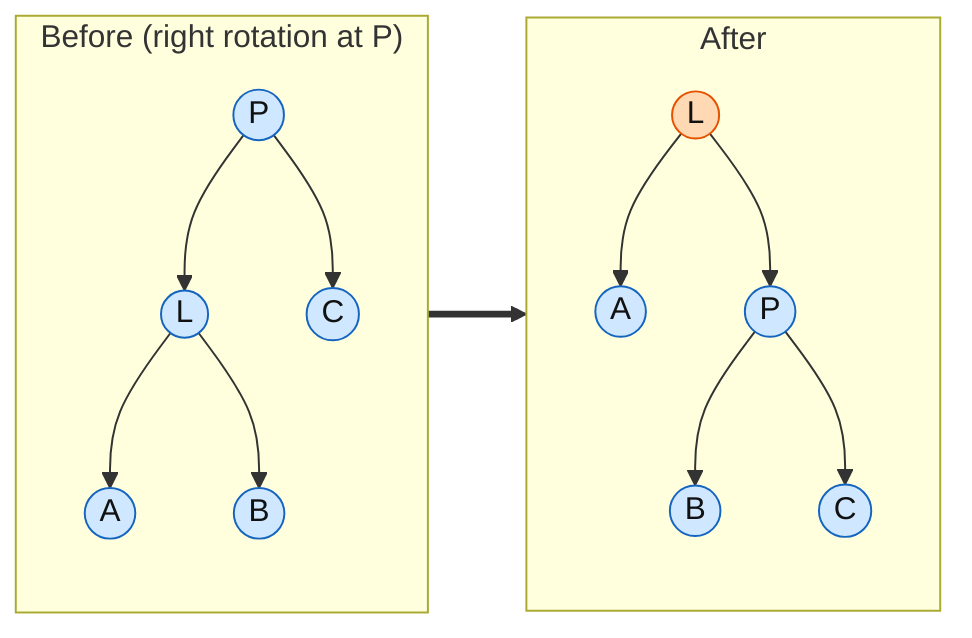

# 6. BSTs — BST Property + Balance Invariant (AVL, Red-Black)

> **Navigation**: [← 1. The Invariant Methodology — What Are We…](01_the_invariant_methodology_what_are_we.md) | [Chapter overview](../A1_DS_Correctness_Invariants.md)
> Page 2 of 2 in **A1. Data Structure Correctness — Proving Invariants Hold**


## 💬 Study-Partner View — BST Invariants

**1. The bottom line:** A BST stays correct when every node is larger than everything on its left and smaller than everything on its right; balanced trees add a height rule on top.

**2. The textbook core:**

- **BST property:** for every node `x`, all keys in `x.left` are `< x.key` and all keys in `x.right` are `> x.key` (not just the immediate children).
- **AVL:** `|height(left) - height(right)| <= 1` at every node.
- **Red-black:** root black; no red node has a red child; every root-to-null path has the same number of black nodes.
- Insert/delete restore these with rotations and recolouring.

**3. The real-world analogy:** A **filing cabinet sorted alphabetically**: everything in the left drawers comes before, everything in the right drawers after, at every level.

**4. Walkthrough:**

1. Insert 5, 3, 8 → root 5, left 3, right 8 (property holds).
2. Insert 4: 4 < 5 go left; 4 > 3 go right → right child of 3.
3. Check the **whole** left subtree of 5: {3, 4} are all < 5 ✓.
4. A wrong insert of 6 as the right child of 3 would violate the property because 6 > 5 but sits in 5's left subtree.

> [!NOTE]
> **Quick check:** Why is "left child < node < right child" not enough? *The rule must hold for the entire subtree, not just direct children.*


## BST Property Invariant

> **Invariant (BST)**: For every node `N` with `N.key = k`, all keys in `N.left` are `< k`, and all keys in `N.right` are `> k`. This holds recursively for all nodes in the tree.

## Initialization

Empty tree (`root = null`) vacuously satisfies the invariant. ✓

## Mutator Preservation — `insert(k)`

```java
Node insert(Node node, int key) {
    if (node == null) return new Node(key);
    if (key < node.key) node.left = insert(node.left, key);
    else if (key > node.key) node.right = insert(node.right, key);
    else node.key = key; // update value, tree unchanged
    return node;
}
```

**Proof by structural induction on `node`**:

*Base case*: If `node == null`, a new leaf is created with `key`. Since it has no children, the BST property is vacuously satisfied for this leaf. ✓

*Inductive step*: Assume the recursive call `insert(node.left, key)` returns a subtree that satisfies the BST property and where all keys in `node.left` are `< key` (because `key < node.key`). Setting `node.left` to this subtree preserves `node.key > all keys in node.left`. The right-subtree case is symmetric. The current node's key is unchanged, so `node.key > all in left` and `node.key < all in right`. ✓

Therefore, by structural induction, the entire tree satisfies the BST property after `insert`. ✓

## AVL Balance Invariant

> **Invariant (AVL Balance)**: For every node `N`, `|height(N.left) - height(N.right)| ≤ 1`. This holds after every insert and delete, maintained by single and double rotations.

## AVL Rotation Proofs

**Lemma (Single Right Rotation preserves BST property)**: Consider nodes `P` (parent) and `L` (left child), where `L` becomes right-heavy after an insert in `L`'s right subtree. The rotation:



**How to read this diagram.** A right rotation lifts `L` above `P`: `L` becomes the root (orange), `P` becomes its right child, and `L`'s old right subtree `B` moves across to become `P`'s left child. The in-order sequence `A L B P C` is unchanged.

**Proof**: All keys in subtree `A` are `< L.key` (original). All keys in subtree `B` are `> L.key` and `< P.key` (original BST property: `L.key < B < P.key`). All keys in subtree `C` are `> P.key`. After rotation, `L` becomes the root. `L.right = P`. The ordering is: `A < L.key < B < P.key < C`. This exactly satisfies the BST invariant for the entire subtree. ✓

**Lemma (AVL rebalancing restores the balance invariant)**: After insertion, we traverse back up the path, recomputing heights and performing rotations at the first node where `|height(left) - height(right)| > 1`. Since the height difference before insertion was at most 1 at every node, the imbalance can only occur at nodes along the insertion path. A single or double rotation at the deepest violating node reduces the height of that subtree to its pre-insertion height. By induction on the path length, all nodes satisfy the balance invariant after rebalancing. ✓

## Red-Black Tree — Five Invariants

> **Invariant (Red-Black)**: The following five properties hold at all times:
>
> 1. Every node is either red or black.
> 2. The root is black.
> 3. All NIL (leaf) children are black.
> 4. If a node is red, both its children are black (no red-red edges).
> 5. For every node, all paths from that node to descendant NIL leaves contain the same number of black nodes (black-height property).

## Red-Black Invariant Preservation — `insert`

Insertion places a new node as a red leaf, then rebalances:

**Case A — Parent is black**: Properties 1–4 are preserved (new node is red, parent is black, no red-red edge created). Black-height on all paths is unchanged. ✓

**Case B — Parent is red (violates property 4)**: Let `uncle` be the sibling of the parent.

- **If uncle is red**: Recolor parent and uncle black, recolor grandparent red. This preserves black-height (each path through grandparent loses one black node at parent but gains one at uncle → net zero). The new red-grandparent may violate property 4 with its own parent — recurse upward. ✓
- **If uncle is black**: A rotation is needed. There are two sub-cases (zig-zag and zig-zig), each requiring one rotation that:
  - Preserves the BST property (same as AVL rotation proof).
  - Restores property 4 (red parent and red child are no longer adjacent after rotation).
  - Preserves black-height (the rotated subtree has the same black-height as before the insertion).

**Lemma (Black-height preservation after rotation)**: In both the single-rotation and double-rotation cases, the number of black nodes on any path through the rotated subtree is unchanged. This is because the rotation rearranges red nodes without changing the count of black nodes on any path. The old black-height `bh` of the grandparent subtree is maintained: each path still has exactly `bh` black nodes. ✓

**Termination of rebalancing**: In the worst case, recolor/rotate actions propagate at most to the root. The root is always recolored black (restoring property 2) after the propagation reaches it. The recursion terminates in O(log n) steps (the height of the tree). ✓

## BST Query Correctness (Search)

> **Claim**: `search(k)` on a BST returns `true` if and only if `k` is in the tree.

*If direction*: If `k` is in the tree, the BST invariant guarantees that following the comparison direction at each node will reach the node containing `k`. Each step eliminates the entire subtree that cannot contain `k` (all keys on the left are smaller; all on the right are larger). Therefore, the search reaches `k`. ✓

*Only-if direction*: If `search(k)` returns `true`, it found a node with key `k`. By the representation invariant, every node reachable in the tree was inserted (or descended from an inserted node). Therefore `k` was inserted. ✓

---

## 7. Heaps — Heap-Order + Complete-Tree Invariant

### 💬 Study-Partner View — Heap Invariants

**1. The bottom line:** A heap is correct when it is a complete tree and every parent is at least as good as its children.

**2. The textbook core:**

- **Shape:** complete binary tree stored in an array indices `0..n-1` (no gaps).
- **Order (min-heap):** `a[(i-1)/2] <= a[i]` for all `i > 0`.
- `insert` appends then **sift-up** until the order holds; `extractMin` moves the last element to the root then **sift-down**.
- The order is local (parent vs child); siblings are unordered.

**3. The real-world analogy:** A **company hierarchy where every manager earns no more than the people they manage** (for a min-heap): the cheapest salary is always the CEO's seat.

**4. Walkthrough:**

1. Heap `[2, 5, 4, 9]`; `insert(1)`.
2. Append → `[2, 5, 4, 9, 1]`; parent of index 4 is index 1 (value 5); 1 < 5 → swap.
3. Now `[2, 1, 4, 9, 5]`; parent of index 1 is index 0 (value 2); 1 < 2 → swap.
4. Heap `[1, 2, 4, 9, 5]` satisfies the order again.

> [!NOTE]
> **Quick check:** Is a heap sorted? *No: only parent ≤ child is guaranteed.*


### Invariant Statement

> **Invariant (Min-Heap Order)**: For every node `N` with `N.key = k`, `k ≤` all keys in `N.left` and `k ≤` all keys in `N.right`. In other words, `parent.key ≤ child.key` for every parent-child pair.

> **Invariant (Complete Binary Tree)**: The tree is filled level-by-level left-to-right. There are no gaps in the first `h-1` levels, and the last level's nodes are packed at the left. This enables array representation with `parent(i) = (i-1)/2`, `left(i) = 2*i+1`, `right(i) = 2*i+2`.

### Initialization

`heap = new int[capacity]`, `size = 0`. The tree is empty, both invariants vacuously hold. ✓

### `siftUp` Preserves Heap-Order

```java
private void siftUp(int i) {
    while (i > 0 && heap[parent(i)] > heap[i]) {
        swap(i, parent(i));
        i = parent(i);
    }
}
```

**Claim**: After `siftUp(i)` terminates, the subtree rooted at the original position satisfies heap-order.

**Proof**: Let `p = parent(i)`. At each iteration, we compare `heap[p]` with `heap[i]`. If `heap[p] > heap[i]`, they are swapped. After the swap, `heap[i]` (the smaller value) is at position `p`, so the heap-order invariant holds for the parent-child pair `(p, i)`'s child. The element that was at `p` is now at `i`. We then move to `i = p` (the next level up). By induction on the number of swap steps, each swap eliminates a heap-order violation at one level and potentially creates one at the parent level. The loop terminates when either `i == 0` (root) or `heap[parent(i)] ≤ heap[i]` (heap-order satisfied). The element's final position has `heap[parent] ≤ heap[i]`. Since only this element moved, all other parent-child pairs retain their original ordering. ✓

### `siftDown` Preserves Heap-Order

```java
private void siftDown(int i) {
    while (true) {
        int smallest = i;
        int l = left(i), r = right(i);
        if (l < size && heap[l] < heap[smallest]) smallest = l;
        if (r < size && heap[r] < heap[smallest]) smallest = r;
        if (smallest != i) { swap(i, smallest); i = smallest; }
        else break;
    }
}
```

**Claim**: After `siftDown(i)`, the subtree rooted at `i` satisfies heap-order.

**Proof**: Let `s` be the index of the smaller child (or `i` itself if neither child is smaller). If `s == i`, the condition `heap[i] ≤ heap[left(i)]` and `heap[i] ≤ heap[right(i)]` holds, so heap-order is satisfied. If `s ≠ i`, then `heap[s] < heap[i]` (by the comparison logic). Swapping them puts the smaller element at `i`. After the swap, the parent-child pair `(i, s)` satisfies heap-order. The element that moved to `s` may now violate heap-order with its own children. The recursive check at position `s` restores it. By induction on the height of the subtree (each iteration moves the violating element one level down), the loop terminates with heap-order satisfied at all nodes in the subtree. ✓

### Complete-Tree Invariant After `extractMin`

```java
public int extractMin() {
    int min = heap[0];
    heap[0] = heap[--size];
    heap[size] = 0;  // or null
    siftDown(0);
    return min;
}
```

After `heap[0] = heap[--size]`, the element from the last position moves to the root. The last position is now logically empty (and we overwrite it). The tree's structure: the last level's rightmost node is removed. This preserves the complete-tree property because the complete binary tree property is defined as: all levels are full except possibly the last, and the last level is filled left-to-right. Removing the rightmost leaf of the last level preserves this — the last level may now have one fewer element, but no gaps appear in the middle. ✓

### `buildHeap` (Floyd's Bottom-Up) — O(n) Proof

```java
public void buildHeap(int[] arr) {
    size = arr.length;
    heap = arr.clone();
    for (int i = size / 2 - 1; i >= 0; i--)
        siftDown(i);
}
```

**Claim**: After `buildHeap`, the array satisfies both the heap-order and complete-tree invariants.

**Proof**: The complete-tree invariant holds trivially — the array represents a complete binary tree by construction (level-order layout). Heap-order: `siftDown(i)` is called on all nodes from the last non-leaf index down to the root. Consider an arbitrary node `v`. All nodes in its subtrees have indices > `i` (where `i` is `v`'s index). By the loop order, `siftDown` has already been applied to all children of `v` (and their descendants). By the `siftDown` correctness lemma above, each child's subtree satisfies heap-order after `siftDown` completes. Then `siftDown(v)` is called, which compares `v` with its children. If `v` is larger than a child, it swaps and continues downward. After `siftDown(v)`, the subtree rooted at `v` satisfies heap-order. By processing nodes in this order (bottom-up), we guarantee that when a node is processed, its children already satisfy heap-order. After the loop finishes, all nodes satisfy heap-order. ✓

**Time complexity proof**: `siftDown(i)` costs O(h) where `h` is the height of the subtree rooted at `i`. In a complete binary tree with n nodes, there are exactly `n/2` leaf nodes (height 0), `n/4` nodes at height 1, `n/8` at height 2, and so on. The total work is:

```
Sum = (n/2)·0 + (n/4)·1 + (n/8)·2 + (n/16)·3 + ...
    = n · Σ (i / 2^(i+1))   for i from 0 to log n
    < n · Σ (i / 2^i)       for i from 0 to ∞
    < 2n                     (geometric series)
    = O(n)
```

Floyd's algorithm builds a heap in O(n) time, vs O(n log n) for n sequential inserts. ✓

### Operational Correctness — `peek()` and `extractMin()`

`peek()` returns `heap[0]`. By heap-order, the root's key is ≤ all other keys. Therefore, `heap[0]` is the minimum element. ✓

`extractMin()` removes and returns `heap[0]`, replacing it with the last element and calling `siftDown(0)`. By heap-order preservation, after `siftDown` the root contains the minimum of the remaining elements. The returned value was the global minimum. ✓

---

## 8. Tries — Prefix Invariant

### 💬 Study-Partner View — Trie Invariants

**1. The bottom line:** In a trie, the path from the root spells a prefix, so every key is just a path ending at a marked node.

**2. The textbook core:**

- **Prefix property:** the string spelled by the path from the root to node `v` is a prefix shared by all keys below `v`.
- **Terminal marker:** a node has `isEnd = true` exactly when its path is a stored key.
- Insert/search/prefix lookup cost **O(L)** for key length `L`, independent of the number of keys.
- Space can be large (many child pointers); compressed tries (radix/Patricia) reduce it.

**3. The real-world analogy:** The **autocomplete dropdown** on your phone: typing "ca" walks to a node whose descendants are "cat", "car", "card"...

**4. Walkthrough:**

1. Insert "car" and "cat": path c → a → r (end) and c → a → t (end).
2. The node for "ca" is shared by both words.
3. `startsWith("ca")`: walk c, a → node exists → true.
4. `search("ca")`: node exists but `isEnd` is false → false.

> [!NOTE]
> **Quick check:** Why store `isEnd`? *Without it you cannot tell the stored word "car" from the mere prefix "ca".*


### Invariant Statement

> **Invariant (Trie Prefix)**: For every key `k` in the set, there exists a root-to-leaf path whose edge labels, concatenated, equal `k`. Every node on this path (including intermediate nodes) is marked with `isEndOfWord = true` if and only if a key ends at that node. No node is labeled with an edge character other than those from inserted keys.

For a compressed (radix) trie:

> **Invariant (Radix Trie Prefix)**: Each edge label is a non-empty string. The concatenated labels along any root-to-leaf path form a key in the set. The set of edge labels from a node covers the key space partition uniquely (no two children of the same node have labels with the same prefix).

### Initialization

Root node `root` has no children, `isEndOfWord = false`. The empty set contains no keys — the invariant holds vacuously. ✓

### Mutator Preservation — `insert(key)`

```java
void insert(String key) {
    TrieNode node = root;
    for (char c : key.toCharArray()) {
        node.children.putIfAbsent(c, new TrieNode());
        node = node.children.get(c);
    }
    node.isEndOfWord = true;
}
```

**Proof by induction on prefix length**: After processing `i` characters of `key`, the traversal is at the node representing the prefix `key[0..i-1]`. By the loop invariant (structural, not loop-specific), this node exists because:
- Base case: `i = 0`, node = root, which exists. ✓
- Inductive step: Assume node exists for prefix of length `i`. The next character `c = key[i]` creates the edge `node → child` if absent (preserving the invariant: the edge label `c` corresponds to the `(i+1)`st character of some key). The child node represents prefix `key[0..i]`. ✓

After the loop, `node` represents the full `key`. Setting `isEndOfWord = true` marks that this path corresponds to an inserted key. No other nodes are modified, so all other keys remain valid. ✓

### `delete(key)`

```java
boolean delete(String key) {
    return delete(root, key, 0);
}

private boolean delete(TrieNode node, String key, int depth) {
    if (node == null) return false;
    if (depth == key.length()) {
        if (!node.isEndOfWord) return false;
        node.isEndOfWord = false;
        return node.children.isEmpty(); // can prune upward
    }
    char c = key.charAt(depth);
    TrieNode child = node.children.get(c);
    if (child == null) return false;
    boolean shouldDeleteChild = delete(child, key, depth + 1);
    if (shouldDeleteChild) node.children.remove(c);
    return node.children.isEmpty() && !node.isEndOfWord;
}
```

**Proof**: The recursive call descends to the node representing `key`. At depth = `key.length`, `isEndOfWord` is set to `false`, so `key` is no longer marked as present. The upward recursion removes nodes only if they have no children and are not the end of another key. This preserves the invariant: any node that is removed had no descendants, so it did not represent a longer key's prefix. Any node that remains has at least one child (if it was a prefix of another key) or `isEndOfWord = true`. Therefore, every remaining root-to-leaf path spells a key that was not deleted. ✓

### Compressed (Radix) Tries

A radix trie compresses chains of single-child nodes by storing edge labels as strings. The prefix invariant adapts: instead of one character per edge, each edge is labeled with a non-empty string. The path for key `k` follows edges whose concatenated labels equal `k`. Insertion splits an edge when the key diverges mid-label, preserving the invariant that all edge labels are derived from the keys in the set. The proof is identical to the basic trie, with string labels instead of single-character labels. ✓

### Operational Correctness — `search(key)`

```java
boolean search(String key) {
    TrieNode node = root;
    for (char c : key.toCharArray()) {
        if (!node.children.containsKey(c)) return false;
        node = node.children.get(c);
    }
    return node.isEndOfWord;
}
```

By the prefix invariant, a path to `key` exists if and only if `key` was inserted. The traversal follows exactly those edges whose labels match each character. If the traversal reaches the end of `key` and `node.isEndOfWord = true`, then `key` is in the set. If any character is missing or `isEndOfWord = false`, the key is not in the set. ✓

### Why Tries Preserve the Prefix Invariant

The invariant is preserved by construction: every inserted key creates exactly one root-to-leaf path, labeled by that key. No operation creates a path for a key not inserted, and no operation removes a path for a key not deleted. This is a direct consequence of the insert/delete implementation — there is no "rebalancing" or "rotation" that could merge or split paths incorrectly.

---

## 9. Union-Find — Parent-Pointer Invariant

### 💬 Study-Partner View — Union-Find Invariants

**1. The bottom line:** Union-Find is correct when following parent pointers always ends at a root, and two elements are in the same set exactly when they reach the same root.

**2. The textbook core:**

- **Parent-pointer forest:** `parent[x]` points to another node or to itself (a root); no cycles other than self-loops at roots.
- **Set identity:** `find(x) == find(y)` iff `x` and `y` are in the same set.
- **Union by rank/size** keeps trees shallow; **path compression** flattens paths during `find`.
- With both, `m` operations cost **O(m · α(n))**, effectively constant.

**3. The real-world analogy:** **Teams in a company**: each team has one captain; asking "who is your captain?" for two people tells you whether they are on the same team, and merging teams means one captain reports to the other.

**4. Walkthrough:**

1. Start with singletons `0..4` (each its own parent).
2. `union(0, 1)`: roots 0 and 1 differ → set `parent[1] = 0`.
3. `union(1, 2)`: `find(1) = 0`, `find(2) = 2` → `parent[2] = 0`.
4. `find(2)` follows 2 → 0 and compresses the path; `find(2) == find(0)` → connected.

> [!NOTE]
> **Quick check:** What does path compression change? *It makes later `find` calls faster without changing which sets exist.*


### Invariant Statement

> **Invariant (Parent-Pointer)**: For every element `x`, following `parent[x]` repeatedly leads to a root element `r` where `parent[r] = r`. All elements in the same connected component share the same root. The `rank` (or `size`) of a root is the size bound of its subtree; non-root elements' ranks are unchanged.

> **Invariant (Find Returns Correct Representative)**: `find(x)` returns the root of the tree containing `x`. By the parent-pointer invariant, this root is unique and is the same for all elements in the same set.

### Initialization

Each element `i` has `parent[i] = i` and `rank[i] = 0`. Each element is its own root — there are `n` singleton sets. Trivially, every element's parent leads to itself. ✓

### `find(x)` with Path Compression

```java
int find(int x) {
    if (parent[x] != x)
        parent[x] = find(parent[x]);
    return parent[x];
}
```

**Claim**: After `find(x)`, `parent[x]` points directly to the root of its set.

**Proof by induction on recursion depth**: If `parent[x] == x`, `x` is already a root — return `x`. If `parent[x] ≠ x`, recursively call `find(parent[x])`. By the inductive hypothesis, the recursive call returns the root `r` and sets `parent[parent[x]] = r`. Then `parent[x]` is set to `r`. After the assignment, `parent[x] = r`. All other pointers are unchanged. ✓

**Path compression preserves the parent-pointer invariant**: After `find(x)`, the tree is shallower (some nodes now point directly to the root), but the root for each node is unchanged. The parent-pointer invariant (every node leads to a root) still holds. ✓

### `union(x, y)`

```java
void union(int x, int y) {
    int rx = find(x);
    int ry = find(y);
    if (rx == ry) return;
    if (rank[rx] < rank[ry]) parent[rx] = ry;
    else if (rank[rx] > rank[ry]) parent[ry] = rx;
    else { parent[ry] = rx; rank[rx]++; }
}
```

**Claim**: After `union(x, y)`, the parent-pointer invariant holds: all elements in the union of the two sets share the same root.

**Proof**: Let `rx = find(x)` and `ry = find(y)`. By the invariant, `rx` is the root of `x`'s set and `ry` is the root of `y`'s set. If `rx == ry`, the sets are already the same — no action needed. If `rx ≠ ry`, we make one root point to the other:

- If `rank[rx] < rank[ry]`: set `parent[rx] = ry`. Now any element whose path led to `rx` now leads to `ry` (one additional hop). All paths lead to `ry`. ✓
- Symmetric case `rank[rx] > rank[ry]`. ✓
- If `rank[rx] == rank[ry]`: arbitrarily make `ry`'s root point to `rx`, and increment `rank[rx]`. The new root is `rx`, with rank increased by 1. All elements now lead to `rx`. ✓

The set of reachable roots is unchanged for all elements outside the two merged sets. For elements inside the union, the invariant holds. ✓

### Rank Invariant

> **Invariant (Rank Bound)**: For any root `r`, all nodes in the subtree of `r` have depth at most `rank[r]`. When two trees of equal rank `r` are merged, the new root has rank `r+1`.

**Proof**: The rank of a root is incremented only in the `union` case where both roots have equal rank. The depth of any node in the new tree is at most the maximum depth in either original tree plus 1 (the node that was the old root now has one extra parent). Since the old roots had depth at most `r`, the new root's children have depth at most `r+1`. Setting `rank[newRoot] = r+1` maintains the invariant. ✓

### Why This Gives Amortized O(alpha(n)) Time

The inverse Ackermann function `alpha(n)` is the functional inverse of the Ackermann function — it grows so slowly that for all practical `n`, `alpha(n) ≤ 4`. The rank invariant guarantees that every `union` increases the rank of some root, and `find` with path compression compresses paths, reducing future find costs. The standard amortized analysis (tarjan's analysis) shows that any sequence of `m` `find`/`union` operations on `n` elements costs `O((n + m) · alpha(n))`. This is effectively linear time for all practical purposes.

### Operational Correctness — `connected(x, y)`

```java
boolean connected(int x, int y) {
    return find(x) == find(y);
}
```

By the parent-pointer invariant, `find(x)` returns the unique root of `x`'s set. If `find(x) == find(y)`, both elements lead to the same root, meaning they are in the same connected component. Conversely, if they are in the same component, they share the same root. ✓

---

## 10. How to State an Invariant in an Interview

### 💬 Study-Partner View — Stating an Invariant in an Interview

**1. The bottom line:** Before you code, say in one sentence what is always true about your structure, and then show each step keeps it true.

**2. The textbook core:**

- Name the **state** (variables/pointers) the invariant talks about.
- State it as a sentence with quantifiers: "for every `i`, ...".
- Show **initialization**, **preservation** and what it **implies** at the end.
- Use it to justify boundaries and edge cases (empty, one element, full).

**3. The real-world analogy:** Like **saying the rules of a game out loud before playing**: both players know what "legal" means, so mistakes are easy to spot.

**4. Walkthrough:**

1. Problem: binary search for `target` in sorted `a`.
2. Invariant: "if `target` is present, it is in `a[lo..hi]`".
3. Init: `lo = 0`, `hi = n-1` covers everything.
4. Each step discards the half that cannot contain `target`, so the invariant is preserved; when `lo > hi` the range is empty → not present.

> [!NOTE]
> **Quick check:** Why is this stronger than "I tested some cases"? *It argues about every input, not just the ones you tried.*


### The Invariant Template

When asked to prove a data structure is correct, use this template:

```
"Here's the invariant:

  [Name] Invariant: [Precise statement in 1-2 sentences]

  Proof:
  1. Initialization: [Show the constructor creates a valid structure]
  2. Preservation: [Prove each mutator preserves the invariant — use the
     specific operation names, e.g., 'insert preserves BST property by X']
  3. Query correctness: [Show the invariant implies the operation is correct]

  Therefore, the data structure is always in a valid state."
```

### Example — BST Delete

"The BST invariant is: every node's left subtree keys are less than the node's key, and every right subtree key is greater. Delete preserves this because we handle three cases:

- Leaf: removing it doesn't affect any other node's ordering.
- One child: the removed node's child replaces it, and because all keys in that subtree are on the correct side of the parent's key (they were before deletion), they remain correctly ordered.
- Two children: we replace the deleted node's value with its inorder successor (the minimum of the right subtree). The successor is greater than all left-subtree keys (by BST property of the right subtree) and less than all right-subtree keys greater than it. The ordering is preserved.

Since the invariant holds after delete, subsequent searches return correct results."

### Common Invariant Mistakes

1. **Stating the wrong property**: "The array is sorted" is NOT an ArrayList invariant — elements are in insertion order, not sorted. Conflating these destroys the correctness argument.
2. **Missing the "at all times" qualifier**: The invariant must hold *between* operations, not just *after* the operation. If a resize temporarily violates the load-factor bound, the invariant is wrong.
3. **Invariant too weak**: "Data structure has nodes" — true but useless. The invariant must be strong enough that query correctness follows from it.
4. **Invariant too strong**: "Data[0..size-1] are sorted AND form a contiguous range AND no duplicates" — if the implementation allows duplicates, the invariant is false.

### Red Flags That Signal an Invariant is Wrong

| Red Flag                                      | What It Means                                         |
| --------------------------------------------- | ----------------------------------------------------- |
| You need to check the operation outcome to verify the invariant | The invariant should not depend on what the operation returned. |
| The invariant holds before but not after resize | The resize code must be included in the preservation proof. |
| Your invariant uses "approximately" or "usually" | Invariants are strict; if it can be violated even transiently, it is not an invariant. |
| The query operation's correctness can't be derived from the invariant | The invariant is either too weak or doesn't capture the right property. |
| You can't prove it for an empty structure     | If the base case fails, the induction can't start. The invariant must hold for the empty structure. |

### The 3-Sentence Proof Template

```
"This data structure maintains [invariant name]. 
[Name the mutator] preserves it because [specific reasoning].
Therefore, [query operation] is correct because [how the invariant guarantees correctness]."
```

Example: "This stack maintains LIFO discipline. Push preserves it by writing to the top position, and pop preserves it by removing from the top and decrementing size. Therefore, pop() returns the most recently pushed element."

---

## Practice Problems

1. **Doubly Linked List**: Prove that after `addAfter(node, newNode)`, the bidirectional invariant `node.prev.next == node` and `node.next.prev == node` holds for all affected nodes. List all pointer assignments needed.

2. **AVL Delete**: Prove that AVL deletion can require O(log n) rotations (vs O(1) for insert). Show a sequence that deletes a leaf from an AVL tree and triggers rebalancing all the way to the root.

3. **Red-Black Delete**: Prove that when a black node is deleted (and a black node's black-height contribution is lost), the `deleteFixup` algorithm must handle four distinct cases, and that each case preserves all five Red-Black invariants.

4. **Circular Array Queue**: The queue is full when `(tail + 1) % capacity == head`. Prove formally that this condition correctly identifies "one slot remaining" and that the alternative (using `head == tail` to mean both empty and full with a separate `size` field) is also valid but requires more bookkeeping.

5. **Trie Delete Edge Case**: In a basic (non-compressed) trie, what happens to the invariant when you delete a key that is a prefix of another key? Trace through with keys `{"apple", "app"}` — delete `"app"`. Does the path for `"apple"` remain valid?

6. **Union-Find**: Prove that after any sequence of `union` operations, all elements in the same set have the same root. Use the parent-pointer invariant directly. (Hint: show by induction on the number of unions that `find(x) == find(y)` if and only if x and y were connected by a union.)

7. **Heap Merge**: Describe the invariant of a leftist heap or skew heap. Prove that `meld(h1, h2)` (merge two heaps) preserves the heap-order invariant and the structural invariant (e.g., leftist property).

8. **Bloom Filter**: Although not a standard data structure in the same sense, a Bloom filter maintains the invariant: if `contains(k)` returns false, then `k` was definitely never inserted. Prove that `contains` can have false positives (returning true for uninserted keys) but never false negatives.

---

## Summary

| Data Structure | Structural Invariant | Key Proof Technique |
| --- | --- | --- |
| ArrayList | data[0..size-1] = live elements in order | Induction on operation count |
| Singly Linked List | reachable nodes = live elements, no cycles | Reachability + graph induction |
| Doubly Linked List | next/prev pointers form consistent chain | Pairwise consistency per operation |
| Stack | data[top] = most-recently-pushed element | LIFO discipline + array layout |
| Circular Queue | head/tail pointers track FIFO order | Circular arithmetic + modulo bounds |
| Hash Table (chaining) | key in bucket = hash(k) mod capacity | Deterministic hash + reachability |
| Hash Table (open addr) | probe sequence visits each slot at most once | Number theory (coprimality) |
| BST | left subtree keys < node.key < right | Structural induction on tree |
| AVL Tree | BST property + \|height(L)-height(R)\| ≤ 1 | Rotation preserves BST + balance |
| Red-Black Tree | BST property + 5 color/black-height rules | Case analysis per recolor/rotate |
| Min-Heap | parent.key ≤ children.keys + complete tree | siftUp/siftDown preserves heap-order |
| Trie | root-to-leaf path = inserted key | Prefix property + structural induction |
| Union-Find | parent pointers lead to unique root per set | Induction on union count + find |

*[Back to DS Index](../00_INDEX.md) | [A2: DS Complexity from First Principles →](../A2_DS_Complexity_FirstPrinciples.md)*

---

## When It Breaks -- DS Correctness Invariants

**1. TreeMap comparator inconsistent with equals** -- `TreeMap` uses `compare(a,b)==0` to identify equal keys. If your comparator returns 0 for two objects that are not `.equals()`, the second put silently overwrites the first. Fix: ensure `compare(a,b)==0` iff `a.equals(b)`.

**2. PriorityQueue element mutation** -- modifying an object inside a PriorityQueue that is used as the comparison key silently breaks the heap invariant. Symptom: `poll()` returns elements in wrong order, no exception. Fix: remove the element (O(n)), modify it, re-insert (O(log n)).

**3. Concurrent modification of invariant-critical collections** -- modifying a HashMap while iterating it (via iterator + put in same thread) throws `ConcurrentModificationException`. Fix: collect changes in a separate list; apply after the iteration completes.

**4. CopyOnWriteArrayList stale reads** -- `CopyOnWriteArrayList` iterators see a snapshot of the list at iterator creation time. Writes after the iterator is created are invisible to it. Design code to expect stale reads if using COW collections with concurrent writers.

---

## Reference Anchor

**JDK -- invariant-maintaining data structures**:
```java
// TreeMap: comparator must be consistent with equals
TreeMap<String, Integer> tm = new TreeMap<>(String.CASE_INSENSITIVE_ORDER);
tm.put("hello", 1); tm.put("HELLO", 2); // silently overwrites -- same key by comparator
assert tm.size() == 1; // NOT 2

// PriorityQueue: no update-key operation -- use lazy deletion instead
PriorityQueue<long[]> pq = new PriorityQueue<>(Comparator.comparingLong(a -> a[0]));
// To "update" dist[v]: don't remove old entry; push new (dist, v) and skip stale on pop
// if (d > dist[u]) continue; // stale entry guard

// Collections.unmodifiableMap -- publish an immutable view of a mutable map
Map<String, Integer> safe = Collections.unmodifiableMap(mutableMap);
// UnsupportedOperationException on put/remove -- enforces invariant at call boundary
```

---

## Brute Force to Optimal -- Invariant Verification

| DS | Full invariant check | Cost | Production approach |
|----|---------------------|------|---------------------|
| BST | Walk all nodes, verify BST property | O(n) | Trust TreeMap; assert in tests only |
| Heap | Check all parent-child pairs | O(n) | Assert heap property in unit test |
| Union-Find | Trace all paths to root, verify rank | O(n alpha(n)) | Log rank at union; spot-check in test |
| HashMap | Verify all keys hash to correct bucket | O(n) | Trust JDK implementation |

Rule: invariant checks are O(n) or worse -- too expensive for production hot paths. Assert in test mode; trust proven library implementations in production.

---

[← 1. The Invariant Methodology — What Are We…](01_the_invariant_methodology_what_are_we.md) | [Chapter overview](../A1_DS_Correctness_Invariants.md)
