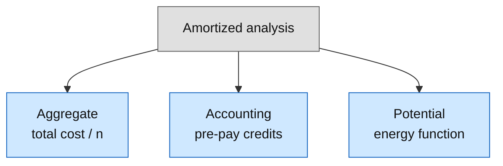

# A2. Data Structure Complexity — From First Principles

**Navigation**: [← A1: DS Correctness](A1_DS_Correctness_Invariants.md) | [📚 DS Index](00_INDEX.md) | [A3: DS Lower Bounds →](A3_DS_Lower_Bounds.md)

> **MIT 6.006 L10–L12 / RWTH Aachen Algo I / TU Munich IN0007 foundation**
>
> "Amortized analysis is the heart of data structure engineering. It is the discipline of asking: not 'how expensive is this single operation?' but 'how expensive is this operation when it is the ten-millionth, in the context of everything that came before?'"
> — Adapted from Robert Tarjan, "Amortized Computational Complexity" (1985)

> A data structure's true cost is not its worst single operation — it is the cost averaged over a *sequence* of operations, taken from the data structure's own perspective as a stateful, evolving container. This chapter derives that cost rigorously, method by method.

---

## Table of Contents

1. [Why Worst-Case Per-Op Lies — The Resize Example](A2_DS_Complexity_FirstPrinciples/01_why_worst_case_per_op_lies.md#1-why-worst-case-per-op-lies--the-resize-example)
2. [The Three Amortized Analysis Methods (DS-Flavored)](A2_DS_Complexity_FirstPrinciples/01_why_worst_case_per_op_lies.md#2-the-three-amortized-analysis-methods-ds-flavored)
3. [Aggregate Method — Dynamic Array Resize](A2_DS_Complexity_FirstPrinciples/01_why_worst_case_per_op_lies.md#3-aggregate-method--dynamic-array-resize)
4. [Accounting Method — Stack with Multipop](A2_DS_Complexity_FirstPrinciples/01_why_worst_case_per_op_lies.md#4-accounting-method--stack-with-multipop)
5. [Potential Method — Binary Counter, Dynamic Array Formal](A2_DS_Complexity_FirstPrinciples/01_why_worst_case_per_op_lies.md#5-potential-method--binary-counter-dynamic-array-formal)
6. [The Famous DS Amortized Analyses](A2_DS_Complexity_FirstPrinciples/02_the_famous_ds_amortized_analyses.md#6-the-famous-ds-amortized-analyses)
   - [6.1 Dynamic Array Doubling — O(1) amortized insert](A2_DS_Complexity_FirstPrinciples/02_the_famous_ds_amortized_analyses.md#61-dynamic-array-doubling--o1-amortized-insert-aggregate-recap)
   - [6.2 Stack with Multipop — O(1) amortized per op](A2_DS_Complexity_FirstPrinciples/02_the_famous_ds_amortized_analyses.md#62-stack-with-multipop--o1-amortized-per-op-accounting-recap)
   - [6.3 Hash Table with Doubling — O(1) amortized insert](A2_DS_Complexity_FirstPrinciples/02_the_famous_ds_amortized_analyses.md#63-hash-table-with-doubling--o1-amortized-insert)
   - 6.4 Tarjan's Union-Find — O(α(n)) per op
   - [6.5 Splay Tree — O(log n) amortized (Sleator-Tarjan)](A2_DS_Complexity_FirstPrinciples/02_the_famous_ds_amortized_analyses.md#65-splay-tree--olog-n-amortized-sleator-tarjan)
   - [6.6 Fibonacci Heap — O(1) amortized insert/decrease-key](A2_DS_Complexity_FirstPrinciples/02_the_famous_ds_amortized_analyses.md#66-fibonacci-heap--o1-amortized-insertdecrease-key)
7. [Space Complexity — The Hidden Half](A2_DS_Complexity_FirstPrinciples/02_the_famous_ds_amortized_analyses.md#7-space-complexity--the-hidden-half)
8. [Why Amortized ≠ Average-Case](A2_DS_Complexity_FirstPrinciples/02_the_famous_ds_amortized_analyses.md#8-why-amortized--average-case)
9. [Common DS Complexity Pitfalls](A2_DS_Complexity_FirstPrinciples/02_the_famous_ds_amortized_analyses.md#9-common-ds-complexity-pitfalls)

---

## 💬 Explain It Like a Study Partner — Amortized Analysis

> [!TIP]
> **Ask yourself first:** *"If one `append` can copy a million elements, how can we still call it O(1)?"*

### 1. The bottom line

Amortized cost spreads an occasional expensive operation over all the cheap ones around it, so you judge the **average cost per operation over a worst-case sequence**.

### 2. The textbook core

- **Amortized cost** = total cost of `n` operations ÷ `n`, for the worst-case sequence. It is *not* a probabilistic average.
- Three standard methods: **aggregate** (sum all costs), **accounting** (charge extra to cheap operations to build credit), **potential** (an "energy" function Φ; amortized cost `â = c + ΔΦ`).
- Dynamic array with doubling: total copy cost over `n` appends < `2n`, so appends are **amortized O(1)**.
- Amortized O(1) does not rule out a single slow operation.

### 3. The real-world analogy

**Paying a yearly insurance premium monthly.** The bill is huge if you pay it all in one month, but if you set aside a little each month you never feel it. The cost per month is small and steady even though the real bill is lumpy.

### 4. Walkthrough: 16 appends to a doubling array

1. Appends 1 to 16 each cost 1 to write → 16 total.
2. Resizes happen at sizes 1, 2, 4, 8 and copy 1 + 2 + 4 + 8 = 15 elements.
3. Total cost = 16 + 15 = 31.
4. Average = 31 ÷ 16 ≈ **1.94**, which is O(1) per append.
5. The geometric series (1 + 2 + 4 + ... + n/2 < n) is why doubling works, while growing by +1 each time would cost O(n²).

> [!NOTE]
> **Quick check:** why is amortized O(1) not good enough for a real-time system? *One operation can still take O(n), which breaks a strict latency budget.*

---

## ⚡ At a Glance — Amortized Analysis

> [!NOTE]
> **Mental model:** amortized cost is the *average cost per operation over a worst-case sequence*. A rare expensive operation is paid for by many cheap ones. It is not an average over random inputs.

**How to read this diagram.** The three methods prove the same bounds; pick the one that fits the structure. Aggregate is simplest, accounting is intuitive, potential is the most general.

| Example | Worst single op | Amortized | Why |
| ------- | --------------- | --------- | --- |
| Dynamic array append (doubling) | O(n) | O(1) | Total copies < 2n over n appends |
| Multipop stack | O(n) | O(1) | Each element pushed and popped once |
| Binary counter increment | O(log n) | O(1) | Total bit flips < 2n |

> [!WARNING]
> Amortized O(1) still allows a single slow operation. For latency-bounded systems you need worst-case O(1), not amortized.

---

## 📚 Topic Pages in This Chapter

This chapter is split into focused pages so each topic can be read on its own. Read them in order the first time; use the table to jump back later.

| # | Page | What is inside | Lines |
| --- | --- | --- | --- |
| 1 | [1. Why Worst-Case Per-Op Lies — The Resize Example](A2_DS_Complexity_FirstPrinciples/01_why_worst_case_per_op_lies.md) | 1. Why Worst-Case Per-Op Lies — The Resize… · 2. The Three Amortized Analysis Methods… · 3. Aggregate Method — Dynamic Array Resize · 4. Accounting Method — Stack with Multipop · 5. Potential Method — Binary Counter, Dynamic… | 372 |
| 2 | [6. The Famous DS Amortized Analyses](A2_DS_Complexity_FirstPrinciples/02_the_famous_ds_amortized_analyses.md) | 6. The Famous DS Amortized Analyses · 7. Space Complexity — The Hidden Half · 8. Why Amortized ≠ Average-Case · 9. Common DS Complexity Pitfalls · Practice Problems · … | 646 |

## Reality Check

> [!CAUTION]
> **Myth:** "Big-O is the complexity"
>
> **Reality:** Big-O gives an UPPER bound. An algorithm that is O(n squared) might actually run in O(n) — the bound is just not tight. Big-Theta gives a TIGHT bound (both upper and lower). When someone says "quicksort is O(n log n)," they usually mean the average case is Theta(n log n). The worst case is Theta(n squared). Precision about which bound and which case matters for making correct algorithmic decisions.

> [!CAUTION]
> **Myth:** "Constant factors do not matter"
>
> **Reality:** An O(n) algorithm with a constant factor of 1000 is slower than an O(n log n) algorithm with a constant factor of 1 for all n under roughly 10 million. In practice, constant factors come from: number of operations per element, cache miss rates, branch misprediction rates, and memory allocation overhead. For competitive programming with n up to 10^6, constant factors often determine whether a solution passes within the time limit.

> [!CAUTION]
> **Myth:** "Space complexity only counts extra space"
>
> **Reality:** There are two conventions: total space (including input) and auxiliary space (excluding input). An in-place sorting algorithm uses O(1) auxiliary space but O(n) total space (the input array). When someone claims O(1) space, clarify whether they mean auxiliary space. Recursive algorithms use O(depth) stack space that is often forgotten — recursive merge sort uses O(n) auxiliary space for the merge step PLUS O(log n) stack space.

> [!CAUTION]
> **Myth:** "Amortized O(1) means every operation is fast"
>
> **Reality:** Amortized O(1) means n operations cost O(n) TOTAL. Individual operations can be expensive: ArrayList.add is O(n) when it triggers a resize (copying all elements to a new array). But resizes happen rarely enough that averaged over all operations, each costs O(1). For REAL-TIME systems where every operation must complete within a deadline, amortized bounds are insufficient — you need worst-case bounds.

> [!CAUTION]
> **Myth:** "Lower bounds tell you the fastest possible algorithm"
>
> **Reality:** Lower bounds are proven within a specific computational MODEL. The Omega(n log n) lower bound for comparison-based sorting does not apply to non-comparison sorts (radix sort). The lower bound for single-threaded algorithms does not apply to parallel algorithms. When a lower bound seems to block progress, question the model — the breakthrough may come from changing what operations are allowed, not from a cleverer algorithm within the same model.
