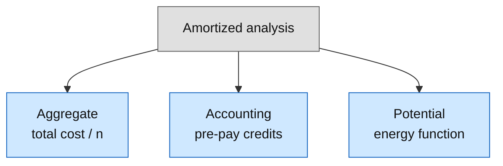
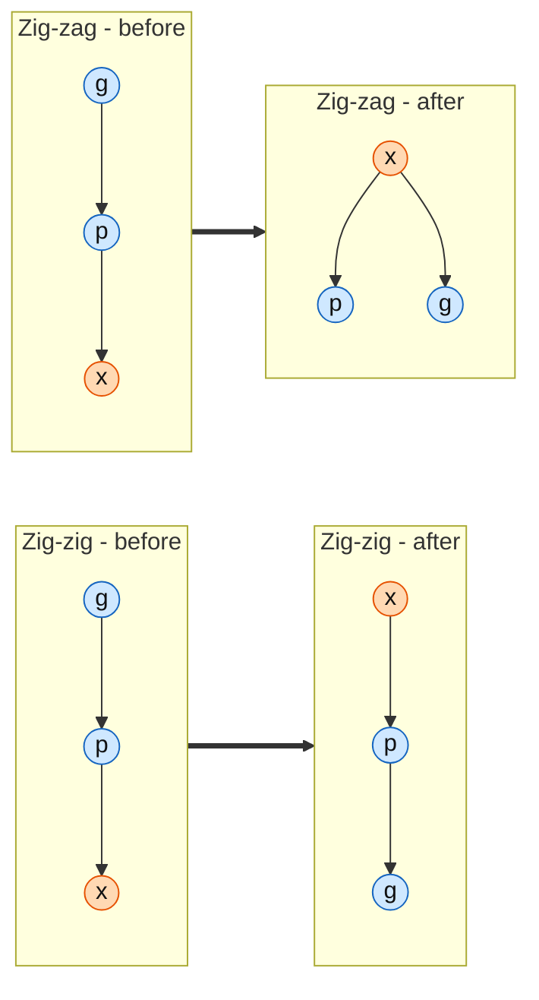

# A2. Data Structure Complexity — From First Principles

**Navigation**: [← A1: DS Correctness](A1_DS_Correctness_Invariants.md) | [📚 DS Index](00_INDEX.md) | [A3: DS Lower Bounds →](A3_DS_Lower_Bounds.md)

> **MIT 6.006 L10–L12 / RWTH Aachen Algo I / TU Munich IN0007 foundation**
>
> "Amortized analysis is the heart of data structure engineering. It is the discipline of asking: not 'how expensive is this single operation?' but 'how expensive is this operation when it is the ten-millionth, in the context of everything that came before?'"
> — Adapted from Robert Tarjan, "Amortized Computational Complexity" (1985)

> A data structure's true cost is not its worst single operation — it is the cost averaged over a *sequence* of operations, taken from the data structure's own perspective as a stateful, evolving container. This chapter derives that cost rigorously, method by method.

---

## Table of Contents

1. [Why Worst-Case Per-Op Lies — The Resize Example](#1-why-worst-case-per-op-lies--the-resize-example)
2. [The Three Amortized Analysis Methods (DS-Flavored)](#2-the-three-amortized-analysis-methods-ds-flavored)
3. [Aggregate Method — Dynamic Array Resize](#3-aggregate-method--dynamic-array-resize)
4. [Accounting Method — Stack with Multipop](#4-accounting-method--stack-with-multipop)
5. [Potential Method — Binary Counter, Dynamic Array Formal](#5-potential-method--binary-counter-dynamic-array-formal)
6. [The Famous DS Amortized Analyses](#6-the-famous-ds-amortized-analyses)
   - [6.1 Dynamic Array Doubling — O(1) amortized insert](#61-dynamic-array-doubling--o1-amortized-insert)
   - [6.2 Stack with Multipop — O(1) amortized per op](#62-stack-with-multipop--o1-amortized-per-op)
   - [6.3 Hash Table with Doubling — O(1) amortized insert](#63-hash-table-with-doubling--o1-amortized-insert)
   - [6.4 Tarjan's Union-Find — O(α(n)) per op](#64-tarjans-union-find--on-per-op)
   - [6.5 Splay Tree — O(log n) amortized (Sleator-Tarjan)](#65-splay-tree--olog-n-amortized-sleator-tarjan)
   - [6.6 Fibonacci Heap — O(1) amortized insert/decrease-key](#66-fibonacci-heap--o1-amortized-insertdecrease-key)
7. [Space Complexity — The Hidden Half](#7-space-complexity--the-hidden-half)
8. [Why Amortized ≠ Average-Case](#8-why-amortized--average-case)
9. [Common DS Complexity Pitfalls](#9-common-ds-complexity-pitfalls)

---

## ⚡ At a Glance — Amortized Analysis

> [!NOTE]
> **Mental model:** amortized cost is the *average cost per operation over a worst-case sequence*. A rare expensive operation is paid for by many cheap ones. It is not an average over random inputs.



**How to read this diagram.** The three methods prove the same bounds; pick the one that fits the structure. Aggregate is simplest, accounting is intuitive, potential is the most general.

| Example | Worst single op | Amortized | Why |
| ------- | --------------- | --------- | --- |
| Dynamic array append (doubling) | O(n) | O(1) | Total copies < 2n over n appends |
| Multipop stack | O(n) | O(1) | Each element pushed and popped once |
| Binary counter increment | O(log n) | O(1) | Total bit flips < 2n |

> [!WARNING]
> Amortized O(1) still allows a single slow operation. For latency-bounded systems you need worst-case O(1), not amortized.

---

## 1. Why Worst-Case Per-Op Lies — The Resize Example

Consider the canonical mutable structure: a dynamic array (Java's `ArrayList`, C++'s `vector`).

```java
public class DynamicArray<T> {
    private Object[] data;
    private int size;
    private int capacity;

    public DynamicArray() {
        data = new Object[1];
        size = 0;
        capacity = 1;
    }

    public void add(T element) {
        if (size == capacity) {
            resize(2 * capacity);   // Step 1: allocate new array
            for (int i = 0; i < size; i++)
                data[i] = oldData[i]; // Step 2: copy ALL existing elements
        }
        data[size++] = element;
    }
}
```

**Worst-case analysis asks**: What is the cost of a single `add()` call?

**Answer from worst-case**: O(n). When the array is full, `resize()` must copy n elements, which is Θ(n). Since this *can* happen, the worst-case per-operation cost of `add` is **O(n)**.

But this answer is **pathologically misleading**. The O(n) resize happens rarely. After n inserts, exactly one resize has occurred (copying n elements). After 2n inserts, exactly two resizes (copying n and 2n elements). The expensive operations are *paid for* by the cheap ones that preceded them.

Amortized analysis makes this precise. We ask: *What is the average cost per operation, over any sequence of n operations starting from a clean state?*

For the dynamic array: n inserts cost **O(n)** total, giving **O(1)** amortized per insert. The O(n) worst-case is real, but it cannot be charged to a single operation — it is the deferred cost of all the cheap insertions that triggered it.

This is the central insight of amortized DS analysis, and it applies to every mutable structure that occasionally "reorganizes" itself: hash tables that rehash, heaps that percolate, splay trees that restructure, disjoint sets that compress paths.

---

## 2. The Three Amortized Analysis Methods (DS-Flavored)

Before diving into specific structures, we formalize the three methods. All three give the same bound for a given data structure — they are different proof techniques, not different answers.

### 2.1 Aggregate Method (Summation)

**Approach**: Sum the total cost of a sequence of n operations, then divide by n.

**When to use**: When the expensive operation occurs at a known, structured frequency (e.g., resizes at powers of 2). The total cost forms a clean sum that you can evaluate.

**Formally**: Let `c_i` be the actual cost of operation `i`. We prove that for all n:

```
Σ_{i=1}^{n} c_i ≤ T(n)    (some explicit function)
```

If `T(n) = O(n)`, then amortized cost per op is `O(n)/n = O(1)`.

### 2.2 Accounting Method (Banker's)

**Approach**: Assign each operation a *charge* (amortized cost) that may be higher than its actual cost. The surplus is stored as "credit" and used to pay for future operations whose actual cost exceeds their charge.

**Invariant (Credit Invariant)**: The credit balance = (total charged) − (total actual cost) must always be ≥ 0.

**When to use**: When you can define a per-element credit that exactly covers the future work attributable to that element. Each piece of work has a clear "payer."

> [!TIP]
> **Key insight:** The charge per operation need not equal its actual cost. The charge only needs to overapproximate the cost in a way that lets credit accumulate for the rare expensive operations.

### 2.3 Potential Method (Physicist's)

**Approach**: Define a *potential function* Φ that maps each DS state D to a non-negative real number. Think of Φ(D) as the "stored energy" in the structure.

**Amortized cost** of operation i:

```
â_i = c_i + Φ(D_i) − Φ(D_{i-1}) = c_i + ΔΦ_i
```

**Total amortized cost** of n operations:

```
Σ â_i = Σ c_i + Φ(D_n) − Φ(D_0)
```

If Φ(D_0) = 0 and Φ(D_i) ≥ 0 for all i, then:

```
Σ â_i ≥ Σ c_i   (amortized is an upper bound on actual)
```

**When to use**: When you can define a global "energy" that decreases during expensive operations (paying for them) and increases during cheap ones (storing energy for later). The potential function encodes the *shape* of the data structure — depth, number of 1-bits, heap order, tree balance.

**Choosing the potential function**: This is the creative step. The potential must be:
1. Zero in the initial state
2. Non-negative in all states
3. Decrease by at most the actual cost of expensive ops (so the amortized cost bound is tight)

**Decision guide: which method?**

| Question | Method |
| -------- | ------ |
| Can you sum the total costs directly (geometric series, known frequencies)? | **Aggregate** method |
| Can you assign per-element credits that cover future work? | **Accounting** method |
| Can you define a global "energy" of the structure that increases on cheap operations (storing work for the future) and decreases on expensive operations (spending stored energy)? | **Potential** method |

---

## 3. Aggregate Method — Dynamic Array Resize

### Setup

We have an initially empty dynamic array with initial capacity 1. The `add` operation:
1. If `size < capacity`: O(1) insert.
2. If `size == capacity`: double capacity, copy all n elements to new array, then insert. Cost = Θ(n).

### Analysis

Consider n consecutive `add` operations starting from empty.

**Resize schedule**: Resizes occur when size reaches 1, 2, 4, 8, ..., 2^⌊log₂ n⌋. There are ⌊log₂ n⌋ + 1 resizes.

**Cost of each resize** (copying the current elements):
```
Resize 1: copy 1 element
Resize 2: copy 2 elements
Resize 3: copy 4 elements
...
Resize k: copy 2^{k-1} elements
```

Total resize cost for n inserts:
```
Σ_{i=0}^{⌊log₂ n⌋} 2^i  =  2^{⌊log₂ n⌋+1} − 1  <  2n − 1  =  O(n)
```

Total insert cost (the O(1) part, n times): n

**Total cost for n adds**: `O(n) + O(n) = O(n)`

**Amortized cost per operation**: `O(n) / n = O(1)` ✓

### Verification

Let n = 16. Resizes at sizes: 1, 2, 4, 8.
| Resize at size | Elements copied | Cost |
| -------------- | --------------- | ---- |
| 1 | 1 | 1 |
| 2 | 2 | 2 |
| 4 | 4 | 4 |
| 8 | 8 | 8 |
| **Total** | | 1+2+4+8 = 15 = 2·8 − 1 = **2n − 1** ✓ |

- Total insert cost (16 O(1) operations): 16
- Total: 31. Amortized: 31/16 ≈ 1.94 → **O(1)** ✓

**Why doubling (not +1)?** If capacity grew by +1 each time, there would be n resizes costing 1+2+3+...+n = Θ(n²) total, giving O(n) amortized per op. Doubling makes the geometric series converge, converting Θ(n²) total into Θ(n).

---

## 4. Accounting Method — Stack with Multipop

### Setup

A stack supports three operations:
- `push(x)`: O(1) actual
- `pop()`: O(1) actual
- `multipop(k)`: pops up to min(k, stack.size) elements, O(min(k, size)) actual

**Naive worst-case**: `multipop(n)` on a stack of size n costs O(n). The worst-case per-operation bound is O(n).

### Accounting Method Design

> [!TIP]
> **Key insight:** Every element, once pushed, is responsible for paying for its own eventual pop. We assign a charge to `push` that covers both the push itself and the future pop of that element.

**Charges**:
- `push(x)`: charge 2 units
  - 1 unit pays for the actual push
  - 1 unit is stored as credit, attached to the newly pushed element
- `pop()`: charge 0 units — uses the 1 credit stored on the element being popped
- `multipop(k)`: charge 0 units — uses k credits, one per element popped

### Verification of Credit Invariant

**Claim**: The credit balance is always non-negative.

**Proof by induction on operations**:

*Base*: Initially stack is empty, credit = 0 ≥ 0. ✓

*Inductive step*: Consider one operation.

- **push**: adds 1 element, adds 1 credit. Credit increases by 1. ✓
- **pop**: removes 1 element, uses 1 credit (the one attached to that element). Credit decreases by 1. Since that element was previously pushed, it contributed 1 credit. Credit cannot go negative. ✓
- **multipop(k)**: removes k elements, uses k credits (one per element). Same argument as pop, scaled by k. ✓

**Total charged** for n pushes: 2n = O(n)

**Total actual cost** for n pushes and their associated pops: at most 2n (each element pushed once and popped at most once) = O(n)

**Amortized cost per operation**: O(n) / n = O(1) ✓

### Intuition

```
Credit balance = number of elements in stack

Why? Each element carries exactly 1 stored credit.
Push:     credit += 1   (element enters with its credit)
Pop:      credit -= 1   (element leaves, takes its credit)
Multipop: credit -= k   (k elements leave, taking k credits)

The credit invariant is automatically maintained because
you cannot pop an element that was never pushed.
```

### Worked Example

Sequence: push(a), push(b), push(c), multipop(5)

| Step | Operation | Actual | Charged | Credit on stack | Balance |
| ---- | --------- | ------ | ------- | --------------- | ------- |
| 1 | `push(a)` | 1 | 2 | a→1 | 1 |
| 2 | `push(b)` | 1 | 2 | a→1, b→1 | 2 |
| 3 | `push(c)` | 1 | 2 | a→1, b→1, c→1 | 3 |
| 4 | `multipop(5)` (pops 3 elements) | 3 | 0 | credits used: 3 | 0 |

- Total charged: 2+2+2+0 = 6
- Total actual: 1+1+1+3 = 6
- Amortized per operation: 6/4 = 1.5 = **O(1)** ✓

---

## 5. Potential Method — Binary Counter, Dynamic Array Formal

### The Binary Counter

A binary counter (k bits, counting from 0 upward) supports `increment()`:
- Scan from LSB upward, flipping 1→0 until a 0 is found
- Flip that 0→1

**Worst-case per increment**: If the counter is 011...111 (k ones), incrementing flips all k+1 bits = O(k) = O(log n) for an n-bit counter. If this happens repeatedly, naive worst-case analysis gives O(n log n) for n increments.

### Potential Function

Define: **`Φ(counter) = number of 1-bits in the counter`**

Properties:
- Φ(0...000) = 0 (initial state, satisfies Φ(D₀) = 0) ✓
- Φ(D) ≥ 0 for all states ✓
- Φ is integer-valued ✓

### Amortized Cost Computation

Consider an increment that flips the rightmost k trailing 1-bits to 0, then flips the next 0 to 1:

```
Before:  ... 0  1  1  1  (k trailing 1s)
After:   ... 1  0  0  0
          ↑ bit flipped from 0→1
```

- **Actual cost**: k (1→0 flips) + 1 (0→1 flip) = k + 1
- **ΔΦ**: The counter gains 1 new 1-bit (the flipped MSB 0→1) and loses k 1-bits (the k trailing 1s). So ΔΦ = 1 − k.
- **Amortized cost**: `â = c + ΔΦ = (k+1) + (1−k) = 2`

### Total Cost

For n increments: `Σ â_i = 2n = O(n)`

Amortized cost per increment: `O(n)/n = O(1)` ✓

### Verification for Key Sequences

Counting 000 → 001 → 010 → 011 → 100, with Φ = number of 1-bits:

| Increment | Bit pattern | c (bits flipped) | Φ before → after | ΔΦ | â = c + ΔΦ |
| --------- | ----------- | ---------------- | ---------------- | -- | ---------- |
| 0 → 1 | 000 → 001 | 1 | 0 → 1 | +1 | 2 |
| 1 → 2 | 001 → 010 | 2 | 1 → 1 | 0 | 2 |
| 2 → 3 | 010 → 011 | 1 | 1 → 2 | +1 | 2 |
| 3 → 4 | 011 → 100 | 3 | 2 → 1 | −1 | 2 |

Σ c = 1+2+1+3 = **7** (actual cost), Σ â = 2+2+2+2 = **8** ≥ 7 ✓. The bound holds, and every increment is charged exactly 2.

**Important**: The amortized cost bound is **O(1)** — not necessarily 2. For larger sequences, k can be up to log₂ n, but `â = 2` always holds by the algebra above. The bound is tight because a counter at 0 has `â = 2` (k = 0 trailing 1s: c=1, ΔΦ=+1, â=2).

---

### Formal Potential for Dynamic Array (Potential Method)

Now re-prove the dynamic array bound using potential. This formalizes Section 3 with the physicist's method, demonstrating the equivalence of all three approaches.

**State**: The state D_i is the array after i insertions.

**Potential function**: `Φ(D) = 2·size − capacity` when size = capacity, and `Φ(D) = 0` otherwise.

*Intuition*: When the array is full (size = capacity), Φ > 0. The positive potential represents "stored energy" that will be spent on the upcoming resize.

**Analysis of `add`**:

*Case 1 — No resize* (size < capacity before insertion):
- Actual cost: 1 (write element)
- After insertion: size increases by 1, capacity unchanged
- ΔΦ: size was < capacity, so Φ was 0. After: size+1 could equal capacity? If size+1 = capacity, then Φ becomes 2·capacity − capacity = capacity > 0.
- We need `Φ(final) − Φ(initial)`. Case analysis:

If `size < capacity − 1` before: Φ stays 0. After insert: size' = size+1 < capacity, Φ stays 0. ΔΦ = 0. `â = 1 + 0 = 1`.

If `size = capacity − 1` before: Φ = 0 (size ≠ capacity). After insert: size' = capacity, so Φ' = 2·capacity − capacity = capacity. ΔΦ = capacity. `â = 1 + capacity = O(n)` — but this case is the resize case, handled below.

*Case 2 — Resize* (size = capacity before insertion, must double):
- Actual cost: capacity (copying all elements) + 1 (inserting new element) = capacity + 1
- After resize: capacity' = 2·capacity, size' = capacity + 1
- Φ' = 0 (size' < capacity')
- ΔΦ = 0 − Φ, where Φ = 2·capacity − capacity = capacity
- So ΔΦ = −capacity
- `â = (capacity + 1) + (−capacity) = 1`

**Result**: Whether or not a resize occurs, `â = O(1)`. For n inserts, total amortized = O(n), amortized per op = O(1) ✓.

---

## 6. The Famous DS Amortized Analyses

### 6.1 Dynamic Array Doubling — O(1) Amortized Insert (Aggregate Recap)

**Structure**: Dynamic array with `add(E)` supporting doubling on overflow.

**Theorem**: The amortized cost of `add` is O(1).

**Proof** (aggregate, already shown in Section 3): After n insertions, the total cost is:
```
Resize costs: 1 + 2 + 4 + ... + 2^{⌊log₂ n⌋} < 2n
Insert costs: n
Total: < 3n = O(n)
```
Amortized per op: O(n)/n = O(1). QED. ✓

**Note**: This bound holds for any growth factor c > 1. If c = 2 (doubling), total resize cost ≤ 2n. If c = 1.5, cost ≤ (c/(c−1))·n. Any constant > 1 gives O(1) amortized. Doubling is chosen for simplicity and the 2x factor keeps the geometric series clean.

---

### 6.2 Stack with Multipop — O(1) Amortized Per Op (Accounting Recap)

**Structure**: Stack with `push`, `pop`, `multipop(k)`.

**Theorem**: Each operation has O(1) amortized cost.

**Proof** (accounting, already shown in Section 4): Assign charge 2 to `push`, 0 to `pop` and `multipop`. Credit invariant holds because each element carries exactly 1 credit when pushed, consumed exactly once on pop. Since total charged ≤ 2 × (number of pushes) ≤ 2n = O(n) for any sequence of n operations, amortized cost per op = O(1). QED. ✓

---

### 6.3 Hash Table with Doubling — O(1) Amortized Insert

### Setup

A hash table with chaining, load factor α = n/m (elements n, buckets m). Insertion:
1. Compute `hash(x)`, add to the appropriate chain. O(1) average.
2. If α exceeds a threshold (typically 0.75), resize: create a new table of size 2m and rehash all n elements.

### Analysis

**Resize schedule**: Resizes occur when n = m, 2m, 4m, 8m, ... (with threshold 0.75, the pattern is slightly shifted but the asymptotic sequence is the same — the constant factor changes but not the Θ-class).

**Cost of one resize at size n = 2^k · m₀**: Rehash n elements. Total n = 2^k · m₀.

**Total resize cost** for inserting n elements:
```
First resize: rehash m₀     elements
Second resize: rehash 2m₀   elements
Third resize:  rehash 4m₀   elements
...
Last resize:   rehash n/2   elements   (the current n before the last resize)
Total = m₀ + 2m₀ + 4m₀ + ... + n/2
      = (n − m₀)   (geometric series)
      <  n
```

**Insertion costs** (n inserts at O(1) each): n

**Total**: 2n = O(n). Amortized per insert: O(1) ✓.

### Java Note

Java's `HashMap` uses a load factor of 0.75 by default (resizes when `size > capacity × 0.75`). OpenJDK uses `treeifyBin()` for long chains (converting to a red-black tree when a bucket has ≥ 8 nodes), but the amortized insert bound remains O(1) because treeification is triggered only for pathological hash functions, and even then costs O(log n) per affected node — bounded by the load factor threshold.

---

### 6.4 Tarjan's Union-Find — O(α(n)) Per Op

*Tarjan, Robert E. "Efficiency of a Good But Not Linear Set Union Algorithm," JACM 1975.*

### Setup

Union-Find (Disjoint Set Union, DSU) maintains a partition of n elements into disjoint sets, supporting:
- `makeSet(x)`: O(1), create a new set containing x
- `find(x)`: returns the representative (root) of the set containing x
- `union(x, y)`: merges the sets containing x and y

Two key optimizations (Tarjan, 1975):
1. **Union by rank**: Always attach the smaller tree under the larger. Track `rank[x]` (upper bound on tree height).
2. **Path compression** during `find`: Make every node on the search path point directly to the root.

**Theorem** (Tarjan, 1975): With both optimizations, m operations on n elements take O(m·α(n)) time, where α is the inverse Ackermann function.

### The Inverse Ackermann Function

α(n) is the smallest integer k such that A(k, k) ≥ n, where A is the Ackermann function.

```
A(0, n) = n+1
A(1, n) = n+2
A(2, n) = 2n+3
A(3, n) = 2^{n+3} − 3
A(4, n) = tower of 2's of height n+3, minus 3

α(n) = min { k ≥ 0 : A(k, k) ≥ n }
```

**Critical property**: α(n) ≤ 4 for all practically conceivable n.

```
α(1) = 0,   α(2) = 0,   α(3) = 0,   α(4) = 0
α(5) = 1,   α(6) = 1,   ...  α(16) = 1
α(17) = 2,  ...  α(65536) = 2
α(2^{65536}) = 3
α(2^{2^{65536}}) = 4  (this number has over 19,000 decimal digits)
```

Thus O(m·α(n)) is effectively O(m) for all practical purposes — "linearithmic overhead" without the log factor.

### Sketch of the Amortized Analysis

The full proof spans 8 pages (CLRS Chapter 21). The key idea is a **potential function** that separates two costs:

**Cost 1 — Tree depth from ranks**: When a node has rank r, it sits at depth at most r in its tree (because union by rank always attaches shallower trees under deeper ones). The number of nodes at rank r can be bounded — at most n/2^r nodes can have rank r.

**Cost 2 — Path compression savings**: Path compression does extra work in the current `find` (making many nodes point to the root), but this work is "saved" in the potential: after compression, those nodes' paths are shorter in future finds, so future operations are cheaper.

**The potential function** (Tarjan's variant):

```
Φ = Σ  (n_i × rank_i)  over all nodes i

where n_i is a weight proportional to the size of i's subtree,
and rank_i is the rank of node i.
```

The algebra is intricate: when a `find` compresses a path of length d, the potential decreases by Ω(d). The amortized cost of `find` is O(α(n)) because α(n) is the maximum number of times a node's rank can increase before the tree is "flattened" by path compression.

**Key lemma**: After any sequence of m operations, the amortized cost of `find` is O(α(n)) and `union` is O(α(n)). Therefore m operations cost O(m·α(n)). QED.

*Reference: CLRS, Chapter 21, Sections 21.1–21.4. Tarjan's original paper gives a clean O(m α(m,n)) bound.*

---

### 6.5 Splay Tree — O(log n) Amortized (Sleator-Tarjan)

*Sleator, Daniel D., and Robert E. Tarjan. "Self-Adjusting Binary Search Trees," JACM 1985.*

### Setup

A splay tree is a binary search tree that **self-adjusts** on every operation. After accessing a node x (via `find`, `insert`, or `delete`), a `splay(x)` operation moves x to the root through a sequence of **rotations**.

Two rotation patterns:
- **Zig**: x is a child of the root. Single rotation.
- **Zig-zig**: x and its parent are both left-children (or both right-children). Rotate the parent, then rotate x. This is the counterintuitive case — two rotations in the same direction.
- **Zig-zag**: x is a left-child, parent is a right-child (or vice versa). Rotate x, then rotate x again. Two rotations in opposite directions.



**How to read this diagram.** The accessed node `x` (orange) is rotated up two levels. In **zig-zig** (x and p are children on the same side) the chain `g → p → x` is reversed to `x → p → g`. In **zig-zag** (x and p are on opposite sides) `x` becomes the root with `p` and `g` as its two children.

### The Access Lemma

**Theorem** (Access Lemma): For any node x accessed in a splay tree with n nodes:

```
Σ  log( size(y) )  ≤  3 · log n
```
over all nodes y on the access path.

The amortized cost of splaying a node x is O(log n) because the amortized cost is bounded by a constant times the number of nodes on the access path whose subtrees grow or shrink — and the sum above shows at most 3·log n nodes are affected.

### Why Zig-Zig Matters

The zig-zig case is what distinguishes splay trees from simple move-to-root schemes. In zig-zig:
- Two rotations are performed, but the total potential change is smaller than two single rotations.
- Specifically, zig-zig reduces potential more than zig-zag, making it asymptotically better.
- The net effect: even though zig-zig does "extra" structure modification, the potential function accounts for this, keeping the amortized bound tight.

### Total Cost of m Operations

Since each operation costs O(log n) amortized, m operations cost O(m log n). The bound is **amortized, not worst-case**: individual operations can be O(n) in the worst case (e.g., accessing the deepest node in a degenerate tree). But the amortized bound holds for any sequence.

### Splay Tree vs. Balanced BST

| Property               | Splay Tree          | Red-Black / AVL Tree    |
| ---------------------- | ------------------- | ----------------------- |
| Worst-case per op      | O(n)                | O(log n)                |
| Amortized per op       | O(log n)            | O(log n)                |
| Search pattern exploit | Yes (temporal)      | No                      |
| No rebalancing metadata| Yes (no rank/height)| No (need rank/height)   |
| Rotation count per op  | Ω(log n), ≤ 2·log n | Exactly O(log n)        |

The splay tree's amortized bound relies on the access lemma, which is a potential function argument where `Φ(tree) = Σ size(v) · log(size(v))` over all nodes v. The algebra of proving that `â = O(log n)` requires carefully bounding the potential change in each of the three rotation cases (zig, zig-zig, zig-zag).

*Reference: Sleator & Tarjan, JACM 1985. The original paper also proves the **working set theorem** and **static optimality theorem** — splay trees are amortized-optimal for static access patterns.*

---

### 6.6 Fibonacci Heap — O(1) Amortized Insert/Decrease-Key

*Fredman and Tarjan, "Fibonacci Heaps and Their Uses in Improved Network Optimization Algorithms," FOCS 1984 / JACM 1987.*

### Setup

A Fibonacci heap is a priority queue with:
- `insert(x)`: O(1) amortized
- `findMin()`: O(1) actual
- `deleteMin()`: O(log n) amortized (amortized, not worst-case)
- `decreaseKey(x, newVal)`: O(1) amortized (critical for Dijkstra's algorithm)
- `merge(H1, H2)`: O(1) actual

The Fibonacci heap achieves these bounds by **deferring** expensive operations (delete-min, consolidate) until they are unavoidable. The "lazy" structure accumulates a forest of trees, and the consolidate step only runs when needed.

### Why "Fibonacci"

After a `deleteMin`, the Fibonacci heap **consolidates** trees of equal degree by linking them. The crucial property: if a node loses one child (due to `decreaseKey`), its degree decreases by 1. The node is then cut and added to the root list.

**Lemma**: If a node has degree k in a Fibonacci heap, it was created by a `merge` of two trees of degrees k−1 and k−1... after a cascade of cuts, the node's degree remains at least ⌊k/2⌋. This means the degree of any node is O(log n), giving the O(log n) amortized bound for `deleteMin`.

The **Fibonacci numbers** appear in the proof: the worst-case tree structure after many cascades resembles a Fibonacci tree (where a node of degree k has children whose degrees are the Fibonacci sequence), hence the name.

### Amortized Cost Summary

| Operation       | Actual   | Amortized | Key technique                  |
| --------------- | -------- | --------- | ------------------------------ |
| `insert`        | O(1)     | O(1)      | No consolidation, just add root|
| `findMin`       | O(1)     | O(1)      | Root pointer maintained        |
| `deleteMin`     | O(log n) | O(log n)  | Consolidate + potential drop   |
| `decreaseKey`   | O(1)     | O(1)      | Cut + cascade cut + potential  |
| `merge`         | O(1)     | O(1)      | Root list concatenation        |

The potential function for Fibonacci heaps is:

```
Φ(H) = 2·(# trees in root list) + Σ  (degree(v) × rank(v))
       over all nodes v
```

where `rank(v) = O(log n)` by the degree bound lemma.

*Reference: Fredman & Tarjan, JACM 1987. The Fibonacci heap is theoretically important; practically, its constant factors are high, and it is rarely used in production (most systems use pairing heaps or binomial queues).*

---

## 7. Space Complexity — The Hidden Half

Space complexity is the **other half** of DS complexity analysis, yet it is often treated as an afterthought. For mutable data structures, space and time interact in subtle ways.

### 7.1 Amortized Space

Amortized analysis applies to space just as it applies to time. The dynamic array is the canonical example:

```
n insertions → at most 2n allocated cells at any point
Space: O(n) (tight bound)
Space amortized per insert: O(1)
```

But the potential for space waste is larger. Consider a `DynamicArray` that grows by doubling and never shrinks. If we insert n elements, then delete n−1, the array still has size O(n) while holding just 1 element. This is **Θ(n) wasted space**, not Θ(1).

### 7.2 Shrink-to-Fit and Shrinking Doubles

Many production implementations address this:
- **Java `ArrayList`**: Does NOT shrink on delete by default. Only grows. This is a deliberate design choice — amortized insert remains O(1) at the cost of potential wasted space.
- **C++ `vector`**: Same. But `shrink_to_fit()` is provided for manual cleanup.
- **`ArrayDeque` (Java)**: Uses a circular buffer. On removal from front, it advances the head pointer — no wasted space from shifts.
- **Resizable hash tables**: Same as dynamic arrays — no automatic shrinking.

### 7.3 Space Bounds for Famous DS

| Data Structure   | Space per element | Notes                                      |
| ---------------- | ----------------- | ------------------------------------------ |
| Dynamic array    | ≤ 2 (wasted ≤ n)  | 100% worst-case (grow-only)                |
| Stack            | Θ(1)              | Each element has exactly 1 slot            |
| Hash table       | Θ(1) (load factor) | With constant load factor, space = O(n)   |
| BST (balanced)   | Θ(1) per node     | 3 pointers + key per node                  |
| Fibonacci heap   | O(1) per node     | Amortized: O(n) total                      |
| Splay tree       | Θ(1) per node     | Same as BST                                |
| Disjoint-set     | O(n) total        | 2 parent pointers + rank per element       |

### 7.4 Space-Time Tradeoffs

| Trade-off | Example | Space / time |
| --------- | ------- | ------------ |
| **More space → less time** | Hash table | O(1) time, O(n) space (load factor n/m) |
| | Memoization | O(n) space, O(n) time instead of O(2ⁿ) |
| | Bitmap index | O(n/8) space, O(1) bit-test instead of an O(n) scan |
| **Less space → more time** | Trie (compact) | O(Σ\|key\|) space, O(\|key\|) lookup |
| | Bloom filter | Space proportional to a small number of bits per element, O(k) lookup, probabilistic |
| | Bit-sampled array | O(1) extra space, O(n) worst-case search |

### 7.5 Recursive Data Structures — Call Stack Space

For recursive DS implementations (tree traversals, recursive sorts), the call stack uses **O(depth)** space:

| Algorithm | Recursion depth | Stack space |
| --------- | --------------- | ----------- |
| BST search | depth ≤ h | O(h): h = O(log n) for balanced, O(n) for degenerate |
| DFS on a graph | depth ≤ n | O(n) (stack-overflow risk for n > 10⁵ on the JVM) |
| Merge sort | depth = log n | O(log n) stack space (the auxiliary array is O(n) heap) |

---

## 8. Why Amortized ≠ Average-Case

This is the most misunderstood distinction in complexity analysis. Let us be precise.

### 8.1 Amortized: Worst-Case Over a Sequence

Amortized analysis gives a **deterministic, worst-case bound** on the average cost per operation, taken over *any* sequence of operations on the data structure. No probability distribution is assumed. The bound must hold for every possible sequence.

**Example**: Dynamic array insert is O(1) amortized. For *any* sequence of n inserts starting from empty, total cost ≤ C·n for some constant C. This is a mathematical guarantee — not a statistical claim.

### 8.2 Average-Case: Expected Cost Over a Distribution

Average-case analysis requires an assumption about the **distribution of inputs** (or operation sequences). You compute the expected cost over that distribution.

**Example**: For random insertion order into a binary search tree, the expected height is O(log n). But this is NOT a worst-case guarantee — a malicious adversary can always choose inputs that produce a degenerate tree of height O(n). The O(log n) average is a statistical property, not an algorithmic guarantee.

### 8.3 Where They Diverge

A data structure can have:
- **O(1) amortized, O(n) average**: Consider a hash table with a pathological hash function (all keys hash to the same bucket). Amortized insert is O(1) if you count work done — but the *average* cost, assuming random keys, is O(1). The amortized bound doesn't require random keys; the average-case does.
- **O(n) amortized, O(1) average**: Consider a deque implemented with a circular buffer. `addFirst` is O(1) amortized (doubling every n operations). If we always add at the *end* (never at the front), the amortized cost remains O(1) — but the average cost (over uniform random position choice) is also O(1). Finding a case that truly diverges is subtle — in practice, the adversarial sequence for amortized is usually the same as the worst-case sequence.

**The critical insight**: Amortized bounds are **stronger** than average-case bounds in the sense that they don't depend on input distribution. They are a worst-case guarantee on a per-sequence average.

### 8.4 The Probability-Free Nature of Amortized Analysis

Amortized analysis is a purely combinatorial argument. It never uses linearity of expectation, probability distributions, or random variables. This is both its strength and its limitation:

```
Strength:  Holds for every sequence. No assumptions about randomness.
           A proof is a mathematical guarantee.

Limitation: May be pessimistic when inputs are known to be random.
            (Random BST height: O(log n) expected vs O(n) worst-case.)
```

---

## 9. Common DS Complexity Pitfalls

### Pitfall 1: Confusing Amortized and Worst-Case

```java
// "ArrayList.add is O(1), so this loop is O(n):"
ArrayList<Integer> list = new ArrayList<>();
for (int i = 0; i < 1_000_000; i++) {
    list.add(i);   // O(1) amortized, but WORST-CASE single call is O(n)
}
```

The loop is O(n) total, O(1) per call amortized. But if you write `list.add(middle, x)` (insert at arbitrary position), the cost is O(n) per call and O(n²) total — and this is NOT amortized away by other operations.

### Pitfall 2: Assuming HashMap Is O(1) Under Adversarial Inputs

```java
// "HashMap is O(1) average, so this is fine:"
Map<String, Integer> map = new HashMap<>();
String[] keys = generateAdversarialKeys();  // all hash to same bucket!
for (String k : keys) {
    map.get(k);   // O(n) per get if all hash to same chain
}
```

The O(1) average bound assumes a *good* hash function. Under worst-case hash functions (or adversarial input), a hash table with chaining degrades to O(n) per operation. Use `Integer` keys or a collision-resistant custom hash to avoid this in practice.

> [!TIP]
> **Fix:** Use `java.util.HashMap` with a strong `hashCode()` implementation. For security-sensitive code, use a cryptographic hash or a hash tree (Merkle tree) to prevent hash flooding.

### Pitfall 3: Forgetting That `peek()` and `remove()` Have Different Complexities

```java
// "PriorityQueue has O(1) peek, O(log n) remove":
PriorityQueue<Integer> pq = new PriorityQueue<>();
// peek(): O(1) — just read the root
// poll(): O(log n) — remove root, heapify
// remove(x): O(n) worst-case — must find x, then percolate up/down
// The PQ is implemented as a binary heap, but remove(element) is O(n)!
// Because PQ has no index mapping from element → node.
// Use a TreeMap instead: remove(x) = O(log n) guaranteed.
```

### Pitfall 4: The "Resize Is O(n)" That Cancels Out

Students often object to the dynamic array amortized proof because they see "O(n) resize" and conclude the data structure is slow. The key insight is that **the O(n) resize is not an extra cost on top of the insert — it is part of the total cost budget**.

```
For n insertions: n O(1) inserts + n total resize cost = O(n) total
vs. n insertions with no resize: n × O(n) [sequential search] = O(n²)

The resize buys O(1) random access. That is the trade.
```

### Pitfall 5: Space Not Freed (The Java String Concatenation Problem)

```java
// What is the space of this?
String result = "";
for (int i = 0; i < n; i++) {
    result = result + chars[i];   // Creates new String each iteration
}
```

Each iteration: create new string of size i, copy i−1 chars from old string. Total characters copied: 1+2+...+n = Θ(n²). **Space used at peak: O(n)** (the final result), but **total allocation: O(n²) bytes**. This is the same Σi pattern as the array resize example, applied to memory allocation.

> [!TIP]
> **Fix:** Use `StringBuilder` (which uses a dynamic array internally, giving O(n) total construction) or `"".join()` (O(n) with one pass).

### Pitfall 6: Amortized Analysis Depends on the Operation Sequence

```java
// "Splay tree is O(log n) amortized, so this is O(m log n):"
for (int i = 0; i < m; i++) {
    tree.access(key_i);   // O(log n) amortized each
}
```

This is correct — the amortized bound holds for any sequence of m accesses. But the **worst-case** single access could be O(n). If you need guaranteed per-operation bounds, use a balanced BST (red-black, AVL). The amortized O(log n) splay tree may outperform balanced BSTs on skewed access patterns (temporal locality) but cannot guarantee any per-operation bound.

### Pitfall 7: Misunderstanding "α(n) = Inverse Ackermann"

```
// "Union-Find is practically O(1) because α(n) ≤ 4"
for (int i = 0; i < n; i++) {
    uf.makeSet(i);
}
for (int i = 0; i < n; i++) {
    uf.union(i, (i + 1) % n);   // n unions
}
for (int i = 0; i < n; i++) {
    uf.find(i);   // n finds
}
```

This sequence is m = 3n operations → O(3n·α(n)) = O(n) total. The α(n) factor is essentially a constant. For n = 10^9, α(n) = 3. The total cost is about 3n operations — indistinguishable from linear in practice.

**But**: α(n) grows extremely slowly, but it *does* grow. For theoretically extreme n (n = 2^65536), α(n) = 5. The theoretical bound matters for algorithm correctness proofs; the practical constancy matters for performance engineering.

---

## Practice Problems

**Problem 1 (Aggregate Method — Dynamic Array)**
A dynamic array grows by doubling: capacity 1 → 2 → 4 → 8 → ...
Suppose the load factor threshold is 0.5 (resize when `size == capacity`, i.e., the array is 100% full). Show that the amortized cost per insert is still O(1) and compute the exact constant.

*Hint*: Resizes occur at sizes 1, 2, 4, 8, ..., n. The cost of resize i is 2^{i−1}. Sum the geometric series and divide by n.

---

**Problem 2 (Accounting Method — Queue with Two Stacks)**
Implement a queue using two stacks (the classic functional programming trick). `enqueue` pushes onto stack A; `dequeue` pops from stack B, refilling from A if B is empty. Analyze the amortized cost per operation using the accounting method, charging `enqueue` a constant amount.

*Hint*: When does `dequeue` do expensive work (transferring all of A to B)? Can the `enqueue` operation be charged to pay for this?

---

**Problem 3 (Potential Method — Binary Counter with Non-Binary Base)**
Consider a counter that increments in base 3 (digits 0, 1, 2). Define a potential function and prove that the amortized cost of increment is O(1). What is the tight bound on the amortized cost?

*Hint*: Potential = sum of digit values? Or potential = number of non-zero digits? Analyze ΔΦ for a digit flip 2→0 (cost 1, potential change -2) vs 2→0→1 (cost 2, potential change 0).

---

**Problem 4 (Aggregate Method — Hash Table with Linear Probing)**
In a hash table with open addressing and linear probing, deletion from a cluster creates a "tombstone." If tombstones are not cleaned up, subsequent searches can degrade. Show that if we rebuild the entire table when the number of tombstones exceeds 50% of the table size, the amortized cost per insertion is still O(1) (assuming good hash function and load factor ≤ 0.5 during normal operation).

*Hint*: Each element is rehashed at most twice per rebuild cycle. Sum over all rebuilds.

---

**Problem 5 (Amortized vs Average — BST Height)**
Let T be a BST built by inserting n random keys (uniform random permutation). The expected height is O(log n). Now consider an adversary who always inserts keys in sorted order, producing a BST of height n.

(a) What is the amortized cost per insert for the sorted sequence? (Hint: worst-case is O(n), but amortized over n inserts?)
(b) What is the average-case cost assuming random insert order?
(c) Explain why amortized analysis says nothing about the random average-case.

---

**Problem 6 (Union-Find Potential Function)**
In Tarjan's analysis of Union-Find with path compression but WITHOUT union by rank, the bound becomes O(n + m·log n). Explain qualitatively why losing union by rank increases the potential — specifically, why tree depth can grow to Ω(n) without rank balancing, and how this affects the `find` cost.

*Hint*: Without union by rank, union can attach any tree under any other tree. After m union operations, the tree could be a path of length m (worst case). Path compression then does O(m) work on find, and this can happen many times.

---

**Problem 7 (Splay Tree — Potential Function)**
For a splay tree with n nodes, define the potential function:
```
Φ = Σ  size(v) · log(size(v))   over all nodes v
```
Prove (qualitatively) that:
(a) Φ ≥ 0 always
(b) After a single splay operation, the amortized cost is O(log n)
(c) What happens to Φ when we splay a deep node to the root?

*Hint*: The key is the **weight-biased** potential: nodes in larger subtrees contribute more to Φ. Splaying reduces the depth of accessed nodes and redistributes subtree sizes in a way that the sum shrinks or grows slowly enough that `â = O(log n)`.

---

**Problem 8 (Fibonacci Heap — Decreased Key)**
In a Fibonacci heap, `decreaseKey(x, newVal)` cuts the edge from x to its parent (if the heap-order property is violated), adds x to the root list, and possibly cascades cuts up the parent chain.

Explain why the cascade must stop after O(log n) cuts (the **rank bound lemma**), and use this to show that the amortized cost of `decreaseKey` is O(1).

*Hint*: When a node loses a child, its degree drops by at least half (in the worst case). After k cuts, the node's degree is at most n/2^k. Since the initial degree is at most O(log n), the cascade depth is O(log n). Each cut costs O(1), but the potential drop from restructuring covers this cost.

---

## Summary

| Data Structure | Amortized method | Potential / key idea |
| -------------- | ---------------- | -------------------- |
| Dynamic array (doubling) | Aggregate (Section 3) | Σ 2^i geometric series = O(n) |
| Stack + multipop | Accounting (Section 4) | Each element carries 1 credit → pays for a future pop |
| Binary counter | Potential (Section 5) | Φ = number of 1-bits; â = c + ΔΦ = 2 always |
| Hash table (doubling) | Aggregate (Section 6.3) | Resize at n, 2n, 4n, ...; Σ nᵢ ≤ 2n total |
| Union-Find (Tarjan) | Potential (Section 6.4) | Track rank + path length; α(n) = inverse Ackermann ≤ 4 |
| Splay tree (Sleator-Tarjan) | Potential (Section 6.5) | Φ = Σ size(v)·log size(v); access lemma: Σ log size ≤ 3·log n |
| Fibonacci heap | Potential (Section 6.6) | Φ = 2·(#roots) + Σ degree·rank; cascading cuts → rank bound O(log n) |

> **Key theorem to remember**: For any mutable data structure where expensive operations are **triggered by** cheap ones and are **bounded in frequency**, amortized analysis converts O(n) worst-case into O(1) average-per-operation. The three methods — aggregate, accounting, potential — are different proof styles for the same underlying truth.


---

## When It Breaks — Complexity Analysis

**1. Confusing worst-case with amortised** — saying "dynamic array append is O(n)" (technically true for the single resize operation) when the amortised cost is O(1). The symptom: performance model predicts slowness for n appends, but benchmarks show O(n) total time.

**2. Potential function doesn't start at 0** — in a potential-based amortised proof, Φ must satisfy Φ_0 = 0 (or ≥ 0 always). If you define a potential that starts negative, the amortised cost underestimates real cost. Fix: verify Φ_0 = 0 and Φ_i ≥ 0 for all i before proceeding.

**3. Mistaking O(log* n) for O(log n)** — the iterated logarithm log*(n) (how many times you apply log before reaching ≤ 1) is effectively constant for all practical n (log*(2^65536) = 5). Union-Find with path compression and union by rank is O(α(n)) per operation (inverse Ackermann), even smaller than log*, but commonly stated as "practically O(1)". Confusing it with O(log n) leads to overcounting in complexity analysis.

**4. Amortised argument breaks for partial sequences** — amortised analysis guarantees cost for a *complete* sequence of operations. If you only run m < n operations and the last one triggers an expensive resize, the amortised O(1) bound doesn't cover just that single operation. Amortised is a statement about totals, not individual worst cases.

**5. Average-case vs expected-case** — average-case (over inputs drawn from a distribution) and expected-case (over algorithm's random choices) are different guarantees. QuickSort with random pivot is O(n log n) expected-case for any input. "Average-case O(n log n)" means nothing without specifying the input distribution.

---

## Section Challenge — Complexity First Principles

**Challenge 1 (Exam — 6 min)**: A hash table doubles its array when load factor > 0.75. Starting from capacity 1, how many total element copies occur to insert n elements? Show the amortised cost per insertion using aggregate analysis.

<details><summary>Model Answer</summary>

**Resizes happen at insertions**: 1, 2, 4, 8, ..., 2^k where 2^k ≈ n. Number of resizes: log₂(n).

**Copies at each resize** (copying all existing elements):
- At capacity 2: copy 1 element.
- At capacity 4: copy 2 elements.
- At capacity 2^k: copy 2^(k-1) elements.

**Total copies** = 1 + 2 + 4 + ... + n/2 = n - 1 (geometric series sum).

**Amortised cost per insertion** = (n insertions + (n-1) copies) / n ≈ 2 = **O(1) amortised**. QED.

This is the aggregate method: spread the total work across all operations. Each insertion "pre-pays" 1 unit for its own future copy cost.

</details>

**Challenge 2 (Tricky — 4 min)**: Can a data structure have O(n) amortised cost per operation but O(1) worst-case per operation? Give an example or prove impossible.

<details><summary>Model Answer</summary>

**Yes.** A structure where most operations are free (O(1) worst-case) but occasionally one operation does O(n) work still has O(n) amortised if those expensive operations are rare.

But the question asks the opposite: O(n) amortised with O(1) worst-case. This is impossible: if every individual operation is O(1), then n operations total O(n) work, giving O(1) amortised — a contradiction with O(n) amortised.

**Formally**: amortised cost ≥ average of worst-case costs ≥ average of actual costs. If every operation is O(1) worst-case, amortised is also O(1).

</details>

*[← A1: DS Correctness](A1_DS_Correctness_Invariants.md) | [A3: DS Lower Bounds →](A3_DS_Lower_Bounds.md)*

---

## Reality Check

> [!CAUTION]
> **Myth:** "Big-O is the complexity"
>
> **Reality:** Big-O gives an UPPER bound. An algorithm that is O(n squared) might actually run in O(n) — the bound is just not tight. Big-Theta gives a TIGHT bound (both upper and lower). When someone says "quicksort is O(n log n)," they usually mean the average case is Theta(n log n). The worst case is Theta(n squared). Precision about which bound and which case matters for making correct algorithmic decisions.

> [!CAUTION]
> **Myth:** "Constant factors do not matter"
>
> **Reality:** An O(n) algorithm with a constant factor of 1000 is slower than an O(n log n) algorithm with a constant factor of 1 for all n under roughly 10 million. In practice, constant factors come from: number of operations per element, cache miss rates, branch misprediction rates, and memory allocation overhead. For competitive programming with n up to 10^6, constant factors often determine whether a solution passes within the time limit.

> [!CAUTION]
> **Myth:** "Space complexity only counts extra space"
>
> **Reality:** There are two conventions: total space (including input) and auxiliary space (excluding input). An in-place sorting algorithm uses O(1) auxiliary space but O(n) total space (the input array). When someone claims O(1) space, clarify whether they mean auxiliary space. Recursive algorithms use O(depth) stack space that is often forgotten — recursive merge sort uses O(n) auxiliary space for the merge step PLUS O(log n) stack space.

> [!CAUTION]
> **Myth:** "Amortized O(1) means every operation is fast"
>
> **Reality:** Amortized O(1) means n operations cost O(n) TOTAL. Individual operations can be expensive: ArrayList.add is O(n) when it triggers a resize (copying all elements to a new array). But resizes happen rarely enough that averaged over all operations, each costs O(1). For REAL-TIME systems where every operation must complete within a deadline, amortized bounds are insufficient — you need worst-case bounds.

> [!CAUTION]
> **Myth:** "Lower bounds tell you the fastest possible algorithm"
>
> **Reality:** Lower bounds are proven within a specific computational MODEL. The Omega(n log n) lower bound for comparison-based sorting does not apply to non-comparison sorts (radix sort). The lower bound for single-threaded algorithms does not apply to parallel algorithms. When a lower bound seems to block progress, question the model — the breakthrough may come from changing what operations are allowed, not from a cleverer algorithm within the same model.
