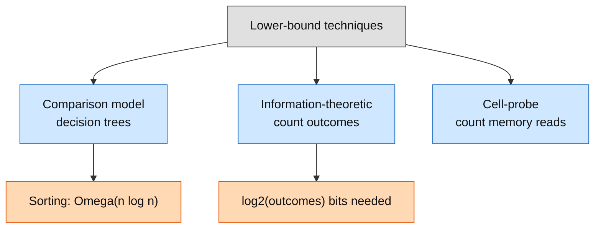

# A3. Data Structure Lower Bounds — Proving You Cannot Do Better

> **Navigation**: [← A2. Data Structure Complexity…](A2_DS_Complexity_FirstPrinciples.md) | [Chapter index](00_INDEX.md) | [A4. Randomized Data Structures… →](A4_Randomized_Data_Structures.md)

> **MIT 6.046J L16–L23 / KTH DD2352 / RWTH Aachen Algo II foundation**
>
> "Proving that your data structure is fast says only that your implementation achieves X. Proving that no data structure can achieve better than X says that all of humanity's cleverness, now and in the future, is bounded by X. Lower bounds are the only way to know when to stop optimizing." — adapted from MIT 6.046J, based on Yao's 1977 Fortune-Teller argument

A data structure's **upper bound** says "this implementation achieves X." A data structure's **lower bound** says "no data structure — even one we haven't invented yet — can beat X." Together they prove **optimality**: you have found the best possible design, and further optimization is futile.

This chapter applies to data structures the lower-bound proving techniques that algorithm analysis has used for decades. The twist: while algorithm lower bounds reason about computation steps, data structure lower bounds must reason about *representations* — about how information is laid out in memory, what can be stored, and how many memory cells must be touched to answer a query. This makes DS lower bounds technically demanding and philosophically profound.

---

## Table of Contents

1. [Why DS Lower Bounds Are Harder Than Algorithm Lower Bounds](A3_DS_Lower_Bounds/01_why_ds_lower_bounds_are_harder.md#1-why-ds-lower-bounds-are-harder-than-algorithm-lower-bounds)
2. [Comparison Model — BST, Sorted Array, and Heap Lower Bounds](A3_DS_Lower_Bounds/01_why_ds_lower_bounds_are_harder.md#2-comparison-model--bst-sorted-array-and-heap-lower-bounds)
3. [The Cell-Probe Model](A3_DS_Lower_Bounds/01_why_ds_lower_bounds_are_harder.md#3-the-cell-probe-model)
4. [Information-Theoretic Lower Bounds](A3_DS_Lower_Bounds/01_why_ds_lower_bounds_are_harder.md#4-information-theoretic-lower-bounds)
5. [Set and Membership Lower Bounds](A3_DS_Lower_Bounds/01_why_ds_lower_bounds_are_harder.md#5-set-and-membership-lower-bounds)
6. [Priority Queue Lower Bounds](A3_DS_Lower_Bounds/01_why_ds_lower_bounds_are_harder.md#6-priority-queue-lower-bounds)
7. [Union-Find Lower Bounds](A3_DS_Lower_Bounds/01_why_ds_lower_bounds_are_harder.md#7-union-find-lower-bounds)
8. [Dynamic Data Structure Lower Bounds](A3_DS_Lower_Bounds/01_why_ds_lower_bounds_are_harder.md#8-dynamic-data-structure-lower-bounds)
9. [What Lower Bounds Mean in Practice](A3_DS_Lower_Bounds/01_why_ds_lower_bounds_are_harder.md#9-what-lower-bounds-mean-in-practice)
10. [Summary — DS Lower Bound Table](A3_DS_Lower_Bounds/01_why_ds_lower_bounds_are_harder.md#10-summary--ds-lower-bound-table)

---

## 💬 Explain It Like a Study Partner — Lower Bounds

> [!TIP]
> **Ask yourself first:** *"How can anyone prove that no cleverer algorithm exists?"*

### 1. The bottom line

A lower bound is a proof that **any** solution in a given model must do at least some amount of work, so once your algorithm matches it you can stop looking for a faster one.

### 2. The textbook core

- A lower bound is always relative to a **model of computation** (what operations are allowed).
- **Comparison model:** decision trees; sorting needs Ω(n log n) comparisons because there are n! outcomes and each comparison splits them at most in half.
- **Information-theoretic:** count the possible answers; you need at least log₂(answers) bits.
- **Cell-probe model:** count memory reads, computation is free; used for data-structure bounds such as Union-Find's Ω(α(n)).
- When upper bound = lower bound, the problem is **solved** (tight).

### 3. The real-world analogy

**Twenty Questions.** With yes/no questions you cannot identify one of 1,000,000 things in fewer than about 20 questions, because each answer at most halves the possibilities and 2²⁰ ≈ 1,000,000. No clever strategy can beat that counting argument.

### 4. Walkthrough: why searching a sorted array needs Ω(log n) comparisons

1. There are `n + 1` possible answers (found at each index, or not found).
2. Each comparison has two outcomes, so after `k` comparisons you can distinguish at most `2^k` answers.
3. To tell all `n + 1` answers apart you need `2^k ≥ n + 1`, so `k ≥ log₂(n + 1)`.
4. Binary search uses about `log₂ n` comparisons, so it is **optimal** in the comparison model.

> [!NOTE]
> **Quick check:** how does counting sort get below Ω(n log n)? *It is not a comparison sort, so the comparison-model bound does not apply.*

---

## ⚡ At a Glance — Lower Bounds

> [!NOTE]
> **Mental model:** a lower bound says *no algorithm in a given model can beat this cost*. Each model (comparison, cell-probe, information-theoretic) restricts what the algorithm is allowed to do, and the bound only holds inside it.

**How to read this diagram.** Blue boxes are the proof techniques; orange boxes are classic results they produce. Always state the model before quoting a bound.

| Claim | Model | Meaning |
| ----- | ----- | ------- |
| Comparison sort ≥ n log n | Comparisons only | Radix/counting sort escape it by not comparing |
| Finding the max ≥ n−1 comparisons | Comparisons | One pass is optimal |
| Tight bound = lower bound meets upper bound | — | Nothing better is possible in the model |

---

## 📚 Topic Pages in This Chapter

This chapter is split into focused pages so each topic can be read on its own. Read them in order the first time; use the table to jump back later.

| # | Page | What is inside | Lines |
| --- | --- | --- | --- |
| 1 | [1. Why DS Lower Bounds Are Harder Than Algorithm Lower Bounds](A3_DS_Lower_Bounds/01_why_ds_lower_bounds_are_harder.md) | 1. Why DS Lower Bounds Are Harder Than… · 2. Comparison Model — BST, Sorted Array, and… · 3. The Cell-Probe Model · 4. Information-Theoretic Lower Bounds · 5. Set and Membership Lower Bounds · … | 814 |
| 2 | [DS Lower Bound Cheat Sheet](A3_DS_Lower_Bounds/02_ds_lower_bound_cheat_sheet.md) | DS Lower Bound Cheat Sheet · Proof Corner -- Comparison-Based DS Lower… · When It Breaks -- DS Lower Bounds · Section Challenge -- DS Lower Bounds · Reference Anchor · … | 145 |

## Reality Check

> [!CAUTION]
> **Myth:** "Lower bounds are only theoretical"
>
> **Reality:** Lower bounds have direct practical impact: the Omega(n log n) comparison sorting bound tells you to stop looking for a faster comparison sort and instead ask whether you can use a non-comparison approach (radix sort, counting sort). The Omega(n) lower bound for finding the maximum tells you a single pass is optimal — no clever algorithm can avoid looking at every element. Lower bounds prevent wasted optimization effort.

> [!CAUTION]
> **Myth:** "Every problem has a known lower bound"
>
> **Reality:** Most interesting problems have UNKNOWN tight lower bounds. We do not know whether matrix multiplication requires Omega(n squared) operations (current best algorithm is O(n^2.37)). We do not know whether SAT requires exponential time (the P vs NP question). Proving lower bounds is generally much harder than designing algorithms — it requires showing that NO possible algorithm can do better, not just that your algorithm cannot.

> [!CAUTION]
> **Myth:** "Decision tree lower bounds apply to all algorithms"
>
> **Reality:** Decision tree lower bounds apply to COMPARISON-BASED algorithms. Each comparison has two outcomes (yes/no), creating a binary tree. With n elements, there are n-factorial permutations, so the tree needs at least log2(n-factorial) = Omega(n log n) leaves. This does NOT apply to algorithms that use arithmetic, hashing, or bit manipulation — these can extract more information per operation than a binary comparison.

> [!CAUTION]
> **Myth:** "If no algorithm beats O(n squared), the lower bound must be Omega(n squared)"
>
> **Reality:** The absence of a better algorithm does NOT prove a lower bound. For decades, the best matrix multiplication was O(n^3), but the Strassen algorithm proved O(n^2.81) was achievable. We still do not know the true lower bound for matrix multiplication. A lower bound is a PROOF about all possible algorithms, not an observation about known algorithms.

> [!CAUTION]
> **Myth:** "Information-theoretic lower bounds are the tightest possible"
>
> **Reality:** Information-theoretic arguments count the minimum information needed to solve a problem. For sorting, you need log2(n-factorial) bits of information, giving Omega(n log n) comparisons. But for specific problems, adversary arguments (constructing a worst-case input that forces any algorithm to do maximum work) can sometimes give tighter bounds than pure information-theoretic counting.
