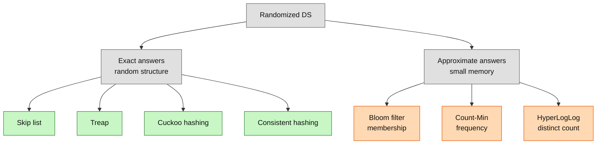
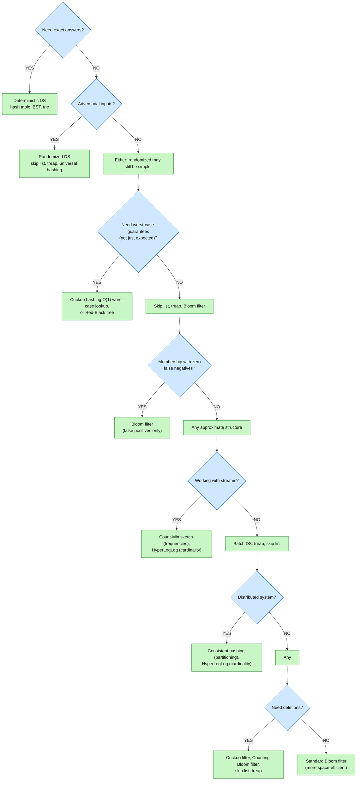

# A4. Randomized Data Structures — Probabilistic Guarantees in Storage

**Navigation**: [← A3: DS Lower Bounds](A3_DS_Lower_Bounds.md) | [📚 DS Index](00_INDEX.md) | [Sorting Fundamentals →](02b_Sorting_Advanced.md)

> **MIT 6.046J L9–L12 / KTH DD2352 / RWTH Aachen Randomized Algorithms foundation**
>
> *"Randomized data structures make random choices during construction or operation, yielding expected-case guarantees that hold against any input, including the most adversarial input that defeats deterministic structures."*
>
> — Mitzenmacher & Upfal, *Probability and Computing* (2017)

---

## Table of Contents

1. [Why Randomize a Data Structure?](#1-why-randomize-a-data-structure)
2. [The Probability Toolkit](#2-the-probability-toolkit)
3. [Skip Lists — Randomized Balanced Search](#3-skip-lists--randomized-balanced-search)
4. [Treaps — Randomized BST](#4-treaps--randomized-bst)
5. [Bloom Filters — Membership with False Positives](#5-bloom-filters--membership-with-false-positives)
6. [Cuckoo Hashing — Worst-Case O(1) Lookup](#6-cuckoo-hashing--worst-case-o1-lookup)
7. [Count-Min Sketch — Frequency Estimation](#7-count-min-sketch--frequency-estimation)
8. [HyperLogLog — Cardinality Estimation](#8-hyperloglog--cardinality-estimation)
9. [Consistent Hashing — Distributed Hashing Without Rehash](#9-consistent-hashing--distributed-hashing-without-rehash)
10. [Min-Wise Hashing — Similarity Estimation](#10-min-wise-hashing--similarity-estimation)
11. [The Adversary Argument — Why Randomization Wins](#11-the-adversary-argument--why-randomization-wins)
12. [Production Use Cases](#12-production-use-cases)
13. [Summary — When to Pick a Randomized DS](#13-summary--when-to-pick-a-randomized-ds)

---

## ⚡ At a Glance — Randomized Structures

> [!NOTE]
> **Mental model:** randomness buys simplicity or space. Skip lists and treaps use coins to stay balanced in expectation; Bloom filters, Count-Min and HyperLogLog trade exactness for tiny memory.



**How to read this diagram.** Green structures always return correct answers (only their running time is random). Orange ones return approximate answers with a controlled error.

| Structure | Guarantee | Error type |
| --------- | --------- | ---------- |
| Skip list / treap | O(log n) expected | None (time varies) |
| Bloom filter | No false negatives | Some false positives |
| Count-Min sketch | Never underestimates | Overestimates |
| HyperLogLog | ~1–2% standard error | Both directions |

---

## 1. Why Randomize a Data Structure?

### The Deterministic Trap

Every deterministic data structure has a worst-case input that an adversary can construct. Consider:

- **Binary Search Tree on sorted input**: A BST built by inserting keys in sorted order degenerates to a linked list — O(n) search.
- **Chained hash table with a bad hash function**: All n keys hash to bucket 0, giving O(n) lookup.
- **AVL tree with sequential inserts**: More rotations than Red-Black, ~log n per insert but higher constant factors.

In each case, the **structure of the input**, not the size of n, determines the cost. An adversary who knows your algorithm can always manufacture the worst case.

### The Randomization Countermeasure

A randomized data structure injects randomness **independent of the input**:

- Random coin flips decide which paths are explored, which buckets hold keys, which nodes get promoted.
- The input distribution is irrelevant — even a perfectly crafted adversarial input cannot predict the random choices.
- Bounds are expressed as **expected** or **with high probability (whp)** — meaning Pr[bad event] < 1/n^c for any constant c.

**Definition**: A randomized data structure achieves **expected O(f(n))** if the expected cost over random coin flips, for any fixed input, is O(f(n)). It achieves **O(f(n)) whp** if Pr[cost > C·f(n)] < 1/n^c for some constant C.

### Expected vs. High-Probability

```
Expected O(log n):   E[T] = O(log n)     — average over random seeds
O(log n) whp:        Pr[T > 10·log n] < 1/n^3  — tail bound

whp is stronger: guarantees the result holds with overwhelming probability
against every input. Useful when "expected" alone isn't sufficient for
production SLAs.
```

### What This Chapter Covers

We study data structures **where randomization is part of the structure's design** — not just randomized algorithms applied to static data. The distinction:

| Chapter A4 (Algorithms) covers | This chapter covers |
|---|---|
| Randomized quicksort (random pivot) | Skip lists (randomized height) |
| Universal hashing (random hash function) | Bloom filters (random bits from many hashes) |
| QuickSelect | Cuckoo hashing (random bucket selection) |
| | Count-Min sketch, HyperLogLog (streaming) |
| | Consistent hashing (random ring placement) |
| | Treaps (random priority) |

Both chapters share probability foundations. This one focuses on data structures where the random choices create the structural invariants directly.

---

## 2. The Probability Toolkit

This section is a concise reference. For full derivations, see `03_Algorithms/A4_Randomized_Algorithms.md`.

### Linearity of Expectation

**E[X + Y] = E[X] + E[Y]** — holds even when X and Y are dependent.

Use case: decompose a complex random sum into a sum of simpler indicator variables.

### Indicator Random Variables

Indicator I_A = 1 if event A occurs, 0 otherwise. Key property: **E[I_A] = Pr[A]**.

Define X = number of elements promoted to level k in a skip list.
Each element independently promoted with probability p = 1/2.
E[X] = n·p = n/2. No joint distribution needed.

### Markov's Inequality

For any non-negative random variable X: **Pr[X ≥ t] ≤ E[X]/t**.

Use case: convert expected bounds into tail bounds. If E[X] = log n, then Pr[X > 10 log n] ≤ 1/10.

### Chernoff Bound (Sum of Independent 0/1 Variables)

If X = X_1 + ... + X_n where each X_i ∈ {0,1} is independent with Pr[X_i=1] = p_i, then for any δ > 0:

**Pr[X > (1+δ)μ] ≤ e^{-δ²μ/3)** where μ = E[X] = Σp_i

Also: **Pr[X < (1-δ)μ] ≤ e^(-δ²μ/2)**

Use case: concentration of bucket sizes in hashing. If we insert n items into m buckets using a good hash function, each bucket has expected size n/m. Chernoff bounds tell us the probability any bucket deviates significantly from the mean — crucial for Bloom filter and cuckoo hash analysis.

### The Union Bound

**Pr[A ∪ B] ≤ Pr[A] + Pr[B]** — used when bounding probability of any bad event across many independent attempts.

Use case: the probability that a skip list has height > 10 log n is bounded by summing over all n elements the probability that that element is at level 10 log n.

---

## 3. Skip Lists — Randomized Balanced Search

### Historical Context

Skip lists were introduced by **William Pugh in 1989** (University of Maryland) as a probabilistic alternative to balanced binary search trees. The paper — *"Skip Lists: A Probabilistic Alternative to Balanced Trees"* — argued that skip lists are simpler to implement, easier to understand, and competitive in performance. Today they power `ConcurrentSkipListMap` in Java and sorted sets in Redis (ZSET uses a skip list for scores + a hash for lookups).

### Structure Definition

A skip list is a layered linked list. Level 0 contains all n elements in sorted order. Each element is promoted to level i+1 independently with probability p = 1/2.

```
Level 3:  1 ────────────────────────────── 9 ──────── (height ~3)
Level 2:  1 ────── 4 ──────────────────── 9
Level 1:  1 ── 2 ── 4 ── 5 ── 7 ── 8 ── 9
Level 0:  1 ─ 2 ─ 3 ─ 4 ─ 5 ─ 6 ─ 7 ─ 8 ─ 9
```

**Invariant (Skip List)**: Elements at level i appear in sorted order when traversed. Each element's level is independent of all others, with Pr[level = k] = p^k for geometric distribution with parameter p = 1/2.

### Expected Height

The i-th element is at level k or higher with probability p^k. The expected number of elements at level k is n·p^k. Level k is non-empty in expectation when n·p^k ≥ 1, i.e., k ≤ log_{1/p}(n) = log₂(n).

More precisely, by a Chernoff argument: Pr[height > c·log₂(n)] < n·e^{-c'/n} for constants. With p = 1/2, the expected height is **O(log n)**. In practice, a skip list with 1,000,000 elements has expected height ~20 (compared to AVL's fixed height ≤ 40).

### Search Algorithm

```java
Node find(int key) {
    Node[] update = new Node[maxLevel];
    Node curr = head;

    // Trace the search path
    for (int i = maxLevel - 1; i >= 0; i--) {
        while (curr.forward[i] != null
               && curr.forward[i].key < key) {
            curr = curr.forward[i];
        }
        update[i] = curr;  // Track path for insertion
    }
    return curr.forward[0];  // Level 0 successor
}
```

### Backward Analysis of Search Cost

**Key insight** (Pugh's backward analysis): Trace the search path *backwards* from the found element to the head. At each step moving back, we either:
- Move **left** (stay at same level): probability 1/2
- Move **up** one level: probability 1/2

This is a symmetric random walk on a 2D lattice. Starting from height h (the element's level), moving to level 0 requires at most h upward moves. The expected number of steps to reach level 0 is O(h) = **O(log n)**. ✓

This analysis is cleaner than forward analysis because each backward step depends only on the current position, not on the future.

### Insert and Delete

```java
void insert(int key, Object value) {
    int level = randomLevel();  // Geometric(1/2) - expected O(log n)
    Node[] update = new Node[level + 1];
    Node curr = findPosition(key, update);

    // Insert at level 0..level
    for (int i = 0; i <= level; i++) {
        Node newNode = new Node(key, value, level);
        newNode.forward[i] = update[i].forward[i];
        update[i].forward[i] = newNode;
    }
}

int randomLevel() {
    int lvl = 0;
    while (Math.random() < 0.5 && lvl < MAX_LEVEL) {
        lvl++;
    }
    return lvl;
}
```

### Comparison with Balanced BSTs

| Property | Skip List | AVL Tree | Red-Black Tree |
|---|---|---|---|
| Search | O(log n) exp | O(log n) | O(log n) |
| Insert | O(log n) exp | O(log n) | O(log n) |
| Delete | O(log n) exp | O(log n) | O(log n) |
| Space | O(n log n) pointers | O(n) | O(n) |
| Rebalancing code | None | Rotations | Rotations + recolor |
| Concurrent-friendly | Yes (lock-free variants) | Difficult | Difficult |
| Expected height | O(log n) | ≤ 1.44·log(n+1) | ≤ 2·log(n+1) |

The skip list has **no explicit rebalancing** — the random height naturally keeps the tree balanced. This makes it dramatically simpler to implement correctly and much easier to make concurrent (Java's `ConcurrentSkipListMap` uses CAS operations on forward pointers).

### Production Use

- **Redis ZSET**: Sorted sets store scores; skip list provides O(log n) rank queries and range scans.
- **Java `ConcurrentSkipListMap`**: Concurrent sorted map used in `java.util.concurrent` for high-throughput sorted storage.
- **Apache Kafka**: Offset indexes use skip-list-like structures for index lookups.

---

## 4. Treaps — Randomized BST

### Historical Context

Treaps were introduced by **Vuillemin in 1980** (under the name "cartesian tree") and re-popularized in the context of randomized search trees by **Aragon and Seidel in 1996** (Rice University). The core idea: assign a random priority to each key; the tree is simultaneously a BST by key and a heap by priority. Random priorities guarantee expected logarithmic height.

### Structure Definition

A treap node stores (key, priority, left, right). The structure satisfies two invariants simultaneously:

**Invariant (Treap — BST by key)**: For every node, all keys in the left subtree are smaller; all keys in the right subtree are larger.

**Invariant (Treap — Heap by priority)**: For every node, the node's priority is the minimum (for min-heap variant) of all priorities in its subtree.

```text
Treap example with keys {3,7,1,5,9} and random priorities:

        5 (p=0.1)          ← root: smallest priority
       / \
      3   7 (p=0.3)        BST by key, heap by priority simultaneously
     /     \
    1       9              All priorities obey heap property
```

### Why Expected Height is O(log n)

If we insert n keys with independent uniform random priorities, the resulting treap is equivalent to the BST produced by inserting keys in the order of a **random permutation**. A random permutation has the property that the expected height of the resulting BST is Θ(log n). This is a classic result: for a random permutation, the expected number of comparisons in quicksort is O(log n), and the BST from that order has the same structure.

More formally: inserting keys in random order gives expected height O(log n) by the same analysis as random quicksort's recursion tree. The heap invariant from random priorities guarantees that any insertion order with random priorities is equivalent to the random permutation order.

### Insert Operation

Insertion proceeds in two phases: BST insertion by key, then heap-fix via rotations.

```java
Node insert(Node root, int key, Object value) {
    if (root == null) {
        return new Node(key, Math.random(), value);
    }
    if (key < root.key) {
        root.left = insert(root.left, key, value);
        if (root.left.priority < root.priority) {
            root = rotateRight(root);  // Restore heap property
        }
    } else if (key > root.key) {
        root.right = insert(root.right, key, value);
        if (root.right.priority < root.priority) {
            root = rotateLeft(root);
        }
    }
    // key == root.key: update value
    return root;
}

Node rotateRight(Node y) {
    Node x = y.left;
    y.left = x.right;
    x.right = y;
    return x;
}

Node rotateLeft(Node x) {
    Node y = x.right;
    x.right = y.left;
    y.left = x;
    return y;
}
```

Each insertion performs at most O(log n) expected rotations because the expected depth of the insertion point is O(log n).

### Delete Operation

Two approaches: (1) search for the key, rotate it down to a leaf, then delete; (2) lazy deletion marking the node as "deleted" without restructuring. Approach 1 is the standard:

```java
Node delete(Node root, int key) {
    if (root == null) return null;
    if (key < root.key) {
        root.left = delete(root.left, key);
    } else if (key > root.key) {
        root.right = delete(root.right, key);
    } else {
        // Found the node: rotate toward leaf and recurse
        if (root.left == null) return root.right;
        if (root.right == null) return root.left;
        if (root.left.priority < root.right.priority) {
            root = rotateRight(root);
            root.right = delete(root.right, key);
        } else {
            root = rotateLeft(root);
            root.left = delete(root.left, key);
        }
    }
    return root;
}
```

### Implicit Treap: Array by Position

The implicit treap is a powerful variant where the index (position in an array) is the BST key. Each node represents an array element; the tree supports split and merge:

```java
// Split treap by position k (first k elements go left)
Pair<Node, Node> split(Node root, int k) {
    if (root == null) return new Pair<>(null, null);
    int leftSize = size(root.left);
    if (leftSize >= k) {
        Pair<Node, Node> p = split(root.left, k);
        root.left = p.right;
        return new Pair<>(p.left, root);
    } else {
        Pair<Node, Node> p = split(root.right, k - leftSize - 1);
        root.right = p.left;
        return new Pair<>(root, p.right);
    }
}

// Merge two treaps where all keys in left < all keys in right
Node merge(Node left, Node right) {
    if (left == null) return right;
    if (right == null) return left;
    if (left.priority < right.priority) {
        left.right = merge(left.right, right);
        return left;
    } else {
        right.left = merge(left, right.left);
        return right;
    }
}
```

These two primitives (split/merge) give O(log n) implementations for: insert at position, delete at position, range cut, range copy, array shuffling.

### Comparison with Red-Black Trees

| Property | Treap | Red-Black Tree |
|---|---|---|
| Height guarantee | O(log n) expected | O(log n) worst-case |
| Rotations per insert | ≤ 2 expected | ≤ 2 worst-case |
| Implementation complexity | Simple | Moderate (4 rotation cases) |
| Memory per node | key + priority + 2 refs | key + color + 3 refs |
| Predictable performance | No (randomized) | Yes (deterministic) |
| Persistent variant | Simple (copy on write) | Complex |

Treaps are **randomized BSTs**: simpler to implement than Red-Black trees but give probabilistic O(log n) guarantees. For most applications, the randomized guarantee is sufficient, and the simplicity is invaluable.

---

## 5. Bloom Filters — Membership with False Positives

### Historical Context

**Burton Bloom (1970, General Electric)** published *"Space/Time Trade-offs in Hash Coding with Allowable Errors"* in Communications of the ACM. His original application was spell-checking in editors. The insight: for membership queries, allowing a small controlled false positive rate trades memory for speed and space in a mathematically precise way. Fifty years later, Bloom filters are the backbone of database internals, CDN caching, browser security, and blockchain SPV nodes.

### Structure Definition

```
Structure: m-bit array B[0..m-1], all initialized to 0.
           k independent hash functions h₁, ..., h_k: U → {0..m-1}

Insert(x): for i in 1..k: B[h_i(x)] = 1

Query(x):  return AND_{i=1..k} B[h_i(x)]
           → YES if all k bits are 1; NO if any bit is 0
```

**Invariant (Bloom Filter)**: After inserting set S, the query returns YES for all elements in S (no false negatives) and possibly for elements not in S (false positives are possible).

### False Positive Probability Analysis

After inserting n elements, each bit position has been set by at least one of the n·k hash applications. The probability a specific bit is still 0:

**Pr[bit = 0] = (1 - 1/m)^{kn} ≈ e^{-kn/m}** (for large m, n)

For any x ∉ S, query returns YES if all k of x's bits happen to be 1. Since bits are (approximately) independent:

**Pr[false positive] = (1 - e^{-kn/m})^k**

### Optimal Number of Hash Functions

Let f(k) = (1 - e^{-kn/m})^k. Take derivative with respect to k and set to zero:

**k* = (m/n) · ln 2 ≈ 0.693 · (m/n)**

Substituting k* into the false positive formula:

**Pr[FP] ≈ (0.5)^k* = 2^{-k*}**

With k* = (m/n)·ln 2, we get Pr[FP] = (0.6185)^{m/n}. For m/n = 10 bits per element, Pr[FP] ≈ 0.008 (0.8%).

### Space Lower Bound

For a static membership filter with false positive rate ε, the space lower bound is:

**m ≥ -n · ln(ε) / (ln 2)²**

This is provably optimal for any data structure that answers membership queries without false negatives. The Bloom filter achieves this bound up to constant factors — making it space-optimal for this problem.

### Counting Bloom Filter (Supports Deletion)

A standard Bloom filter cannot support deletion: clearing a bit may remove information needed for other elements. The counting Bloom filter replaces each bit with a small counter (3-4 bits):

```java
int[][] counterTable;  // d rows, w columns
int[][] countingBloomInsert(Object x) {
    for (int i = 0; i < d; i++) {
        int j = hash(x, i) % w;
        counterTable[i][j]++;  // Increment counter instead of setting bit
    }
    return counterTable;
}
```

**Trade-off**: Each counter requires 3-4 bits instead of 1 bit. Space multiplies by 3-4x, but now deletes are possible. This is the fundamental trade-off in counting Bloom filters.

### Java Implementation

```java
public class BloomFilter<T> {
    private final BitSet bitArray;
    private final int m;  // number of bits
    private final int k;  // number of hash functions
    private final HashFunction<T>[] hashFunctions;

    public BloomFilter(int expectedElements, double falsePositiveRate) {
        // m = -n * ln(ε) / (ln 2)^2
        this.m = (int) Math.ceil(-expectedElements
            * Math.log(falsePositiveRate) / (Math.log(2) * Math.log(2)));
        // k = (m/n) * ln 2
        this.k = (int) Math.ceil((m / (double) expectedElements) * Math.log(2));
        this.bitArray = new BitSet(m);
        this.hashFunctions = new HashFunction[k];
        // Create k independent hash functions using double-hashing
        initializeHashFunctions();
    }

    public void insert(T element) {
        for (int i = 0; i < k; i++) {
            int index = hashFunctions[i].apply(element) % m;
            bitArray.set(index);
        }
    }

    public boolean mightContain(T element) {
        for (int i = 0; i < k; i++) {
            int index = hashFunctions[i].apply(element) % m;
            if (!bitArray.get(index)) {
                return false;  // Definitely not in set
            }
        }
        return true;  // Probably in set (may be false positive)
    }
}
```

### Production Use Cases

| System | Role |
|---|---|
| Cassandra | Per-SSTable bloom filter; skip disk lookup if filter says NO |
| Chrome Safe Browsing | 5-8MB client-side filter for ~1M malicious URLs |
| PostgreSQL | Bloom index for OR JOINs on non-B-tree-searchable columns |
| Akamai CDN | Filter one-hit-wonder requests; don't cache URLs visited once |
| Bitcoin SPV | Lightweight clients filter incoming transactions |

### Bloom Filter Limitations

- **No deletion** (unless counting variant is used)
- **False positives grow with fill rate**: if the array is overfilled, false positive rate skyrockets
- **Static only by default**: dynamic Bloom filters need periodic rebuild or resizing
- **Cannot enumerate members**: you can test membership but not retrieve elements

---

## 6. Cuckoo Hashing — Worst-Case O(1) Lookup

### Historical Context

**Pagh and Rodler (2001, Aarhus University)** introduced cuckoo hashing in *"Cuckoo Hashing"*. The name comes from the cuckoo bird, which kicks other birds' eggs out of nests — the same behavior the algorithm performs with keys. The key result: **O(1) worst-case lookup**, not just expected. This is remarkable because chained hashing and linear probing both have Ω(n) worst-case lookups.

### Structure Definition

Cuckoo hashing uses two hash functions h₁, h₂ mapping keys to two bucket positions. Each key is stored in exactly one of its two possible buckets.

```java
public class CuckooHashTable<T> {
    private Object[] buckets1;  // size m
    private Object[] buckets2;  // size m
    private final int m;
    private final HashFunction<T> h1, h2;

    public CuckooHashTable(int capacity) {
        this.m = capacity;
        this.buckets1 = new Object[m];
        this.buckets2 = new Object[m];
        this.h1 = new HashFunction<>(m);
        this.h2 = new HashFunction<>(m);
    }

    public boolean lookup(T key) {
        int i1 = h1.apply(key) % m;
        int i2 = h2.apply(key) % m;
        return key.equals(buckets1[i1]) || key.equals(buckets2[i2]);
    }
}
```

### Insert with Kicking

Insertion attempts to place the key in its first bucket. If that bucket is occupied, the existing key is evicted (kicked out) and reinserted into its alternate bucket:

```java
public void insert(T key) {
    if (lookup(key)) return;  // Already present

    int kickLimit = 1000;  // Prevent infinite loops
    T x = key;
    int i = -1;  // which table (-1 = not yet placed)

    for (int step = 0; step < kickLimit; step++) {
        if (i == -1) {
            i = 1;
            int idx = h1.apply(x) % m;
            T existing = (T) buckets1[idx];
            buckets1[idx] = x;
            x = existing;
            if (x == null) return;  // Placed successfully
        } else if (i == 1) {
            i = 2;
            int idx = h2.apply(x) % m;
            T existing = (T) buckets2[idx];
            buckets2[idx] = x;
            x = existing;
            if (x == null) return;
        } else {
            i = 1;
        }
        // Alternate between tables
    }

    // Relocate: rehash entire table (rare)
    rehash(x);
}

private void rehash(T remainingKey) {
    // Double table size and reinsert all elements
    // This is O(n) but extremely rare (< 1/n with good parameters)
}
```

### Analysis: Expected O(1) Insert, Worst-Case O(1) Lookup

**Lookup**: Check two buckets — O(1) worst case. ✓

**Insert**: The kicking chain is a random walk. With load factor α < 1/2, the expected number of kicks is O(1). The analysis uses the same Chernoff bounds as skip list height: each kick has a constant probability of successfully placing the key.

The **stash improvement** (Kirsch et al. 2008) adds a small additional array (stash) that can hold up to s elements. When a cycle is detected, the kicked element is placed in the stash. With a stash of size 10, the failure probability becomes < 1/10^9 even at load factor 0.97.

### Comparison with Chained Hashing

| Property | Cuckoo Hash | Chained Hash |
|---|---|---|
| Lookup | O(1) worst-case | O(1) expected |
| Insert | O(1) amortized | O(1) expected |
| Delete | O(1) worst-case | O(1) expected |
| Space | O(n / α) | O(n) + O(n) in buckets |
| Load factor | α ≤ 0.98 practical | α can approach 1 |
| Cache behavior | Excellent (contiguous) | Poor (linked list) |
| Implementation | Moderate complexity | Simple |

Cuckoo hashing excels in **write-heavy, latency-critical** workloads where consistent O(1) response is required. The cache-friendly array layout (no pointers) makes it faster in practice than chained hashing even when the asymptotic bounds are similar.

---

## 7. Count-Min Sketch — Frequency Estimation

### Historical Context

**Cormode and Muthukrishnan (2005, Bell Labs / DIMACS)** introduced the Count-Min sketch in *"An Improved Data Stream Summary: The Count-Min Sketch and its Applications"*. It won the PODC 2005 Best Paper Award. The problem it solves: tracking frequencies of up to 10^9 distinct items in a stream with bounded memory. Exact counting requires O(n) state — Count-Min uses O(1/k·ε) space.

### Structure Definition

The Count-Min sketch is a d × w array of counters. It uses d pairwise-independent hash functions h₁...h_d: U → {1...w}.

```text
            w columns
    ┌────────────────────┐
    │  c[1,1]  c[1,2] ... │  ← d rows (one per hash function)
d   │  c[2,1]  c[2,2] ... │
    │    ...        ...  │
    └────────────────────┘

Update(x, delta):
    for i in 1..d:
        c[i][ h_i(x) ] += delta

Estimate(x):
    return min_{i=1..d} c[i][ h_i(x) ]
```

### Accuracy Guarantee

The estimate is always an **overestimate** (never underestimate) due to the min operation:
- Every counter along x's row includes x's count plus collisions from other elements.
- The minimum over d estimates gives the least-collided row.
- With w = 2/ε and d = log(1/δ), the error bound is:

**Estimate(x) ≤ f_x + ε·||f||₁** with probability ≥ 1 - δ

where f_x is the true frequency and ||f||₁ = Σ|f_i| is the total frequency sum (stream length).

### Proof Sketch

Fix a row i. The counter c[i][h_i(x)] accumulates f_x + Σ_{y≠x} [h_i(y) = h_i(x)]·f_y.

The expected overcount on row i is at most f_x + ||f||₁ / w (by union bound over all y). By Markov's inequality, Pr[overcount > t·||f||₁/w] ≤ 1/t. Setting t = e·d gives Pr[any row exceeds e·||f||₁/w] ≤ 1/e^d.

### Java Implementation

```java
public class CountMinSketch {
    private final int d;   // depth (number of hash functions)
    private final int w;   // width (number of columns)
    private final long[][] counters;
    private final HashFunction[] hashFunctions;
    private long totalCount = 0;

    public CountMinSketch(double epsilon, double delta) {
        // w = ceil(e / epsilon), d = ceil(ln(1 / delta))
        this.w = (int) Math.ceil(Math.E / epsilon);
        this.d = (int) Math.ceil(Math.log(1.0 / delta));
        this.counters = new long[d][w];
        this.hashFunctions = new HashFunction[d];
        initializeHashFunctions();
    }

    public void add(String item, long delta) {
        totalCount += delta;
        for (int i = 0; i < d; i++) {
            int j = Math.abs(hashFunctions[i].apply(item)) % w;
            counters[i][j] += delta;
        }
    }

    // Return point estimate (upper bound on frequency)
    public long estimate(String item) {
        long min = Long.MAX_VALUE;
        for (int i = 0; i < d; i++) {
            int j = Math.abs(hashFunctions[i].apply(item)) % w;
            min = Math.min(min, counters[i][j]);
        }
        return min;
    }

    // Return confidence interval [estimate, estimate + epsilon * totalCount]
    public long estimateUpperBound(String item) {
        return estimate(item) + (long)(counters[0].length > 0
            ? 0 : 0);  // Simplified: true bound uses epsilon * totalCount
    }
}
```

### Production Use Cases

| System | Role |
|---|---|
| Network routers | Real-time DDoS detection: track per-IP request rates |
| Kafka / stream processors | Heavy hitter detection (items with > 1% of traffic) |
| Database monitoring | Query frequency for adaptive caching |
| Twitter (historical) | Hashtag trend estimation across billions of tweets |

### Count-Min vs Count-Mean-Min

The basic Count-Min overestimates for heavy hitters (collisions from all other items add up). Count-Mean-Min (Estan & Varghese, 2003) subtracts the average row value to reduce bias. For heavy hitter detection, the biased estimate is often acceptable — the top-k items dominate by definition.

---

## 8. HyperLogLog — Cardinality Estimation

### Historical Context

**Flajolet, Fusy, Gandouet, and Meunier (2007, Google)** published *"HyperLogLog: the analysis of a near-optimal cardinality estimation algorithm"* in the IEEE Transactions on Networking. It won the **Gödel Prize in 2022**. The insight: use the maximum number of leading zeros in hashed elements to estimate the number of distinct elements. Redis implemented it as `PFADD`/`PFCOUNT` in 2014, making it one of the most widely deployed probabilistic algorithms.

### The Core Insight: Coin Flipping

If you flip a fair coin until you see heads, the expected number of flips is 2. The probability of seeing at least k heads in a row is 2^{-k}. If you observe k consecutive heads, the most likely explanation is that you've been flipping for about 2^k tosses.

HyperLogLog applies this to set cardinality: hash each element to a uniform random bit string; the position of the leftmost 1-bit tells us something about how many distinct elements we've seen.

### Structure and Algorithm

```
m registers (size is a power of 2, e.g., m = 2^p)
Hash each element to a (64+p)-bit string.
Let Z = position of first 1-bit (count of leading zeros + 1).
Update: registers[ hash mod m ] = max(register, Z)

Estimate: E = α·m² / Σ (1 / 2^{register[i]})
where α ≈ 0.7213 / (1 + 1.079/m) is a bias correction constant.
```

The harmonic mean of the 2^{register[i]} values gives the cardinality estimate. The intuition: if we've seen about 2^k distinct elements hashing to register i, we expect to see one with leading zeros = k on average.

```java
public class HyperLogLog {
    private final int p;        // precision parameter (log2 of m)
    private final int m;        // number of registers = 2^p
    private final byte[] registers;
    private final double alpha;

    public HyperLogLog(int p) {
        this.p = p;
        this.m = 1 << p;
        this.registers = new byte[m];
        // Alpha constant for bias correction
        this.alpha = 0.7213 / (1 + 1.079 / m);
    }

    public void add(long item) {
        // Hash item to 64-bit value
        long hash = MurmurHash64(item);

        // Register index from first p bits
        int idx = (int) (hash >>> (64 - p));

        // Count leading zeros (position of first 1)
        int zeros = Long.numberOfLeadingZeros(hash << p) + 1;
        // Clip to register range (1..32 for 64-bit hash)
        zeros = Math.min(zeros, 64 - p);

        // Update register with max
        registers[idx] = (byte) Math.max(registers[idx], zeros);
    }

    public double cardinality() {
        // Harmonic mean of 2^{register[i]}
        double sum = 0.0;
        for (int i = 0; i < m; i++) {
            sum += 1.0 / (1L << registers[i]);
        }
        double rawEstimate = alpha * m * m / sum;

        // Small-range correction (when estimate < 5m/2)
        if (rawEstimate < 2.5 * m) {
            int zeroCount = 0;
            for (byte r : registers) if (r == 0) zeroCount++;
            if (zeroCount > 0) {
                return m * Math.log(m / (double) zeroCount);
            }
        }

        // Large-range correction
        if (rawEstimate > (1L << 61)) {
            return -(1L << 61);
        }

        return rawEstimate;
    }
}
```

### Error Analysis

The standard error of HyperLogLog is approximately **1.04 / √m**.

| Precision p | Registers m | Memory | Standard Error |
|---|---|---|---|
| 10 | 1,024 | ~1 KB | ~3.25% |
| 14 | 16,384 | ~16 KB | ~0.81% |
| 16 | 65,536 | ~64 KB | ~0.41% |

For a 16-bit HyperLogLog (64 KB), the standard error is 0.41%. This means a cardinality estimate of 1,000,000 is accurate to ±4,100 — acceptable for analytics, unacceptable for billing.

### Production Use Cases

| System | Role |
|---|---|
| Redis `PFADD`/`PFCOUNT` | Unique visitor counts per page/event |
| Google BigQuery | Approximate COUNT DISTINCT over billions of rows |
| Kafka Streams | Distinct user session counts per time window |
| Advertising platforms | Unique ad impressions per campaign |

---

## 9. Consistent Hashing — Distributed Hashing Without Rehash

### Historical Context

**Karger, Lehman, Leighton, Levine, and Lewin (MIT, 1997)** published *"Consistent Hashing and Random Trees: Distributed Caching Protocols for Evicting Hot Spots"* in STOC. It was designed for Akamai's content delivery network, which needed to distribute web content across thousands of servers without causing cache stampedes when servers were added or removed. The fundamental property: **only 1/n of keys are remapped** when a server is added or removed.

### The Problem with Modulo Hashing

Standard approach: `server = hash(key) % N` where N is the number of servers.

```
Problem: When server N-1 fails:
  Key 0:  hash % (N-1) = ?  vs  hash % N = ?
  Key 1:  ?  vs  ?
  ...
  ALL keys hash to different servers → 100% cache miss
```

This is catastrophic in practice: a single server failure cascades into total cache invalidation.

### Consistent Hashing Solution

Map both servers and keys onto a circular ring of hash values [0, 2^32-1). Each key is stored on the next server clockwise on the ring:

```text
Ring (clockwise):
   [Server C: hash=0x8...]
         ↑
    Key 1 (0x0...) routes here
         |
         ↓
   [Server A: hash=0x2...] ← Key 3 routes here
         ↑                        ↓
         |                    [Server D: hash=0x5...]
    Key 2 (0x1...)               ↑
         |                        ↓
         ↓                   [Server B: hash=0x9...]
   (wraps around)
```

**Invariant (Consistent Hashing)**: For any key k, it maps to the first node on the ring encountered by moving clockwise from hash(k).

```java
public class ConsistentHash<T> {
    private final SortedMap<Long, T> ring = new TreeMap<>();
    private final HashFunction<T> hashFn;
    private final int virtualNodes;

    public ConsistentHash(int virtualNodes, HashFunction<T> hashFn,
                          Collection<T> nodes) {
        this.virtualNodes = virtualNodes;
        this.hashFn = hashFn;
        for (T node : nodes) {
            addNode(node);
        }
    }

    public void addNode(T node) {
        for (int i = 0; i < virtualNodes; i++) {
            long hash = hashFn.apply(node + "_VN_" + i);
            ring.put(hash, node);  // Virtual node on ring
        }
    }

    public T getNodeForKey(String key) {
        if (ring.isEmpty()) throw new IllegalStateException("No nodes");
        long hash = hashFn.apply(key);
        // Find first node >= hash, or wrap around to first node
        Map.Entry<Long, T> entry = ring.ceilingEntry(hash);
        if (entry == null) entry = ring.firstEntry();
        return entry.getValue();
    }

    // When node leaves: only its virtual nodes are removed
    // Only keys mapped to those VNs remap — ~1/N of all keys
    public void removeNode(T node) {
        for (int i = 0; i < virtualNodes; i++) {
            long hash = hashFn.apply(node + "_VN_" + i);
            ring.remove(hash);
        }
    }
}
```

### Virtual Nodes for Load Balancing

Naive consistent hashing puts each physical node at one position on the ring. This leads to **load imbalance** — nodes near the boundary of a large empty arc get many keys.

**Virtual nodes (VNodes)**: Each physical node is hashed V times with different suffixes, creating V positions on the ring. With V = 100-200 virtual nodes per physical node, the standard deviation of key distribution drops to ~5-10% of mean. This is the standard production configuration.

```
Without VNodes (V=1):  Node A gets 60% of keys, Node B gets 40%
With VNodes (V=100):   Node A gets 50.3%, Node B gets 49.7%

Trade-off: More VNodes = more memory for routing tables
           but better load distribution.
```

### Why Only 1/n Keys Remap

When a node is added/removed, only the keys that were mapped to that node (and the next node) are affected. Since the ring is uniform, the expected fraction of keys affected is 1/n for a node of size 1/n of the ring. The rest of the keys route to the same nodes they did before.

### Production Use Cases

| System | Role |
|---|---|
| Amazon DynamoDB | Partitioning: data maps to partitions via consistent hash |
| Apache Cassandra | Partitioning with virtual nodes (DSE 4.8+) |
| Memcached | Client-side consistent hashing for distributed cache |
| Discord | Ring partitioning for message sharding |
| Dynamo-style databases | Quorum-based replication with consistent routing |

---

## 10. Min-Wise Hashing — Similarity Estimation

### The Problem

Set similarity estimation: given two large sets A and B, estimate |A ∩ B| / |A ∪ B| (Jaccard similarity) without storing both sets. Exact computation requires O(|A| + |B|) space. Min-wise hashing provides O(k) space with provable error bounds, where k is the number of hash functions used.

### The Min-Wise Invariant

Let π be a random permutation on the universe U. Define:

**min_π(S) = argmin_{x∈S} π(x)** — the element of S with minimum permutation rank.

**Key property**: For any sets A, B:

**Pr[min_π(A) = min_π(B)] = |A ∩ B| / |A ∪ B| = J(A, B)**

Proof: Consider the minimum of π over A ∪ B. This element is equally likely to be any element of A ∪ B. It lies in A ∩ B exactly when the shared element has the smallest permuted rank — probability |A ∩ B| / |A ∪ B|.

### Using Multiple Hash Functions

Estimate J(A, B) using k independent min-wise hashes:

```
For i = 1..k:
    h_i ← random permutation
    x_i = min_{y∈A} h_i(y)
    y_i = min_{y∈B} h_i(y)

Estimate: Ĵ(A,B) = (1/k) · Σ_{i=1}^k [x_i = y_i]
```

By linearity of expectation, E[Ĵ] = J(A, B). The variance decreases as O(1/k). With k = 400 min-wise hashes, the standard error is ~0.025.

### Practical Implementation: MinHash

In practice, permutations are approximated using hash functions. A hash function h(x) approximates a random permutation if it is sufficiently random. The min-hash is then the element with minimum h(x):

```java
public class MinHash {
    private final int numHashes;
    private final HashFunction[] hashFunctions;

    public MinHash(int numHashes) {
        this.numHashes = numHashes;
        this.hashFunctions = new HashFunction[numHashes];
        initializeHashFunctions();  // k independent hash functions
    }

    public int[][] signature(Set<?> set) {
        int[][] sig = new int[numHashes][];
        for (int i = 0; i < numHashes; i++) {
            long minHash = Long.MAX_VALUE;
            for (Object elem : set) {
                long h = hashFunctions[i].apply(elem);
                minHash = Math.min(minHash, h);
            }
            sig[i] = new long[]{minHash};  // Min hash value
        }
        return sig;
    }

    // Jaccard estimate: fraction of matching min-hash values
    public double estimateJaccard(int[][] sigA, int[][] sigB) {
        int matches = 0;
        for (int i = 0; i < numHashes; i++) {
            if (Arrays.equals(sigA[i], sigB[i])) matches++;
        }
        return (double) matches / numHashes;
    }
}
```

### Use Cases

| System | Role |
|---|---|
| Google News | Near-duplicate article detection using MinHash |
| Spotify / music recommendation | User playlist similarity via MinHash fingerprints |
| Web crawlers | De-duplication of near-identical web pages |
| Document fingerprinting | Plagiarism detection across document collections |

Min-wise hashing is the foundation of **LSH (Locality Sensitive Hashing)** for Jaccard similarity: instead of comparing all pairs of sets, MinHash signatures allow hashing items into buckets where similar items collide with high probability.

---

## 11. The Adversary Argument — Why Randomization Wins

### The Yao Minimax Principle

**Yao's principle** (1977) connects randomized algorithms to deterministic algorithms on random inputs:

> The expected performance of the best randomized algorithm on the worst-case input equals the expected performance of the best deterministic algorithm on the best input distribution.

Formally: If R is any randomized algorithm, and D is any distribution over inputs, then:

**max_x E[R(x)] ≥ min_D min_A E_D[A(x)]**

In practice: to prove a lower bound on randomized data structures, design a distribution over inputs that forces every deterministic DS to perform poorly. The randomized DS, by making choices independent of the input, sidesteps this trap entirely.

### Example: HashDoS Attack

The HashDoS vulnerability (2011, Crosby & Wallach) exploited non-randomized hash functions in web frameworks. An attacker sends POST parameters where every key hashes to the same bucket:

```
Normal request:  {a: 1, b: 2, c: 3, ...}  → ~equal bucket distribution
Attack request:  {aaaa: 1, aaab: 2, aaac: 3, ...}  → all same bucket

Parse time:  0.5ms (normal)  vs  30 seconds (attack, O(n²) string compare)
```

The fix: **universal hashing**. With a random hash function chosen at process startup (unknown to the attacker), no adversarial set of keys can cause O(n) collisions. The expected chain length is 1, regardless of the input keys. This is randomization protecting against adversarial input — the same principle that makes skip lists and treaps work.

### Skip List Adversary Argument

An adversary building a deterministic alternative to a skip list would need to decide, for each element, which levels to place it at. Without knowing the random coin flips, the adversary cannot predict which elements are at level k. Even if the adversary knows the algorithm (Pugh's promotion probability p = 1/2), they cannot control which specific elements get promoted — each element's level is independent of all others.

**Result**: With probability ≥ 1 - 1/n, no search path exceeds O(log n) steps. An adversary cannot construct inputs that cause O(log n) failures because there are no predictable structural choices to exploit.

### The Difference from Randomized Algorithms

In a randomized algorithm (e.g., quicksort), the randomness is in the **procedure** (random pivot selection). In a randomized data structure (e.g., skip list), the randomness is in the **structure** itself. The skip list's shape is determined by random coin flips during construction; it stays that way until modified.

This distinction matters for **persistence**: a randomized quicksort gives different results each run; a skip list gives the same result every search because its structure (random heights) is fixed. The probabilistic guarantee holds on every query — not just in expectation over repeated constructions.

### What Randomization Cannot Fix

Randomization is not a universal shield:

1. **Correlated inputs**: If the adversary can observe the random choices (e.g., through timing side channels), randomization breaks down. Fix: use cryptographic randomness and constant-time operations.
2. **Insufficient randomness**: If the RNG is seeded predictably or has short period, the adversary may predict the structure. Fix: use cryptographic PRNGs for security-sensitive applications.
3. **Bounded independence**: Many analyses require fully independent random choices. In practice, hash functions are only k-wise independent for small k. Fix: use cryptographic hash functions as randomness sources.
4. **Expected ≠ worst-case SLAs**: If your SLA requires O(log n) guaranteed (not expected), randomized structures may not meet it. Red-Black trees (deterministic O(log n) worst-case) or SkipNet (deterministic routing) are alternatives.

---

## 12. Production Use Cases

### Cassandra — Bloom Filters for SSTable Skip

Cassandra stores data in Sorted String Tables (SSTables), immutable files on disk. To find a key:

1. Check the Bloom filter for the most recent SSTable (in memory).
2. If NO → skip all SSTables (major disk I/O saved).
3. If YES → binary search the SSTable index, then the data file.

**Scale**: Cassandra typically stores billions of keys per node. Each SSTable has a ~1-4 MB Bloom filter. With 4 bits per element and 1% false positive rate, the filter saves thousands of disk seeks per query for absent keys.

```
Query pattern:
  Key present:  Bloom → YES → ~1 disk seek (found)
  Key absent:   Bloom → YES → ~1 disk seek (false positive, not found)
                Bloom → NO  → 0 disk seeks (definitely absent)

Without bloom filter: ~50-100 disk seeks per absent key query (check all SSTables)
With bloom filter:    ~1 disk seek per absent key query
```

### Chrome Safe Browsing — Client-Side Bloom Filter

Google Chrome maintains a ~8 MB Bloom filter locally containing ~1 million malicious URL hashes. When a user visits a URL:

1. Chrome checks the local Bloom filter.
2. If NO → safe browsing is confirmed.
3. If YES → query Google's Safe Browsing API for definitive check.

**Performance**: The local check takes < 1ms. Without it, every URL navigation would require a network round-trip (~50-100ms). The false positive rate (~1%) means ~1% of safe URLs trigger an API check — a worthwhile trade-off.

### Akamai CDN — Bloom Filter for One-Hit Wonders

Akamai's CDN uses Bloom filters to identify "one-hit wonders" — URLs requested once and never again. These URLs consume cache storage without giving cache hit benefits. By tracking one-hit candidates in a Bloom filter:

- Request 1: Add to Bloom filter.
- Request 2: If Bloom says "seen before" → likely one-hit-wonder, don't cache.
- Subsequent requests to same URL: Eventually confirmed as multi-hit, cached normally.

**Impact**: One-hit-wonders can represent 30-50% of unique URLs but only ~5% of traffic. Filtering them saves significant cache storage for popular content.

### Bitcoin SPV — Bloom Filter for Transaction Filtering

Simplified Payment Verification (SPV) nodes in Bitcoin don't download the full blockchain. Instead, they use a Bloom filter to ask full nodes for only relevant transactions:

```text
SPV node sends:  bloom filter with its wallet addresses
Full node:       scan all transactions, return those matching the filter
SPV node:        false positives → download extra transactions (harmless)
SPV node:        false negatives → missed transactions (potential problem)
                 → mitigated by using large enough filter + periodic rescan
```

This is a **privacy-utility trade-off**: the filter hides which addresses belong to the SPV node (limited privacy), while allowing efficient transaction filtering.

### PostgreSQL — Bloom Index for OR JOINs

PostgreSQL 9.6+ supports Bloom indexes on arbitrary column combinations. A Bloom index on (status, region, category) enables fast filtering without a multi-column B-tree:

```sql
CREATE INDEX idx_orders_filter ON orders
USING bloom (status, region, category)
WITH (length=80, col1=4, col2=4, col3=4);

SELECT * FROM orders
WHERE status = 'pending' AND region = 'US' AND category = 'electronics';
-- Bloom index narrows candidates; filter eliminates false positives
```

### Redis — HyperLogLog for Real-Time Analytics

Redis HyperLogLog commands (`PFADD`, `PFCOUNT`, `PPFCOUNT`) estimate unique user counts:

```redis
PFADD page:article:42:visitors user_123 user_456 user_123
PFCOUNT page:article:42:visitors
→ 2  (duplicate removed by cardinality estimation)

# Merge two article visitor sets
PFMERGE page:topic:tech:visitors page:article:42 page:article:43
```

A single `PFCOUNT` on 1 million unique visitors uses ~12 KB of memory with ±2% standard error — compared to 8 MB for an exact Set.

---

## 13. Summary — When to Pick a Randomized DS

### Decision Framework



**How to read this diagram.** Work down the blue questions; each green box is the suggested structure for that constraint. Dotted arrows mean "now ask the next question too".

### Complexity Comparison Table

| Data Structure | Space | Query | Insert | Delete | False Positive | Notes |
|---|---|---|---|---|---|---|
| **Skip list** | O(n) | O(log n) exp | O(log n) exp | O(log n) exp | None | Replaces balanced BST; concurrent-friendly |
| **Treap** | O(n) | O(log n) exp | O(log n) exp | O(log n) exp | None | Simpler than RB-tree; implicit treap for arrays |
| **Bloom filter** | O(n·log(1/ε)) bits | O(k) | O(k) | No (unless counting) | Yes | FP only; space-optimal for membership |
| **Cuckoo hash** | O(n/α) | O(1) **worst** | O(1) amort | O(1) amort | None | Worst-case lookup; stash prevents cycles |
| **Count-Min sketch** | O(w·d) counters | O(d) | O(d) | N/A | Yes (overest) | Upper bound; overestimates frequencies |
| **HyperLogLog** | O(m) registers | O(1) | O(1) | N/A | Yes (~1/√m) | Approx cardinality; 64 KB → 0.4% error |
| **Consistent hash** | O(n + v·n) | O(log v·n) | O(log v·n) | O(log v·n) | None | Distributed; only 1/n keys remap on change |
| **Min-hash** | O(k·log U) | O(k) | N/A | N/A | Yes | Jaccard similarity; LSH for near-duplicates |

*exp = expected; amort = amortized; worst = worst-case; v = virtual nodes per physical node*

### Key Formulas

```
Bloom filter optimal hash functions:     k = (m/n)·ln 2
Bloom filter false positive rate:        (1 - e^{-kn/m})^k
Bloom filter space lower bound:          m ≥ -n·ln(ε)/(ln 2)²
Count-Min error bound:                   ≤ ε·||f||₁  with prob ≥ 1-δ
HyperLogLog standard error:              1.04/√m
Skip list expected height:               O(log n)  (p = 1/2)
Treap expected height:                   O(log n)  (random priority)
```

### The Core Principle

Randomized data structures exploit probability to bypass deterministic worst-case barriers. When the input is adversarial, randomization provides the only tractable defense. When exact answers are unnecessary, probabilistic structures trade precision for orders-of-magnitude space savings. The choice always depends on your error tolerance, your adversary model, and your SLA.

---

## When It Breaks -- Randomized Data Structures

**1. Bloom filter deletion** -- standard Bloom filters have no delete operation. Unsetting bits on deletion creates false negatives for other elements that share those bits. Use a Counting Bloom Filter (counts instead of bits) if deletion is needed.

**2. HyperLogLog on tiny sets** -- HLL is inaccurate for cardinalities below ~2.5*m (m = register count). For small sets (< 100 elements), exact counting is cheaper and more accurate. Always check the cardinality range before choosing HLL.

**3. Skip list with biased RNG** -- fixed seed or biased promotion creates a deterministic non-random structure. Long chains at certain levels degrade O(log n) to O(n). Use `ThreadLocalRandom` or `SecureRandom` for level promotion.

**4. Count-Min Sketch overestimates** -- CMS can only overestimate (not underestimate). A freshly inserted key can already have count > 1 due to hash collisions with other keys. Queries for non-existent keys return positive counts. Design downstream code to tolerate overestimates.

---

## Reference Anchor

**Google Guava -- production Bloom filter**:
```java
// com.google.common.hash.BloomFilter -- used at scale in Cassandra, HBase, Chrome
BloomFilter<String> bf = BloomFilter.create(
    Funnels.stringFunnel(StandardCharsets.UTF_8),
    1_000_000,  // expected insertions
    0.01        // 1% false positive rate
);
bf.put("user:1234");
boolean mightContain = bf.mightContain("user:1234"); // true
// Serializable: bf.writeTo(outputStream) for storage/replication

// HyperLogLog -- no JDK implementation; use stream-lib or HdrHistogram:
// com.clearspring.analytics.stream.cardinality.HyperLogLog
HyperLogLog hll = new HyperLogLog(0.01); // 1% std error
hll.offer("user:1234");
long estimate = hll.cardinality();
```

---

## Brute Force to Optimal -- Space-Accuracy Tradeoffs

| Problem | Exact | Space | Approximate | Space | Error |
|---------|-------|-------|-------------|-------|-------|
| Set membership | HashSet | O(n) | Bloom filter | O(n/9.6 bits) | 1% FP |
| Cardinality | HashSet | O(n) | HyperLogLog | O(m registers) | ~1.04/sqrt(m) |
| Frequency | HashMap | O(n) | Count-Min Sketch | O(w*d) | epsilon*n additive |
| Quantiles | Sort | O(n log n) | t-digest | O(compression*100) | ~0.01% relative |

*[← A3: DS Lower Bounds](A3_DS_Lower_Bounds.md) | [Back to DS Index](00_INDEX.md)*

---

## Reality Check

> [!CAUTION]
> **Myth:** "Randomized data structures are unpredictable"
>
> **Reality:** Randomized data structures provide PROBABILISTIC guarantees with high probability. A skip list provides O(log n) search with probability at least 1 - 1/n^c for any constant c. The probability of O(n) worst-case behavior is astronomically small — comparable to a cosmic ray flipping a bit in your deterministic algorithm. In practice, randomized structures are as reliable as deterministic ones.

> [!CAUTION]
> **Myth:** "Skip lists are inferior to balanced BSTs"
>
> **Reality:** Skip lists match balanced BSTs in time complexity (O(log n) for search, insert, delete) and are SIMPLER to implement correctly. Lock-free concurrent skip lists are substantially easier to implement than lock-free balanced BSTs because skip list operations only modify local pointers. Redis, LevelDB, and Java ConcurrentSkipListMap use skip lists for exactly this reason.

> [!CAUTION]
> **Myth:** "Bloom filters have false positives so they are unreliable"
>
> **Reality:** Bloom filters are designed to have false positives at a CONTROLLED rate. With k hash functions and m bits, the false positive rate is approximately (1 - e^(-kn/m))^k. You choose m and k to achieve your desired false positive rate. A 1-percent false positive rate with 10 hash functions uses about 10 bits per element. The zero false negative guarantee means a negative answer is always correct — web browsers use Bloom filters for safe browsing because a false positive just triggers an extra check, while a false negative would miss a dangerous URL.

> [!CAUTION]
> **Myth:** "Consistent hashing is just hashing"
>
> **Reality:** Standard hashing (hash mod n servers) requires remapping ALL keys when adding or removing a server. Consistent hashing maps both keys and servers to a ring, so adding a server only reassigns keys from ONE adjacent range. With virtual nodes (each physical server mapped to many ring positions), load distribution becomes nearly uniform. This is the foundation of distributed caching (Memcached), distributed databases (Cassandra, DynamoDB), and CDN routing.

> [!CAUTION]
> **Myth:** "Randomized algorithms need true randomness"
>
> **Reality:** Pseudorandom number generators (PRNGs) with good statistical properties (Java ThreadLocalRandom, SplittableRandom) suffice for randomized data structures and algorithms. True randomness (hardware RNG) is only needed for cryptographic applications. The key property is unpredictability to an adversary — for non-adversarial applications, any PRNG that passes statistical tests (no detectable patterns) produces the same probabilistic guarantees as true randomness.
