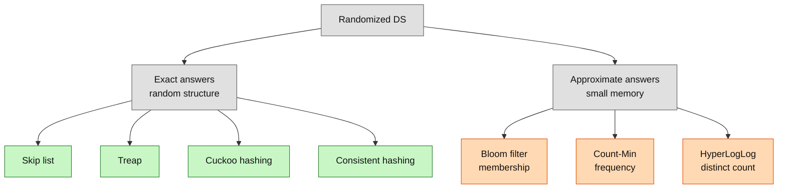

# A4. Randomized Data Structures — Probabilistic Guarantees in Storage

> **Navigation**: [← A3. Data Structure Lower Bounds…](A3_DS_Lower_Bounds.md) | [Chapter index](00_INDEX.md) | [A5. Designing Your Own Data… →](A5_Designing_Your_Own_Data_Structures.md)

> **MIT 6.046J L9–L12 / KTH DD2352 / RWTH Aachen Randomized Algorithms foundation**
>
> *"Randomized data structures make random choices during construction or operation, yielding expected-case guarantees that hold against any input, including the most adversarial input that defeats deterministic structures."*
>
> — Mitzenmacher & Upfal, *Probability and Computing* (2017)

---

## Table of Contents

1. [Why Randomize a Data Structure?](A4_Randomized_Data_Structures/01_why_randomize_a_data_structure.md#1-why-randomize-a-data-structure)
2. [The Probability Toolkit](A4_Randomized_Data_Structures/01_why_randomize_a_data_structure.md#2-the-probability-toolkit)
3. [Skip Lists — Randomized Balanced Search](A4_Randomized_Data_Structures/01_why_randomize_a_data_structure.md#3-skip-lists--randomized-balanced-search)
4. [Treaps — Randomized BST](A4_Randomized_Data_Structures/02_treaps_randomized_bst.md#4-treaps--randomized-bst)
5. [Bloom Filters — Membership with False Positives](A4_Randomized_Data_Structures/03_bloom_filters_membership_with_false_positives.md#5-bloom-filters--membership-with-false-positives)
6. [Cuckoo Hashing — Worst-Case O(1) Lookup](A4_Randomized_Data_Structures/04_cuckoo_hashing_worst_case_o_1.md#6-cuckoo-hashing--worst-case-o1-lookup)
7. [Count-Min Sketch — Frequency Estimation](A4_Randomized_Data_Structures/05_count_min_sketch_frequency_estimation.md#7-count-min-sketch--frequency-estimation)
8. [HyperLogLog — Cardinality Estimation](A4_Randomized_Data_Structures/06_hyperloglog_cardinality_estimation.md#8-hyperloglog--cardinality-estimation)
9. [Consistent Hashing — Distributed Hashing Without Rehash](A4_Randomized_Data_Structures/07_consistent_hashing_distributed_hashing_without_r.md#9-consistent-hashing--distributed-hashing-without-rehash)
10. [Min-Wise Hashing — Similarity Estimation](A4_Randomized_Data_Structures/07_consistent_hashing_distributed_hashing_without_r.md#10-min-wise-hashing--similarity-estimation)
11. [The Adversary Argument — Why Randomization Wins](A4_Randomized_Data_Structures/07_consistent_hashing_distributed_hashing_without_r.md#11-the-adversary-argument--why-randomization-wins)
12. [Production Use Cases](A4_Randomized_Data_Structures/07_consistent_hashing_distributed_hashing_without_r.md#12-production-use-cases)
13. [Summary — When to Pick a Randomized DS](A4_Randomized_Data_Structures/07_consistent_hashing_distributed_hashing_without_r.md#13-summary--when-to-pick-a-randomized-ds)

---

## 💬 Explain It Like a Study Partner — Randomized Data Structures

> [!TIP]
> **Ask yourself first:** *"Why would you let a coin flip decide how your data structure is shaped?"*

### 1. The bottom line

Randomness lets a data structure stay balanced or tiny without complicated bookkeeping, and an adversary cannot predict the coin flips to build a worst-case input.

### 2. The textbook core

- **Las Vegas** structures are always correct; only the running time is random (skip lists, treaps, randomized hashing: expected O(log n) / O(1)).
- **Monte Carlo** structures are fast and small but may be wrong with controlled probability (Bloom filter: false positives only; Count-Min sketch: overestimates; HyperLogLog: ~1–2% error).
- **Universal hashing** picks a random hash function from a family, so no fixed input is bad for everyone.
- **Consistent hashing** places servers and keys on a ring so adding a server moves only a small fraction of keys.

### 3. The real-world analogy

A **bouncer with a guest list photo book**: a Bloom filter is like a quick glance at a blurry "have I seen this face?" sheet. If the sheet says "never seen", you are certain. If it says "maybe seen", you double-check at the real list. Occasionally it says "maybe" for a stranger, but it never misses a real guest.

### 4. Walkthrough: a Bloom filter with 3 hash functions

1. Start with a bit array of `m` zeros.
2. **Add** "cat": compute three hashes → set bits 4, 9 and 17 to 1.
3. **Query** "cat": check bits 4, 9, 17 → all 1 → "possibly present".
4. **Query** "dog": hashes give bits 2, 9, 30. Bit 2 is 0 → "definitely not present".
5. A different word whose three bits all happen to be set by other words gives a **false positive**; there are no false negatives because bits are never cleared.

> [!NOTE]
> **Quick check:** why can't a plain Bloom filter delete items? *Clearing a bit might also erase another item that shares it; counting Bloom filters or cuckoo filters solve this.*

---

## ⚡ At a Glance — Randomized Structures

> [!NOTE]
> **Mental model:** randomness buys simplicity or space. Skip lists and treaps use coins to stay balanced in expectation; Bloom filters, Count-Min and HyperLogLog trade exactness for tiny memory.

**How to read this diagram.** Green structures always return correct answers (only their running time is random). Orange ones return approximate answers with a controlled error.

| Structure | Guarantee | Error type |
| --------- | --------- | ---------- |
| Skip list / treap | O(log n) expected | None (time varies) |
| Bloom filter | No false negatives | Some false positives |
| Count-Min sketch | Never underestimates | Overestimates |
| HyperLogLog | ~1–2% standard error | Both directions |

---

## 📚 Topic Pages in This Chapter

This chapter is split into focused pages so each topic can be read on its own. Read them in order the first time; use the table to jump back later.

| # | Page | What is inside | Lines |
| --- | --- | --- | --- |
| 1 | [1. Why Randomize a Data Structure?](A4_Randomized_Data_Structures/01_why_randomize_a_data_structure.md) | 1. Why Randomize a Data Structure? · 2. The Probability Toolkit · 3. Skip Lists — Randomized Balanced Search | 217 |
| 2 | [4. Treaps — Randomized BST](A4_Randomized_Data_Structures/02_treaps_randomized_bst.md) | 4. Treaps — Randomized BST | 179 |
| 3 | [5. Bloom Filters — Membership with False Positives](A4_Randomized_Data_Structures/03_bloom_filters_membership_with_false_positives.md) | 5. Bloom Filters — Membership with False… | 150 |
| 4 | [6. Cuckoo Hashing — Worst-Case O(1) Lookup](A4_Randomized_Data_Structures/04_cuckoo_hashing_worst_case_o_1.md) | 6. Cuckoo Hashing — Worst-Case O(1) Lookup | 124 |
| 5 | [7. Count-Min Sketch — Frequency Estimation](A4_Randomized_Data_Structures/05_count_min_sketch_frequency_estimation.md) | 7. Count-Min Sketch — Frequency Estimation | 129 |
| 6 | [8. HyperLogLog — Cardinality Estimation](A4_Randomized_Data_Structures/06_hyperloglog_cardinality_estimation.md) | 8. HyperLogLog — Cardinality Estimation | 131 |
| 7 | [9. Consistent Hashing — Distributed Hashing Without Rehash](A4_Randomized_Data_Structures/07_consistent_hashing_distributed_hashing_without_r.md) | 9. Consistent Hashing — Distributed Hashing… · 10. Min-Wise Hashing — Similarity Estimation · 11. The Adversary Argument — Why… · 12. Production Use Cases · 13. Summary — When to Pick a Randomized DS · … | 506 |

## Reality Check

> [!CAUTION]
> **Myth:** "Randomized data structures are unpredictable"
>
> **Reality:** Randomized data structures provide PROBABILISTIC guarantees with high probability. A skip list provides O(log n) search with probability at least 1 - 1/n^c for any constant c. The probability of O(n) worst-case behavior is astronomically small — comparable to a cosmic ray flipping a bit in your deterministic algorithm. In practice, randomized structures are as reliable as deterministic ones.

> [!CAUTION]
> **Myth:** "Skip lists are inferior to balanced BSTs"
>
> **Reality:** Skip lists match balanced BSTs in time complexity (O(log n) for search, insert, delete) and are SIMPLER to implement correctly. Lock-free concurrent skip lists are substantially easier to implement than lock-free balanced BSTs because skip list operations only modify local pointers. Redis, LevelDB, and Java ConcurrentSkipListMap use skip lists for exactly this reason.

> [!CAUTION]
> **Myth:** "Bloom filters have false positives so they are unreliable"
>
> **Reality:** Bloom filters are designed to have false positives at a CONTROLLED rate. With k hash functions and m bits, the false positive rate is approximately (1 - e^(-kn/m))^k. You choose m and k to achieve your desired false positive rate. A 1-percent false positive rate with 10 hash functions uses about 10 bits per element. The zero false negative guarantee means a negative answer is always correct — web browsers use Bloom filters for safe browsing because a false positive just triggers an extra check, while a false negative would miss a dangerous URL.

> [!CAUTION]
> **Myth:** "Consistent hashing is just hashing"
>
> **Reality:** Standard hashing (hash mod n servers) requires remapping ALL keys when adding or removing a server. Consistent hashing maps both keys and servers to a ring, so adding a server only reassigns keys from ONE adjacent range. With virtual nodes (each physical server mapped to many ring positions), load distribution becomes nearly uniform. This is the foundation of distributed caching (Memcached), distributed databases (Cassandra, DynamoDB), and CDN routing.

> [!CAUTION]
> **Myth:** "Randomized algorithms need true randomness"
>
> **Reality:** Pseudorandom number generators (PRNGs) with good statistical properties (Java ThreadLocalRandom, SplittableRandom) suffice for randomized data structures and algorithms. True randomness (hardware RNG) is only needed for cryptographic applications. The key property is unpredictability to an adversary — for non-adversarial applications, any PRNG that passes statistical tests (no detectable patterns) produces the same probabilistic guarantees as true randomness.
