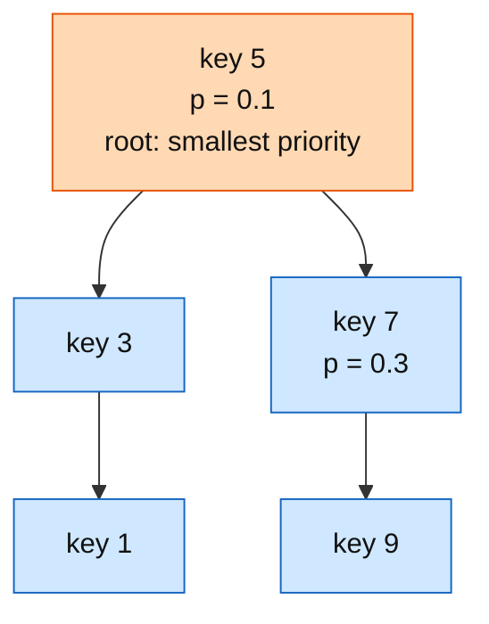

# 4. Treaps — Randomized BST

> **Navigation**: [← 1. Why Randomize a Data Structure?](01_why_randomize_a_data_structure.md) | [Chapter overview](../A4_Randomized_Data_Structures.md) | [5. Bloom Filters — Membership with False… →](03_bloom_filters_membership_with_false_positives.md)
> Page 2 of 7 in **A4. Randomized Data Structures — Probabilistic Guarantees in Storage**


## 💬 Study-Partner View — Treaps

**1. The bottom line:** A treap is a BST by key and a heap by random priority; the random priorities make the tree balanced in expectation.

**2. The textbook core:**

- Each node has a **key** (BST order) and a random **priority** (heap order).
- Given distinct keys and priorities, the shape is unique: it is the BST you would get by inserting keys in priority order.
- Expected depth O(log n); insert/delete use rotations to restore heap order.
- Supports `split` and `merge` in O(log n), which makes range operations easy.

**3. The real-world analogy:** A **randomly seeded tournament**: ranks (keys) decide left/right order, but who sits near the top is decided by a random draw (priority), so no particular order of entries can build a bad tree.

**4. Walkthrough:**

1. Insert key 5 with priority 0.1, then key 7 with priority 0.3.
2. 7 > 5 goes right of 5; 0.3 > 0.1 keeps heap order (min-heap), so no rotation.
3. Insert key 3 with priority 0.05: goes left of 5, but 0.05 < 0.1 violates heap order → rotate 3 up above 5.
4. Now the root is 3 with right child 5, and 7 is below 5.

> [!NOTE]
> **Quick check:** What do the priorities buy us? *A random shape, i.e. expected balance, without tracking heights or colours.*


## Historical Context

Treaps were introduced by **Vuillemin in 1980** (under the name "cartesian tree") and re-popularized in the context of randomized search trees by **Aragon and Seidel in 1996** (Rice University). The core idea: assign a random priority to each key; the tree is simultaneously a BST by key and a heap by priority. Random priorities guarantee expected logarithmic height.

## Structure Definition

A treap node stores (key, priority, left, right). The structure satisfies two invariants simultaneously:

**Invariant (Treap — BST by key)**: For every node, all keys in the left subtree are smaller; all keys in the right subtree are larger.

**Invariant (Treap — Heap by priority)**: For every node, the node's priority is the minimum (for min-heap variant) of all priorities in its subtree.

**Treap example** with keys `{3,7,1,5,9}` and random priorities:



**How to read this diagram.** The tree is a BST by key and, at the same time, a heap by priority: every node's priority is smaller than its children's (min-heap), so the smallest priority sits at the root.

## Why Expected Height is O(log n)

If we insert n keys with independent uniform random priorities, the resulting treap is equivalent to the BST produced by inserting keys in the order of a **random permutation**. A random permutation has the property that the expected height of the resulting BST is Θ(log n). This is a classic result: for a random permutation, the expected number of comparisons in quicksort is O(log n), and the BST from that order has the same structure.

More formally: inserting keys in random order gives expected height O(log n) by the same analysis as random quicksort's recursion tree. The heap invariant from random priorities guarantees that any insertion order with random priorities is equivalent to the random permutation order.

## Insert Operation

Insertion proceeds in two phases: BST insertion by key, then heap-fix via rotations.

```java
Node insert(Node root, int key, Object value) {
    if (root == null) {
        return new Node(key, Math.random(), value);
    }
    if (key < root.key) {
        root.left = insert(root.left, key, value);
        if (root.left.priority < root.priority) {
            root = rotateRight(root);  // Restore heap property
        }
    } else if (key > root.key) {
        root.right = insert(root.right, key, value);
        if (root.right.priority < root.priority) {
            root = rotateLeft(root);
        }
    }
    // key == root.key: update value
    return root;
}

Node rotateRight(Node y) {
    Node x = y.left;
    y.left = x.right;
    x.right = y;
    return x;
}

Node rotateLeft(Node x) {
    Node y = x.right;
    x.right = y.left;
    y.left = x;
    return y;
}
```

Each insertion performs at most O(log n) expected rotations because the expected depth of the insertion point is O(log n).

## Delete Operation

Two approaches: (1) search for the key, rotate it down to a leaf, then delete; (2) lazy deletion marking the node as "deleted" without restructuring. Approach 1 is the standard:

```java
Node delete(Node root, int key) {
    if (root == null) return null;
    if (key < root.key) {
        root.left = delete(root.left, key);
    } else if (key > root.key) {
        root.right = delete(root.right, key);
    } else {
        // Found the node: rotate toward leaf and recurse
        if (root.left == null) return root.right;
        if (root.right == null) return root.left;
        if (root.left.priority < root.right.priority) {
            root = rotateRight(root);
            root.right = delete(root.right, key);
        } else {
            root = rotateLeft(root);
            root.left = delete(root.left, key);
        }
    }
    return root;
}
```

## Implicit Treap: Array by Position

The implicit treap is a powerful variant where the index (position in an array) is the BST key. Each node represents an array element; the tree supports split and merge:

```java
// Split treap by position k (first k elements go left)
Pair<Node, Node> split(Node root, int k) {
    if (root == null) return new Pair<>(null, null);
    int leftSize = size(root.left);
    if (leftSize >= k) {
        Pair<Node, Node> p = split(root.left, k);
        root.left = p.right;
        return new Pair<>(p.left, root);
    } else {
        Pair<Node, Node> p = split(root.right, k - leftSize - 1);
        root.right = p.left;
        return new Pair<>(root, p.right);
    }
}

// Merge two treaps where all keys in left < all keys in right
Node merge(Node left, Node right) {
    if (left == null) return right;
    if (right == null) return left;
    if (left.priority < right.priority) {
        left.right = merge(left.right, right);
        return left;
    } else {
        right.left = merge(left, right.left);
        return right;
    }
}
```

These two primitives (split/merge) give O(log n) implementations for: insert at position, delete at position, range cut, range copy, array shuffling.

## Comparison with Red-Black Trees

| Property | Treap | Red-Black Tree |
|---|---|---|
| Height guarantee | O(log n) expected | O(log n) worst-case |
| Rotations per insert | ≤ 2 expected | ≤ 2 worst-case |
| Implementation complexity | Simple | Moderate (4 rotation cases) |
| Memory per node | key + priority + 2 refs | key + color + 3 refs |
| Predictable performance | No (randomized) | Yes (deterministic) |
| Persistent variant | Simple (copy on write) | Complex |

Treaps are **randomized BSTs**: simpler to implement than Red-Black trees but give probabilistic O(log n) guarantees. For most applications, the randomized guarantee is sufficient, and the simplicity is invaluable.

---

[← 1. Why Randomize a Data Structure?](01_why_randomize_a_data_structure.md) | [Chapter overview](../A4_Randomized_Data_Structures.md) | [5. Bloom Filters — Membership with False… →](03_bloom_filters_membership_with_false_positives.md)
