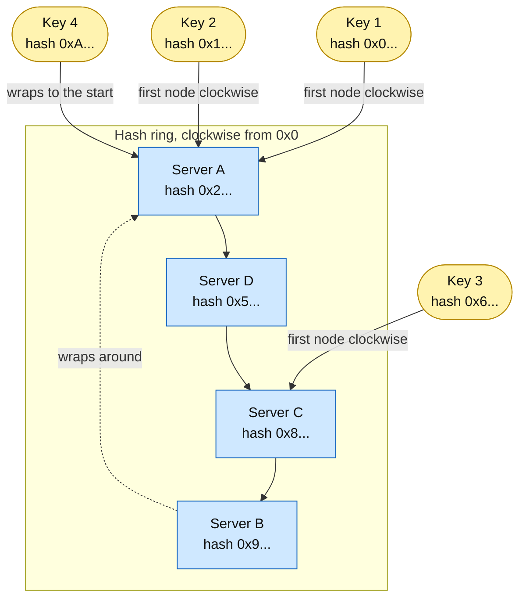
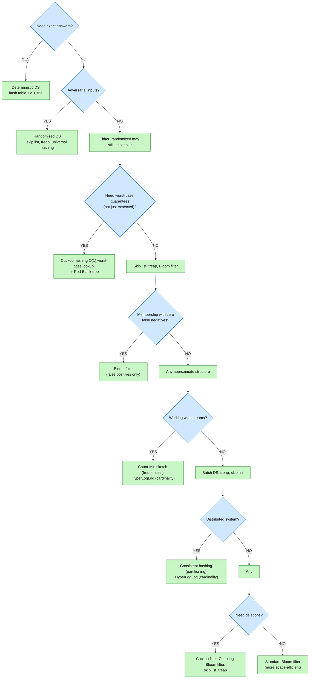

# 9. Consistent Hashing — Distributed Hashing Without Rehash

> **Navigation**: [← 8. HyperLogLog — Cardinality Estimation](06_hyperloglog_cardinality_estimation.md) | [Chapter overview](../A4_Randomized_Data_Structures.md)
> Page 7 of 7 in **A4. Randomized Data Structures — Probabilistic Guarantees in Storage**


## 💬 Study-Partner View — Consistent Hashing

**1. The bottom line:** Hash both servers and keys onto a ring so that adding or removing a server moves only a small share of the keys.

**2. The textbook core:**

- Place servers (and often many **virtual nodes** per server) on a ring by hash; a key goes to the first server clockwise from its hash.
- Adding/removing a server moves about **1/N** of the keys, versus almost all keys with `hash(key) mod N`.
- Virtual nodes smooth out load imbalance.
- Used in Dynamo, Cassandra, memcached clients and CDNs.

**3. The real-world analogy:** A **round table with seat markers**: each guest is served by the next waiter clockwise from their seat; if one waiter leaves, only the guests between that waiter and the previous one need a new waiter.

**4. Walkthrough:**

1. Servers A (hash 20), B (hash 50), C (hash 80) on a 0–99 ring.
2. Key with hash 60 → next clockwise server is C (80). Key with hash 10 → A.
3. Add server D at hash 65.
4. Only keys with hashes between 50 and 65 move (from C to D); everything else stays.

> [!NOTE]
> **Quick check:** What goes wrong with `hash(key) % N`? *Changing N remaps nearly every key, causing a cache stampede.*


## Historical Context

**Karger, Lehman, Leighton, Levine, and Lewin (MIT, 1997)** published *"Consistent Hashing and Random Trees: Distributed Caching Protocols for Evicting Hot Spots"* in STOC. It was designed for Akamai's content delivery network, which needed to distribute web content across thousands of servers without causing cache stampedes when servers were added or removed. The fundamental property: **only 1/n of keys are remapped** when a server is added or removed.

## The Problem with Modulo Hashing

Standard approach: `server = hash(key) % N` where N is the number of servers.

```
Problem: When server N-1 fails:
  Key 0:  hash % (N-1) = ?  vs  hash % N = ?
  Key 1:  ?  vs  ?
  ...
  ALL keys hash to different servers → 100% cache miss
```

This is catastrophic in practice: a single server failure cascades into total cache invalidation.

## Consistent Hashing Solution

Map both servers and keys onto a circular ring of hash values [0, 2^32-1). Each key is stored on the next server clockwise on the ring:



**How to read this diagram.** Servers and keys are hashed onto the same ring. Each key is served by the first server found going clockwise from its position (wrapping past the end). Adding or removing one server only moves the keys between it and its neighbour.

**Invariant (Consistent Hashing)**: For any key k, it maps to the first node on the ring encountered by moving clockwise from hash(k).

```java
public class ConsistentHash<T> {
    private final SortedMap<Long, T> ring = new TreeMap<>();
    private final HashFunction<T> hashFn;
    private final int virtualNodes;

    public ConsistentHash(int virtualNodes, HashFunction<T> hashFn,
                          Collection<T> nodes) {
        this.virtualNodes = virtualNodes;
        this.hashFn = hashFn;
        for (T node : nodes) {
            addNode(node);
        }
    }

    public void addNode(T node) {
        for (int i = 0; i < virtualNodes; i++) {
            long hash = hashFn.apply(node + "_VN_" + i);
            ring.put(hash, node);  // Virtual node on ring
        }
    }

    public T getNodeForKey(String key) {
        if (ring.isEmpty()) throw new IllegalStateException("No nodes");
        long hash = hashFn.apply(key);
        // Find first node >= hash, or wrap around to first node
        Map.Entry<Long, T> entry = ring.ceilingEntry(hash);
        if (entry == null) entry = ring.firstEntry();
        return entry.getValue();
    }

    // When node leaves: only its virtual nodes are removed
    // Only keys mapped to those VNs remap — ~1/N of all keys
    public void removeNode(T node) {
        for (int i = 0; i < virtualNodes; i++) {
            long hash = hashFn.apply(node + "_VN_" + i);
            ring.remove(hash);
        }
    }
}
```

## Virtual Nodes for Load Balancing

Naive consistent hashing puts each physical node at one position on the ring. This leads to **load imbalance** — nodes near the boundary of a large empty arc get many keys.

**Virtual nodes (VNodes)**: Each physical node is hashed V times with different suffixes, creating V positions on the ring. With V = 100-200 virtual nodes per physical node, the standard deviation of key distribution drops to ~5-10% of mean. This is the standard production configuration.

```
Without VNodes (V=1):  Node A gets 60% of keys, Node B gets 40%
With VNodes (V=100):   Node A gets 50.3%, Node B gets 49.7%

Trade-off: More VNodes = more memory for routing tables
           but better load distribution.
```

## Why Only 1/n Keys Remap

When a node is added/removed, only the keys that were mapped to that node (and the next node) are affected. Since the ring is uniform, the expected fraction of keys affected is 1/n for a node of size 1/n of the ring. The rest of the keys route to the same nodes they did before.

## Production Use Cases

| System | Role |
|---|---|
| Amazon DynamoDB | Partitioning: data maps to partitions via consistent hash |
| Apache Cassandra | Partitioning with virtual nodes (DSE 4.8+) |
| Memcached | Client-side consistent hashing for distributed cache |
| Discord | Ring partitioning for message sharding |
| Dynamo-style databases | Quorum-based replication with consistent routing |

---

## 10. Min-Wise Hashing — Similarity Estimation

### 💬 Study-Partner View — Min-Wise Hashing (MinHash)

**1. The bottom line:** MinHash compresses a big set into a tiny signature so that you can estimate how similar two sets are.

**2. The textbook core:**

- Jaccard similarity: `J(A, B) = |A ∩ B| / |A ∪ B|`.
- For a random hash function, `P[min h(A) = min h(B)] = J(A, B)`.
- Use `k` hash functions; the fraction of matching minima estimates J with error ≈ `1/√k`.
- Locality-sensitive hashing groups similar signatures for near-duplicate detection.

**3. The real-world analogy:** Comparing two **playlists** by checking whether their "alphabetically first song under a random shuffle" matches. Similar playlists agree often; different ones rarely do.

**4. Walkthrough:**

1. A = {a, b, c}, B = {b, c, d}: J = 2/4 = 0.5.
2. Apply a random ordering, say d < b < a < c: min of A is b, min of B is d → mismatch.
3. Apply another ordering b < a < c < d: min of A is b, min of B is b → match.
4. Over many orderings, about half match, estimating J ≈ 0.5.

> [!NOTE]
> **Quick check:** Where is MinHash used? *Web-page near-duplicate detection and document similarity search.*


### The Problem

Set similarity estimation: given two large sets A and B, estimate |A ∩ B| / |A ∪ B| (Jaccard similarity) without storing both sets. Exact computation requires O(|A| + |B|) space. Min-wise hashing provides O(k) space with provable error bounds, where k is the number of hash functions used.

### The Min-Wise Invariant

Let π be a random permutation on the universe U. Define:

**min_π(S) = argmin_{x∈S} π(x)** — the element of S with minimum permutation rank.

**Key property**: For any sets A, B:

**Pr[min_π(A) = min_π(B)] = |A ∩ B| / |A ∪ B| = J(A, B)**

Proof: Consider the minimum of π over A ∪ B. This element is equally likely to be any element of A ∪ B. It lies in A ∩ B exactly when the shared element has the smallest permuted rank — probability |A ∩ B| / |A ∪ B|.

### Using Multiple Hash Functions

Estimate J(A, B) using k independent min-wise hashes:

```
For i = 1..k:
    h_i ← random permutation
    x_i = min_{y∈A} h_i(y)
    y_i = min_{y∈B} h_i(y)

Estimate: Ĵ(A,B) = (1/k) · Σ_{i=1}^k [x_i = y_i]
```

By linearity of expectation, E[Ĵ] = J(A, B). The variance decreases as O(1/k). With k = 400 min-wise hashes, the standard error is ~0.025.

### Practical Implementation: MinHash

In practice, permutations are approximated using hash functions. A hash function h(x) approximates a random permutation if it is sufficiently random. The min-hash is then the element with minimum h(x):

```java
public class MinHash {
    private final int numHashes;
    private final HashFunction[] hashFunctions;

    public MinHash(int numHashes) {
        this.numHashes = numHashes;
        this.hashFunctions = new HashFunction[numHashes];
        initializeHashFunctions();  // k independent hash functions
    }

    public int[][] signature(Set<?> set) {
        int[][] sig = new int[numHashes][];
        for (int i = 0; i < numHashes; i++) {
            long minHash = Long.MAX_VALUE;
            for (Object elem : set) {
                long h = hashFunctions[i].apply(elem);
                minHash = Math.min(minHash, h);
            }
            sig[i] = new long[]{minHash};  // Min hash value
        }
        return sig;
    }

    // Jaccard estimate: fraction of matching min-hash values
    public double estimateJaccard(int[][] sigA, int[][] sigB) {
        int matches = 0;
        for (int i = 0; i < numHashes; i++) {
            if (Arrays.equals(sigA[i], sigB[i])) matches++;
        }
        return (double) matches / numHashes;
    }
}
```

### Use Cases

| System | Role |
|---|---|
| Google News | Near-duplicate article detection using MinHash |
| Spotify / music recommendation | User playlist similarity via MinHash fingerprints |
| Web crawlers | De-duplication of near-identical web pages |
| Document fingerprinting | Plagiarism detection across document collections |

Min-wise hashing is the foundation of **LSH (Locality Sensitive Hashing)** for Jaccard similarity: instead of comparing all pairs of sets, MinHash signatures allow hashing items into buckets where similar items collide with high probability.

---

## 11. The Adversary Argument — Why Randomization Wins

### The Yao Minimax Principle

**Yao's principle** (1977) connects randomized algorithms to deterministic algorithms on random inputs:

> The expected performance of the best randomized algorithm on the worst-case input equals the expected performance of the best deterministic algorithm on the best input distribution.

Formally: If R is any randomized algorithm, and D is any distribution over inputs, then:

**max_x E[R(x)] ≥ min_D min_A E_D[A(x)]**

In practice: to prove a lower bound on randomized data structures, design a distribution over inputs that forces every deterministic DS to perform poorly. The randomized DS, by making choices independent of the input, sidesteps this trap entirely.

### Example: HashDoS Attack

The HashDoS vulnerability (2011, Crosby & Wallach) exploited non-randomized hash functions in web frameworks. An attacker sends POST parameters where every key hashes to the same bucket:

```
Normal request:  {a: 1, b: 2, c: 3, ...}  → ~equal bucket distribution
Attack request:  {aaaa: 1, aaab: 2, aaac: 3, ...}  → all same bucket

Parse time:  0.5ms (normal)  vs  30 seconds (attack, O(n²) string compare)
```

The fix: **universal hashing**. With a random hash function chosen at process startup (unknown to the attacker), no adversarial set of keys can cause O(n) collisions. The expected chain length is 1, regardless of the input keys. This is randomization protecting against adversarial input — the same principle that makes skip lists and treaps work.

### Skip List Adversary Argument

An adversary building a deterministic alternative to a skip list would need to decide, for each element, which levels to place it at. Without knowing the random coin flips, the adversary cannot predict which elements are at level k. Even if the adversary knows the algorithm (Pugh's promotion probability p = 1/2), they cannot control which specific elements get promoted — each element's level is independent of all others.

**Result**: With probability ≥ 1 - 1/n, no search path exceeds O(log n) steps. An adversary cannot construct inputs that cause O(log n) failures because there are no predictable structural choices to exploit.

### The Difference from Randomized Algorithms

In a randomized algorithm (e.g., quicksort), the randomness is in the **procedure** (random pivot selection). In a randomized data structure (e.g., skip list), the randomness is in the **structure** itself. The skip list's shape is determined by random coin flips during construction; it stays that way until modified.

This distinction matters for **persistence**: a randomized quicksort gives different results each run; a skip list gives the same result every search because its structure (random heights) is fixed. The probabilistic guarantee holds on every query — not just in expectation over repeated constructions.

### What Randomization Cannot Fix

Randomization is not a universal shield:

1. **Correlated inputs**: If the adversary can observe the random choices (e.g., through timing side channels), randomization breaks down. Fix: use cryptographic randomness and constant-time operations.
2. **Insufficient randomness**: If the RNG is seeded predictably or has short period, the adversary may predict the structure. Fix: use cryptographic PRNGs for security-sensitive applications.
3. **Bounded independence**: Many analyses require fully independent random choices. In practice, hash functions are only k-wise independent for small k. Fix: use cryptographic hash functions as randomness sources.
4. **Expected ≠ worst-case SLAs**: If your SLA requires O(log n) guaranteed (not expected), randomized structures may not meet it. Red-Black trees (deterministic O(log n) worst-case) or SkipNet (deterministic routing) are alternatives.

---

## 12. Production Use Cases

### Cassandra — Bloom Filters for SSTable Skip

Cassandra stores data in Sorted String Tables (SSTables), immutable files on disk. To find a key:

1. Check the Bloom filter for the most recent SSTable (in memory).
2. If NO → skip all SSTables (major disk I/O saved).
3. If YES → binary search the SSTable index, then the data file.

**Scale**: Cassandra typically stores billions of keys per node. Each SSTable has a ~1-4 MB Bloom filter. With 4 bits per element and 1% false positive rate, the filter saves thousands of disk seeks per query for absent keys.

| Query | Bloom filter says | Disk seeks | Meaning |
| ----- | ----------------- | ---------- | ------- |
| Key present | YES | ~1 | found |
| Key absent | YES (false positive) | ~1 | not found |
| Key absent | NO | 0 | definitely absent |

- **Without** a Bloom filter: ~50–100 disk seeks per absent-key query (check all SSTables).
- **With** a Bloom filter: ~1 disk seek per absent-key query.

### Chrome Safe Browsing — Client-Side Bloom Filter

Google Chrome maintains a ~8 MB Bloom filter locally containing ~1 million malicious URL hashes. When a user visits a URL:

1. Chrome checks the local Bloom filter.
2. If NO → safe browsing is confirmed.
3. If YES → query Google's Safe Browsing API for definitive check.

**Performance**: The local check takes < 1ms. Without it, every URL navigation would require a network round-trip (~50-100ms). The false positive rate (~1%) means ~1% of safe URLs trigger an API check — a worthwhile trade-off.

### Akamai CDN — Bloom Filter for One-Hit Wonders

Akamai's CDN uses Bloom filters to identify "one-hit wonders" — URLs requested once and never again. These URLs consume cache storage without giving cache hit benefits. By tracking one-hit candidates in a Bloom filter:

- Request 1: Add to Bloom filter.
- Request 2: If Bloom says "seen before" → likely one-hit-wonder, don't cache.
- Subsequent requests to same URL: Eventually confirmed as multi-hit, cached normally.

**Impact**: One-hit-wonders can represent 30-50% of unique URLs but only ~5% of traffic. Filtering them saves significant cache storage for popular content.

### Bitcoin SPV — Bloom Filter for Transaction Filtering

Simplified Payment Verification (SPV) nodes in Bitcoin don't download the full blockchain. Instead, they use a Bloom filter to ask full nodes for only relevant transactions:

```text
SPV node sends:  bloom filter with its wallet addresses
Full node:       scan all transactions, return those matching the filter
SPV node:        false positives → download extra transactions (harmless)
SPV node:        false negatives → missed transactions (potential problem)
                 → mitigated by using large enough filter + periodic rescan
```

This is a **privacy-utility trade-off**: the filter hides which addresses belong to the SPV node (limited privacy), while allowing efficient transaction filtering.

### PostgreSQL — Bloom Index for OR JOINs

PostgreSQL 9.6+ supports Bloom indexes on arbitrary column combinations. A Bloom index on (status, region, category) enables fast filtering without a multi-column B-tree:

```sql
CREATE INDEX idx_orders_filter ON orders
USING bloom (status, region, category)
WITH (length=80, col1=4, col2=4, col3=4);

SELECT * FROM orders
WHERE status = 'pending' AND region = 'US' AND category = 'electronics';
-- Bloom index narrows candidates; filter eliminates false positives
```

### Redis — HyperLogLog for Real-Time Analytics

Redis HyperLogLog commands (`PFADD`, `PFCOUNT`, `PPFCOUNT`) estimate unique user counts:

```redis
PFADD page:article:42:visitors user_123 user_456 user_123
PFCOUNT page:article:42:visitors
→ 2  (duplicate removed by cardinality estimation)

# Merge two article visitor sets
PFMERGE page:topic:tech:visitors page:article:42 page:article:43
```

A single `PFCOUNT` on 1 million unique visitors uses ~12 KB of memory with ±2% standard error — compared to 8 MB for an exact Set.

---

## 13. Summary — When to Pick a Randomized DS

### Decision Framework



**How to read this diagram.** Work down the blue questions; each green box is the suggested structure for that constraint. Dotted arrows mean "now ask the next question too".

### Complexity Comparison Table

| Data Structure | Space | Query | Insert | Delete | False Positive | Notes |
|---|---|---|---|---|---|---|
| **Skip list** | O(n) | O(log n) exp | O(log n) exp | O(log n) exp | None | Replaces balanced BST; concurrent-friendly |
| **Treap** | O(n) | O(log n) exp | O(log n) exp | O(log n) exp | None | Simpler than RB-tree; implicit treap for arrays |
| **Bloom filter** | O(n·log(1/ε)) bits | O(k) | O(k) | No (unless counting) | Yes | FP only; space-optimal for membership |
| **Cuckoo hash** | O(n/α) | O(1) **worst** | O(1) amort | O(1) amort | None | Worst-case lookup; stash prevents cycles |
| **Count-Min sketch** | O(w·d) counters | O(d) | O(d) | N/A | Yes (overest) | Upper bound; overestimates frequencies |
| **HyperLogLog** | O(m) registers | O(1) | O(1) | N/A | Yes (~1/√m) | Approx cardinality; 64 KB → 0.4% error |
| **Consistent hash** | O(n + v·n) | O(log v·n) | O(log v·n) | O(log v·n) | None | Distributed; only 1/n keys remap on change |
| **Min-hash** | O(k·log U) | O(k) | N/A | N/A | Yes | Jaccard similarity; LSH for near-duplicates |

*exp = expected; amort = amortized; worst = worst-case; v = virtual nodes per physical node*

### Key Formulas

```
Bloom filter optimal hash functions:     k = (m/n)·ln 2
Bloom filter false positive rate:        (1 - e^{-kn/m})^k
Bloom filter space lower bound:          m ≥ -n·ln(ε)/(ln 2)²
Count-Min error bound:                   ≤ ε·||f||₁  with prob ≥ 1-δ
HyperLogLog standard error:              1.04/√m
Skip list expected height:               O(log n)  (p = 1/2)
Treap expected height:                   O(log n)  (random priority)
```

### The Core Principle

Randomized data structures exploit probability to bypass deterministic worst-case barriers. When the input is adversarial, randomization provides the only tractable defense. When exact answers are unnecessary, probabilistic structures trade precision for orders-of-magnitude space savings. The choice always depends on your error tolerance, your adversary model, and your SLA.

---

## When It Breaks -- Randomized Data Structures

**1. Bloom filter deletion** -- standard Bloom filters have no delete operation. Unsetting bits on deletion creates false negatives for other elements that share those bits. Use a Counting Bloom Filter (counts instead of bits) if deletion is needed.

**2. HyperLogLog on tiny sets** -- HLL is inaccurate for cardinalities below ~2.5*m (m = register count). For small sets (< 100 elements), exact counting is cheaper and more accurate. Always check the cardinality range before choosing HLL.

**3. Skip list with biased RNG** -- fixed seed or biased promotion creates a deterministic non-random structure. Long chains at certain levels degrade O(log n) to O(n). Use `ThreadLocalRandom` or `SecureRandom` for level promotion.

**4. Count-Min Sketch overestimates** -- CMS can only overestimate (not underestimate). A freshly inserted key can already have count > 1 due to hash collisions with other keys. Queries for non-existent keys return positive counts. Design downstream code to tolerate overestimates.

---

## Reference Anchor

**Google Guava -- production Bloom filter**:
```java
// com.google.common.hash.BloomFilter -- used at scale in Cassandra, HBase, Chrome
BloomFilter<String> bf = BloomFilter.create(
    Funnels.stringFunnel(StandardCharsets.UTF_8),
    1_000_000,  // expected insertions
    0.01        // 1% false positive rate
);
bf.put("user:1234");
boolean mightContain = bf.mightContain("user:1234"); // true
// Serializable: bf.writeTo(outputStream) for storage/replication

// HyperLogLog -- no JDK implementation; use stream-lib or HdrHistogram:
// com.clearspring.analytics.stream.cardinality.HyperLogLog
HyperLogLog hll = new HyperLogLog(0.01); // 1% std error
hll.offer("user:1234");
long estimate = hll.cardinality();
```

---

## Brute Force to Optimal -- Space-Accuracy Tradeoffs

| Problem | Exact | Space | Approximate | Space | Error |
|---------|-------|-------|-------------|-------|-------|
| Set membership | HashSet | O(n) | Bloom filter | O(n/9.6 bits) | 1% FP |
| Cardinality | HashSet | O(n) | HyperLogLog | O(m registers) | ~1.04/sqrt(m) |
| Frequency | HashMap | O(n) | Count-Min Sketch | O(w*d) | epsilon*n additive |
| Quantiles | Sort | O(n log n) | t-digest | O(compression*100) | ~0.01% relative |

*[← A3: DS Lower Bounds](../A3_DS_Lower_Bounds.md) | [Back to DS Index](../00_INDEX.md)*

---

[← 8. HyperLogLog — Cardinality Estimation](06_hyperloglog_cardinality_estimation.md) | [Chapter overview](../A4_Randomized_Data_Structures.md)
