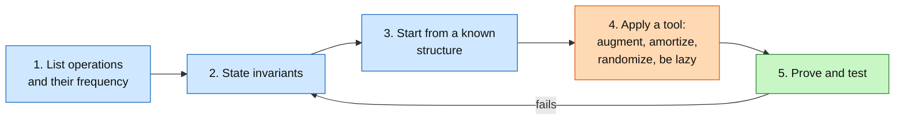
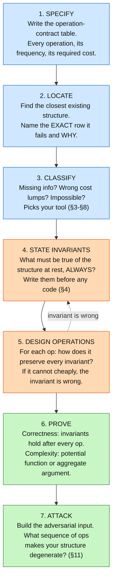

# A5. Designing Your Own Data Structures — The Invention Method

**Navigation**: [← A4: Randomized Data Structures](A4_Randomized_Data_Structures.md) | [📚 DS Index](00_INDEX.md) | [Algorithms A5: Designing Your Own Algorithms →](../03_Algorithms/A5_Designing_Your_Own_Algorithms.md)

> **MIT 6.851 Advanced Data Structures / KTH DD2440 / ETH Advanced Algorithms level**
>
> "The best way to understand a data structure is to invent it. Every structure in your textbook was, at some moment, a person sitting with a problem that no existing structure solved, and a piece of paper."

> Every other chapter in this module teaches you data structures that **already exist**. This one teaches you the process that **creates** them. By the end you should be able to take a novel operation-set-with-cost-budget and derive a structure that meets it — then prove that it does.

---

## Table of Contents

1. [5W1H](#5w1h)
2. [The Central Question: What Forces a New Structure Into Existence](#1-the-central-question-what-forces-a-new-structure-into-existence)
3. [The Design Loop — The Method Itself](#2-the-design-loop--the-method-itself)
4. [Tool 1: Augmentation — The 80% Tool](#3-tool-1-augmentation--the-80-tool)
5. [Tool 2: Invariant-First Design](#4-tool-2-invariant-first-design)
6. [Tool 3: Amortization as a Design Tool](#5-tool-3-amortization-as-a-design-tool-not-just-an-analysis-tool)
7. [Tool 4: Randomization — Buying Simplicity With Probability](#6-tool-4-randomization--buying-simplicity-with-probability)
8. [Tool 5: Laziness — Deferring Work Until It Pays](#7-tool-5-laziness--deferring-work-until-it-pays)
9. [Tool 6: The Three-Currency Dial (Time / Space / Exactness)](#8-tool-6-the-three-currency-dial-time--space--exactness)
10. [Case Studies: How Real Structures Were Actually Invented](#9-case-studies-how-real-structures-were-actually-invented)
11. [Worked Invention: Deriving the Fenwick Tree From Nothing](#10-worked-invention-deriving-the-fenwick-tree-from-nothing)
12. [The Validation Protocol — Proving Your Own Design Correct](#11-the-validation-protocol--proving-your-own-design-correct)
13. [When NOT To Design Your Own](#12-when-not-to-design-your-own)
14. [Practice Challenges](#-practice-challenges)
15. [Reality Check](#reality-check)

---

## 5W1H

- **WHAT**: The repeatable engineering method for producing a *new* data structure that meets a stated operation-and-cost contract — and the proof discipline that shows it actually does.
- **WHY**: Because the structure you need is frequently not in the library. Every production system of consequence contains at least one custom structure: the LRU cache that is a hash map fused with a doubly linked list, the rate limiter's ring buffer, the event index built from a skip list because it must be lock-free. Knowing only catalogue structures means solving these badly or not at all.
- **WHO**: Anyone past the "I can use a HashMap" stage who wants the "I can *build* the thing HashMap cannot do" stage. This is the boundary between a library consumer and a systems engineer.
- **WHEN**: When you can write down an operation set with required complexities, and no standard structure meets all of them simultaneously. That mismatch — and *only* that mismatch — is the trigger.
- **WHERE**: In the gap between what your problem demands and what `java.util` supplies.
- **HOW**: Specify the contract → find the closest existing structure → identify precisely which requirement it violates → apply one of six design tools → state the invariants → prove correctness and complexity → adversarially test the assumptions.

---

## 💬 Explain It Like a Study Partner — Designing Your Own Structure

> [!TIP]
> **Ask yourself first:** *"When would you ever need a data structure that is not in the standard library?"*

### 1. The bottom line

You design a new structure by writing down exactly which operations you need and how fast, then **bending a known structure** until it fits.

### 2. The textbook core

- Start with an **operation-contract table**: every operation, how often it happens, required cost.
- Find the closest existing structure and name the row where it fails.
- Pick a tool: **augmentation** (store extra data), **amortization**, **randomization**, **laziness**, or the **time/space/exactness** trade-off.
- State the **invariants** before writing code, then prove each operation preserves them.
- Attack your design with adversarial input, and remember: often the right answer is **not** to invent anything.

### 3. The real-world analogy

**Remodelling a kitchen instead of building a house.** You list what you cook (operations), look at the closest existing layout (a known structure), and add a counter or an island (augmentation) where it does not work, rather than starting from bare ground.

### 4. Walkthrough: "give me the k-th smallest in a changing set"

1. **Contract:** insert O(log n), delete O(log n), `kth(k)` O(log n).
2. **Closest structure:** a balanced BST gives insert/delete in O(log n) but `kth` is O(n) (walk in order).
3. **Augment:** store the **subtree size** in every node.
4. **Invariant:** `size(node) = size(left) + size(right) + 1`; rotations and inserts update it.
5. **`kth`:** at a node, if `k ≤ size(left)` go left, if `k = size(left) + 1` return the node, else go right with `k - size(left) - 1`. That is O(log n). You have invented an *order-statistic tree*.

> [!NOTE]
> **Quick check:** when should you not design your own? *When a standard structure already meets the contract; custom structures are hard to prove and test.*

---

## ⚡ At a Glance — The Design Loop

> [!NOTE]
> **Mental model:** you do not invent a data structure; you *derive* it from the operations you need, then pick the cheapest tool that satisfies them.



**How to read this diagram.** Move left to right; the arrow back from step 5 to step 2 is the normal case, because failed proofs usually mean the invariant was wrong or incomplete.

---

## 1. The Central Question: What Forces a New Structure Into Existence

Every data structure in history was created by the same event: **someone wrote down an operation set with cost requirements, and no existing structure could satisfy all of them at once.**

That sentence is the whole chapter. Everything else is technique.

### 1.1 The operation-contract table

Before you design anything, you write this table. No exceptions.

| Operation | Frequency | Required cost | Notes |
| --- | --- | --- | --- |
| `insert(k, v)` | very high | O(1) amortized | writes dominate |
| `get(k)` | high | O(1) expected | |
| `evictOldest()` | 1 per insert past capacity | O(1) worst case | must not scan |
| `iterate in access order` | rare | O(n) | |

This table *is* the specification. It is also the test suite, the complexity proof obligation, and the argument you will make in code review. A design conversation without this table is two people describing different structures to each other.

**Now the key move.** Look at your table and ask: *which single existing structure comes closest, and exactly which row does it fail?*

For the table above:
- A `HashMap` gives you rows 1 and 2 and fails row 3 completely (no notion of order, eviction requires a scan → O(n)).
- A doubly linked list gives you rows 3 and 4 and fails row 2 (lookup is O(n)).

Neither works. **Both fail on a *different* row.** That observation is the design.

### 1.2 The three shapes of failure

When you compare your contract against the closest existing structure, the failure takes exactly one of three shapes. Naming the shape tells you which tool to reach for.

| Failure shape | What it means | Tool to reach for |
| --- | --- | --- |
| **Missing information** | The structure could answer your query if it just *remembered* one more fact | Augmentation (§3) |
| **Wrong cost distribution** | Total work is acceptable, but it arrives in the wrong-sized lumps | Amortization (§5) or Laziness (§7) |
| **Impossible requirement** | Information theory or a lower bound forbids it (§[A3](A3_DS_Lower_Bounds.md)) | Relax a currency (§8) — space, or exactness |

The LRU example is a fourth, special case: **two structures each satisfy a disjoint half of the contract.** The tool is *composition* — run both, and link them so each operation uses whichever half is good at it. That is the entire LRU cache design, and it is worth internalizing that a famous "hard" interview problem is one line of design reasoning once the contract table exists.

---

## 2. The Design Loop — The Method Itself

This is the procedure. Follow it in order; the ordering is load-bearing.



**How to read this diagram.** Follow the seven steps top to bottom. The dotted arrow is the loop-back: if an operation cannot preserve an invariant cheaply, the invariant (not the operation) is what you should revisit.

**Step 5 is where most designs die, and it dies productively.** When you find that an operation cannot cheaply restore an invariant, you have not failed — you have learned that your invariant was too strong. Weaken it and continue. Red-Black trees exist precisely because AVL's invariant (heights differ by ≤ 1) is too strong to maintain cheaply under deletion; relaxing it to "no red node has a red child, and all root-to-leaf paths have equal black-height" buys cheaper rebalancing at the cost of slightly worse balance. That is step 5 producing a new structure.

---

## 3. Tool 1: Augmentation — The 80% Tool

**The most practical design tool by a wide margin.** Most "new" structures you will ever need in production are an existing structure carrying extra bookkeeping.

### 3.1 The recipe (CLRS Chapter 14, formalized)

To augment a structure, you must answer four questions. Skipping any of them is how augmented structures acquire silent bugs.

1. **Which underlying structure?** (usually a balanced BST, a heap, or a hash map)
2. **What extra information is stored at each node?**
3. **Can that information be maintained during every modifying operation — in particular, during the structure's *internal* reorganizations (rotations, resizes, rehashes)?**
4. **What new operations does the extra information enable?**

Question 3 is the one that kills naive augmentations. It has a precise sufficient condition:

> **The augmentation theorem.** If the extra field `f(x)` at node `x` can be computed *using only* `x`'s own data and the `f` values of `x`'s children, then `f` can be maintained through insertion, deletion, and rotation without changing their asymptotic cost.

The reason is mechanical: a rotation changes the parent-child relationships of O(1) nodes. If `f` depends only on children, only those O(1) nodes need recomputation, and each recomputation is O(1) — so the rotation stays O(1) and the operation stays O(log n).

### 3.2 Worked augmentation: the order-statistic tree

**Contract:** a sorted set that additionally supports `select(k)` (the k-th smallest element) and `rank(x)` (how many elements are < x), both in O(log n).

- **Step 2 (locate):** A balanced BST gives sorted-set operations in O(log n) but has no notion of position — `select(k)` requires an in-order walk, O(n). Failure shape: **missing information**. The tree *could* answer it if each node knew how many elements sit beneath it.
- **Augment with:** `size[x] = number of nodes in the subtree rooted at x`.
- **Check question 3:** `size[x] = size[x.left] + size[x.right] + 1`. This depends only on `x` and its children — the augmentation theorem applies. Maintainable in O(1) per rotation. ✅

**Now derive `select(k)` yourself before reading on.** You are at node `x`; the left subtree contains `size[x.left]` elements, all smaller than `x`.

```java
// Find the k-th smallest (1-indexed) in the subtree rooted at x.
Node select(Node x, int k) {
    int leftSize = size(x.left);          // elements smaller than x
    if (k == leftSize + 1) return x;      // x itself is the k-th
    if (k <= leftSize)  return select(x.left, k);
    else                return select(x.right, k - leftSize - 1);
    //                                        ^^^^^^^^^^^^^^^^^^
    // we discarded leftSize elements AND x itself, so the target's
    // rank within the right subtree drops by exactly leftSize + 1
}
```

Each step descends one level and does O(1) work → **O(log n)**, matching the contract. The `k - leftSize - 1` adjustment is the entire content of the algorithm, and you derived it from the invariant rather than memorizing it.

And the rotation maintenance — the part textbooks often skip:

```java
// Right-rotate around y. AFTER relinking, sizes must be restored
// bottom-up: x becomes the parent of y, so y is recomputed FIRST.
void rotateRight(Node y) {
    Node x = y.left;
    y.left = x.right;
    x.right = y;
    // order matters: y is now BELOW x
    y.size = size(y.left) + size(y.right) + 1;
    x.size = size(x.left) + size(x.right) + 1;
}
```

Recomputing `x` before `y` would read a stale `y.size` — a bug that produces *slightly* wrong ranks under specific rotation sequences and survives casual testing. This is the concrete form of augmentation question 3.

### 3.3 The augmentation catalogue

Once you see the pattern, a large family of "advanced" structures collapses into it:

| Augment a... | With... | And you get |
| --- | --- | --- |
| Balanced BST | subtree size | Order-statistic tree (rank/select) |
| Balanced BST | max endpoint in subtree | Interval tree (overlap queries) |
| Balanced BST | subtree min/max/sum | Range-query tree |
| Doubly linked list | hash map from key → node | LRU cache (O(1) evict *and* lookup) |
| Heap | hash map from item → heap index | Indexed priority queue (decrease-key in O(log n)) |
| Union-Find | subtree size / rank | Union-by-rank (near-O(1) with path compression) |
| Trie | count of words in subtree | Autocomplete with frequency ranking |

**Every row is the same move**: a structure was missing one fact; storing that fact — maintainable from children alone — unlocked a whole operation class. When you face a novel requirement, run down question 3 for candidate facts. If you find one that satisfies the augmentation theorem, you are done; you have designed your structure.

---

## 4. Tool 2: Invariant-First Design

An invariant is a property that is **true of the structure whenever no operation is in progress**. It is the contract between the structure and its own operations.

### 4.1 Why invariants come before code

Because the invariant *is* the design. Consider three structures that store comparable elements:

| Structure | Invariant | What it buys | What it costs |
| --- | --- | --- | --- |
| Sorted array | `a[i] ≤ a[i+1]` for all i | O(log n) search, O(1) select | O(n) insert (shifting) |
| Binary heap | `parent ≤ both children` | O(1) find-min, O(log n) insert | No O(log n) search for arbitrary key |
| BST | `left subtree < node < right subtree` | O(log n) search AND insert | No O(1) find-min without augmentation |

These are not three arbitrary designs. They are three *different answers to how much order to enforce*, and each answer mechanically determines the cost table. The heap is fast to insert precisely because it enforces less order than a sorted array; it cannot binary-search precisely because of the same weakness.

> **The design principle:** enforce the *weakest* invariant that still supports your required operations. Every unit of extra order costs maintenance time on every mutation.

This principle explains a great deal at once: why a heap beats a sorted array for a priority queue, why Red-Black trees beat AVL trees under deletion-heavy workloads, and why a hash table (which enforces essentially *no* order) beats every tree at pure lookup.

### 4.2 Writing invariants that are actually checkable

Write them as **executable predicates**, not prose. This one habit will find more bugs in your custom structures than any test suite.

```java
// The single most valuable method on any custom data structure.
// Call it after every operation in tests; delete it in production
// (or keep it behind an assertion flag).
boolean checkInvariants() {
    // I1: size field matches actual node count
    if (this.size != countNodes(root)) return false;
    // I2: BST ordering holds globally, not just locally
    if (!isBST(root, Long.MIN_VALUE, Long.MAX_VALUE)) return false;
    // I3: every node's cached subtree size is consistent
    if (!sizesConsistent(root)) return false;
    return true;
}

// Note I2 carefully: the NAIVE check (each node > its left child and
// < its right child) is WRONG — it passes trees that violate the
// global BST property. Bounds must be threaded down.
boolean isBST(Node x, long min, long max) {
    if (x == null) return true;
    if (x.key <= min || x.key >= max) return false;
    return isBST(x.left, min, x.key) && isBST(x.right, x.key, max);
}
```

The `isBST` comment is the canonical example of why invariants must be stated **globally over the whole structure**, not as local edge conditions. A locally-valid, globally-invalid BST is a real bug class that a local check certifies as correct.

### 4.3 The invariant-weakening move

When step 5 of the design loop fails — an operation cannot cheaply restore an invariant — you weaken the invariant. This is a *creative* step and it is how several famous structures came to exist:

| Structure | Strong invariant that failed | Weakened to | Payoff |
| --- | --- | --- | --- |
| Red-Black tree | AVL: heights differ by ≤ 1 | No red node has a red child; equal black-heights | O(1) amortized rotations per update |
| B-tree | Binary branching | Nodes hold between ⌈m/2⌉ and m keys | Shallow tree → fewer disk seeks |
| Splay tree | Any balance guarantee at all | *None* (only amortized) | No stored balance data; adapts to access pattern |
| Skip list | Deterministic level structure | Levels assigned by coin flip | No rebalancing code whatsoever |

Notice the trajectory of that last column: each weakening bought *simplicity or speed of maintenance*. That is what invariant strength trades against.

---

## 5. Tool 3: Amortization as a Design Tool (Not Just an Analysis Tool)

[A2](A2_DS_Complexity_FirstPrinciples.md) teaches you to *analyze* amortized cost. Here you use it *deliberately*, at design time.

### 5.1 The design move

> **Deliberately make one operation occasionally expensive, so that all the others can be cheap.**

You are not tolerating the expensive operation. You are *choosing* it.

The dynamic array is the purest instance. You could keep an array always exactly the right size — then every append is O(n) (copy to a new array of size n+1). Instead you **over-allocate**, wasting space, so that most appends touch nothing but a pointer:

```java
void append(T item) {
    if (size == capacity) {
        resize(capacity * 2);   // O(n) — but rare
    }
    data[size++] = item;        // O(1) — the common case
}
```

**Why doubling and not `capacity + 100`?** Derive it, do not memorize it.

- **Growth by a constant c:** to reach size n you resize n/c times, and resize number i copies about `c·i` elements. Total copying ≈ `c·(1 + 2 + ... + n/c)` = Θ(n²/c). Amortized per append: **Θ(n)**. Catastrophic.
- **Growth by a factor of 2:** resizes happen at sizes 1, 2, 4, …, n. Total copying = `1 + 2 + 4 + ... + n` < `2n` (geometric series). Amortized per append: **Θ(1)**. ✅

The geometric series is the entire justification, and it generalizes: *any* growth factor > 1 gives O(1) amortized. Java's `ArrayList` uses 1.5×, trading slightly more resizes for less wasted memory and better reuse of freed blocks. Knowing the derivation lets you pick the constant for *your* memory profile rather than copying someone else's.

### 5.2 The rule you must state alongside it

Amortized O(1) means **n operations cost O(n) in total**. It does *not* mean every operation is fast. One append in your sequence really does take O(n).

This distinction is a design decision, not a technicality:

- **Throughput system** (batch job, ETL, compiler): amortized bounds are exactly right. Take the occasional spike.
- **Latency-bounded system** (game frame loop, real-time trading, an SLA with a p99.9): an O(n) spike may blow the deadline. You need **worst-case** bounds, and you get them by *spreading* the expensive work: incremental resizing (copy a few elements on every operation rather than all at once), or a deamortized two-array scheme.

Naming which of these two systems you are building — before choosing the structure — is part of the specification step.

---

## 6. Tool 4: Randomization — Buying Simplicity With Probability

### 6.1 The trade

Deterministic balanced trees (AVL, Red-Black) achieve O(log n) worst case at the cost of substantial rebalancing machinery: rotation cases, colour rules, and deletion logic that is famously fiddly to get right.

Randomization buys you **the same expected bound with a fraction of the code**, at the price of a probabilistic (not absolute) guarantee.

### 6.2 The skip list — invented, not memorized

Pugh's 1989 question was precisely: *can I get O(log n) search without writing any rebalancing code?*

Start from a sorted linked list. Search is O(n) because you must step one node at a time. The obvious fix: add an "express lane" over every 2nd node, so you can skip pairs. Then a lane over every 4th. Every 8th. With `log n` lanes you get binary-search-like descent — but *maintaining* exact 2/4/8 spacing under insertion is exactly the rebalancing work you were trying to avoid.

**Pugh's move:** do not maintain the spacing exactly. When inserting a node, flip a coin repeatedly; promote the node one level per heads.

```java
int randomLevel() {
    int level = 1;
    while (random.nextDouble() < 0.5 && level < MAX_LEVEL) {
        level++;                 // each heads promotes one more lane
    }
    return level;
}
```

- P(node reaches level ≥ i) = 2^(1-i), so expected nodes at level i is n/2^(i-1) — **the same distribution the deterministic scheme enforces**, achieved without enforcing anything.
- Expected height: O(log n). Expected search: O(log n).
- Rebalancing code required: **zero**.

The insight worth extracting: **a random process can produce a good structure in expectation without any code that maintains structure.** That is a general design tool, and its payoff is not speed but *simplicity* — which is why lock-free concurrent skip lists (`ConcurrentSkipListMap`) are practical while lock-free balanced BSTs are research projects. Fewer structural mutations means fewer things to make atomic.

### 6.3 When randomization is *not* acceptable

- **Adversarial inputs with a visible seed.** If an attacker can predict your randomness, they can force worst-case behaviour (this is the hash-collision DoS attack — the reason modern hash tables use randomized, per-process seeds).
- **Hard real-time.** "O(log n) with probability 1 − 1/n^c" is not a guarantee a flight controller can accept.
- **Reproducibility requirements.** Debugging a structure whose shape differs per run is materially harder; seed it explicitly in tests.

---

## 7. Tool 5: Laziness — Deferring Work Until It Pays

**The design move:** do not do work when asked; record that it *needs* doing, and do it when the answer is actually required — or never, if the request is superseded.

### 7.1 Lazy deletion

**Contract problem:** a priority queue needs `remove(item)`, but a binary heap has no way to find an arbitrary item — removal is O(n) search plus O(log n) fix-up.

**Lazy answer:** do not remove. Mark it dead, and skip dead entries when they surface at the top.

```java
// Standard trick used in Dijkstra, A*, and every event-loop scheduler.
// Instead of decrease-key (which a binary heap cannot do cheaply),
// push a NEW entry and let the stale one die on arrival.
void push(Item item, int priority) {
    heap.add(new Entry(item, priority));
    bestKnown.put(item, priority);
}

Item pop() {
    while (!heap.isEmpty()) {
        Entry e = heap.poll();
        // is this entry stale? (a better one was pushed later)
        if (e.priority == bestKnown.get(e.item)) return e.item;
        // else: silently discard — this is the deferred deletion
    }
    return null;
}
```

**Cost analysis (do this, do not hand-wave):** each `push` adds at most one entry, so across `m` pushes the heap holds ≤ m entries and each `poll` is O(log m). Every entry is discarded at most once, so the total discard work across the whole run is O(m log m) — the *same* asymptotic bound as a heap with real decrease-key, achieved with none of the index-tracking machinery. The cost is memory (stale entries linger) and a heap larger than the live set.

### 7.2 The lazy family

| Technique | Deferred work | Where you have met it |
| --- | --- | --- |
| Lazy deletion | Removal | Priority queues, [Ch26 flake quarantine](../21_SDET_Playwright_Automation/06_CI_CD_And_Reliability/26_Flakiness_Diagnosis_and_Fixing.md) |
| Lazy propagation | Range updates pushed to children | Segment trees with range assign |
| Copy-on-write | Copying | Persistent structures, git objects, `CopyOnWriteArrayList` |
| Rebuild-on-threshold | Reorganization | Scapegoat trees, LSM compaction |
| Memoization | Recomputation | DP, [React `useMemo`](../15_React_Frontend/03_Hooks_Deep_Dive.md) |

Laziness and amortization are siblings: laziness *creates* the lumpy cost distribution that amortized analysis then *justifies*.

---

## 8. Tool 6: The Three-Currency Dial (Time / Space / Exactness)

Most engineers know they can trade time against space. The third currency is the one that unlocks modern structures.

> **You may spend time, space, or EXACTNESS. Modern large-scale structures spend exactness first.**

### 8.1 The dial in action: "how many distinct users visited today?"

| Design | Time | Space | Exact? |
| --- | --- | --- | --- |
| `HashSet<UserId>` | O(1) per add | O(n) — gigabytes at scale | ✅ exact |
| Sorted array + dedupe | O(n log n) | O(n) | ✅ exact |
| **HyperLogLog** | O(1) per add | **O(log log n)** — ~12 KB for billions | ❌ ~2% error |

HyperLogLog is not a worse hash set. It is a structure that **spent exactness to buy a space reduction of five orders of magnitude** — and for the question "roughly how many distinct users," 2% error is free. If your problem tolerates approximation, the space savings available are not incremental; they are categorical.

### 8.2 Deriving the approximate-structure family

Each of these is the same move applied to a different exact structure:

| Exact structure | Relaxed to | What was traded | What was gained |
| --- | --- | --- | --- |
| Set membership | **Bloom filter** | False positives allowed (never false negatives) | ~10 bits/element instead of full keys |
| Distinct count | **HyperLogLog** | ~2% error | O(log log n) space |
| Frequency count | **Count-Min Sketch** | Overestimates only | Sublinear space |
| Nearest neighbour | **LSH** | Approximate neighbours | Escapes the curse of dimensionality |
| Quantiles | **t-digest / KLL** | Bounded rank error | Streaming, mergeable |

**The design question to ask of your own problem:** *does the consumer of this answer actually need it to be exact?* Bloom filters power browser safe-browsing checks because a false positive costs one extra verification round-trip, while the space saving makes the whole feature shippable. Notice also the deliberate **asymmetry** of the error: Bloom filters can never produce a false *negative*, because "definitely not in the set" is the answer the application relies on. When you design an approximate structure, choosing *which direction* the error may go is as important as choosing its magnitude.

---

## 9. Case Studies: How Real Structures Were Actually Invented

Each of these is the design loop, run by a real person against a real contract failure.

### 9.1 Bloom filter (Burton Bloom, 1970)

- **Contract:** membership test for a large dictionary; the dictionary does not fit in memory.
- **Failure:** a hash set stores the keys themselves — Θ(n · keysize) space. Failure shape: **impossible** under the memory budget (information-theoretically, exact membership requires storing enough to distinguish members).
- **Relaxation:** allow false positives (§8).
- **Design:** a bit array of size m, plus k independent hash functions. `add(x)` sets bits `h₁(x)…h_k(x)`; `contains(x)` returns true only if *all* those bits are set.
- **Why no false negatives:** bits are only ever set, never cleared — so a member's bits are still set when queried. The asymmetry is structural, not incidental.
- **The tuning result:** with `m` bits and `n` items, false-positive rate ≈ `(1 − e^(−kn/m))^k`, minimized at `k = (m/n)·ln 2`. You *choose* your error rate by sizing `m`, which is what makes the structure engineerable rather than merely clever.

### 9.2 Skip list (William Pugh, 1989)

Covered in §6.2. The contract failure was **complexity of implementation**, not of asymptotics — a reminder that "the code is too hard to get right, especially concurrently" is a legitimate design driver.

### 9.3 LSM tree (O'Neil et al., 1996)

- **Contract:** a write-heavy store (logging, time-series, metrics) where writes vastly outnumber reads.
- **Failure:** a B-tree does an in-place update per write, which means a random disk seek per write. Failure shape: **wrong cost distribution** for this workload — B-trees optimize reads at write expense.
- **Design:** buffer writes in a sorted in-memory structure (the memtable); flush it sequentially to an immutable on-disk run; merge runs in the background (compaction).
- **What was traded:** read amplification (a read may check several runs, mitigated by per-run Bloom filters — note the composition) and background compaction I/O.
- **What was gained:** writes become sequential appends, which on spinning disks was ~100× faster and on SSDs reduces write amplification and wear.
- **Where you use it:** LevelDB, RocksDB, Cassandra, HBase, and the storage engine under many time-series databases.

This case study is the clearest illustration that **there is no universally best structure — only a structure best matched to a workload.** B-tree and LSM tree solve the same abstract problem with opposite optimizations.

### 9.4 Rope (Boehm, Atkinson, Plass, 1995)

- **Contract:** a text editor buffer supporting insert/delete *in the middle* of a multi-megabyte document.
- **Failure:** a flat string/array requires shifting Θ(n) bytes per edit; concatenation copies both operands.
- **Design:** a balanced binary tree whose leaves are short string fragments and whose internal nodes store the total length of their left subtree (**an augmentation** — §3).
- **Result:** concatenation becomes O(1) (create a new root), index lookup and split/insert become O(log n) by descending with the length augmentation.
- **Note the composition of tools:** tree structure + augmentation + (in some implementations) laziness for concatenation. Real structures usually combine two or three tools; only textbook structures use exactly one.

### 9.5 The pattern across all four

| Structure | Contract failure | Tool used | Currency spent |
| --- | --- | --- | --- |
| Bloom filter | Space impossible | Relaxation | Exactness |
| Skip list | Implementation complexity | Randomization | Determinism |
| LSM tree | Write cost distribution | Laziness + batching | Read speed |
| Rope | Edit cost in the middle | Augmentation | Constant factors, memory |

---

## 10. Worked Invention: Deriving the Fenwick Tree From Nothing

This section is the chapter in miniature. **Do not read ahead — try each step first.** The Fenwick tree (Binary Indexed Tree, Peter Fenwick, 1994) is the best available exercise because it is genuinely derivable, and because most people memorize it without ever seeing where it comes from.

### Step 1: Specify

| Operation | Required cost |
| --- | --- |
| `update(i, delta)` — add delta to element i | O(log n) |
| `prefixSum(i)` — sum of elements 0..i | O(log n) |

### Step 2: Locate the failure

| Candidate | `update` | `prefixSum` | Verdict |
| --- | --- | --- | --- |
| Plain array | O(1) ✅ | O(n) ❌ — must add them up | fails row 2 |
| Prefix-sum array | O(n) ❌ — every prefix after i changes | O(1) ✅ | fails row 1 |

Two structures, each acing one row and failing the other. **The same shape as the LRU problem** (§1.1) — but composition will not help here, because the two representations of the same data are mutually inconsistent (you cannot keep both updated cheaply). We need a middle ground.

### Step 3: The design question

> Both extremes fail because each stores sums over the *wrong-sized* ranges: the plain array stores ranges of size 1 (cheap to update, expensive to combine), the prefix array stores ranges of size i (cheap to read, expensive to update).
>
> **What if each cell stored a sum over a range whose size is neither 1 nor i, chosen so that *both* operations touch only O(log n) cells?**

This is the whole idea. Everything below is working it out.

### Step 4: Choosing the ranges

We want any prefix `0..i` to be expressible as a sum of O(log n) stored ranges. There is a natural source of "O(log n) pieces" for any integer: **its binary representation**. n has at most log₂n set bits.

So: let cell `i` store the sum of a range whose **length is the value of the lowest set bit of i**. Write that as `i & -i` (two's complement isolates the lowest set bit — see [Ch10 Bit Manipulation](../03_Algorithms/10_Bit_Manipulation_Complete.md)).

Using 1-based indexing, cell `i` covers `(i − (i & −i), i]` — that is, `i & -i` elements ending at i.

```
i      binary   i&-i   range covered
1      0001      1      [1,1]
2      0010      2      [1,2]
3      0011      1      [3,3]
4      0100      4      [1,4]
5      0101      1      [5,5]
6      0110      2      [5,6]
7      0111      1      [7,7]
8      1000      8      [1,8]
```

### Step 5: Derive `prefixSum` from that table

To get `prefixSum(7)` = sum of [1,7]: take cell 7 → covers [7,7]. Remaining: [1,6]. Take cell 6 → covers [5,6]. Remaining: [1,4]. Take cell 4 → covers [1,4]. Done.

The index sequence was **7 → 6 → 4**. In binary: `0111 → 0110 → 0100`. Each step **cleared the lowest set bit** — which is exactly `i -= i & -i`.

```java
long prefixSum(int i) {          // 1-based
    long sum = 0;
    while (i > 0) {
        sum += tree[i];
        i -= i & -i;             // strip lowest set bit
    }
    return sum;
}
```

**Complexity, derived not asserted:** each iteration removes one set bit from `i`, and `i` has at most log₂n set bits → **O(log n)**. ✅

### Step 6: Derive `update` yourself

Updating element `i` must update every cell whose range *contains* `i`. From the table, element 5 lives in cells 5 ([5,5]), 6 ([5,6]), and 8 ([1,8]) — the sequence **5 → 6 → 8**, in binary `0101 → 0110 → 1000`. Each step **adds the lowest set bit**: `i += i & -i`.

```java
void update(int i, long delta) { // 1-based
    while (i <= n) {
        tree[i] += delta;
        i += i & -i;             // move to the next covering cell
    }
}
```

Each step's lowest set bit strictly increases, so at most log₂n iterations → **O(log n)**. ✅

### Step 7: What you just did

You met the contract with a structure of **exactly n cells** (no extra space, unlike a segment tree's 4n) and two five-line methods — and every line came from the design question in step 3 rather than from memory.

**This is the entire skill.** The Fenwick tree looks like magic bit-twiddling when presented as a finished artifact. Derived from the contract, it is forced: you needed O(log n) pieces, binary representation supplies O(log n) pieces, and the rest is arithmetic on set bits.

> **Exercise (do this now, it takes 10 minutes):** the structure above supports prefix sums. How do you get `rangeSum(l, r)`? And what property of addition does your answer depend on — would the same trick work if the operation were `min` instead of `+`? The answer to the second question tells you exactly when a Fenwick tree is the wrong choice and a segment tree is required.

---

## 11. The Validation Protocol — Proving Your Own Design Correct

A structure you designed yourself has no community of users to find its bugs. You must be that community. Run all five stages.

### Stage 1: Invariant audit
Write `checkInvariants()` (§4.2) and call it after **every** operation in tests. Most design bugs are invariant violations, and they surface immediately under this discipline while being nearly invisible without it.

### Stage 2: Correctness proof by induction
- **Base case:** the empty structure satisfies all invariants.
- **Inductive step:** for each operation, assume invariants hold before; show they hold after.
- An operation you cannot argue this for is an operation you do not understand yet.

### Stage 3: Complexity proof
Choose the appropriate method from [A2](A2_DS_Complexity_FirstPrinciples.md):
- **Aggregate:** bound the total cost of n operations, divide by n.
- **Accounting:** assign each operation a charge; show credits never go negative.
- **Potential:** define Φ(state) ≥ 0; show amortized cost = actual + ΔΦ is bounded.

State which case you proved — worst, average, or amortized — and, if average, **state the distributional assumption explicitly**. An unstated assumption is where "fast in benchmarks, slow in production" is born.

### Stage 4: Adversarial attack
Deliberately construct the worst input for *your specific design*:

| Design element | Adversarial input |
| --- | --- |
| Hashing | Keys colliding under your hash function |
| BST without balancing | Sorted insertion order → linked list |
| Randomization | A predictable/leaked seed |
| Amortization | The operation sequence that maximizes expensive-step frequency |
| Lazy deletion | Workload that pushes stale entries faster than they are popped |

If you cannot construct one, either your structure is genuinely robust or you have not attacked hard enough. Assume the latter first.

### Stage 5: Differential (model-based) testing
Implement the same contract with a deliberately stupid, obviously-correct reference (e.g. a plain array with O(n) scans). Then run millions of random operation sequences against both and compare every result.

```java
// The single highest-value test for any custom data structure.
// It finds the sequences your hand-written unit tests never imagined.
for (int trial = 0; trial < 1_000_000; trial++) {
    int op = rnd.nextInt(3);
    switch (op) {
        case 0 -> { int k = rnd.nextInt(100);
                    mine.insert(k); reference.insert(k); }
        case 1 -> { int k = rnd.nextInt(100);
                    assertEquals(reference.contains(k), mine.contains(k)); }
        case 2 -> { int k = rnd.nextInt(100);
                    mine.remove(k); reference.remove(k); }
    }
    assertTrue(mine.checkInvariants());   // stage 1, on every step
    assertEquals(reference.toList(), mine.toList());
}
```

This technique — property-based / model-based testing — is how production data-structure libraries are actually validated, and it connects directly to your SDET work: it is [mutation-testing](../21_SDET_Playwright_Automation/07_Specialised_Testing/53_Mutation_Testing_With_Stryker.md)'s sibling, asking "would my tests notice if the implementation were subtly wrong?"

---

## 12. When NOT To Design Your Own

Designing a structure is a cost: correctness risk, maintenance burden, onboarding friction, and a bus factor of one. Do it only when the analysis genuinely demands it.

| Situation | Do this instead |
| --- | --- |
| A standard structure meets the contract | **Use it.** `HashMap` is battle-tested against inputs you will never imagine. |
| It meets the contract but is "not elegant" | Use it. Elegance is not in your contract table. |
| You need a *composition* of two standard structures | Compose them (LRU = map + list). This is not a new structure; it is assembly. |
| Only the constant factor is unsatisfactory | Profile first ([14_MM Optimization Pipeline](../14_Mental_Models/14_Optimization_Pipeline.md)). The problem is usually allocation or cache behaviour, not the structure. |
| A published structure fits but is not in your stdlib | Port the published one. Its correctness proof already exists. |

**The legitimate triggers**, and they are narrow:
1. Your contract table has a row no standard structure satisfies, and no composition does either.
2. Your workload has a property standard structures cannot exploit (extreme write skew, a known key distribution, hard real-time bounds).
3. You are learning — which is a *complete* justification, in a scratch project, and is exactly what the challenges below are for.

---

## 🏋️ Practice Challenges

Work these in order; each one exercises a different tool from this chapter.

**Challenge 1 — Augmentation (§3).** Design a structure supporting `insert(x)`, `delete(x)`, `getMedian()`, all in O(log n). Write the contract table, name the closest existing structure and the row it fails, then design. *Hint: two heaps, or one augmented balanced BST — do both, and compare the invariant each requires.*

**Challenge 2 — Amortization (§5).** Design a queue using only two stacks, achieving O(1) amortized `enqueue` and `dequeue`. Prove the bound with the accounting method: what credit does each element carry, and what does it pay for? Then answer the design question: **why is this not O(1) worst case, and what workload makes that matter?**

**Challenge 3 — The dial (§8).** You must answer "has this URL been seen before?" over 10 billion URLs, with 8 GB of RAM. Exact is impossible — prove that to yourself with an information-theoretic estimate first. Then design an approximate solution, choose your error direction deliberately, and size it.

**Challenge 4 — Full loop (§2), hardest.** Design a data structure supporting `insert(x)`, `delete(x)`, `contains(x)`, and `getRandom()` — returning a uniformly random current element — all in O(1) expected. Run all seven steps of the design loop, then run all five validation stages from §11 on your implementation.

<details>
<summary><strong>Challenge 4 — the design reasoning (attempt it first)</strong></summary>

**Specify:** all four operations O(1); `getRandom` must be *uniform*.

**Locate:** A `HashSet` gives insert/delete/contains in O(1) but cannot sample uniformly — it has no indexable positions, so picking a random element requires an O(n) walk. An `ArrayList` gives O(1) uniform sampling (`get(rnd.nextInt(size))`) and O(1) append, but `contains`/`delete` are O(n).

**Classify:** two structures, each satisfying a disjoint half of the contract → **composition** (§1.2), the same shape as LRU.

**Design:** keep both. An `ArrayList<T> items` for sampling, and a `HashMap<T,Integer> index` mapping each element to its position in the list.
- `insert(x)`: append to the list, record `index[x] = size−1`.
- `contains(x)`: `index.containsKey(x)`.
- `getRandom()`: `items.get(rnd.nextInt(items.size()))` — uniform because every element occupies exactly one slot.
- `delete(x)`: the only interesting one. Removing from the middle of an ArrayList is O(n) — *unless* order does not matter, and here it does not. **Swap the element with the last one, then remove the last.** Update the moved element's index.

```java
void delete(T x) {
    int i = index.get(x);
    T last = items.get(items.size() - 1);
    items.set(i, last);          // overwrite the hole with the last element
    index.put(last, i);          // the moved element has a new position
    items.remove(items.size() - 1);
    index.remove(x);
}
```

**Invariants (state them):**
- I1: `index.size() == items.size()`
- I2: for every x, `items.get(index.get(x)) == x`
- I3: `items` has no holes (indices 0..size−1 all occupied)

**The subtle bug to attack (stage 4):** if `x` *is* the last element, then `last == x`, and the naive ordering writes `index.put(x, i)` before `index.remove(x)` — leaving the map correct only by luck of ordering. Test that case explicitly; it is the adversarial input for this design.

**Which tool was this?** Composition (§1.2) plus the observation that the ArrayList's ordering invariant was *stronger than the contract required* (§4.1) — dropping it made O(1) deletion possible. That is the invariant-weakening move.

</details>

---

## 📎 Cross-References

- [A1: DS Correctness & Invariants](A1_DS_Correctness_Invariants.md) — the invariant discipline this chapter designs with
- [A2: Complexity From First Principles](A2_DS_Complexity_FirstPrinciples.md) — the amortized analysis §5 applies
- [A3: DS Lower Bounds](A3_DS_Lower_Bounds.md) — when your contract is provably impossible
- [A4: Randomized Data Structures](A4_Randomized_Data_Structures.md) — the probabilistic guarantees §6 relies on
- [02b: DS Variants Advanced](02b_DS_Variants_Advanced.md) — the catalogue of structures others designed
- [Algorithms A5: Designing Your Own Algorithms](../03_Algorithms/A5_Designing_Your_Own_Algorithms.md) — the companion method for algorithms
- [Algorithm Timeline](../03_Algorithms/00_ALGORITHM_TIMELINE.md) — when each structure was invented and what forced it

---

**Navigation**: [← A4: Randomized Data Structures](A4_Randomized_Data_Structures.md) | [📚 DS Index](00_INDEX.md) | [Algorithms A5: Designing Your Own Algorithms →](../03_Algorithms/A5_Designing_Your_Own_Algorithms.md)

---

## Reality Check

> [!CAUTION]
> **Myth:** "Designing a data structure means inventing something nobody has built"
>
> **Reality:** Almost every custom structure in production is a *composition* or an *augmentation* of standard ones — LRU is a map plus a linked list, an indexed priority queue is a heap plus a map, an interval tree is a BST plus one cached field. The genuinely novel structure is rare and usually a research contribution. Aiming for "novel" makes the skill feel unreachable; aiming for "assembled and augmented correctly to meet my contract table" makes it a Tuesday afternoon.

> [!CAUTION]
> **Myth:** "You start designing by thinking about the implementation"
>
> **Reality:** You start by writing the operation-contract table (§1.1). Designs that begin at the implementation produce structures that solve a problem adjacent to the real one, and the mismatch surfaces only after the code exists. The table is also what makes the design *reviewable* — a colleague can challenge a required complexity in one sentence, where challenging half-written code takes an afternoon.

> [!CAUTION]
> **Myth:** "A correct-looking implementation that passes tests is a validated design"
>
> **Reality:** Hand-written tests exercise the sequences you imagined; custom structures fail on the sequences you did not. The validation protocol (§11) exists because invariant checks after every operation, an inductive correctness argument, a stated complexity proof, a deliberate adversarial input, and differential testing against a stupid reference each catch a *different* class of defect. Passing tests is stage zero of five.

> [!CAUTION]
> **Myth:** "Amortized O(1) is as good as worst-case O(1)"
>
> **Reality:** They are equivalent for throughput systems and materially different for latency-bounded ones. Amortized O(1) permits one operation in the sequence to genuinely take O(n) — fine for a batch job, potentially a dropped frame or a violated p99.9 SLA in a real-time system. The design decision is upstream of the structure choice: *decide which kind of system you are building*, then pick bounds accordingly, and know that deamortization (spreading the expensive work across operations) is available when you need worst-case guarantees.

> [!CAUTION]
> **Myth:** "If a standard structure exists, designing your own is always wasted effort"
>
> **Reality:** True in production, false in learning — and the distinction matters because the learning transfers back. Deriving the Fenwick tree (§10) does not make you ship a Fenwick tree; it makes you able to *read* one, recognize when a problem wants one, and debug the library version when it misbehaves. The production rule (§12: use the standard structure) and the learning rule (build it once from the contract) are not in conflict — they operate at different times, and skipping the second is why so many engineers can call `TreeMap` and cannot say what it costs them.
