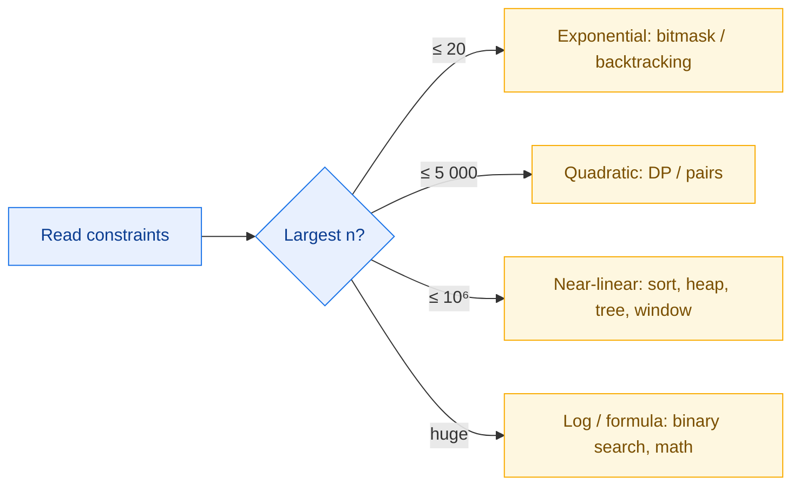
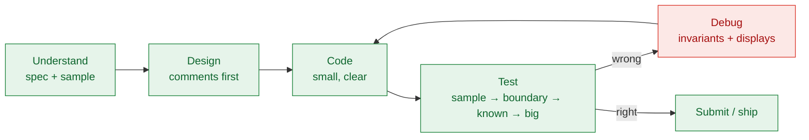

# 📚 Book Companion — Reading This Folder Alongside Two Classic Algorithm Books

> **Navigation**: [← Combinatorics & Counting](27_Combinatorics_Counting_Toolkit.md) | [Back to Index](00_INDEX.md) | [Learning Path](00_LEARNING_PATH.md)

Two books live at the root of this repository:

| Book | What it is best at | How this folder relates |
| --- | --- | --- |
| **Competitive Programmer's Handbook** — Antti Laaksonen (2018 draft; `Compitative Programming book.pdf`) | A compact, proof-light tour of ~30 techniques with a strong "estimate complexity first" habit | This folder covers the same techniques in Java with production context and verification notes; the handbook is the fastest *second opinion* on a topic |
| **Programming Challenges** — Steven Skiena & Miguel Revilla (Springer, 2003; `Programming_Challenges.pdf`) | A problem-solving **workflow**: read the spec, design, test, debug — with graded contest problems per chapter | Strongest on *how to work*, which this folder only summarises; the book's problem lists make good extra practice |

> [!NOTE]
> **How the books were used.** They were read as references for fact-checking, for finding **topics this folder did not yet cover**, and for practice-problem ideas. All explanations and Java code in this repository are written independently (the books use C++/C); nothing is reproduced from them. Please buy or borrow the books for the full treatment — they are well worth it.

---

## 💬 Explain It Like a Study Partner — Why a Companion Page?

### 1. The bottom line

A second book catches what one author misses: use it to **spot gaps** and **cross-check claims**, not to copy.

### 2. The textbook core

- **Triangulation:** a technique that appears in two independent sources with the same statement is much more likely to be stated correctly.
- **Coverage audit:** map each chapter of a reference book to your own material; unmapped chapters are candidate gaps.
- **Style audit:** note *how* the book teaches (estimate first, test systematically), then adopt the method.

### 3. The real-world analogy

Like asking a colleague to code-review your design doc: they rarely rewrite it, but they spot the missing section.

### 4. Walkthrough: how the audit found chapter 27

1. List the handbook's chapters (combinatorics, spanning trees, flows, number theory, …).
2. `grep` this folder for each named theorem — Catalan, Burnside, Cayley/Prüfer, Kirchhoff, Wilson, Dilworth, Josephus, Diophantine, Stern–Brocot.
3. Seven of them had **zero** mentions → the new chapter [27 Combinatorics & Counting](27_Combinatorics_Counting_Toolkit.md) closes the gap, with every program verified against brute force.

---

## 🗺️ Map 1 — *Competitive Programmer's Handbook* → this folder

| Handbook chapter | Where it lives here | Status / what to add |
| --- | --- | --- |
| 1 Introduction (I/O, numbers, shortcuts, math) | [01 Algorithm Thinking](01_Algorithm_Thinking.md), [06 Math & Geometry](06_Math_Geometry_Java_Complete.md) | ✅ Covered; Java replaces C++ shortcuts |
| 2 Time complexity (estimating efficiency, max subarray) | [A2 Complexity from First Principles](A2_Complexity_FirstPrinciples.md), [08b Essential Array Patterns](08b_NumberTheory_Advanced.md) (Kadane) | ✅ See the [input-size table](#-input-size--required-complexity) below |
| 3 Sorting (theory, binary search) | [02a](02a_Sorting_Fundamentals.md), [02b](02b_Sorting_Advanced.md), [22 Searching & Binary Search](22_Searching_And_Binary_Search_Complete.md) | ✅ |
| 4 Data structures | [02_Data_Structures](../02_Data_Structures/00_INDEX.md) | ✅ In the sibling folder |
| 5 Complete search (subsets, permutations, backtracking, pruning, meet in the middle) | [11 Backtracking](11_Backtracking_Complete.md), [03a–c Recursion](03a_Recursion_Internals.md) | ✅ Meet-in-the-middle is brief — see the [pattern](#-pattern-meet-in-the-middle) below |
| 6 Greedy (coins, scheduling, deadlines, minimising sums, compression) | [12 Greedy](12_Greedy_Algorithms_Complete.md), [06a](06a_Greedy_BitManip.md) | ✅ |
| 7 Dynamic programming | [04a–c](04a_DP_Internals.md) | ✅ |
| 8 Amortized analysis | [A2](A2_Complexity_FirstPrinciples.md), [15 Monotonic Stack/Queue](15_Monotonic_Stack_Queue_Complete.md) | ✅ |
| 9 Range queries (prefix sums, sparse table, Fenwick, segment tree) | [19 Prefix Sums](19_Prefix_Sum_Prefix_XOR_2D_Prefix_Java_Complete.md), [07a](07a_Advanced_DS_Core.md), [07b](07b_Advanced_DS_Patterns.md) | ✅ |
| 10 Bit manipulation | [10 Bit Manipulation](10_Bit_Manipulation_Complete.md), [18 Bitwise Trie](18_Bitwise_Trie_Java_Complete.md) | ✅ |
| 11–13 Graph basics, traversal, shortest paths | [05b–e](05b_Graphs_Internals.md) | ✅ |
| 14 Tree algorithms (diameter, all-longest paths) | [05 Trees](05_Trees.md) | ✅ |
| 15 Spanning trees (Kruskal, union-find, Prim) | [05d](05d_Graphs_Advanced_Algos.md), [14 Union-Find](14_Union_Find_DSU_Complete.md) | ✅ |
| 16–17 Directed graphs, strong connectivity (topological sort, SCC, 2-SAT) | [05d](05d_Graphs_Advanced_Algos.md), [05e](05e_Graphs_Patterns.md) | ✅ |
| 18 Tree queries (binary lifting, LCA, Euler tour, offline) | [05 Trees](05_Trees.md), [07c](07c_Advanced_Trees_Deep.md) | ✅ |
| 19 Paths and circuits (Euler, Hamilton, de Bruijn, knight tours) | [05e](05e_Graphs_Patterns.md), [06e](06e_Algorithm_Patterns.md) | ◑ Euler and Hamilton present; **de Bruijn sequences and knight's tours are not covered yet** (open gap) |
| 20 Flows and cuts (max flow, matching, Hall's theorem, **Dilworth**, path covers) | [06e](06e_Algorithm_Patterns.md), [27 §6](27_Combinatorics_Counting_Toolkit.md) | ✅ Dilworth added with a verified matching-based implementation |
| 21 Number theory (primes, modular arithmetic, **Diophantine**, Wilson, Euler totient) | [08a](08a_NumberTheory_Core.md), [08b](08b_NumberTheory_Advanced.md), [27 §6–7](27_Combinatorics_Counting_Toolkit.md) | ✅ Added Wilson and Diophantine equations |
| 22 Combinatorics (**Catalan, inclusion–exclusion, Burnside, Cayley**) | [27 Combinatorics & Counting](27_Combinatorics_Counting_Toolkit.md) 🆕 | ✅ New chapter |
| 23 Matrices (powers, graph paths, **Kirchhoff**) | [23 Matrix Exponentiation](23_Matrix_Exponentiation_And_Linear_Recurrences.md), [27 §5](27_Combinatorics_Counting_Toolkit.md) | ✅ |
| 24 Probability (expected value, Markov chains, randomised algorithms) | [A4 Randomized Algorithms](A4_Randomized_Algorithms.md) | ✅ |
| 25 Game theory (Nim, Sprague–Grundy) | [24 Game Theory](24_Game_Theory_Nim_Sprague_Grundy.md) | ✅ |
| 26 String algorithms (hashing, Z, suffix arrays) | [13 String Algorithms](13_String_Algorithms_Complete.md), [06d](06d_String_Algorithms.md) | ✅ |
| 27 Square-root algorithms (batching, **Mo's algorithm**) | [06e](06e_Algorithm_Patterns.md), [06d](06d_String_Algorithms.md), [07b](07b_Advanced_DS_Patterns.md) | ✅ |
| 28 Segment trees revisited (lazy propagation, dynamic, 2D) | [07a](07a_Advanced_DS_Core.md), [07b](07b_Advanced_DS_Patterns.md) | ✅ |
| 29–30 Geometry and sweep line (cross product, area, **Pick**, closest pair, convex hull) | [06 Math & Geometry](06_Math_Geometry_Java_Complete.md), [06e](06e_Algorithm_Patterns.md), [27 §6](27_Combinatorics_Counting_Toolkit.md) | ✅ |

Legend: ✅ covered · ◑ partially covered (see note) · 🆕 added after the book audit.

---

## 🗺️ Map 2 — *Programming Challenges* → this folder

| Book chapter | Where it lives here | Notes |
| --- | --- | --- |
| 1 Getting started (judge feedback, programming hints, data types) | [01 Algorithm Thinking](01_Algorithm_Thinking.md), [Working Method](#-the-working-method-from-programming-challenges) below | Method summarised below |
| 2 Data structures (stacks, queues, dictionaries, priority queues, sets) | [02_Data_Structures](../02_Data_Structures/00_INDEX.md) | Testing/debugging checklist summarised below |
| 3 Strings | [13 String Algorithms](13_String_Algorithms_Complete.md), [06d](06d_String_Algorithms.md) | ✅ |
| 4 Sorting | [02a](02a_Sorting_Fundamentals.md), [02b](02b_Sorting_Advanced.md) | ✅ |
| 5 Arithmetic and algebra (big integers, bases, fractions, logarithms) | [06 Math & Geometry](06_Math_Geometry_Java_Complete.md), [08a](08a_NumberTheory_Core.md), [26 FFT/NTT](26_FFT_NTT_Polynomial_Multiplication.md) | ✅ `BigInteger` / `BigDecimal` in Java replace hand-rolled big-number code; Stern–Brocot added in [27 §7](27_Combinatorics_Counting_Toolkit.md) |
| 6 Combinatorics (counting, recurrences, binomials, Catalan, Stirling) | [27 Combinatorics & Counting](27_Combinatorics_Counting_Toolkit.md) 🆕 | ✅ |
| 7 Number theory (primes, gcd/lcm, modular arithmetic, congruences, Diophantine) | [08a](08a_NumberTheory_Core.md), [08b](08b_NumberTheory_Advanced.md), [27 §7](27_Combinatorics_Counting_Toolkit.md) | ✅ |
| 8 Backtracking (subsets, permutations, eight queens, pruning) | [11 Backtracking](11_Backtracking_Complete.md) | ✅ |
| 9 Graph traversal (BFS, DFS, cycles, components, topological sort) | [05b](05b_Graphs_Internals.md), [05c](05c_Graphs_Fundamentals.md) | ✅ |
| 10 Graph algorithms (MST, Dijkstra, all-pairs, flows, bipartite matching) | [05d](05d_Graphs_Advanced_Algos.md), [06e](06e_Algorithm_Patterns.md) | ✅ |
| 11 Dynamic programming (edit distance, path reconstruction) | [04a–c](04a_DP_Internals.md) | ✅ |
| 12 Grids | [05e](05e_Graphs_Patterns.md), [04b](04b_DP_Fundamentals.md) | ✅ |
| 13–14 Geometry and computational geometry | [06 Math & Geometry](06_Math_Geometry_Java_Complete.md), [06e](06e_Algorithm_Patterns.md) | ✅ |

---

## 📏 Input Size → Required Complexity

The handbook's most reusable habit: **read the constraint first, then pick the algorithm class** (assuming a one-second limit and "some hundreds of millions of simple operations per second").

| Input size | Complexity you can afford | Typical techniques |
| --- | --- | --- |
| `n ≤ 10` | `O(n!)` | Permutation backtracking |
| `n ≤ 20` | `O(2ⁿ)` | Bitmask subsets, meet in the middle |
| `n ≤ 500` | `O(n³)` | Floyd–Warshall, cubic DP |
| `n ≤ 5 000` | `O(n²)` | Quadratic DP, all-pairs checks |
| `n ≤ 10⁶` | `O(n log n)` or `O(n)` | Sorting, heaps, segment trees, prefix sums, two pointers |
| `n` huge | `O(1)` or `O(log n)` | Formulas, binary search, fast exponentiation |

> [!WARNING]
> Constants matter: an `O(n)` loop doing 5n operations is five times slower than one doing n. Treat the table as a filter that rules approaches *out*, not as a guarantee.



**How to read this diagram.** Start from the constraint, follow the branch for the largest input size, and only consider the algorithm families in the yellow box.

---

## 🧩 Pattern: Meet in the Middle

When `n ≈ 40` the full `2ⁿ` search is too slow, but `2^(n/2)` is fine. Split the items in two halves, enumerate subset sums of each half, sort one list and **combine with binary search or two pointers**: `O(2^(n/2) · n)`.

```java
// Does any subset of a[] (n <= ~40) sum exactly to target?
static boolean subsetSumMitm(long[] a, long target) {
    int h = a.length / 2;
    long[] left = sums(a, 0, h), right = sums(a, h, a.length);
    Arrays.sort(right);
    for (long s : left) if (Arrays.binarySearch(right, target - s) >= 0) return true;
    return false;
}

static long[] sums(long[] a, int from, int to) {
    int m = to - from;
    long[] out = new long[1 << m];
    for (int mask = 1; mask < (1 << m); mask++) {
        int low = Integer.numberOfTrailingZeros(mask);
        out[mask] = out[mask & (mask - 1)] + a[from + low];
    }
    return out;
}
```

> [!TIP]
> This is the same "trade memory for time" move as two-sum with a hash set — you just apply it to *halves of a search space*.

---

## 🛠️ The Working Method from *Programming Challenges*

The book's most valuable lesson is procedural. Condensed and restated:

| Stage | Habit | Why it works |
| --- | --- | --- |
| **Understand** | Re-read the specification; run the sample by hand | Most wrong answers come from a misread rule, not a wrong algorithm |
| **Design** | Write a few sentences of comments describing what each routine must do *before* coding; comment each variable | If you cannot explain it plainly, you do not understand it yet |
| **Code** | Name constants once; factor repeated code into subroutines; avoid cleverness | Bugs hide in code that is "too clever to understand" |
| **Test** | Sample input → boundary cases (empty, one, two, zero) → inputs whose answer you know by hand → large random inputs just to check nothing crashes | The checklist catches off-by-one errors first |
| **Debug** | Learn the debugger; print your data structures with a dedicated display routine; test **invariants** (e.g. `rank(unrank(i)) == i`); make print statements name the variable and location | Targeted evidence beats guessing |



**How to read this diagram.** The green boxes are the forward path; red is the loop you enter when a test fails. Most engineering time is spent in that loop, so make it fast.

> [!IMPORTANT]
> **Connect to this repo's practice.** Every chapter's "Verification done" row in the Enterprise Lens follows this method: write a brute-force twin, test boundaries, then compare on random inputs.

---

## ✅ What Changed in This Folder Because of the Books

| Change | Where |
| --- | --- |
| New chapter on combinatorics and counting (Catalan, inclusion–exclusion, Burnside, Cayley/Prüfer, Kirchhoff, Wilson, Pick, Dilworth, Josephus, Diophantine, Stern–Brocot) | [27](27_Combinatorics_Counting_Toolkit.md) |
| Input-size → complexity table and decision diagram | This page |
| Meet-in-the-middle pattern with tested Java | This page |
| Working-method checklist (understand → design → code → test → debug) | This page |
| Cross-read of theorem statements (Dilworth, Kirchhoff, Wilson, Pick, Burnside, Cayley, Catalan reflection argument) against the handbook before writing | [27](27_Combinatorics_Counting_Toolkit.md) |

### Open gaps found by the audit

| Gap | Source | Plan |
| --- | --- | --- |
| De Bruijn sequences, knight's tours | Handbook ch. 19 | Candidate for a future small topic page |
| Stirling numbers, integer partitions | Programming Challenges ch. 6, Handbook ch. 27 | Candidate extension of chapter 27 |

---

[← Combinatorics & Counting](27_Combinatorics_Counting_Toolkit.md) | [Index](00_INDEX.md) | [Learning Path](00_LEARNING_PATH.md)
