# 03 - Algorithms

> Learn HOW to solve problems — the thinking patterns that power every solution.

> [!IMPORTANT]
> **New here? Start with the [Learning Path](00_LEARNING_PATH.md).** It gives the gap-free reading order, the abstraction ladder, the dependency graph and the coverage matrix. This page is the flat catalog.

> [!NOTE]
> **Chapter hubs and topic pages.** Long chapters are split: the chapter file (the *hub*) keeps the bridge, study-partner explainer, at-a-glance diagram and Enterprise Lens, and lists its **topic pages** in a table (in a folder with the same name as the chapter). Read the pages in order the first time; use the hub table to jump back later. Previous/next links follow the reading order of this index.

**Review checklist for every chapter:** state time **and** space complexity · state the invariant · list edge cases (empty, one element, duplicates, extremes) · say what happens at 10× data.

## 💬 How the Chapters Are Built

Every chapter follows the same enterprise-grade layout so you always know where to look:

| Block | What you get |
| ----- | ------------ |
| 🔗 **Bridge** | What it builds on, what you will learn, what it leads to, and the abstraction level |
| 💬 **Study-partner explainer** | Bottom line, textbook core, real-world analogy, step-by-step walkthrough, quick check, and a **Check yourself** set with worked answers |
| ⚡ **At a glance** | Colour-styled Mermaid diagram and a complexity / decision table |
| Core content | Brute force → bottleneck → idea → invariant → proof sketch → code → complexity |
| 🏢 **Enterprise lens** | Production uses, failure modes, testing strategy, performance notes |
| 🧪 **Practice ladder** | Problems ordered from easy to hard |

## Catalog (in recommended reading order)

### 🎓 Methodology Layer *(MIT 6.006 / KTH DD2352 / RWTH Aachen / TU Munich foundation)*

> **Read A1 and A2 right after Algorithm Thinking.** The rest of the layer can be read in parallel with the catalog (see the path for placement).

| # | File | What you'll learn |
| - | ---- | ----------------- |
| U1 | [A1 Algorithm Correctness](A1_Correctness_Proofs.md) | Loop invariants, exchange arguments, optimal substructure |
| U2 | [A2 Complexity from First Principles](A2_Complexity_FirstPrinciples.md) | Recurrences, Master theorem, amortized analysis (3 methods) |
| U3 | [A3 Lower Bounds & NP-Completeness](A3_Lower_Bounds_And_NP.md) | Decision-tree lower bounds, reductions, P vs NP |
| U4 | [A4 Randomized Algorithms](A4_Randomized_Algorithms.md) | Las Vegas vs Monte Carlo, indicator variables, universal hashing |
| U5 | [A5 Designing Your Own Algorithms](A5_Designing_Your_Own_Algorithms.md) | The invention method |

### 1. Foundations

| # | File | What you'll learn |
| - | ---- | ----------------- |
| 1 | [Algorithm Thinking](01_Algorithm_Thinking.md) | How to approach any problem |
| 2 | [Sorting Fundamentals](02a_Sorting_Fundamentals.md) | Bubble, selection, insertion, merge |
| 3 | [Sorting Advanced](02b_Sorting_Advanced.md) | Quick, heap, radix, bucket, counting, selection |
| 4 | [Searching & Binary Search](22_Searching_And_Binary_Search_Complete.md) 🆕 | Boundary search, search on the answer |
| 5 | [Divide & Conquer](02c_Divide_And_Conquer.md) | Split–solve–merge paradigm |

### 2. Recursion, DP and Search

| # | File | What you'll learn |
| - | ---- | ----------------- |
| 6 | [Recursion Internals](03a_Recursion_Internals.md) | Call stack, tail recursion, JVM behaviour |
| 7 | [Recursion Fundamentals](03b_Recursion_Fundamentals.md) | Base cases, recursive leap of faith |
| 8 | [Recursion Advanced](03c_Recursion_Advanced.md) | Memoization bridge, tree recursion |
| 9 | [DP Internals](04a_DP_Internals.md) | Tabulation vs memoization under the hood |
| 10 | [DP Fundamentals](04b_DP_Fundamentals.md) | Classic patterns: knapsack, LIS, LCS |
| 11 | [DP Advanced](04c_DP_Advanced.md) | Bitmask DP, digit DP, tree DP, interval DP |
| 12 | [Backtracking](11_Backtracking_Complete.md) | N-Queens, Sudoku, permutations |
| 13 | [Greedy](12_Greedy_Algorithms_Complete.md) | Activity selection, Huffman, exchange arguments |

### 3. Techniques and Enabling Structures

| # | File | What you'll learn |
| - | ---- | ----------------- |
| 14 | [Monotonic Stack / Queue](15_Monotonic_Stack_Queue_Complete.md) | Next-greater-element patterns |
| 15 | [Prefix Family](19_Prefix_Sum_Prefix_XOR_2D_Prefix_Java_Complete.md) | Prefix sum, prefix XOR, 2D prefix, difference arrays |
| 16 | [Bit Manipulation](10_Bit_Manipulation_Complete.md) | All bit tricks and problems |
| 17 | [Union-Find / DSU](14_Union_Find_DSU_Complete.md) | Disjoint sets, path compression |
| 18 | [Bitwise Trie](18_Bitwise_Trie_Java_Complete.md) | Maximum/minimum XOR, offline queries |

### 4. Trees and Graphs

| # | File | What you'll learn |
| - | ---- | ----------------- |
| 19 | [Trees](05_Trees.md) | BST, traversals, LCA, balanced trees |
| 20 | [Graphs Internals](05b_Graphs_Internals.md) | Adjacency list/matrix, memory and cache behaviour |
| 21 | [Graph Fundamentals](05c_Graphs_Fundamentals.md) | BFS, DFS, connected components |
| 22 | [Advanced Graph Algorithms](05d_Graphs_Advanced_Algos.md) | Dijkstra, Bellman–Ford, Floyd–Warshall, MST |
| 23 | [Graph Patterns](05e_Graphs_Patterns.md) | SCC, articulation points, Euler paths, A\* |

### 5. Strings, Math and Algebra

| # | File | What you'll learn |
| - | ---- | ----------------- |
| 24 | [String Algorithms](13_String_Algorithms_Complete.md) | KMP, Z, Rabin–Karp, Manacher, suffix structures |
| 25 | [Advanced Patterns & Competitive Techniques](06d_String_Algorithms.md) | Interview patterns, string deep dive, competitive tricks, templates |
| 26 | [Number Theory Core](08a_NumberTheory_Core.md) | GCD, primes, modular arithmetic |
| 27 | [Essential Array Patterns](08b_NumberTheory_Advanced.md) | Kadane, Dutch flag, Boyer–Moore, Floyd, prefix/difference arrays |
| 28 | [Matrix Exponentiation & Linear Recurrences](23_Matrix_Exponentiation_And_Linear_Recurrences.md) 🆕 | Huge-`n` recurrences, walk counting |
| 29 | [FFT / NTT](26_FFT_NTT_Polynomial_Multiplication.md) 🆕 | Fast convolution |
| 29b | [Combinatorics & Counting](27_Combinatorics_Counting_Toolkit.md) 🆕 | Catalan, inclusion–exclusion, Burnside, Cayley, Kirchhoff, Dilworth, Diophantine |
| 29c | [Book Companion](00_BOOK_COMPANION.md) 🆕 | Chapter maps to two classic books, complexity-by-input-size table, working method |
| 30 | [Game Theory](24_Game_Theory_Nim_Sprague_Grundy.md) 🆕 | Nim, Grundy numbers |
| 31 | [Math & Geometry](06_Math_Geometry_Java_Complete.md) | Cross product, shoelace, Pick's theorem |

### 6. Advanced Data Structures and Engineering

| # | File | What you'll learn |
| - | ---- | ----------------- |
| 32 | [Advanced DS Core](07a_Advanced_DS_Core.md) | Memory layouts of tries, segment trees, Fenwick, DSU, skip lists |
| 33 | [Advanced DS Patterns](07b_Advanced_DS_Patterns.md) | Fenwick, segment tree + lazy, DSU, skip list, Bloom, LRU, B-tree |
| 34 | [Advanced Trees Deep Dive](07c_Advanced_Trees_Deep.md) | Red-black, B-trees, LSM, spatial, Merkle |
| 35 | [Probabilistic DS Deep Dive](07d_Probabilistic_DS_Deep.md) | Bloom filters, HyperLogLog, consistent hashing |
| 36 | [Algorithm Engineering Deep Dive](07e_Advanced_Algorithm_Engineering_Deep.md) | HLD, Euler tour, Mo's, wavelet tree |

### 7. Limits of Computation

| # | File | What you'll learn |
| - | ---- | ----------------- |
| 37 | [Advanced Algorithms Deep Dive](06c_Advanced_Algo_Deep.md) | DP/backtracking/branch-and-bound implementations, NP-hard and NP-complete |
| 38 | [Modern Algorithms & Advanced Topics](06e_Algorithm_Patterns.md) | P vs NP, randomized, string, flow, geometry, paradigm summary |
| 39 | [Approximation, Online & LP](25_Online_Approximation_And_Linear_Programming.md) 🆕 | Ratios, competitive analysis, LP |
| ★ | [Advanced Algorithms University Guide](06a_Greedy_BitManip.md) | Reference: CPU costs, asymptotics, amortized, greedy/matroids |

### 8. Production, Reasoning and Practice

| # | File | What you'll learn |
| - | ---- | ----------------- |
| 40 | [Algorithms in Production](13_Algorithms_In_Production.md) | React diffing, PageRank, Bloom filters |
| 41 | [Algorithm War Stories](21_Algorithm_War_Stories.md) | 10 real incidents traced through the design loop |
| 42 | [DSA Deep Reasoning](16_DSA_Deep_Reasoning.md) | Why algorithms work: proofs and intuition |
| 43 | [Java Implementation Mastery](17_DSA_Java_Implementation_Mastery.md) | Java-specific DSA implementation |
| 44 | [Pattern Programs](09_Pattern_Programs_Complete.md) | Star, number, character patterns |
| 45 | [Problem Sets](03_PROBLEM_SETS.md) | Graded practice |
| 46 | [PDF Coverage Map (Java)](20_DSA_Patterns_PDF_Java_Coverage_Map.md) | Pattern → Java chapter mapping and revision route |

### Reference and Cross-Module Links

| File | Purpose |
| ---- | ------- |
| [Learning Path](00_LEARNING_PATH.md) | Dependency graph, abstraction ladder, coverage matrix |
| [Master Algorithm Selector](00_MASTER_ALGORITHM_SELECTOR.md) | Constraint → algorithm |
| [Cheat Sheets](00_CHEAT_SHEETS.md) | One-page family summaries |
| [Algorithm Timeline](00_ALGORITHM_TIMELINE.md) | History of algorithms and data structures |
| [Cross-Domain Bridges](00_CROSS_DOMAIN_BRIDGES.md) | How algorithms appear in other modules |
| [Competitive Coding Deep Thinking](../14_Mental_Models/21_Competitive_Coding_Deep_Thinking.md) | Constraints, formulas, proof, patterns |
| [Constraint-Based Pattern Selection](../04_Patterns_Templates/25_Constraint_Based_Pattern_Selection.md) | If constraints say X, choose Y |
| [Brute Force to Optimal Playbook](../14_Mental_Models/22_Brute_Force_To_Optimal_Playbook.md) | Naive loop to DS/algorithm rewrite |

## Roadmap

```mermaid
flowchart LR
    M["Methodology<br/>A1-A5"] --> F["Foundations<br/>thinking, sorting, searching, D&C"]
    F --> R["Recursion, DP,<br/>backtracking, greedy"]
    R --> S["Techniques and<br/>enabling structures"]
    S --> G["Trees and graphs"]
    G --> X["Strings, math,<br/>algebra, games"]
    X --> A["Advanced structures<br/>and engineering"]
    A --> L["Limits of computation"]
    L --> P["Production,<br/>reasoning, practice"]
    classDef a fill:#e1d5f7,stroke:#6a1b9a,color:#111
    classDef b fill:#cfe8ff,stroke:#1565c0,color:#111
    classDef c fill:#c8f7c5,stroke:#2e7d32,color:#111
    classDef d fill:#ffd9b3,stroke:#e65100,color:#111
    class M a
    class F,R,S b
    class G,X c
    class A,L,P d
```

**How to read this diagram.** Left to right is the recommended order; the full dependency graph and chapter-by-chapter bridges are in the [Learning Path](00_LEARNING_PATH.md).

---

[← Back to Master Index](../00_MASTER_INDEX.md)
