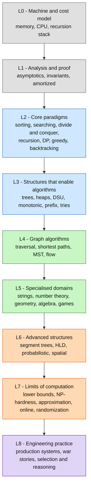
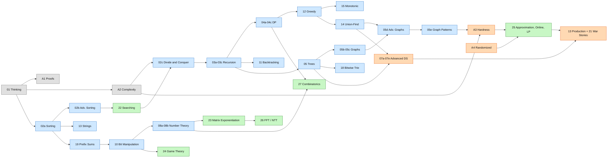

# 🧭 Algorithms Learning Path — The Complete, Gap-Free Flow

> **Navigation**: [Back to Index](00_INDEX.md) | [Master Algorithm Selector](00_MASTER_ALGORITHM_SELECTOR.md) | [Cheat Sheets](00_CHEAT_SHEETS.md)

This page is the **curriculum map**. It answers four questions: *In what order should I read?* *What does each step give me that the next one needs?* *What is covered where?* *What did the audit find missing and where was it added?*

## 💬 Explain It Like a Study Partner — How This Course Is Built

> [!TIP]
> **Ask yourself first:** *"After I learn a technique, how do I know why the next chapter exists?"*

### 1. The bottom line

Each chapter solves a limit left by the previous one, and every chapter opens with a **Bridge** box that says what it builds on and what it leads to.

### 2. The textbook core

- The course is organised as an **abstraction ladder**: machine cost → analysis → paradigms → data structures → graphs → specialised domains → hardness → engineering practice.
- Every algorithm is taught with the same spine: **problem → brute force → bottleneck → idea → invariant → proof sketch → code → complexity → failure modes → production use**.
- The `A1`–`A5` chapters form a *methodology layer* (proofs, complexity, hardness, randomization, invention) that you can read in parallel with the catalog chapters.

### 3. The real-world analogy

A **building**: you cannot put up walls (graph algorithms) before the foundation (cost model and invariants), and the plumbing (strings, number theory) can be added once the structure stands.

### 4. Walkthrough: following one thread (shortest paths)

1. [Algorithm Thinking](01_Algorithm_Thinking.md): brute-force "try every route" and see why it explodes.
2. [Graph Fundamentals](05c_Graphs_Fundamentals.md): BFS finds fewest hops, but all edges cost 1.
3. [Advanced Graph Algorithms](05d_Graphs_Advanced_Algos.md): weights force Dijkstra; negative weights force Bellman–Ford; all pairs force Floyd–Warshall.
4. [Graph Patterns](05e_Graphs_Patterns.md): heuristics (A\*), strongly connected components, flows.
5. [Online, Approximation & LP](25_Online_Approximation_And_Linear_Programming.md): when exact is too slow, accept a proven ratio.

> [!NOTE]
> **Quick check:** which chapter introduces "binary search on the answer"? *[Searching & Binary Search](22_Searching_And_Binary_Search_Complete.md).*

---

## 1. Abstraction Ladder

**How to read this diagram.** Read bottom-up as increasing abstraction and top-down as increasing prerequisites. You can stay at one level until its tools feel natural, but never skip a level entirely.

## 2. Dependency Graph

**How to read this diagram.** Arrows mean "read before". Green boxes are chapters added by the curriculum audit to close gaps; orange are the advanced/limits layer.

---

## 3. Recommended Reading Order with Bridges

Each row says what you **carry in**, what **new problem** forces the chapter, and what it **hands to** the next.

| # | Chapter | Carry in | New problem it solves | Hands off to |
| - | ------- | -------- | --------------------- | ------------ |
| 1 | [Algorithm Thinking](01_Algorithm_Thinking.md) | Programming basics | How to approach any problem: constraints, brute force, bottleneck | Proofs, sorting |
| 2 | [A1 Correctness Proofs](A1_Correctness_Proofs.md) | Loops, recursion | "How do I know it is right?" Loop invariants, exchange arguments | Every later proof corner |
| 3 | [A2 Complexity from First Principles](A2_Complexity_FirstPrinciples.md) | Counting steps | Recurrences, Master theorem, amortized analysis | Divide & conquer, DP |
| 4 | [Sorting Fundamentals](02a_Sorting_Fundamentals.md) | Arrays, loops | Order data: bubble/selection/insertion/merge | Advanced sorting |
| 5 | [Sorting Advanced](02b_Sorting_Advanced.md) | O(n²) sorts are too slow | Quick/heap/counting/radix/bucket, selection, hybrids | Searching |
| 6 | [Searching & Binary Search](22_Searching_And_Binary_Search_Complete.md) 🆕 | Sorted order | Boundary search, search on the answer | Divide & conquer |
| 7 | [Divide & Conquer](02c_Divide_And_Conquer.md) | Halving, recurrences | Split–solve–merge: Karatsuba, closest pair, Strassen | Recursion, FFT |
| 8 | [Recursion Internals](03a_Recursion_Internals.md) → [Fundamentals](03b_Recursion_Fundamentals.md) → [Advanced](03c_Recursion_Advanced.md) | Call stack | Recursive thinking, memoization bridge | DP, backtracking |
| 9 | [DP Internals](04a_DP_Internals.md) → [Fundamentals](04b_DP_Fundamentals.md) → [Advanced](04c_DP_Advanced.md) | Overlapping subproblems | Tabulation, knapsack/LIS/LCS, bitmask/digit/tree DP | Greedy, math recurrences |
| 10 | [Backtracking](11_Backtracking_Complete.md) | Recursion | Search with pruning (N-Queens, permutations) | Branch & bound, NP |
| 11 | [Greedy](12_Greedy_Algorithms_Complete.md) | DP (to see when greed is enough) | Locally optimal choices that are globally optimal (exchange argument, matroids) | MST, Huffman |
| 12 | [Monotonic Stack/Queue](15_Monotonic_Stack_Queue_Complete.md), [Prefix Sums](19_Prefix_Sum_Prefix_XOR_2D_Prefix_Java_Complete.md), [Bit Manipulation](10_Bit_Manipulation_Complete.md) | Arrays, stacks | O(n) techniques for range/next-greater/XOR problems | Tries, number theory |
| 13 | [Trees](05_Trees.md) | Recursion, stacks/queues | Hierarchical data and traversals, LCA | Graphs |
| 14 | [Graphs Internals](05b_Graphs_Internals.md) → [Fundamentals](05c_Graphs_Fundamentals.md) | Trees (graphs without the hierarchy) | Representation, BFS/DFS, components | Weighted graphs |
| 15 | [Union-Find](14_Union_Find_DSU_Complete.md) | Graph connectivity | Dynamic connectivity in near-O(1) | Kruskal, advanced graphs |
| 16 | [Advanced Graphs](05d_Graphs_Advanced_Algos.md) → [Graph Patterns](05e_Graphs_Patterns.md) | BFS/DFS, heaps, DSU | Weighted shortest paths, MST, topological order, SCC, flow patterns | Hardness, production |
| 17 | [String Algorithms](13_String_Algorithms_Complete.md) (+ [Advanced Patterns & Competitive Techniques](06d_String_Algorithms.md)) | Arrays, hashing | Pattern matching: KMP, Z, Rabin–Karp, Manacher, suffix structures | Tries |
| 18 | [Bitwise Trie](18_Bitwise_Trie_Java_Complete.md) | Tries, bit tricks | Max/min XOR queries | Advanced DS |
| 19 | [Number Theory Core](08a_NumberTheory_Core.md) → [Number Theory Advanced / Essential Patterns](08b_NumberTheory_Advanced.md) | Modular arithmetic | GCD, primes, modular inverse, classic array patterns | Matrix exponentiation |
| 20 | [Matrix Exponentiation](23_Matrix_Exponentiation_And_Linear_Recurrences.md) 🆕 → [FFT/NTT](26_FFT_NTT_Polynomial_Multiplication.md) 🆕 | Fast power, D&C | Huge-`n` recurrences, fast convolution | Counting problems |
| 20b | [Combinatorics & Counting](27_Combinatorics_Counting_Toolkit.md) 🆕 | Modular inverse, DP recurrences, spanning trees | Count without listing: Catalan, inclusion–exclusion, Burnside, Cayley, Kirchhoff, Dilworth | Randomized algorithms, backtracking (listing what you counted) |
| 21 | [Game Theory](24_Game_Theory_Nim_Sprague_Grundy.md) 🆕 | XOR, DP, backtracking | Who wins a two-player game | Adversary arguments |
| 22 | [Math & Geometry](06_Math_Geometry_Java_Complete.md) | Cross products, area | Orientation, polygon area, lattice points | Computational geometry |
| 23 | [Advanced DS Core](07a_Advanced_DS_Core.md) → [Patterns](07b_Advanced_DS_Patterns.md) → [Advanced Trees](07c_Advanced_Trees_Deep.md) → [Probabilistic](07d_Probabilistic_DS_Deep.md) → [Algorithm Engineering](07e_Advanced_Algorithm_Engineering_Deep.md) | Trees, DSU, hashing | Range queries (segment/Fenwick), balanced/disk trees, sketches, HLD/Mo/wavelet | Production |
| 24 | [A3 Lower Bounds & NP](A3_Lower_Bounds_And_NP.md), [Advanced Algo Deep](06c_Advanced_Algo_Deep.md), [Modern Algorithms & Advanced Topics](06e_Algorithm_Patterns.md) | All paradigms | What cannot be done fast; NP-completeness; network flow, geometry basics | Approximation |
| 25 | [A4 Randomized](A4_Randomized_Algorithms.md) → [Approximation, Online & LP](25_Online_Approximation_And_Linear_Programming.md) 🆕 | Hardness, probability | Living with hardness: randomization, ratios, competitive analysis | Production |
| 26 | [A5 Designing Your Own](A5_Designing_Your_Own_Algorithms.md) | Everything above | Inventing and validating new algorithms | Practice |
| 27 | [Algorithms in Production](13_Algorithms_In_Production.md), [War Stories](21_Algorithm_War_Stories.md), [Deep Reasoning](16_DSA_Deep_Reasoning.md), [Java Mastery](17_DSA_Java_Implementation_Mastery.md) | Everything | How it behaves at scale, how it fails, how to reason under pressure | Interviews, systems |
| ★ | [Advanced Algorithms University Guide](06a_Greedy_BitManip.md) | — | **Reference deep-dive** (CPU-level costs, asymptotics, amortized analysis, greedy/matroids); read alongside rows 3 and 11 | — |
| ★ | [Pattern Programs](09_Pattern_Programs_Complete.md), [PDF Coverage Map](20_DSA_Patterns_PDF_Java_Coverage_Map.md), [Problem Sets](03_PROBLEM_SETS.md) | — | Practice and coverage tracking | — |

> [!IMPORTANT]
> **File names vs content.** Some historical file names do not match what the file teaches. The table above uses the *actual* content: `06a` is a university-style advanced-algorithms guide (not just greedy/bit tricks), `06d` is competitive-programming string and pattern techniques, `06e` is the modern-topics chapter (NP, randomization, flow, geometry), `07b` starts with Fenwick/segment trees, and `08b` teaches essential array patterns (Kadane, Dutch flag, Boyer–Moore, Floyd, monotonic stack, prefix sums). They were deliberately not renamed to keep existing links valid.

---

## 4. Coverage Matrix (Audit Result)

The audit searched every chapter for the topics a complete algorithms syllabus (CLRS, MIT 6.006/6.046, KTH DD2352, Competitive Programmer's Handbook) expects.

| Area | Topics covered | Where |
| ---- | -------------- | ----- |
| Analysis | Asymptotics, recurrences, Master theorem, amortized, loop invariants | [A1](A1_Correctness_Proofs.md), [A2](A2_Complexity_FirstPrinciples.md), [06a](06a_Greedy_BitManip.md) |
| Sorting & selection | Comparison and non-comparison sorts, quickselect, median of medians | [02a](02a_Sorting_Fundamentals.md), [02b](02b_Sorting_Advanced.md) |
| Searching | Binary search, search on the answer, exponential, peak | [22](22_Searching_And_Binary_Search_Complete.md) 🆕 |
| Divide & conquer | Merge, Karatsuba, Strassen, closest pair | [02c](02c_Divide_And_Conquer.md) |
| Recursion / backtracking | Recursion trees, memoization, N-Queens, pruning, branch & bound | [03a–c](03a_Recursion_Internals.md), [11](11_Backtracking_Complete.md), [06c](06c_Advanced_Algo_Deep.md) |
| Dynamic programming | Knapsack, LIS, LCS, edit distance, matrix chain, bitmask, digit, tree DP, optimizations | [04a–c](04a_DP_Internals.md) |
| Greedy | Interval scheduling, Huffman, matroids, exchange arguments | [12](12_Greedy_Algorithms_Complete.md), [06a](06a_Greedy_BitManip.md) |
| Graphs | BFS/DFS, topological sort, SCC, Dijkstra, Bellman–Ford, Floyd–Warshall, A\*, MST, bridges/articulation points, Euler paths, flow, matching | [05b–e](05b_Graphs_Internals.md), [06e](06e_Algorithm_Patterns.md) |
| Strings | KMP, Z, Rabin–Karp, Manacher, suffix array/automaton, Aho–Corasick, hashing | [13](13_String_Algorithms_Complete.md), [06d](06d_String_Algorithms.md) |
| Number theory & algebra | GCD, sieve, modular inverse, CRT, Miller–Rabin, totient, fast power, **matrix exponentiation**, **FFT/NTT** | [08a–b](08a_NumberTheory_Core.md), [23](23_Matrix_Exponentiation_And_Linear_Recurrences.md) 🆕, [26](26_FFT_NTT_Polynomial_Multiplication.md) 🆕 |
| Game theory | Nim, Grundy numbers, Sprague–Grundy | [24](24_Game_Theory_Nim_Sprague_Grundy.md) 🆕 |
| Geometry | Cross product, convex hull, shoelace, Pick, sweep line | [06](06_Math_Geometry_Java_Complete.md), [06e](06e_Algorithm_Patterns.md) |
| Advanced structures | Segment/Fenwick, sparse table, sqrt decomposition, HLD, Mo's, treaps/splay, B-trees/LSM, Bloom/HLL | [07a–e](07a_Advanced_DS_Core.md), [14](14_Union_Find_DSU_Complete.md), [18](18_Bitwise_Trie_Java_Complete.md) |
| Limits | Lower bounds, P vs NP, reductions, **approximation, online algorithms, LP** | [A3](A3_Lower_Bounds_And_NP.md), [06c](06c_Advanced_Algo_Deep.md), [25](25_Online_Approximation_And_Linear_Programming.md) 🆕 |
| Randomization | Las Vegas/Monte Carlo, universal hashing, skip lists, treaps | [A4](A4_Randomized_Algorithms.md), [07d](07d_Probabilistic_DS_Deep.md) |
| Engineering | Production use, failure case studies, selection frameworks | [13](13_Algorithms_In_Production.md), [21](21_Algorithm_War_Stories.md), [00_MASTER_ALGORITHM_SELECTOR](00_MASTER_ALGORITHM_SELECTOR.md) |

### Gaps found and closed

| Gap found by audit | Resolution |
| ------------------ | ---------------------------------------------------------- |
| Binary search was used everywhere but never taught as a reusable idea (search on the answer: only 6 mentions) | New [chapter 22](22_Searching_And_Binary_Search_Complete.md) |
| Matrix exponentiation: 0 mentions | New [chapter 23](23_Matrix_Exponentiation_And_Linear_Recurrences.md) |
| Game theory / Sprague–Grundy: 0 mentions | New [chapter 24](24_Game_Theory_Nim_Sprague_Grundy.md) |
| Approximation, online algorithms, LP: ≤ 3 mentions each | New [chapter 25](25_Online_Approximation_And_Linear_Programming.md) |
| FFT/NTT: scattered mentions, no derivation or code | New [chapter 26](26_FFT_NTT_Polynomial_Multiplication.md) |
| Catalan, Burnside, Cayley/Prüfer, Kirchhoff, Wilson, Dilworth, Josephus, Diophantine, Stern–Brocot: 0 mentions (found by the [book audit](00_BOOK_COMPANION.md)) | New [chapter 27](27_Combinatorics_Counting_Toolkit.md) |
| No single place mapping the repository to the two reference books or giving the input-size → complexity table | New [Book Companion](00_BOOK_COMPANION.md) |
| Index numbering stale; some links pointed to files that do not exist | [00_INDEX](00_INDEX.md) rewritten and links corrected |
| File names mismatch content for `06a`, `06d`, `06e`, `07b`, `08a`, `08b` | Documented above and in the index; chapters carry a Bridge box |

---

## 5. Quality Standard Every Chapter Is Held To

| Dimension | Standard |
| --------- | -------- |
| **Structure** | Bridge box → study-partner explainer → at-a-glance diagram and table → content → enterprise lens → practice → reality check |
| **Correctness** | Invariants stated; code compiled and cross-checked against brute force where applicable |
| **Rigor** | Complexity for time **and** space; proof sketch or reference to A1–A5 |
| **Engineering** | Production uses, failure modes, testing strategy and performance notes |
| **Navigation** | Previous / next / index links; no dead links (checked by `tools/check_links.py`) |
| **Visuals** | Colour-styled Mermaid diagrams with a "How to read this diagram" note (checked by `tools/mermaid-check`) |

---

[← Back to Index](00_INDEX.md)
