**Navigation**: [Back to Index](../00_MASTER_INDEX.md) | [Next >](02a_Sorting_Fundamentals.md)

# 🧠 Algorithm Thinking: How to Approach Any Problem

## Learning the LOGIC, Not Just the Code

---

# 📚 Part 0: Complete Understanding + Growth Mindset

## What Is Algorithmic Thinking?

Algorithmic thinking is a METHOD of thinking about problems that involves:
- Breaking problems into SMALLER, manageable parts
- Finding PATTERNS across different problems
- Creating STEP-BY-STEP solutions
- GENERALIZING solutions to apply broadly

💡 **KEY INSIGHT: It's NOT about memorizing algorithms - it's about developing**
a THINKING PROCESS that lets you CREATE solutions.

**Historical Perspective**:
- 300 BC: Euclid's GCD algorithm (first recorded algorithm)
- 820 AD: Al-Khwarizmi (the word "algorithm" comes from his name!)
- 1936: Alan Turing - formalized what "computable" means
- 1960s: Structured programming - algorithms became science
- Today: Millions of algorithms, but THINKING process is universal!

## What Problem Does Algorithmic Thinking Solve

**Core Problem**: Humans naturally think in vague, incomplete ways.
Computers need PRECISE, COMPLETE instructions.

**Human Instruction**: "Sort these numbers"

**Computer Needs**:
1. What does "sorted" mean? (ascending? descending?)
2. What type of numbers? (integers? decimals? negative?)
3. What if there are duplicates?
4. What if empty?
5. EXACT steps to compare and arrange
ALGORITHMIC THINKING bridges this gap!
REAL-WORLD APPLICATIONS:
- Google Search: Rank billions of pages in milliseconds
- GPS: Find best route among millions of possibilities
- Netflix: Recommend from thousands of shows
- Compression: Make files smaller without losing data
- Encryption: Secure communication across internet

## ⭐ The Growth Mindset For Creating Your Own Algorithms ⭐

"I can ONLY use algorithms I've learned" ← FIXED MINDSET
"I can CREATE algorithms for new problems" ← GROWTH MINDSET

**The Truth**: Every algorithm was INVENTED by someone facing a new problem!

**How Algorithms Get Invented**:
1. OBSERVATION: "I keep doing the same work repeatedly"
↓
2. QUESTION: "Can I eliminate this repetition?"
↓
3. EXPERIMENT: "What if I store/precompute/organize differently?"
↓
4. GENERALIZE: "This works for other problems too!"
↓
5. PATTERN BORN: Now it's a named algorithm!
YOU CAN DO THIS TOO!
EXAMPLE - How you might "invent" Sliding Window:
Problem: "Find max sum of 3 consecutive elements"
Brute force: For each start, sum next 3 elements → O(n*k)

**Observation**: "I'm adding same numbers multiple times!"
sum(0,1,2) = a + b + c
sum(1,2,3) = b + c + d  ← I already know b+c from previous!

**Invention**: "Instead of re-summing, I'll ADD new - REMOVE old!"
sum(1,2,3) = sum(0,1,2) - a + d  → O(n)!

**Congratulations**: You just "invented" Sliding Window! 🎉

**The Secret**: Every algorithm is just this process applied!

## How To Develop Algorithm Creation Skills

1. ALWAYS START WITH BRUTE FORCE
"What's the simplest way to solve this?"
Don't worry about efficiency first - get CORRECT solution
2. IDENTIFY THE WASTE
"Where am I repeating work?"
"What am I computing multiple times?"
"What information am I not using?"
3. ASK THE MAGIC QUESTIONS
"Can I precompute something?"
"Can I sort first?"
"Can I use extra space to save time?"
"Can I process while reading input?"
"Can I divide the problem?"
4. LOOK FOR STRUCTURE
"Is there ordering I can exploit?"
"Is there hierarchy/tree structure?"
"Are there independent subproblems?"
"Are there overlapping subproblems?"
5. COMBINE KNOWN TECHNIQUES
Binary Search + Greedy = Optimization
HashMap + Sliding Window = Substring problems
DFS + Memoization = Tree DP
6. TEST AND REFINE
Does it work for edge cases?
Can it be simpler?
Can it be faster?

## Creating Your Own Data Structures

SAME GROWTH MINDSET APPLIES!
EXAMPLE - How LRU Cache was "invented":

**Problem**: Cache with limited space, need to decide what to remove

**Observation**: "Most recently used items are more likely to be used again"

**Need**: Fast lookup (HashMap) + Fast ordering (LinkedList)

**Invention**: Combine HashMap + DoublyLinkedList!
HashMap: O(1) lookup of any item
LinkedList: O(1) move-to-front and remove-from-back

**Result**: LRU Cache - a NEW DATA STRUCTURE from combining existing ones!
YOUR TURN - Try these exercises:
- Can you create a "MinStack" (stack with O(1) getMin)?
- Can you create a "MaxQueue" (queue with O(1) getMax)?
- Can you create a "FrequencyStack" (pop most frequent element)?

**Hint**: Combine existing structures + maintain extra state!

## Difficulties & Common Mistakes

1. JUMPING TO CODE TOO FAST:
Want to code immediately without thinking
Solution: Force yourself to write solution in WORDS first
2. NOT SEEING PATTERNS:
Each problem feels unique and new
Solution: After solving, ask "What similar problems use this?"
3. ANALYSIS PARALYSIS:
Overthinking, trying to find optimal solution immediately
Solution: Solve brute force first, THEN optimize
4. FEAR OF INEFFICIENCY:
"This solution is O(n²), it must be wrong"
Solution: Check constraints! O(n²) for n=100 is FINE
5. MEMORIZING VS UNDERSTANDING:
Memorizing solutions doesn't help with new problems
Solution: For each solution, understand WHY it works
6. GIVING UP TOO EARLY:
"I don't know the algorithm for this"
Solution: YOU can create the algorithm! Use the process above.

## Expected Outcomes

- ✅ PROBLEM DECOMPOSITION: Break any problem into smaller pieces
- ✅ PATTERN RECOGNITION: See connections across different problems
- ✅ MULTIPLE APPROACHES: Generate several solutions, pick best
- ✅ COMPLEXITY ANALYSIS: Predict time/space before coding
- ✅ EDGE CASE AWARENESS: Naturally think about boundaries
- ✅ OPTIMIZATION PATH: Know how to improve brute force
- ✅ CONFIDENCE: "I can figure this out even if I haven't seen it before"

**The Ultimate Output**:
Transform from "I need to know the algorithm" to
"I can CREATE the algorithm"

---

# 🧩 Part 1: the Universal Problem — Solving Framework

## Step-by-Step Thinking Process

## The 5-Step Framework

1. UNDERSTAND 📖
What is the input? Output? Constraints?
2. EXAMPLES 📝
Work through 2-3 examples by hand
3. BRUTE FORCE 💪
What's the simplest (maybe slow) solution?
4. OPTIMIZE 🚀
Where is the repetition? Can we save work?
5. CODE 💻
Translate logic to code

---

# 🎨 Part 2: Pattern Recognition

## How to Identify Which Algorithm to Use

### Decision Tree for Common Problems

```
                    START
                      │
          ┌──────────┴──────────┐
          │ Is data SORTED?     │
          └──────────┬──────────┘
                 YES │ NO
           ┌─────────┴─────────┐
           │                   │
    Binary Search      ┌───────┴───────┐
    Two Pointers       │ Need OPTIMAL  │
                       │ substructure? │
                       └───────┬───────┘
                           YES │ NO
                      ┌────────┴────────┐
                      │                 │
               Dynamic           ┌──────┴──────┐
               Programming       │ Searching/  │
                                │ Traversing? │
                                └──────┬──────┘
                                   YES │
                            ┌──────────┴──────────┐
                            │                     │
                    Tree/Graph?           Array/String?
                        │                       │
                   BFS / DFS              Sliding Window
                                         Two Pointers
                                         HashMap
```

**Flow:**
1. Is data SORTED?
2. Need OPTIMAL / substructure?
3. Searching/ / Traversing?

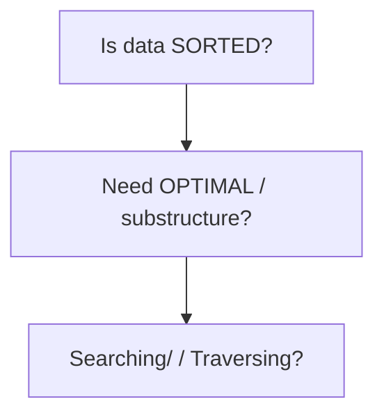

### Keyword → Pattern Mapping

| Keywords in Problem                   | Think About            |
| ------------------------------------- | ---------------------- |
| "subarray", "substring", "contiguous" | Sliding Window         |
| "sorted array", "search"              | Binary Search          |
| "pairs", "two elements"               | Two Pointers / HashMap |
| "shortest path", "minimum steps"      | BFS                    |
| "all paths", "all combinations"       | DFS / Backtracking     |
| "connected components"                | Union-Find / DFS       |
| "minimum/maximum", "optimal"          | DP / Greedy            |
| "top K", "Kth largest/smallest"       | Heap                   |
| "frequency", "count", "duplicate"     | HashMap                |
| "sorted order", "BST property"        | TreeMap / BST          |
| "parentheses", "nested"               | Stack                  |
| "level by level"                      | BFS                    |

---

# 🎨 Part 3: the Thinking Process for Each Pattern

## 1. Two Pointers Thinking

### When to Think Two Pointers

```
SIGNAL PHRASES:
- "Find two elements that..."
- "Sorted array"
- "Remove duplicates"
- "Reverse"
- "Palindrome"

MENTAL MODEL:
┌─────────────────────────────────────────┐
│ Instead of checking ALL pairs O(n²)     │
│                                         │
│ Use TWO pointers that MOVE based on     │
│ some CONDITION                          │
│                                         │
│ left →────────────────────────── ← right│
│                                         │
│ Movement reduces search space!          │
└─────────────────────────────────────────┘
```

**Flow:**
1. SIGNAL PHRASES:
2. - 'Find two elements that...'
3. - 'Sorted array'
4. - 'Remove duplicates'
5. - 'Reverse'
6. - 'Palindrome'
7. MENTAL MODEL:

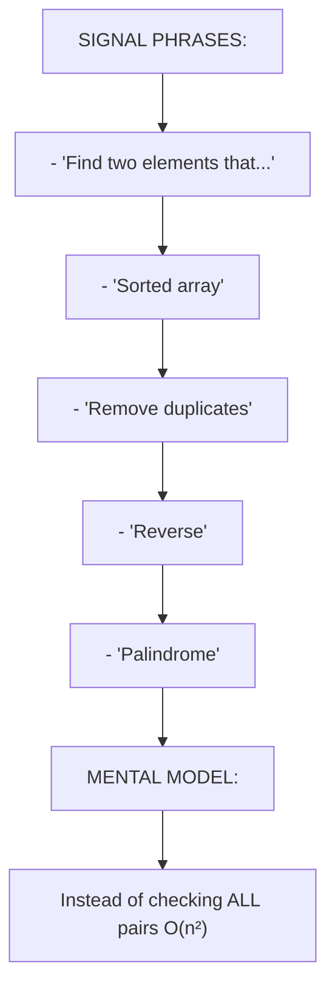

### Thinking Example: Container With Most Water

```
PROBLEM:
Heights: [1, 8, 6, 2, 5, 4, 8, 3, 7]
Find max water between two lines.

BRUTE FORCE THINKING:
"Check every pair of lines"
for i in range(n):
    for j in range(i+1, n):
        water = min(height[i], height[j]) * (j - i)
        max_water = max(max_water, water)
Time: O(n²) ❌

TWO POINTER THINKING:
"Start with widest container (left and right edges)"
"Which pointer should I move?"

INSIGHT:
- Water limited by SHORTER line
- If I move the taller line, water can only DECREASE (width shrinks)
- If I move the shorter line, water MIGHT increase (might find taller)

So: ALWAYS MOVE THE SHORTER LINE!

left = 0, right = n-1
while left < right:
    water = min(height[left], height[right]) * (right - left)
    if height[left] < height[right]:
        left++
    else:
        right--
Time: O(n) ✓
```

---

🔬 **Section Challenge — 1. Two Pointers Thinking**

**Challenge 1 (Reasoning):** Two-pointer pattern reduces O(N²) brute force to O(N). What is the KEY invariant that makes this safe?
<details><summary>Answer</summary>

The invariant: all pairs we SKIP are guaranteed to not contain the answer. In 3Sum: once we fix `nums[i]` and use l/r pointers, we can safely skip because the array is sorted. If `sum > 0`: decreasing r decreases the sum (smaller right value). If `sum < 0`: increasing l increases the sum (larger left value). We never skip a valid pair because monotonicity guarantees it.
</details>


## 2. Sliding Window Thinking

### When to Think Sliding Window

```
SIGNAL PHRASES:
- "Subarray/substring of size K"
- "Longest/shortest subarray with condition"
- "Consecutive elements"
- "Sum of K elements"

MENTAL MODEL:
┌─────────────────────────────────────────┐
│ Instead of recalculating for each       │
│ starting position...                    │
│                                         │
│ SLIDE a window and UPDATE incrementally │
│                                         │
│ [1, 2, 3, 4, 5, 6, 7, 8]                │
│  └─────┘                window size 3   │
│     └─────┘              slide right    │
│        └─────┘           slide right    │
│                                         │
│ Add new element, remove old element     │
└─────────────────────────────────────────┘
```

**Flow:**
1. SIGNAL PHRASES:
2. - 'Subarray/substring of size K'
3. - 'Longest/shortest subarray with condition'
4. - 'Consecutive elements'
5. - 'Sum of K elements'
6. MENTAL MODEL:
7. Instead of recalculating for each

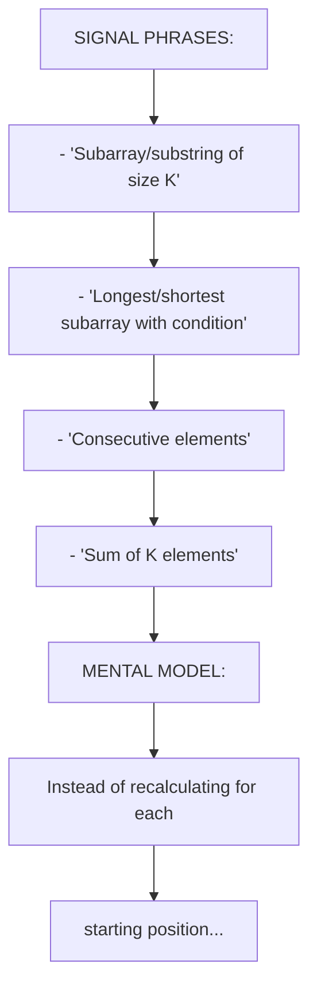

### Fixed vs Variable Window

```
FIXED WINDOW (Size K given):
- Initialize: sum of first K elements
- Slide: add new, remove old
- Example: Maximum average of K elements

VARIABLE WINDOW (Condition given):
- Expand until condition breaks
- Shrink until condition satisfied
- Track best result

VARIABLE WINDOW TEMPLATE:
left = 0
for right in range(n):
    # EXPAND: add arr[right] to window

    while (condition violated):
        # SHRINK: remove arr[left]
        left++

    # UPDATE: result with current window
```

### Thinking Example: Longest Substring Without Repeating

```
PROBLEM:
s = "abcabcbb"
Find longest substring without repeating characters.

BRUTE FORCE THINKING:
"Check every substring, verify no repeats"
for i in range(n):
    for j in range(i+1, n+1):
        if all_unique(s[i:j]):
            max_len = max(max_len, j - i)
Time: O(n³) ❌

SLIDING WINDOW THINKING:
"Expand window until I see a repeat"
"When repeat found, shrink from left until no repeat"

Window: "abc" → add 'a' → repeat found!
Shrink until 'a' removed: "bca"
Continue expanding...

INSIGHT:
Use SET to track characters in window
When repeat, shrink until that char removed

seen = set()
left = 0
max_len = 0

for right in range(n):
    while s[right] in seen:
        seen.remove(s[left])
        left++
    seen.add(s[right])
    max_len = max(max_len, right - left + 1)

Time: O(n) ✓
```

**Flow:**
1. Window: 'abc' add 'a' repeat found!

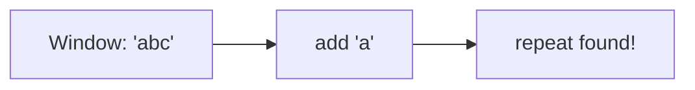

---

🔬 **Section Challenge — 2. Sliding Window Thinking**

**Challenge 1 (Reasoning):** Sliding window guarantees O(N). How? Each element is added and removed exactly how many times?
<details><summary>Answer</summary>

Each element enters the window exactly ONCE (right pointer advances past it) and leaves exactly ONCE (left pointer advances past it). Total operations: 2N regardless of window size changes. Compare to brute force: for each ending position, scan back to find optimal start = O(N²). The window's state (sum, freq map, etc.) is maintained INCREMENTALLY — O(1) per pointer move.
</details>

**Challenge 2 (Bug Hunt):** Minimum Window Substring: the while loop to shrink the window runs `while(valid) { shrink; }`. What's wrong with this logic?
<details><summary>Answer</summary>

Should shrink `while(valid)` to find the minimum window — this is correct! But the common bug: not updating `left++` BEFORE rechecking validity, or forgetting to update the answer BEFORE shrinking. The answer should be captured at the moment the window first becomes valid, then kept updated as we shrink to find smaller valid windows.
</details>


## 3. Binary Search Thinking

### When to Think Binary Search

```
SIGNAL PHRASES:
- "Sorted array"
- "Find target"
- "Search in O(log n)"
- "Find first/last occurrence"
- "Find minimum/maximum that satisfies condition"

MENTAL MODEL:
┌─────────────────────────────────────────┐
│ Can I eliminate HALF the search space   │
│ with one comparison?                    │
│                                         │
│ YES → Binary Search possible!           │
│                                         │
│ [1, 3, 5, 7, 9, 11, 13, 15]             │
│              ↑                          │
│           middle                        │
│                                         │
│ Target < middle → search LEFT half      │
│ Target > middle → search RIGHT half     │
└─────────────────────────────────────────┘
```

**Flow:**
1. SIGNAL PHRASES:
2. - 'Sorted array'
3. - 'Find target'
4. - 'Search in O(log n)'
5. - 'Find first/last occurrence'
6. - 'Find minimum/maximum that satisfies condition'
7. MENTAL MODEL:

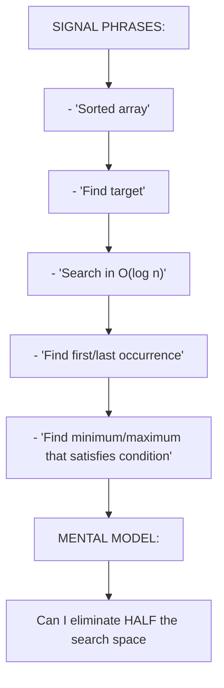

### Binary Search Variants

```
VARIANT 1: Exact Match
"Find element equal to target"
→ Standard binary search

VARIANT 2: First Occurrence
"Find first element >= target"
→ When found, DON'T STOP! Search left for earlier

VARIANT 3: Last Occurrence
"Find last element <= target"
→ When found, DON'T STOP! Search right for later

VARIANT 4: Search on Answer
"Find minimum K such that condition(K) is true"
→ Binary search on K values, not array!
```

**Flow:**
1. VARIANT 1: Exact Match
2. 'Find element equal to target'
3. Standard binary search
4. VARIANT 2: First Occurrence
5. 'Find first element >= target'
6. When found, DON'T STOP! Search left for earlier VARIANT 3: Last Occurrence

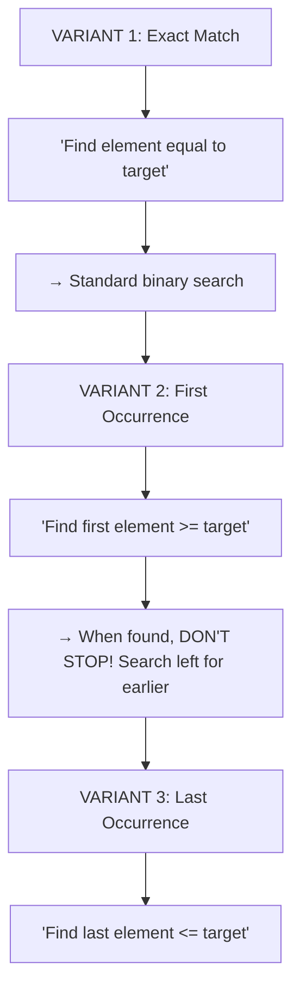

### Thinking Example: Find Peak Element

```
PROBLEM:
nums = [1, 2, 3, 1]
Find any peak element (greater than neighbors).

LINEAR THINKING:
"Check each element against neighbors"
for i in range(n):
    if nums[i] > neighbors:
        return i
Time: O(n) - but can we do better?

BINARY SEARCH THINKING:
"Can I eliminate half with one comparison?"

INSIGHT:
At middle, if nums[mid] < nums[mid+1]:
  → Peak MUST be on right side (going UP)

If nums[mid] > nums[mid+1]:
  → Peak MUST be on left side or AT mid (going DOWN)

left = 0, right = n-1
while left < right:
    mid = (left + right) / 2
    if nums[mid] < nums[mid + 1]:
        left = mid + 1  # Peak is right
    else:
        right = mid     # Peak is left or here

return left  # left == right, found peak

Time: O(log n) ✓
```

**Flow:**
1. PROBLEM: nums = [1, 2, 3, 1]
2. Find any peak element (greater than neighbors).
3. LINEAR THINKING:
4. 'Check each element against neighbors'
5. return i
6. Time: O(n) - but can we do better?

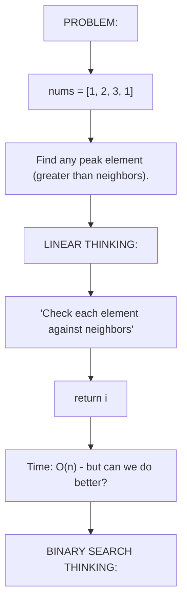

---

🔬 **Section Challenge — 3. Binary Search Thinking**

**Challenge 1 (Reasoning):** Binary search on `[1,3,5,7,9]` with `target=6`. Trace `lo`, `hi`, `mid` at each step and explain the final state.
<details><summary>Answer</summary>

lo=0,hi=4 → mid=2(val=5): 5<6 → lo=3. lo=3,hi=4 → mid=3(val=7): 7>6 → hi=2. lo(3)>hi(2): loop ends, return -1 (not found). Key insight: lo overtakes hi — this is the standard termination condition. `lo` ends at the insertion point where 6 would go.
</details>

**Challenge 2 (Design):** Binary search on a rotated array `[4,5,6,7,0,1,2]`. How do you determine which half is sorted?
<details><summary>Answer</summary>

Compare `nums[lo]` and `nums[mid]`. If `nums[lo] <= nums[mid]`: left half is sorted. Check if target is in `[nums[lo], nums[mid])` — if yes, search left; else search right. Otherwise right half is sorted. Check if target is in `(nums[mid], nums[hi]]` — if yes, search right; else search left. This always works because at least one half of a rotated sorted array is always sorted.
</details>


## 4. Dynamic Programming Thinking

### When to Think DP

```
SIGNAL PHRASES:
- "How many ways..."
- "Minimum/maximum cost/profit"
- "Is it possible..."
- "Count all..."
- "Optimal solution"

DP DETECTION:
1. Overlapping subproblems?
   (Same calculation repeated)
2. Optimal substructure?
   (Optimal solution built from optimal sub-solutions)

If BOTH yes → DP!
```

**Flow:**
1. If BOTH yes
2. DP!

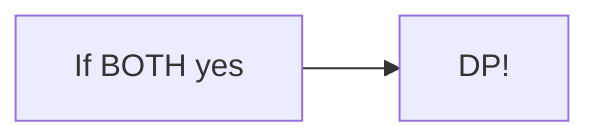

### DP Recipe

```
STEP 1: Define State
"What variables describe a subproblem?"
dp[i] = answer for first i elements
dp[i][j] = answer using i items with capacity j

STEP 2: Find Recurrence
"How does dp[i] relate to smaller subproblems?"
dp[i] = dp[i-1] + dp[i-2]  (Fibonacci)
dp[i] = max(dp[j] + arr[i]) for all j < i  (LIS)

STEP 3: Identify Base Cases
"What are the smallest subproblems I know?"
dp[0] = 1, dp[1] = 1  (Climbing stairs)

STEP 4: Determine Order
"In what order should I fill the table?"
Usually left-to-right, top-to-bottom

STEP 5: Extract Answer
"Where in the table is my final answer?"
dp[n] or max(dp) or dp[n][W]
```

### Thinking Example: House Robber

```
PROBLEM:
houses = [2, 7, 9, 3, 1]
Can't rob adjacent houses. Maximize profit.

BRUTE FORCE THINKING:
"Try all combinations of non-adjacent houses"
2^n combinations → O(2ⁿ) ❌

DP THINKING:
"At each house, I have TWO choices:
 1. Rob it (can't rob previous)
 2. Skip it (keep previous money)"

DEFINE STATE:
dp[i] = max money robbing houses 0 to i

RECURRENCE:
dp[i] = max(
    dp[i-2] + houses[i],  // Rob house i
    dp[i-1]               // Skip house i
)

BASE CASES:
dp[0] = houses[0]  // Rob first house
dp[1] = max(houses[0], houses[1])  // Better of first two

FILL TABLE:
houses = [2, 7, 9, 3, 1]
dp[0] = 2
dp[1] = max(2, 7) = 7
dp[2] = max(7, 2+9) = 11
dp[3] = max(11, 7+3) = 11
dp[4] = max(11, 11+1) = 12

ANSWER: dp[4] = 12 ✓
```

**Flow:**
1. 2^n combinations
2. O(2ⁿ) ❌

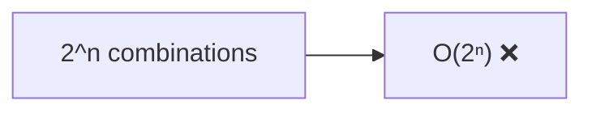

---

🔬 **Section Challenge — 4. Dynamic Programming Thinking**

**Challenge 1 (Reasoning):** How do you identify that a problem requires DP vs Greedy? What's the key test?
<details><summary>Answer</summary>

Greedy test: does the locally optimal choice always lead to the globally optimal solution? (Prove via exchange argument.) If yes → greedy. If making a local choice requires knowing future choices → DP. Example: Coin Change with standard coins [1,5,10,25] → greedy works (always pick largest). Coin Change with coins [1,3,4] and amount 6 → greedy picks 4+1+1=3 coins, optimal is 3+3=2 coins. Greedy fails → DP.
</details>

**Challenge 2 (Design):** You need to find the number of ways to climb N stairs taking 1 or 2 steps at a time. Define the DP state and recurrence.
<details><summary>Answer</summary>

State: `dp[i]` = number of ways to reach step i. Recurrence: `dp[i] = dp[i-1] + dp[i-2]` (come from step i-1 via 1 step, or from step i-2 via 2 steps). Base: `dp[0]=1` (one way: don't move), `dp[1]=1`. This is exactly Fibonacci. Space optimization: only need last 2 values → O(1) space.
</details>


## 5. BFS/DFS Thinking

### When to Think BFS

```
SIGNAL PHRASES:
- "Shortest path"
- "Minimum steps"
- "Level by level"
- "Nearest"

BFS = LEVEL ORDER TRAVERSAL
- Explores all nodes at distance 1
- Then all at distance 2
- Then all at distance 3...

MENTAL MODEL:
Think of dropping a stone in water
The ripples spread OUTWARD evenly
```

### When to Think DFS

```
SIGNAL PHRASES:
- "All paths"
- "All combinations"
- "Detect cycle"
- "Connected components"
- "Backtracking"

DFS = GO DEEP FIRST
- Explore as far as possible
- Backtrack when stuck
- Try another path

MENTAL MODEL:
Think of solving a maze
Go until dead end
Back up and try different path
```

### Thinking Example: Number of Islands

```
PROBLEM:
grid = [
  ['1','1','0','0'],
  ['1','1','0','0'],
  ['0','0','1','0'],
  ['0','0','0','1']
]
Count number of islands.

THINKING PROCESS:
"An island is a group of connected '1's"
"If I find a '1', I need to mark ALL connected '1's as visited"
"Then count how many times I start a new search"

BFS or DFS?
- Don't need shortest path
- Need to explore all connected cells
- Either works! DFS is simpler.

ALGORITHM:
count = 0
for each cell (i, j):
    if cell is '1':
        count++
        DFS to mark all connected '1's as visited

DFS Function:
def dfs(i, j):
    if out of bounds or grid[i][j] != '1':
        return
    grid[i][j] = '0'  # Mark visited
    dfs(i+1, j)  # Down
    dfs(i-1, j)  # Up
    dfs(i, j+1)  # Right
    dfs(i, j-1)  # Left

Time: O(m × n) ✓
```

---

# 💭 Part 4: Common Thinking Mistakes

## Mistake 1: Jumping to Code

```
❌ WRONG:
See problem → Start typing code

✓ RIGHT:
See problem → Understand → Examples → Brute force → Optimize → Code

"10 minutes of planning saves 1 hour of debugging"
```

**Flow:**
1. See problem
2. Start typing code
3. See problem
4. Understand
5. Examples
6. Brute force
7. Optimize
8. Code

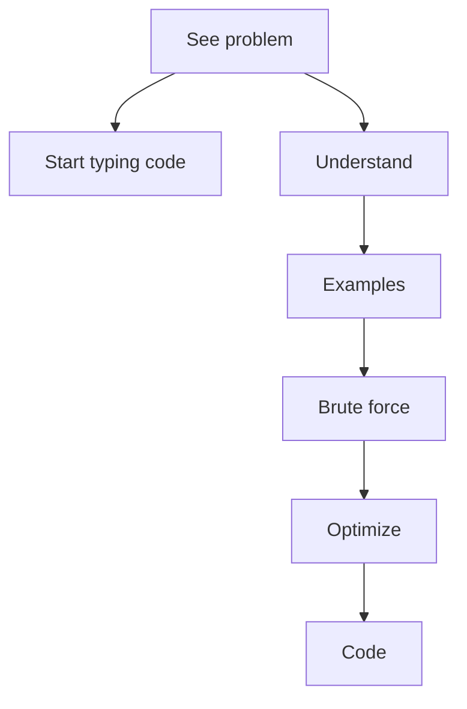

## Mistake 2: Not Considering Edge Cases

```
ALWAYS CHECK:
- Empty input: [], ""
- Single element: [1], "a"
- All same: [5,5,5,5]
- Already sorted: [1,2,3,4]
- Reverse sorted: [4,3,2,1]
- Negative numbers: [-1,-2,-3]
- Maximum values: [10^9, 10^9]
```

## Mistake 3: Off-by-One Errors

```
COMMON PITFALLS:
- Array index: 0 to n-1, not 1 to n
- Loop bounds: < n vs <= n
- Substring: end index exclusive
- Middle calculation: (left + right) / 2 vs left + (right - left) / 2

PREVENTION:
- Trace through with small example
- Check boundary conditions explicitly
```

## Mistake 4: Overcomplicating

```
❌ WRONG:
"This must need a complex algorithm"

✓ RIGHT:
"What's the simplest thing that could work?"

REMEMBER:
- Brute force is a VALID starting point
- Sometimes O(n²) is acceptable
- Optimize only if needed
```

---

# 💪 Part 5: Practice Methodology

## The 4-Phase Learning

```
PHASE 1: SEE (Day 1)
- Read problem and solution
- Understand the logic
- NO coding yet!

PHASE 2: DO (Day 2)
- Try to solve without looking
- Refer to notes if stuck
- Implement solution

PHASE 3: TEACH (Day 3)
- Explain solution out loud
- Write the thinking process
- Identify key insights

PHASE 4: APPLY (Day 4+)
- Solve similar problems
- Recognize the pattern
- Apply with variations
```

## Time Boxing

```
BEGINNER (Week 1-2):
- 30 min to understand
- 30 min to implement
- Look at solution if stuck after 30 min
- Learn from solution

INTERMEDIATE (Week 3-4):
- 20 min to think
- 25 min to implement
- 15 min to optimize
- Total: 60 min per problem

ADVANCED (Week 5+):
- 10 min to think
- 20 min to implement
- 5 min to verify
- Total: 35 min per problem
```

---

# 🎤 Part 6: Interview Thinking Out Loud

## The STAR Format for Problem Solving

```
S - STATE the problem
    "I need to find..."

T - THINK through approaches
    "I'm considering two approaches..."
    "Brute force would be O(n²) because..."
    "I can optimize using..."

A - ANNOUNCE your plan
    "I'll use a sliding window because..."
    "Here's my plan: First I'll... Then I'll..."

R - REVIEW as you code
    "This loop handles..."
    "This condition checks for..."
    "Let me trace through an example..."
```

## Sample Think-Aloud

```
PROBLEM: Two Sum

"Okay, so I need to find two numbers that add up to a target.

Let me think about brute force first. I could check every pair of numbers -
that would be O(n²). Not great for large inputs.

How can I do better? For each number, I need to find its complement.
If I could look up the complement in O(1)... I can use a HashMap!

So my plan is:
1. Create an empty HashMap
2. For each number, check if (target - number) is in the map
3. If yes, return the indices
4. If no, add current number to map

Let me trace through [2, 7, 11, 15] with target 9:
- i=0: complement is 7, not in map, add 2→0
- i=1: complement is 2, YES in map! Return [0, 1]

That looks correct. Time is O(n), space is O(n).

Let me code this up..."
```

**Flow:**
1. PROBLEM: Two Sum
2. that would be O(n²). Not great for large inputs.
3. So my plan is:
4. Create an empty HashMap
5. If yes, return the indices
6. If no, add current number to map
7. Let me trace through [2, 7, 11, 15] with target 9:

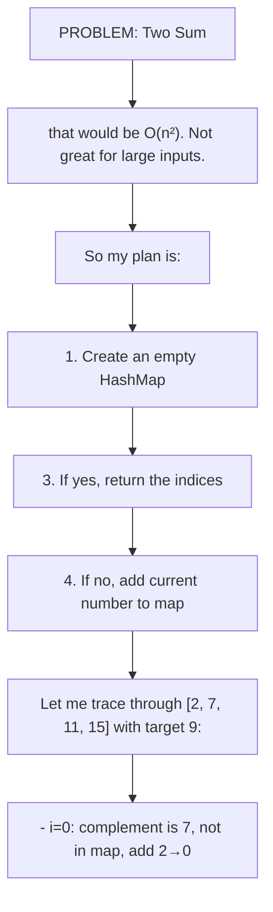

---

_Practice this thinking framework every day!_ 🧠

---

---

## 🏋️ Practice & Interview Questions — Algorithms

### Sorting

**Q1.** Which sorting algorithm does Java use for `Arrays.sort(int[])`? Why not MergeSort?
<details><summary>Answer</summary>

**Dual-Pivot QuickSort** — for primitives. MergeSort requires O(N) extra space. QuickSort is in-place and cache-friendly. Stability doesn't matter for primitives (equal ints are indistinguishable). For objects (`Arrays.sort(Object[])`), Java uses **TimSort** (stable, O(N log N) worst).
</details>

**Q2.** Trace Merge Sort on `[4,2,7,1]`.
<details><summary>Answer</summary>

Split: `[4,2]` `[7,1]` → Split: `[4]` `[2]` `[7]` `[1]` → Merge: `[2,4]` `[1,7]` → Merge: `[1,2,4,7]`
</details>

**Q3.** ⭐⭐ Sort Colors (Dutch National Flag — 3-way partition).
<details><summary>Solution</summary>

```java
int lo=0, mid=0, hi=n-1;
while(mid<=hi){
    if(nums[mid]==0) swap(nums,lo++,mid++);
    else if(nums[mid]==1) mid++;
    else swap(nums,mid,hi--);
}
```
</details>

### Binary Search

**Q4.** ⭐ Search in Rotated Sorted Array.
<details><summary>Solution</summary>

```java
int lo=0, hi=n-1;
while(lo<=hi){
    int mid=(lo+hi)/2;
    if(nums[mid]==target) return mid;
    if(nums[lo]<=nums[mid]){ // left half sorted
        if(nums[lo]<=target&&target<nums[mid]) hi=mid-1; else lo=mid+1;
    } else { // right half sorted
        if(nums[mid]<target&&target<=nums[hi]) lo=mid+1; else hi=mid-1;
    }
}
return -1;
```
</details>

**Q5.** ⭐ Find First and Last Position (binary search twice).
<details><summary>Solution</summary>

```java
// First: find leftmost with while(lo<hi){ if arr[mid]>=target hi=mid else lo=mid+1 }
// Last: find rightmost with while(lo<hi){ if arr[mid]<=target lo=mid+1 else hi=mid } return lo-1
```
</details>

**Q6.** ⭐⭐ Koko Eating Bananas — binary search on answer.
<details><summary>Key insight</summary>

Binary search the eating speed k in range [1, max(piles)]. For each k, calculate hours needed. Find minimum k where hours ≤ H.
</details>

### Dynamic Programming

**Q7.** ⭐ Climbing Stairs — n steps, 1 or 2 at a time. How many ways?
<details><summary>Solution</summary>

```java
// Fibonacci sequence! dp[i] = dp[i-1] + dp[i-2]
int a=1, b=1;
for(int i=2;i<=n;i++){ int c=a+b; a=b; b=c; }
return b;
```
</details>

**Q8.** ⭐ Coin Change — minimum coins for amount.
<details><summary>Solution</summary>

```java
int[] dp = new int[amount+1]; Arrays.fill(dp, amount+1);
dp[0]=0;
for(int i=1;i<=amount;i++)
    for(int c:coins) if(c<=i) dp[i]=Math.min(dp[i],dp[i-c]+1);
return dp[amount]>amount?-1:dp[amount];
```
</details>

**Q9.** ⭐⭐ Longest Common Subsequence.
<details><summary>Solution</summary>

```java
int[][] dp=new int[m+1][n+1];
for(int i=1;i<=m;i++) for(int j=1;j<=n;j++){
    if(text1.charAt(i-1)==text2.charAt(j-1)) dp[i][j]=dp[i-1][j-1]+1;
    else dp[i][j]=Math.max(dp[i-1][j],dp[i][j-1]);
}
return dp[m][n];
```
</details>

**Q10.** ⭐⭐ Word Break — can string be segmented using dictionary words?
<details><summary>Solution</summary>

```java
boolean[] dp=new boolean[n+1]; dp[0]=true;
for(int i=1;i<=n;i++) for(String w:wordDict)
    if(i>=w.length()&&dp[i-w.length()]&&s.substring(i-w.length(),i).equals(w)) dp[i]=true;
return dp[n];
```
</details>

**Q11.** ⭐⭐⭐ Edit Distance (Levenshtein).
<details><summary>Solution</summary>

```java
int[][] dp=new int[m+1][n+1];
for(int i=0;i<=m;i++) dp[i][0]=i;
for(int j=0;j<=n;j++) dp[0][j]=j;
for(int i=1;i<=m;i++) for(int j=1;j<=n;j++){
    if(word1.charAt(i-1)==word2.charAt(j-1)) dp[i][j]=dp[i-1][j-1];
    else dp[i][j]=1+Math.min(dp[i-1][j-1],Math.min(dp[i-1][j],dp[i][j-1]));
}
```
</details>

### Graph Algorithms

**Q12.** ⭐ Number of Islands (BFS/DFS grid traversal).
<details><summary>Solution</summary>

```java
for each cell (i,j) if grid[i][j]=='1': count++; BFS/DFS to mark all connected land as visited
```
</details>

**Q13.** ⭐⭐ Course Schedule — detect cycle in directed graph (Topological sort).
<details><summary>Solution</summary>

```java
// Kahn's algorithm: indegree array + BFS queue
// If result size == numCourses → no cycle → can finish
```
</details>

**Q14.** ⭐⭐ Dijkstra's Shortest Path.
<details><summary>Solution</summary>

```java
PriorityQueue<int[]> pq=new PriorityQueue<>((a,b)->a[1]-b[1]); // [node, dist]
pq.offer(new int[]{src,0}); dist[src]=0;
while(!pq.isEmpty()){
    int[] curr=pq.poll(); int u=curr[0],d=curr[1];
    if(d>dist[u]) continue; // stale
    for(int[] neighbor:graph[u]) if(dist[u]+neighbor[1]<dist[neighbor[0]]){
        dist[neighbor[0]]=dist[u]+neighbor[1]; pq.offer(new int[]{neighbor[0],dist[neighbor[0]]});
    }
}
```
</details>

### MCQ Rapid Fire

| # | Question | Answer |
|---|---|---|
| 1 | QuickSort avg/worst | O(N log N) avg, O(N²) worst |
| 2 | MergeSort space complexity | O(N) |
| 3 | HeapSort space complexity | O(1) (in-place) |
| 4 | Binary search precondition | Sorted array |
| 5 | BFS time complexity on graph | O(V+E) |
| 6 | DFS space complexity | O(V) (recursion stack) |
| 7 | Dijkstra fails on | Negative weight edges |
| 8 | Bellman-Ford handles | Negative weights, detects negative cycles |
| 9 | Floyd-Warshall use case | All-pairs shortest path, O(V³) |
| 10 | Topological sort requires | Directed Acyclic Graph (DAG) |

---

## 🧠 Deep Conceptual Questions — Algorithm Design & Analysis

**C1. What does O(N log N) "feel like" and why is it the complexity barrier for comparison-based sorting?**
<details><summary>Deep Answer</summary>

O(N log N) for N=1M ≈ 20M operations. O(N²) ≈ 1 trillion. The difference is 50,000x. **Comparison sort lower bound**: any comparison-based sort must distinguish between N! possible orderings. Each comparison has 2 outcomes. A decision tree with N! leaves needs ≥ log₂(N!) height ≈ N log N (Stirling's approximation). Therefore NO comparison sort can beat O(N log N) in the worst case. Non-comparison sorts (counting sort, radix sort, bucket sort) break this bound by using non-comparison operations — but require constraints on input (e.g., integer range bounded by N).
</details>

**C2. Greedy algorithms: when do they work and what must be proven?**
<details><summary>Deep Answer</summary>

A greedy algorithm makes the locally optimal choice at each step. Works when problem has: (1) **Greedy choice property**: local optimal leads to global optimal — the choice never needs to be revised. (2) **Optimal substructure**: optimal solution to the problem contains optimal solutions to subproblems. To PROVE greedy is correct: use "exchange argument" — assume optimal solution differs from greedy, show you can swap greedy's choice in without making it worse, contradiction. Greedy FAILS when: future choices depend on current choice in complex ways (use DP instead). Classic works: interval scheduling, Huffman coding, Dijkstra. Classic fails: 0-1 knapsack (use DP).
</details>

**C3. Dynamic Programming: what is "overlapping subproblems" and why does it matter?**
<details><summary>Deep Answer</summary>

Overlapping subproblems: the same sub-computation appears multiple times. Fibonacci: `fib(5)` calls `fib(4)` and `fib(3)`. `fib(4)` also calls `fib(3)`. Without memoization: `fib(3)` computed exponentially many times → O(2^N). With memoization: each sub-result computed once and stored → O(N). DP is valuable SPECIFICALLY when: (1) problem has optimal substructure AND (2) subproblems overlap. If no overlap: just use divide-and-conquer (merge sort's subproblems don't overlap → no DP needed). DP = "smart recursion" = avoid recomputing.
</details>

**C4. Top-down (memoization) vs Bottom-up (tabulation) DP — when to choose each?**
<details><summary>Deep Answer</summary>

**Top-down (memoization)**: Write natural recursion + cache results. Easy to implement, only computes needed subproblems (sparse computation). Cons: recursion overhead and stack depth risk. Use when: problem is naturally recursive, only a fraction of subproblems needed. **Bottom-up (tabulation)**: Fill DP table iteratively from base cases. No recursion overhead, better cache performance, easier space optimization. Use when: need all subproblems (or most of them), want to optimize space (can often reduce to 1D from 2D). Rule: start with top-down for correctness verification, optimize to bottom-up for performance.
</details>

**C5. Dijkstra's Algorithm: why does it fail on negative weights?**
<details><summary>Deep Answer</summary>

Dijkstra assumes: once a node is "settled" (extracted from the priority queue with its final shortest distance), that distance is optimal. With negative weights: settling node A at distance 5 might not be final — a path through B (distance 7) → C (edge -10) → A gives distance -3. But A was already settled! Dijkstra doesn't revisit settled nodes. Bellman-Ford handles negatives by relaxing ALL edges N-1 times — no "settled" assumption. For graphs with negative cycles: Bellman-Ford detects them (if distances still decrease after N-1 rounds, there's a negative cycle).
</details>

**C6. Union-Find: why is path compression + union by rank/size nearly O(1)?**
<details><summary>Deep Answer</summary>

**Path compression**: when finding the root of element x, make every node on the path point directly to the root. Flattens the tree. Future finds on those paths: O(1). **Union by rank**: always attach the smaller tree under the larger → limits tree height to O(log N). Combined: inverse Ackermann function α(N) amortized — so slow-growing it's practically constant (α(10^80) = 4). Neither alone is optimal: path compression without union by rank → O(log N) amortized. Union by rank without path compression → O(log N). Together → α(N) ≈ O(1) amortized. Used in: Kruskal's MST, cycle detection, connected components.
</details>

**C7. Binary Search on the Answer — what types of problems does it apply to?**
<details><summary>Deep Answer</summary>

When the answer space is **monotone**: "if X is achievable, then all values less extreme than X are also achievable." Problems: minimize the maximum (aggressive cows, split array), find minimum valid threshold (Koko bananas, minimum days to bloom), divide-and-conquer feasibility. Template: binary search on the answer range [lo, hi], for each mid check `isFeasible(mid)` in O(N) or O(N log N). Total: O(N log(answer_range)). Key insight: reframe "find optimal value" as "find smallest X where condition holds" → enables binary search on a non-array space.
</details>

**C8. Why does merge sort guarantee stability while quicksort doesn't?**
<details><summary>Deep Answer</summary>

**Merge sort stability**: during merge, when two elements are equal, we always take from the LEFT array first → preserves original relative order. **QuickSort instability**: the partition step swaps elements across the pivot without regard to original order. Two equal elements may be placed on opposite sides of the pivot, reversing their order. QuickSort CAN be made stable (Lomuto partition with careful implementation) but loses performance. Java uses TimSort for objects (stable), dual-pivot quicksort for primitives (stability irrelevant since primitives without fields).
</details>

**C9. Backtracking: what's the difference from plain DFS and when to use vs DP?**
<details><summary>Deep Answer</summary>

**Backtracking vs DFS**: DFS visits every path. Backtracking prunes paths early when a constraint is violated — avoids exploring infeasible branches. Same asymptotic but drastically different practical performance with good pruning. **Backtracking vs DP**: backtracking for **combinatorial/enumeration** problems (find all solutions, permutations, subsets). DP for **optimization** problems (find optimal single solution). Backtracking produces exponential solutions in worst case but is necessary when you need ALL solutions. DP finds the optimal in polynomial time when overlapping subproblems exist.
</details>

**C10. What is amortized analysis and how does it differ from average-case analysis?**
<details><summary>Deep Answer</summary>

**Amortized**: analyzes the average cost per operation over a SEQUENCE of operations — in the worst case. No probability involved. Guarantees: N operations ALWAYS take O(N·T) total, even if some individual operations are O(N·T). Example: ArrayList append is O(N) when resizing, but amortized O(1) because resizing is rare. **Average-case**: analyzes expected cost of a SINGLE operation assuming random input. QuickSort is O(N log N) average-case (random pivot). Amortized is a stronger guarantee — it holds even for adversarial input sequences.
</details>

**Navigation**: [Back to Index](../00_MASTER_INDEX.md) | [Next >](02a_Sorting_Fundamentals.md)
