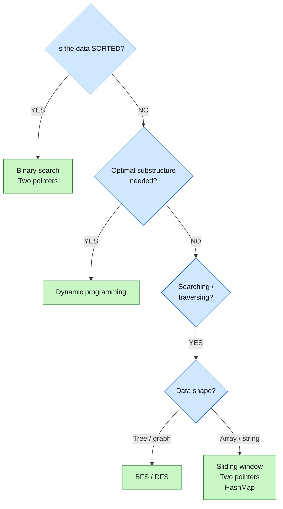

# Section 0 — Why Algorithm Choice Is a Production Decision

> **Navigation**: [Chapter overview](../01_Algorithm_Thinking.md) | [the Thinking Process for Each Pattern →](02_the_thinking_process_for_each_pattern.md)
> Page 1 of 2 in **Algorithm Thinking: How to Approach Any Problem**


> The wrong algorithm doesn't just make a solution slower — it makes it impossible to fix without a rewrite. These stories happened on real systems.

---

## Story 1 — The Search That Brought Down the Product Catalog (O(n) vs O(log n))

An e-commerce platform built product search by scanning all ~50,000 SKUs on every user query. A product manager added a "filter by tag" feature the week before Black Friday — now each search ran the scan twice. 2 × 50,000 = 100,000 comparisons × 1,400 concurrent shoppers = 140 million comparisons per second. The server OOM-killed the web process 9 minutes into the sale.

Root cause: a linear scan where a sorted index with binary search (O(log n)) would have taken 17 comparisons instead of 50,000.

```python
# What they had — O(n) scan every request
def search(products, tag):
    return [p for p in products if tag in p.tags]  # 50,000 iterations

# The fix — build an inverted index once at startup
from collections import defaultdict
tag_index = defaultdict(list)
for p in products:
    for tag in p.tags:
        tag_index[tag].append(p)

def search(tag):
    return tag_index.get(tag, [])  # O(1) hash lookup, no scan
```

**What to learn from this**: Before choosing a data structure or algorithm, ask "how big can the input get, and how often does this run?" A scan that's fine for 100 items becomes a site-killer at 50,000.

---

## Story 2 — The Naive Fibonacci That Ran for 47 Minutes (Exponential vs Linear)

A developer added a "fun stats" feature to a math education app: display the Nth Fibonacci number where N = the user's lifetime lesson count. Lesson 40 took 4 seconds; lesson 45 took 47 minutes. Nobody noticed until a power user with 45 lessons complained. The recursive Fibonacci runs in O(2^n) — doubling work for every lesson.

```python
# What they had — O(2^n) exponential
def fib(n):
    if n <= 1:
        return n
    return fib(n - 1) + fib(n - 2)  # fib(45) = 2^45 ≈ 35 trillion calls

# Fix 1: Memoization — O(n) time, O(n) space
from functools import lru_cache
@lru_cache(maxsize=None)
def fib(n):
    if n <= 1: return n
    return fib(n - 1) + fib(n - 2)

# Fix 2: Iterative — O(n) time, O(1) space
def fib(n):
    a, b = 0, 1
    for _ in range(n):
        a, b = b, a + b
    return a
```

**What to learn from this**: Recursive solutions that call themselves twice per level create exponential blowup. Any time you see `f(n) = f(n-1) + f(n-2)` or similar, think: "Can I memoize or flatten this into iteration?"

---

## Story 3 — The Nested Loop That Made the Daily Report a 6-Hour Job (O(n²) vs O(n log n))

A reporting team compared sales of 80,000 transactions against 80,000 targets by looping each sale against each target: `for sale in sales: for target in targets`. That's 6.4 billion comparisons. The nightly report job, scheduled to take 20 minutes, ran for 6 hours and was still running at start-of-business — blocking the finance team's morning standup.

```python
# What they had — O(n²) nested loop
matched = []
for sale in sales:           # 80,000
    for target in targets:   # 80,000 each
        if sale.product_id == target.product_id:
            matched.append((sale, target))
# Total: 80,000 × 80,000 = 6.4 billion iterations

# Fix: O(n) lookup using a dictionary
target_map = {t.product_id: t for t in targets}  # O(n) build
matched = [
    (sale, target_map[sale.product_id])
    for sale in sales
    if sale.product_id in target_map             # O(1) lookup
]
# Total: O(n) to build + O(n) to match = O(n)
```

**What to learn from this**: A nested loop over two lists of size N is O(n²). When you need to match items from two collections, build a hash map from one and look up into it from the other — O(n) total.

---

## 📚 Part 0: Complete Understanding + Growth Mindset

### What Is Algorithmic Thinking?

Algorithmic thinking is a METHOD of thinking about problems that involves:

- Breaking problems into SMALLER, manageable parts
- Finding PATTERNS across different problems
- Creating STEP-BY-STEP solutions
- GENERALIZING solutions to apply broadly

💡 **KEY INSIGHT: It's NOT about memorizing algorithms - it's about developing**
a THINKING PROCESS that lets you CREATE solutions.

### Constraint-First Thinking

Before choosing any algorithm, read the constraints as if they are hints.

| Constraint Signal                | Algorithmic Direction                                     |
| -------------------------------- | --------------------------------------------------------- |
| `N <= 20`                        | subsets, bitmask DP, backtracking                         |
| `N <= 2e5`                       | `O(N log N)` or better                                    |
| negative numbers in subarray sum | prefix sum + hashmap/tree/deque, not basic sliding window |
| range queries with updates       | Fenwick / segment tree                                    |
| unweighted shortest path         | BFS                                                       |
| weighted non-negative graph      | Dijkstra                                                  |
| negative graph edges             | Bellman-Ford / potentials                                 |
| static range min/max             | sparse table                                              |

Full decision map: [Constraint-Based Pattern Selection](../../04_Patterns_Templates/25_Constraint_Based_Pattern_Selection.md).

**Historical Perspective**:

- 300 BC: Euclid's GCD algorithm (first recorded algorithm)
- 820 AD: Al-Khwarizmi (the word "algorithm" comes from his name!)
- 1936: Alan Turing - formalized what "computable" means
- 1960s: Structured programming - algorithms became science
- Today: Millions of algorithms, but THINKING process is universal!

### What Problem Does Algorithmic Thinking Solve

**Core Problem**: Humans naturally think in vague, incomplete ways.
Computers need PRECISE, COMPLETE instructions.

**Human Instruction**: "Sort these numbers"

**Computer Needs**:

1. What does "sorted" mean? (ascending? descending?)
2. What type of numbers? (integers? decimals? negative?)
3. What if there are duplicates?
4. What if empty?
5. EXACT steps to compare and arrange
   ALGORITHMIC THINKING bridges this gap!
   REAL-WORLD APPLICATIONS:

- Google Search: Rank billions of pages in milliseconds
- GPS: Find best route among millions of possibilities
- Netflix: Recommend from thousands of shows
- Compression: Make files smaller without losing data
- Encryption: Secure communication across internet

### ⭐ The Growth Mindset For Creating Your Own Algorithms ⭐

"I can ONLY use algorithms I've learned" ← FIXED MINDSET
"I can CREATE algorithms for new problems" ← GROWTH MINDSET

**The Truth**: Every algorithm was INVENTED by someone facing a new problem!

**How Algorithms Get Invented**:

1. **Observation:** "I keep doing the same work repeatedly."
2. **Question:** "Can I eliminate this repetition?"
3. **Experiment:** "What if I store, precompute or organize differently?"
4. **Generalize:** "This works for other problems too!"
5. **Pattern born:** now it is a named algorithm. You can do this too!

**Example: how you might "invent" Sliding Window**

- Problem: find the max sum of 3 consecutive elements.
- Brute force: for each start, sum the next 3 elements, O(n·k).

**Observation**: "I'm adding same numbers multiple times!"
sum(0,1,2) = a + b + c
sum(1,2,3) = b + c + d ← I already know b+c from previous!

**Invention**: "Instead of re-summing, I'll ADD new - REMOVE old!"
sum(1,2,3) = sum(0,1,2) - a + d → O(n)!

**Congratulations**: You just "invented" Sliding Window! 🎉

**The Secret**: Every algorithm is just this process applied!

### How To Develop Algorithm Creation Skills

1. ALWAYS START WITH BRUTE FORCE
   "What's the simplest way to solve this?"
   Don't worry about efficiency first - get CORRECT solution
2. IDENTIFY THE WASTE
   "Where am I repeating work?"
   "What am I computing multiple times?"
   "What information am I not using?"
3. ASK THE MAGIC QUESTIONS
   "Can I precompute something?"
   "Can I sort first?"
   "Can I use extra space to save time?"
   "Can I process while reading input?"
   "Can I divide the problem?"
4. LOOK FOR STRUCTURE
   "Is there ordering I can exploit?"
   "Is there hierarchy/tree structure?"
   "Are there independent subproblems?"
   "Are there overlapping subproblems?"
5. COMBINE KNOWN TECHNIQUES
   Binary Search + Greedy = Optimization
   HashMap + Sliding Window = Substring problems
   DFS + Memoization = Tree DP
6. TEST AND REFINE
   Does it work for edge cases?
   Can it be simpler?
   Can it be faster?

### Creating Your Own Data Structures

SAME GROWTH MINDSET APPLIES!
EXAMPLE - How LRU Cache was "invented":

**Problem**: Cache with limited space, need to decide what to remove

**Observation**: "Most recently used items are more likely to be used again"

**Need**: Fast lookup (HashMap) + Fast ordering (LinkedList)

**Invention**: Combine HashMap + DoublyLinkedList!
HashMap: O(1) lookup of any item
LinkedList: O(1) move-to-front and remove-from-back

**Result**: LRU Cache - a NEW DATA STRUCTURE from combining existing ones!
YOUR TURN - Try these exercises:

- Can you create a "MinStack" (stack with O(1) getMin)?
- Can you create a "MaxQueue" (queue with O(1) getMax)?
- Can you create a "FrequencyStack" (pop most frequent element)?

**Hint**: Combine existing structures + maintain extra state!

### Difficulties & Common Mistakes

1. JUMPING TO CODE TOO FAST:
   Want to code immediately without thinking
   Solution: Force yourself to write solution in WORDS first
2. NOT SEEING PATTERNS:
   Each problem feels unique and new
   Solution: After solving, ask "What similar problems use this?"
3. ANALYSIS PARALYSIS:
   Overthinking, trying to find optimal solution immediately
   Solution: Solve brute force first, THEN optimize
4. FEAR OF INEFFICIENCY:
   "This solution is O(n²), it must be wrong"
   Solution: Check constraints! O(n²) for n=100 is FINE
5. MEMORIZING VS UNDERSTANDING:
   Memorizing solutions doesn't help with new problems
   Solution: For each solution, understand WHY it works
6. GIVING UP TOO EARLY:
   "I don't know the algorithm for this"
   Solution: YOU can create the algorithm! Use the process above.

### Expected Outcomes

- ✅ PROBLEM DECOMPOSITION: Break any problem into smaller pieces
- ✅ PATTERN RECOGNITION: See connections across different problems
- ✅ MULTIPLE APPROACHES: Generate several solutions, pick best
- ✅ COMPLEXITY ANALYSIS: Predict time/space before coding
- ✅ EDGE CASE AWARENESS: Naturally think about boundaries
- ✅ OPTIMIZATION PATH: Know how to improve brute force
- ✅ CONFIDENCE: "I can figure this out even if I haven't seen it before"

**The Ultimate Output**:
Transform from "I need to know the algorithm" to
"I can CREATE the algorithm"

---

## 🧩 Part 1: the Universal Problem — Solving Framework

### Step-by-Step Thinking Process

### The 5-Step Framework

1. UNDERSTAND 📖
   What is the input? Output? Constraints?
2. EXAMPLES 📝
   Work through 2-3 examples by hand
3. BRUTE FORCE 💪
   What's the simplest (maybe slow) solution?
4. OPTIMIZE 🚀
   Where is the repetition? Can we save work?
5. CODE 💻
   Translate logic to code

---

## 🎨 Part 2: Pattern Recognition

### How to Identify Which Algorithm to Use

#### Decision Tree for Common Problems



**How to read this diagram.** Answer the blue questions top-down; the green box is the family of techniques to try first. This is a starting heuristic, not a proof: always confirm with the constraints.

#### Keyword → Pattern Mapping

| Keywords in Problem                   | Think About            |
| ------------------------------------- | ---------------------- |
| "subarray", "substring", "contiguous" | Sliding Window         |
| "sorted array", "search"              | Binary Search          |
| "pairs", "two elements"               | Two Pointers / HashMap |
| "shortest path", "minimum steps"      | BFS                    |
| "all paths", "all combinations"       | DFS / Backtracking     |
| "connected components"                | Union-Find / DFS       |
| "minimum/maximum", "optimal"          | DP / Greedy            |
| "top K", "Kth largest/smallest"       | Heap                   |
| "frequency", "count", "duplicate"     | HashMap                |
| "sorted order", "BST property"        | TreeMap / BST          |
| "parentheses", "nested"               | Stack                  |
| "level by level"                      | BFS                    |

---

[Chapter overview](../01_Algorithm_Thinking.md) | [the Thinking Process for Each Pattern →](02_the_thinking_process_for_each_pattern.md)
