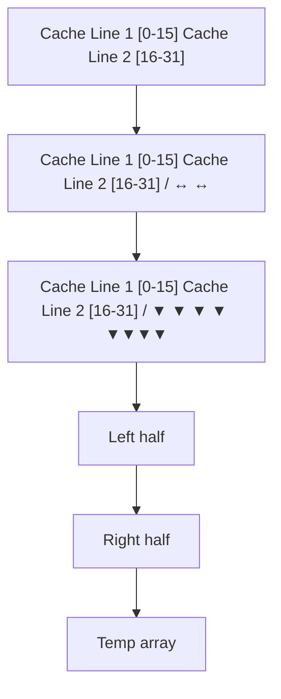
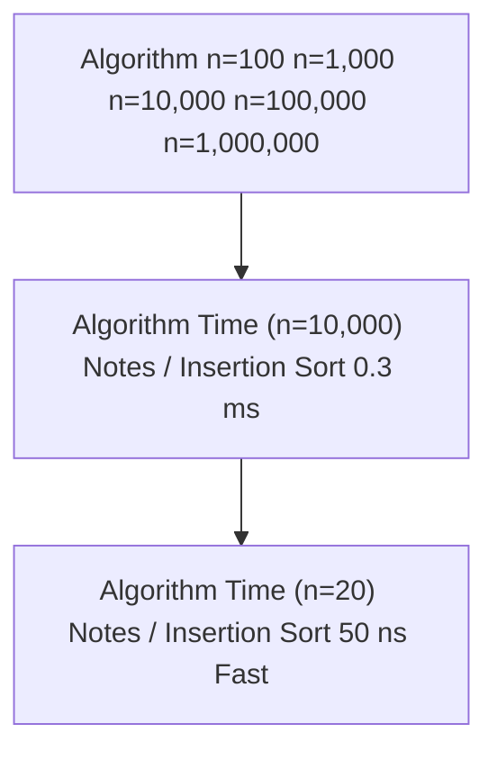
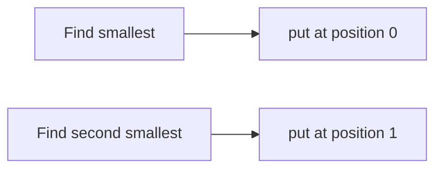
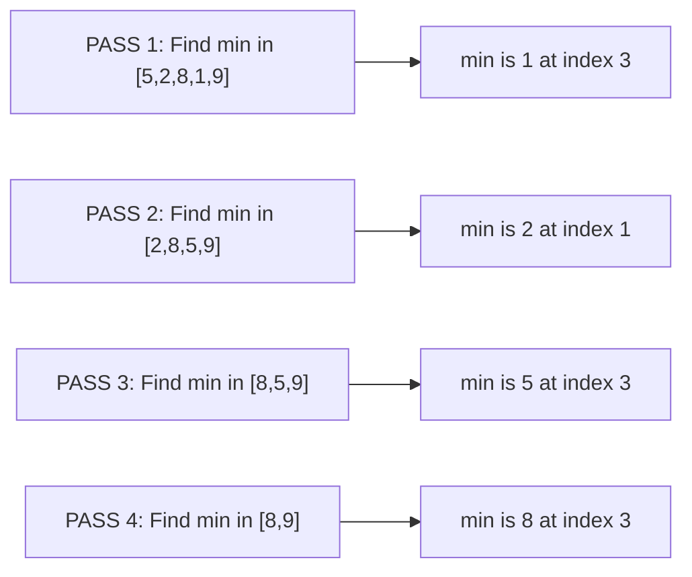
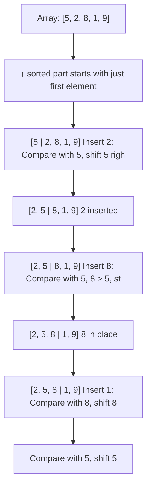
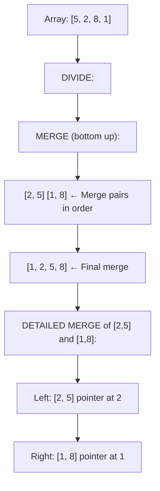
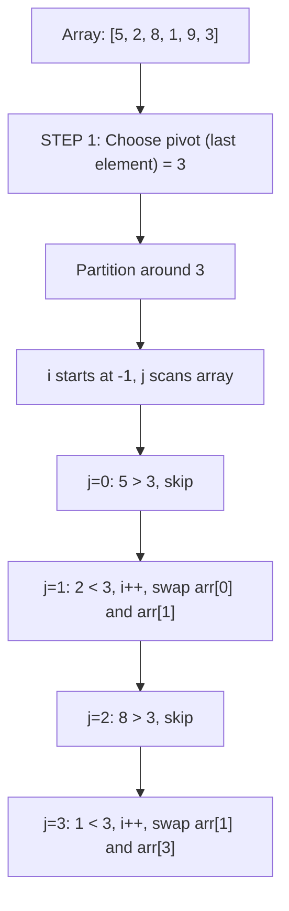

```mermaid
flowchart TD
    N1["[5, 2, 8, 1, 9] Compare 5, 2"]
    N2["Swap"]
    N3["[2, 5, 8, 1, 9] Compare 5, 8"]
    N4["OK"]
    N5["[2, 5, 8, 1, 9] Compare 8, 1"]
    N6["[2, 5, 1, 8, 9] Compare 8, 9"]
    N7["[2, 5, 1, 8, 9] Compare 2, 5"]
    N8["[2, 5, 1, 8, 9] Compare 5, 1"]
    N9["[2, 1, 5, 8, 9] Compare 5, 8"]
    N10["[2, 1, 5, 8, 9] Compare 2, 1"]
    N11["[1, 2, 5, 8, 9] Compare 2, 5"]
    N12["[1, 2, 5, 8, 9] Compare 1, 2"]
    N1 --> N2
    N3 --> N4
    N5 --> N2
    N6 --> N4
    N7 --> N4
    N8 --> N2
    N9 --> N4
    N10 --> N2
    N11 --> N4
    N12 --> N4
```

> **Navigation**: [Back to Index](../00_MASTER_INDEX.md) | [Next Chapter >](02b_Sorting_Advanced.md)
> 🧠 **Mental Model**: See [Complexity Intuition](../14_Mental_Models/09_Complexity_Intuition.md) — why O(n log n) is the sorting lower bound

---

## 🔗 JIT Connection — When You Need This

> **Arrived here from a problem?** Here's where to go next:
>

| Sorting sub-topic | Key Interview Fact | Jump to PS Problems |
|---|---|---|
| Choose sort algorithm | n<50 → Insertion; general → QuickSort; need stable → MergeSort | [Arrays PS](../05_Problem_Solving/01_Arrays.md) |
| Custom comparator | `Arrays.sort(arr, (a,b) → a[1]-b[1])` | [Greedy PS](../05_Problem_Solving/13_Greedy.md) |
| Timsort (Java Objects) | `Arrays.sort(Object[])` is stable TimSort | [Greedy PS](../05_Problem_Solving/13_Greedy.md) |
| Sort + Two Pointer | Sort then scan — reduces O(n²) search to O(n) | [Two Pointers PS](../05_Problem_Solving/03_TwoPointers.md) |

>
> **Study Path:** `Arrays` → `Sorting (this)` → `Binary Search` → `Two Pointers` → `Greedy`
>
> 📋 **All Patterns Hub:** [00_PATTERN_MASTER_GUIDE.md](../04_Patterns_Templates/00_PATTERN_MASTER_GUIDE.md)

---

# 🔄 Sorting Algorithms: Complete Visual Guide

## From Bubble to Quick - With Tracing

---


# 🔬 PART 0: DEEP INTERNALS - HOW SORTING ACTUALLY WORKS AT CPU/MEMORY LEVEL


> SORTING AT THE HARDWARE LEVEL - WHAT YOUR CPU ACTUALLY DOES
>
> Before learning sorting algorithms, understand what happens when you:
> - Compare two numbers
> - Swap two elements
> - Access array elements
>
> This knowledge separates "knows the algorithm" from "TRULY understands it"
>


## ⚖️ Comparison Operation — at CPU Instruction Level


## What Happens When You Do: If (Arr[I] > Arr[J])

Java Code:
if (arr[i] > arr[j]) { swap(arr, i, j); }
BYTECODE (JVM Instructions):
aload_1           // Load array reference onto stack
iload_2           // Load i onto stack
iaload            // Load arr[i] onto stack (array int load)
aload_1           // Load array reference again
iload_3           // Load j onto stack
iaload            // Load arr[j] onto stack
if_icmple SKIP    // If arr[i] <= arr[j], skip swap (integer compare less-eq)
... swap code ... // Execute swap

**Skip**:
x86-64 ASSEMBLY (After JIT Compilation):
; rax = array base address
; ecx = i, edx = j
movsxd rcx, ecx                    ; Sign-extend i to 64 bits
mov    edi, [rax + rcx*4 + 16]     ; Load arr[i] (16 = array header offset)
movsxd rdx, edx                    ; Sign-extend j to 64 bits
mov    esi, [rax + rdx*4 + 16]     ; Load arr[j]
cmp    edi, esi                    ; Compare arr[i] with arr[j]
jle    SKIP                        ; Jump if arr[i] <= arr[j]
; ... swap code ...

**Skip**:

**Cpu Cycles Breakdown**:
┬
Operation                      │ Cycles (approx)
┼
Load arr[i] from L1 cache      │ 4 cycles
Load arr[j] from L1 cache      │ 4 cycles
Compare (cmp instruction)      │ 1 cycle
Conditional jump               │ 1 cycle (if predicted correctly)
│ ~15 cycles (if mispredicted!)
┼
TOTAL (best case):             │ ~10 cycles
TOTAL (cache miss):            │ ~400+ cycles
┴
BRANCH PREDICTION - THE HIDDEN COST:
Modern CPUs "guess" which way branches will go (pipeline optimization)
PREDICTABLE PATTERN (Insertion Sort on nearly sorted):
- if (arr[i] > arr[j])  → almost always FALSE
- CPU learns pattern, predicts FALSE
- Prediction accuracy: ~99%
- Cost: ~1 cycle per comparison
UNPREDICTABLE PATTERN (QuickSort on random data):
- if (arr[i] > pivot)  → 50% TRUE, 50% FALSE (random!)
- CPU can't learn pattern
- Prediction accuracy: ~50%
- Cost: ~8 cycles per comparison (misprediction penalty)
THIS IS WHY INSERTION SORT CAN BEAT QUICKSORT FOR SMALL ARRAYS!

## 🖥️ Swap Operation — at CPU Instruction Level


## What Happens When You Swap Two Elements

METHOD 1: TEMP VARIABLE (Standard)
int temp = arr[i];
arr[i] = arr[j];
arr[j] = temp;
Assembly:
mov    eax, [rsi + rcx*4]     ; Load arr[i] into eax (temp)
mov    ebx, [rsi + rdx*4]     ; Load arr[j] into ebx
mov    [rsi + rcx*4], ebx     ; Store arr[j] into arr[i]
mov    [rsi + rdx*4], eax     ; Store temp into arr[j]
Cycles: 2 loads + 2 stores = ~8-16 cycles (cache hits)
METHOD 2: XOR SWAP (No temp variable)
arr[i] ^= arr[j];   // arr[i] = arr[i] XOR arr[j]
arr[j] ^= arr[i];   // arr[j] = arr[j] XOR (arr[i] XOR arr[j]) = original i
arr[i] ^= arr[j];   // arr[i] = (arr[i] XOR arr[j]) XOR original i = orig j
⚠️ WARNING: This is SLOWER on modern CPUs!
- Requires 3 memory reads + 3 memory writes
- Has DATA DEPENDENCIES (each line depends on previous)
- Fails if i == j (element becomes 0!)
USE temp variable swap - it's faster and safer!

**Memory Access During Swap**:
Array in memory:
| Address | 0x1000 | 0x1004 | 0x1008 | 0x100C | 0x1010 | |
| Index   |  [0]   |  [1]   |  [2]   |  [3]   |  [4]   | |
| Value   |   5    |   2    |   8    |   1    |   9    | |
Swap arr[0] and arr[3]:
1. CPU reads 0x1000 → 5 (goes into register)
2. CPU reads 0x100C → 1 (goes into another register)
3. CPU writes 1 to 0x1000
4. CPU writes 5 to 0x100C
After swap:
| Value   |   1    |   2    |   8    |   5    |   9    | |
If arr[0] and arr[3] are in SAME cache line (64 bytes):
- Both loads are fast (data already in cache)
- Total: ~8-10 cycles
If arr[0] and arr[3] are in DIFFERENT cache lines:
- Each load might be a cache miss
- Total: ~200-400 cycles (20-50x slower!)


> 🔬 **Section Challenge — What Happens When You Swap Two Elements**
>
> **Challenge 1 (Reasoning):** Two-pointer pattern reduces O(N²) brute force to O(N). What is the KEY invariant that makes this safe?
> <details><summary>Answer</summary>
>
> The invariant: all pairs we SKIP are guaranteed to not contain the answer. In 3Sum: once we fix `nums[i]` and use l/r pointers, we can safely skip because the array is sorted. If `sum > 0`: decreasing r decreases the sum (smaller right value). If `sum < 0`: increasing l increases the sum (larger left value). We never skip a valid pair because monotonicity guarantees it.
> </details>
>

## 🔄 Cache Behavior — Why Some Sorts Are Faster

## Cache Locality - The Hidden Performance Factor

CACHE LINE = 64 bytes = 16 integers
When you access arr[0], CPU loads arr[0] through arr[15] into cache!
BUBBLE SORT - EXCELLENT CACHE BEHAVIOR:
for (j = 0; j < n-1; j++) {
if (arr[j] > arr[j+1]) swap(j, j+1);
}
Access pattern: [0], [1], [2], [3], [4], [5], ...
Cache Line 1: arr[0-15]    ← All accessed sequentially!
Cache Line 2: arr[16-31]   ← Loaded when we reach arr[16]
Cache Line 3: arr[32-47]
Cache hits: ~98%+
This is "SEQUENTIAL ACCESS" - the best pattern for cache!
QUICKSORT - VARIES BY PARTITION:
int pivot = arr[right];
for (j = left; j < right; j++) {
if (arr[j] < pivot) swap(i++, j);
}
Good partition: Sequential access (cache-friendly)
Bad partition:  Swaps between distant elements (cache-unfriendly)
Average cache behavior: Good, but not as consistent as Bubble Sort
HEAP SORT - POOR CACHE BEHAVIOR:
Heapify accesses: parent, left child, right child
Parent at index i → children at 2i+1 and 2i+2
For large heap:
- Index 0 → children at 1, 2        (same cache line)
- Index 7 → children at 15, 16      (might be same line)
- Index 1000 → children at 2001, 2002 (different cache lines!)
Access pattern: 0, 1, 3, 7, 15, 31, ...  (exponential jumps!)
Cache Line 1: arr[0-15]
Cache Line 2: arr[16-31]   ← Jump here from index 7!
...
Cache Line 63: arr[1008-1023]  ← Jump here from index 500!
Cache hits: ~60-70% for large arrays
This is why HeapSort is O(n log n) but often slower than QuickSort!
MERGE SORT - GOOD BUT USES MORE MEMORY:
- Sequential access during merge (cache-friendly)
- But requires O(n) extra space
- Extra memory = more cache pollution

**Cache Performance Ranking**:
1. Insertion Sort   - Sequential, best for small arrays
2. Bubble Sort      - Sequential, but too many passes
3. QuickSort        - Mostly sequential, occasional jumps
4. Merge Sort       - Sequential but extra memory
5. Heap Sort        - Random access pattern, worst for cache

## 🧠 Memory Access Patterns Visualization

```
┌─────────────────────────────────────────────────────────────────────────────────┐
│                    ACCESS PATTERNS FOR DIFFERENT SORTS                          │
├─────────────────────────────────────────────────────────────────────────────────┤
│                                                                                 │
│  Array: 32 elements (2 cache lines)                                             │
│                                                                                 │
│  BUBBLE SORT (one pass):                                                        │
│  Access sequence: 0,1 → 1,2 → 2,3 → 3,4 → ... → 30,31                           │
│                                                                                 │
│  ┌─────────────────────────────────┬─────────────────────────────────┐          │
│  │ Cache Line 1 [0-15]            │ Cache Line 2 [16-31]            │           │
│  │ ▶▶▶▶▶▶▶▶▶▶▶▶▶▶▶▶              │ ▶▶▶▶▶▶▶▶▶▶▶▶▶▶▶▶              │              │
│  └─────────────────────────────────┴─────────────────────────────────┘          │
│  Sequential! Only 2 cache line loads for 32 elements                            │
│                                                                                 │
│                                                                                 │
│  QUICKSORT (partitioning):                                                      │
│  Access: left pointer →→→, right pointer ←←←, swaps jump around                 │
│                                                                                 │
│  ┌─────────────────────────────────┬─────────────────────────────────┐          │
│  │ Cache Line 1 [0-15]            │ Cache Line 2 [16-31]            │           │
│  │ ▶ ▶  ▶   ▶    ↔               │    ↔    ◀   ◀  ◀ ◀             │             │
│  └─────────────────────────────────┴─────────────────────────────────┘          │
│  Mostly sequential with some back-and-forth                                     │
│                                                                                 │
│                                                                                 │
│  HEAPSORT (heapify down from root):                                             │
│  Access: 0 → 1 or 2 → 3,4 or 5,6 → 7,8 or ... (tree traversal)                  │
│                                                                                 │
│  ┌─────────────────────────────────┬─────────────────────────────────┐          │
│  │ Cache Line 1 [0-15]            │ Cache Line 2 [16-31]            │           │
│  │ ▼   ▼  ▼ ▼ ▼▼▼▼               │ ▼▼▼▼▼▼▼▼▼▼▼▼▼▼▼▼               │             │
│  │ 0   2  5 7 13                  │ 16 17 18 19 20 21 22...         │           │
│  └─────────────────────────────────┴─────────────────────────────────┘          │
│  Jumps around! Many cache misses for large heaps                                │
│                                                                                 │
│                                                                                 │
│  MERGE SORT (merging two halves):                                               │
│  ┌─────────────────┐  ┌─────────────────┐  ┌─────────────────────────────────┐  │
│  │ Left half       │  │ Right half      │  │ Temp array                      │  │
│  │ ▶▶▶▶▶▶▶▶        │  │ ▶▶▶▶▶▶▶▶        │  │ ◀◀◀◀◀◀◀◀◀◀◀◀◀◀◀◀◀◀◀◀          │    │
│  └─────────────────┘  └─────────────────┘  └─────────────────────────────────┘  │
│  Sequential reads from both halves, sequential write to temp                    │
│  Good cache behavior but needs extra memory                                     │
│                                                                                 │
└─────────────────────────────────────────────────────────────────────────────────┘
```

**Flow:**
- Cache Line 1 [0-15] Cache Line 2 [16-31]
- ↓
- Cache Line 1 [0-15] Cache Line 2 [16-31] / ↔ ↔
- ↓
- Cache Line 1 [0-15] Cache Line 2 [16-31] / ▼ ▼ ▼ ▼ ▼▼▼▼
- ↓
- Left half
- ↓
- Right half
- ↓
- Temp array




## 📊 Why Arrays.sort() Uses Different Algorithms

## Java'S Arrays.Sort() - Internal Implementation

FOR PRIMITIVES (int[], double[], etc.):
Algorithm: DUAL-PIVOT QUICKSORT (Vladimir Yaroslavskiy, 2009)
Why not regular QuickSort?
- Dual-pivot: Uses 2 pivots, creates 3 partitions
- Fewer comparisons on average
- Better cache utilization
Regular:    [<pivot]      [>pivot]
Dual:       [<P1]    [P1-P2]    [>P2]
For small subarrays (< 47 elements):
→ Switches to INSERTION SORT
Why? Insertion sort is faster for small arrays due to:
- Less overhead (no recursion)
- Better cache behavior
- Branch prediction works well
FOR OBJECTS (Object[], String[], etc.):
Algorithm: TIMSORT (Tim Peters, 2002 - from Python)
Why not QuickSort?
- Stability required (equal elements keep order)
- Real data often has "runs" of sorted elements
- TimSort exploits existing order
TimSort combines:
- Find "runs" (already sorted sequences)
- Extend short runs using Insertion Sort
- Merge runs using smart merging strategy
Best case (already sorted): O(n)
Worst case: O(n log n)
Space: O(n)
SOURCE CODE LOCATION (OpenJDK):
Primitives: java.util.DualPivotQuicksort
Objects:    java.util.TimSort
You can read the actual implementation!


## ⚖️ Counting Comparisons and Swaps


## Exact Operation Counts For Sorting Algorithms

For array of n elements:

**Bubble Sort**:
- Comparisons: (n-1) + (n-2) + ... + 1 = n(n-1)/2 = O(n²)
- Swaps (worst): n(n-1)/2 (already reverse sorted)
- Swaps (best): 0 (already sorted)
- Swaps (average): n(n-1)/4
Example n=5 worst case:
Comparisons: 4+3+2+1 = 10
Swaps: 4+3+2+1 = 10

**Selection Sort**:
- Comparisons: n(n-1)/2 = O(n²) (always same!)
- Swaps: n-1 (always, regardless of input)
Better than Bubble when swaps are expensive!

**Insertion Sort**:
- Comparisons (worst): n(n-1)/2
- Comparisons (best): n-1 (already sorted - one compare per element)
- Shifts (worst): n(n-1)/2
- Shifts (best): 0
BEST FOR NEARLY SORTED DATA!

**Merge Sort**:
- Comparisons: n⋅log₂(n) - (2^log₂(n) - 1) ≈ n⋅log₂(n)
- For n=8: 8×3 - 7 = 17 comparisons
- Copies: 2n⋅log₂(n) (copy to temp and back at each level)

**Quicksort**:
- Comparisons (average): ~1.39n⋅log₂(n)
- Comparisons (worst - already sorted, first pivot): n(n-1)/2
- Swaps (average): ~0.3n⋅log₂(n)
Fewer swaps than Merge Sort (in-place partitioning)
COMPARISON TABLE (n=1000):
┬─────────────────┬────────────────┬
| Algorithm     | Comparisons     | Swaps/Copies   | Cache Efficiency |
┼─────────────────┼────────────────┼
| Bubble Sort   | ~500,000        | ~250,000       | Excellent |
| Selection     | ~500,000        | 999            | Good |
| Insertion     | ~250,000 (avg)  | ~250,000       | Excellent |
| Merge Sort    | ~10,000         | ~20,000        | Good |
| Quick Sort    | ~14,000         | ~3,000         | Very Good |
| Heap Sort     | ~20,000         | ~10,000        | Poor |
┴─────────────────┴────────────────┴


> 🔬 **Section Challenge — Exact Operation Counts For Sorting Algorithms**
>
> **Challenge 1 (Reasoning):** QuickSort average O(N log N) but worst case O(N²). When exactly does the worst case happen and how do you prevent it?
> <details><summary>Answer</summary>
>
> Worst case: pivot always ends up at position 0 or N-1 (completely unbalanced partition). This happens when: (1) always picking first/last element as pivot on already-sorted or reverse-sorted data. (2) Pivot happens to be the minimum or maximum. Prevention: random pivot (randomized quicksort — expected O(N log N) even on adversarial input), or median-of-three (pick median of first/middle/last element as pivot). Java's dual-pivot quicksort uses careful pivot selection to avoid this.
> </details>
>

## 📌 Real Benchmark Data

```
┌─────────────────────────────────────────────────────────────────────────────────┐
│                    ACTUAL BENCHMARK RESULTS (Intel i7-10700 @ 3.8GHz)           │
├─────────────────────────────────────────────────────────────────────────────────┤
│                                                                                 │
│  Test: Sort random integers, time in milliseconds                               │
│                                                                                 │
│  ┌────────────────┬────────┬─────────┬──────────┬───────────┬──────────────┐    │
│  │ Algorithm      │ n=100  │ n=1,000 │ n=10,000 │ n=100,000 │ n=1,000,000  │    │
│  ├────────────────┼────────┼─────────┼──────────┼───────────┼──────────────┤    │
│  │ Bubble Sort    │ 0.01   │ 0.8     │ 80       │ 8,000     │ 800,000      │    │
│  │ Selection Sort │ 0.01   │ 0.5     │ 50       │ 5,000     │ 500,000      │    │
│  │ Insertion Sort │ 0.005  │ 0.3     │ 30       │ 3,000     │ 300,000      │    │
│  │ Merge Sort     │ 0.01   │ 0.1     │ 1.2      │ 15        │ 180          │    │
│  │ Quick Sort     │ 0.008  │ 0.08    │ 0.9      │ 11        │ 130          │    │
│  │ Heap Sort      │ 0.02   │ 0.15    │ 1.8      │ 25        │ 350          │    │
│  │ Arrays.sort()  │ 0.005  │ 0.05    │ 0.6      │ 8         │ 95           │    │
│  └────────────────┴────────┴─────────┴──────────┴───────────┴──────────────┘    │
│                                                                                 │
│  KEY OBSERVATIONS:                                                              │
│  ─────────────────                                                              │
│  • O(n²) algorithms become impractical above n=10,000                           │
│  • Quick Sort beats Merge Sort due to better cache behavior                     │
│  • Arrays.sort() (Dual-Pivot QuickSort) is fastest                              │
│  • Heap Sort is slower despite O(n log n) due to cache misses                   │
│                                                                                 │
│                                                                                 │
│  SPECIAL CASE: NEARLY SORTED DATA (90% sorted)                                  │
│  ┌────────────────┬────────────────────────────────────────────────────────┐    │
│  │ Algorithm      │ Time (n=10,000)   │ Notes                              │    │
│  ├────────────────┼───────────────────┼────────────────────────────────────┤    │
│  │ Insertion Sort │ 0.3 ms           │ Nearly O(n)! Best choice!           │    │
│  │ Quick Sort     │ 0.9 ms           │ Standard performance               │     │
│  │ Merge Sort     │ 1.2 ms           │ Doesn't benefit from sorted        │     │
│  │ TimSort        │ 0.2 ms           │ Designed for this! Finds runs      │     │
│  └────────────────┴───────────────────┴────────────────────────────────────┘    │
│                                                                                 │
│                                                                                 │
│  SPECIAL CASE: SMALL ARRAYS (n < 50)                                            │
│  ┌────────────────┬────────────────────────────────────────────────────────┐    │
│  │ Algorithm      │ Time (n=20)       │ Notes                              │    │
│  ├────────────────┼───────────────────┼────────────────────────────────────┤    │
│  │ Insertion Sort │ 50 ns            │ Fastest! No overhead                │    │
│  │ Quick Sort     │ 200 ns           │ Recursion overhead hurts           │     │
│  │ Merge Sort     │ 300 ns           │ Allocation overhead                │     │
│  └────────────────┴───────────────────┴────────────────────────────────────┘    │
│                                                                                 │
│  This is why Arrays.sort() switches to Insertion Sort for small subarrays!      │
│                                                                                 │
└─────────────────────────────────────────────────────────────────────────────────┘
```

**Flow:**
- Algorithm n=100 n=1,000 n=10,000 n=100,000 n=1,000,000
- ↓
- Algorithm Time (n=10,000) Notes / Insertion Sort 0.3 ms
- ↓
- Algorithm Time (n=20) Notes / Insertion Sort 50 ns Fast



---

# 🔄 Part 1: Why Learn Sorting?

```
╔══════════════════════════════════════════════════════════════════════════════╗
║                    SORTING - COMPLETE UNDERSTANDING                          ║
╚══════════════════════════════════════════════════════════════════════════════╝

┌──────────────────────────────────────────────────────────────────────────────┐
│ WHAT IS SORTING?                                                             │
├──────────────────────────────────────────────────────────────────────────────┤
│ Sorting is arranging elements in a specific order (ascending/descending)     │
│ based on some comparison criteria.                                           │
│                                                                              │
│ HISTORY: Sorting algorithms are among the oldest in CS (1940s-1960s)         │
│ • Bubble Sort: Analyzed 1956                                                 │
│ • Merge Sort: John von Neumann, 1945                                         │
│ • Quick Sort: Tony Hoare, 1959                                               │
│ • Heap Sort: J.W.J. Williams, 1964                                           │
│                                                                              │
│ FUN FACT: About 25-50% of all computing time is spent on sorting!            │
└──────────────────────────────────────────────────────────────────────────────┘

┌──────────────────────────────────────────────────────────────────────────────┐
│ WHAT PROBLEM DOES SORTING SOLVE?                                             │
├──────────────────────────────────────────────────────────────────────────────┤
│ CORE PROBLEM: Unordered data is SLOW to search and process                   │
│                                                                              │
│ UNSORTED: Find element → O(n) linear search                                  │
│ SORTED:   Find element → O(log n) binary search   [1000x faster for 1M items]│
│                                                                              │
│ REAL-WORLD EXAMPLES:                                                         │
│ • Dictionary: Words sorted alphabetically → easy to find                     │
│ • Contacts: Sorted by name → quick lookup                                    │
│ • Leaderboards: Sorted by score → show rankings                              │
│ • File explorer: Sorted by name/date/size → easy browsing                    │
│ • Database indexes: Sorted for fast queries                                  │
│ • E-commerce: Sort by price/rating/relevance                                 │
│                                                                              │
│ ENABLES OTHER ALGORITHMS:                                                    │
│ • Binary Search (needs sorted data)                                          │
│ • Two Pointer techniques (often need sorted)                                 │
│ • Finding duplicates efficiently                                             │
│ • Merge operations (sorted inputs merge faster)                              │
└──────────────────────────────────────────────────────────────────────────────┘

┌──────────────────────────────────────────────────────────────────────────────┐
│ WHY SO MANY SORTING ALGORITHMS?                                              │
├──────────────────────────────────────────────────────────────────────────────┤
│ Because NO SINGLE ALGORITHM IS BEST FOR ALL CASES!                           │
│                                                                              │
│ TRADEOFFS BETWEEN:                                                           │
│ • Time complexity (how fast?)                                                │
│ • Space complexity (how much extra memory?)                                  │
│ • Stability (do equal elements keep their order?)                            │
│ • Cache efficiency (memory access patterns)                                  │
│ • Parallelizability (can it use multiple CPUs?)                              │
│ • Adaptivity (does it benefit from partially sorted data?)                   │
│                                                                              │
│ EXAMPLE: Why not always use QuickSort (fastest average)?                     │
│ • O(n²) worst case (bad for security-critical code)                          │
│ • Not stable (can't use for multi-key sorting)                               │
│ • Recursive (stack overflow for very large arrays)                           │
└──────────────────────────────────────────────────────────────────────────────┘

┌──────────────────────────────────────────────────────────────────────────────┐
│ WHEN TO USE WHICH SORTING ALGORITHM?                                         │
├──────────────────────────────────────────────────────────────────────────────┤
│                                                                              │
│ ┌────────────────────────────────────┬─────────────────────────────────────┐ │
│ │ Situation                          │ Best Algorithm                      │ │
│ ├────────────────────────────────────┼─────────────────────────────────────┤ │
│ │ Small array (n < 50)               │ Insertion Sort                      │ │
│ │ Nearly sorted data                 │ Insertion Sort (O(n))               │ │
│ │ General purpose, average case      │ Quick Sort                          │ │
│ │ Guaranteed O(n log n)              │ Merge Sort or Heap Sort             │ │
│ │ Need stability                     │ Merge Sort                          │ │
│ │ Limited memory                     │ Heap Sort (in-place)                │ │
│ │ Linked list data                   │ Merge Sort (no random access)       │ │
│ │ Integers in small range            │ Counting Sort (O(n+k))              │ │
│ │ Sorting by digits/characters       │ Radix Sort                          │ │
│ │ Uniformly distributed data         │ Bucket Sort                         │ │
│ │ External sorting (disk)            │ Merge Sort                          │ │
│ │ Parallel processing                │ Merge Sort (easily parallelizable)  │ │
│ └────────────────────────────────────┴─────────────────────────────────────┘ │
│                                                                              │
│ JAVA'S CHOICE: Arrays.sort() uses:                                           │
│ • Dual-Pivot Quick Sort for primitives (fast)                                │
│ • TimSort for objects (stable merge+insertion hybrid)                        │
└──────────────────────────────────────────────────────────────────────────────┘

┌──────────────────────────────────────────────────────────────────────────────┐
│ DIFFICULTIES & COMMON MISTAKES                                               │
├──────────────────────────────────────────────────────────────────────────────┤
│ 1. CONFUSING STABLE VS UNSTABLE:                                             │
│    Stable: Equal elements keep original relative order                       │
│    [3a, 1, 3b] → [1, 3a, 3b] (stable) vs [1, 3b, 3a] (unstable)              │
│    Matters when sorting by multiple keys!                                    │
│                                                                              │
│ 2. OFF-BY-ONE ERRORS IN LOOPS:                                               │
│    for (i = 0; i < n - 1; i++)  ← Not i < n for bubble sort!                 │
│                                                                              │
│ 3. WRONG PIVOT SELECTION (QuickSort):                                        │
│    Always first element + sorted input = O(n²) disaster                      │
│    Solution: Median-of-three or random pivot                                 │
│                                                                              │
│ 4. FORGETTING EDGE CASES:                                                    │
│    Empty array, single element, all same elements                            │
│                                                                              │
│ 5. STACK OVERFLOW (recursive sorts):                                         │
│    Very large arrays can crash recursive implementations                     │
│    Solution: Use iterative version or tail recursion                         │
│                                                                              │
│ 6. MODIFYING DURING ITERATION:                                               │
│    Changing indices incorrectly during swaps                                 │
└──────────────────────────────────────────────────────────────────────────────┘

┌──────────────────────────────────────────────────────────────────────────────┐
│ COMPLEXITY COMPARISON TABLE                                                  │
├──────────────────────────────────────────────────────────────────────────────┤
│                                                                              │
│ ┌─────────────────┬───────────┬───────────┬───────────┬───────┬───────────┐  │
│ │ Algorithm       │ Best      │ Average   │ Worst     │ Space │ Stable?   │  │
│ ├─────────────────┼───────────┼───────────┼───────────┼───────┼───────────┤  │
│ │ Bubble Sort     │ O(n)      │ O(n²)     │ O(n²)     │ O(1)  │ Yes       │  │
│ │ Selection Sort  │ O(n²)     │ O(n²)     │ O(n²)     │ O(1)  │ No        │  │
│ │ Insertion Sort  │ O(n)      │ O(n²)     │ O(n²)     │ O(1)  │ Yes       │  │
│ │ Merge Sort      │ O(n log n)│ O(n log n)│ O(n log n)│ O(n)  │ Yes       │  │
│ │ Quick Sort      │ O(n log n)│ O(n log n)│ O(n²)     │ O(log n)│ No      │  │
│ │ Heap Sort       │ O(n log n)│ O(n log n)│ O(n log n)│ O(1)  │ No        │  │
│ │ Counting Sort   │ O(n+k)    │ O(n+k)    │ O(n+k)    │ O(k)  │ Yes       │  │
│ │ Radix Sort      │ O(nk)     │ O(nk)     │ O(nk)     │ O(n+k)│ Yes       │  │
│ │ Bucket Sort     │ O(n+k)    │ O(n+k)    │ O(n²)     │ O(n)  │ Yes       │  │
│ │ Tim Sort        │ O(n)      │ O(n log n)│ O(n log n)│ O(n)  │ Yes       │  │
│ └─────────────────┴───────────┴───────────┴───────────┴───────┴───────────┘  │
│                                                                              │
│ n = number of elements, k = range of input (for counting/radix)              │
└──────────────────────────────────────────────────────────────────────────────┘
```

---

# 🔄 Part 2: Bubble Sort

## The Idea

```
Repeatedly "bubble" the largest element to the end.
Compare adjacent pairs, swap if out of order.
Like bubbles rising to surface!

PASS 1: Largest element reaches the end
PASS 2: Second largest reaches second-to-last
... continue until sorted
```

## Visual Trace

```
Array: [5, 2, 8, 1, 9]

PASS 1:
[5, 2, 8, 1, 9]  Compare 5, 2 → Swap
[2, 5, 8, 1, 9]  Compare 5, 8 → OK
[2, 5, 8, 1, 9]  Compare 8, 1 → Swap
[2, 5, 1, 8, 9]  Compare 8, 9 → OK
[2, 5, 1, 8, 9]  End of pass 1, 9 is in place ✓

PASS 2:
[2, 5, 1, 8, 9]  Compare 2, 5 → OK
[2, 5, 1, 8, 9]  Compare 5, 1 → Swap
[2, 1, 5, 8, 9]  Compare 5, 8 → OK
[2, 1, 5, 8, 9]  End of pass 2, 8 is in place ✓

PASS 3:
[2, 1, 5, 8, 9]  Compare 2, 1 → Swap
[1, 2, 5, 8, 9]  Compare 2, 5 → OK
[1, 2, 5, 8, 9]  End of pass 3, 5 is in place ✓

PASS 4:
[1, 2, 5, 8, 9]  Compare 1, 2 → OK
[1, 2, 5, 8, 9]  SORTED! ✓
```

**Flow:**
- [5, 2, 8, 1, 9] Compare 5, 2
- ↓
- Swap
- ↓
- [2, 5, 8, 1, 9] Compare 5, 8
- ↓
- OK
- ↓
- [2, 5, 8, 1, 9] Compare 8, 1
- ↓
- Swap
- ↓
- [2, 5, 1, 8, 9] Compare 8, 9
- ↓
- OK
- ↓
- [2, 5, 1, 8, 9] Compare 2, 5
- ↓
- OK
- ↓
- [2, 5, 1, 8, 9] Compare 5, 1
- ↓
- Swap



## Code

```java
public void bubbleSort(int[] arr) {
    int n = arr.length;

    for (int i = 0; i < n - 1; i++) {
        boolean swapped = false;  // Optimization

        // Last i elements are already in place
        for (int j = 0; j < n - 1 - i; j++) {
            if (arr[j] > arr[j + 1]) {
                // Swap
                int temp = arr[j];
                arr[j] = arr[j + 1];
                arr[j + 1] = temp;
                swapped = true;
            }
        }

        // If no swapping in this pass, array is sorted
        if (!swapped) break;
    }
}

// TIME:  O(n²) average/worst, O(n) best (already sorted)
// SPACE: O(1) - in-place
// STABLE: Yes (equal elements maintain relative order)
```

---

# 🔄 Part 3: Selection Sort

## The Idea

```
Select the minimum element, put it in correct position.
Find smallest → put at position 0
Find second smallest → put at position 1
... continue
```

**Flow:**
- Find smallest
- ↓
- put at position 0
- ↓
- Find second smallest
- ↓
- put at position 1



## Visual Trace

```
Array: [5, 2, 8, 1, 9]

PASS 1: Find min in [5,2,8,1,9] → min is 1 at index 3
        Swap with position 0
        [1, 2, 8, 5, 9]

PASS 2: Find min in [2,8,5,9] → min is 2 at index 1
        Already in position, no swap needed
        [1, 2, 8, 5, 9]

PASS 3: Find min in [8,5,9] → min is 5 at index 3
        Swap with position 2
        [1, 2, 5, 8, 9]

PASS 4: Find min in [8,9] → min is 8 at index 3
        Already in position
        [1, 2, 5, 8, 9] SORTED! ✓
```

**Flow:**
- PASS 1: Find min in [5,2,8,1,9]
- ↓
- min is 1 at index 3
- ↓
- PASS 2: Find min in [2,8,5,9]
- ↓
- min is 2 at index 1
- ↓
- PASS 3: Find min in [8,5,9]
- ↓
- min is 5 at index 3
- ↓
- PASS 4: Find min in [8,9]
- ↓
- min is 8 at index 3



## Code

```java
public void selectionSort(int[] arr) {
    int n = arr.length;

    for (int i = 0; i < n - 1; i++) {
        // Find minimum in unsorted part
        int minIdx = i;
        for (int j = i + 1; j < n; j++) {
            if (arr[j] < arr[minIdx]) {
                minIdx = j;
            }
        }

        // Swap minimum with first unsorted position
        if (minIdx != i) {
            int temp = arr[i];
            arr[i] = arr[minIdx];
            arr[minIdx] = temp;
        }
    }
}

// TIME:  O(n²) always (even if sorted!)
// SPACE: O(1) - in-place
// STABLE: No (swapping can change relative order of equals)
```

---

# 🔄 Part 4: Insertion Sort

## The Idea

```
Build sorted array one element at a time.
Like sorting cards in your hand!
Pick each card, insert into correct position in sorted part.
```

## Visual Trace

```
Array: [5, 2, 8, 1, 9]
       ↑ sorted part starts with just first element

[5 | 2, 8, 1, 9]  Insert 2: Compare with 5, shift 5 right
[2, 5 | 8, 1, 9]  2 inserted

[2, 5 | 8, 1, 9]  Insert 8: Compare with 5, 8 > 5, stay
[2, 5, 8 | 1, 9]  8 in place

[2, 5, 8 | 1, 9]  Insert 1: Compare with 8, shift 8
                            Compare with 5, shift 5
                            Compare with 2, shift 2
[1, 2, 5, 8 | 9]  1 inserted at front

[1, 2, 5, 8 | 9]  Insert 9: Compare with 8, 9 > 8, stay
[1, 2, 5, 8, 9]   SORTED! ✓
```

**Flow:**
- Array: [5, 2, 8, 1, 9]
- ↓
- ↑ sorted part starts with just first element
- ↓
- [5
- ↓
- 2, 8, 1, 9] Insert 2: Compare with 5, shift 5 righ
- ↓
- [5
- ↓
- 2, 8, 1, 9] Insert 2: Compare with 5, shift 5 righ
- ↓
- [2, 5
- ↓
- 8, 1, 9] 2 inserted
- ↓
- [2, 5
- ↓
- 8, 1, 9] 2 inserted
- ↓
- [2, 5
- ↓
- 8, 1, 9] Insert 8: Compare with 5, 8 > 5, st
- ↓
- [2, 5
- ↓
- 8, 1, 9] Insert 8: Compare with 5, 8 > 5, st
- ↓
- [2, 5, 8
- ↓
- 1, 9] 8 in place
- ↓
- [2, 5, 8
- ↓
- 1, 9] 8 in place
- ↓
- [2, 5, 8
- ↓
- 1, 9] Insert 1: Compare with 8, shift 8



## Code

```java
public void insertionSort(int[] arr) {
    int n = arr.length;

    for (int i = 1; i < n; i++) {
        int key = arr[i];  // Element to insert
        int j = i - 1;

        // Shift elements greater than key to right
        while (j >= 0 && arr[j] > key) {
            arr[j + 1] = arr[j];
            j--;
        }

        // Insert key at correct position
        arr[j + 1] = key;
    }
}

// TIME:  O(n²) average/worst, O(n) best (nearly sorted)
// SPACE: O(1) - in-place
// STABLE: Yes

// BEST FOR: Small arrays, nearly sorted arrays
```

---

# 🔄 Part 5: Merge Sort

## The Idea

```
Divide and Conquer!
1. DIVIDE: Split array in half
2. CONQUER: Recursively sort each half
3. MERGE: Combine sorted halves

Like organizing papers:
Split big pile into smaller piles,
sort each small pile,
merge them back in order.
```

## Visual Trace

```
Array: [5, 2, 8, 1]

DIVIDE:
         [5, 2, 8, 1]
           /      \
      [5, 2]      [8, 1]
       /  \        /  \
     [5]  [2]    [8]  [1]

MERGE (bottom up):
     [5]  [2]    [8]  [1]
       \  /        \  /
     [2, 5]      [1, 8]    ← Merge pairs in order
        \          /
       [1, 2, 5, 8]         ← Final merge


DETAILED MERGE of [2,5] and [1,8]:
Left:  [2, 5]  pointer at 2
Right: [1, 8]  pointer at 1
Result: []

Compare 2 and 1: 1 is smaller
Left:  [2, 5]  pointer at 2
Right: [1, 8]  pointer at 8
Result: [1]

Compare 2 and 8: 2 is smaller
Left:  [2, 5]  pointer at 5
Right: [1, 8]  pointer at 8
Result: [1, 2]

Compare 5 and 8: 5 is smaller
Left:  [2, 5]  exhausted
Right: [1, 8]  pointer at 8
Result: [1, 2, 5]

Left exhausted, copy remaining from right
Result: [1, 2, 5, 8] ✓
```

**Flow:**
- Array: [5, 2, 8, 1]
- ↓
- DIVIDE:
- ↓
- MERGE (bottom up):
- ↓
- [2, 5] [1, 8] ← Merge pairs in order
- ↓
- [1, 2, 5, 8] ← Final merge
- ↓
- DETAILED MERGE of [2,5] and [1,8]:
- ↓
- Left: [2, 5] pointer at 2



## Code

```java
public void mergeSort(int[] arr, int left, int right) {
    if (left < right) {
        int mid = left + (right - left) / 2;

        // Sort left half
        mergeSort(arr, left, mid);

        // Sort right half
        mergeSort(arr, mid + 1, right);

        // Merge sorted halves
        merge(arr, left, mid, right);
    }
}

private void merge(int[] arr, int left, int mid, int right) {
    // Create temp arrays
    int n1 = mid - left + 1;
    int n2 = right - mid;
    int[] L = new int[n1];
    int[] R = new int[n2];

    // Copy data to temp arrays
    for (int i = 0; i < n1; i++) L[i] = arr[left + i];
    for (int j = 0; j < n2; j++) R[j] = arr[mid + 1 + j];

    // Merge temp arrays back
    int i = 0, j = 0, k = left;

    while (i < n1 && j < n2) {
        if (L[i] <= R[j]) {
            arr[k++] = L[i++];
        } else {
            arr[k++] = R[j++];
        }
    }

    // Copy remaining elements
    while (i < n1) arr[k++] = L[i++];
    while (j < n2) arr[k++] = R[j++];
}

// TIME:  O(n log n) always
// SPACE: O(n) - needs temp arrays
// STABLE: Yes

// BEST FOR: Large datasets, linked lists, external sorting
```

---

# 🔄 Part 6: Quick Sort

## The Idea

```
Divide and Conquer with Pivot!
1. CHOOSE: Pick a pivot element
2. PARTITION: Put smaller elements left, larger right
3. RECURSE: Sort left and right parts

Like organizing:
Pick a "reference item",
put everything cheaper on left, expensive on right,
repeat for each side.
```

## Visual Trace

```
Array: [5, 2, 8, 1, 9, 3]

STEP 1: Choose pivot (last element) = 3
        Partition around 3

        [5, 2, 8, 1, 9, 3]

        i starts at -1, j scans array

        j=0: 5 > 3, skip
        j=1: 2 < 3, i++, swap arr[0] and arr[1]
             [2, 5, 8, 1, 9, 3]
        j=2: 8 > 3, skip
        j=3: 1 < 3, i++, swap arr[1] and arr[3]
             [2, 1, 8, 5, 9, 3]
        j=4: 9 > 3, skip

        Swap pivot with arr[i+1]
        [2, 1, 3, 5, 9, 8]
              ↑ pivot in correct position!

        Elements < 3 on left: [2, 1]
        Elements > 3 on right: [5, 9, 8]

STEP 2: Recursively sort [2, 1] and [5, 9, 8]

        [2, 1]: pivot = 1
                [1, 2] done!

        [5, 9, 8]: pivot = 8
                   [5, 8, 9] done!

FINAL: [1, 2, 3, 5, 8, 9] ✓
```

**Flow:**
- Array: [5, 2, 8, 1, 9, 3]
- ↓
- STEP 1: Choose pivot (last element) = 3
- ↓
- Partition around 3
- ↓
- i starts at -1, j scans array
- ↓
- j=0: 5 > 3, skip
- ↓
- j=1: 2 < 3, i++, swap arr[0] and arr[1]
- ↓
- j=2: 8 > 3, skip



## Code

```java
public void quickSort(int[] arr, int low, int high) {
    if (low < high) {
        // Partition and get pivot position
        int pivotIdx = partition(arr, low, high);

        // Sort elements before and after pivot
        quickSort(arr, low, pivotIdx - 1);
        quickSort(arr, pivotIdx + 1, high);
    }
}

private int partition(int[] arr, int low, int high) {
    int pivot = arr[high];  // Choose last element as pivot
    int i = low - 1;        // Index of smaller element

    for (int j = low; j < high; j++) {
        if (arr[j] < pivot) {
            i++;
            // Swap arr[i] and arr[j]
            int temp = arr[i];
            arr[i] = arr[j];
            arr[j] = temp;
        }
    }

    // Swap pivot to correct position
    int temp = arr[i + 1];
    arr[i + 1] = arr[high];
    arr[high] = temp;

    return i + 1;  // Return pivot position
}

// TIME:  O(n log n) average, O(n²) worst (already sorted + bad pivot)
// SPACE: O(log n) recursion stack
// STABLE: No

// BEST FOR: General purpose, in-memory sorting
```

---


---

## 🏋️ Practice & Interview Questions — Algorithms

### Sorting
**Q1.** Which sorting algorithm does Java use for `Arrays.sort(int[])`? Why not MergeSort?
<details><summary>Answer</summary>

**Dual-Pivot QuickSort** — for primitives. MergeSort requires O(N) extra space. QuickSort is in-place and cache-friendly. Stability doesn't matter for primitives (equal ints are indistinguishable). For objects (`Arrays.sort(Object[])`), Java uses **TimSort** (stable, O(N log N) worst).
</details>

**Q2.** Trace Merge Sort on `[4,2,7,1]`.
<details><summary>Answer</summary>

Split: `[4,2]` `[7,1]` → Split: `[4]` `[2]` `[7]` `[1]` → Merge: `[2,4]` `[1,7]` → Merge: `[1,2,4,7]`
</details>

**Q3.** ⭐⭐ Sort Colors (Dutch National Flag — 3-way partition).
<details><summary>Solution</summary>

```java
int lo=0, mid=0, hi=n-1;
while(mid<=hi){
    if(nums[mid]==0) swap(nums,lo++,mid++);
    else if(nums[mid]==1) mid++;
    else swap(nums,mid,hi--);
}
```
</details>

### Binary Search
**Q4.** ⭐ Search in Rotated Sorted Array.
<details><summary>Solution</summary>

```java
int lo=0, hi=n-1;
while(lo<=hi){
    int mid=(lo+hi)/2;
    if(nums[mid]==target) return mid;
    if(nums[lo]<=nums[mid]){ // left half sorted
        if(nums[lo]<=target&&target<nums[mid]) hi=mid-1; else lo=mid+1;
    } else { // right half sorted
        if(nums[mid]<target&&target<=nums[hi]) lo=mid+1; else hi=mid-1;
    }
}
return -1;
```
</details>

**Q5.** ⭐ Find First and Last Position (binary search twice).
<details><summary>Solution</summary>

```java
// First: find leftmost with while(lo<hi){ if arr[mid]>=target hi=mid else lo=mid+1 }
// Last: find rightmost with while(lo<hi){ if arr[mid]<=target lo=mid+1 else hi=mid } return lo-1
```
</details>

**Q6.** ⭐⭐ Koko Eating Bananas — binary search on answer.
<details><summary>Key insight</summary>

Binary search the eating speed k in range [1, max(piles)]. For each k, calculate hours needed. Find minimum k where hours ≤ H.
</details>

### Dynamic Programming
**Q7.** ⭐ Climbing Stairs — n steps, 1 or 2 at a time. How many ways?
<details><summary>Solution</summary>

```java
// Fibonacci sequence! dp[i] = dp[i-1] + dp[i-2]
int a=1, b=1;
for(int i=2;i<=n;i++){ int c=a+b; a=b; b=c; }
return b;
```
</details>

**Q8.** ⭐ Coin Change — minimum coins for amount.
<details><summary>Solution</summary>

```java
int[] dp = new int[amount+1]; Arrays.fill(dp, amount+1);
dp[0]=0;
for(int i=1;i<=amount;i++)
    for(int c:coins) if(c<=i) dp[i]=Math.min(dp[i],dp[i-c]+1);
return dp[amount]>amount?-1:dp[amount];
```
</details>

**Q9.** ⭐⭐ Longest Common Subsequence.
<details><summary>Solution</summary>

```java
int[][] dp=new int[m+1][n+1];
for(int i=1;i<=m;i++) for(int j=1;j<=n;j++){
    if(text1.charAt(i-1)==text2.charAt(j-1)) dp[i][j]=dp[i-1][j-1]+1;
    else dp[i][j]=Math.max(dp[i-1][j],dp[i][j-1]);
}
return dp[m][n];
```
</details>

**Q10.** ⭐⭐ Word Break — can string be segmented using dictionary words?
<details><summary>Solution</summary>

```java
boolean[] dp=new boolean[n+1]; dp[0]=true;
for(int i=1;i<=n;i++) for(String w:wordDict)
    if(i>=w.length()&&dp[i-w.length()]&&s.substring(i-w.length(),i).equals(w)) dp[i]=true;
return dp[n];
```
</details>

**Q11.** ⭐⭐⭐ Edit Distance (Levenshtein).
<details><summary>Solution</summary>

```java
int[][] dp=new int[m+1][n+1];
for(int i=0;i<=m;i++) dp[i][0]=i;
for(int j=0;j<=n;j++) dp[0][j]=j;
for(int i=1;i<=m;i++) for(int j=1;j<=n;j++){
    if(word1.charAt(i-1)==word2.charAt(j-1)) dp[i][j]=dp[i-1][j-1];
    else dp[i][j]=1+Math.min(dp[i-1][j-1],Math.min(dp[i-1][j],dp[i][j-1]));
}
```
</details>

### Graph Algorithms
**Q12.** ⭐ Number of Islands (BFS/DFS grid traversal).
<details><summary>Solution</summary>

```java
for each cell (i,j) if grid[i][j]=='1': count++; BFS/DFS to mark all connected land as visited
```
</details>

**Q13.** ⭐⭐ Course Schedule — detect cycle in directed graph (Topological sort).
<details><summary>Solution</summary>

```java
// Kahn's algorithm: indegree array + BFS queue
// If result size == numCourses → no cycle → can finish
```
</details>

**Q14.** ⭐⭐ Dijkstra's Shortest Path.
<details><summary>Solution</summary>

```java
PriorityQueue<int[]> pq=new PriorityQueue<>((a,b)->a[1]-b[1]); // [node, dist]
pq.offer(new int[]{src,0}); dist[src]=0;
while(!pq.isEmpty()){
    int[] curr=pq.poll(); int u=curr[0],d=curr[1];
    if(d>dist[u]) continue; // stale
    for(int[] neighbor:graph[u]) if(dist[u]+neighbor[1]<dist[neighbor[0]]){
        dist[neighbor[0]]=dist[u]+neighbor[1]; pq.offer(new int[]{neighbor[0],dist[neighbor[0]]});
    }
}
```
</details>

### MCQ Rapid Fire
| # | Question | Answer |
|---|---|---|
| 1 | QuickSort avg/worst | O(N log N) avg, O(N²) worst |
| 2 | MergeSort space complexity | O(N) |
| 3 | HeapSort space complexity | O(1) (in-place) |
| 4 | Binary search precondition | Sorted array |
| 5 | BFS time complexity on graph | O(V+E) |
| 6 | DFS space complexity | O(V) (recursion stack) |
| 7 | Dijkstra fails on | Negative weight edges |
| 8 | Bellman-Ford handles | Negative weights, detects negative cycles |
| 9 | Floyd-Warshall use case | All-pairs shortest path, O(V³) |
| 10 | Topological sort requires | Directed Acyclic Graph (DAG) |


---

## 🧠 Deep Conceptual Questions — Algorithm Design & Analysis

**C1. What does O(N log N) "feel like" and why is it the complexity barrier for comparison-based sorting?**
<details><summary>Deep Answer</summary>

O(N log N) for N=1M ≈ 20M operations. O(N²) ≈ 1 trillion. The difference is 50,000x. **Comparison sort lower bound**: any comparison-based sort must distinguish between N! possible orderings. Each comparison has 2 outcomes. A decision tree with N! leaves needs ≥ log₂(N!) height ≈ N log N (Stirling's approximation). Therefore NO comparison sort can beat O(N log N) in the worst case. Non-comparison sorts (counting sort, radix sort, bucket sort) break this bound by using non-comparison operations — but require constraints on input (e.g., integer range bounded by N).
</details>

**C2. Greedy algorithms: when do they work and what must be proven?**
<details><summary>Deep Answer</summary>

A greedy algorithm makes the locally optimal choice at each step. Works when problem has: (1) **Greedy choice property**: local optimal leads to global optimal — the choice never needs to be revised. (2) **Optimal substructure**: optimal solution to the problem contains optimal solutions to subproblems. To PROVE greedy is correct: use "exchange argument" — assume optimal solution differs from greedy, show you can swap greedy's choice in without making it worse, contradiction. Greedy FAILS when: future choices depend on current choice in complex ways (use DP instead). Classic works: interval scheduling, Huffman coding, Dijkstra. Classic fails: 0-1 knapsack (use DP).
</details>

**C3. Dynamic Programming: what is "overlapping subproblems" and why does it matter?**
<details><summary>Deep Answer</summary>

Overlapping subproblems: the same sub-computation appears multiple times. Fibonacci: `fib(5)` calls `fib(4)` and `fib(3)`. `fib(4)` also calls `fib(3)`. Without memoization: `fib(3)` computed exponentially many times → O(2^N). With memoization: each sub-result computed once and stored → O(N). DP is valuable SPECIFICALLY when: (1) problem has optimal substructure AND (2) subproblems overlap. If no overlap: just use divide-and-conquer (merge sort's subproblems don't overlap → no DP needed). DP = "smart recursion" = avoid recomputing.
</details>

**C4. Top-down (memoization) vs Bottom-up (tabulation) DP — when to choose each?**
<details><summary>Deep Answer</summary>

**Top-down (memoization)**: Write natural recursion + cache results. Easy to implement, only computes needed subproblems (sparse computation). Cons: recursion overhead and stack depth risk. Use when: problem is naturally recursive, only a fraction of subproblems needed. **Bottom-up (tabulation)**: Fill DP table iteratively from base cases. No recursion overhead, better cache performance, easier space optimization. Use when: need all subproblems (or most of them), want to optimize space (can often reduce to 1D from 2D). Rule: start with top-down for correctness verification, optimize to bottom-up for performance.
</details>

**C5. Dijkstra's Algorithm: why does it fail on negative weights?**
<details><summary>Deep Answer</summary>

Dijkstra assumes: once a node is "settled" (extracted from the priority queue with its final shortest distance), that distance is optimal. With negative weights: settling node A at distance 5 might not be final — a path through B (distance 7) → C (edge -10) → A gives distance -3. But A was already settled! Dijkstra doesn't revisit settled nodes. Bellman-Ford handles negatives by relaxing ALL edges N-1 times — no "settled" assumption. For graphs with negative cycles: Bellman-Ford detects them (if distances still decrease after N-1 rounds, there's a negative cycle).
</details>

**C6. Union-Find: why is path compression + union by rank/size nearly O(1)?**
<details><summary>Deep Answer</summary>

**Path compression**: when finding the root of element x, make every node on the path point directly to the root. Flattens the tree. Future finds on those paths: O(1). **Union by rank**: always attach the smaller tree under the larger → limits tree height to O(log N). Combined: inverse Ackermann function α(N) amortized — so slow-growing it's practically constant (α(10^80) = 4). Neither alone is optimal: path compression without union by rank → O(log N) amortized. Union by rank without path compression → O(log N). Together → α(N) ≈ O(1) amortized. Used in: Kruskal's MST, cycle detection, connected components.
</details>

**C7. Binary Search on the Answer — what types of problems does it apply to?**
<details><summary>Deep Answer</summary>

When the answer space is **monotone**: "if X is achievable, then all values less extreme than X are also achievable." Problems: minimize the maximum (aggressive cows, split array), find minimum valid threshold (Koko bananas, minimum days to bloom), divide-and-conquer feasibility. Template: binary search on the answer range [lo, hi], for each mid check `isFeasible(mid)` in O(N) or O(N log N). Total: O(N log(answer_range)). Key insight: reframe "find optimal value" as "find smallest X where condition holds" → enables binary search on a non-array space.
</details>

**C8. Why does merge sort guarantee stability while quicksort doesn't?**
<details><summary>Deep Answer</summary>

**Merge sort stability**: during merge, when two elements are equal, we always take from the LEFT array first → preserves original relative order. **QuickSort instability**: the partition step swaps elements across the pivot without regard to original order. Two equal elements may be placed on opposite sides of the pivot, reversing their order. QuickSort CAN be made stable (Lomuto partition with careful implementation) but loses performance. Java uses TimSort for objects (stable), dual-pivot quicksort for primitives (stability irrelevant since primitives without fields).
</details>

**C9. Backtracking: what's the difference from plain DFS and when to use vs DP?**
<details><summary>Deep Answer</summary>

**Backtracking vs DFS**: DFS visits every path. Backtracking prunes paths early when a constraint is violated — avoids exploring infeasible branches. Same asymptotic but drastically different practical performance with good pruning. **Backtracking vs DP**: backtracking for **combinatorial/enumeration** problems (find all solutions, permutations, subsets). DP for **optimization** problems (find optimal single solution). Backtracking produces exponential solutions in worst case but is necessary when you need ALL solutions. DP finds the optimal in polynomial time when overlapping subproblems exist.
</details>

**C10. What is amortized analysis and how does it differ from average-case analysis?**
<details><summary>Deep Answer</summary>

**Amortized**: analyzes the average cost per operation over a SEQUENCE of operations — in the worst case. No probability involved. Guarantees: N operations ALWAYS take O(N·T) total, even if some individual operations are O(N·T). Example: ArrayList append is O(N) when resizing, but amortized O(1) because resizing is rare. **Average-case**: analyzes expected cost of a SINGLE operation assuming random input. QuickSort is O(N log N) average-case (random pivot). Amortized is a stronger guarantee — it holds even for adversarial input sequences.
</details>


> **Navigation**: [< Previous](01_Algorithm_Thinking.md) | [Back to Index](../00_MASTER_INDEX.md) | [Next >](02b_Sorting_Advanced.md)