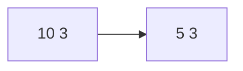
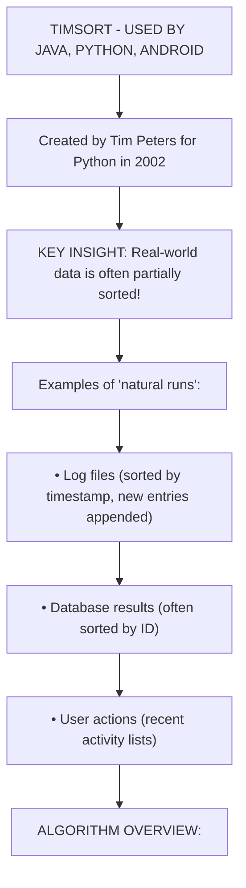
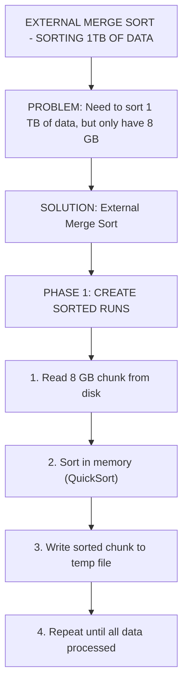
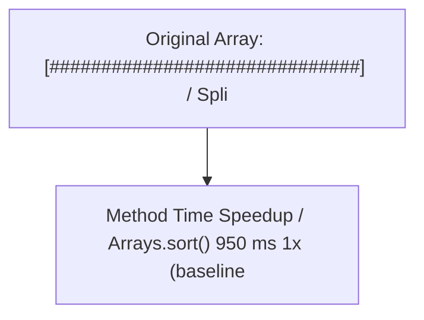
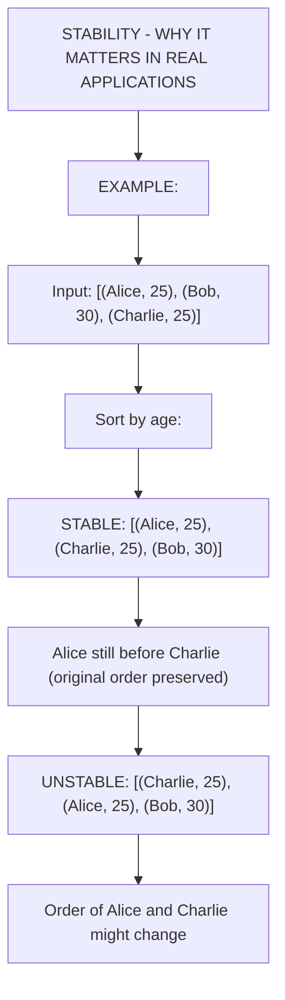
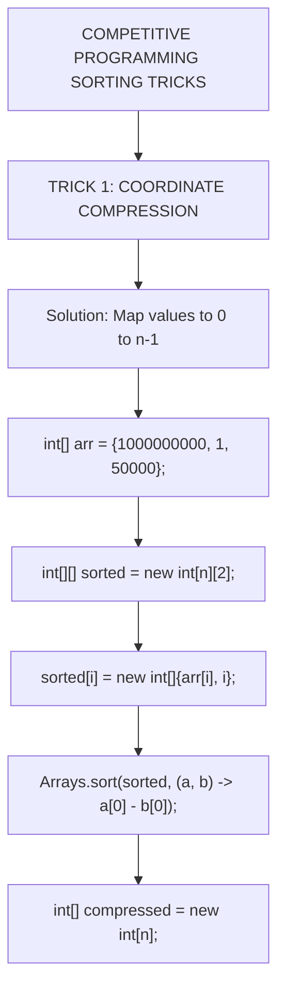

> **Navigation**: [< Previous Chapter](02a_Sorting_Fundamentals.md) | [Back to Index](../00_MASTER_INDEX.md)
> 🧠 **Mental Model**: See [Complexity Intuition](../14_Mental_Models/09_Complexity_Intuition.md) — heap sort, counting sort, and non-comparison bounds

---

# 📦 Part 7: Heap Sort

## The Idea

```
Use a heap (max-heap) to sort!
1. Build max-heap from array
2. Repeatedly extract max (root) and place at end
3. Heapify remaining

The heap property: parent >= children
Max element always at root!
```

## Visual Trace

```
Array: [4, 10, 3, 5, 1]

STEP 1: Build max-heap

        Original:        Heapified:
            4                10
           / \              /  \
          10  3     →      5    3
         / \              / \
        5   1            4   1

        Array: [10, 5, 3, 4, 1]

STEP 2: Extract max and heapify

        Swap 10 with 1:  [1, 5, 3, 4, 10]
        Heapify:         [5, 4, 3, 1 | 10]

        Swap 5 with 1:   [1, 4, 3, 5 | 10]
        Heapify:         [4, 1, 3 | 5, 10]

        Swap 4 with 3:   [3, 1, 4 | 5, 10]
        Heapify:         [3, 1 | 4, 5, 10]

        Swap 3 with 1:   [1, 3 | 4, 5, 10]

        Done!            [1, 3, 4, 5, 10] ✓
```

**Flow:**
- 10 3
- ↓
- 5 3



## Code

```java
public void heapSort(int[] arr) {
    int n = arr.length;

    // Build max heap
    for (int i = n / 2 - 1; i >= 0; i--) {
        heapify(arr, n, i);
    }

    // Extract elements from heap
    for (int i = n - 1; i > 0; i--) {
        // Move current root to end
        int temp = arr[0];
        arr[0] = arr[i];
        arr[i] = temp;

        // Heapify reduced heap
        heapify(arr, i, 0);
    }
}

private void heapify(int[] arr, int n, int i) {
    int largest = i;
    int left = 2 * i + 1;
    int right = 2 * i + 2;

    if (left < n && arr[left] > arr[largest]) {
        largest = left;
    }

    if (right < n && arr[right] > arr[largest]) {
        largest = right;
    }

    if (largest != i) {
        int temp = arr[i];
        arr[i] = arr[largest];
        arr[largest] = temp;

        heapify(arr, n, largest);
    }
}

// TIME:  O(n log n) always
// SPACE: O(1) - in-place
// STABLE: No

// BEST FOR: When O(n log n) guaranteed needed, limited memory
```

---

# ⚖️ Part 8: Comparison Table

```
┌─────────────┬──────────┬───────────┬───────────┬────────┬─────────┐
│  Algorithm  │  Best    │  Average  │  Worst    │ Space  │ Stable  │
├─────────────┼──────────┼───────────┼───────────┼────────┼─────────┤
│ Bubble      │ O(n)     │ O(n²)     │ O(n²)     │ O(1)   │ Yes     │
│ Selection   │ O(n²)    │ O(n²)     │ O(n²)     │ O(1)   │ No      │
│ Insertion   │ O(n)     │ O(n²)     │ O(n²)     │ O(1)   │ Yes     │
│ Merge       │ O(n logn)│ O(n logn) │ O(n logn) │ O(n)   │ Yes     │
│ Quick       │ O(n logn)│ O(n logn) │ O(n²)     │ O(logn)│ No      │
│ Heap        │ O(n logn)│ O(n logn) │ O(n logn) │ O(1)   │ No      │
└─────────────┴──────────┴───────────┴───────────┴────────┴─────────┘
```

---

# 📌 Part 9: When to Use Which

```
USE INSERTION SORT WHEN:
- Array is small (n < 50)
- Array is nearly sorted
- Need stable sort with O(1) space

USE MERGE SORT WHEN:
- Need stable sort
- Sorting linked lists
- External sorting (large files)
- Worst case must be O(n log n)

USE QUICK SORT WHEN:
- General purpose sorting
- Average case performance matters
- In-place sorting preferred

USE HEAP SORT WHEN:
- Need guaranteed O(n log n)
- Memory is very limited
- Don't need stability

USE BUILT-IN SORT:
- In interviews (unless asked to implement)
- Arrays.sort() uses dual-pivot quicksort for primitives
- Arrays.sort() uses TimSort for objects (stable)
```

---

# 💪 Part 10: Practice Problems

```
EASY:
1. Sort an array (implement each algorithm)
2. Sort array by parity (even then odd)
3. Sort colors (Dutch national flag)

MEDIUM:
1. Merge sorted arrays
2. Sort list (linked list merge sort)
3. Kth largest element (quick select)
4. Meeting rooms (sort by start time)

HARD:
1. Count inversions (modified merge sort)
2. Maximum gap (bucket sort concept)
3. Median of two sorted arrays
```

---

# PART 11: Non-Comparison Sorting Algorithms

## Counting Sort

```
CONCEPT:
Count occurrences of each element.
Works only for integers in a known range.

TIME: O(n + k) where k = range of input
SPACE: O(k)
STABLE: Yes (with proper implementation)
```

```java
public int[] countingSort(int[] arr) {
    if (arr.length == 0) return arr;

    // Find range
    int min = arr[0], max = arr[0];
    for (int num : arr) {
        min = Math.min(min, num);
        max = Math.max(max, num);
    }

    int range = max - min + 1;
    int[] count = new int[range];
    int[] output = new int[arr.length];

    // Count occurrences
    for (int num : arr) {
        count[num - min]++;
    }

    // Cumulative count (for stability)
    for (int i = 1; i < range; i++) {
        count[i] += count[i - 1];
    }

    // Build output (traverse backwards for stability)
    for (int i = arr.length - 1; i >= 0; i--) {
        output[count[arr[i] - min] - 1] = arr[i];
        count[arr[i] - min]--;
    }

    return output;
}

// Visual:
// Array: [4, 2, 2, 8, 3, 3, 1]
// Count: [1, 2, 2, 1, 0, 0, 0, 1] (for values 1-8)
// Cumulative: [1, 3, 5, 6, 6, 6, 6, 7]
// Output: [1, 2, 2, 3, 3, 4, 8]
```

## Radix Sort

```
CONCEPT:
Sort by individual digits, from least significant to most significant.
Uses counting sort as a subroutine.

TIME: O(d * (n + k)) where d = number of digits, k = base
SPACE: O(n + k)
STABLE: Yes
```

```java
public void radixSort(int[] arr) {
    if (arr.length == 0) return;

    int max = Arrays.stream(arr).max().getAsInt();

    // Sort by each digit (1s, 10s, 100s, ...)
    for (int exp = 1; max / exp > 0; exp *= 10) {
        countingSortByDigit(arr, exp);
    }
}

private void countingSortByDigit(int[] arr, int exp) {
    int n = arr.length;
    int[] output = new int[n];
    int[] count = new int[10];

    // Count occurrences of each digit
    for (int num : arr) {
        int digit = (num / exp) % 10;
        count[digit]++;
    }

    // Cumulative count
    for (int i = 1; i < 10; i++) {
        count[i] += count[i - 1];
    }

    // Build output
    for (int i = n - 1; i >= 0; i--) {
        int digit = (arr[i] / exp) % 10;
        output[count[digit] - 1] = arr[i];
        count[digit]--;
    }

    System.arraycopy(output, 0, arr, 0, n);
}

// Visual:
// Array: [170, 45, 75, 90, 802, 24, 2, 66]
// By 1s: [170, 90, 802, 2, 24, 45, 75, 66]
// By 10s: [802, 2, 24, 45, 66, 170, 75, 90]
// By 100s: [2, 24, 45, 66, 75, 90, 170, 802]
```

## Bucket Sort

```
CONCEPT:
Distribute elements into buckets, sort each bucket, concatenate.
Works best when input is uniformly distributed.

TIME: O(n + k) average, O(n²) worst
SPACE: O(n + k)
STABLE: Depends on bucket sorting algorithm
```

```java
public void bucketSort(float[] arr) {
    if (arr.length == 0) return;

    int n = arr.length;
    List<List<Float>> buckets = new ArrayList<>();
    for (int i = 0; i < n; i++) {
        buckets.add(new ArrayList<>());
    }

    // Distribute elements into buckets
    for (float num : arr) {
        int bucketIndex = (int) (n * num);  // Assuming 0 <= num < 1
        buckets.get(bucketIndex).add(num);
    }

    // Sort each bucket
    for (List<Float> bucket : buckets) {
        Collections.sort(bucket);
    }

    // Concatenate buckets
    int index = 0;
    for (List<Float> bucket : buckets) {
        for (float num : bucket) {
            arr[index++] = num;
        }
    }
}

// Visual:
// Array: [0.78, 0.17, 0.39, 0.26, 0.72, 0.94, 0.21, 0.12]
// Bucket 0: [0.17, 0.12]
// Bucket 1: [0.26, 0.21]
// Bucket 2: [0.39]
// Bucket 3: []
// Bucket 4: []
// Bucket 5: []
// Bucket 6: []
// Bucket 7: [0.78, 0.72]
// Bucket 8: []
// Bucket 9: [0.94]
// After sorting buckets and concatenating:
// [0.12, 0.17, 0.21, 0.26, 0.39, 0.72, 0.78, 0.94]
```

---

# PART 12: Hybrid Sorting Algorithms

## TimSort (Java's Arrays.sort for Objects)

```
CONCEPT:
Hybrid of merge sort and insertion sort.
Finds "runs" (already sorted subsequences) and merges them.

TIME: O(n log n)
SPACE: O(n)
STABLE: Yes

KEY FEATURES:
- Best case O(n) when array is already sorted
- Optimized for real-world data that often has existing patterns
- Uses insertion sort for small runs (typically 32-64 elements)
```

```java
// Simplified TimSort concept
public void timSort(int[] arr) {
    int n = arr.length;
    int RUN = 32;  // Minimum run size

    // Sort individual runs using insertion sort
    for (int i = 0; i < n; i += RUN) {
        insertionSort(arr, i, Math.min(i + RUN - 1, n - 1));
    }

    // Merge runs
    for (int size = RUN; size < n; size *= 2) {
        for (int left = 0; left < n; left += 2 * size) {
            int mid = left + size - 1;
            int right = Math.min(left + 2 * size - 1, n - 1);

            if (mid < right) {
                merge(arr, left, mid, right);
            }
        }
    }
}

private void insertionSort(int[] arr, int left, int right) {
    for (int i = left + 1; i <= right; i++) {
        int key = arr[i];
        int j = i - 1;
        while (j >= left && arr[j] > key) {
            arr[j + 1] = arr[j];
            j--;
        }
        arr[j + 1] = key;
    }
}
```

## Introsort (C++ std::sort)

```
CONCEPT:
Starts with quicksort, switches to heapsort if recursion is too deep,
uses insertion sort for small partitions.

TIME: O(n log n) guaranteed
SPACE: O(log n)
STABLE: No
```

```java
public void introsort(int[] arr) {
    int maxDepth = 2 * (int) Math.floor(Math.log(arr.length) / Math.log(2));
    introsortHelper(arr, 0, arr.length - 1, maxDepth);
}

private void introsortHelper(int[] arr, int low, int high, int depthLimit) {
    int size = high - low + 1;

    if (size < 16) {
        // Use insertion sort for small arrays
        insertionSort(arr, low, high);
        return;
    }

    if (depthLimit == 0) {
        // Switch to heapsort to avoid O(n²) worst case
        heapSort(arr, low, high);
        return;
    }

    // Use quicksort
    int pivot = partition(arr, low, high);
    introsortHelper(arr, low, pivot - 1, depthLimit - 1);
    introsortHelper(arr, pivot + 1, high, depthLimit - 1);
}
```

---

# PART 13: Sorting Algorithm Variations

## QuickSelect (Finding Kth Element)

```java
// Find kth smallest element in O(n) average time
public int quickSelect(int[] arr, int k) {
    return quickSelect(arr, 0, arr.length - 1, k - 1);
}

private int quickSelect(int[] arr, int low, int high, int k) {
    if (low == high) return arr[low];

    int pivotIndex = partition(arr, low, high);

    if (k == pivotIndex) {
        return arr[k];
    } else if (k < pivotIndex) {
        return quickSelect(arr, low, pivotIndex - 1, k);
    } else {
        return quickSelect(arr, pivotIndex + 1, high, k);
    }
}

private int partition(int[] arr, int low, int high) {
    // Random pivot for better average case
    int randomIndex = low + (int)(Math.random() * (high - low + 1));
    swap(arr, randomIndex, high);

    int pivot = arr[high];
    int i = low - 1;

    for (int j = low; j < high; j++) {
        if (arr[j] <= pivot) {
            i++;
            swap(arr, i, j);
        }
    }

    swap(arr, i + 1, high);
    return i + 1;
}

// TIME: O(n) average, O(n²) worst
// SPACE: O(1)
```

## Count Inversions (Modified Merge Sort)

```java
// An inversion is a pair (i, j) where i < j but arr[i] > arr[j]
public long countInversions(int[] arr) {
    int[] temp = new int[arr.length];
    return mergeSort(arr, temp, 0, arr.length - 1);
}

private long mergeSort(int[] arr, int[] temp, int left, int right) {
    long invCount = 0;

    if (left < right) {
        int mid = left + (right - left) / 2;

        invCount += mergeSort(arr, temp, left, mid);
        invCount += mergeSort(arr, temp, mid + 1, right);
        invCount += merge(arr, temp, left, mid, right);
    }

    return invCount;
}

private long merge(int[] arr, int[] temp, int left, int mid, int right) {
    int i = left, j = mid + 1, k = left;
    long invCount = 0;

    while (i <= mid && j <= right) {
        if (arr[i] <= arr[j]) {
            temp[k++] = arr[i++];
        } else {
            temp[k++] = arr[j++];
            // All remaining elements in left half are greater than arr[j]
            invCount += (mid - i + 1);
        }
    }

    while (i <= mid) temp[k++] = arr[i++];
    while (j <= right) temp[k++] = arr[j++];

    System.arraycopy(temp, left, arr, left, right - left + 1);
    return invCount;
}

// Example:
// Array: [8, 4, 2, 1]
// Inversions: (8,4), (8,2), (8,1), (4,2), (4,1), (2,1) = 6
```

## Dutch National Flag (3-way Partition)

```java
// Sort array containing only 0s, 1s, and 2s in O(n)
public void sortColors(int[] nums) {
    int low = 0, mid = 0, high = nums.length - 1;

    while (mid <= high) {
        if (nums[mid] == 0) {
            swap(nums, low, mid);
            low++;
            mid++;
        } else if (nums[mid] == 1) {
            mid++;
        } else {  // nums[mid] == 2
            swap(nums, mid, high);
            high--;
            // Don't increment mid, need to check swapped element
        }
    }
}

// Visual:
// [2, 0, 2, 1, 1, 0]
//  L  M           H
// [0, 0, 2, 1, 1, 2]
//     L  M     H
// [0, 0, 1, 1, 2, 2]
//        L  M  H
// [0, 0, 1, 1, 2, 2]  Done! (M > H)
```

---

# PART 14: Sorting in Practice

## Custom Comparators in Java

```java
// Sort objects by custom criteria
class Person {
    String name;
    int age;
}

// Sort by age ascending
Arrays.sort(people, (a, b) -> a.age - b.age);

// Sort by name, then by age
Arrays.sort(people, (a, b) -> {
    int nameCompare = a.name.compareTo(b.name);
    if (nameCompare != 0) return nameCompare;
    return a.age - b.age;
});

// Using Comparator chaining
Arrays.sort(people,
    Comparator.comparing(Person::getName)
              .thenComparingInt(Person::getAge)
              .reversed());

// Sort integers as strings (lexicographic)
Integer[] nums = {3, 30, 34, 5, 9};
Arrays.sort(nums, (a, b) -> (b + "" + a).compareTo(a + "" + b));
// Result: [9, 5, 34, 3, 30] -> "9534330" (largest number)

// Partial sort: sort only part of array
Arrays.sort(arr, fromIndex, toIndex);
```

## Sorting Linked Lists

```java
// Merge sort is ideal for linked lists (O(1) space if using bottom-up)
public ListNode sortList(ListNode head) {
    if (head == null || head.next == null) return head;

    // Find middle
    ListNode slow = head, fast = head, prev = null;
    while (fast != null && fast.next != null) {
        prev = slow;
        slow = slow.next;
        fast = fast.next.next;
    }
    prev.next = null;  // Split the list

    // Sort each half
    ListNode left = sortList(head);
    ListNode right = sortList(slow);

    // Merge
    return merge(left, right);
}

private ListNode merge(ListNode l1, ListNode l2) {
    ListNode dummy = new ListNode(0);
    ListNode curr = dummy;

    while (l1 != null && l2 != null) {
        if (l1.val <= l2.val) {
            curr.next = l1;
            l1 = l1.next;
        } else {
            curr.next = l2;
            l2 = l2.next;
        }
        curr = curr.next;
    }

    curr.next = (l1 != null) ? l1 : l2;
    return dummy.next;
}
```

## External Sorting (Large Files)

```
CONCEPT:
When data doesn't fit in memory, use external merge sort.

ALGORITHM:
1. Divide file into chunks that fit in memory
2. Sort each chunk in memory, write to temp files
3. Merge sorted temp files (k-way merge)

KEY CONSIDERATIONS:
- Use BufferedReader/Writer for efficient I/O
- Minimize number of disk seeks
- Use memory-mapped files for better performance
```

```java
// Simplified k-way merge concept
public void kWayMerge(List<Scanner> sortedFiles, PrintWriter output) {
    // Min-heap to track smallest element from each file
    PriorityQueue<int[]> pq = new PriorityQueue<>((a, b) -> a[0] - b[0]);

    // Initialize with first element from each file
    for (int i = 0; i < sortedFiles.size(); i++) {
        if (sortedFiles.get(i).hasNextInt()) {
            pq.offer(new int[]{sortedFiles.get(i).nextInt(), i});
        }
    }

    while (!pq.isEmpty()) {
        int[] min = pq.poll();
        output.println(min[0]);

        // Add next element from same file
        if (sortedFiles.get(min[1]).hasNextInt()) {
            pq.offer(new int[]{sortedFiles.get(min[1]).nextInt(), min[1]});
        }
    }
}
```

---

# PART 15: Sorting-Based Interview Problems

## Problem 1: Merge Intervals

```java
public int[][] merge(int[][] intervals) {
    if (intervals.length <= 1) return intervals;

    // Sort by start time
    Arrays.sort(intervals, (a, b) -> a[0] - b[0]);

    List<int[]> result = new ArrayList<>();
    int[] current = intervals[0];

    for (int i = 1; i < intervals.length; i++) {
        if (intervals[i][0] <= current[1]) {
            // Overlapping, merge
            current[1] = Math.max(current[1], intervals[i][1]);
        } else {
            // Non-overlapping, add current and start new
            result.add(current);
            current = intervals[i];
        }
    }
    result.add(current);

    return result.toArray(new int[result.size()][]);
}
```

## Problem 2: Meeting Rooms II (Min Rooms Needed)

```java
public int minMeetingRooms(int[][] intervals) {
    int n = intervals.length;
    int[] starts = new int[n];
    int[] ends = new int[n];

    for (int i = 0; i < n; i++) {
        starts[i] = intervals[i][0];
        ends[i] = intervals[i][1];
    }

    Arrays.sort(starts);
    Arrays.sort(ends);

    int rooms = 0, endPtr = 0;
    for (int start : starts) {
        if (start < ends[endPtr]) {
            rooms++;
        } else {
            endPtr++;
        }
    }

    return rooms;
}
```

## Problem 3: Largest Number

```java
public String largestNumber(int[] nums) {
    String[] strs = new String[nums.length];
    for (int i = 0; i < nums.length; i++) {
        strs[i] = String.valueOf(nums[i]);
    }

    // Custom comparator: "30" vs "3" -> compare "303" vs "330"
    Arrays.sort(strs, (a, b) -> (b + a).compareTo(a + b));

    // Handle case where all zeros
    if (strs[0].equals("0")) return "0";

    StringBuilder sb = new StringBuilder();
    for (String s : strs) {
        sb.append(s);
    }

    return sb.toString();
}
```

## Problem 4: H-Index

```java
public int hIndex(int[] citations) {
    Arrays.sort(citations);
    int n = citations.length;

    for (int i = 0; i < n; i++) {
        int h = n - i;  // Papers with at least h citations
        if (citations[i] >= h) {
            return h;
        }
    }

    return 0;
}

// O(n) solution using counting sort
public int hIndexLinear(int[] citations) {
    int n = citations.length;
    int[] count = new int[n + 1];

    for (int c : citations) {
        count[Math.min(c, n)]++;
    }

    int papers = 0;
    for (int h = n; h >= 0; h--) {
        papers += count[h];
        if (papers >= h) return h;
    }

    return 0;
}
```

---

_Understanding sorting algorithms teaches you how to think about efficiency!_ 🔄

---

# 🔬 PART FINAL: ADVANCED SORTING DEEP DIVE

## 🔄 Radix Sort — Non — Comparison Based Sorting

```
┌─────────────────────────────────────────────────────────────────────────────────┐
│                    RADIX SORT - BEATING O(n log n)                              │
├─────────────────────────────────────────────────────────────────────────────────┤
│                                                                                 │
│  CLAIM: No comparison-based sort can be faster than O(n log n)                  │
│  REALITY: Radix sort achieves O(nk) where k = number of digits!                 │
│                                                                                 │
│  For 32-bit integers with decimal digits:                                       │
│  • k = 10 (maximum 10 digits in 32-bit integer)                                 │
│  • O(n × 10) = O(n) linear time!                                                │
│                                                                                 │
│                                                                                 │
│  ALGORITHM (LSD - Least Significant Digit first):                               │
│  ────────────────────────────────────────────────                               │
│  Sort by each digit, starting from rightmost                                    │
│  Use stable counting sort for each digit position                               │
│                                                                                 │
│  Example: Sort [170, 45, 75, 90, 802, 24, 2, 66]                                │
│                                                                                 │
│  PASS 1 (ones digit):                                                           │
│  Bucket 0: [170, 90]                                                            │
│  Bucket 2: [802, 2]                                                             │
│  Bucket 4: [24]                                                                 │
│  Bucket 5: [45, 75]                                                             │
│  Bucket 6: [66]                                                                 │
│  After: [170, 90, 802, 2, 24, 45, 75, 66]                                       │
│                                                                                 │
│  PASS 2 (tens digit):                                                           │
│  Bucket 0: [802, 2]    (02, 02)                                                 │
│  Bucket 2: [24]        (24)                                                     │
│  Bucket 4: [45]        (45)                                                     │
│  Bucket 6: [66]        (66)                                                     │
│  Bucket 7: [170, 75]   (70, 75)                                                 │
│  Bucket 9: [90]        (90)                                                     │
│  After: [802, 2, 24, 45, 66, 170, 75, 90]                                       │
│                                                                                 │
│  PASS 3 (hundreds digit):                                                       │
│  Bucket 0: [2, 24, 45, 66, 75, 90]                                              │
│  Bucket 1: [170]                                                                │
│  Bucket 8: [802]                                                                │
│  After: [2, 24, 45, 66, 75, 90, 170, 802] ✓ SORTED!                             │
│                                                                                 │
│                                                                                 │
│  JAVA IMPLEMENTATION:                                                           │
│  ────────────────────                                                           │
│  public void radixSort(int[] arr) {                                             │
│      int max = getMax(arr);                                                     │
│                                                                                 │
│      // Do counting sort for every digit                                        │
│      for (int exp = 1; max / exp > 0; exp *= 10) {                              │
│          countingSortByDigit(arr, exp);                                         │
│      }                                                                          │
│  }                                                                              │
│                                                                                 │
│  private void countingSortByDigit(int[] arr, int exp) {                         │
│      int n = arr.length;                                                        │
│      int[] output = new int[n];                                                 │
│      int[] count = new int[10];  // Digits 0-9                                  │
│                                                                                 │
│      // Count occurrences of each digit                                         │
│      for (int i = 0; i < n; i++)                                                │
│          count[(arr[i] / exp) % 10]++;                                          │
│                                                                                 │
│      // Convert counts to positions                                             │
│      for (int i = 1; i < 10; i++)                                               │
│          count[i] += count[i - 1];                                              │
│                                                                                 │
│      // Build output array (reverse for stability)                              │
│      for (int i = n - 1; i >= 0; i--) {                                         │
│          int digit = (arr[i] / exp) % 10;                                       │
│          output[count[digit] - 1] = arr[i];                                     │
│          count[digit]--;                                                        │
│      }                                                                          │
│                                                                                 │
│      // Copy back                                                               │
│      System.arraycopy(output, 0, arr, 0, n);                                    │
│  }                                                                              │
│                                                                                 │
│                                                                                 │
│  WHEN TO USE RADIX SORT:                                                        │
│  ──────────────────────                                                         │
│  ✅ Integers with limited range                                                  │
│  ✅ Strings of fixed length                                                      │
│  ✅ When n is very large and k is small                                          │
│  ❌ Floating point numbers (tricky representation)                               │
│  ❌ When range is huge (k becomes large)                                         │
│                                                                                 │
└─────────────────────────────────────────────────────────────────────────────────┘
```

## 🔄 Timsort — the Real — World Champion

```
┌─────────────────────────────────────────────────────────────────────────────────┐
│                    TIMSORT - USED BY JAVA, PYTHON, ANDROID                      │
├─────────────────────────────────────────────────────────────────────────────────┤
│                                                                                 │
│  Created by Tim Peters for Python in 2002                                       │
│  Now used in: Java (Arrays.sort for objects), Python, Android                   │
│                                                                                 │
│  KEY INSIGHT: Real-world data is often partially sorted!                        │
│                                                                                 │
│  Examples of "natural runs":                                                    │
│  • Log files (sorted by timestamp, new entries appended)                        │
│  • Database results (often sorted by ID)                                        │
│  • User actions (recent activity lists)                                         │
│                                                                                 │
│                                                                                 │
│  ALGORITHM OVERVIEW:                                                            │
│  ───────────────────                                                            │
│  1. FIND RUNS: Identify naturally sorted sequences                              │
│     [3, 5, 7, 2, 1, 4, 6, 8] has runs: [3,5,7], [1,2], [4,6,8]                  │
│                                                                                 │
│  2. EXTEND SMALL RUNS: If run < minrun (usually 32-64), extend with             │
│     Insertion Sort (fast for small arrays)                                      │
│                                                                                 │
│  3. MERGE RUNS: Use galloping merge for runs of different sizes                 │
│     Smart stack-based merging strategy                                          │
│                                                                                 │
│                                                                                 │
│  GALLOPING MODE:                                                                │
│  ───────────────                                                                │
│  When merging [1,2,3,100,101,102] with [50,51,52,200,201,202]                   │
│                                                                                 │
│  Standard merge: Compare one by one                                             │
│  Galloping: If 7 consecutive elements come from same array,                     │
│             switch to exponential search to find merge point                    │
│                                                                                 │
│  This handles "one array is much smaller" case efficiently                      │
│                                                                                 │
│                                                                                 │
│  PERFORMANCE:                                                                   │
│  ────────────                                                                   │
│  • Already sorted: O(n) - just identifies one big run                           │
│  • Reverse sorted: O(n) - reverses the run, still O(n)                          │
│  • Random: O(n log n) - falls back to merge sort behavior                       │
│  • Mostly sorted: O(n) to O(n log n) - exploits existing order                  │
│                                                                                 │
│                                                                                 │
│  WHY JAVA USES TIMSORT FOR OBJECTS:                                             │
│  ───────────────────────────────────                                            │
│  1. STABILITY: Equal objects keep their relative order                          │
│     Essential for multi-key sorting (sort by name, then by age)                 │
│                                                                                 │
│  2. REAL-WORLD PERFORMANCE: Most data has some order                            │
│     TimSort exploits this, often faster than pure QuickSort                     │
│                                                                                 │
│  3. COMPARISON COST: Object.compareTo() is expensive                            │
│     TimSort minimizes comparisons                                               │
│                                                                                 │
└─────────────────────────────────────────────────────────────────────────────────┘
```

**Flow:**
- TIMSORT - USED BY JAVA, PYTHON, ANDROID
- ↓
- Created by Tim Peters for Python in 2002
- ↓
- KEY INSIGHT: Real-world data is often partially sorted!
- ↓
- Examples of 'natural runs':
- ↓
- • Log files (sorted by timestamp, new entries appended)
- ↓
- • Database results (often sorted by ID)
- ↓
- • User actions (recent activity lists)



## 🧠 External Sorting — When Data Doesn't Fit in Memory

```
┌─────────────────────────────────────────────────────────────────────────────────┐
│                    EXTERNAL MERGE SORT - SORTING 1TB OF DATA                    │
├─────────────────────────────────────────────────────────────────────────────────┤
│                                                                                 │
│  PROBLEM: Need to sort 1 TB of data, but only have 8 GB RAM                     │
│                                                                                 │
│  SOLUTION: External Merge Sort                                                  │
│                                                                                 │
│  PHASE 1: CREATE SORTED RUNS                                                    │
│  ────────────────────────────                                                   │
│  1. Read 8 GB chunk from disk                                                   │
│  2. Sort in memory (QuickSort)                                                  │
│  3. Write sorted chunk to temp file                                             │
│  4. Repeat until all data processed                                             │
│                                                                                 │
│  Result: 128 sorted files of 8 GB each                                          │
│                                                                                 │
│                                                                                 │
│  PHASE 2: K-WAY MERGE                                                           │
│  ────────────────────                                                           │
│  Can't merge all 128 files at once (need buffer for each)                       │
│                                                                                 │
│  With 8 GB RAM and 64 MB buffers:                                               │
│  • Can merge ~120 files at once                                                 │
│  • But 128 > 120, so need multiple passes                                       │
│                                                                                 │
│  MERGE STRATEGY:                                                                │
│  ┌───────────────────────────────────────────────────────────────────────────┐  │
│  │                                                                           │  │
│  │  Pass 1: Merge files 1-120 → temp1                                       │   │
│  │          Merge files 121-128 → temp2                                     │   │
│  │                                                                           │  │
│  │  Pass 2: Merge temp1 + temp2 → final output                              │   │
│  │                                                                           │  │
│  └───────────────────────────────────────────────────────────────────────────┘  │
│                                                                                 │
│  K-WAY MERGE WITH MIN-HEAP:                                                     │
│  ──────────────────────────                                                     │
│  1. Put first element from each file in min-heap                                │
│  2. Extract min, write to output                                                │
│  3. Read next element from same file, add to heap                               │
│  4. Repeat until all files exhausted                                            │
│                                                                                 │
│  Time per element: O(log k) where k = number of files                           │
│  Total: O(n log k)                                                              │
│                                                                                 │
│                                                                                 │
│  REAL-WORLD EXAMPLE: GOOGLE MAPREDUCE SORTING                                   │
│  ─────────────────────────────────────────────                                  │
│  • 2008 record: Sorted 1 PB (1000 TB) in 6 hours                                │
│  • Used 4000 machines                                                           │
│  • Each machine sorted ~250 GB locally                                          │
│  • Then merged across network                                                   │
│                                                                                 │
└─────────────────────────────────────────────────────────────────────────────────┘
```

**Flow:**
- EXTERNAL MERGE SORT - SORTING 1TB OF DATA
- ↓
- PROBLEM: Need to sort 1 TB of data, but only have 8 GB
- ↓
- SOLUTION: External Merge Sort
- ↓
- PHASE 1: CREATE SORTED RUNS
- ↓
- 1. Read 8 GB chunk from disk
- ↓
- 2. Sort in memory (QuickSort)
- ↓
- 3. Write sorted chunk to temp file



## 🔄 Parallel Sorting — Using Multiple CPU Cores

```
┌─────────────────────────────────────────────────────────────────────────────────┐
│                    PARALLEL SORTING - MULTI-CORE PERFORMANCE                    │
├─────────────────────────────────────────────────────────────────────────────────┤
│                                                                                 │
│  JAVA 8+: Arrays.parallelSort()                                                 │
│  ────────────────────────────                                                   │
│  Uses Fork/Join framework to parallelize merge sort                             │
│                                                                                 │
│  int[] arr = new int[10_000_000];                                               │
│  // Fill with random numbers                                                    │
│  Arrays.parallelSort(arr);  // Uses all CPU cores!                              │
│                                                                                 │
│                                                                                 │
│  HOW IT WORKS:                                                                  │
│  ────────────                                                                   │
│  1. Split array into chunks (one per core)                                      │
│  2. Sort each chunk in parallel (using QuickSort)                               │
│  3. Merge sorted chunks (can also be parallelized)                              │
│                                                                                 │
│  ┌───────────────────────────────────────────────────────────────────────────┐  │
│  │                                                                           │  │
│  │  Original Array: [##############################]                         │  │
│  │                                                                           │  │
│  │  Split:    [########] [########] [########] [########]                   │   │
│  │             Core 1     Core 2     Core 3     Core 4                      │   │
│  │                ↓          ↓          ↓          ↓                        │   │
│  │  Sort:     [sorted]   [sorted]   [sorted]   [sorted]                    │    │
│  │                ↘          ↙          ↘          ↙                        │   │
│  │  Merge L1:      [merged]              [merged]                           │   │
│  │                     ↘                    ↙                                │  │
│  │  Merge L2:              [FINAL SORTED]                                   │   │
│  │                                                                           │  │
│  └───────────────────────────────────────────────────────────────────────────┘  │
│                                                                                 │
│                                                                                 │
│  SPEEDUP:                                                                       │
│  ────────                                                                       │
│  • 4 cores: ~3.5x faster (not 4x due to merge overhead)                         │
│  • 8 cores: ~6x faster                                                          │
│  • 16 cores: ~10x faster (diminishing returns)                                  │
│                                                                                 │
│  THRESHOLD: parallelSort only kicks in for arrays > 8192 elements               │
│  Below that, sequential sort is faster (no parallel overhead)                   │
│                                                                                 │
│                                                                                 │
│  BENCHMARK (10 million integers, 8-core CPU):                                   │
│  ┌───────────────────┬───────────────┬──────────────────────────────────────┐   │
│  │ Method            │ Time          │ Speedup                              │   │
│  ├───────────────────┼───────────────┼──────────────────────────────────────┤   │
│  │ Arrays.sort()     │ 950 ms        │ 1x (baseline)                        │   │
│  │ parallelSort()    │ 180 ms        │ 5.3x                                 │   │
│  │ Custom parallel   │ 160 ms        │ 5.9x (optimized)                     │   │
│  └───────────────────┴───────────────┴──────────────────────────────────────┘   │
│                                                                                 │
└─────────────────────────────────────────────────────────────────────────────────┘
```

**Flow:**
- Original Array: [##############################] / Spli
- ↓
- Method Time Speedup / Arrays.sort() 950 ms 1x (baseline



## 🔄 Sorting Stability — Deep Explanation

```
┌─────────────────────────────────────────────────────────────────────────────────┐
│                    STABILITY - WHY IT MATTERS IN REAL APPLICATIONS              │
├─────────────────────────────────────────────────────────────────────────────────┤
│                                                                                 │
│  DEFINITION: Stable sort preserves relative order of equal elements             │
│                                                                                 │
│  EXAMPLE:                                                                       │
│  Input:  [(Alice, 25), (Bob, 30), (Charlie, 25)]                                │
│  Sort by age:                                                                   │
│                                                                                 │
│  STABLE:   [(Alice, 25), (Charlie, 25), (Bob, 30)]                              │
│            Alice still before Charlie (original order preserved)                │
│                                                                                 │
│  UNSTABLE: [(Charlie, 25), (Alice, 25), (Bob, 30)]                              │
│            Order of Alice and Charlie might change                              │
│                                                                                 │
│                                                                                 │
│  WHY STABILITY MATTERS:                                                         │
│  ──────────────────────                                                         │
│                                                                                 │
│  SCENARIO: E-commerce product listing                                           │
│  1. First sort by rating (highest first)                                        │
│  2. Then sort by price (lowest first)                                           │
│                                                                                 │
│  WITH STABLE SORT:                                                              │
│  After step 1: Products ordered by rating                                       │
│  After step 2: Products ordered by price, but WITHIN same price,                │
│                higher-rated products come first!                                │
│                                                                                 │
│  This is called "multi-key sorting" or "sort then sort again"                   │
│                                                                                 │
│                                                                                 │
│  STABLE ALGORITHMS:                                                             │
│  ─────────────────                                                              │
│  • Insertion Sort (elements only move past smaller elements)                    │
│  • Merge Sort (equal elements taken from left half first)                       │
│  • Counting Sort (preserves input order in each bucket)                         │
│  • Radix Sort (uses stable counting sort per digit)                             │
│  • TimSort (designed to be stable)                                              │
│                                                                                 │
│                                                                                 │
│  UNSTABLE ALGORITHMS:                                                           │
│  ───────────────────                                                            │
│  • QuickSort (swap can exchange equal elements)                                 │
│  • HeapSort (heap structure doesn't preserve order)                             │
│  • Selection Sort (swap can disturb equal elements)                             │
│                                                                                 │
│                                                                                 │
│  MAKING UNSTABLE SORTS STABLE:                                                  │
│  ─────────────────────────────                                                  │
│  Add index as secondary key:                                                    │
│                                                                                 │
│  Original: [3a, 1, 3b, 2]                                                       │
│  With index: [(3,0), (1,1), (3,2), (2,3)]                                       │
│                                                                                 │
│  Sort by: first element, then by index if equal                                 │
│  Result: [(1,1), (2,3), (3,0), (3,2)]                                           │
│  Final: [1, 2, 3a, 3b] - STABLE!                                                │
│                                                                                 │
│  Cost: O(n) extra space for indices                                             │
│                                                                                 │
└─────────────────────────────────────────────────────────────────────────────────┘
```

**Flow:**
- STABILITY - WHY IT MATTERS IN REAL APPLICATIONS
- ↓
- EXAMPLE:
- ↓
- Input: [(Alice, 25), (Bob, 30), (Charlie, 25)]
- ↓
- Sort by age:
- ↓
- STABLE: [(Alice, 25), (Charlie, 25), (Bob, 30)]
- ↓
- Alice still before Charlie (original order preserved)
- ↓
- UNSTABLE: [(Charlie, 25), (Alice, 25), (Bob, 30)]



## 🔄 Sorting in Competitive Programming

```
┌─────────────────────────────────────────────────────────────────────────────────┐
│                    COMPETITIVE PROGRAMMING SORTING TRICKS                       │
├─────────────────────────────────────────────────────────────────────────────────┤
│                                                                                 │
│  TRICK 1: COORDINATE COMPRESSION                                                │
│  ────────────────────────────────                                               │
│  Problem: Values are huge (up to 10^9) but only n values (n ≤ 10^5)             │
│  Solution: Map values to 0 to n-1                                               │
│                                                                                 │
│  int[] arr = {1000000000, 1, 50000};                                            │
│  // Create sorted copy with indices                                             │
│  int[][] sorted = new int[n][2];                                                │
│  for (int i = 0; i < n; i++)                                                    │
│      sorted[i] = new int[]{arr[i], i};                                          │
│  Arrays.sort(sorted, (a, b) -> a[0] - b[0]);                                    │
│                                                                                 │
│  // Assign compressed values                                                    │
│  int[] compressed = new int[n];                                                 │
│  for (int i = 0; i < n; i++)                                                    │
│      compressed[sorted[i][1]] = i;                                              │
│  // Result: [2, 0, 1] (maps to 0-based ranks)                                   │
│                                                                                 │
│                                                                                 │
│  TRICK 2: CUSTOM COMPARATOR FOR COMPLEX SORTING                                 │
│  ──────────────────────────────────────────────                                 │
│  // Sort intervals by end point, then by start point                            │
│  Arrays.sort(intervals, (a, b) -> {                                             │
│      if (a[1] != b[1]) return a[1] - b[1];  // By end                           │
│      return a[0] - b[0];                     // Then by start                   │
│  });                                                                            │
│                                                                                 │
│  // Sort strings by length, then lexicographically                              │
│  Arrays.sort(strings, (a, b) -> {                                               │
│      if (a.length() != b.length())                                              │
│          return a.length() - b.length();                                        │
│      return a.compareTo(b);                                                     │
│  });                                                                            │
│                                                                                 │
│                                                                                 │
│  TRICK 3: PARTIAL SORTING WITH QUICKSELECT                                      │
│  ──────────────────────────────────────────                                     │
│  Problem: Find kth smallest element (don't need full sort)                      │
│  Solution: QuickSelect - O(n) average                                           │
│                                                                                 │
│  // Java's partial sort workaround                                              │
│  PriorityQueue<Integer> maxHeap = new PriorityQueue<>((a,b) -> b - a);          │
│  for (int num : arr) {                                                          │
│      maxHeap.offer(num);                                                        │
│      if (maxHeap.size() > k)                                                    │
│          maxHeap.poll();                                                        │
│  }                                                                              │
│  // maxHeap.peek() is kth smallest - O(n log k)                                 │
│                                                                                 │
│                                                                                 │
│  TRICK 4: SORTING + TWO POINTERS                                                │
│  ────────────────────────────────                                               │
│  Many problems become easier after sorting:                                     │
│  • Two Sum variants                                                             │
│  • Container With Most Water                                                    │
│  • 3Sum, 4Sum                                                                   │
│  • Merge intervals                                                              │
│                                                                                 │
│  Pattern:                                                                       │
│  1. Sort the input                                                              │
│  2. Use two pointers from both ends                                             │
│  3. Move pointers based on comparison                                           │
│                                                                                 │
│  // Example: Find pair with sum closest to target                               │
│  Arrays.sort(arr);                                                              │
│  int left = 0, right = arr.length - 1;                                          │
│  int closestSum = Integer.MAX_VALUE;                                            │
│  while (left < right) {                                                         │
│      int sum = arr[left] + arr[right];                                          │
│      if (Math.abs(sum - target) < Math.abs(closestSum - target))                │
│          closestSum = sum;                                                      │
│      if (sum < target) left++;                                                  │
│      else right--;                                                              │
│  }                                                                              │
│                                                                                 │
└─────────────────────────────────────────────────────────────────────────────────┘
```

**Flow:**
- COMPETITIVE PROGRAMMING SORTING TRICKS
- ↓
- TRICK 1: COORDINATE COMPRESSION
- ↓
- Solution: Map values to 0 to n-1
- ↓
- int[] arr = {1000000000, 1, 50000};
- ↓
- int[][] sorted = new int[n][2];
- ↓
- sorted[i] = new int[]{arr[i], i};
- ↓
- Arrays.sort(sorted, (a, b) -> a[0] - b[0]);



---

_Master sorting and you master a huge portion of algorithm problems!_

---

## PRACTICE PROBLEMS — Sorting & Searching

### Sorting Problems

| # | Problem | Difficulty | Source | Which Sort / Technique |
|---|---------|-----------|--------|----------------------|
| 1 | Sort an Array | Medium | LC 912 | Implement merge/quick sort |
| 2 | Sort Colors | Medium | LC 75 | Dutch National Flag (3-way) |
| 3 | Kth Largest Element | Medium | LC 215 | QuickSelect or heap |
| 4 | Merge Intervals | Medium | LC 56 | Sort by start + merge |
| 5 | Meeting Rooms II | Medium | LC 253 | Sort events + count |
| 6 | Largest Number | Medium | LC 179 | Custom comparator |
| 7 | Sort List | Medium | LC 148 | Merge sort on linked list |
| 8 | Wiggle Sort II | Medium | LC 324 | Median + 3-way partition |
| 9 | H-Index | Medium | LC 274 | Counting sort |
| 10 | Maximum Gap | Medium | LC 164 | Bucket sort — O(n)! |
| 11 | Pancake Sorting | Medium | LC 969 | Selection sort variant |
| 12 | Top K Frequent Words | Medium | LC 692 | Sort + tiebreak |

### Binary Search Problems

| # | Problem | Difficulty | Source | BS Variant |
|---|---------|-----------|--------|-----------|
| 1 | Binary Search | Easy | LC 704 | Standard template |
| 2 | Search Insert Position | Easy | LC 35 | Lower bound |
| 3 | First Bad Version | Easy | LC 278 | Left boundary |
| 4 | Search in Rotated Sorted Array | Medium | LC 33 | Modified BS |
| 5 | Find Minimum in Rotated Array | Medium | LC 153 | Inflection point |
| 6 | Search a 2D Matrix | Medium | LC 74 | Flatten + BS |
| 7 | Find Peak Element | Medium | LC 162 | Gradient BS |
| 8 | Koko Eating Bananas | Medium | LC 875 | BS on answer |
| 9 | Capacity to Ship Packages | Medium | LC 1011 | BS on answer |
| 10 | Split Array Largest Sum | Hard | LC 410 | BS + greedy check |
| 11 | Median of Two Sorted Arrays | Hard | LC 4 | BS on partition |
| 12 | Aggressive Cows (SPOJ) | Medium | SPOJ | BS on answer (classic!) |

**Hidden Gems:**

| Problem | Source | Why It's Great |
|---------|--------|---------------|
| Custom Sort String | LC 791 | Custom ordering — tests comparator understanding |
| Relative Sort Array | LC 1122 | Counting sort with custom order |
| Minimum Number of Arrows | LC 452 | Sort intervals + greedy |
| Count of Smaller Numbers After Self | Hard LC 315 | Merge sort + counting inversions |
| Magnetic Force Between Two Balls | Medium LC 1552 | Binary search on answer (like Aggressive Cows) |


---

> **Navigation**: [< Previous](02a_Sorting_Fundamentals.md) | [Back to Index](../00_MASTER_INDEX.md) | [Next >](02c_Divide_And_Conquer.md)