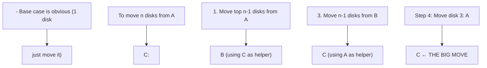

**Navigation**: [< Previous Chapter](03a_Recursion_Internals.md) | [Back to Index](../00_MASTER_INDEX.md) | [Next Chapter >](03c_Recursion_Advanced.md)
🧠 **Mental Model**: See [Recursion Tree Thinking](../14_Mental_Models/01_Recursion_Tree_Thinking.md) — base case identification and recursive leap of faith

---

## 🔗 JIT Connection — When You Need This

**Arrived here from a problem that said "find all..." or involved a tree/graph?**


| Recursion type | When you use it | Jump to PS Problems |
|---|---|---|
| **Linear recursion** | Factorial, linked list operations | [LinkedList PS](../05_Problem_Solving/15_LinkedList.md) |
| **Binary recursion** (no overlap) | Tree height, Merge Sort | [Trees PS](../05_Problem_Solving/09_Trees.md) |
| **Binary recursion** (with overlap) | Fibonacci → **add memo → DP!** | [DP PS](../05_Problem_Solving/07_DP.md) |
| **Backtracking** (Choose-Explore-Unchoose) | Subsets, Permutations, N-Queens | [Backtracking PS](../05_Problem_Solving/12_Backtracking.md) |
| **DFS** on graph | Islands, connected components | [Graphs PS](../05_Problem_Solving/10_Graphs.md) |


**Signal → Tool mapping:**
```
"Find ALL combinations/subsets/paths" → Backtracking (recursion + undo)
"Repeated sub-problems in recursion?" → Add memoization → DP
"Tree problem?" → Recursion (trust child returns the right answer)
```

📋 **All Patterns Hub:** [00_PATTERN_MASTER_GUIDE.md](../04_Patterns_Templates/00_PATTERN_MASTER_GUIDE.md)

---

# 🔁 Part 1: What is Recursion Really?

## Complete Understanding

```

╔══════════════════════════════════════════════════════════════════════════════╗
║ RECURSION - COMPLETE UNDERSTANDING                                           ║
╚══════════════════════════════════════════════════════════════════════════════╝

┌──────────────────────────────────────────────────────────────────────────────┐
│ WHAT IS RECURSION?                                                           │
├──────────────────────────────────────────────────────────────────────────────┤
│ Recursion is when a function calls ITSELF to solve smaller versions of       │
│ the SAME problem until reaching a simple case it can solve directly.         │
│                                                                              │
│ FORMAL DEFINITION: A method of solving problems where the solution           │
│ depends on solutions to smaller instances of the same problem.               │
│                                                                              │
│ INVENTOR: The concept comes from mathematical induction (1600s), but         │
│ recursive functions in computing were formalized by Stephen Kleene (1930s)   │
│ and became practical with programming languages like LISP (1958).            │
└──────────────────────────────────────────────────────────────────────────────┘

┌──────────────────────────────────────────────────────────────────────────────┐
│ WHAT PROBLEM DOES RECURSION SOLVE?                                           │
├──────────────────────────────────────────────────────────────────────────────┤
│ CORE PROBLEM: Some problems have SELF-SIMILAR structure - they contain       │
│ smaller versions of themselves inside them!                                  │
│                                                                              │
│ EXAMPLES:                                                                    │
│ • Folders contain subfolders (which contain subfolders...)                   │
│ • Tree nodes have children (which have children...)                          │
│ • Mathematical sequences: n! = n × (n-1)!                                    │
│ • Divide and Conquer: sort big array = sort two halves + merge               │
│                                                                              │
│ WITHOUT RECURSION:                                                           │
│ You'd need complex loops with manual stack management - very error-prone!    │
│                                                                              │
│ WITH RECURSION:                                                              │
│ Write code that mirrors the problem's natural structure - elegant & clean!   │
└──────────────────────────────────────────────────────────────────────────────┘

┌──────────────────────────────────────────────────────────────────────────────┐
│ WHY USE RECURSION OVER ITERATION?                                            │
├──────────────────────────────────────────────────────────────────────────────┤
│                                                                              │
│ ┌────────────────────────────┬────────────────────────────────────────────┐  │
│ │ USE RECURSION WHEN │ USE ITERATION WHEN │                                  │
│ ├────────────────────────────┼────────────────────────────────────────────┤  │
│ │ Problem has tree structure │ Linear/sequential processing │                │
│ │ Need to backtrack │ Simple counting/accumulation │                         │
│ │ D&C algorithms │ Memory is very limited │                                  │
│ │ Generating combinations │ Input size is huge (>10⁵ depth) │                │
│ │ Tree/Graph traversal │ Performance is critical │                           │
│ │ Nested structures │ Tail recursion not optimized (Java) │                  │
│ └────────────────────────────┴────────────────────────────────────────────┘  │
│                                                                              │
│ KEY INSIGHT: Every recursion CAN be converted to iteration with explicit     │
│ stack, but recursion is often more readable for tree-like problems.          │
└──────────────────────────────────────────────────────────────────────────────┘

┌──────────────────────────────────────────────────────────────────────────────┐
│ WHEN TO USE RECURSION? (INTERVIEW SIGNALS)                                   │
├──────────────────────────────────────────────────────────────────────────────┤
│ SIGNAL 1: "Find all..." or "Generate all..."                                 │
│ → Combinations, permutations, subsets = RECURSION with backtracking          │
│                                                                              │
│ SIGNAL 2: Tree or Graph problems                                             │
│ → Tree traversal, path finding = NATURAL recursion                           │
│                                                                              │
│ SIGNAL 3: "Divide into halves" mentioned                                     │
│ → Binary search, merge sort = D&C recursion                                  │
│                                                                              │
│ SIGNAL 4: Problem definition references itself                               │
│ → Fibonacci, factorial, nested structures                                    │
│                                                                              │
│ SIGNAL 5: Need to try choices and undo (backtrack)                           │
│ → N-Queens, Sudoku, maze solving                                             │
└──────────────────────────────────────────────────────────────────────────────┘

┌──────────────────────────────────────────────────────────────────────────────┐
│ HOW DOES RECURSION WORK BEHIND THE SCENES?                                   │
├──────────────────────────────────────────────────────────────────────────────┤
│                                                                              │
│ CALL STACK MECHANISM:                                                        │
│ When function calls itself, Java creates new "stack frame" with:             │
│ • Local variables (separate copy)                                            │
│ • Parameters (separate copy)                                                 │
│ • Return address (where to go back)                                          │
│                                                                              │
│ ┌─────────────────┐                                                          │
│ │ factorial(1) │ ← TOP (currently executing)                                 │
│ │ n=1, return→2 │                                                            │
│ ├─────────────────┤                                                          │
│ │ factorial(2) │ (waiting for result from above)                             │
│ │ n=2, return→5 │                                                            │
│ ├─────────────────┤                                                          │
│ │ factorial(3) │ (waiting)                                                   │
│ │ n=3, return→10 │                                                           │
│ └─────────────────┘                                                          │
│                                                                              │
│ Each frame WAITS until the frame above returns, then continues.              │
└──────────────────────────────────────────────────────────────────────────────┘

┌──────────────────────────────────────────────────────────────────────────────┐
│ DIFFICULTIES & COMMON PITFALLS                                               │
├──────────────────────────────────────────────────────────────────────────────┤
│ 1. STACK OVERFLOW (Most Common!):                                            │
│ Cause: No base case OR base case never reached                               │
│ Java default stack: ~10,000-20,000 frames (varies by JVM/OS)                 │
│ Solution: Always verify base case is reachable!                              │
│                                                                              │
│ 2. EXPONENTIAL TIME COMPLEXITY:                                              │
│ Cause: Overlapping subproblems (like naive Fibonacci)                        │
│ Solution: Add memoization or convert to DP                                   │
│                                                                              │
│ 3. EXTRA SPACE FROM CALL STACK:                                              │
│ Cause: O(n) stack space even if algorithm seems O(1)                         │
│ Solution: Use tail recursion or convert to iteration                         │
│                                                                              │
│ 4. DEBUGGING DIFFICULTY:                                                     │
│ Cause: Hard to trace multiple levels                                         │
│ Solution: Add print statements showing depth and parameters                  │
│                                                                              │
│ 5. INFINITE RECURSION (Subtle):                                              │
│ Example: if (n == 1) return 1; return n \* fact(n); // forgot n-1!           │
│ Solution: Always check that recursive call uses SMALLER input                │
└──────────────────────────────────────────────────────────────────────────────┘

┌──────────────────────────────────────────────────────────────────────────────┐
│ EXPECTED OUTPUTS & COMPLEXITY                                                │
├──────────────────────────────────────────────────────────────────────────────┤
│ TIME COMPLEXITY:                                                             │
│ • Linear recursion (1 call): O(n)                                            │
│ • Binary recursion without overlap: O(n) - like merge sort                   │
│ • Binary recursion WITH overlap: O(2^n) - like naive fib                     │
│ • Binary recursion with memo: O(n) - like optimized fib                      │
│                                                                              │
│ SPACE COMPLEXITY:                                                            │
│ • Always at least O(depth) for call stack                                    │
│ • Linear recursion: O(n) stack space                                         │
│ • Balanced binary: O(log n) stack space                                      │
│ • Unbalanced/linear: O(n) stack space                                        │
│                                                                              │
│ RECURRENCE RELATIONS:                                                        │
│ • T(n) = T(n-1) + O(1) → O(n) [Linear]                                       │
│ • T(n) = 2T(n/2) + O(n) → O(n log n) [Merge Sort]                            │
│ • T(n) = T(n-1) + T(n-2) → O(2^n) [Naive Fibonacci]                          │
└──────────────────────────────────────────────────────────────────────────────┘


## The Mental Model


RECURSION = TRUSTING YOUR FUTURE SELF

Imagine you're standing in a line of 100 people.
Someone asks: "What's your position in the line?"

NON-RECURSIVE (Loop) Thinking:

- Count everyone from the start
- 1, 2, 3, ... 99, 100
- "I'm 100th"

RECURSIVE Thinking:

- Ask the person in front: "What's your position?"
- They ask the person in front of them
- ... continues until the first person
- First person says "I'm 1st" (BASE CASE!)
- Each person adds 1 to the answer they received
- "The person behind me is position 2"
- ... continues back
- You finally get: "I'm 100th"

THE KEY INSIGHT:
You TRUST that asking the person ahead will eventually give you the answer.
You don't worry about HOW they'll figure it out.

WHY THIS WORKS:

1. Base case exists (first person knows they're #1)
2. Each step makes progress (asking person IN FRONT, not behind)
3. Combining is simple (just add 1)


## The Three Laws of Recursion


┌──────────────────────────────────────────────────────────────┐
│ LAW 1: BASE CASE                                             │
│ There MUST be a stopping condition                           │
│ Without it: INFINITE RECURSION → Stack Overflow!             │
├──────────────────────────────────────────────────────────────┤
│ LAW 2: PROGRESS TOWARD BASE CASE                             │
│ Each recursive call MUST get closer to base case             │
│ If n starts at 100, next call should use 99, then 98...      │
├──────────────────────────────────────────────────────────────┤
│ LAW 3: TRUST THE RECURSION                                   │
│ Assume the recursive call works correctly                    │
│ Focus on: "If sub-problem is solved, how do I use it?"       │
└──────────────────────────────────────────────────────────────┘

```

---

🔬 **Section Challenge — The Three Laws of Recursion**

**Challenge 1 (Reasoning):** Every recursive algorithm can be converted to iterative. What data structure replaces the call stack?
<details><summary>Answer</summary>

An explicit `Stack<State>` where State holds what the stack frame would hold (current node, remaining work, partial results). DFS → explicit stack. Factorial → accumulator variable (tail recursion → loop). Tree traversal → stack with nodes + 'visited' flag. When to use recursion vs iteration: recursion = cleaner code when tree/graph depth is bounded. Iteration = necessary when depth is unbounded (stack overflow risk) or when performance is critical.
</details>

**Challenge 2 (Bug Hunt):** ```java
void fib(int n) { return n<=1 ? n : fib(n-1) + fib(n-2); }
fib(50) // takes forever
```
Why and what are the 3 fixes?
<details><summary>Answer</summary>

Exponential time O(2^N) — `fib(n-1)` and `fib(n-2)` each recursively recompute the same subproblems billions of times. Fix 1: Memoization — `Map<Integer,Long> memo`, return early if computed. O(N) time, O(N) space. Fix 2: Bottom-up DP — array `dp[i] = dp[i-1] + dp[i-2]`. O(N) time, O(N) space. Fix 3: O(1) space — just track last two values with two variables. O(N) time, O(1) space.
</details>


# 📌 Part 2: Anatomy of a Recursive Function

```java
public int recursiveFunction(parameters) {

    // 1. BASE CASE - When to stop?
    if (baseCondition) {
        return baseValue;
    }

    // 2. RECURSIVE CASE - Break down the problem
    // Make progress toward base case
    int subResult = recursiveFunction(smallerProblem);

    // 3. COMBINE - Use sub-result to build answer
    return combine(subResult, currentData);
}
```

## Classic Example: Factorial

```java
// ITERATIVE
public int factorialIterative(int n) {
    int result = 1;
    for (int i = 1; i <= n; i++) {
        result *= i;
    }
    return result;
}

// RECURSIVE
public int factorial(int n) {
    // BASE CASE
    if (n == 0 || n == 1) {
        return 1;
    }

    // RECURSIVE CASE + COMBINE
    return n * factorial(n - 1);
}

// TRACING factorial(5):
//
// factorial(5)
//     └── 5 * factorial(4)
//              └── 4 * factorial(3)
//                       └── 3 * factorial(2)
//                                └── 2 * factorial(1)
//                                         └── returns 1 (BASE)
//                                returns 2 * 1 = 2
//                       returns 3 * 2 = 6
//              returns 4 * 6 = 24
//     returns 5 * 24 = 120
//
// CALL STACK VISUALIZATION:
// ┌─────────────┐
// │ factorial(1)│ ← TOP (returns 1)
// ├─────────────┤
// │ factorial(2)│ (waiting)
// ├─────────────┤
// │ factorial(3)│ (waiting)
// ├─────────────┤
// │ factorial(4)│ (waiting)
// ├─────────────┤
// │ factorial(5)│ ← BOTTOM (first call)
// └─────────────┘
```

---

# 🔁 Part 3: Types of Recursion

## Type 1: Linear Recursion

```java
// Each call makes ONE recursive call
// Examples: Factorial, Sum of array

public int sum(int[] arr, int index) {
    if (index == arr.length) return 0;  // Base
    return arr[index] + sum(arr, index + 1);  // One call
}
```

🔬 **Section Challenge — Type 1: Linear Recursion**

**Challenge 1 (Reasoning):** Every recursive algorithm can be converted to iterative. What data structure replaces the call stack?
<details><summary>Answer</summary>

An explicit `Stack<State>` where State holds what the stack frame would hold (current node, remaining work, partial results). DFS → explicit stack. Factorial → accumulator variable (tail recursion → loop). Tree traversal → stack with nodes + 'visited' flag. When to use recursion vs iteration: recursion = cleaner code when tree/graph depth is bounded. Iteration = necessary when depth is unbounded (stack overflow risk) or when performance is critical.
</details>

**Challenge 2 (Bug Hunt):** ```java
void fib(int n) { return n<=1 ? n : fib(n-1) + fib(n-2); }
fib(50) // takes forever
```
Why and what are the 3 fixes?
<details><summary>Answer</summary>

Exponential time O(2^N) — `fib(n-1)` and `fib(n-2)` each recursively recompute the same subproblems billions of times. Fix 1: Memoization — `Map<Integer,Long> memo`, return early if computed. O(N) time, O(N) space. Fix 2: Bottom-up DP — array `dp[i] = dp[i-1] + dp[i-2]`. O(N) time, O(N) space. Fix 3: O(1) space — just track last two values with two variables. O(N) time, O(1) space.
</details>


## Type 2: Binary/Tree Recursion

```java
// Each call makes TWO (or more) recursive calls
// Examples: Fibonacci, Tree traversal, Merge Sort

public int fibonacci(int n) {
    if (n <= 1) return n;  // Base
    return fibonacci(n - 1) + fibonacci(n - 2);  // Two calls
}

// CALL TREE for fibonacci(5):
//                    fib(5)
//                   /      \
//              fib(4)      fib(3)
//             /    \       /    \
//         fib(3)  fib(2) fib(2) fib(1)
//         /   \    / \    / \
//      fib(2) fib(1) ...
//
// PROBLEM: Same sub-problems computed multiple times!
// fib(3) computed 2 times
// fib(2) computed 3 times
// This is why we need MEMOIZATION (see DP guide)
```

🔬 **Section Challenge — Type 2: Binary/Tree Recursion**

**Challenge 1 (Reasoning):** Every recursive algorithm can be converted to iterative. What data structure replaces the call stack?
<details><summary>Answer</summary>

An explicit `Stack<State>` where State holds what the stack frame would hold (current node, remaining work, partial results). DFS → explicit stack. Factorial → accumulator variable (tail recursion → loop). Tree traversal → stack with nodes + 'visited' flag. When to use recursion vs iteration: recursion = cleaner code when tree/graph depth is bounded. Iteration = necessary when depth is unbounded (stack overflow risk) or when performance is critical.
</details>

**Challenge 2 (Bug Hunt):** ```java
void fib(int n) { return n<=1 ? n : fib(n-1) + fib(n-2); }
fib(50) // takes forever
```
Why and what are the 3 fixes?
<details><summary>Answer</summary>

Exponential time O(2^N) — `fib(n-1)` and `fib(n-2)` each recursively recompute the same subproblems billions of times. Fix 1: Memoization — `Map<Integer,Long> memo`, return early if computed. O(N) time, O(N) space. Fix 2: Bottom-up DP — array `dp[i] = dp[i-1] + dp[i-2]`. O(N) time, O(N) space. Fix 3: O(1) space — just track last two values with two variables. O(N) time, O(1) space.
</details>


## Type 3: Tail Recursion

```java
// Recursive call is the LAST operation
// Can be optimized by compiler (no stack buildup)

// NOT TAIL RECURSIVE (has multiplication AFTER recursive call)
public int factorial(int n) {
    if (n <= 1) return 1;
    return n * factorial(n - 1);  // Multiply happens AFTER call returns
}

// TAIL RECURSIVE (accumulator pattern)
public int factorialTail(int n, int accumulator) {
    if (n <= 1) return accumulator;
    return factorialTail(n - 1, n * accumulator);  // Nothing after call
}

// Usage: factorialTail(5, 1)
// Trace:
// factorialTail(5, 1) → factorialTail(4, 5) → factorialTail(3, 20)
// → factorialTail(2, 60) → factorialTail(1, 120) → returns 120
```

🔬 **Section Challenge — Type 3: Tail Recursion**

**Challenge 1 (Reasoning):** Every recursive algorithm can be converted to iterative. What data structure replaces the call stack?
<details><summary>Answer</summary>

An explicit `Stack<State>` where State holds what the stack frame would hold (current node, remaining work, partial results). DFS → explicit stack. Factorial → accumulator variable (tail recursion → loop). Tree traversal → stack with nodes + 'visited' flag. When to use recursion vs iteration: recursion = cleaner code when tree/graph depth is bounded. Iteration = necessary when depth is unbounded (stack overflow risk) or when performance is critical.
</details>

**Challenge 2 (Bug Hunt):** ```java
void fib(int n) { return n<=1 ? n : fib(n-1) + fib(n-2); }
fib(50) // takes forever
```
Why and what are the 3 fixes?
<details><summary>Answer</summary>

Exponential time O(2^N) — `fib(n-1)` and `fib(n-2)` each recursively recompute the same subproblems billions of times. Fix 1: Memoization — `Map<Integer,Long> memo`, return early if computed. O(N) time, O(N) space. Fix 2: Bottom-up DP — array `dp[i] = dp[i-1] + dp[i-2]`. O(N) time, O(N) space. Fix 3: O(1) space — just track last two values with two variables. O(N) time, O(1) space.
</details>


## Type 4: Mutual Recursion

```java
// Two or more functions call each other

public boolean isEven(int n) {
    if (n == 0) return true;
    return isOdd(n - 1);
}

public boolean isOdd(int n) {
    if (n == 0) return false;
    return isEven(n - 1);
}

// Trace isEven(4):
// isEven(4) → isOdd(3) → isEven(2) → isOdd(1) → isEven(0) → true
```

---

🔬 **Section Challenge — Type 4: Mutual Recursion**

**Challenge 1 (Reasoning):** Every recursive algorithm can be converted to iterative. What data structure replaces the call stack?
<details><summary>Answer</summary>

An explicit `Stack<State>` where State holds what the stack frame would hold (current node, remaining work, partial results). DFS → explicit stack. Factorial → accumulator variable (tail recursion → loop). Tree traversal → stack with nodes + 'visited' flag. When to use recursion vs iteration: recursion = cleaner code when tree/graph depth is bounded. Iteration = necessary when depth is unbounded (stack overflow risk) or when performance is critical.
</details>

**Challenge 2 (Bug Hunt):** ```java
void fib(int n) { return n<=1 ? n : fib(n-1) + fib(n-2); }
fib(50) // takes forever
```
Why and what are the 3 fixes?
<details><summary>Answer</summary>

Exponential time O(2^N) — `fib(n-1)` and `fib(n-2)` each recursively recompute the same subproblems billions of times. Fix 1: Memoization — `Map<Integer,Long> memo`, return early if computed. O(N) time, O(N) space. Fix 2: Bottom-up DP — array `dp[i] = dp[i-1] + dp[i-2]`. O(N) time, O(N) space. Fix 3: O(1) space — just track last two values with two variables. O(N) time, O(1) space.
</details>


# 🔁 Part 4: Recursion Patterns for DSA

## Pattern 1: Process and Recurse

```java
// Do something with current element, then recurse on rest
public void printArray(int[] arr, int index) {
    if (index == arr.length) return;  // Base

    System.out.println(arr[index]);   // Process current
    printArray(arr, index + 1);        // Recurse on rest
}
```

## Pattern 2: Recurse then Process

```java
// Recurse first, then do something (reverse order!)
public void printArrayReverse(int[] arr, int index) {
    if (index == arr.length) return;  // Base

    printArrayReverse(arr, index + 1); // Recurse first
    System.out.println(arr[index]);    // Process after return
}

// For arr = [1, 2, 3]:
// Call printReverse(0)
//   Call printReverse(1)
//     Call printReverse(2)
//       Call printReverse(3) → base case, return
//     Print arr[2] = 3
//   Print arr[1] = 2
// Print arr[0] = 1
// Output: 3, 2, 1
```

## Pattern 3: Binary Recursion with Divide

```java
// Split problem in half, solve both, combine
public int maxElement(int[] arr, int left, int right) {
    // Base: single element
    if (left == right) return arr[left];

    int mid = left + (right - left) / 2;

    // Recurse on both halves
    int leftMax = maxElement(arr, left, mid);
    int rightMax = maxElement(arr, mid + 1, right);

    // Combine results
    return Math.max(leftMax, rightMax);
}
```

🔬 **Section Challenge — Pattern 3: Binary Recursion with Divide**

**Challenge 1 (Reasoning):** Every recursive algorithm can be converted to iterative. What data structure replaces the call stack?
<details><summary>Answer</summary>

An explicit `Stack<State>` where State holds what the stack frame would hold (current node, remaining work, partial results). DFS → explicit stack. Factorial → accumulator variable (tail recursion → loop). Tree traversal → stack with nodes + 'visited' flag. When to use recursion vs iteration: recursion = cleaner code when tree/graph depth is bounded. Iteration = necessary when depth is unbounded (stack overflow risk) or when performance is critical.
</details>

**Challenge 2 (Bug Hunt):** ```java
void fib(int n) { return n<=1 ? n : fib(n-1) + fib(n-2); }
fib(50) // takes forever
```
Why and what are the 3 fixes?
<details><summary>Answer</summary>

Exponential time O(2^N) — `fib(n-1)` and `fib(n-2)` each recursively recompute the same subproblems billions of times. Fix 1: Memoization — `Map<Integer,Long> memo`, return early if computed. O(N) time, O(N) space. Fix 2: Bottom-up DP — array `dp[i] = dp[i-1] + dp[i-2]`. O(N) time, O(N) space. Fix 3: O(1) space — just track last two values with two variables. O(N) time, O(1) space.
</details>


## Pattern 4: Backtracking (Choice, Explore, Unchoose)

```java
// Make a choice, explore, undo the choice
public void generateSubsets(int[] nums, int index, List<Integer> current,
                            List<List<Integer>> result) {
    // Base: processed all elements
    if (index == nums.length) {
        result.add(new ArrayList<>(current));
        return;
    }

    // CHOICE 1: Include current element
    current.add(nums[index]);
    generateSubsets(nums, index + 1, current, result);  // Explore
    current.remove(current.size() - 1);  // UNCHOOSE (backtrack)

    // CHOICE 2: Exclude current element
    generateSubsets(nums, index + 1, current, result);  // Explore
}

// TREE VISUALIZATION for nums = [1, 2]:
//                    []
//                  /    \
//               [1]      []
//              /   \    /   \
//           [1,2]  [1] [2]  []
//
// Result: [[1,2], [1], [2], []]
```

---

# 🔁 Part 5: Recursion on Data Structures

## Linked List Recursion

```java
// Reverse a linked list
public ListNode reverseList(ListNode head) {
    // Base cases
    if (head == null || head.next == null) {
        return head;
    }

    // Recursively reverse the rest
    ListNode newHead = reverseList(head.next);

    // head.next is now the TAIL of reversed list
    // Make it point back to head
    head.next.next = head;
    head.next = null;

    return newHead;
}

// TRACING for 1→2→3→null:
//
// reverseList(1)
//   reverseList(2)
//     reverseList(3) → returns 3 (base case)
//   Now: 3→null, head=2, head.next=3
//   3.next = 2, 2.next = null → 3→2→null
//   Returns 3
// Now: head=1, head.next=2
// 2.next = 1, 1.next = null → 3→2→1→null
// Returns 3
```

🔬 **Section Challenge — Linked List Recursion**

**Challenge 1 (Reasoning):** Every recursive algorithm can be converted to iterative. What data structure replaces the call stack?
<details><summary>Answer</summary>

An explicit `Stack<State>` where State holds what the stack frame would hold (current node, remaining work, partial results). DFS → explicit stack. Factorial → accumulator variable (tail recursion → loop). Tree traversal → stack with nodes + 'visited' flag. When to use recursion vs iteration: recursion = cleaner code when tree/graph depth is bounded. Iteration = necessary when depth is unbounded (stack overflow risk) or when performance is critical.
</details>

**Challenge 2 (Bug Hunt):** ```java
void fib(int n) { return n<=1 ? n : fib(n-1) + fib(n-2); }
fib(50) // takes forever
```
Why and what are the 3 fixes?
<details><summary>Answer</summary>

Exponential time O(2^N) — `fib(n-1)` and `fib(n-2)` each recursively recompute the same subproblems billions of times. Fix 1: Memoization — `Map<Integer,Long> memo`, return early if computed. O(N) time, O(N) space. Fix 2: Bottom-up DP — array `dp[i] = dp[i-1] + dp[i-2]`. O(N) time, O(N) space. Fix 3: O(1) space — just track last two values with two variables. O(N) time, O(1) space.
</details>


## Tree Recursion

```java
// Tree traversals
public void inorder(TreeNode root) {
    if (root == null) return;

    inorder(root.left);          // L
    System.out.print(root.val);  // N
    inorder(root.right);         // R
}

// Calculate tree height
public int height(TreeNode root) {
    if (root == null) return 0;

    int leftHeight = height(root.left);
    int rightHeight = height(root.right);

    return 1 + Math.max(leftHeight, rightHeight);
}

// Check if tree is balanced
public boolean isBalanced(TreeNode root) {
    return checkHeight(root) != -1;
}

private int checkHeight(TreeNode root) {
    if (root == null) return 0;

    int leftHeight = checkHeight(root.left);
    if (leftHeight == -1) return -1;  // Left subtree unbalanced

    int rightHeight = checkHeight(root.right);
    if (rightHeight == -1) return -1;  // Right subtree unbalanced

    if (Math.abs(leftHeight - rightHeight) > 1) return -1;  // Current unbalanced

    return 1 + Math.max(leftHeight, rightHeight);
}
```

---

🔬 **Section Challenge — Tree Recursion**

**Challenge 1 (Reasoning):** Every recursive algorithm can be converted to iterative. What data structure replaces the call stack?
<details><summary>Answer</summary>

An explicit `Stack<State>` where State holds what the stack frame would hold (current node, remaining work, partial results). DFS → explicit stack. Factorial → accumulator variable (tail recursion → loop). Tree traversal → stack with nodes + 'visited' flag. When to use recursion vs iteration: recursion = cleaner code when tree/graph depth is bounded. Iteration = necessary when depth is unbounded (stack overflow risk) or when performance is critical.
</details>

**Challenge 2 (Bug Hunt):** ```java
void fib(int n) { return n<=1 ? n : fib(n-1) + fib(n-2); }
fib(50) // takes forever
```
Why and what are the 3 fixes?
<details><summary>Answer</summary>

Exponential time O(2^N) — `fib(n-1)` and `fib(n-2)` each recursively recompute the same subproblems billions of times. Fix 1: Memoization — `Map<Integer,Long> memo`, return early if computed. O(N) time, O(N) space. Fix 2: Bottom-up DP — array `dp[i] = dp[i-1] + dp[i-2]`. O(N) time, O(N) space. Fix 3: O(1) space — just track last two values with two variables. O(N) time, O(1) space.
</details>


# 🔍 Part 6: Common Mistakes & How to Avoid

## Mistake 1: No Base Case

```java
// ❌ WRONG - Infinite recursion!
public int sum(int n) {
    return n + sum(n - 1);  // Never stops!
}

// ✅ CORRECT
public int sum(int n) {
    if (n == 0) return 0;   // BASE CASE!
    return n + sum(n - 1);
}
```

## Mistake 2: Not Making Progress

```java
// ❌ WRONG - Never reaches base case!
public void print(int n) {
    if (n == 0) return;
    print(n);  // Same n every time!
}

// ✅ CORRECT
public void print(int n) {
    if (n == 0) return;
    print(n - 1);  // n decreases toward 0
}
```

## Mistake 3: Off-by-One in Base Case

```java
// ❌ WRONG - Misses the last element
public int sumArray(int[] arr, int i) {
    if (i == arr.length - 1) return 0;  // Stops too early!
    return arr[i] + sumArray(arr, i + 1);
}

// ✅ CORRECT
public int sumArray(int[] arr, int i) {
    if (i == arr.length) return 0;  // Stops when past array
    return arr[i] + sumArray(arr, i + 1);
}
```

## Mistake 4: Modifying Shared State Without Backtracking

```java
// ❌ WRONG - path keeps accumulating
List<Integer> path = new ArrayList<>();
public void explore(int n) {
    if (n == 0) {
        result.add(path);  // All paths share same list!
        return;
    }
    path.add(n);
    explore(n - 1);
    // Missing: path.remove(path.size() - 1);
}

// ✅ CORRECT
public void explore(int n) {
    if (n == 0) {
        result.add(new ArrayList<>(path));  // Copy!
        return;
    }
    path.add(n);
    explore(n - 1);
    path.remove(path.size() - 1);  // BACKTRACK!
}
```

---

# 🔁 Part 7: Recursion to Iteration Conversion

## Why Convert?

```
RECURSION DRAWBACKS:
1. Stack space: Each call uses memory
2. Stack overflow: Too many calls
3. Overhead: Function call has cost

WHEN TO CONVERT:
- Deep recursion (n > 10000)
- Tail recursion (easy to convert)
- Performance critical code
```

## Conversion Patterns

```java
// TAIL RECURSION → Simple Loop
// Recursive
public int factorialRec(int n, int acc) {
    if (n <= 1) return acc;
    return factorialRec(n - 1, n * acc);
}

// Iterative
public int factorialIter(int n) {
    int acc = 1;
    while (n > 1) {
        acc *= n;
        n--;
    }
    return acc;
}

// TREE RECURSION → Stack-based Iteration
// Recursive inorder
public void inorderRec(TreeNode root) {
    if (root == null) return;
    inorderRec(root.left);
    visit(root);
    inorderRec(root.right);
}

// Iterative inorder
public void inorderIter(TreeNode root) {
    Stack<TreeNode> stack = new Stack<>();
    TreeNode curr = root;

    while (curr != null || !stack.isEmpty()) {
        // Go all the way left
        while (curr != null) {
            stack.push(curr);
            curr = curr.left;
        }

        // Process node
        curr = stack.pop();
        visit(curr);

        // Go right
        curr = curr.right;
    }
}
```

---

# PART 7.5: TOWER OF HANOI — The Classic First Recursion Problem

```
THE PROBLEM:
Move n disks from Source (A) to Target (C) using Auxiliary (B).
Rules: 1. Move one disk at a time
       2. Never place larger disk on smaller disk

WHY THIS IS THE PERFECT RECURSION PROBLEM:
- Base case is obvious (1 disk → just move it)
- Recursive step is elegant (move n-1, move biggest, move n-1)
- Self-similar: solving for n uses the solution for n-1 twice

THE INSIGHT (MIT 6.006 Style):
━━━━━━━━━━━━━━━━━━━━━━━━━━━━━
To move n disks from A → C:
  1. Move top n-1 disks from A → B (using C as helper)
  2. Move disk n (the largest) from A → C
  3. Move n-1 disks from B → C (using A as helper)

3-DISK TRACE:
  Start:     A=[3,2,1]   B=[]       C=[]

  Step 1: Move disk 1: A→C
           A=[3,2]      B=[]       C=[1]
  Step 2: Move disk 2: A→B
           A=[3]        B=[2]      C=[1]
  Step 3: Move disk 1: C→B
           A=[3]        B=[2,1]    C=[]
  Step 4: Move disk 3: A→C          ← THE BIG MOVE
           A=[]         B=[2,1]    C=[3]
  Step 5: Move disk 1: B→A
           A=[1]        B=[2]      C=[3]
  Step 6: Move disk 2: B→C
           A=[1]        B=[]       C=[3,2]
  Step 7: Move disk 1: A→C
           A=[]         B=[]       C=[3,2,1]  ✓ DONE!

  Total moves = 2^n - 1 = 2^3 - 1 = 7 moves
```

**Flow:**
1. - Base case is obvious (1 disk just move it)
2. To move n disks from A
3. C:
4. Move top n-1 disks from A
5. B (using C as helper)
6. Move n-1 disks from B
7. C (using A as helper)
8. Step 4: Move disk 3: A
9. C ← THE BIG MOVE



```java
// Tower of Hanoi — Classic Recursive Solution
public void towerOfHanoi(int n, char source, char target, char auxiliary) {
    if (n == 1) {
        System.out.println("Move disk 1 from " + source + " to " + target);
        return;
    }
    // Step 1: Move n-1 disks from source to auxiliary (using target as helper)
    towerOfHanoi(n - 1, source, auxiliary, target);
    
    // Step 2: Move the largest disk from source to target
    System.out.println("Move disk " + n + " from " + source + " to " + target);
    
    // Step 3: Move n-1 disks from auxiliary to target (using source as helper)
    towerOfHanoi(n - 1, auxiliary, target, source);
}

// Usage: towerOfHanoi(3, 'A', 'C', 'B');
```

```
COMPLEXITY: Time O(2^n) — must make 2^n - 1 moves (provably optimal!)
            Space O(n) — recursion depth

WHY 2^n - 1 IS OPTIMAL:
  T(n) = 2·T(n-1) + 1
  T(1) = 1
  T(n) = 2^n - 1  (by induction or Master Theorem)

  You CANNOT do better. Every state transition is necessary.
  This makes Tower of Hanoi the simplest exponential-time problem
  that's PROVABLY exponential — no clever algorithm can speed it up.

LEGEND: Buddhist monks in Hanoi are said to be moving 64 golden disks.
When they finish (2^64 - 1 moves), the world will end.
At 1 move/second, that's 585 billion years. The universe is 13.8 billion.
```

---

# 💪 Part 8: Practice Problems By Difficulty

## Easy

| # | Problem | LC# | Pattern |
|---|---------|-----|---------|
| 1 | [Sum of Digits](https://leetcode.com/problems/add-digits/) | 258 | Recursion / Math |
| 2 | [Power of Two](https://leetcode.com/problems/power-of-two/) | 231 | Recursion / Bit |
| 3 | [Palindrome Check](https://leetcode.com/problems/valid-palindrome/) | 125 | Recursion / Two Pointers |
| 4 | [Reverse String](https://leetcode.com/problems/reverse-string/) | 344 | Recursion / Two Pointers |
| 5 | [Fibonacci Number](https://leetcode.com/problems/fibonacci-number/) | 509 | Recursion → DP |

## Medium

| # | Problem | LC# | Pattern |
|---|---------|-----|---------|
| 1 | [Generate Parentheses](https://leetcode.com/problems/generate-parentheses/) | 22 | Constrained Backtrack |
| 2 | [Subsets](https://leetcode.com/problems/subsets/) | 78 | Include/Exclude |
| 3 | [Permutations](https://leetcode.com/problems/permutations/) | 46 | Backtrack + visited |
| 4 | [Combination Sum](https://leetcode.com/problems/combination-sum/) | 39 | Unbounded Backtrack |
| 5 | [Letter Combinations of Phone](https://leetcode.com/problems/letter-combinations-of-a-phone-number/) | 17 | Backtracking |

## Hard

| # | Problem | LC# | Pattern |
|---|---------|-----|---------|
| 1 | [N-Queens](https://leetcode.com/problems/n-queens/) | 51 | Constraint Backtrack |
| 2 | [Sudoku Solver](https://leetcode.com/problems/sudoku-solver/) | 37 | Constraint Backtrack |
| 3 | [Word Search](https://leetcode.com/problems/word-search/) | 79 | Grid Backtrack |
| 4 | [Regular Expression Matching](https://leetcode.com/problems/regular-expression-matching/) | 10 | Recursion → DP |
| 5 | [Wildcard Matching](https://leetcode.com/problems/wildcard-matching/) | 44 | Recursion → DP |

---

# 📌 Part 9: Mental Exercises

## Exercise 1: Trace by Hand

```
Before coding, trace these by hand:

1. factorial(4)
2. fibonacci(6)
3. reverse("hello") using recursion
4. sum([1,2,3,4,5], 0)

Draw the call stack!
Draw the return values!

## Exercise 2: Identify the Pattern

For each problem, identify:
1. What is the base case?
2. How does problem get smaller?
3. How to combine sub-results?


## Exercise 3: Convert

Take any recursive solution and:
1. Convert to tail recursion
2. Convert to iteration
3. Add memoization
```

---

# 📌 Part 10: Real — World Applications

```
1. FILE SYSTEM TRAVERSAL
   - List all files in a directory and subdirectories
   - "Go into folder, list files, recurse into subfolders"

2. DOM TREE PARSING
   - Web browsers parse HTML recursively
   - Each element can contain child elements

3. JSON/XML PARSING
   - Nested structures need recursive parsing
   - Objects containing objects

4. COMPILER DESIGN
   - Expression parsing: (1 + (2 * (3 + 4)))
   - Each sub-expression parsed recursively

5. GAME AI
   - Minimax algorithm for chess
   - "If I move here, opponent will move there, then I..."

6. FRACTALS
   - Mandelbrot set, Sierpinski triangle
   - Self-similar patterns generated recursively
```

---

**Navigation**: [< Previous](03a_Recursion_Internals.md) | [Back to Index](../00_MASTER_INDEX.md) | [Next >](03c_Recursion_Advanced.md)
