**Navigation**: [< Previous Chapter](03b_Recursion_Fundamentals.md) | [Back to Index](../00_MASTER_INDEX.md)
🧠 **Mental Model**: See [Recursion Tree Thinking](../14_Mental_Models/01_Recursion_Tree_Thinking.md) — include/exclude pattern and decision trees

---

## PART 9: Advanced Recursion Patterns

### Pattern 1: Include/Exclude Pattern

```
CONCEPT:
At each step, make a choice: include current element or exclude it.
This generates all possible subsets/combinations.

WHEN TO USE:
- Subset generation
- Combination problems
- 0/1 Knapsack variants
- Partition problems
```

```java
// Template: Include/Exclude Pattern
public void includeExclude(int index, int[] arr, List<Integer> current,
                           List<List<Integer>> result) {
    // Base case: processed all elements
    if (index == arr.length) {
        result.add(new ArrayList<>(current));
        return;
    }

    // EXCLUDE current element
    includeExclude(index + 1, arr, current, result);

    // INCLUDE current element
    current.add(arr[index]);
    includeExclude(index + 1, arr, current, result);
    current.remove(current.size() - 1);  // Backtrack
}

// Example: All Subsets of [1, 2, 3]
// Call tree:
//                    []
//           /                  \
//       []                      [1]
//      /    \                  /    \
//    []      [2]           [1]      [1,2]
//   /  \    /   \         /   \    /    \
// [] [3] [2] [2,3]     [1] [1,3] [1,2] [1,2,3]
```

### Pattern 2: Swap Pattern (Permutations)

```java
// Template: Generate All Permutations
public void permute(int[] arr, int start, List<List<Integer>> result) {
    if (start == arr.length) {
        List<Integer> perm = new ArrayList<>();
        for (int num : arr) perm.add(num);
        result.add(perm);
        return;
    }

    for (int i = start; i < arr.length; i++) {
        swap(arr, start, i);        // Choose
        permute(arr, start + 1, result);  // Explore
        swap(arr, start, i);        // Un-choose (backtrack)
    }
}

// Visual:
// [1, 2, 3] at start=0
//     swap(0,0)         swap(0,1)         swap(0,2)
//        ↓                  ↓                  ↓
//    [1, 2, 3]         [2, 1, 3]         [3, 2, 1]
//      /   \             /   \             /   \
// [1,2,3] [1,3,2]   [2,1,3] [2,3,1]   [3,2,1] [3,1,2]
```

### Pattern 3: Choose/Explore/Unchoose (Backtracking)

```java
// Template: N-Queens Problem
public void solveNQueens(int n) {
    int[] queens = new int[n];  // queens[row] = column
    Arrays.fill(queens, -1);
    solve(0, n, queens, new ArrayList<>());
}

private void solve(int row, int n, int[] queens, List<List<String>> result) {
    if (row == n) {
        result.add(buildBoard(queens, n));
        return;
    }

    for (int col = 0; col < n; col++) {
        if (isValid(queens, row, col)) {
            queens[row] = col;           // CHOOSE
            solve(row + 1, n, queens, result);  // EXPLORE
            queens[row] = -1;            // UNCHOOSE
        }
    }
}

private boolean isValid(int[] queens, int row, int col) {
    for (int i = 0; i < row; i++) {
        // Same column or diagonal
        if (queens[i] == col ||
            Math.abs(queens[i] - col) == Math.abs(i - row)) {
            return false;
        }
    }
    return true;
}
```

### Pattern 4: Multiple Recursive Calls (Divide and Conquer)

```java
// Template: Merge Sort
public void mergeSort(int[] arr, int left, int right) {
    if (left >= right) return;  // Base case: single element

    int mid = left + (right - left) / 2;

    // Two recursive calls - divide
    mergeSort(arr, left, mid);
    mergeSort(arr, mid + 1, right);

    // Conquer - merge sorted halves
    merge(arr, left, mid, right);
}

// Call pattern:
//           mergeSort(0,7)
//          /              \
//   mergeSort(0,3)    mergeSort(4,7)
//      /     \           /      \
//  ms(0,1)  ms(2,3)  ms(4,5)  ms(6,7)
//   / \      / \      / \      / \
// ms ms    ms ms    ms ms    ms ms
```

### Pattern 5: State Passing vs Return Value

```java
// APPROACH 1: Pass state through parameters (accumulator pattern)
public int sumArray(int[] arr, int index, int currentSum) {
    if (index == arr.length) return currentSum;
    return sumArray(arr, index + 1, currentSum + arr[index]);
}
// This is TAIL RECURSIVE - can be optimized to iteration

// APPROACH 2: Return and combine
public int sumArray(int[] arr, int index) {
    if (index == arr.length) return 0;
    return arr[index] + sumArray(arr, index + 1);
}
// This builds up the call stack

// APPROACH 3: Use mutable state (not recommended but common)
int sum = 0;
public void sumArray(int[] arr, int index) {
    if (index == arr.length) return;
    sum += arr[index];
    sumArray(arr, index + 1);
}
```

---

🔬 **Section Challenge — PART 9: Advanced Recursion Patterns**

**Challenge 1 (Reasoning):** Every recursive algorithm can be converted to iterative. What data structure replaces the call stack?
<details><summary>Answer</summary>

An explicit `Stack<State>` where State holds what the stack frame would hold (current node, remaining work, partial results). DFS → explicit stack. Factorial → accumulator variable (tail recursion → loop). Tree traversal → stack with nodes + 'visited' flag. When to use recursion vs iteration: recursion = cleaner code when tree/graph depth is bounded. Iteration = necessary when depth is unbounded (stack overflow risk) or when performance is critical.
</details>

**Challenge 2 (Bug Hunt):** ```java
void fib(int n) { return n<=1 ? n : fib(n-1) + fib(n-2); }
fib(50) // takes forever
```
Why and what are the 3 fixes?
<details><summary>Answer</summary>

Exponential time O(2^N) — `fib(n-1)` and `fib(n-2)` each recursively recompute the same subproblems billions of times. Fix 1: Memoization — `Map<Integer,Long> memo`, return early if computed. O(N) time, O(N) space. Fix 2: Bottom-up DP — array `dp[i] = dp[i-1] + dp[i-2]`. O(N) time, O(N) space. Fix 3: O(1) space — just track last two values with two variables. O(N) time, O(1) space.
</details>


## PART 10: Recursion to Iteration Conversion

### Technique 1: Using Explicit Stack

```java
// RECURSIVE factorial
public int factorialRecursive(int n) {
    if (n <= 1) return 1;
    return n * factorialRecursive(n - 1);
}

// ITERATIVE with stack (simulates call stack)
public int factorialStack(int n) {
    Deque<Integer> stack = new ArrayDeque<>();

    // Push all "calls" onto stack
    while (n > 1) {
        stack.push(n);
        n--;
    }

    // Process stack (return phase)
    int result = 1;
    while (!stack.isEmpty()) {
        result *= stack.pop();
    }
    return result;
}

// SIMPLE iterative (direct conversion)
public int factorialIterative(int n) {
    int result = 1;
    for (int i = 2; i <= n; i++) {
        result *= i;
    }
    return result;
}
```

### Technique 2: Tree Traversal Conversion

```java
// RECURSIVE inorder
public void inorderRecursive(TreeNode root) {
    if (root == null) return;
    inorderRecursive(root.left);
    process(root);
    inorderRecursive(root.right);
}

// ITERATIVE inorder using stack
public void inorderIterative(TreeNode root) {
    Deque<TreeNode> stack = new ArrayDeque<>();
    TreeNode current = root;

    while (current != null || !stack.isEmpty()) {
        // Go left as far as possible
        while (current != null) {
            stack.push(current);
            current = current.left;
        }

        // Process current
        current = stack.pop();
        process(current);

        // Move to right subtree
        current = current.right;
    }
}

// MORRIS INORDER (O(1) space!)
public void morrisInorder(TreeNode root) {
    TreeNode current = root;

    while (current != null) {
        if (current.left == null) {
            process(current);
            current = current.right;
        } else {
            // Find inorder predecessor
            TreeNode predecessor = current.left;
            while (predecessor.right != null && predecessor.right != current) {
                predecessor = predecessor.right;
            }

            if (predecessor.right == null) {
                // Make current the right child of predecessor
                predecessor.right = current;
                current = current.left;
            } else {
                // Restore tree and process current
                predecessor.right = null;
                process(current);
                current = current.right;
            }
        }
    }
}
```

### Technique 3: Backtracking to Iteration

```java
// RECURSIVE subsets
public List<List<Integer>> subsetsRecursive(int[] nums) {
    List<List<Integer>> result = new ArrayList<>();
    backtrack(nums, 0, new ArrayList<>(), result);
    return result;
}

// ITERATIVE subsets using bit manipulation
public List<List<Integer>> subsetsIterative(int[] nums) {
    List<List<Integer>> result = new ArrayList<>();
    int n = nums.length;
    int totalSubsets = 1 << n;  // 2^n

    for (int mask = 0; mask < totalSubsets; mask++) {
        List<Integer> subset = new ArrayList<>();
        for (int i = 0; i < n; i++) {
            if ((mask & (1 << i)) != 0) {
                subset.add(nums[i]);
            }
        }
        result.add(subset);
    }
    return result;
}

// ITERATIVE using cascading
public List<List<Integer>> subsetsCascade(int[] nums) {
    List<List<Integer>> result = new ArrayList<>();
    result.add(new ArrayList<>());  // Start with empty subset

    for (int num : nums) {
        int size = result.size();
        for (int i = 0; i < size; i++) {
            List<Integer> newSubset = new ArrayList<>(result.get(i));
            newSubset.add(num);
            result.add(newSubset);
        }
    }
    return result;
}
```

---

🔬 **Section Challenge — PART 10: Recursion to Iteration Conversion**

**Challenge 1 (Reasoning):** Every recursive algorithm can be converted to iterative. What data structure replaces the call stack?
<details><summary>Answer</summary>

An explicit `Stack<State>` where State holds what the stack frame would hold (current node, remaining work, partial results). DFS → explicit stack. Factorial → accumulator variable (tail recursion → loop). Tree traversal → stack with nodes + 'visited' flag. When to use recursion vs iteration: recursion = cleaner code when tree/graph depth is bounded. Iteration = necessary when depth is unbounded (stack overflow risk) or when performance is critical.
</details>

**Challenge 2 (Bug Hunt):** ```java
void fib(int n) { return n<=1 ? n : fib(n-1) + fib(n-2); }
fib(50) // takes forever
```
Why and what are the 3 fixes?
<details><summary>Answer</summary>

Exponential time O(2^N) — `fib(n-1)` and `fib(n-2)` each recursively recompute the same subproblems billions of times. Fix 1: Memoization — `Map<Integer,Long> memo`, return early if computed. O(N) time, O(N) space. Fix 2: Bottom-up DP — array `dp[i] = dp[i-1] + dp[i-2]`. O(N) time, O(N) space. Fix 3: O(1) space — just track last two values with two variables. O(N) time, O(1) space.
</details>


## PART 11: Classic Recursion Problems with Full Solutions

### Problem 1: Generate All Balanced Parentheses

```java
public List<String> generateParenthesis(int n) {
    List<String> result = new ArrayList<>();
    generate(n, 0, 0, new StringBuilder(), result);
    return result;
}

private void generate(int n, int open, int close,
                      StringBuilder sb, List<String> result) {
    // Base case: used all parentheses
    if (sb.length() == 2 * n) {
        result.add(sb.toString());
        return;
    }

    // Can add open if haven't used all
    if (open < n) {
        sb.append('(');
        generate(n, open + 1, close, sb, result);
        sb.deleteCharAt(sb.length() - 1);  // Backtrack
    }

    // Can add close if it doesn't exceed open
    if (close < open) {
        sb.append(')');
        generate(n, open, close + 1, sb, result);
        sb.deleteCharAt(sb.length() - 1);  // Backtrack
    }
}

// Call tree for n=2:
//                ""
//                ↓ add (
//               "("
//             /      \
//        "(("          "()"
//         ↓              ↓
//       "(()"          "()("
//         ↓              ↓
//       "(())"        "()()"
```

### Problem 2: Word Search in Grid

```java
public boolean exist(char[][] board, String word) {
    int m = board.length, n = board[0].length;

    for (int i = 0; i < m; i++) {
        for (int j = 0; j < n; j++) {
            if (search(board, word, i, j, 0)) {
                return true;
            }
        }
    }
    return false;
}

private boolean search(char[][] board, String word,
                       int i, int j, int index) {
    // Found complete word
    if (index == word.length()) return true;

    // Out of bounds or wrong character
    if (i < 0 || i >= board.length ||
        j < 0 || j >= board[0].length ||
        board[i][j] != word.charAt(index)) {
        return false;
    }

    // Mark as visited
    char temp = board[i][j];
    board[i][j] = '#';

    // Explore 4 directions
    boolean found = search(board, word, i + 1, j, index + 1) ||
                    search(board, word, i - 1, j, index + 1) ||
                    search(board, word, i, j + 1, index + 1) ||
                    search(board, word, i, j - 1, index + 1);

    // Restore cell (backtrack)
    board[i][j] = temp;

    return found;
}
```

### Problem 3: Letter Combinations of Phone Number

```java
private static final String[] MAPPING = {
    "", "", "abc", "def", "ghi", "jkl", "mno", "pqrs", "tuv", "wxyz"
};

public List<String> letterCombinations(String digits) {
    List<String> result = new ArrayList<>();
    if (digits.isEmpty()) return result;

    combine(digits, 0, new StringBuilder(), result);
    return result;
}

private void combine(String digits, int index,
                     StringBuilder sb, List<String> result) {
    if (index == digits.length()) {
        result.add(sb.toString());
        return;
    }

    String letters = MAPPING[digits.charAt(index) - '0'];
    for (char c : letters.toCharArray()) {
        sb.append(c);
        combine(digits, index + 1, sb, result);
        sb.deleteCharAt(sb.length() - 1);
    }
}

// For "23", call tree:
//                  ""
//          /       |       \
//        "a"      "b"      "c"       (letters for '2')
//      / | \    / | \    / | \
//   "ad" "ae" "af" ...                (letters for '3')
```

### Problem 4: Sudoku Solver

```java
public void solveSudoku(char[][] board) {
    solve(board);
}

private boolean solve(char[][] board) {
    for (int i = 0; i < 9; i++) {
        for (int j = 0; j < 9; j++) {
            if (board[i][j] == '.') {
                for (char c = '1'; c <= '9'; c++) {
                    if (isValid(board, i, j, c)) {
                        board[i][j] = c;      // Choose

                        if (solve(board)) {   // Explore
                            return true;
                        }

                        board[i][j] = '.';    // Unchoose
                    }
                }
                return false;  // No valid number found
            }
        }
    }
    return true;  // All cells filled
}

private boolean isValid(char[][] board, int row, int col, char c) {
    for (int i = 0; i < 9; i++) {
        // Check row
        if (board[row][i] == c) return false;
        // Check column
        if (board[i][col] == c) return false;
        // Check 3x3 box
        int boxRow = 3 * (row / 3) + i / 3;
        int boxCol = 3 * (col / 3) + i % 3;
        if (board[boxRow][boxCol] == c) return false;
    }
    return true;
}
```

### Problem 5: Expression Add Operators

```java
// Given "123" and target 6, return ["1+2+3", "1*2*3"]
public List<String> addOperators(String num, int target) {
    List<String> result = new ArrayList<>();
    if (num.isEmpty()) return result;

    helper(num, target, 0, 0, 0, "", result);
    return result;
}

private void helper(String num, int target, int index,
                    long eval, long multed, String path,
                    List<String> result) {
    if (index == num.length()) {
        if (eval == target) {
            result.add(path);
        }
        return;
    }

    for (int i = index; i < num.length(); i++) {
        // Skip numbers with leading zeros
        if (i != index && num.charAt(index) == '0') break;

        long curr = Long.parseLong(num.substring(index, i + 1));

        if (index == 0) {
            helper(num, target, i + 1, curr, curr, "" + curr, result);
        } else {
            // Addition
            helper(num, target, i + 1, eval + curr, curr,
                   path + "+" + curr, result);

            // Subtraction
            helper(num, target, i + 1, eval - curr, -curr,
                   path + "-" + curr, result);

            // Multiplication (need to handle precedence!)
            helper(num, target, i + 1, eval - multed + multed * curr,
                   multed * curr, path + "*" + curr, result);
        }
    }
}
```

---

🔬 **Section Challenge — PART 11: Classic Recursion Problems with Full Solutions**

**Challenge 1 (Reasoning):** Every recursive algorithm can be converted to iterative. What data structure replaces the call stack?
<details><summary>Answer</summary>

An explicit `Stack<State>` where State holds what the stack frame would hold (current node, remaining work, partial results). DFS → explicit stack. Factorial → accumulator variable (tail recursion → loop). Tree traversal → stack with nodes + 'visited' flag. When to use recursion vs iteration: recursion = cleaner code when tree/graph depth is bounded. Iteration = necessary when depth is unbounded (stack overflow risk) or when performance is critical.
</details>

**Challenge 2 (Bug Hunt):** ```java
void fib(int n) { return n<=1 ? n : fib(n-1) + fib(n-2); }
fib(50) // takes forever
```
Why and what are the 3 fixes?
<details><summary>Answer</summary>

Exponential time O(2^N) — `fib(n-1)` and `fib(n-2)` each recursively recompute the same subproblems billions of times. Fix 1: Memoization — `Map<Integer,Long> memo`, return early if computed. O(N) time, O(N) space. Fix 2: Bottom-up DP — array `dp[i] = dp[i-1] + dp[i-2]`. O(N) time, O(N) space. Fix 3: O(1) space — just track last two values with two variables. O(N) time, O(1) space.
</details>


## PART 12: Recursion Complexity Analysis

### Time Complexity Patterns

```
┌──────────────────────────────────────────────────────────────────────────┐
│ RECURSION TYPE              │ RECURRENCE       │ TIME                    │
├──────────────────────────────────────────────────────────────────────────┤
│ Linear (1 call, n→n-1)      │ T(n) = T(n-1)+1  │ O(n)                    │
│ Linear (1 call, n→n/2)      │ T(n) = T(n/2)+1  │ O(log n)                │
│ Binary (2 calls, n→n-1)     │ T(n) = 2T(n-1)+1 │ O(2^n)                  │
│ Binary (2 calls, n→n/2)     │ T(n) = 2T(n/2)+n │ O(n log n)              │
│ Tree traversal              │ T(n) = 2T(n/2)+1 │ O(n)                    │
│ Subsets                     │ T(n) = 2T(n-1)+1 │ O(2^n)                  │
│ Permutations                │ T(n) = n*T(n-1)  │ O(n!)                   │
│ Fibonacci (naive)           │ T(n) = T(n-1)+T(n-2) │ O(φ^n) ≈ O(1.618^n) │
└──────────────────────────────────────────────────────────────────────────┘

SPACE COMPLEXITY:
- Usually O(max recursion depth)
- For trees: O(height) = O(log n) balanced, O(n) skewed
- For subsets/permutations: O(n) for the path being built
- Plus any data structures passed/returned
```

**Flow:**
1. RECURSION TYPE RECURRENCE TIME
2. Tree traversal T(n) = 2T(n/2)+1 O(n)
3. Subsets T(n) = 2T(n-1)+1 O(2^n)
4. Permutations T(n) = n*T(n-1) O(n!)
5. SPACE COMPLEXITY:
6. - Usually O(max recursion depth)
7. - For trees: O(height) = O(log n) balanced, O(n) skewed

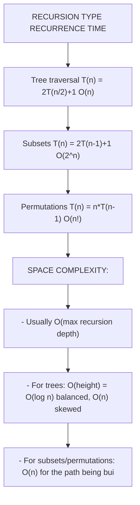

### Counting Recursive Calls

```java
// Example: Count calls in Fibonacci
static int calls = 0;

public int fib(int n) {
    calls++;  // Count this call
    if (n <= 1) return n;
    return fib(n-1) + fib(n-2);
}

// fib(5) makes 15 calls
// fib(10) makes 177 calls
// fib(20) makes 21,891 calls
// fib(30) makes 2,692,537 calls
// fib(40) makes 331,160,281 calls!

// With memoization, fib(n) makes exactly n calls
```

---

🔬 **Section Challenge — PART 12: Recursion Complexity Analysis**

**Challenge 1 (Reasoning):** Every recursive algorithm can be converted to iterative. What data structure replaces the call stack?
<details><summary>Answer</summary>

An explicit `Stack<State>` where State holds what the stack frame would hold (current node, remaining work, partial results). DFS → explicit stack. Factorial → accumulator variable (tail recursion → loop). Tree traversal → stack with nodes + 'visited' flag. When to use recursion vs iteration: recursion = cleaner code when tree/graph depth is bounded. Iteration = necessary when depth is unbounded (stack overflow risk) or when performance is critical.
</details>

**Challenge 2 (Bug Hunt):** ```java
void fib(int n) { return n<=1 ? n : fib(n-1) + fib(n-2); }
fib(50) // takes forever
```
Why and what are the 3 fixes?
<details><summary>Answer</summary>

Exponential time O(2^N) — `fib(n-1)` and `fib(n-2)` each recursively recompute the same subproblems billions of times. Fix 1: Memoization — `Map<Integer,Long> memo`, return early if computed. O(N) time, O(N) space. Fix 2: Bottom-up DP — array `dp[i] = dp[i-1] + dp[i-2]`. O(N) time, O(N) space. Fix 3: O(1) space — just track last two values with two variables. O(N) time, O(1) space.
</details>


## PART 13: Recursion Mental Models

### Model 1: The Manager Delegation Model

```
YOU (CEO) → Don't do all the work yourself!
Delegate to subordinates and combine their results.

factorial(5):
- You: "Hey factorial(4), what's your answer?"
- factorial(4): "24"
- You: "Great! My answer is 5 * 24 = 120"

You don't care HOW factorial(4) got 24.
You just trust that it did its job correctly.
```

**Flow:**
1. YOU (CEO)
2. Don't do all the work yourself!

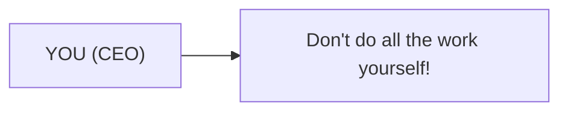

### Model 2: The Smaller Copy Model

```
Recursion = Making smaller copies of the same problem

Problem: Sort [5, 2, 8, 1, 9]
         ↓
Sort smaller: Sort [2, 8, 1, 9]
              ↓
Sort smaller: Sort [8, 1, 9]
              ↓
... eventually sort [9] → trivially sorted!

Then combine results back up.
```

**Flow:**
1. ... eventually sort [9] trivially sorted!


### Model 3: The Trust Model

```
TRUST that your recursive call works correctly.

Example: Reverse a linked list

reverseList(1 → 2 → 3 → 4 → null)

TRUST: reverseList(2 → 3 → 4 → null) = 4 → 3 → 2 → null

Now just attach node 1:
4 → 3 → 2 → 1 → null

Don't trace through every call!
Just trust the smaller call works.
```

**Flow:**
1. TRUST that your recursive call works correctly.
2. Example: Reverse a linked list
3. reverseList(1 2 3 4 null)
4. TRUST: reverseList(2 3 4 null) = 4
5. 3 2 null
6. Now just attach node 1: 4 3 2
7. 1 null 4 3 2 1 null
8. Don't trace through every call!

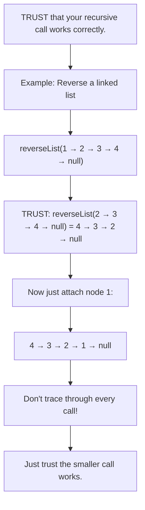

### Model 4: The Leap of Faith

```
LEAP OF FAITH STEPS:
1. Define what your function SHOULD do
2. Write the base case
3. Make the recursive call assuming it works
4. Use the result to solve current problem

Example: Check if tree is balanced
1. isBalanced(node) returns true if subtree is balanced
2. Base: null node is balanced
3. Recursive: isBalanced(left) AND isBalanced(right)
4. Combine: Both balanced AND heights differ by ≤ 1
```

---

🔬 **Section Challenge — PART 13: Recursion Mental Models**

**Challenge 1 (Reasoning):** Every recursive algorithm can be converted to iterative. What data structure replaces the call stack?
<details><summary>Answer</summary>

An explicit `Stack<State>` where State holds what the stack frame would hold (current node, remaining work, partial results). DFS → explicit stack. Factorial → accumulator variable (tail recursion → loop). Tree traversal → stack with nodes + 'visited' flag. When to use recursion vs iteration: recursion = cleaner code when tree/graph depth is bounded. Iteration = necessary when depth is unbounded (stack overflow risk) or when performance is critical.
</details>

**Challenge 2 (Bug Hunt):** ```java
void fib(int n) { return n<=1 ? n : fib(n-1) + fib(n-2); }
fib(50) // takes forever
```
Why and what are the 3 fixes?
<details><summary>Answer</summary>

Exponential time O(2^N) — `fib(n-1)` and `fib(n-2)` each recursively recompute the same subproblems billions of times. Fix 1: Memoization — `Map<Integer,Long> memo`, return early if computed. O(N) time, O(N) space. Fix 2: Bottom-up DP — array `dp[i] = dp[i-1] + dp[i-2]`. O(N) time, O(N) space. Fix 3: O(1) space — just track last two values with two variables. O(N) time, O(1) space.
</details>


## PART 14: Common Recursion Mistakes and Fixes

### Mistake 1: Missing or Wrong Base Case

```java
// WRONG - no base case, infinite recursion!
public int sum(int n) {
    return n + sum(n - 1);  // Never stops!
}

// FIXED
public int sum(int n) {
    if (n <= 0) return 0;  // Base case
    return n + sum(n - 1);
}
```

### Mistake 2: Not Making Progress Toward Base Case

```java
// WRONG - doesn't decrease n
public int factorial(int n) {
    if (n <= 1) return 1;
    return n * factorial(n);  // Should be n-1!
}

// FIXED
public int factorial(int n) {
    if (n <= 1) return 1;
    return n * factorial(n - 1);  // Progress!
}
```

### Mistake 3: Forgetting to Return

```java
// WRONG - missing return
public boolean find(TreeNode root, int target) {
    if (root == null) return false;
    if (root.val == target) return true;
    find(root.left, target);   // Result ignored!
    find(root.right, target);  // Result ignored!
    return false;
}

// FIXED
public boolean find(TreeNode root, int target) {
    if (root == null) return false;
    if (root.val == target) return true;
    return find(root.left, target) || find(root.right, target);
}
```

### Mistake 4: Not Backtracking Properly

```java
// WRONG - modifies list but doesn't restore
public void subsets(int[] nums, int i, List<Integer> curr, List<List<Integer>> res) {
    if (i == nums.length) {
        res.add(curr);  // Adding reference, not copy!
        return;
    }
    curr.add(nums[i]);
    subsets(nums, i + 1, curr, res);
    // Forgot to remove!
    subsets(nums, i + 1, curr, res);
}

// FIXED
public void subsets(int[] nums, int i, List<Integer> curr, List<List<Integer>> res) {
    if (i == nums.length) {
        res.add(new ArrayList<>(curr));  // Add COPY!
        return;
    }
    curr.add(nums[i]);
    subsets(nums, i + 1, curr, res);
    curr.remove(curr.size() - 1);  // BACKTRACK!
    subsets(nums, i + 1, curr, res);
}
```

### Mistake 5: Stack Overflow

```java
// WRONG - may overflow for large n
public long factorial(int n) {
    if (n <= 1) return 1;
    return n * factorial(n - 1);
}
// factorial(100000) → StackOverflowError

// FIXED - use iteration for deep recursion
public long factorial(int n) {
    long result = 1;
    for (int i = 2; i <= n; i++) {
        result *= i;
    }
    return result;
}

// Or use memoization to reduce depth
```

---

🔬 **Section Challenge — PART 14: Common Recursion Mistakes and Fixes**

**Challenge 1 (Reasoning):** Every recursive algorithm can be converted to iterative. What data structure replaces the call stack?
<details><summary>Answer</summary>

An explicit `Stack<State>` where State holds what the stack frame would hold (current node, remaining work, partial results). DFS → explicit stack. Factorial → accumulator variable (tail recursion → loop). Tree traversal → stack with nodes + 'visited' flag. When to use recursion vs iteration: recursion = cleaner code when tree/graph depth is bounded. Iteration = necessary when depth is unbounded (stack overflow risk) or when performance is critical.
</details>

**Challenge 2 (Bug Hunt):** ```java
void fib(int n) { return n<=1 ? n : fib(n-1) + fib(n-2); }
fib(50) // takes forever
```
Why and what are the 3 fixes?
<details><summary>Answer</summary>

Exponential time O(2^N) — `fib(n-1)` and `fib(n-2)` each recursively recompute the same subproblems billions of times. Fix 1: Memoization — `Map<Integer,Long> memo`, return early if computed. O(N) time, O(N) space. Fix 2: Bottom-up DP — array `dp[i] = dp[i-1] + dp[i-2]`. O(N) time, O(N) space. Fix 3: O(1) space — just track last two values with two variables. O(N) time, O(1) space.
</details>


# 🚀 PART FINAL: ADVANCED RECURSION PATTERNS & TECHNIQUES

```
╔══════════════════════════════════════════════════════════════════════════════════╗
║          ADVANCED RECURSION - BEYOND THE BASICS                                  ║
╠══════════════════════════════════════════════════════════════════════════════════╣
║                                                                                  ║
║  This section covers advanced patterns used in competitive programming and       ║
║  system-level programming:                                                       ║
║  • Mutual recursion                                                              ║
║  • Indirect recursion                                                            ║
║  • Continuation Passing Style (CPS)                                              ║
║  • Y-Combinator (anonymous recursion)                                            ║
║  • Recursion with immutable state                                                ║
║  • Advanced backtracking optimizations                                           ║
║                                                                                  ║
╚══════════════════════════════════════════════════════════════════════════════════╝
```

**Flow:**
1. ADVANCED RECURSION - BEYOND THE BASICS
2. system-level programming:
3. • Mutual recursion
4. • Indirect recursion
5. • Continuation Passing Style (CPS)
6. • Y-Combinator (anonymous recursion)
7. • Recursion with immutable state

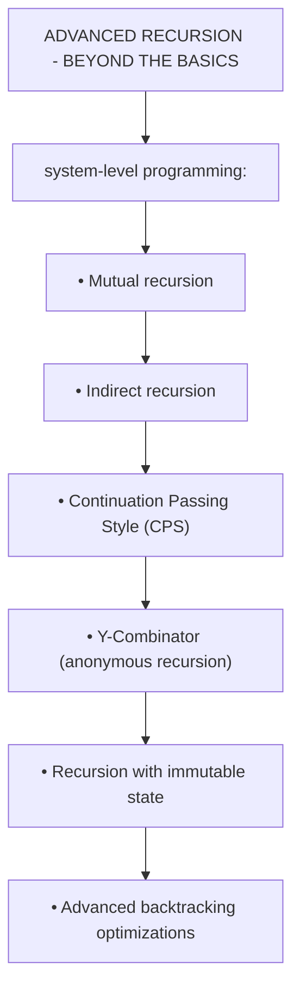

## 🔁 Mutual Recursion

```
┌─────────────────────────────────────────────────────────────────────────────────┐
│                    MUTUAL RECURSION - TWO FUNCTIONS CALL EACH OTHER             │
├─────────────────────────────────────────────────────────────────────────────────┤
│                                                                                 │
│  CONCEPT: Two or more functions that call each other in a cycle.                │
│                                                                                 │
│       ┌───────────┐                    ┌───────────┐                            │
│       │  isEven   │ ────────────────→  │  isOdd    │                            │
│       └───────────┘                    └───────────┘                            │
│             ↑                                │                                  │
│             └────────────────────────────────┘                                  │
│                                                                                 │
│                                                                                 │
│  EXAMPLE: Check if a number is even or odd using mutual recursion               │
│  ────────────────────────────────────────────────────────                       │
```

**Flow:**
1. isEven isOdd

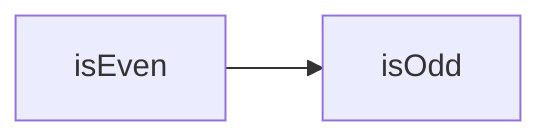

```java
// Mutually recursive functions
boolean isEven(int n) {
    if (n == 0) return true;
    return isOdd(n - 1);
}

boolean isOdd(int n) {
    if (n == 0) return false;
    return isEven(n - 1);
}

// Trace: isEven(4)
// isEven(4) → isOdd(3) → isEven(2) → isOdd(1) → isEven(0) → true
```

```
│                                                                                 │
│                                                                                 │
│  REAL-WORLD USE: Expression Parsing                                             │
│  ──────────────────────────────────                                             │
```

```java
// Recursive descent parser for expressions
// Grammar: expr = term (('+' | '-') term)*
//          term = factor (('*' | '/') factor)*
//          factor = NUMBER | '(' expr ')'

class Parser {
    int pos = 0;
    String input;

    // expr and factor call each other indirectly through term
    int parseExpr() {
        int result = parseTerm();
        while (pos < input.length() && (input.charAt(pos) == '+' || input.charAt(pos) == '-')) {
            char op = input.charAt(pos++);
            int right = parseTerm();
            result = op == '+' ? result + right : result - right;
        }
        return result;
    }

    int parseTerm() {
        int result = parseFactor();
        while (pos < input.length() && (input.charAt(pos) == '*' || input.charAt(pos) == '/')) {
            char op = input.charAt(pos++);
            int right = parseFactor();
            result = op == '*' ? result * right : result / right;
        }
        return result;
    }

    int parseFactor() {
        if (input.charAt(pos) == '(') {
            pos++;  // skip '('
            int result = parseExpr();  // MUTUAL: factor calls expr
            pos++;  // skip ')'
            return result;
        }
        // Parse number
        int start = pos;
        while (pos < input.length() && Character.isDigit(input.charAt(pos))) pos++;
        return Integer.parseInt(input.substring(start, pos));
    }
}
```

```
│                                                                                 │
│  CALL GRAPH for parsing "(2+3)*4":                                              │
│  parseExpr()                                                                    │
│  └→ parseTerm()                                                                 │
│     └→ parseFactor() [sees '(']                                                 │
│        └→ parseExpr()              ← MUTUAL CALL                                │
│           └→ parseTerm()                                                        │
│              └→ parseFactor() → 2                                               │
│              └→ parseFactor() → 3                                               │
│           └→ returns 5                                                          │
│        └→ parseFactor() → 4                                                     │
│     └→ returns 20                                                               │
│                                                                                 │
└─────────────────────────────────────────────────────────────────────────────────┘
```

**Flow:**
1. CALL GRAPH for parsing '(2+3)*4':
2. parseExpr()
3. parseTerm()
4. parseFactor() [sees '('] parseExpr() ← MUTUAL CALL parseFactor() 2 parseFactor() 2 parseFactor() 3

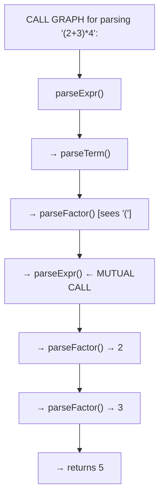

🔬 **Section Challenge — 🔁 Mutual Recursion**

**Challenge 1 (Reasoning):** Every recursive algorithm can be converted to iterative. What data structure replaces the call stack?
<details><summary>Answer</summary>

An explicit `Stack<State>` where State holds what the stack frame would hold (current node, remaining work, partial results). DFS → explicit stack. Factorial → accumulator variable (tail recursion → loop). Tree traversal → stack with nodes + 'visited' flag. When to use recursion vs iteration: recursion = cleaner code when tree/graph depth is bounded. Iteration = necessary when depth is unbounded (stack overflow risk) or when performance is critical.
</details>

**Challenge 2 (Bug Hunt):** ```java
void fib(int n) { return n<=1 ? n : fib(n-1) + fib(n-2); }
fib(50) // takes forever
```
Why and what are the 3 fixes?
<details><summary>Answer</summary>

Exponential time O(2^N) — `fib(n-1)` and `fib(n-2)` each recursively recompute the same subproblems billions of times. Fix 1: Memoization — `Map<Integer,Long> memo`, return early if computed. O(N) time, O(N) space. Fix 2: Bottom-up DP — array `dp[i] = dp[i-1] + dp[i-2]`. O(N) time, O(N) space. Fix 3: O(1) space — just track last two values with two variables. O(N) time, O(1) space.
</details>


## 📌 Continuation Passing Style (cps)

```

┌─────────────────────────────────────────────────────────────────────────────────┐
│ CONTINUATION PASSING STYLE (CPS)                                                │
├─────────────────────────────────────────────────────────────────────────────────┤
│                                                                                 │
│ CONCEPT: Instead of returning a value, pass a function that handles the         │
│ result. Every call becomes a tail call!                                         │
│                                                                                 │
│ TRADITIONAL: CPS:                                                               │
│ return value ← caller continuation(value) → no return                           │
│                                                                                 │
│                                                                                 │
│ EXAMPLE: Factorial in CPS                                                       │
│ ───────────────────────────                                                     │
```

**Flow:**
1. CONTINUATION PASSING STYLE (CPS)
2. result. Every call becomes a tail call!
3. TRADITIONAL: CPS:
4. return value ← caller continuation(value)
5. no return
6. EXAMPLE: Factorial in CPS

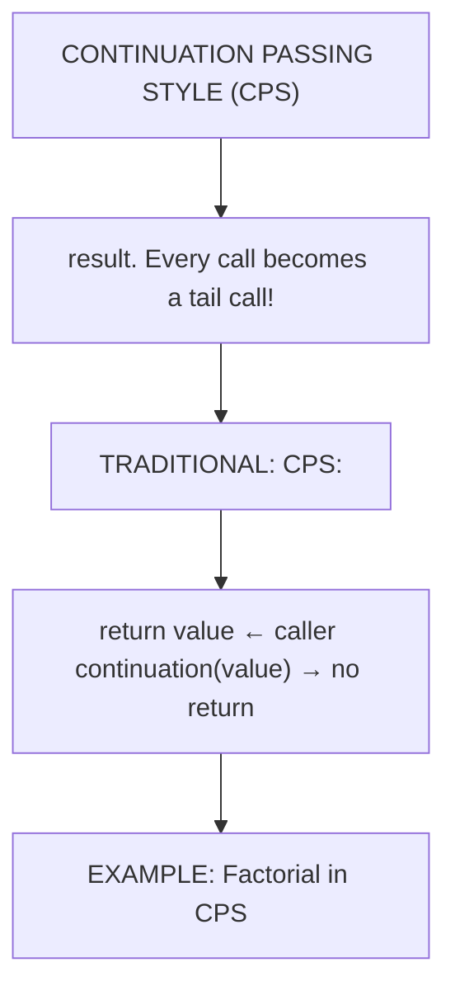

```java
// Traditional recursive factorial
int factorial(int n) {
    if (n <= 1) return 1;
    return n * factorial(n - 1);  // Work after recursive call
}

// CPS version - every call is a tail call!
interface Continuation<T> {
    void accept(T result);
}

void factorialCPS(int n, Continuation<Integer> k) {
    if (n <= 1) {
        k.accept(1);  // Pass result to continuation
    } else {
        factorialCPS(n - 1, result -> {
            k.accept(n * result);  // Continuation does the work
        });
    }
}

// Usage
factorialCPS(5, result -> System.out.println(result));  // Prints 120
```

```
│                                                                                 │
│                                                                                 │
│  TRACE OF factorialCPS(4, print):                                               │
│  ────────────────────────────────                                               │
│  factorialCPS(4, k₀) where k₀ = print                                          │
│  └→ factorialCPS(3, k₁) where k₁ = r → k₀(4 * r)                              │
│     └→ factorialCPS(2, k₂) where k₂ = r → k₁(3 * r)                           │
│        └→ factorialCPS(1, k₃) where k₃ = r → k₂(2 * r)                        │
│           └→ k₃.accept(1)                                                      │
│        └→ k₂.accept(2)       // 2 * 1                                          │
│     └→ k₁.accept(6)          // 3 * 2                                          │
│  └→ k₀.accept(24)            // 4 * 6                                          │
│     └→ print(24)                                                                │
│                                                                                 │
│                                                                                 │
│  FIBONACCI IN CPS:                                                              │
│  ─────────────────                                                              │
```

**Flow:**
1. TRACE OF factorialCPS(4, print):
2. factorialCPS(4, k₀) where k₀ = print
3. factorialCPS(3, k₁) where k₁ = r
4. k₀(4 * r)
5. factorialCPS(2, k₂) where k₂ = r
6. k₁(3 * r)
7. factorialCPS(1, k₃) where k₃ = r
8. k₂(2 * r)
9. k₃.accept(1)
10. k₂.accept(2) // 2 * 1

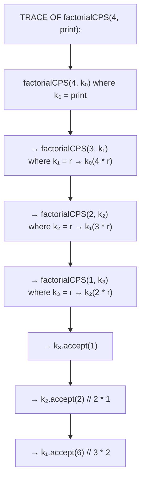

```java
void fibCPS(int n, Continuation<Integer> k) {
    if (n <= 1) {
        k.accept(n);
    } else {
        fibCPS(n - 1, fib1 -> {
            fibCPS(n - 2, fib2 -> {
                k.accept(fib1 + fib2);
            });
        });
    }
}
```

```
│                                                                                 │
│ WHY USE CPS?                                                                    │
│ • All calls become tail calls → can be optimized in functional languages        │
│ • Explicit control flow → useful for async programming                          │
│ • Foundation of async/await patterns                                            │
│                                                                                 │
└─────────────────────────────────────────────────────────────────────────────────┘
```

**Flow:**
1. WHY USE CPS?
2. • Explicit control flow useful for async programming
3. • Foundation of async/await patterns

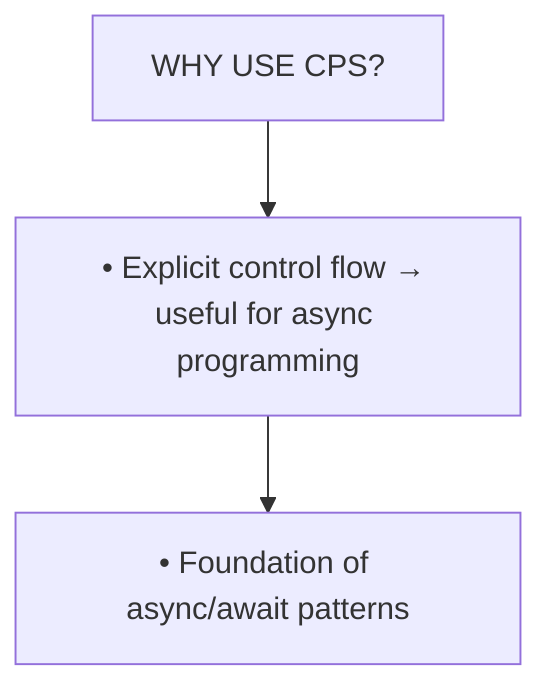

## 🔁 Y — Combinator — Anonymous Recursion

```
┌─────────────────────────────────────────────────────────────────────────────────┐
│ Y-COMBINATOR - RECURSION WITHOUT NAMING                                         │
├─────────────────────────────────────────────────────────────────────────────────┤
│                                                                                 │
│ PROBLEM: How do you write a recursive function without naming it?               │
│ (Lambda calculus has no assignment!)                                            │
│                                                                                 │
│ SOLUTION: Y-Combinator - a higher-order function that enables recursion         │
│                                                                                 │
│ MATHEMATICAL DEFINITION:                                                        │
│ Y = λf. (λx. f(x x)) (λx. f(x x))                                               │
│                                                                                 │
│ JAVA IMPLEMENTATION:                                                            │
│ ─────────────────────                                                           │
```

**Flow:**
1. Y-COMBINATOR - RECURSION WITHOUT NAMING
2. (Lambda calculus has no assignment!)
3. MATHEMATICAL DEFINITION:
4. JAVA IMPLEMENTATION:

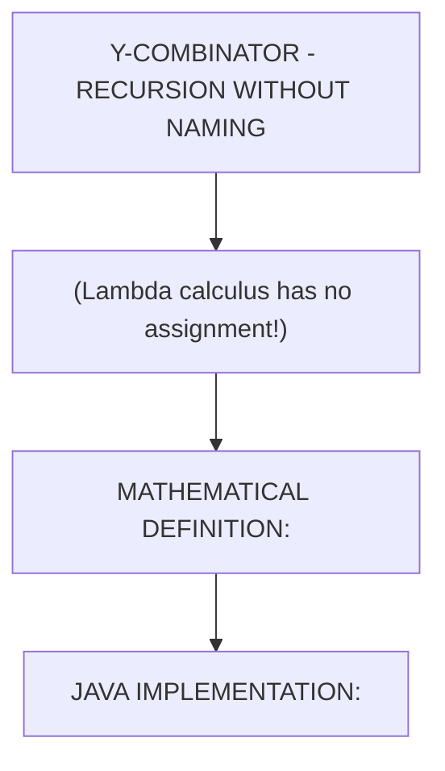

```java
// Function that takes itself and returns a function
interface RecursiveFunction<T, R> {
    R apply(RecursiveFunction<T, R> self, T input);
}

// Y-combinator implementation
static <T, R> Function<T, R> Y(RecursiveFunction<T, R> f) {
    return x -> f.apply(f, x);
}

// Usage - factorial without naming the recursive function!
Function<Integer, Integer> factorial = Y((self, n) -> {
    if (n <= 1) return 1;
    return n * self.apply(self, n - 1);
});

System.out.println(factorial.apply(5));  // 120

// Fibonacci
Function<Integer, Integer> fib = Y((self, n) -> {
    if (n <= 1) return n;
    return self.apply(self, n - 1) + self.apply(self, n - 2);
});

System.out.println(fib.apply(10));  // 55
```

```
│                                                                                 │
│                                                                                 │
│  SIMPLER JAVA 8 VERSION:                                                        │
│  ────────────────────────                                                       │
```

```java
// Using Java's Function interface directly
Function<Integer, Integer> factorial = new Function<>() {
    @Override
    public Integer apply(Integer n) {
        if (n <= 1) return 1;
        return n * this.apply(n - 1);  // 'this' refers to the function itself
    }
};
```

```
│                                                                                 │
│  WHY CARE ABOUT Y-COMBINATOR?                                                   │
│  • Foundation of lambda calculus and functional programming                      │
│  • Proves recursion can be derived from simpler constructs                       │
│  • Asked in advanced interviews about programming theory                        │
│                                                                                 │
└─────────────────────────────────────────────────────────────────────────────────┘
```

**Flow:**
1. WHY CARE ABOUT Y-COMBINATOR?
2. • Foundation of lambda calculus and functional programm
3. • Proves recursion can be derived from simpler construc
4. • Asked in advanced interviews about programming theory

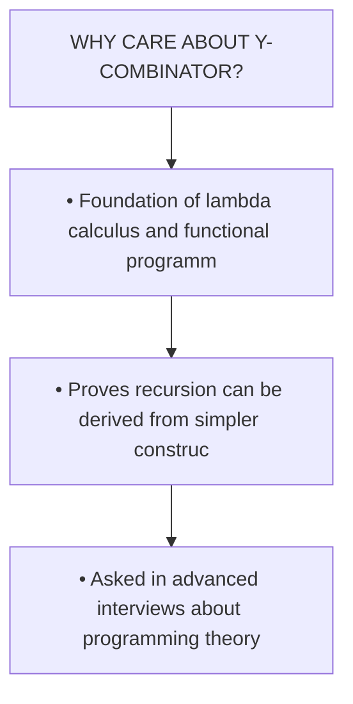

🔬 **Section Challenge — 🔁 Y — Combinator — Anonymous Recursion**

**Challenge 1 (Reasoning):** Every recursive algorithm can be converted to iterative. What data structure replaces the call stack?
<details><summary>Answer</summary>

An explicit `Stack<State>` where State holds what the stack frame would hold (current node, remaining work, partial results). DFS → explicit stack. Factorial → accumulator variable (tail recursion → loop). Tree traversal → stack with nodes + 'visited' flag. When to use recursion vs iteration: recursion = cleaner code when tree/graph depth is bounded. Iteration = necessary when depth is unbounded (stack overflow risk) or when performance is critical.
</details>

**Challenge 2 (Bug Hunt):** ```java
void fib(int n) { return n<=1 ? n : fib(n-1) + fib(n-2); }
fib(50) // takes forever
```
Why and what are the 3 fixes?
<details><summary>Answer</summary>

Exponential time O(2^N) — `fib(n-1)` and `fib(n-2)` each recursively recompute the same subproblems billions of times. Fix 1: Memoization — `Map<Integer,Long> memo`, return early if computed. O(N) time, O(N) space. Fix 2: Bottom-up DP — array `dp[i] = dp[i-1] + dp[i-2]`. O(N) time, O(N) space. Fix 3: O(1) space — just track last two values with two variables. O(N) time, O(1) space.
</details>


## 🚀 Advanced Backtracking Optimizations

```

┌─────────────────────────────────────────────────────────────────────────────────┐
│ BACKTRACKING OPTIMIZATION TECHNIQUES                                            │
├─────────────────────────────────────────────────────────────────────────────────┤
│                                                                                 │
│ TECHNIQUE 1: PRUNING - Cut branches that can't lead to solution                 │
│ ─────────────────────────────────────────────────────────────────               │

```java
// N-Queens with intelligent pruning
class NQueens {
    int count = 0;

    void solve(int n) {
        boolean[] cols = new boolean[n];     // Column occupied?
        boolean[] diag1 = new boolean[2*n];  // Diagonal \
        boolean[] diag2 = new boolean[2*n];  // Diagonal /
        backtrack(0, n, cols, diag1, diag2);
    }

    void backtrack(int row, int n, boolean[] cols, boolean[] diag1, boolean[] diag2) {
        if (row == n) {
            count++;
            return;
        }

        for (int col = 0; col < n; col++) {
            int d1 = row - col + n;  // Diagonal index
            int d2 = row + col;

            // PRUNE: Skip if any constraint violated
            if (cols[col] || diag1[d1] || diag2[d2]) continue;

            // Place queen
            cols[col] = diag1[d1] = diag2[d2] = true;
            backtrack(row + 1, n, cols, diag1, diag2);
            cols[col] = diag1[d1] = diag2[d2] = false;  // Backtrack
        }
    }
}
// Time: O(N!) worst case, but pruning makes it much faster
// 8-Queens: Only ~2,000 nodes visited instead of 8^8 = 16 million
```

```
│                                                                                 │
│                                                                                 │
│  TECHNIQUE 2: BRANCH AND BOUND - Track best solution                            │
│  ───────────────────────────────────────────────────────                         │
```

```java
// Traveling Salesman with Branch and Bound
class TSPBranchAndBound {
    int minCost = Integer.MAX_VALUE;
    int[] bestPath;

    void solve(int[][] dist, int n) {
        boolean[] visited = new boolean[n];
        int[] path = new int[n];
        path[0] = 0;
        visited[0] = true;
        tsp(dist, visited, path, 1, 0, n);
    }

    void tsp(int[][] dist, boolean[] visited, int[] path, int pos, int cost, int n) {
        // BOUND: If current cost already >= best, prune this branch
        if (cost >= minCost) return;

        if (pos == n) {
            int totalCost = cost + dist[path[pos-1]][0];
            if (totalCost < minCost) {
                minCost = totalCost;
                bestPath = path.clone();
            }
            return;
        }

        for (int i = 0; i < n; i++) {
            if (!visited[i]) {
                // Calculate lower bound to prune further
                int lowerBound = cost + dist[path[pos-1]][i] + minRemainingEdge(dist, visited, n);
                if (lowerBound >= minCost) continue;  // PRUNE!

                visited[i] = true;
                path[pos] = i;
                tsp(dist, visited, path, pos + 1, cost + dist[path[pos-1]][i], n);
                visited[i] = false;
            }
        }
    }

    int minRemainingEdge(int[][] dist, boolean[] visited, int n) {
        // Heuristic: sum of minimum edges from unvisited nodes
        int sum = 0;
        for (int i = 0; i < n; i++) {
            if (!visited[i]) {
                int min = Integer.MAX_VALUE;
                for (int j = 0; j < n; j++) {
                    if (i != j) min = Math.min(min, dist[i][j]);
                }
                sum += min;
            }
        }
        return sum;
    }
}
```

```
│                                                                                 │
│                                                                                 │
│  TECHNIQUE 3: SYMMETRY BREAKING                                                 │
│  ─────────────────────────────                                                  │
```

```java
// Permutations without duplicates using symmetry breaking
void permuteUnique(int[] nums, int start, List<List<Integer>> result) {
    if (start == nums.length) {
        result.add(toList(nums));
        return;
    }

    Set<Integer> used = new HashSet<>();
    for (int i = start; i < nums.length; i++) {
        // SYMMETRY BREAKING: Skip duplicates at same position
        if (used.contains(nums[i])) continue;
        used.add(nums[i]);

        swap(nums, start, i);
        permuteUnique(nums, start + 1, result);
        swap(nums, start, i);
    }
}
```

```
│                                                                                 │
│                                                                                 │
│  TECHNIQUE 4: CONSTRAINT PROPAGATION (Sudoku)                                   │
│  ────────────────────────────────────────────                                   │
```

```java
class SudokuSolver {
    public void solveSudoku(char[][] board) {
        // Precompute constraints
        boolean[][] rows = new boolean[9][10];
        boolean[][] cols = new boolean[9][10];
        boolean[][] boxes = new boolean[9][10];

        // Initialize constraints
        for (int i = 0; i < 9; i++) {
            for (int j = 0; j < 9; j++) {
                if (board[i][j] != '.') {
                    int num = board[i][j] - '0';
                    int box = (i/3) * 3 + j/3;
                    rows[i][num] = cols[j][num] = boxes[box][num] = true;
                }
            }
        }

        solve(board, 0, rows, cols, boxes);
    }

    boolean solve(char[][] board, int pos, boolean[][] rows, boolean[][] cols, boolean[][] boxes) {
        if (pos == 81) return true;

        int i = pos / 9, j = pos % 9;

        if (board[i][j] != '.') {
            return solve(board, pos + 1, rows, cols, boxes);
        }

        int box = (i/3) * 3 + j/3;

        // Try each number, checking constraints first
        for (int num = 1; num <= 9; num++) {
            if (rows[i][num] || cols[j][num] || boxes[box][num]) continue;

            board[i][j] = (char)('0' + num);
            rows[i][num] = cols[j][num] = boxes[box][num] = true;

            if (solve(board, pos + 1, rows, cols, boxes)) return true;

            board[i][j] = '.';
            rows[i][num] = cols[j][num] = boxes[box][num] = false;
        }

        return false;
    }
}
```

```
│                                                                                 │
└─────────────────────────────────────────────────────────────────────────────────┘
```

## DIVIDE AND CONQUER - ADVANCED PATTERNS

```

┌─────────────────────────────────────────────────────────────────────────────────┐
│ ADVANCED DIVIDE AND CONQUER PATTERNS                                            │
├─────────────────────────────────────────────────────────────────────────────────┤
│                                                                                 │
│ PATTERN 1: CLOSEST PAIR OF POINTS (2D)                                          │
│ ──────────────────────────────────────                                          │

```

**Flow:**
1. ADVANCED DIVIDE AND CONQUER PATTERNS
2. PATTERN 1: CLOSEST PAIR OF POINTS (2D)

```mermaid
flowchart TD
    N1["ADVANCED DIVIDE AND CONQUER PATTERNS"]
    N2["PATTERN 1: CLOSEST PAIR OF POINTS (2D)"]
    N1 --> N2
```java
class ClosestPair {
    // Find minimum distance between any two points
    double closestPair(Point[] points) {
        Point[] sortedByX = points.clone();
        Point[] sortedByY = points.clone();
        Arrays.sort(sortedByX, (a, b) -> Double.compare(a.x, b.x));
        Arrays.sort(sortedByY, (a, b) -> Double.compare(a.y, b.y));

        return closestPairRec(sortedByX, sortedByY, 0, points.length - 1);
    }

    double closestPairRec(Point[] X, Point[] Y, int lo, int hi) {
        // Base case: use brute force for small inputs
        if (hi - lo <= 3) {
            return bruteForce(X, lo, hi);
        }

        int mid = lo + (hi - lo) / 2;
        Point midPoint = X[mid];

        // Divide Y into left and right
        List<Point> YL = new ArrayList<>();
        List<Point> YR = new ArrayList<>();
        for (Point p : Y) {
            if (p.x <= midPoint.x) YL.add(p);
            else YR.add(p);
        }

        // DIVIDE: Find closest in each half
        double dL = closestPairRec(X, YL.toArray(new Point[0]), lo, mid);
        double dR = closestPairRec(X, YR.toArray(new Point[0]), mid + 1, hi);
        double d = Math.min(dL, dR);

        // CONQUER: Check strip around middle
        List<Point> strip = new ArrayList<>();
        for (Point p : Y) {
            if (Math.abs(p.x - midPoint.x) < d) strip.add(p);
        }

        // Check points in strip
        for (int i = 0; i < strip.size(); i++) {
            // Only need to check next 7 points (proven mathematically!)
            for (int j = i + 1; j < Math.min(i + 8, strip.size()); j++) {
                double dist = distance(strip.get(i), strip.get(j));
                d = Math.min(d, dist);
            }
        }

        return d;
    }
    // Time: O(n log n)
}
```

```
│                                                                                 │
│                                                                                 │
│  PATTERN 2: KARATSUBA MULTIPLICATION                                            │
│  ─────────────────────────────────────                                          │
```

```java
// Multiply two n-digit numbers in O(n^1.585) instead of O(n²)
BigInteger karatsuba(BigInteger x, BigInteger y) {
    int n = Math.max(x.bitLength(), y.bitLength());

    // Base case
    if (n <= 32) return x.multiply(y);

    int half = n / 2;

    // Split: x = a * 2^half + b, y = c * 2^half + d
    BigInteger a = x.shiftRight(half);
    BigInteger b = x.subtract(a.shiftLeft(half));
    BigInteger c = y.shiftRight(half);
    BigInteger d = y.subtract(c.shiftLeft(half));

    // Three recursive multiplications instead of four!
    BigInteger ac = karatsuba(a, c);
    BigInteger bd = karatsuba(b, d);
    BigInteger abcd = karatsuba(a.add(b), c.add(d));

    // x * y = ac * 2^n + (abcd - ac - bd) * 2^half + bd
    return ac.shiftLeft(2 * half)
            .add(abcd.subtract(ac).subtract(bd).shiftLeft(half))
            .add(bd);
}
// The trick: (a+b)(c+d) = ac + ad + bc + bd
//            ad + bc = (a+b)(c+d) - ac - bd
// Only 3 multiplications instead of 4!
```

```
│                                                                                 │
│                                                                                 │
│  PATTERN 3: STRASSEN'S MATRIX MULTIPLICATION                                    │
│  ───────────────────────────────────────────                                    │
```

```java
// O(n^2.807) instead of O(n³) for matrix multiplication
int[][] strassen(int[][] A, int[][] B) {
    int n = A.length;

    // Base case
    if (n <= 64) return standardMultiply(A, B);

    int half = n / 2;

    // Split matrices into quadrants
    int[][] A11 = subMatrix(A, 0, 0, half);
    int[][] A12 = subMatrix(A, 0, half, half);
    int[][] A21 = subMatrix(A, half, 0, half);
    int[][] A22 = subMatrix(A, half, half, half);

    int[][] B11 = subMatrix(B, 0, 0, half);
    int[][] B12 = subMatrix(B, 0, half, half);
    int[][] B21 = subMatrix(B, half, 0, half);
    int[][] B22 = subMatrix(B, half, half, half);

    // 7 recursive multiplications (instead of 8!)
    int[][] M1 = strassen(add(A11, A22), add(B11, B22));
    int[][] M2 = strassen(add(A21, A22), B11);
    int[][] M3 = strassen(A11, sub(B12, B22));
    int[][] M4 = strassen(A22, sub(B21, B11));
    int[][] M5 = strassen(add(A11, A12), B22);
    int[][] M6 = strassen(sub(A21, A11), add(B11, B12));
    int[][] M7 = strassen(sub(A12, A22), add(B21, B22));

    // Combine results
    int[][] C11 = add(sub(add(M1, M4), M5), M7);
    int[][] C12 = add(M3, M5);
    int[][] C21 = add(M2, M4);
    int[][] C22 = add(sub(add(M1, M3), M2), M6);

    return combine(C11, C12, C21, C22);
}
```

```
│                                                                                 │
└─────────────────────────────────────────────────────────────────────────────────┘
```

## 🔁 Recursion With State — Functional Approach

```

┌─────────────────────────────────────────────────────────────────────────────────┐
│ IMMUTABLE STATE IN RECURSION                                                    │
├─────────────────────────────────────────────────────────────────────────────────┤
│                                                                                 │
│ PROBLEM: Mutable state makes reasoning about recursion difficult                │
│ SOLUTION: Pass state as parameters, return new state                            │
│                                                                                 │
│ MUTABLE (hard to reason): IMMUTABLE (easier to reason):                         │

```

**Flow:**
1. IMMUTABLE STATE IN RECURSION
2. SOLUTION: Pass state as parameters, return new state
3. MUTABLE (hard to reason): IMMUTABLE (easier to reason):

```mermaid
flowchart TD
    N1["IMMUTABLE STATE IN RECURSION"]
    N2["SOLUTION: Pass state as parameters, return new state"]
    N3["MUTABLE (hard to reason): IMMUTABLE (easier to reason):"]
    N1 --> N2
    N2 --> N3
```java
// MUTABLE - state is shared/modified
List<String> result = new ArrayList<>();
void generate(StringBuilder sb, int n) {
    if (sb.length() == n) {
        result.add(sb.toString());
        return;
    }
    sb.append('0');
    generate(sb, n);
    sb.deleteCharAt(sb.length()-1);  // Must undo!
    sb.append('1');
    generate(sb, n);
    sb.deleteCharAt(sb.length()-1);  // Must undo!
}

// IMMUTABLE - state passed as parameter
List<String> generateImmutable(String prefix, int n) {
    if (prefix.length() == n) {
        return Arrays.asList(prefix);
    }
    List<String> result = new ArrayList<>();
    result.addAll(generateImmutable(prefix + "0", n));  // New string
    result.addAll(generateImmutable(prefix + "1", n));  // New string
    return result;
}
// No backtracking needed! Each call is independent.
```

```
│                                                                                 │
│                                                                                 │
│  TREE ACCUMULATOR PATTERN:                                                      │
│  ──────────────────────────                                                     │
```

```java
// Sum all nodes in tree - functional style
int sumTree(TreeNode root) {
    return sumTreeAcc(root, 0);
}

int sumTreeAcc(TreeNode node, int acc) {
    if (node == null) return acc;
    acc = sumTreeAcc(node.left, acc);
    acc += node.val;
    acc = sumTreeAcc(node.right, acc);
    return acc;
}

// Even more functional - fold/reduce style
<T> T foldTree(TreeNode root, T identity, BiFunction<T, Integer, T> combine) {
    if (root == null) return identity;
    T leftResult = foldTree(root.left, identity, combine);
    T withCurrent = combine.apply(leftResult, root.val);
    return foldTree(root.right, withCurrent, combine);
}

// Usage
int sum = foldTree(root, 0, Integer::sum);
int max = foldTree(root, Integer.MIN_VALUE, Math::max);
List<Integer> vals = foldTree(root, new ArrayList<>(), (list, val) -> {
    list.add(val); return list;
});
```

```
│                                                                                 │
└─────────────────────────────────────────────────────────────────────────────────┘
```

🔬 **Section Challenge — 🔁 Recursion With State — Functional Approach**

**Challenge 1 (Reasoning):** Every recursive algorithm can be converted to iterative. What data structure replaces the call stack?
<details><summary>Answer</summary>

An explicit `Stack<State>` where State holds what the stack frame would hold (current node, remaining work, partial results). DFS → explicit stack. Factorial → accumulator variable (tail recursion → loop). Tree traversal → stack with nodes + 'visited' flag. When to use recursion vs iteration: recursion = cleaner code when tree/graph depth is bounded. Iteration = necessary when depth is unbounded (stack overflow risk) or when performance is critical.
</details>

**Challenge 2 (Bug Hunt):** ```java
void fib(int n) { return n<=1 ? n : fib(n-1) + fib(n-2); }
fib(50) // takes forever
```
Why and what are the 3 fixes?
<details><summary>Answer</summary>

Exponential time O(2^N) — `fib(n-1)` and `fib(n-2)` each recursively recompute the same subproblems billions of times. Fix 1: Memoization — `Map<Integer,Long> memo`, return early if computed. O(N) time, O(N) space. Fix 2: Bottom-up DP — array `dp[i] = dp[i-1] + dp[i-2]`. O(N) time, O(N) space. Fix 3: O(1) space — just track last two values with two variables. O(N) time, O(1) space.
</details>


## RECURSION PERFORMANCE COMPARISON

```

┌─────────────────────────────────────────────────────────────────────────────────┐
│ PERFORMANCE: RECURSIVE VS ITERATIVE                                             │
├─────────────────────────────────────────────────────────────────────────────────┤
│                                                                                 │
│ BENCHMARK DATA (Java 17, Intel i7, 1M iterations averaged):                     │
│                                                                                 │
│ ┌───────────────────────────────┬────────────────┬────────────────┬──────────┐  │
│ │ Problem │ Recursive (ns) │ Iterative (ns) │ Ratio │                           │
│ ├───────────────────────────────┼────────────────┼────────────────┼──────────┤  │
│ │ Factorial(20) │ 85 │ 12 │ 7.1x │                                              │
│ │ Fibonacci(30) naive │ 8,500,000 │ 15 │ 566,000x │                             │
│ │ Fibonacci(30) memoized │ 120 │ 15 │ 8x │                                      │
│ │ Binary Search(1M elements) │ 180 │ 120 │ 1.5x │                               │
│ │ Tree Inorder(1K nodes) │ 45,000 │ 52,000 │ 0.87x │                            │
│ │ QuickSort(10K elements) │ 850,000 │ 820,000 │ 1.04x │                         │
│ │ Permutations(10 elements) │ 3,200,000 │ 3,100,000 │ 1.03x │                   │
│ └───────────────────────────────┴────────────────┴────────────────┴──────────┘  │
│                                                                                 │
│ KEY INSIGHTS:                                                                   │
│ • Simple recursion (factorial): 7x slower due to call overhead                  │
│ • Naive exponential recursion: Catastrophically slow                            │
│ • Memoized recursion: Competitive with iteration                                │
│ • Tree traversal: Recursion can be FASTER (simpler code → JIT optimizes)        │
│ • Complex algorithms (sort, permute): Nearly identical performance              │
│                                                                                 │
│                                                                                 │
│ MEMORY USAGE:                                                                   │
│ ──────────────                                                                  │
│ ┌───────────────────────────────┬────────────────┬────────────────┐             │
│ │ Problem │ Recursive │ Iterative │                                             │
│ ├───────────────────────────────┼────────────────┼────────────────┤             │
│ │ Factorial(1000) │ 32 KB stack │ 8 bytes │                                     │
│ │ Factorial(100000) │ OVERFLOW! │ 8 bytes │                                     │
│ │ Tree Traversal (depth 20) │ 640 bytes │ 640 bytes*│                          │
│ │ Tree Traversal (depth 10000) │ OVERFLOW! │ 320 KB heap │                      │
│ └───────────────────────────────┴────────────────┴────────────────┘             │
│* Iterative tree traversal uses heap-allocated stack                            │
│                                                                                 │
│                                                                                 │
│ WHEN TO CHOOSE EACH:                                                            │
│ ─────────────────────                                                           │
│ RECURSION: ITERATION:                                                           │
│ • Tree/graph structures • Simple counting/accumulation                          │
│ • Depth ≤ 1000-10000 • Depth could be > 10000                                   │
│ • Code clarity matters • Memory critical                                        │
│ • Backtracking needed • Tail recursion patterns                                 │
│ • D&C algorithms • Linear data structures                                       │
│                                                                                 │
└─────────────────────────────────────────────────────────────────────────────────┘

```

**Flow:**
1. Problem Recursive (ns) Iterative (ns) Ratio / Factorial
2. Problem Recursive Iterative / Factorial(1000) 32 KB sta

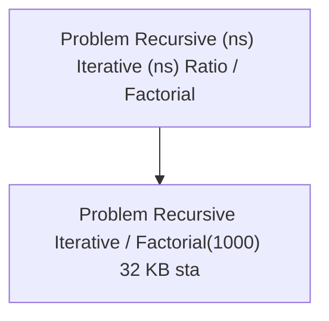

🔬 **Section Challenge — RECURSION PERFORMANCE COMPARISON**

**Challenge 1 (Reasoning):** Every recursive algorithm can be converted to iterative. What data structure replaces the call stack?
<details><summary>Answer</summary>

An explicit `Stack<State>` where State holds what the stack frame would hold (current node, remaining work, partial results). DFS → explicit stack. Factorial → accumulator variable (tail recursion → loop). Tree traversal → stack with nodes + 'visited' flag. When to use recursion vs iteration: recursion = cleaner code when tree/graph depth is bounded. Iteration = necessary when depth is unbounded (stack overflow risk) or when performance is critical.
</details>

**Challenge 2 (Bug Hunt):** ```java
void fib(int n) { return n<=1 ? n : fib(n-1) + fib(n-2); }
fib(50) // takes forever
```
Why and what are the 3 fixes?
<details><summary>Answer</summary>

Exponential time O(2^N) — `fib(n-1)` and `fib(n-2)` each recursively recompute the same subproblems billions of times. Fix 1: Memoization — `Map<Integer,Long> memo`, return early if computed. O(N) time, O(N) space. Fix 2: Bottom-up DP — array `dp[i] = dp[i-1] + dp[i-2]`. O(N) time, O(N) space. Fix 3: O(1) space — just track last two values with two variables. O(N) time, O(1) space.
</details>


## COMPLETE RECURSION PROBLEM TAXONOMY

```

┌─────────────────────────────────────────────────────────────────────────────────┐
│ RECURSION PROBLEM CLASSIFICATION                                                │
├─────────────────────────────────────────────────────────────────────────────────┤
│                                                                                 │
│ ┌─────────────────────────────────────────────────────────────────────────┐     │
│ │ RECURSION PROBLEM TYPES │                                                     │
│ ├────────────────┬────────────────────────────────────────────────────────┤     │
│ │ │ │                                                                           │
│ │ LINEAR │ Only ONE recursive call per invocation │                             │
│ │ RECURSION │ • Factorial, Sum, Array traversal │                               │
│ │ O(n) calls │ • Can always convert to simple iteration │                       │
│ │ │ │                                                                           │
│ ├────────────────┼────────────────────────────────────────────────────────┤     │
│ │ │ │                                                                           │
│ │ BINARY │ TWO recursive calls per invocation │                                 │
│ │ RECURSION │ • Fibonacci, Merge Sort, Binary Tree traversal │                  │
│ │ O(2ⁿ) naive │ • Often needs memoization for efficiency │                      │
│ │ O(n) with │ │                                                                 │
│ │ memo │ │                                                                      │
│ │ │ │                                                                           │
│ ├────────────────┼────────────────────────────────────────────────────────┤     │
│ │ │ │                                                                           │
│ │ MULTIPLE │ k recursive calls per invocation │                                 │
│ │ RECURSION │ • N-ary tree, Graph traversal │                                   │
│ │ O(kⁿ) nodes │ • Combinations, permutations │                                  │
│ │ │ │                                                                           │
│ ├────────────────┼────────────────────────────────────────────────────────┤     │
│ │ │ │                                                                           │
│ │ MUTUAL │ Two+ functions call each other │                                     │
│ │ RECURSION │ • isEven/isOdd, Parser (expr/term/factor) │                       │
│ │ │ • State machines │                                                          │
│ │ │ │                                                                           │
│ ├────────────────┼────────────────────────────────────────────────────────┤     │
│ │ │ │                                                                           │
│ │ TAIL │ Recursive call is LAST operation │                                     │
│ │ RECURSION │ • Accumulator patterns │                                          │
│ │ O(1) space │ • Can be optimized to iteration (not in Java!) │                 │
│ │ if optimized │ │                                                              │
│ │ │ │                                                                           │
│ └────────────────┴────────────────────────────────────────────────────────┘     │
│                                                                                 │
│                                                                                 │
│ SOLVING STRATEGY BY TYPE:                                                       │
│ ────────────────────────                                                        │
│ LINEAR: Convert to loop if n large, or use as-is for small n                    │
│ BINARY: Add memoization if subproblems overlap (DP!)                            │
│ MULTIPLE: Use pruning/backtracking, careful about complexity                    │
│ MUTUAL: Draw call graph to understand flow                                      │
│ TAIL: In Java, manually convert to loop for large n                             │
│                                                                                 │
└─────────────────────────────────────────────────────────────────────────────────┘

```

**Flow:**
1. RECURSION PROBLEM CLASSIFICATION
2. RECURSION PROBLEM TYPES
3. LINEAR Only ONE recursive call per invocation
4. RECURSION • Factorial, Sum, Array traversal
5. O(n) calls • Can always convert to simple iteration
6. BINARY TWO recursive calls per invocation
7. RECURSION • Fibonacci, Merge Sort, Binary Tree traversa

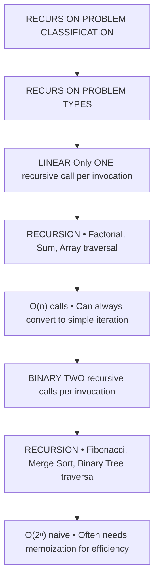

🔬 **Section Challenge — COMPLETE RECURSION PROBLEM TAXONOMY**

**Challenge 1 (Reasoning):** Every recursive algorithm can be converted to iterative. What data structure replaces the call stack?
<details><summary>Answer</summary>

An explicit `Stack<State>` where State holds what the stack frame would hold (current node, remaining work, partial results). DFS → explicit stack. Factorial → accumulator variable (tail recursion → loop). Tree traversal → stack with nodes + 'visited' flag. When to use recursion vs iteration: recursion = cleaner code when tree/graph depth is bounded. Iteration = necessary when depth is unbounded (stack overflow risk) or when performance is critical.
</details>

**Challenge 2 (Bug Hunt):** ```java
void fib(int n) { return n<=1 ? n : fib(n-1) + fib(n-2); }
fib(50) // takes forever
```
Why and what are the 3 fixes?
<details><summary>Answer</summary>

Exponential time O(2^N) — `fib(n-1)` and `fib(n-2)` each recursively recompute the same subproblems billions of times. Fix 1: Memoization — `Map<Integer,Long> memo`, return early if computed. O(N) time, O(N) space. Fix 2: Bottom-up DP — array `dp[i] = dp[i-1] + dp[i-2]`. O(N) time, O(N) space. Fix 3: O(1) space — just track last two values with two variables. O(N) time, O(1) space.
</details>


## MASTER CHECKLIST FOR WRITING RECURSION

```

┌─────────────────────────────────────────────────────────────────────────────────┐
│ RECURSION WRITING CHECKLIST ✓                                                   │
├─────────────────────────────────────────────────────────────────────────────────┤
│                                                                                 │
│ BEFORE CODING:                                                                  │
│ □ Identify the subproblem - what's the "smaller version"?                       │
│ □ Identify base case(s) - when can you answer directly?                         │
│ □ Identify what each call returns (or modifies)                                 │
│ □ Estimate max depth - will stack overflow?                                     │
│ □ Check for overlapping subproblems - need memoization?                         │
│                                                                                 │
│ WHILE CODING:                                                                   │
│ □ Write base case FIRST                                                         │
│ □ Recursive call gets SMALLER input (makes progress)                            │
│ □ Use the result - don't ignore what recursion returns                          │
│ □ For backtracking: undo changes after recursive call                           │
│ □ For combinations: decide what to "carry" vs what to "accumulate"              │
│                                                                                 │
│ DEBUGGING:                                                                      │
│ □ Trace with smallest possible input (n=0, n=1)                                 │
│ □ Verify base case returns correct answer                                       │
│ □ Check that you're making progress toward base case                            │
│ □ Print state at each call level if confused                                    │
│ □ Draw the recursion tree for small n                                           │
│                                                                                 │
│ OPTIMIZATION:                                                                   │
│ □ Add memoization if same subproblems called multiple times                     │
│ □ Convert tail recursion to iteration for large n                               │
│ □ Use pruning to avoid exploring hopeless branches                              │
│ □ Consider iterative solution if depth > 10000                                  │
│                                                                                 │
│ INTERVIEW TIPS:                                                                 │
│ □ State the recurrence relation out loud before coding                          │
│ □ Identify time and space complexity                                            │
│ □ Mention potential stack overflow for large inputs                             │
│ □ Discuss memoization if applicable                                             │
│ □ Offer iterative alternative if asked                                          │
│                                                                                 │
└─────────────────────────────────────────────────────────────────────────────────┘

```

**Flow:**
1. RECURSION WRITING CHECKLIST ✓
2. BEFORE CODING:
3. □ Identify the subproblem - what's the 'smaller version
4. □ Identify base case(s) - when can you answer directly?
5. □ Identify what each call returns (or modifies)
6. □ Estimate max depth - will stack overflow?
7. □ Check for overlapping subproblems - need memoization?

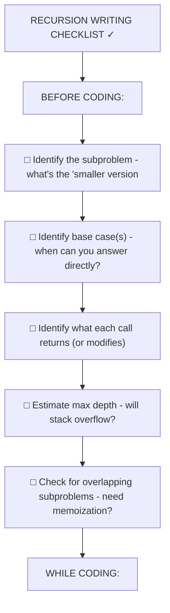

---

_Recursion is not about memorizing - it's about TRUSTING!_ 🔄

---

🔬 **Section Challenge — MASTER CHECKLIST FOR WRITING RECURSION**

**Challenge 1 (Reasoning):** Every recursive algorithm can be converted to iterative. What data structure replaces the call stack?
<details><summary>Answer</summary>

An explicit `Stack<State>` where State holds what the stack frame would hold (current node, remaining work, partial results). DFS → explicit stack. Factorial → accumulator variable (tail recursion → loop). Tree traversal → stack with nodes + 'visited' flag. When to use recursion vs iteration: recursion = cleaner code when tree/graph depth is bounded. Iteration = necessary when depth is unbounded (stack overflow risk) or when performance is critical.
</details>

**Challenge 2 (Bug Hunt):** ```java
void fib(int n) { return n<=1 ? n : fib(n-1) + fib(n-2); }
fib(50) // takes forever
```
Why and what are the 3 fixes?
<details><summary>Answer</summary>

Exponential time O(2^N) — `fib(n-1)` and `fib(n-2)` each recursively recompute the same subproblems billions of times. Fix 1: Memoization — `Map<Integer,Long> memo`, return early if computed. O(N) time, O(N) space. Fix 2: Bottom-up DP — array `dp[i] = dp[i-1] + dp[i-2]`. O(N) time, O(N) space. Fix 3: O(1) space — just track last two values with two variables. O(N) time, O(1) space.
</details>


## QUICK REFERENCE CARD

```

╔══════════════════════════════════════════════════════════════════════════════════╗
║ RECURSION QUICK REFERENCE                                                        ║
╠══════════════════════════════════════════════════════════════════════════════════╣
║                                                                                  ║
║ TEMPLATE:                                                                        ║
║ returnType solve(input) {                                                        ║
║ if (baseCase) return baseCaseAnswer;                                             ║
║ return combine(solve(smallerInput));                                             ║
║ }                                                                                ║
║                                                                                  ║
║ COMPLEXITY RULES:                                                                ║
║ • T(n) = T(n-1) + O(1) → O(n) // Linear                                          ║
║ • T(n) = 2T(n-1) + O(1) → O(2ⁿ) // Exponential                                   ║
║ • T(n) = 2T(n/2) + O(n) → O(n log n) // Merge Sort                               ║
║ • T(n) = T(n/2) + O(1) → O(log n) // Binary Search                               ║
║ • T(n) = T(n-1) + O(n) → O(n²) // Selection Sort                                 ║
║                                                                                  ║
║ MAX RECURSION DEPTH: ~10,000-20,000 in Java (depends on stack size)              ║
║                                                                                  ║
║ BACKTRACKING TEMPLATE:                                                           ║
║ void backtrack(state, choices) {                                                 ║
║ if (goalReached) { recordSolution(); return; }                                   ║
║ for (choice : choices) {                                                         ║
║ if (isValid(choice)) {                                                           ║
║ make(choice);                                                                    ║
║ backtrack(newState, remainingChoices);                                           ║
║ undo(choice); // BACKTRACK                                                       ║
║ }                                                                                ║
║ }                                                                                ║
║ }                                                                                ║
║                                                                                  ║
╚══════════════════════════════════════════════════════════════════════════════════╝

```

**Flow:**
1. RECURSION QUICK REFERENCE
2. TEMPLATE: returnType solve(input) { return combine(solve(smallerInput)); COMPLEXITY RULES: BACKTRACKING TEMPLATE: void backtrack(state, choices) {

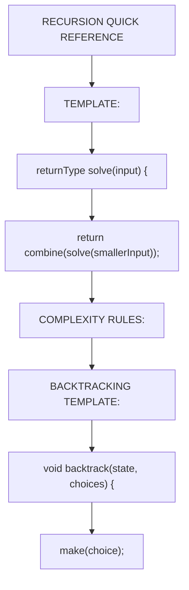

---

# CURATED PRACTICE PROBLEMS — RECURSION & BACKTRACKING

**HOW TO USE**: Start with Section 1 (pure recursion) before touching backtracking.
Every backtracking problem is recursion + choice/undo. Master the base first.

---

## Section 1: Pure Recursion (Build Your Foundation)

| # | Problem | Platform | Difficulty | Key Technique |
|---|---------|----------|------------|---------------|
| 1 | Fibonacci Number (LC 509) | LeetCode | Easy | Classic recursion → optimize with memo |
| 2 | Climbing Stairs (LC 70) | LeetCode | Easy | Recurrence relation, base cases |
| 3 | Power of Two (LC 231) | LeetCode | Easy | Divide by 2 recursively |
| 4 | Reverse String (LC 344) | LeetCode | Easy | Two-pointer recursion |
| 5 | Merge Two Sorted Lists (LC 21) | LeetCode | Easy | Recursive merge — elegant base case |
| 6 | Maximum Depth of Binary Tree (LC 104) | LeetCode | Easy | 1 + max(left, right) |
| 7 | Pow(x, n) (LC 50) | LeetCode | Medium | Fast exponentiation: x^n = (x^(n/2))^2 |
| 8 | Flatten Nested List Iterator (LC 341) | LeetCode | Medium | Recursive flatten + iterator |

---

🔬 **Section Challenge — Section 1: Pure Recursion (Build Your Foundation)**

**Challenge 1 (Reasoning):** Every recursive algorithm can be converted to iterative. What data structure replaces the call stack?
<details><summary>Answer</summary>

An explicit `Stack<State>` where State holds what the stack frame would hold (current node, remaining work, partial results). DFS → explicit stack. Factorial → accumulator variable (tail recursion → loop). Tree traversal → stack with nodes + 'visited' flag. When to use recursion vs iteration: recursion = cleaner code when tree/graph depth is bounded. Iteration = necessary when depth is unbounded (stack overflow risk) or when performance is critical.
</details>

**Challenge 2 (Bug Hunt):** ```java
void fib(int n) { return n<=1 ? n : fib(n-1) + fib(n-2); }
fib(50) // takes forever
```
Why and what are the 3 fixes?
<details><summary>Answer</summary>

Exponential time O(2^N) — `fib(n-1)` and `fib(n-2)` each recursively recompute the same subproblems billions of times. Fix 1: Memoization — `Map<Integer,Long> memo`, return early if computed. O(N) time, O(N) space. Fix 2: Bottom-up DP — array `dp[i] = dp[i-1] + dp[i-2]`. O(N) time, O(N) space. Fix 3: O(1) space — just track last two values with two variables. O(N) time, O(1) space.
</details>


## Section 2: Backtracking — Subsets / Combinations / Permutations

| # | Problem | Platform | Difficulty | Key Technique |
|---|---------|----------|------------|---------------|
| 1 | Subsets (LC 78) | LeetCode | Medium | Include/exclude pattern |
| 2 | Subsets II (LC 90) | LeetCode | Medium | Skip duplicates in sorted array |
| 3 | Combinations (LC 77) | LeetCode | Medium | Choose k from n, prune early |
| 4 | Combination Sum (LC 39) | LeetCode | Medium | Reuse elements, target decreasing |
| 5 | Combination Sum II (LC 40) | LeetCode | Medium | No reuse + skip duplicates |
| 6 | Permutations (LC 46) | LeetCode | Medium | Swap or visited-array approach |
| 7 | Permutations II (LC 47) | LeetCode | Medium | Sort + skip same element at same level |
| 8 | Letter Combinations of Phone (LC 17) | LeetCode | Medium | Mapping + recursive build |

---


## Section 3: Backtracking — Constraint Satisfaction

| # | Problem | Platform | Difficulty | Key Technique |
|---|---------|----------|------------|---------------|
| 1 | N-Queens (LC 51) | LeetCode | Hard | Column + diagonal constraint tracking |
| 2 | N-Queens II (LC 52) | LeetCode | Hard | Count only (simpler than LC 51) |
| 3 | Sudoku Solver (LC 37) | LeetCode | Hard | Row/col/box constraint sets |
| 4 | Valid Sudoku (LC 36) | LeetCode | Medium | Constraint check without solving |
| 5 | Word Search (LC 79) | LeetCode | Medium | Grid backtracking with visited |
| 6 | Word Search II (LC 212) | LeetCode | Hard | Trie + backtracking on grid |
| 7 | Palindrome Partitioning (LC 131) | LeetCode | Medium | Partition string into palindromes |
| 8 | Restore IP Addresses (LC 93) | LeetCode | Medium | 4 segments, each 0-255 |
| 9 | Generate Parentheses (LC 22) | LeetCode | Medium | open < n, close < open |
| 10 | Expression Add Operators (LC 282) | LeetCode | Hard | Insert +,-,* between digits |

---


## HIDDEN GEMS — Recursion & Backtracking

| # | Problem | Platform | Why It's Valuable |
|---|---------|----------|-------------------|
| 1 | Different Ways to Add Parentheses (LC 241) | LeetCode | Divide-and-conquer recursion on expressions |
| 2 | Strobogrammatic Number II (LC 247) | LeetCode | Build from outside-in recursively |
| 3 | Additive Number (LC 306) | LeetCode | String backtracking with BigInteger |
| 4 | Beautiful Arrangement (LC 526) | LeetCode | Permutation with divisibility constraint |
| 5 | Matchsticks to Square (LC 473) | LeetCode | Partition into 4 equal subsets — pruning critical |
| 6 | Partition to K Equal Sum Subsets (LC 698) | LeetCode | Generalized partition — bitmask or backtrack |
| 7 | Increasing Subsequences (LC 491) | LeetCode | Backtrack without sorting — use set at each level |
| 8 | Split Array into Fibonacci Sequence (LC 842) | LeetCode | Fibonacci constraint + string splitting |

---

**Navigation**: [< Previous](03b_Recursion_Fundamentals.md) | [Back to Index](../00_MASTER_INDEX.md) | [Next >](04a_DP_Internals.md)

🔬 **Section Challenge — HIDDEN GEMS — Recursion & Backtracking**

**Challenge 1 (Reasoning):** Every recursive algorithm can be converted to iterative. What data structure replaces the call stack?
<details><summary>Answer</summary>

An explicit `Stack<State>` where State holds what the stack frame would hold (current node, remaining work, partial results). DFS → explicit stack. Factorial → accumulator variable (tail recursion → loop). Tree traversal → stack with nodes + 'visited' flag. When to use recursion vs iteration: recursion = cleaner code when tree/graph depth is bounded. Iteration = necessary when depth is unbounded (stack overflow risk) or when performance is critical.
</details>

**Challenge 2 (Bug Hunt):** ```java
void fib(int n) { return n<=1 ? n : fib(n-1) + fib(n-2); }
fib(50) // takes forever
```
Why and what are the 3 fixes?
<details><summary>Answer</summary>

Exponential time O(2^N) — `fib(n-1)` and `fib(n-2)` each recursively recompute the same subproblems billions of times. Fix 1: Memoization — `Map<Integer,Long> memo`, return early if computed. O(N) time, O(N) space. Fix 2: Bottom-up DP — array `dp[i] = dp[i-1] + dp[i-2]`. O(N) time, O(N) space. Fix 3: O(1) space — just track last two values with two variables. O(N) time, O(1) space.
</details>

