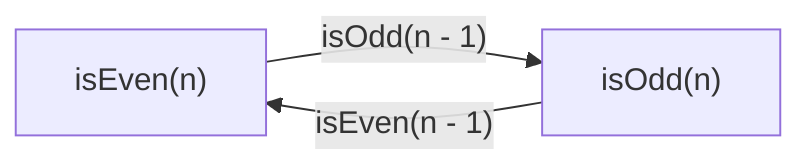
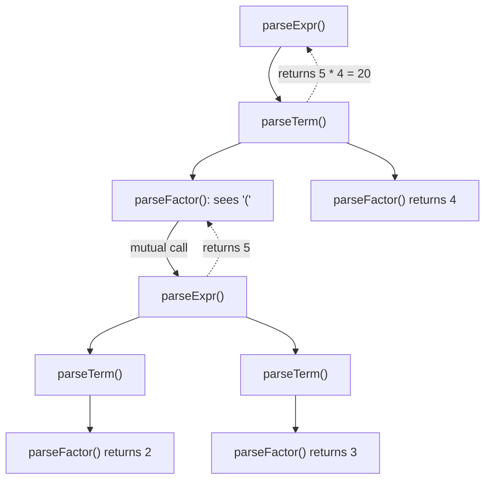
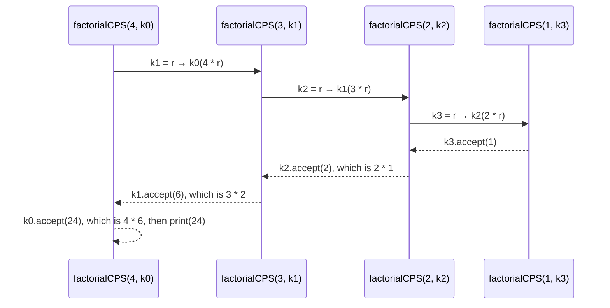

# 🚀 PART FINAL: ADVANCED RECURSION PATTERNS & TECHNIQUES

> **Navigation**: [← Classic Recursion Problems with Full…](03_classic_recursion_problems_with_full_solutions.md) | [Chapter overview](../03c_Recursion_Advanced.md) | [Advanced Backtracking Optimizations →](05_advanced_backtracking_optimizations.md)
> Page 4 of 5 in **Advanced Recursion Patterns**


## Advanced recursion: beyond the basics

This section covers advanced patterns used in competitive programming and system-level programming:

- Mutual recursion
- Indirect recursion
- Continuation-passing style (CPS)
- Y-combinator-style (anonymous) recursion
- Recursion with immutable state
- Advanced backtracking optimizations

## 🔁 Mutual Recursion

**Concept:** two or more functions call each other in a cycle.



**How to read this diagram.** Each function hands the smaller problem (`n - 1`) to the other, so the calls alternate until a base case (`n == 0`) stops the cycle.

**Example:** check whether a number is even or odd using mutual recursion.

```java
// Mutually recursive functions
boolean isEven(int n) {
    if (n == 0) return true;
    return isOdd(n - 1);
}

boolean isOdd(int n) {
    if (n == 0) return false;
    return isEven(n - 1);
}

// Trace: isEven(4)
// isEven(4) → isOdd(3) → isEven(2) → isOdd(1) → isEven(0) → true
```

**Real-world use: expression parsing**

```java
// Recursive descent parser for expressions
// Grammar: expr = term (('+' | '-') term)*
//          term = factor (('*' | '/') factor)*
//          factor = NUMBER | '(' expr ')'

class Parser {
    int pos = 0;
    String input;

    // expr and factor call each other indirectly through term
    int parseExpr() {
        int result = parseTerm();
        while (pos < input.length() && (input.charAt(pos) == '+' || input.charAt(pos) == '-')) {
            char op = input.charAt(pos++);
            int right = parseTerm();
            result = op == '+' ? result + right : result - right;
        }
        return result;
    }

    int parseTerm() {
        int result = parseFactor();
        while (pos < input.length() && (input.charAt(pos) == '*' || input.charAt(pos) == '/')) {
            char op = input.charAt(pos++);
            int right = parseFactor();
            result = op == '*' ? result * right : result / right;
        }
        return result;
    }

    int parseFactor() {
        if (input.charAt(pos) == '(') {
            pos++;  // skip '('
            int result = parseExpr();  // MUTUAL: factor calls expr
            pos++;  // skip ')'
            return result;
        }
        // Parse number
        int start = pos;
        while (pos < input.length() && Character.isDigit(input.charAt(pos))) pos++;
        return Integer.parseInt(input.substring(start, pos));
    }
}
```

**Call graph for parsing `(2+3)*4`**



**How to read this diagram.** The outer `parseFactor` sees `(` and calls `parseExpr` again: that is the mutual call. The inner expression returns 5 (`2+3`), and the outer `parseTerm` then multiplies it by 4 to return 20.

🔬 **Section Challenge — 🔁 Mutual Recursion**

**Challenge 1 (Termination Proof):** `isEven(n)` calls `isOdd(n-1)` and vice versa. **Who** ensures this TERMINATES? **When** does mutual recursion cause infinite loop? **What** is the specific base case structure needed for both functions?

<details><summary>Answer</summary>

**Who ensures termination:** The BASE CASE in both functions. For mutual recursion, BOTH functions must independently handle the base case. **Standard structure:** `isEven(0) = true` (base), `isOdd(0) = false` (base). Each non-base call reduces n by 1, ensuring convergence. **When it causes infinite loop:** If the base case is missing from ONE of the pair. E.g., if `isOdd` has no base case for n=0, then `isEven(1)` calls `isOdd(0)` which calls `isEven(-1)` which calls `isOdd(-2)`... infinite recursion into negative numbers. **Key requirement for mutual recursion termination:** (1) Both functions must have base cases that terminate the chain. (2) Each recursive call must strictly move toward the base case (decreasing n, shrinking problem). (3) The "entry point" function should be called with a non-negative argument. **Java note:** Java doesn't optimize tail calls, so deep mutual recursion (n > ~5000) risks `StackOverflowError`. For large n, convert to iterative using a loop with a boolean flag.

</details>

## 📌 Continuation Passing Style (cps)

**Concept:** instead of returning a value, pass a function (the *continuation*) that handles the result. Every call becomes a tail call.

| Style | How the result travels |
| --- | --- |
| Traditional | `return value` goes back to the caller |
| CPS | `continuation(value)` is called, and nothing is returned |

> [!NOTE]
> Java does not perform tail-call optimization, so CPS in Java does **not** save stack space. The pattern matters because it makes control flow explicit and is the basis of callback-style and functional code.

**Example: factorial in CPS**

```java
// Traditional recursive factorial
int factorial(int n) {
    if (n <= 1) return 1;
    return n * factorial(n - 1);  // Work after recursive call
}

// CPS version - every call is a tail call!
interface Continuation<T> {
    void accept(T result);
}

void factorialCPS(int n, Continuation<Integer> k) {
    if (n <= 1) {
        k.accept(1);  // Pass result to continuation
    } else {
        factorialCPS(n - 1, result -> {
            k.accept(n * result);  // Continuation does the work
        });
    }
}

// Usage
factorialCPS(5, result -> System.out.println(result));  // Prints 120
```

**Trace of `factorialCPS(4, print)`**



**How to read this diagram.** Each call wraps the caller's continuation in a new one (`k1`, `k2`, `k3`). At the base case, `k3.accept(1)` starts the chain, and each continuation multiplies in its own `n` before passing the result on to the next, until `k0` prints 24.

**Fibonacci in CPS**

```java
void fibCPS(int n, Continuation<Integer> k) {
    if (n <= 1) {
        k.accept(n);
    } else {
        fibCPS(n - 1, fib1 -> {
            fibCPS(n - 2, fib2 -> {
                k.accept(fib1 + fib2);
            });
        });
    }
}
```

**Why use CPS?**

- All calls become tail calls, which functional languages with tail-call optimization can turn into loops.
- Explicit control flow is useful for asynchronous programming.
- Callbacks and `async`/`await` are closely related to continuations.

## 🔁 Y — Combinator — Anonymous Recursion

**Problem:** how do you write a recursive function without naming it? (Lambda calculus has no assignment.)

**Solution:** the Y-combinator, a higher-order function that enables recursion. Its mathematical definition is:

`Y = λf. (λx. f(x x)) (λx. f(x x))`

**Java implementation.** Java's lambdas cannot refer to themselves by name, so the version below passes the function to itself explicitly. This is the *self-application* idea behind the Y-combinator rather than the untyped lambda-calculus formula.

```java
// Function that takes itself and returns a function
interface RecursiveFunction<T, R> {
    R apply(RecursiveFunction<T, R> self, T input);
}

// Self-application helper in the spirit of the Y-combinator
static <T, R> Function<T, R> Y(RecursiveFunction<T, R> f) {
    return x -> f.apply(f, x);
}

// Usage - factorial without naming the recursive function!
Function<Integer, Integer> factorial = Y((self, n) -> {
    if (n <= 1) return 1;
    return n * self.apply(self, n - 1);
});

System.out.println(factorial.apply(5));  // 120

// Fibonacci
Function<Integer, Integer> fib = Y((self, n) -> {
    if (n <= 1) return n;
    return self.apply(self, n - 1) + self.apply(self, n - 2);
});

System.out.println(fib.apply(10));  // 55
```

**Simpler version: an anonymous class** (the diamond `new Function<>() {...}` needs Java 9 or later)

```java
// Using Java's Function interface directly
Function<Integer, Integer> factorial = new Function<>() {
    @Override
    public Integer apply(Integer n) {
        if (n <= 1) return 1;
        return n * this.apply(n - 1);  // 'this' refers to the function itself
    }
};
```

**Why care about the Y-combinator?**

- It is a foundation of lambda calculus and functional programming.
- It shows that recursion can be derived from simpler constructs.
- It is asked about in advanced interviews on programming theory.

🔬 **Section Challenge — 🔁 Y — Combinator — Anonymous Recursion**

**Challenge 1 (Lambda Recursion):** In Java, a lambda cannot directly call itself by name. `f -> f.apply(n-1)` doesn't work because `f` isn't in scope. **Who** provides the self-reference in the Y-combinator pattern? **What** is the key structural trick that enables self-application?

<details><summary>Answer</summary>

**Who provides self-reference:** The Y-combinator itself, by passing the function as an argument to itself. **The structural trick:** Instead of `Factorial f = n -> f.apply(n-1)` (illegal, `f` not in scope during assignment), you use a higher-order function that accepts "self" as a parameter: `Function<Function<Integer,Integer>, Function<Integer,Integer>> factorial = self -> n -> n <= 1 ? 1 : n * self.apply(self).apply(n-1);`. Then: `Function<Integer,Integer> fact = factorial.apply(factorial);`. **How it works:** `factorial.apply(factorial)` creates a function where `self = factorial`. When it calls `self.apply(self)`, it re-creates the same function with `self` again — infinite self-application, but lazy (only when called). **Why this matters in Java:** Java `var` and lambdas can't reference themselves during initialization. Y-combinator is the principled way to do anonymous recursion without naming the function. Used in: functional programming frameworks, rule engines, DSLs where functions must be composable without names.

</details>

---

[← Classic Recursion Problems with Full…](03_classic_recursion_problems_with_full_solutions.md) | [Chapter overview](../03c_Recursion_Advanced.md) | [Advanced Backtracking Optimizations →](05_advanced_backtracking_optimizations.md)
