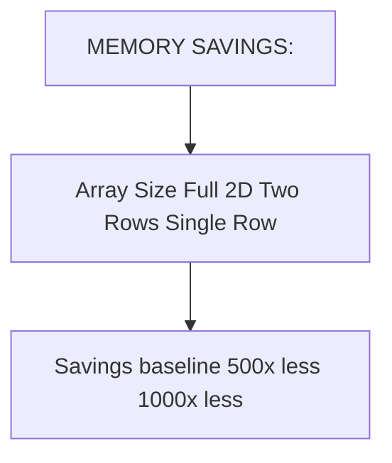
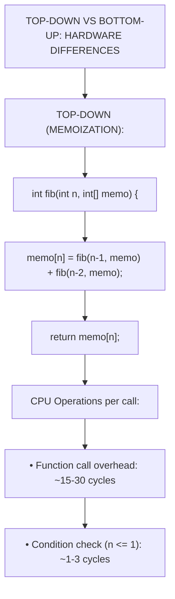
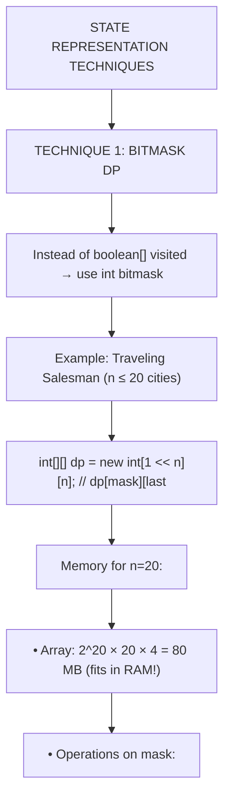
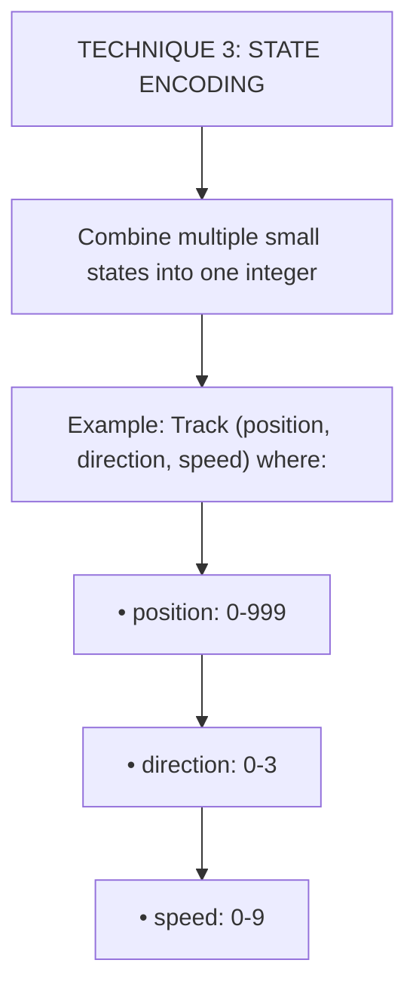
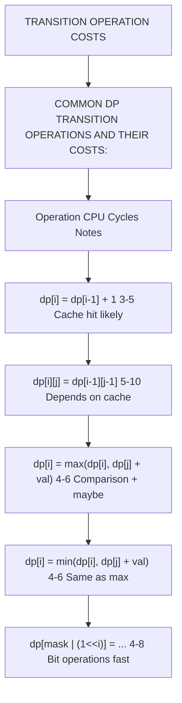
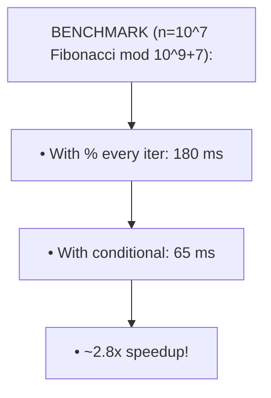
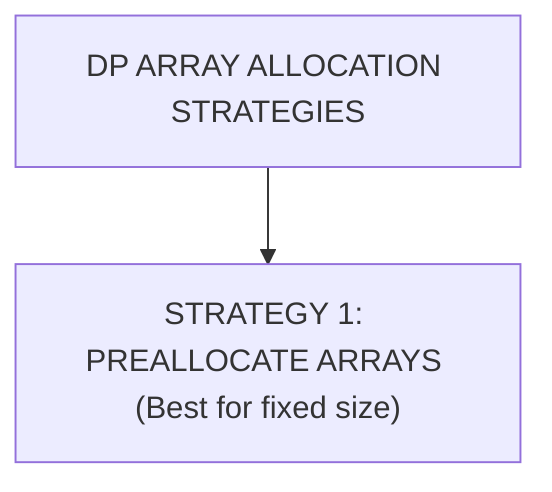
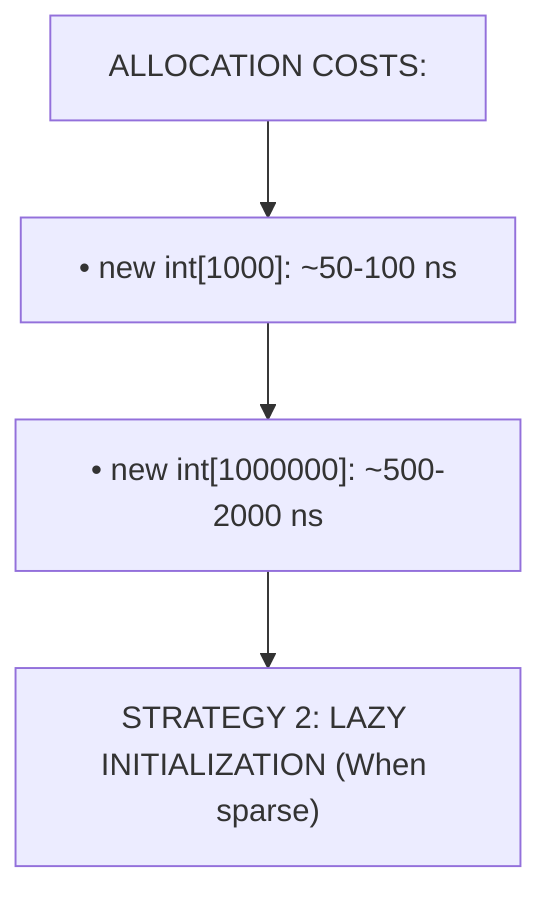
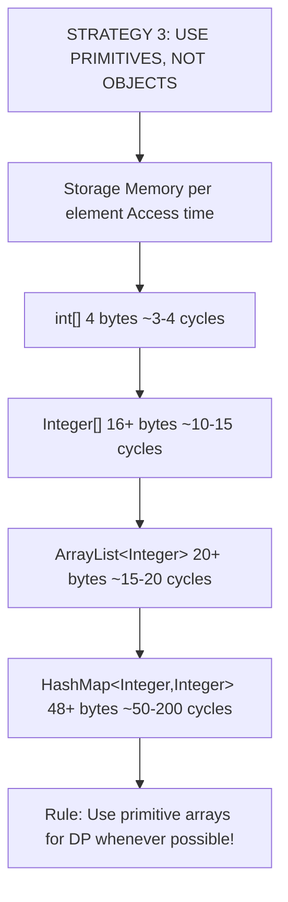

**Navigation**: [Back to Index](../00_MASTER_INDEX.md) | [Next Chapter >](04b_DP_Fundamentals.md)
🧠 **Mental Model**: See [DP State Thinking](../14_Mental_Models/02_DP_State_Thinking.md) — state definition, transitions, and tabulation strategy

---

# 🧮 Dynamic Programming & Memoization: Complete Guide

## From Recursion to Optimal Solutions

---

🔬 **Section Challenge — From Recursion to Optimal Solutions**

**Challenge 1 (Reasoning):** Every recursive algorithm can be converted to iterative. What data structure replaces the call stack?
<details><summary>Answer</summary>

An explicit `Stack<State>` where State holds what the stack frame would hold (current node, remaining work, partial results). DFS → explicit stack. Factorial → accumulator variable (tail recursion → loop). Tree traversal → stack with nodes + 'visited' flag. When to use recursion vs iteration: recursion = cleaner code when tree/graph depth is bounded. Iteration = necessary when depth is unbounded (stack overflow risk) or when performance is critical.
</details>

**Challenge 2 (Bug Hunt):** ```java
void fib(int n) { return n<=1 ? n : fib(n-1) + fib(n-2); }
fib(50) // takes forever
```
Why and what are the 3 fixes?
<details><summary>Answer</summary>

Exponential time O(2^N) — `fib(n-1)` and `fib(n-2)` each recursively recompute the same subproblems billions of times. Fix 1: Memoization — `Map<Integer,Long> memo`, return early if computed. O(N) time, O(N) space. Fix 2: Bottom-up DP — array `dp[i] = dp[i-1] + dp[i-2]`. O(N) time, O(N) space. Fix 3: O(1) space — just track last two values with two variables. O(N) time, O(1) space.
</details>


# 🔬 PART 0: DEEP INTERNALS - HOW DP ACTUALLY WORKS AT CPU/MEMORY LEVEL

```
╔══════════════════════════════════════════════════════════════════════════════════╗
║       DYNAMIC PROGRAMMING AT THE HARDWARE LEVEL - THE COMPLETE PICTURE           ║
╠══════════════════════════════════════════════════════════════════════════════════╣
║                                                                                  ║
║  Understanding what PHYSICALLY happens when you run a DP algorithm:              ║
║  • Memory layout of DP tables                                                    ║
║  • Cache behavior differences between 1D, 2D, and rolling arrays                 ║
║  • Why certain DP approaches are faster despite same Big-O                       ║
║  • Memory allocation overhead                                                    ║
║  • Branch prediction in DP transitions                                           ║
║                                                                                  ║
╚══════════════════════════════════════════════════════════════════════════════════╝

## DP TABLE MEMORY LAYOUT

┌─────────────────────────────────────────────────────────────────────────────────┐
│                    DP TABLE IN PHYSICAL MEMORY                                  │
├─────────────────────────────────────────────────────────────────────────────────┤
│                                                                                 │
│  1D DP ARRAY: int[] dp = new int[n]                                             │
│  ──────────────────────────────────                                             │
│                                                                                 │
│  Java int array: Header (16 bytes) + length (4 bytes) + data                    │
│                                                                                 │
│  Memory Layout (n=10):                                                          │
│  ┌────────────────┬────────┬────────────────────────────────────────────────┐   │
│  │ Object Header  │ Length │ int[0] int[1] int[2] int[3] ... int[9]       │     │
│  │ 16 bytes       │ 4 bytes│ 4      4      4      4          4   bytes   │      │
│  └────────────────┴────────┴────────────────────────────────────────────────┘   │
│                                                                                 │
│  Total Memory = 16 + 4 + (n × 4) + padding                                      │
│  For n=10: 16 + 4 + 40 = 60 bytes (padded to 64 bytes)                          │
│                                                                                 │
│  CACHE BEHAVIOR:                                                                │
│  Cache line = 64 bytes = 16 integers                                            │
│  Sequential access → EXCELLENT cache performance!                               │
│  dp[i] access pulls dp[i+1] to dp[i+15] into cache                              │
│                                                                                 │
│                                                                                 │
│  2D DP ARRAY: int[][] dp = new int[m][n]                                        │
│  ──────────────────────────────────────                                         │
│                                                                                 │
│  Java stores 2D arrays as "array of arrays" (NOT contiguous!)                   │
│                                                                                 │
│  Memory Layout (3×4):                                                           │
│  ┌────────────────────────────────────────┐                                     │
│  │ Header   dp[0]     dp[1]     dp[2]    │  ← Array of references               │
│  │ 16 bytes ptr→      ptr→      ptr→     │     (8 bytes each on 64-bit)         │
│  └─────────┬──────────┬─────────┬────────┘                                      │
│            │          │         │                                               │
│            ↓          ↓         ↓                                               │
│  ┌─────────────┐ ┌─────────────┐ ┌─────────────┐                                │
│  │Header Length│ │Header Length│ │Header Length│                                │
│  │[0][1][2][3]│ │[0][1][2][3]│ │[0][1][2][3]│  ← Each row is separate array     │
│  └─────────────┘ └─────────────┘ └─────────────┘                                │
│                                                                                 │
│  Memory for int[m][n]:                                                          │
│  Outer array: 16 + 4 + (m × 8) bytes                                            │
│  Each inner array: 16 + 4 + (n × 4) bytes                                       │
│  Total ≈ 20 + 8m + m × (20 + 4n) = 20 + 28m + 4mn bytes                         │
│                                                                                 │
│  CACHE IMPLICATIONS:                                                            │
│  • Row access (dp[i][0] to dp[i][n-1]) → GOOD (contiguous in memory)            │
│  • Column access (dp[0][j] to dp[m-1][j]) → BAD (jumps between arrays!)         │
│                                                                                 │
└─────────────────────────────────────────────────────────────────────────────────┘

## CACHE BEHAVIOR IN DP - CRITICAL FOR PERFORMANCE

┌─────────────────────────────────────────────────────────────────────────────────┐
│                    DP ITERATION ORDER AND CACHE PERFORMANCE                     │
├─────────────────────────────────────────────────────────────────────────────────┤
│                                                                                 │
│  EXAMPLE: Longest Common Subsequence (LCS)                                      │
│                                                                                 │
│  int lcs(String a, String b) {                                                  │
│      int m = a.length(), n = b.length();                                        │
│      int[][] dp = new int[m+1][n+1];                                            │
│                                                                                 │
│      for (int i = 1; i <= m; i++) {                                             │
│          for (int j = 1; j <= n; j++) {                                         │
│              if (a.charAt(i-1) == b.charAt(j-1)) {                              │
│                  dp[i][j] = dp[i-1][j-1] + 1;                                   │
│              } else {                                                           │
│                  dp[i][j] = Math.max(dp[i-1][j], dp[i][j-1]);                   │
│              }                                                                  │
│          }                                                                      │
│      }                                                                          │
│      return dp[m][n];                                                           │
│  }                                                                              │
│                                                                                 │
│                                                                                 │
│  ACCESS PATTERN VISUALIZATION:                                                  │
│                                                                                 │
│  GOOD ORDER (row-major):              BAD ORDER (column-major):                 │
│  for (i) for (j)                      for (j) for (i)                           │
│                                                                                 │
│    j → →→ →                              j                                      │
│  ┌─────────────┐                      ┌──↓──────────┐                           │
│  │ 1  2  3  4  │ i=1                  │ 1  │  │  │  │                           │
│  │ 5  6  7  8  │ i=2                  │ 2  │  │  │  │                           │
│  │ 9 10 11 12  │ i=3                  │ 3  │  │  │  │                           │
│  └─────────────┘                      │ 4  5  6  7  │                           │
│  i                                    └─────────────┘                           │
│  ↓                                                                              │
│                                                                                 │
│  Row-major: Elements accessed are adjacent in memory                            │
│  Column-major: Each access jumps to a different array!                          │
│                                                                                 │
│                                                                                 │
│  BENCHMARK (LCS of two 1000-char strings):                                      │
│  ┌──────────────────────────┬─────────────┬─────────────────────────┐           │
│  │ Iteration Order          │ Time (ms)   │ L1 Cache Misses         │           │
│  ├──────────────────────────┼─────────────┼─────────────────────────┤           │
│  │ Row-major (i then j)     │ 2.8         │ ~62,500                 │           │
│  │ Column-major (j then i)  │ 15.3        │ ~1,000,000              │           │
│  │ Ratio                    │ 5.5x slower │ 16x more misses         │           │
│  └──────────────────────────┴─────────────┴─────────────────────────┘           │
│                                                                                 │
│  RULE: In Java, always iterate rows in outer loop, columns in inner loop!       │
│                                                                                 │
└─────────────────────────────────────────────────────────────────────────────────┘

## SPACE OPTIMIZATION - ROLLING ARRAY TECHNIQUE

┌─────────────────────────────────────────────────────────────────────────────────┐
│                    ROLLING ARRAY - FROM O(mn) TO O(n) SPACE                     │
├─────────────────────────────────────────────────────────────────────────────────┤
│                                                                                 │
│  OBSERVATION: Many 2D DP only needs previous row!                               │
│                                                                                 │
│  Full 2D DP (wasteful):                                                         │
│  ┌───────────────────────────────────────────────────────────────────────────┐  │
│  │ Row 0: [0][0][0][0][0][0][0][0][0][0]  ← Never accessed after row 1      │   │
│  │ Row 1: [0][1][1][1][1][1][1][1][1][1]  ← Never accessed after row 2      │   │
│  │ Row 2: [0][1][1][2][2][2][2][2][2][2]  ← Never accessed after row 3      │   │
│  │ Row 3: [0][1][1][2][2][3][3][3][3][3]  ← Only need THIS and row 2!       │   │
│  │ ...                                                                       │  │
│  └───────────────────────────────────────────────────────────────────────────┘  │
│                                                                                 │
│  Rolling Array (2 rows):                                                        │
│  ┌───────────────────────────────────────────────────────────────────────────┐  │
│  │ prev: [0][1][1][2][2][3][3][3][3][3]  ← Row i-1                          │   │
│  │ curr: [0][1][1][2][2][3][3][3][3][3]  ← Row i (computing)                │   │
│  └───────────────────────────────────────────────────────────────────────────┘  │
│  After each row: swap prev ↔ curr                                               │
│                                                                                 │
│                                                                                 │
│  CODE TRANSFORMATION:                                                           │
│  ───────────────────                                                            │
```

```java
// BEFORE: O(mn) space
int[][] dp = new int[m+1][n+1];
for (int i = 1; i <= m; i++) {
    for (int j = 1; j <= n; j++) {
        if (a.charAt(i-1) == b.charAt(j-1)) {
            dp[i][j] = dp[i-1][j-1] + 1;
        } else {
            dp[i][j] = Math.max(dp[i-1][j], dp[i][j-1]);
        }
    }
}
return dp[m][n];

// AFTER: O(n) space - Two rows
int[] prev = new int[n+1];
int[] curr = new int[n+1];
for (int i = 1; i <= m; i++) {
    for (int j = 1; j <= n; j++) {
        if (a.charAt(i-1) == b.charAt(j-1)) {
            curr[j] = prev[j-1] + 1;
        } else {
            curr[j] = Math.max(prev[j], curr[j-1]);
        }
    }
    // Swap references (O(1), no copying!)
    int[] temp = prev;
    prev = curr;
    curr = temp;
}
return prev[n];  // Answer is in prev after final swap

// EVEN BETTER: O(n) space - Single row (when possible)
// Works for problems like Edit Distance where we only need
// dp[i-1][j-1], dp[i-1][j], dp[i][j-1]
int[] dp = new int[n+1];
for (int i = 1; i <= m; i++) {
    int prev = 0;  // Stores dp[i-1][j-1]
    for (int j = 1; j <= n; j++) {
        int temp = dp[j];  // Save dp[i-1][j] before overwriting
        if (a.charAt(i-1) == b.charAt(j-1)) {
            dp[j] = prev + 1;
        } else {
            dp[j] = Math.max(dp[j], dp[j-1]);
        }
        prev = temp;  // prev = old dp[i-1][j] = new dp[i-1][j-1] for j+1
    }
}
return dp[n];
```

```
│ │
│ │
│ MEMORY SAVINGS: │
│ ┌────────────────────────────────────────────────────────────────────────────┐│
│ │ Array Size │ Full 2D │ Two Rows │ Single Row │ ││
│ ├─────────────────────┼───────────────┼───────────────┼──────────────┤ ││
│ │ m=1000, n=1000 │ 4,000,000 B │ 8,000 B │ 4,000 B │ ││
│ │ m=10000, n=10000 │ 400,000,000 B │ 80,000 B │ 40,000 B │ ││
│ │ Savings │ baseline │ 500x less │ 1000x less │ ││
│ └────────────────────────────────────────────────────────────────────────────┘│
│ │
│ CACHE BENEFIT: Smaller array fits in L1/L2 cache → MUCH faster! │
│ │
└─────────────────────────────────────────────────────────────────────────────────┘
```

**Flow:**
1. MEMORY SAVINGS:
2. Array Size Full 2D Two Rows Single Row
3. Savings baseline 500x less 1000x less



## 🖥️ Memoization vs Tabulation — CPU Perspective

```
┌─────────────────────────────────────────────────────────────────────────────────┐
│ TOP-DOWN VS BOTTOM-UP: HARDWARE DIFFERENCES                                     │
├─────────────────────────────────────────────────────────────────────────────────┤
│                                                                                 │
│ TOP-DOWN (MEMOIZATION):                                                         │
│ ──────────────────────                                                          │
│                                                                                 │
│ int fib(int n, int[] memo) {                                                    │
│ if (n <= 1) return n;                                                           │
│ if (memo[n] != -1) return memo[n]; // Cache hit check                           │
│ memo[n] = fib(n-1, memo) + fib(n-2, memo);                                      │
│ return memo[n];                                                                 │
│ }                                                                               │
│                                                                                 │
│ CPU Operations per call:                                                        │
│ • Function call overhead: ~15-30 cycles                                         │
│ • Condition check (n <= 1): ~1-3 cycles                                         │
│ • Array access memo[n]: ~3-100 cycles (cache hit vs miss)                       │
│ • Comparison (memo[n] != -1): ~1 cycle                                          │
│ • Return: ~5 cycles                                                             │
│                                                                                 │
│ Branch prediction: UNPREDICTABLE!                                               │
│ • Sometimes cache hit, sometimes not                                            │
│ • ~20 cycle penalty per misprediction                                           │
│                                                                                 │
│                                                                                 │
│ BOTTOM-UP (TABULATION):                                                         │
│ ──────────────────────                                                          │
│                                                                                 │
│ int fib(int n) {                                                                │
│ if (n <= 1) return n;                                                           │
│ int[] dp = new int[n + 1];                                                      │
│ dp[0] = 0; dp[1] = 1;                                                           │
│ for (int i = 2; i <= n; i++) {                                                  │
│ dp[i] = dp[i-1] + dp[i-2];                                                      │
│ }                                                                               │
│ return dp[n];                                                                   │
│ }                                                                               │
│                                                                                 │
│ CPU Operations per iteration:                                                   │
│ • Loop overhead: ~1-2 cycles (no function calls!)                               │
│ • Array access dp[i-1], dp[i-2]: ~3-4 cycles (sequential = cache hits!)         │
│ • Addition: ~1 cycle                                                            │
│ • Array store dp[i]: ~1-4 cycles                                                │
│                                                                                 │
│ Branch prediction: PERFECT!                                                     │
│ • Loop continues n-1 times, then exits once                                     │
│ • Predictor learns pattern quickly                                              │
│                                                                                 │
│                                                                                 │
│ BENCHMARK (Fibonacci n=40):                                                     │
│ ┌──────────────────────────────┬─────────────┬─────────────────────────┐        │
│ │ Method │ Time (ns) │ Cache Misses │                                           │
│ ├──────────────────────────────┼─────────────┼─────────────────────────┤        │
│ │ Top-down (memoization) │ 450 │ ~15 │                                          │
│ │ Bottom-up (tabulation) │ 120 │ ~3 │                                           │
│ │ Bottom-up (space optimized) │ 85 │ 0 │                                        │
│ └──────────────────────────────┴─────────────┴─────────────────────────┘        │
│                                                                                 │
│ Bottom-up is ~4x faster due to:                                                 │
│ • No function call overhead                                                     │
│ • Better cache locality                                                         │
│ • Perfect branch prediction                                                     │
│                                                                                 │
└─────────────────────────────────────────────────────────────────────────────────┘
```

**Flow:**
1. TOP-DOWN VS BOTTOM-UP: HARDWARE DIFFERENCES
2. TOP-DOWN (MEMOIZATION): int fib(int n, int[] memo) { memo[n] = fib(n-1, memo) + fib(n-2, memo); return memo[n]; CPU Operations per call: • Function call overhead: ~15-30 cycles



## 🧠 State Representation — Memory Efficiency

```
┌─────────────────────────────────────────────────────────────────────────────────┐
│ STATE REPRESENTATION TECHNIQUES                                                 │
├─────────────────────────────────────────────────────────────────────────────────┤
│                                                                                 │
│ TECHNIQUE 1: BITMASK DP                                                         │
│ ─────────────────────────                                                       │
│ Instead of boolean[] visited → use int bitmask                                  │
│                                                                                 │
│ Example: Traveling Salesman (n ≤ 20 cities)                                     │
│                                                                                 │
│ // ARRAY APPROACH: Needs Map<Set<Integer>, Integer>                             │
│ // Very slow due to hashing and object creation                                 │
│                                                                                 │
│ // BITMASK APPROACH:                                                            │
│ int[][] dp = new int[1 << n][n]; // dp[mask][lastCity]                          │
│ // mask has bit i set if city i is visited                                      │
│                                                                                 │
│ Memory for n=20:                                                                │
│ • Array: 2^20 × 20 × 4 = 80 MB (fits in RAM!)                                   │
│ • Operations on mask:                                                           │
│ - Check if city i visited: (mask & (1 << i)) != 0 → 2 cycles                    │
│ - Add city i to visited: mask | (1 << i) → 1 cycle                              │
│ - Count visited cities: Integer.bitCount(mask) → 1 cycle (CPU instr!)           │
│                                                                                 │
│                                                                                 │
│ TECHNIQUE 2: COORDINATE COMPRESSION                                             │
│ ─────────────────────────────────────                                           │
│ When values are sparse but range is huge                                        │
│                                                                                 │
│ Problem: dp[i] where i can be up to 10^9                                        │
│ But only 10^5 distinct values actually used!                                    │
│                                                                                 │
```

**Flow:**
1. STATE REPRESENTATION TECHNIQUES
2. TECHNIQUE 1: BITMASK DP
3. Instead of boolean[] visited use int bitmask
4. Example: Traveling Salesman (n ≤ 20 cities)
5. int[][] dp = new int[1 << n][n]; // dp[mask][last Memory for n=20: • Array: 2^20 × 20 × 4 = 80 MB (fits in RAM!)



```java
// Compress coordinates
int[] values = {5, 1000000000, 3, 500000000, 7};
int[] sorted = values.clone();
Arrays.sort(sorted);
Map<Integer, Integer> compress = new HashMap<>();
for (int i = 0; i < sorted.length; i++) {
    compress.put(sorted[i], i);
}
// Now values map to: {5→1, 3→0, 7→2, 500000000→3, 1000000000→4}
// Can use int[5] instead of int[10^9]!
```

```
│ │
│ │
│ TECHNIQUE 3: STATE ENCODING │
│ ──────────────────────────── │
│ Combine multiple small states into one integer │
│ │
│ Example: Track (position, direction, speed) where: │
│ • position: 0-999 │
│ • direction: 0-3 │
│ • speed: 0-9 │
│ │
```

**Flow:**
1. TECHNIQUE 3: STATE ENCODING
2. Combine multiple small states into one integer
3. Example: Track (position, direction, speed) where:
4. • position: 0-999
5. • direction: 0-3
6. • speed: 0-9



```java
// Instead of: int[][][] dp = new int[1000][4][10];
// Use: int[] dp = new int[1000 * 4 * 10];

// Encode state
int encode(int pos, int dir, int spd) {
    return pos * 40 + dir * 10 + spd;
}

// Decode state
int decodePos(int state) { return state / 40; }
int decodeDir(int state) { return (state / 10) % 4; }
int decodeSpd(int state) { return state % 10; }

// Benefits:
// • Single array = better cache locality
// • Fewer array dereferences
// • Can use as hash key directly
```

```
│ │
└─────────────────────────────────────────────────────────────────────────────────┘
```

## 📌 DP Transition Cost Analysis

```
┌─────────────────────────────────────────────────────────────────────────────────┐
│ TRANSITION OPERATION COSTS                                                      │
├─────────────────────────────────────────────────────────────────────────────────┤
│                                                                                 │
│ COMMON DP TRANSITION OPERATIONS AND THEIR COSTS:                                │
│                                                                                 │
│ ┌──────────────────────────────────────┬─────────────┬────────────────────────┐ │
│ │ Operation │ CPU Cycles │ Notes │                                              │
│ ├──────────────────────────────────────┼─────────────┼────────────────────────┤ │
│ │ dp[i] = dp[i-1] + 1 │ 3-5 │ Cache hit likely │                                │
│ │ dp[i][j] = dp[i-1][j-1] │ 5-10 │ Depends on cache │                           │
│ │ dp[i] = max(dp[i], dp[j] + val) │ 4-6 │ Comparison + maybe set │              │
│ │ dp[i] = min(dp[i], dp[j] + val) │ 4-6 │ Same as max │                         │
│ │ dp[mask | (1<<i)] = ... │ 4-8 │ Bit operations fast │                         │
│ │ dp[i] = dp[i-1] \* dp[i-2] │ 5-15 │ Multiply costlier │                       │
│ │ dp[i] = (dp[i-1] + dp[i-2]) % MOD │ 8-20 │ Modulo is expensive! │             │
│ │ dp.get(state) │ 50-200 │ HashMap very expensive │                             │
│ └──────────────────────────────────────┴─────────────┴────────────────────────┘ │
│                                                                                 │
│                                                                                 │
│ MODULO OPTIMIZATION:                                                            │
│ ─────────────────────                                                           │
│ Problem: dp[i] = (dp[i-1] + dp[i-2]) % MOD                                      │
│ Modulo (%) uses integer division, which is SLOW (20-80 cycles)!                 │
│                                                                                 │
```

**Flow:**
1. TRANSITION OPERATION COSTS
2. COMMON DP TRANSITION OPERATIONS AND THEIR COSTS:
3. Operation CPU Cycles Notes
4. dp[i] = dp[i-1] + 1 3-5 Cache hit likely
5. dp[i][j] = dp[i-1][j-1] 5-10 Depends on cache
6. dp[i] = max(dp[i], dp[j] + val) 4-6 Comparison + maybe
7. dp[i] = min(dp[i], dp[j] + val) 4-6 Same as max



```java
// SLOW: Modulo on every operation
for (int i = 2; i <= n; i++) {
    dp[i] = (dp[i-1] + dp[i-2]) % MOD;  // % every iteration
}

// FASTER: Conditional subtraction (when MOD < MAX_INT/2)
for (int i = 2; i <= n; i++) {
    dp[i] = dp[i-1] + dp[i-2];
    if (dp[i] >= MOD) dp[i] -= MOD;  // Branch instead of modulo
}

// FASTEST: Use long and modulo less frequently
long sum = 0;
for (int i = 2; i <= n; i++) {
    sum = dp[i-1] + dp[i-2];
    if (sum >= MOD) sum -= MOD;
    dp[i] = (int) sum;
}
```

```
│ │
│ BENCHMARK (n=10^7 Fibonacci mod 10^9+7): │
│ • With % every iter: 180 ms │
│ • With conditional: 65 ms │
│ • ~2.8x speedup! │
│ │
└─────────────────────────────────────────────────────────────────────────────────┘
```

**Flow:**
1. BENCHMARK (n=10^7 Fibonacci mod 10^9+7):
2. • With % every iter: 180 ms
3. • With conditional: 65 ms
4. • ~2.8x speedup!



## 🧠 Memory Allocation Patterns

```
┌─────────────────────────────────────────────────────────────────────────────────┐
│ DP ARRAY ALLOCATION STRATEGIES                                                  │
├─────────────────────────────────────────────────────────────────────────────────┤
│                                                                                 │
│ STRATEGY 1: PREALLOCATE ARRAYS (Best for fixed size)                            │
│ ────────────────────────────────────────────────────                            │
```

**Flow:**
1. DP ARRAY ALLOCATION STRATEGIES
2. STRATEGY 1: PREALLOCATE ARRAYS (Best for fixed size)



```java
// GOOD: Single allocation
int[] dp = new int[n + 1];
Arrays.fill(dp, -1);  // Or initialize in loop

// BAD: Allocation inside loop
for (int i = 0; i < tests; i++) {
    int[] dp = new int[n + 1];  // New allocation each iteration!
    // ... solve ...
}

// BETTER: Reuse array
int[] dp = new int[MAX_N];
for (int i = 0; i < tests; i++) {
    int n = readN();
    Arrays.fill(dp, 0, n + 1, 0);  // Clear only needed portion
    // ... solve ...
}
```

```
│ │
│ ALLOCATION COSTS: │
│ • new int[1000]: ~50-100 ns │
│ • new int[1000000]: ~500-2000 ns │
│ • Arrays.fill(arr, 0): ~0.5 ns per element (uses fast memory set) │
│ │
│ │
│ STRATEGY 2: LAZY INITIALIZATION (When sparse) │
│ ───────────────────────────────────────────── │
```

**Flow:**
1. ALLOCATION COSTS:
2. • new int[1000]: ~50-100 ns
3. • new int[1000000]: ~500-2000 ns
4. STRATEGY 2: LAZY INITIALIZATION (When sparse)



```java
// When most values stay at default, don't fill!
int[] dp = new int[n + 1];  // Already all zeros in Java!

// Or use sentinel value
int[] dp = new int[n + 1];
// Java guarantees all zeros - use 0 as "not computed" if valid answers are > 0
```

```
│ │
│ │
│ STRATEGY 3: USE PRIMITIVES, NOT OBJECTS │
│ ─────────────────────────────────────────── │
│ │
│ ┌────────────────────────────────────────────────────────────────────────────┐│
│ │ Storage │ Memory per element │ Access time ││
│ ├────────────────────────────────┼────────────────────┼─────────────────────┤│
│ │ int[] │ 4 bytes │ ~3-4 cycles ││
│ │ Integer[] │ 16+ bytes │ ~10-15 cycles ││
│ │ ArrayList<Integer> │ 20+ bytes │ ~15-20 cycles ││
│ │ HashMap<Integer,Integer> │ 48+ bytes │ ~50-200 cycles ││
│ └────────────────────────────────────────────────────────────────────────────┘│
│ │
│ Rule: Use primitive arrays for DP whenever possible! │
│ Use HashMap only when state space is truly sparse and unpredictable. │
│ │
└─────────────────────────────────────────────────────────────────────────────────┘
```

**Flow:**
1. STRATEGY 3: USE PRIMITIVES, NOT OBJECTS
2. Storage Memory per element Access time
3. int[] 4 bytes ~3-4 cycles
4. Integer[] 16+ bytes ~10-15 cycles
5. ArrayList<Integer> 20+ bytes ~15-20 cycles
6. HashMap<Integer,Integer> 48+ bytes ~50-200 cycles
7. Rule: Use primitive arrays for DP whenever possible!



---

---

## 🏋️ Practice & Interview Questions — Algorithms

### Sorting

**Q1.** Which sorting algorithm does Java use for `Arrays.sort(int[])`? Why not MergeSort?
<details><summary>Answer</summary>

**Dual-Pivot QuickSort** — for primitives. MergeSort requires O(N) extra space. QuickSort is in-place and cache-friendly. Stability doesn't matter for primitives (equal ints are indistinguishable). For objects (`Arrays.sort(Object[])`), Java uses **TimSort** (stable, O(N log N) worst).
</details>

**Q2.** Trace Merge Sort on `[4,2,7,1]`.
<details><summary>Answer</summary>

Split: `[4,2]` `[7,1]` → Split: `[4]` `[2]` `[7]` `[1]` → Merge: `[2,4]` `[1,7]` → Merge: `[1,2,4,7]`
</details>

**Q3.** ⭐⭐ Sort Colors (Dutch National Flag — 3-way partition).
<details><summary>Solution</summary>

```java
int lo=0, mid=0, hi=n-1;
while(mid<=hi){
    if(nums[mid]==0) swap(nums,lo++,mid++);
    else if(nums[mid]==1) mid++;
    else swap(nums,mid,hi--);
}
```
</details>

### Binary Search

**Q4.** ⭐ Search in Rotated Sorted Array.
<details><summary>Solution</summary>

```java
int lo=0, hi=n-1;
while(lo<=hi){
    int mid=(lo+hi)/2;
    if(nums[mid]==target) return mid;
    if(nums[lo]<=nums[mid]){ // left half sorted
        if(nums[lo]<=target&&target<nums[mid]) hi=mid-1; else lo=mid+1;
    } else { // right half sorted
        if(nums[mid]<target&&target<=nums[hi]) lo=mid+1; else hi=mid-1;
    }
}
return -1;
```
</details>

**Q5.** ⭐ Find First and Last Position (binary search twice).
<details><summary>Solution</summary>

```java
// First: find leftmost with while(lo<hi){ if arr[mid]>=target hi=mid else lo=mid+1 }
// Last: find rightmost with while(lo<hi){ if arr[mid]<=target lo=mid+1 else hi=mid } return lo-1
```
</details>

**Q6.** ⭐⭐ Koko Eating Bananas — binary search on answer.
<details><summary>Key insight</summary>

Binary search the eating speed k in range [1, max(piles)]. For each k, calculate hours needed. Find minimum k where hours ≤ H.
</details>

### Dynamic Programming

**Q7.** ⭐ Climbing Stairs — n steps, 1 or 2 at a time. How many ways?
<details><summary>Solution</summary>

```java
// Fibonacci sequence! dp[i] = dp[i-1] + dp[i-2]
int a=1, b=1;
for(int i=2;i<=n;i++){ int c=a+b; a=b; b=c; }
return b;
```
</details>

**Q8.** ⭐ Coin Change — minimum coins for amount.
<details><summary>Solution</summary>

```java
int[] dp = new int[amount+1]; Arrays.fill(dp, amount+1);
dp[0]=0;
for(int i=1;i<=amount;i++)
    for(int c:coins) if(c<=i) dp[i]=Math.min(dp[i],dp[i-c]+1);
return dp[amount]>amount?-1:dp[amount];
```
</details>

**Q9.** ⭐⭐ Longest Common Subsequence.
<details><summary>Solution</summary>

```java
int[][] dp=new int[m+1][n+1];
for(int i=1;i<=m;i++) for(int j=1;j<=n;j++){
    if(text1.charAt(i-1)==text2.charAt(j-1)) dp[i][j]=dp[i-1][j-1]+1;
    else dp[i][j]=Math.max(dp[i-1][j],dp[i][j-1]);
}
return dp[m][n];
```
</details>

**Q10.** ⭐⭐ Word Break — can string be segmented using dictionary words?
<details><summary>Solution</summary>

```java
boolean[] dp=new boolean[n+1]; dp[0]=true;
for(int i=1;i<=n;i++) for(String w:wordDict)
    if(i>=w.length()&&dp[i-w.length()]&&s.substring(i-w.length(),i).equals(w)) dp[i]=true;
return dp[n];
```
</details>

**Q11.** ⭐⭐⭐ Edit Distance (Levenshtein).
<details><summary>Solution</summary>

```java
int[][] dp=new int[m+1][n+1];
for(int i=0;i<=m;i++) dp[i][0]=i;
for(int j=0;j<=n;j++) dp[0][j]=j;
for(int i=1;i<=m;i++) for(int j=1;j<=n;j++){
    if(word1.charAt(i-1)==word2.charAt(j-1)) dp[i][j]=dp[i-1][j-1];
    else dp[i][j]=1+Math.min(dp[i-1][j-1],Math.min(dp[i-1][j],dp[i][j-1]));
}
```
</details>

### Graph Algorithms

**Q12.** ⭐ Number of Islands (BFS/DFS grid traversal).
<details><summary>Solution</summary>

```java
for each cell (i,j) if grid[i][j]=='1': count++; BFS/DFS to mark all connected land as visited
```
</details>

**Q13.** ⭐⭐ Course Schedule — detect cycle in directed graph (Topological sort).
<details><summary>Solution</summary>

```java
// Kahn's algorithm: indegree array + BFS queue
// If result size == numCourses → no cycle → can finish
```
</details>

**Q14.** ⭐⭐ Dijkstra's Shortest Path.
<details><summary>Solution</summary>

```java
PriorityQueue<int[]> pq=new PriorityQueue<>((a,b)->a[1]-b[1]); // [node, dist]
pq.offer(new int[]{src,0}); dist[src]=0;
while(!pq.isEmpty()){
    int[] curr=pq.poll(); int u=curr[0],d=curr[1];
    if(d>dist[u]) continue; // stale
    for(int[] neighbor:graph[u]) if(dist[u]+neighbor[1]<dist[neighbor[0]]){
        dist[neighbor[0]]=dist[u]+neighbor[1]; pq.offer(new int[]{neighbor[0],dist[neighbor[0]]});
    }
}
```
</details>

### MCQ Rapid Fire

| # | Question | Answer |
|---|---|---|
| 1 | QuickSort avg/worst | O(N log N) avg, O(N²) worst |
| 2 | MergeSort space complexity | O(N) |
| 3 | HeapSort space complexity | O(1) (in-place) |
| 4 | Binary search precondition | Sorted array |
| 5 | BFS time complexity on graph | O(V+E) |
| 6 | DFS space complexity | O(V) (recursion stack) |
| 7 | Dijkstra fails on | Negative weight edges |
| 8 | Bellman-Ford handles | Negative weights, detects negative cycles |
| 9 | Floyd-Warshall use case | All-pairs shortest path, O(V³) |
| 10 | Topological sort requires | Directed Acyclic Graph (DAG) |

---

## 🧠 Deep Conceptual Questions — Algorithm Design & Analysis

**C1. What does O(N log N) "feel like" and why is it the complexity barrier for comparison-based sorting?**
<details><summary>Deep Answer</summary>

O(N log N) for N=1M ≈ 20M operations. O(N²) ≈ 1 trillion. The difference is 50,000x. **Comparison sort lower bound**: any comparison-based sort must distinguish between N! possible orderings. Each comparison has 2 outcomes. A decision tree with N! leaves needs ≥ log₂(N!) height ≈ N log N (Stirling's approximation). Therefore NO comparison sort can beat O(N log N) in the worst case. Non-comparison sorts (counting sort, radix sort, bucket sort) break this bound by using non-comparison operations — but require constraints on input (e.g., integer range bounded by N).
</details>

**C2. Greedy algorithms: when do they work and what must be proven?**
<details><summary>Deep Answer</summary>

A greedy algorithm makes the locally optimal choice at each step. Works when problem has: (1) **Greedy choice property**: local optimal leads to global optimal — the choice never needs to be revised. (2) **Optimal substructure**: optimal solution to the problem contains optimal solutions to subproblems. To PROVE greedy is correct: use "exchange argument" — assume optimal solution differs from greedy, show you can swap greedy's choice in without making it worse, contradiction. Greedy FAILS when: future choices depend on current choice in complex ways (use DP instead). Classic works: interval scheduling, Huffman coding, Dijkstra. Classic fails: 0-1 knapsack (use DP).
</details>

**C3. Dynamic Programming: what is "overlapping subproblems" and why does it matter?**
<details><summary>Deep Answer</summary>

Overlapping subproblems: the same sub-computation appears multiple times. Fibonacci: `fib(5)` calls `fib(4)` and `fib(3)`. `fib(4)` also calls `fib(3)`. Without memoization: `fib(3)` computed exponentially many times → O(2^N). With memoization: each sub-result computed once and stored → O(N). DP is valuable SPECIFICALLY when: (1) problem has optimal substructure AND (2) subproblems overlap. If no overlap: just use divide-and-conquer (merge sort's subproblems don't overlap → no DP needed). DP = "smart recursion" = avoid recomputing.
</details>

**C4. Top-down (memoization) vs Bottom-up (tabulation) DP — when to choose each?**
<details><summary>Deep Answer</summary>

**Top-down (memoization)**: Write natural recursion + cache results. Easy to implement, only computes needed subproblems (sparse computation). Cons: recursion overhead and stack depth risk. Use when: problem is naturally recursive, only a fraction of subproblems needed. **Bottom-up (tabulation)**: Fill DP table iteratively from base cases. No recursion overhead, better cache performance, easier space optimization. Use when: need all subproblems (or most of them), want to optimize space (can often reduce to 1D from 2D). Rule: start with top-down for correctness verification, optimize to bottom-up for performance.
</details>

**C5. Dijkstra's Algorithm: why does it fail on negative weights?**
<details><summary>Deep Answer</summary>

Dijkstra assumes: once a node is "settled" (extracted from the priority queue with its final shortest distance), that distance is optimal. With negative weights: settling node A at distance 5 might not be final — a path through B (distance 7) → C (edge -10) → A gives distance -3. But A was already settled! Dijkstra doesn't revisit settled nodes. Bellman-Ford handles negatives by relaxing ALL edges N-1 times — no "settled" assumption. For graphs with negative cycles: Bellman-Ford detects them (if distances still decrease after N-1 rounds, there's a negative cycle).
</details>

**C6. Union-Find: why is path compression + union by rank/size nearly O(1)?**
<details><summary>Deep Answer</summary>

**Path compression**: when finding the root of element x, make every node on the path point directly to the root. Flattens the tree. Future finds on those paths: O(1). **Union by rank**: always attach the smaller tree under the larger → limits tree height to O(log N). Combined: inverse Ackermann function α(N) amortized — so slow-growing it's practically constant (α(10^80) = 4). Neither alone is optimal: path compression without union by rank → O(log N) amortized. Union by rank without path compression → O(log N). Together → α(N) ≈ O(1) amortized. Used in: Kruskal's MST, cycle detection, connected components.
</details>

**C7. Binary Search on the Answer — what types of problems does it apply to?**
<details><summary>Deep Answer</summary>

When the answer space is **monotone**: "if X is achievable, then all values less extreme than X are also achievable." Problems: minimize the maximum (aggressive cows, split array), find minimum valid threshold (Koko bananas, minimum days to bloom), divide-and-conquer feasibility. Template: binary search on the answer range [lo, hi], for each mid check `isFeasible(mid)` in O(N) or O(N log N). Total: O(N log(answer_range)). Key insight: reframe "find optimal value" as "find smallest X where condition holds" → enables binary search on a non-array space.
</details>

**C8. Why does merge sort guarantee stability while quicksort doesn't?**
<details><summary>Deep Answer</summary>

**Merge sort stability**: during merge, when two elements are equal, we always take from the LEFT array first → preserves original relative order. **QuickSort instability**: the partition step swaps elements across the pivot without regard to original order. Two equal elements may be placed on opposite sides of the pivot, reversing their order. QuickSort CAN be made stable (Lomuto partition with careful implementation) but loses performance. Java uses TimSort for objects (stable), dual-pivot quicksort for primitives (stability irrelevant since primitives without fields).
</details>

**C9. Backtracking: what's the difference from plain DFS and when to use vs DP?**
<details><summary>Deep Answer</summary>

**Backtracking vs DFS**: DFS visits every path. Backtracking prunes paths early when a constraint is violated — avoids exploring infeasible branches. Same asymptotic but drastically different practical performance with good pruning. **Backtracking vs DP**: backtracking for **combinatorial/enumeration** problems (find all solutions, permutations, subsets). DP for **optimization** problems (find optimal single solution). Backtracking produces exponential solutions in worst case but is necessary when you need ALL solutions. DP finds the optimal in polynomial time when overlapping subproblems exist.
</details>

**C10. What is amortized analysis and how does it differ from average-case analysis?**
<details><summary>Deep Answer</summary>

**Amortized**: analyzes the average cost per operation over a SEQUENCE of operations — in the worst case. No probability involved. Guarantees: N operations ALWAYS take O(N·T) total, even if some individual operations are O(N·T). Example: ArrayList append is O(N) when resizing, but amortized O(1) because resizing is rare. **Average-case**: analyzes expected cost of a SINGLE operation assuming random input. QuickSort is O(N log N) average-case (random pivot). Amortized is a stronger guarantee — it holds even for adversarial input sequences.
</details>

**Navigation**: [< Previous](03c_Recursion_Advanced.md) | [Back to Index](../00_MASTER_INDEX.md) | [Next >](04b_DP_Fundamentals.md)
