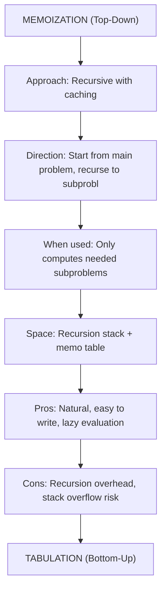

> **Navigation**: [< Previous Chapter](04a_DP_Internals.md) | [Back to Index](../00_MASTER_INDEX.md) | [Next Chapter >](04c_DP_Advanced.md)
> 🧠 **Mental Model**: See [DP State Thinking](../14_Mental_Models/02_DP_State_Thinking.md) — state definition, transitions, and tabulation strategy

---

## 🔗 JIT Connection — When You Need This

> **Got stuck on a DP problem? Identify which type you're dealing with:**
>

| DP Pattern | State Definition | Problem Examples | PS Section |
|---|---|---|---|
| **1D Linear** | `dp[i]` = answer for first i items | Climbing Stairs, House Robber, LIS | [DP PS](../05_Problem_Solving/07_DP.md) |
| **Grid (2D)** | `dp[i][j]` = answer at cell (i,j) | Unique Paths, Min Path Sum | [DP PS](../05_Problem_Solving/07_DP.md) |
| **String (2D)** | `dp[i][j]` = answer for s1[0..i-1] vs s2[0..j-1] | LCS, Edit Distance | [DP PS](../05_Problem_Solving/07_DP.md) |
| **Knapsack** | `dp[i][w]` = max value with i items, capacity w | 0/1 Knapsack, Coin Change | [DP PS](../05_Problem_Solving/07_DP.md) |

>
> **The 5-Step Recipe (memorize this):**
> ```
> 1. IDENTIFY subproblem: what is the last decision?
> 2. DEFINE state: what changes between recursive calls?
> 3. WRITE recurrence: dp[i] = f(dp[i-1], dp[i-2], ...)
> 4. BASE CASES: what's the smallest problem you know directly?
> 5. COMPUTE ORDER: fill table from smallest to largest
> ```
>
> **Greedy vs DP?** → See [11_Greedy_vs_DP_Decision.md](../14_Mental_Models/11_Greedy_vs_DP_Decision.md)
> 📋 **All Patterns Hub:** [00_PATTERN_MASTER_GUIDE.md](../04_Patterns_Templates/00_PATTERN_MASTER_GUIDE.md)

---

# 📌 Part 1: Understanding DP From Scratch

## What is Dynamic Programming?

```

╔══════════════════════════════════════════════════════════════════════════════╗
║ DYNAMIC PROGRAMMING - COMPLETE UNDERSTANDING                                 ║
╚══════════════════════════════════════════════════════════════════════════════╝

┌──────────────────────────────────────────────────────────────────────────────┐
│ WHAT IS DYNAMIC PROGRAMMING?                                                 │
├──────────────────────────────────────────────────────────────────────────────┤
│ Dynamic Programming (DP) is a method for solving complex problems by:        │
│ 1. Breaking them into simpler OVERLAPPING subproblems                        │
│ 2. Solving each subproblem ONLY ONCE                                         │
│ 3. STORING the results to avoid redundant computation                        │
│                                                                              │
│ DP = RECURSION + MEMOIZATION (REMEMBERING)                                   │
│                                                                              │
│ INVENTOR: Richard Bellman (1950s) at RAND Corporation                        │
│ NAME ORIGIN: "Dynamic" sounded impressive to government funders!             │
│ (Bellman chose it to hide the mathematical nature of his work)               │
└──────────────────────────────────────────────────────────────────────────────┘

┌──────────────────────────────────────────────────────────────────────────────┐
│ WHAT PROBLEM DOES DP SOLVE?                                                  │
├──────────────────────────────────────────────────────────────────────────────┤
│ CORE PROBLEM: Optimization problems where:                                   │
│ • You need the BEST solution (max/min)                                       │
│ • Making decisions at each step                                              │
│ • Decisions affect future choices                                            │
│                                                                              │
│ REAL-WORLD EXAMPLES:                                                         │
│ • Navigation: What's the shortest route? (Same intersections = subproblems)  │
│ • Finance: Max profit from stock trades (Each day = decision point)          │
│ • Text: How similar are two strings? (Edit distance)                         │
│ • Packing: Most value in limited space (Knapsack problem)                    │
│ • Scheduling: Best order for tasks (Job scheduling)                          │
│                                                                              │
│ THE INSIGHT:                                                                 │
│ Instead of exploring ALL possible combinations (exponential), DP builds      │
│ optimal solutions from optimal sub-solutions (polynomial)!                   │
│                                                                              │
│ BEFORE DP (Brute Force): O(2^n) or worse - trying all combinations           │
│ AFTER DP: O(n²) or O(n×m) - building from subproblems                        │
└──────────────────────────────────────────────────────────────────────────────┘

┌──────────────────────────────────────────────────────────────────────────────┐
│ WHY DOES DP WORK? (THE MATHEMATICAL FOUNDATION)                              │
├──────────────────────────────────────────────────────────────────────────────┤
│                                                                              │
│ TWO ESSENTIAL PROPERTIES (Both MUST be true):                                │
│                                                                              │
│ 1. OPTIMAL SUBSTRUCTURE                                                      │
│ "Optimal solution to the whole = combination of optimal sub-solutions"       │
│                                                                              │
│ Example: Shortest Path A→C                                                   │
│ If A→B→C is shortest, then:                                                  │
│ • A→B part must be the shortest A→B path                                     │
│ • B→C part must be the shortest B→C path                                     │
│                                                                              │
│ If this wasn't true, you could find a shorter A→C!                           │
│                                                                              │
│ 2. OVERLAPPING SUBPROBLEMS                                                   │
│ "Same subproblems appear multiple times during recursion"                    │
│                                                                              │
│ Example: Fibonacci fib(5)                                                    │
│ fib(5) = fib(4) + fib(3)                                                     │
│ fib(4) = fib(3) + fib(2) ← fib(3) needed TWICE!                              │
│ fib(3) = fib(2) + fib(1) ← fib(2) needed THRICE!                             │
│                                                                              │
│ If subproblems DON'T overlap → Use Divide & Conquer instead!                 │
└──────────────────────────────────────────────────────────────────────────────┘

┌──────────────────────────────────────────────────────────────────────────────┐
│ WHEN TO USE DP? (INTERVIEW RECOGNITION PATTERNS)                             │
├──────────────────────────────────────────────────────────────────────────────┤
│ SIGNAL 1: "Find maximum/minimum..." or "Count the number of ways..."         │
│ → Optimization = DP likely                                                   │
│                                                                              │
│ SIGNAL 2: "Given choices at each step..."                                    │
│ → Decision making with future consequences = DP                              │
│                                                                              │
│ SIGNAL 3: "Can you reach...?" or "Is it possible...?"                        │
│ → Often can be framed as DP (true/false states)                              │
│                                                                              │
│ SIGNAL 4: Problem involves sequences/grids                                   │
│ → String problems, matrix traversal = Classic DP                             │
│                                                                              │
│ SIGNAL 5: Same question repeated with different parameters                   │
│ → Recursive structure with overlapping = DP                                  │
│                                                                              │
│ ┌────────────────────────────────┬─────────────────────────────────────────┐ │
│ │ USE DP WHEN │ DON'T USE DP WHEN │                                          │
│ ├────────────────────────────────┼─────────────────────────────────────────┤ │
│ │ Need optimal solution │ Just need any valid solution │                     │
│ │ Subproblems overlap │ Subproblems independent (use D&C) │                  │
│ │ Problem has optimal structure │ Local choices don't build global optimal│  │
│ │ Can define clear state │ State space is too large │                        │
│ └────────────────────────────────┴─────────────────────────────────────────┘ │
└──────────────────────────────────────────────────────────────────────────────┘

┌──────────────────────────────────────────────────────────────────────────────┐
│ HOW DOES DP WORK? (TWO APPROACHES)                                           │
├──────────────────────────────────────────────────────────────────────────────┤
│                                                                              │
│ APPROACH 1: TOP-DOWN (MEMOIZATION)                                           │
│ ┌─────────────────────────────────────────────────────────────┐              │
│ │ 1. Start with original problem │                                           │
│ │ 2. Recursively break into subproblems │                                    │
│ │ 3. Before computing, check if answer already cached │                      │
│ │ 4. If cached: return it | If not: compute and cache │                      │
│ │ │                                                                          │
│ │ ANALOGY: You're asked a hard question. You think recursively │             │
│ │ but write down answers you've figured out on a notepad. │                  │
│ └─────────────────────────────────────────────────────────────┘              │
│                                                                              │
│ APPROACH 2: BOTTOM-UP (TABULATION)                                           │
│ ┌─────────────────────────────────────────────────────────────┐              │
│ │ 1. Identify base cases (smallest subproblems) │                            │
│ │ 2. Fill table starting from base cases │                                   │
│ │ 3. Build up to the answer iteratively │                                    │
│ │ 4. Final cell contains the answer │                                        │
│ │ │                                                                          │
│ │ ANALOGY: Building a pyramid brick by brick from the bottom. │              │
│ │ Each brick relies on the ones below it. │                                  │
│ └─────────────────────────────────────────────────────────────┘              │
│                                                                              │
│ COMPARISON:                                                                  │
│ ┌───────────────────────┬───────────────────────────────────────┐            │
│ │ Top-Down (Memo) │ Bottom-Up (Tabulation) │                                 │
│ ├───────────────────────┼───────────────────────────────────────┤            │
│ │ Easier to write │ Usually faster (no recursion) │                          │
│ │ Only solves needed │ Solves ALL subproblems │                              │
│ │ Risk of stack overflow│ No stack overflow │                                │
│ │ Lazy evaluation │ Eager evaluation │                                       │
│ └───────────────────────┴───────────────────────────────────────┘            │
└──────────────────────────────────────────────────────────────────────────────┘

┌──────────────────────────────────────────────────────────────────────────────┐
│ DIFFICULTIES & COMMON PITFALLS                                               │
├──────────────────────────────────────────────────────────────────────────────┤
│ 1. IDENTIFYING THE STATE (Hardest Part!):                                    │
│ "What information do I need to solve a subproblem?"                          │
│ Wrong state definition = wrong solution                                      │
│ Tip: Ask "What changes between recursive calls?"                             │
│                                                                              │
│ 2. FINDING THE RECURRENCE:                                                   │
│ "How does current state relate to previous states?"                          │
│ Tip: Think about the LAST decision/step                                      │
│                                                                              │
│ 3. BASE CASE ERRORS:                                                         │
│ Missing or wrong base cases cause wrong answers                              │
│ Tip: What's the smallest problem you can answer directly?                    │
│                                                                              │
│ 4. OFF-BY-ONE ERRORS:                                                        │
│ Array indices, loop bounds - classic source of bugs                          │
│ Tip: Trace through small examples by hand                                    │
│                                                                              │
│ 5. SPACE COMPLEXITY:                                                         │
│ 2D DP tables can be huge for large inputs                                    │
│ Tip: Often can optimize to 1D by keeping only previous row                   │
│                                                                              │
│ 6. RECONSTRUCTION PATH:                                                      │
│ DP gives optimal VALUE, but sometimes you need the actual SOLUTION           │
│ Tip: Store "choice made" at each step, then backtrack                        │
└──────────────────────────────────────────────────────────────────────────────┘

┌──────────────────────────────────────────────────────────────────────────────┐
│ EXPECTED OUTPUTS & COMPLEXITY                                                │
├──────────────────────────────────────────────────────────────────────────────┤
│                                                                              │
│ COMPLEXITY IMPROVEMENT (Why DP is Powerful):                                 │
│ ┌──────────────────────┬─────────────────────┬────────────────────────────┐  │
│ │ Problem │ Brute Force │ With DP │                                          │
│ ├──────────────────────┼─────────────────────┼────────────────────────────┤  │
│ │ Fibonacci │ O(2^n) │ O(n) │                                                │
│ │ Longest Common Subseq│ O(2^(m+n)) │ O(m×n) │                               │
│ │ 0/1 Knapsack │ O(2^n) │ O(n×W) │                                           │
│ │ Edit Distance │ O(3^n) │ O(m×n) │                                          │
│ │ Matrix Chain │ O(n!) │ O(n³) │                                             │
│ │ Coin Change │ O(amount^n) │ O(n×amount) │                                  │
│ └──────────────────────┴─────────────────────┴────────────────────────────┘  │
│                                                                              │
│ TYPICAL DP OUTPUT:                                                           │
│ • Single number: Max profit, min cost, number of ways                        │
│ • Boolean: Is it possible?                                                   │
│ • Array/Table: All subproblem solutions (for path reconstruction)            │
│ • The actual solution: Requires backtracking through DP table                │
│                                                                              │
│ SPACE-TIME TRADEOFF:                                                         │
│ • Standard 2D DP: O(n×m) time, O(n×m) space                                  │
│ • Space-optimized: O(n×m) time, O(min(n,m)) space (keep 2 rows)              │
│ • Ultra-optimized: Sometimes O(1) space possible (like Fibonacci)            │
└──────────────────────────────────────────────────────────────────────────────┘


### The Story Metaphor


THE STORY:
Imagine you're solving a maze. Every time you hit a dead end,
you go back to the start and try again.

BRUTE FORCE:

- Start → try path A → dead end → go back to start
- Start → try path B → dead end → go back to start
- You keep walking the same initial path!

SMART WAY (DP):

- Start → try path A → dead end → MARK IT
- Go back, but remember "path A = dead end"
- Next time, skip path A directly!

THIS IS MEMOIZATION: Remember what you've already calculated.

```

---


> 🔬 **Section Challenge — What is Dynamic Programming?**
>
> **Challenge 1 (Reasoning):** How do you identify that a problem requires DP vs Greedy? What's the key test?
> <details><summary>Answer</summary>
>
> Greedy test: does the locally optimal choice always lead to the globally optimal solution? (Prove via exchange argument.) If yes → greedy. If making a local choice requires knowing future choices → DP. Example: Coin Change with standard coins [1,5,10,25] → greedy works (always pick largest). Coin Change with coins [1,3,4] and amount 6 → greedy picks 4+1+1=3 coins, optimal is 3+3=2 coins. Greedy fails → DP.
> </details>
>
> **Challenge 2 (Design):** You need to find the number of ways to climb N stairs taking 1 or 2 steps at a time. Define the DP state and recurrence.
> <details><summary>Answer</summary>
>
> State: `dp[i]` = number of ways to reach step i. Recurrence: `dp[i] = dp[i-1] + dp[i-2]` (come from step i-1 via 1 step, or from step i-2 via 2 steps). Base: `dp[0]=1` (one way: don't move), `dp[1]=1`. This is exactly Fibonacci. Space optimization: only need last 2 values → O(1) space.
> </details>
>

# 📌 Part 2: Fibonacci — the Gateway to DP

## Evolution of Solutions

### Level 1: Pure Recursion (❌ Inefficient)

```java
public int fibRecursive(int n) {
    if (n <= 1) return n;
    return fibRecursive(n - 1) + fibRecursive(n - 2);
}

// TIME: O(2^n) - Exponential!
// SPACE: O(n) - Call stack

// CALL TREE for fib(5):
//                         fib(5)
//                        /      \
//                   fib(4)      fib(3)
//                   /    \      /    \
//               fib(3)  fib(2) fib(2) fib(1)
//               /   \
//           fib(2) fib(1)
//
// fib(3) computed 2 times
// fib(2) computed 3 times
// WASTEFUL!
```

### Level 2: Memoization - Top Down (✅ Efficient)

```java
public int fibMemo(int n, int[] memo) {
    // Base case
    if (n <= 1) return n;

    // Check if already computed
    if (memo[n] != 0) return memo[n];

    // Compute and STORE
    memo[n] = fibMemo(n - 1, memo) + fibMemo(n - 2, memo);

    return memo[n];
}

// Usage: fibMemo(n, new int[n + 1])
// TIME: O(n) - Each subproblem solved once
// SPACE: O(n) - Memo array + call stack

// CALL TREE with memoization:
//                         fib(5)
//                        /      \
//                   fib(4)      fib(3) ← CACHED! Return immediately
//                   /    \
//               fib(3)  fib(2) ← CACHED!
//               /   \
//           fib(2) fib(1)
//           /   \
//       fib(1) fib(0)
```

### Level 3: Tabulation - Bottom Up (✅✅ Best)

```java
public int fibTabulation(int n) {
    if (n <= 1) return n;

    int[] dp = new int[n + 1];
    dp[0] = 0;
    dp[1] = 1;

    // Build from smallest to largest
    for (int i = 2; i <= n; i++) {
        dp[i] = dp[i - 1] + dp[i - 2];
    }

    return dp[n];
}

// TIME: O(n)
// SPACE: O(n)

// TRACE for n = 5:
// dp[0] = 0
// dp[1] = 1
// dp[2] = dp[1] + dp[0] = 1 + 0 = 1
// dp[3] = dp[2] + dp[1] = 1 + 1 = 2
// dp[4] = dp[3] + dp[2] = 2 + 1 = 3
// dp[5] = dp[4] + dp[3] = 3 + 2 = 5
```

### Level 4: Space Optimized (✅✅✅ Perfect)

```java
public int fibOptimized(int n) {
    if (n <= 1) return n;

    int prev2 = 0;  // dp[i-2]
    int prev1 = 1;  // dp[i-1]

    for (int i = 2; i <= n; i++) {
        int current = prev1 + prev2;
        prev2 = prev1;
        prev1 = current;
    }

    return prev1;
}

// TIME: O(n)
// SPACE: O(1) - Only 2 variables!

// INSIGHT: We only need last 2 values, not entire array!
```

---

# 📌 Part 3: the DP Recipe

## 5-Step Process

```
STEP 1: IDENTIFY SUBPROBLEM
        "What is the last decision/action?"
        "What information do I need at each step?"

STEP 2: DEFINE STATE
        dp[i] = "answer for subproblem of size i"
        dp[i][j] = "answer considering first i items with capacity j"

STEP 3: FIND RECURRENCE RELATION
        "How does dp[i] relate to smaller subproblems?"
        dp[i] = some_function(dp[i-1], dp[i-2], ...)

STEP 4: IDENTIFY BASE CASES
        "What are the smallest subproblems I know directly?"
        dp[0] = ?, dp[1] = ?

STEP 5: DETERMINE COMPUTATION ORDER
        "In what order should I fill the table?"
        Usually: smaller to larger
```

---

# 🧩 Part 4: Classic DP Problems With Traces

## Problem 1: Climbing Stairs

```java
// You can climb 1 or 2 stairs at a time.
// How many ways to reach step n?

// STEP 1: Last action? Either climb 1 step OR 2 steps
// STEP 2: dp[i] = number of ways to reach step i
// STEP 3: dp[i] = dp[i-1] + dp[i-2]
//         (ways to reach i = ways via i-1 + ways via i-2)
// STEP 4: dp[1] = 1, dp[2] = 2
// STEP 5: Fill from 3 to n

public int climbStairs(int n) {
    if (n <= 2) return n;

    int[] dp = new int[n + 1];
    dp[1] = 1;  // 1 way to reach step 1
    dp[2] = 2;  // 2 ways to reach step 2: (1+1) or (2)

    for (int i = 3; i <= n; i++) {
        dp[i] = dp[i - 1] + dp[i - 2];
    }

    return dp[n];
}

// TRACE for n = 5:
// dp[1] = 1    (just step 1)
// dp[2] = 2    (1+1 or 2)
// dp[3] = dp[2] + dp[1] = 2 + 1 = 3    (1+1+1, 1+2, 2+1)
// dp[4] = dp[3] + dp[2] = 3 + 2 = 5
// dp[5] = dp[4] + dp[3] = 5 + 3 = 8
//
// WHY does dp[3] = dp[2] + dp[1]?
// To reach step 3:
//   - Be at step 2, take 1 step → dp[2] ways
//   - Be at step 1, take 2 steps → dp[1] ways
//   Total = dp[2] + dp[1]
```


## Problem 2: House Robber

```java
// Can't rob adjacent houses. Maximize total.
// houses = [2, 7, 9, 3, 1]

// STEP 1: For house i, either rob it OR skip it
// STEP 2: dp[i] = max money robbing houses 0 to i
// STEP 3: dp[i] = max(dp[i-1], dp[i-2] + houses[i])
//         Either skip house i (dp[i-1]) OR rob i (dp[i-2] + houses[i])
// STEP 4: dp[0] = houses[0], dp[1] = max(houses[0], houses[1])
// STEP 5: Fill from 2 to n-1

public int rob(int[] houses) {
    if (houses.length == 0) return 0;
    if (houses.length == 1) return houses[0];

    int[] dp = new int[houses.length];
    dp[0] = houses[0];
    dp[1] = Math.max(houses[0], houses[1]);

    for (int i = 2; i < houses.length; i++) {
        dp[i] = Math.max(dp[i - 1], dp[i - 2] + houses[i]);
    }

    return dp[houses.length - 1];
}

// TRACE for houses = [2, 7, 9, 3, 1]:
// dp[0] = 2
// dp[1] = max(2, 7) = 7
// dp[2] = max(dp[1], dp[0] + 9) = max(7, 2+9) = 11  [rob houses 0, 2]
// dp[3] = max(dp[2], dp[1] + 3) = max(11, 7+3) = 11 [still best: houses 0, 2]
// dp[4] = max(dp[3], dp[2] + 1) = max(11, 11+1) = 12 [rob houses 0, 2, 4]
//
// Answer: 12 (rob houses at indices 0, 2, 4 → values 2, 9, 1)
```

## Problem 3: Coin Change

```java
// coins = [1, 2, 5], amount = 11
// Find minimum coins needed

// STEP 1: Last coin used could be any of the coins
// STEP 2: dp[i] = min coins to make amount i
// STEP 3: dp[i] = min(dp[i - coin] + 1) for each coin
// STEP 4: dp[0] = 0 (0 coins for amount 0)
// STEP 5: Fill from 1 to amount

public int coinChange(int[] coins, int amount) {
    int[] dp = new int[amount + 1];
    Arrays.fill(dp, amount + 1);  // "infinity"
    dp[0] = 0;

    for (int i = 1; i <= amount; i++) {
        for (int coin : coins) {
            if (coin <= i) {
                dp[i] = Math.min(dp[i], dp[i - coin] + 1);
            }
        }
    }

    return dp[amount] > amount ? -1 : dp[amount];
}

// TRACE for coins = [1, 2, 5], amount = 11:
// dp[0] = 0
// dp[1] = min(dp[0]+1) = 1                    [1]
// dp[2] = min(dp[1]+1, dp[0]+1) = min(2, 1) = 1    [2]
// dp[3] = min(dp[2]+1, dp[1]+1) = min(2, 2) = 2    [2,1] or [1,1,1]
// dp[4] = min(dp[3]+1, dp[2]+1) = min(3, 2) = 2    [2,2]
// dp[5] = min(dp[4]+1, dp[3]+1, dp[0]+1) = min(3, 3, 1) = 1    [5]
// dp[6] = min(dp[5]+1, dp[4]+1, dp[1]+1) = min(2, 3, 2) = 2    [5,1]
// ...
// dp[11] = 3    [5, 5, 1]
```


## Problem 4: Longest Increasing Subsequence (LIS)

```java
// nums = [10, 9, 2, 5, 3, 7, 101, 18]
// Find length of longest strictly increasing subsequence

// STEP 1: For each element, either include it or not
// STEP 2: dp[i] = length of LIS ending at index i
// STEP 3: dp[i] = max(dp[j] + 1) for all j < i where nums[j] < nums[i]
// STEP 4: dp[i] = 1 for all (each element is LIS of length 1)
// STEP 5: Fill from 0 to n-1, track maximum

public int lengthOfLIS(int[] nums) {
    int n = nums.length;
    int[] dp = new int[n];
    Arrays.fill(dp, 1);  // Each element is LIS of length 1
    int maxLen = 1;

    for (int i = 1; i < n; i++) {
        for (int j = 0; j < i; j++) {
            if (nums[j] < nums[i]) {
                dp[i] = Math.max(dp[i], dp[j] + 1);
            }
        }
        maxLen = Math.max(maxLen, dp[i]);
    }

    return maxLen;
}

// TRACE for nums = [10, 9, 2, 5, 3, 7, 101, 18]:
// Index:  0   1  2  3  4  5   6    7
// nums = [10, 9, 2, 5, 3, 7, 101, 18]
//
// dp[0] = 1 (just 10)
// dp[1] = 1 (9, can't extend from 10)
// dp[2] = 1 (2, can't extend)
// dp[3] = max(dp[2]+1) = 2 (2 < 5, so LIS: [2,5])
// dp[4] = max(dp[2]+1) = 2 (2 < 3, LIS: [2,3])
// dp[5] = max(dp[2]+1, dp[3]+1, dp[4]+1) = max(2, 3, 3) = 3
//         LIS options: [2,5,7] or [2,3,7]
// dp[6] = max(dp[0]+1, ..., dp[5]+1) = 4 (LIS: [2,5,7,101])
// dp[7] = 4 (LIS: [2,5,7,18])
//
// Answer: 4
```

---


# 💎 Part 5: 2d Dynamic Programming

## Problem 5: Unique Paths

```java
// Grid of m x n. How many ways from top-left to bottom-right?
// Can only move right or down.

// STEP 2: dp[i][j] = number of ways to reach cell (i, j)
// STEP 3: dp[i][j] = dp[i-1][j] + dp[i][j-1]
// STEP 4: dp[0][j] = 1, dp[i][0] = 1 (only one way to reach first row/col)

public int uniquePaths(int m, int n) {
    int[][] dp = new int[m][n];

    // Base cases: first row and first column
    for (int j = 0; j < n; j++) dp[0][j] = 1;
    for (int i = 0; i < m; i++) dp[i][0] = 1;

    // Fill the rest
    for (int i = 1; i < m; i++) {
        for (int j = 1; j < n; j++) {
            dp[i][j] = dp[i - 1][j] + dp[i][j - 1];
        }
    }

    return dp[m - 1][n - 1];
}

// TRACE for m=3, n=3:
// dp table:
// 1  1  1
// 1  2  3
// 1  3  6
//
// dp[1][1] = dp[0][1] + dp[1][0] = 1 + 1 = 2
// dp[1][2] = dp[0][2] + dp[1][1] = 1 + 2 = 3
// dp[2][1] = dp[1][1] + dp[2][0] = 2 + 1 = 3
// dp[2][2] = dp[1][2] + dp[2][1] = 3 + 3 = 6
```

## Problem 6: Longest Common Subsequence (LCS)

```java
// text1 = "abcde", text2 = "ace"
// Find length of longest common subsequence

// STEP 2: dp[i][j] = LCS of text1[0...i-1] and text2[0...j-1]
// STEP 3: If text1[i-1] == text2[j-1]: dp[i][j] = dp[i-1][j-1] + 1
//         Else: dp[i][j] = max(dp[i-1][j], dp[i][j-1])
// STEP 4: dp[0][j] = 0, dp[i][0] = 0 (empty string)

public int longestCommonSubsequence(String text1, String text2) {
    int m = text1.length(), n = text2.length();
    int[][] dp = new int[m + 1][n + 1];

    for (int i = 1; i <= m; i++) {
        for (int j = 1; j <= n; j++) {
            if (text1.charAt(i - 1) == text2.charAt(j - 1)) {
                dp[i][j] = dp[i - 1][j - 1] + 1;
            } else {
                dp[i][j] = Math.max(dp[i - 1][j], dp[i][j - 1]);
            }
        }
    }

    return dp[m][n];
}

// TRACE for text1 = "abcde", text2 = "ace":
//     ""  a  c  e
// ""   0  0  0  0
// a    0  1  1  1
// b    0  1  1  1
// c    0  1  2  2
// d    0  1  2  2
// e    0  1  2  3
//
// Answer: 3 (LCS = "ace")
```

## Problem 7: 0/1 Knapsack

```java
// weights = [1, 2, 3], values = [6, 10, 12], capacity = 5
// Maximize value without exceeding capacity

// STEP 2: dp[i][w] = max value using items 0..i-1 with capacity w
// STEP 3: dp[i][w] = max(
//           dp[i-1][w],                    // Don't take item i-1
//           dp[i-1][w-weight[i-1]] + value[i-1]  // Take item i-1
//         )
// STEP 4: dp[0][w] = 0 (no items)

public int knapsack(int[] weights, int[] values, int capacity) {
    int n = weights.length;
    int[][] dp = new int[n + 1][capacity + 1];

    for (int i = 1; i <= n; i++) {
        for (int w = 0; w <= capacity; w++) {
            // Don't take item i-1
            dp[i][w] = dp[i - 1][w];

            // Take item i-1 (if it fits)
            if (weights[i - 1] <= w) {
                dp[i][w] = Math.max(
                    dp[i][w],
                    dp[i - 1][w - weights[i - 1]] + values[i - 1]
                );
            }
        }
    }

    return dp[n][capacity];
}

// TRACE for weights=[1,2,3], values=[6,10,12], capacity=5:
//       w: 0  1  2  3  4  5
// item 0:  0  0  0  0  0  0
// item 1:  0  6  6  6  6  6   (item 0: w=1, v=6)
// item 2:  0  6 10 16 16 16   (item 1: w=2, v=10)
// item 3:  0  6 10 16 18 22   (item 2: w=3, v=12)
//
// dp[3][5] = 22 (take items 1 and 2: weights 2+3=5, values 10+12=22)
```

---

# 🎨 Part 6: DP Patterns

## Pattern 1: Linear DP

```
dp[i] depends on dp[i-1], dp[i-2], etc.
Examples: Fibonacci, House Robber, Climbing Stairs

STATE: Single index
TRANSITION: dp[i] = f(dp[i-1], dp[i-2], ...)


## Pattern 2: Grid DP

dp[i][j] depends on dp[i-1][j], dp[i][j-1], dp[i-1][j-1]
Examples: Unique Paths, Min Path Sum, Edit Distance

STATE: Two indices (row, column)
TRANSITION: dp[i][j] = f(dp[i-1][j], dp[i][j-1], dp[i-1][j-1])


## Pattern 3: String DP

dp[i][j] for two strings s1[0..i], s2[0..j]
Examples: LCS, Edit Distance, Regex Matching

STATE: Indices into both strings
TRANSITION: Based on character match/mismatch


## Pattern 4: Knapsack DP

dp[i][w] for items 0..i with capacity w
Examples: 0/1 Knapsack, Subset Sum, Coin Change

STATE: Item index + remaining capacity
TRANSITION: Take or don't take current item


## Pattern 5: Interval DP

dp[i][j] for interval [i, j]
Examples: Matrix Chain Multiplication, Burst Balloons

STATE: Start and end of interval
TRANSITION: Try all split points k between i and j
```

---


# 🧠 Part 7: Memoization vs Tabulation

```
┌─────────────────────────────────────────────────────────────────┐
│                    MEMOIZATION (Top-Down)                       │
├─────────────────────────────────────────────────────────────────┤
│ Approach:    Recursive with caching                             │
│ Direction:   Start from main problem, recurse to subproblems    │
│ When used:   Only computes needed subproblems                   │
│ Space:       Recursion stack + memo table                       │
│ Pros:        Natural, easy to write, lazy evaluation            │
│ Cons:        Recursion overhead, stack overflow risk            │
├─────────────────────────────────────────────────────────────────┤
│                    TABULATION (Bottom-Up)                       │
├─────────────────────────────────────────────────────────────────┤
│ Approach:    Iterative with table                               │
│ Direction:   Start from base cases, build up to main problem    │
│ When used:   Computes ALL subproblems                           │
│ Space:       Just the table (no stack)                          │
│ Pros:        No recursion overhead, can optimize space          │
│ Cons:        Need to think about computation order              │
└─────────────────────────────────────────────────────────────────┘

WHEN TO USE WHICH?

MEMOIZATION:
- When not all subproblems are needed
- When recursion depth is manageable
- When problem is easier to think recursively

TABULATION:
- When you need all subproblems anyway
- When recursion depth could overflow
- When you want to optimize space (sliding window)
```

**Flow:**
- MEMOIZATION (Top-Down)
- ↓
- Approach: Recursive with caching
- ↓
- Direction: Start from main problem, recurse to subprobl
- ↓
- When used: Only computes needed subproblems
- ↓
- Space: Recursion stack + memo table
- ↓
- Pros: Natural, easy to write, lazy evaluation
- ↓
- Cons: Recursion overhead, stack overflow risk



---

# ⚡ Part 8: Space Optimization

```java
// Many DP problems can be optimized from O(n²) to O(n) space!

// EXAMPLE: LCS can be done with 2 rows instead of full table
public int lcsOptimized(String s1, String s2) {
    int m = s1.length(), n = s2.length();
    int[] prev = new int[n + 1];
    int[] curr = new int[n + 1];

    for (int i = 1; i <= m; i++) {
        for (int j = 1; j <= n; j++) {
            if (s1.charAt(i - 1) == s2.charAt(j - 1)) {
                curr[j] = prev[j - 1] + 1;
            } else {
                curr[j] = Math.max(prev[j], curr[j - 1]);
            }
        }
        // Swap rows
        int[] temp = prev;
        prev = curr;
        curr = temp;
        Arrays.fill(curr, 0);
    }

    return prev[n];
}

// KEY INSIGHT:
// If dp[i][j] only depends on dp[i-1][...] and dp[i][j-1]
// You only need 2 rows (or even 1 row with careful ordering)!
```

---

# 💪 Part 9: Practice Problems By Pattern

## Linear DP

1. Climbing Stairs
2. House Robber
3. Maximum Subarray (Kadane's)
4. Best Time to Buy and Sell Stock
5. Decode Ways


## Grid DP

1. Unique Paths
2. Minimum Path Sum
3. Maximal Square
4. Dungeon Game
5. Cherry Pickup

## String DP

1. Longest Common Subsequence
2. Edit Distance
3. Longest Palindromic Subsequence
4. Regular Expression Matching
5. Wildcard Matching


## Knapsack DP

1. 0/1 Knapsack
2. Coin Change
3. Partition Equal Subset Sum
4. Target Sum
5. Ones and Zeroes

---

# 📌 Part 10: Edge Cases Checklist

```
⬜ Empty input: n = 0, empty array, empty string
⬜ Single element: n = 1, single character
⬜ All same values: [5, 5, 5, 5]
⬜ All zeros: [0, 0, 0, 0]
⬜ Negative values: [-1, -2, -3]
⬜ Large values: near Integer.MAX_VALUE (overflow!)
⬜ No solution exists: return -1 or special value
⬜ Multiple solutions: verify you want min/max/count
```

### 🔗 Cross-References — Navigate the Ecosystem

| Topic | Related Content |
|---|---|
| DP pattern recognition | [DP Pattern Recognition](../04_Patterns_Templates/16_DP_Pattern_Recognition.md) |
| DP practice problems | [Problem Solving — DP](../05_Problem_Solving/11_Dynamic_Programming.md) |
| Knapsack family (DP) | [Knapsack Family](../04_Patterns_Templates/23_Knapsack_Family.md) |
| Memoization in React (useMemo) | [React Hooks](../15_React_Frontend/03_Hooks_Deep_Dive.md) |
| Optimization in ML (gradient descent) | [Math for ML](../21_Python_ML_DL_NLP/04_Math_For_ML.md) |
| Greedy vs DP | [Greedy Algorithms](12_Greedy_Algorithms_Complete.md) |

---


---

## 🏋️ Practice & Interview Questions — Algorithms

### Sorting
**Q1.** Which sorting algorithm does Java use for `Arrays.sort(int[])`? Why not MergeSort?
<details><summary>Answer</summary>

**Dual-Pivot QuickSort** — for primitives. MergeSort requires O(N) extra space. QuickSort is in-place and cache-friendly. Stability doesn't matter for primitives (equal ints are indistinguishable). For objects (`Arrays.sort(Object[])`), Java uses **TimSort** (stable, O(N log N) worst).
</details>

**Q2.** Trace Merge Sort on `[4,2,7,1]`.
<details><summary>Answer</summary>

Split: `[4,2]` `[7,1]` → Split: `[4]` `[2]` `[7]` `[1]` → Merge: `[2,4]` `[1,7]` → Merge: `[1,2,4,7]`
</details>

**Q3.** ⭐⭐ Sort Colors (Dutch National Flag — 3-way partition).
<details><summary>Solution</summary>

```java
int lo=0, mid=0, hi=n-1;
while(mid<=hi){
    if(nums[mid]==0) swap(nums,lo++,mid++);
    else if(nums[mid]==1) mid++;
    else swap(nums,mid,hi--);
}
```
</details>

### Binary Search
**Q4.** ⭐ Search in Rotated Sorted Array.
<details><summary>Solution</summary>

```java
int lo=0, hi=n-1;
while(lo<=hi){
    int mid=(lo+hi)/2;
    if(nums[mid]==target) return mid;
    if(nums[lo]<=nums[mid]){ // left half sorted
        if(nums[lo]<=target&&target<nums[mid]) hi=mid-1; else lo=mid+1;
    } else { // right half sorted
        if(nums[mid]<target&&target<=nums[hi]) lo=mid+1; else hi=mid-1;
    }
}
return -1;
```
</details>

**Q5.** ⭐ Find First and Last Position (binary search twice).
<details><summary>Solution</summary>

```java
// First: find leftmost with while(lo<hi){ if arr[mid]>=target hi=mid else lo=mid+1 }
// Last: find rightmost with while(lo<hi){ if arr[mid]<=target lo=mid+1 else hi=mid } return lo-1
```
</details>

**Q6.** ⭐⭐ Koko Eating Bananas — binary search on answer.
<details><summary>Key insight</summary>

Binary search the eating speed k in range [1, max(piles)]. For each k, calculate hours needed. Find minimum k where hours ≤ H.
</details>

### Dynamic Programming
**Q7.** ⭐ Climbing Stairs — n steps, 1 or 2 at a time. How many ways?
<details><summary>Solution</summary>

```java
// Fibonacci sequence! dp[i] = dp[i-1] + dp[i-2]
int a=1, b=1;
for(int i=2;i<=n;i++){ int c=a+b; a=b; b=c; }
return b;
```
</details>

**Q8.** ⭐ Coin Change — minimum coins for amount.
<details><summary>Solution</summary>

```java
int[] dp = new int[amount+1]; Arrays.fill(dp, amount+1);
dp[0]=0;
for(int i=1;i<=amount;i++)
    for(int c:coins) if(c<=i) dp[i]=Math.min(dp[i],dp[i-c]+1);
return dp[amount]>amount?-1:dp[amount];
```
</details>

**Q9.** ⭐⭐ Longest Common Subsequence.
<details><summary>Solution</summary>

```java
int[][] dp=new int[m+1][n+1];
for(int i=1;i<=m;i++) for(int j=1;j<=n;j++){
    if(text1.charAt(i-1)==text2.charAt(j-1)) dp[i][j]=dp[i-1][j-1]+1;
    else dp[i][j]=Math.max(dp[i-1][j],dp[i][j-1]);
}
return dp[m][n];
```
</details>

**Q10.** ⭐⭐ Word Break — can string be segmented using dictionary words?
<details><summary>Solution</summary>

```java
boolean[] dp=new boolean[n+1]; dp[0]=true;
for(int i=1;i<=n;i++) for(String w:wordDict)
    if(i>=w.length()&&dp[i-w.length()]&&s.substring(i-w.length(),i).equals(w)) dp[i]=true;
return dp[n];
```
</details>

**Q11.** ⭐⭐⭐ Edit Distance (Levenshtein).
<details><summary>Solution</summary>

```java
int[][] dp=new int[m+1][n+1];
for(int i=0;i<=m;i++) dp[i][0]=i;
for(int j=0;j<=n;j++) dp[0][j]=j;
for(int i=1;i<=m;i++) for(int j=1;j<=n;j++){
    if(word1.charAt(i-1)==word2.charAt(j-1)) dp[i][j]=dp[i-1][j-1];
    else dp[i][j]=1+Math.min(dp[i-1][j-1],Math.min(dp[i-1][j],dp[i][j-1]));
}
```
</details>

### Graph Algorithms
**Q12.** ⭐ Number of Islands (BFS/DFS grid traversal).
<details><summary>Solution</summary>

```java
for each cell (i,j) if grid[i][j]=='1': count++; BFS/DFS to mark all connected land as visited
```
</details>

**Q13.** ⭐⭐ Course Schedule — detect cycle in directed graph (Topological sort).
<details><summary>Solution</summary>

```java
// Kahn's algorithm: indegree array + BFS queue
// If result size == numCourses → no cycle → can finish
```
</details>

**Q14.** ⭐⭐ Dijkstra's Shortest Path.
<details><summary>Solution</summary>

```java
PriorityQueue<int[]> pq=new PriorityQueue<>((a,b)->a[1]-b[1]); // [node, dist]
pq.offer(new int[]{src,0}); dist[src]=0;
while(!pq.isEmpty()){
    int[] curr=pq.poll(); int u=curr[0],d=curr[1];
    if(d>dist[u]) continue; // stale
    for(int[] neighbor:graph[u]) if(dist[u]+neighbor[1]<dist[neighbor[0]]){
        dist[neighbor[0]]=dist[u]+neighbor[1]; pq.offer(new int[]{neighbor[0],dist[neighbor[0]]});
    }
}
```
</details>

### MCQ Rapid Fire
| # | Question | Answer |
|---|---|---|
| 1 | QuickSort avg/worst | O(N log N) avg, O(N²) worst |
| 2 | MergeSort space complexity | O(N) |
| 3 | HeapSort space complexity | O(1) (in-place) |
| 4 | Binary search precondition | Sorted array |
| 5 | BFS time complexity on graph | O(V+E) |
| 6 | DFS space complexity | O(V) (recursion stack) |
| 7 | Dijkstra fails on | Negative weight edges |
| 8 | Bellman-Ford handles | Negative weights, detects negative cycles |
| 9 | Floyd-Warshall use case | All-pairs shortest path, O(V³) |
| 10 | Topological sort requires | Directed Acyclic Graph (DAG) |


---

## 🧠 Deep Conceptual Questions — Algorithm Design & Analysis

**C1. What does O(N log N) "feel like" and why is it the complexity barrier for comparison-based sorting?**
<details><summary>Deep Answer</summary>

O(N log N) for N=1M ≈ 20M operations. O(N²) ≈ 1 trillion. The difference is 50,000x. **Comparison sort lower bound**: any comparison-based sort must distinguish between N! possible orderings. Each comparison has 2 outcomes. A decision tree with N! leaves needs ≥ log₂(N!) height ≈ N log N (Stirling's approximation). Therefore NO comparison sort can beat O(N log N) in the worst case. Non-comparison sorts (counting sort, radix sort, bucket sort) break this bound by using non-comparison operations — but require constraints on input (e.g., integer range bounded by N).
</details>

**C2. Greedy algorithms: when do they work and what must be proven?**
<details><summary>Deep Answer</summary>

A greedy algorithm makes the locally optimal choice at each step. Works when problem has: (1) **Greedy choice property**: local optimal leads to global optimal — the choice never needs to be revised. (2) **Optimal substructure**: optimal solution to the problem contains optimal solutions to subproblems. To PROVE greedy is correct: use "exchange argument" — assume optimal solution differs from greedy, show you can swap greedy's choice in without making it worse, contradiction. Greedy FAILS when: future choices depend on current choice in complex ways (use DP instead). Classic works: interval scheduling, Huffman coding, Dijkstra. Classic fails: 0-1 knapsack (use DP).
</details>

**C3. Dynamic Programming: what is "overlapping subproblems" and why does it matter?**
<details><summary>Deep Answer</summary>

Overlapping subproblems: the same sub-computation appears multiple times. Fibonacci: `fib(5)` calls `fib(4)` and `fib(3)`. `fib(4)` also calls `fib(3)`. Without memoization: `fib(3)` computed exponentially many times → O(2^N). With memoization: each sub-result computed once and stored → O(N). DP is valuable SPECIFICALLY when: (1) problem has optimal substructure AND (2) subproblems overlap. If no overlap: just use divide-and-conquer (merge sort's subproblems don't overlap → no DP needed). DP = "smart recursion" = avoid recomputing.
</details>

**C4. Top-down (memoization) vs Bottom-up (tabulation) DP — when to choose each?**
<details><summary>Deep Answer</summary>

**Top-down (memoization)**: Write natural recursion + cache results. Easy to implement, only computes needed subproblems (sparse computation). Cons: recursion overhead and stack depth risk. Use when: problem is naturally recursive, only a fraction of subproblems needed. **Bottom-up (tabulation)**: Fill DP table iteratively from base cases. No recursion overhead, better cache performance, easier space optimization. Use when: need all subproblems (or most of them), want to optimize space (can often reduce to 1D from 2D). Rule: start with top-down for correctness verification, optimize to bottom-up for performance.
</details>

**C5. Dijkstra's Algorithm: why does it fail on negative weights?**
<details><summary>Deep Answer</summary>

Dijkstra assumes: once a node is "settled" (extracted from the priority queue with its final shortest distance), that distance is optimal. With negative weights: settling node A at distance 5 might not be final — a path through B (distance 7) → C (edge -10) → A gives distance -3. But A was already settled! Dijkstra doesn't revisit settled nodes. Bellman-Ford handles negatives by relaxing ALL edges N-1 times — no "settled" assumption. For graphs with negative cycles: Bellman-Ford detects them (if distances still decrease after N-1 rounds, there's a negative cycle).
</details>

**C6. Union-Find: why is path compression + union by rank/size nearly O(1)?**
<details><summary>Deep Answer</summary>

**Path compression**: when finding the root of element x, make every node on the path point directly to the root. Flattens the tree. Future finds on those paths: O(1). **Union by rank**: always attach the smaller tree under the larger → limits tree height to O(log N). Combined: inverse Ackermann function α(N) amortized — so slow-growing it's practically constant (α(10^80) = 4). Neither alone is optimal: path compression without union by rank → O(log N) amortized. Union by rank without path compression → O(log N). Together → α(N) ≈ O(1) amortized. Used in: Kruskal's MST, cycle detection, connected components.
</details>

**C7. Binary Search on the Answer — what types of problems does it apply to?**
<details><summary>Deep Answer</summary>

When the answer space is **monotone**: "if X is achievable, then all values less extreme than X are also achievable." Problems: minimize the maximum (aggressive cows, split array), find minimum valid threshold (Koko bananas, minimum days to bloom), divide-and-conquer feasibility. Template: binary search on the answer range [lo, hi], for each mid check `isFeasible(mid)` in O(N) or O(N log N). Total: O(N log(answer_range)). Key insight: reframe "find optimal value" as "find smallest X where condition holds" → enables binary search on a non-array space.
</details>

**C8. Why does merge sort guarantee stability while quicksort doesn't?**
<details><summary>Deep Answer</summary>

**Merge sort stability**: during merge, when two elements are equal, we always take from the LEFT array first → preserves original relative order. **QuickSort instability**: the partition step swaps elements across the pivot without regard to original order. Two equal elements may be placed on opposite sides of the pivot, reversing their order. QuickSort CAN be made stable (Lomuto partition with careful implementation) but loses performance. Java uses TimSort for objects (stable), dual-pivot quicksort for primitives (stability irrelevant since primitives without fields).
</details>

**C9. Backtracking: what's the difference from plain DFS and when to use vs DP?**
<details><summary>Deep Answer</summary>

**Backtracking vs DFS**: DFS visits every path. Backtracking prunes paths early when a constraint is violated — avoids exploring infeasible branches. Same asymptotic but drastically different practical performance with good pruning. **Backtracking vs DP**: backtracking for **combinatorial/enumeration** problems (find all solutions, permutations, subsets). DP for **optimization** problems (find optimal single solution). Backtracking produces exponential solutions in worst case but is necessary when you need ALL solutions. DP finds the optimal in polynomial time when overlapping subproblems exist.
</details>

**C10. What is amortized analysis and how does it differ from average-case analysis?**
<details><summary>Deep Answer</summary>

**Amortized**: analyzes the average cost per operation over a SEQUENCE of operations — in the worst case. No probability involved. Guarantees: N operations ALWAYS take O(N·T) total, even if some individual operations are O(N·T). Example: ArrayList append is O(N) when resizing, but amortized O(1) because resizing is rare. **Average-case**: analyzes expected cost of a SINGLE operation assuming random input. QuickSort is O(N log N) average-case (random pivot). Amortized is a stronger guarantee — it holds even for adversarial input sequences.
</details>


> **Navigation**: [< Previous](04a_DP_Internals.md) | [Back to Index](../00_MASTER_INDEX.md) | [Next >](04c_DP_Advanced.md)