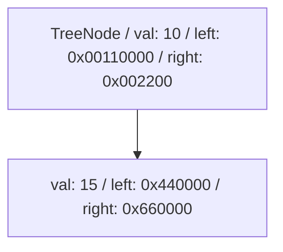
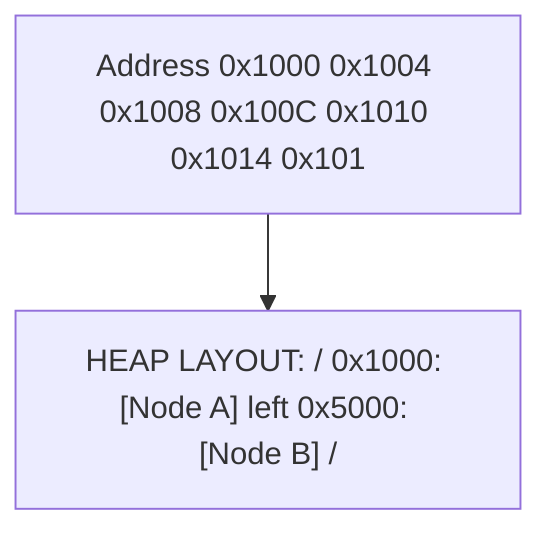
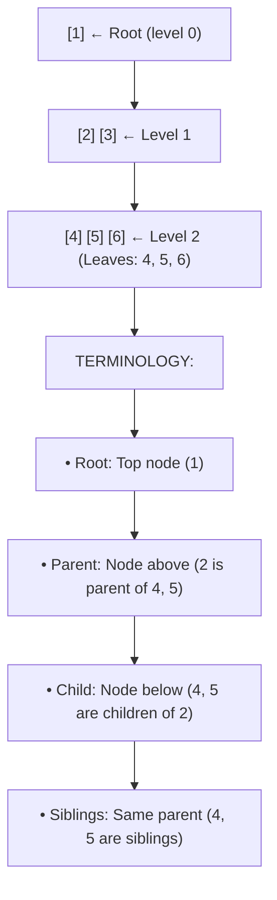
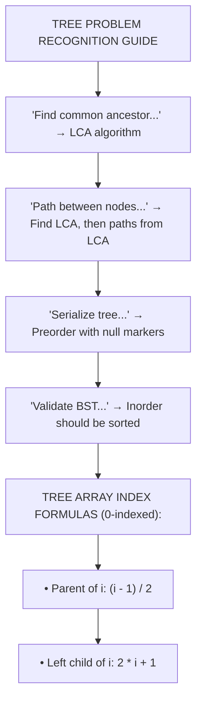

# TREES - Complete Guide
## From Binary Trees to Advanced Tree Algorithms

> 🧠 **Mental Model**: See [Graph & Tree Thinking](../14_Mental_Models/03_Graph_Tree_Thinking.md) — tree traversal patterns and parent-child reasoning
> **Split from Trees_Graphs.md for better navigation**
> See also: [Graphs](05b_Graphs_Internals.md) | [Index](../00_MASTER_INDEX.md)

---

# 🔬 PART 0: DEEP INTERNALS - HOW TREES & GRAPHS WORK AT CPU/MEMORY LEVEL


> TREES & GRAPHS AT THE HARDWARE LEVEL - WHAT REALLY HAPPENS
>
> Understanding the PHYSICAL reality of trees and graphs:
> - How nodes are stored in memory
> - What happens during tree traversal at CPU level
> - Recursion stack deep dive
> - Why tree operations are often cache-unfriendly
> - Graph representation memory comparison
>


## 🧠 Tree Node Memory Layout

```
┌─────────────────────────────────────────────────────────────────────────────────┐
│                    BINARY TREE NODE - MEMORY REPRESENTATION                     │
├─────────────────────────────────────────────────────────────────────────────────┤
│                                                                                 │
│  Java TreeNode class:                                                           │
│  class TreeNode {                                                               │
│      int val;                                                                   │
│      TreeNode left;                                                             │
│      TreeNode right;                                                            │
│  }                                                                              │
│                                                                                 │
│  MEMORY LAYOUT (64-bit JVM, compressed oops):                                   │
│  ┌─────────────────────────────────────────────────────────────────────────┐    │
│  │ OFFSET │ SIZE │ FIELD                  │ VALUE                         │     │
│  ├────────┼──────┼────────────────────────┼───────────────────────────────┤     │
│  │ 0      │ 8    │ Mark Word              │ Object header (GC, locks)     │     │
│  │ 8      │ 4    │ Class Pointer          │ → TreeNode.class              │     │
│  │ 12     │ 4    │ val (int)              │ 42                             │    │
│  │ 16     │ 4    │ left (reference)       │ 0x00110000 → left child       │     │
│  │ 20     │ 4    │ right (reference)      │ 0x00220000 → right child      │     │
│  │ 24     │ 0    │ padding                │ (object aligned to 8 bytes)   │     │
│  └────────┴──────┴────────────────────────┴───────────────────────────────┘     │
│  TOTAL: 24 bytes per TreeNode                                                   │
│                                                                                 │
│                                                                                 │
│  TREE STRUCTURE IN MEMORY:                                                      │
│  ───────────────────────────                                                    │
│                                                                                 │
│  Logical View:              Physical View (HEAP):                               │
│                                                                                 │
│        [10]                  Address 0x00100000:                                │
│       /    \                 ┌──────────────────────────┐                       │
│     [5]    [15]              │ TreeNode                 │                       │
│    /  \    /  \              │ val: 10                  │                       │
│  [3]  [7][12] [20]           │ left: 0x00110000 ─┐      │                       │
│                              │ right: 0x00220000 │      │                       │
│                              └──────────────────│─┼────-┘                       │
│                                                 │ │                             │
│                              ┌──────────────────┘ │                             │
│                              ▼                    ▼                             │
│                Address 0x00110000:         0x00220000:                          │
│                ┌────────────────┐         ┌────────────────┐                    │
│                │ val: 5         │         │ val: 15        │                    │
│                │ left: 0x330000 │         │ left: 0x440000 │                    │
│                │ right: 0x550000│         │ right: 0x660000│                    │
│                └────────────────┘         └────────────────┘                    │
│                                                                                 │
│  KEY INSIGHT: Nodes are SCATTERED in memory!                                    │
│  • Parent at 0x100000                                                           │
│  • Left child at 0x110000 (not contiguous!)                                     │
│  • Right child at 0x220000 (even further!)                                      │
│                                                                                 │
│  This causes CACHE MISSES during traversal!                                     │
│                                                                                 │
└─────────────────────────────────────────────────────────────────────────────────┘
```

> **Flow**: TreeNode / val: 10 / left: 0x00110000 / right: 0x002200 → val: 15 / left: 0x440000 / right: 0x660000



## 📚 Recursion Stack — What Actually Happens

```
┌─────────────────────────────────────────────────────────────────────────────────┐
│                    RECURSIVE TRAVERSAL - STACK VISUALIZATION                    │
├─────────────────────────────────────────────────────────────────────────────────┤
│                                                                                 │
│  Code: void inorder(TreeNode root) {                                            │
│            if (root == null) return;                                            │
│            inorder(root.left);                                                  │
│            System.out.println(root.val);                                        │
│            inorder(root.right);                                                 │
│        }                                                                        │
│                                                                                 │
│  Tree:      [10]                                                                │
│            /    \                                                               │
│          [5]    [15]                                                            │
│         /  \                                                                    │
│       [3]  [7]                                                                  │
│                                                                                 │
│                                                                                 │
│  CALL STACK EVOLUTION (visualizing each recursive call):                        │
│  ────────────────────────────────────────────────────────                       │
│                                                                                 │
│  Call 1: inorder(10)                                                            │
│  ┌────────────────────────┐                                                     │
│  │ Frame: inorder(10)     │ ← Stack Pointer                                     │
│  │ root = node(10)        │                                                     │
│  │ return addr = main:42  │                                                     │
│  └────────────────────────┘                                                     │
│  Call 2: inorder(10).left → inorder(5)                                          │
│  ┌────────────────────────┐                                                     │
│  │ Frame: inorder(5)      │ ← Stack Pointer                                     │
│  │ root = node(5)         │                                                     │
│  │ return addr = inorder:3│                                                     │
│  ├────────────────────────┤                                                     │
│  │ Frame: inorder(10)     │                                                     │
│  └────────────────────────┘                                                     │
│                                                                                 │
│                                                                                 │
│  Call 3: inorder(5).left → inorder(3)                                           │
│  ┌────────────────────────┐                                                     │
│  │ Frame: inorder(3)      │ ← Stack Pointer                                     │
│  │ root = node(3)         │                                                     │
│  ├────────────────────────┤                                                     │
│  │ Frame: inorder(5)      │                                                     │
│  ├────────────────────────┤                                                     │
│  │ Frame: inorder(10)     │                                                     │
│  └────────────────────────┘                                                     │
│                                                                                 │
│  Call 4: inorder(3).left → inorder(null) → returns immediately                  │
│                                                                                 │
│  Call 5: Print "3"                                                              │
│                                                                                 │
│  Call 6: inorder(3).right → inorder(null) → returns immediately                 │
│                                                                                 │
│  Frame for inorder(3) POPS, return to inorder(5)                                │
│  ┌────────────────────────┐                                                     │
│  │ Frame: inorder(5)      │ ← Stack Pointer (resumed)                           │
│  ├────────────────────────┤                                                     │
│  │ Frame: inorder(10)     │                                                     │
│  └────────────────────────┘                                                     │
│                                                                                 │
│  Call 7: Print "5"                                                              │
│                                                                                 │
│  Call 8: inorder(5).right → inorder(7)                                          │
│  ┌────────────────────────┐                                                     │
│  │ Frame: inorder(7)      │ ← Stack Pointer                                     │
│  ├────────────────────────┤                                                     │
│  │ Frame: inorder(5)      │                                                     │
│  ├────────────────────────┤                                                     │
│  │ Frame: inorder(10)     │                                                     │
│  └────────────────────────┘                                                     │
│                                                                                 │
│  ... continues until all nodes visited                                          │
│                                                                                 │
│  Final output: 3, 5, 7, 10, 15  (INORDER = SORTED for BST!)                     │
│                                                                                 │
│                                                                                 │
│  STACK FRAME SIZE:                                                              │
│  ─────────────────                                                              │
│  Each frame contains:                                                           │
│  • Return address:     8 bytes                                                  │
│  • root parameter:     8 bytes (reference)                                      │
│  • Saved registers:    ~32 bytes (varies by JVM)                                │
│  ───────────────────────────────                                                │
│  Total per frame:      ~48 bytes                                                │
│                                                                                 │
│  For tree of height h: Stack size = h × 48 bytes                                │
│  Balanced tree (n nodes): h ≈ log₂(n)                                           │
│  1 million nodes: h ≈ 20 → 20 × 48 = 960 bytes (safe!)                          │
│                                                                                 │
│  Skewed tree (n nodes): h = n                                                   │
│  1 million nodes: h = 1,000,000 → 48 MB stack!                                  │
│  DEFAULT STACK SIZE: ~1MB → STACK OVERFLOW!                                     │
│                                                                                 │
└─────────────────────────────────────────────────────────────────────────────────┘
```

## 📚 Iterative Traversal — Explicit Stack

## Iterative Vs Recursive - Memory Comparison


**Recursive Inorder**:
void inorder(TreeNode root) {
if (root == null) return;
inorder(root.left);
visit(root);
inorder(root.right);
}
Uses CALL STACK: ~48 bytes per frame (includes return address, saved regs)

**Iterative Inorder**:
void inorderIterative(TreeNode root) {
Stack<TreeNode> stack = new Stack<>();
TreeNode curr = root;
while (curr != null || !stack.isEmpty()) {
while (curr != null) {
stack.push(curr);
curr = curr.left;
}
curr = stack.pop();
visit(curr);
curr = curr.right;
}
}
Uses HEAP STACK: ~8 bytes per node reference
MEMORY COMPARISON (tree height h = 20):
┬───────────────────┬
| Method             | Memory Used       | Notes |
┼───────────────────┼
| Recursive          | 20 × 48 = 960 B   | Uses call stack (limited!) |
| Iterative          | 20 × 8 = 160 B    | Uses heap (flexible) |
┴───────────────────┴
For SKEWED tree (h = 100,000):
- Recursive: 100,000 × 48 = 4.8 MB → STACK OVERFLOW on 1MB stack
- Iterative: 100,000 × 8 = 800 KB → Works fine on heap

**Recommendation**: Use iterative for production code with unknown tree shapes

## 🌳 Cache Behavior in Tree Traversal

```
┌─────────────────────────────────────────────────────────────────────────────────┐
│                    WHY TREE TRAVERSAL IS CACHE-UNFRIENDLY                       │
├─────────────────────────────────────────────────────────────────────────────────┤
│                                                                                 │
│  MEMORY LAYOUT COMPARISON:                                                      │
│                                                                                 │
│  ARRAY (cache-friendly):                                                        │
│  ┌────────────────────────────────────────────────────────────────────────────┐ │
│  │ Address │ 0x1000 │ 0x1004 │ 0x1008 │ 0x100C │ 0x1010 │ 0x1014 │ 0x1018 │     │
│  │ Index   │  [0]   │  [1]   │  [2]   │  [3]   │  [4]   │  [5]   │  [6]   │     │
│  └────────────────────────────────────────────────────────────────────────────┘ │
│  Access arr[0] → CPU loads cache line: [0] to [15] (64 bytes)                   │
│  Access arr[1] → Already in cache! CACHE HIT!                                   │
│  Access arr[2] → Already in cache! CACHE HIT!                                   │
│                                                                                 │
│                                                                                 │
│  TREE (cache-unfriendly):                                                       │
│  ┌────────────────────────────────────────────────────────────────────────────┐ │
│  │ HEAP LAYOUT:                                                               │ │
│  │                                                                            │ │
│  │ 0x1000: [Node A] ───left───►  0x5000: [Node B]                            │  │
│  │                 ───right──►  0x8000: [Node C]                            │   │
│  │                                      ↓                                     │ │
│  │                              0x3000: [Node D]                              │ │
│  └────────────────────────────────────────────────────────────────────────────┘ │
│                                                                                 │
│  Access Node A → CPU loads cache line around 0x1000                             │
│  Access Node B → 0x5000 NOT in cache → CACHE MISS! Load new line                │
│  Access Node D → 0x3000 NOT in cache → CACHE MISS! Load new line                │
│                                                                                 │
│                                                                                 │
│  CACHE MISS PENALTY:                                                            │
│  ───────────────────                                                            │
│  • L1 cache hit:   ~4 cycles                                                    │
│  • L2 cache hit:   ~12 cycles                                                   │
│  • L3 cache hit:   ~40 cycles                                                   │
│  • RAM (miss):     ~200 cycles                                                  │
│                                                                                 │
│  Tree traversal: ~200 cycles PER NODE (mostly cache misses)                     │
│  Array iteration: ~4 cycles PER ELEMENT (mostly cache hits)                     │
│                                                                                 │
│  THIS IS WHY ARRAY-BASED HEAP IS FASTER THAN POINTER-BASED TREE!                │
│                                                                                 │
│                                                                                 │
│  OPTIMIZATION: Van Emde Boas Layout                                             │
│  ────────────────────────────────────                                           │
│  Store tree nodes in memory in a cache-friendly order:                          │
│  • Keep subtrees together in contiguous memory                                  │
│  • Used in high-performance databases (B+ trees)                                │
│  • Trade-off: Complex implementation, harder to update                          │
│                                                                                 │
└─────────────────────────────────────────────────────────────────────────────────┘
```

> **Flow**: Address 0x1000 0x1004 0x1008 0x100C 0x1010 0x1014 0x101 → HEAP LAYOUT: / 0x1000: [Node A] left 0x5000: [Node B] /



## 🧠 Graph Representation — Memory Deep Dive

---

# 🌳 Part 1: Binary Tree Fundamentals

## Complete Understanding

```
╔══════════════════════════════════════════════════════════════════════════════╗
║                    TREES - COMPLETE UNDERSTANDING                            ║
╚══════════════════════════════════════════════════════════════════════════════╝

┌──────────────────────────────────────────────────────────────────────────────┐
│ WHAT IS A TREE DATA STRUCTURE?                                               │
├──────────────────────────────────────────────────────────────────────────────┤
│ A tree is a hierarchical data structure consisting of NODES connected by     │
│ EDGES, with these properties:                                                │
│ • ONE root node (top)                                                        │
│ • Each node has ZERO or more children                                        │
│ • Each non-root node has EXACTLY one parent                                  │
│ • NO CYCLES (can't reach a node from itself by following edges)              │
│                                                                              │
│ FORMAL: A connected acyclic graph with n nodes and n-1 edges                 │
│                                                                              │
│ HISTORY: Trees were formalized by Arthur Cayley in 1857 for chemical         │
│ structures. Used in CS since early programming (file systems, parsing).      │
└──────────────────────────────────────────────────────────────────────────────┘

┌──────────────────────────────────────────────────────────────────────────────┐
│ WHAT PROBLEM DO TREES SOLVE?                                                 │
├──────────────────────────────────────────────────────────────────────────────┤
│ CORE PROBLEM: Representing HIERARCHICAL relationships efficiently            │
│                                                                              │
│ REAL-WORLD EXAMPLES:                                                         │
│ • File System: Folders contain files and subfolders (parent-child)           │
│ • Organization: CEO → Managers → Employees (reporting structure)             │
│ • DOM/HTML: <html> → <body> → <div> → <p> (nesting)                          │
│ • Family Tree: Ancestors and descendants                                     │
│ • Decision Making: Yes/No questions leading to conclusions                   │
│ • Syntax Parsing: Expression trees (how compilers work)                      │
│                                                                              │
│ WHY NOT USE ARRAY OR LIST?                                                   │
│ • Arrays: Good for linear data, but hierarchies need O(n) to find parent     │
│ • Trees: Natural for hierarchies, O(log n) operations for balanced trees     │
│                                                                              │
│ WHY NOT USE GRAPH?                                                           │
│ • Graphs allow cycles, multiple paths - more complex                         │
│ • Trees have unique paths - simpler algorithms, easier reasoning             │
└──────────────────────────────────────────────────────────────────────────────┘

┌──────────────────────────────────────────────────────────────────────────────┐
│ WHY USE TREES? (ADVANTAGES)                                                  │
├──────────────────────────────────────────────────────────────────────────────┤
│ 1. HIERARCHICAL REPRESENTATION:                                              │
│    Perfectly models parent-child relationships                               │
│                                                                              │
│ 2. EFFICIENT OPERATIONS (when balanced):                                     │
│    Search, Insert, Delete: O(log n) instead of O(n)                          │
│                                                                              │
│ 3. SORTED DATA (BST):                                                        │
│    Inorder traversal gives sorted elements                                   │
│                                                                              │
│ 4. NATURAL RECURSION:                                                        │
│    Tree problems have elegant recursive solutions                            │
│                                                                              │
│ COMPARISON:                                                                  │
│ ┌───────────────┬─────────────┬─────────────┬─────────────┬─────────────┐    │
│ │ Operation     │ Array       │ LinkedList  │ BST (avg)   │ BST (worst) │    │
│ ├───────────────┼─────────────┼─────────────┼─────────────┼─────────────┤    │
│ │ Search        │ O(n)        │ O(n)        │ O(log n)    │ O(n)        │    │
│ │ Insert        │ O(n)        │ O(1)        │ O(log n)    │ O(n)        │    │
│ │ Delete        │ O(n)        │ O(1)        │ O(log n)    │ O(n)        │    │
│ │ Min/Max       │ O(n)        │ O(n)        │ O(log n)    │ O(n)        │    │
│ └───────────────┴─────────────┴─────────────┴─────────────┴─────────────┘    │
└──────────────────────────────────────────────────────────────────────────────┘

┌──────────────────────────────────────────────────────────────────────────────┐
│ WHEN TO USE TREES?                                                           │
├──────────────────────────────────────────────────────────────────────────────┤
│ ✅ USE TREES WHEN:                                                            │
│    • Data has natural hierarchy (files, org charts)                          │
│    • Need efficient search, insert, delete (use BST)                         │
│    • Need sorted iteration (BST inorder)                                     │
│    • Need to find min/max quickly (Heaps)                                    │
│    • Need range queries (Segment Trees)                                      │
│    • Prefix-based search (Tries)                                             │
│                                                                              │
│ ❌ DON'T USE TREES WHEN:                                                      │
│    • Data is flat/linear (use array)                                         │
│    • Relationships aren't hierarchical (use graph)                           │
│    • Simple key-value lookup (use HashMap - O(1))                            │
│    • Data changes rarely but searched often (use sorted array + binary)      │
│                                                                              │
│ TREE TYPE SELECTION:                                                         │
│ ┌────────────────────────────┬───────────────────────────────────────────┐   │
│ │ Problem Type               │ Best Tree Type                            │   │
│ ├────────────────────────────┼───────────────────────────────────────────┤   │
│ │ Maintain sorted data       │ BST, AVL, Red-Black                       │   │
│ │ Find min/max repeatedly    │ Heap                                      │   │
│ │ Range sum/min/max queries  │ Segment Tree                              │   │
│ │ Prefix search (strings)    │ Trie                                      │   │
│ │ Hierarchical data          │ N-ary Tree                                │   │
│ │ Parse expressions          │ Expression Tree                           │   │
│ └────────────────────────────┴───────────────────────────────────────────┘   │
└──────────────────────────────────────────────────────────────────────────────┘

┌──────────────────────────────────────────────────────────────────────────────┐
│ DIFFICULTIES & COMMON PITFALLS                                               │
├──────────────────────────────────────────────────────────────────────────────┤
│ 1. NULL POINTER EXCEPTIONS:                                                  │
│    ALWAYS check if node is null before accessing .left or .right             │
│    Solution: Start every recursive function with: if (root == null) return   │
│                                                                              │
│ 2. UNBALANCED TREES:                                                         │
│    Inserting sorted data into BST → becomes a linked list → O(n)             │
│    Solution: Use self-balancing trees (AVL, Red-Black)                       │
│                                                                              │
│ 3. CONFUSING TRAVERSAL TYPES:                                                │
│    Which traversal to use for which problem?                                 │
│    Solution: See "When to use each traversal" section below                  │
│                                                                              │
│ 4. STACK OVERFLOW WITH DEEP RECURSION:                                       │
│    Very deep trees can exceed stack limit                                    │
│    Solution: Convert to iterative with explicit stack                        │
│                                                                              │
│ 5. MUTATING TREE DURING TRAVERSAL:                                           │
│    Changing tree structure while iterating causes bugs                       │
│    Solution: Collect nodes first, then modify                                │
│                                                                              │
│ 6. OFF-BY-ONE IN DEPTH/HEIGHT:                                               │
│    Is root at depth 0 or 1? Height of null is 0 or -1?                       │
│    Solution: Define clearly and be consistent                                │
└──────────────────────────────────────────────────────────────────────────────┘

┌──────────────────────────────────────────────────────────────────────────────┐
│ EXPECTED OUTPUTS & COMPLEXITY                                                │
├──────────────────────────────────────────────────────────────────────────────┤
│                                                                              │
│ TRAVERSAL OUTPUTS:                                                           │
│ • Preorder:  [root, left subtree, right subtree]  - useful for copying tree  │
│ • Inorder:   [left subtree, root, right subtree]  - gives SORTED for BST     │
│ • Postorder: [left subtree, right subtree, root]  - useful for deleting      │
│ • Level:     [[level 0], [level 1], ...]          - useful for BFS problems  │
│                                                                              │
│ TIME COMPLEXITY:                                                             │
│ • All traversals: O(n) - must visit every node                               │
│ • BST search/insert/delete: O(h) where h = height                            │
│   - Balanced: h = log(n) → O(log n)                                          │
│   - Unbalanced: h = n → O(n)                                                 │
│                                                                              │
│ SPACE COMPLEXITY:                                                            │
│ • Recursive traversal: O(h) for call stack                                   │
│ • Iterative traversal: O(h) for explicit stack                               │
│ • Level order: O(w) where w = max width of tree                              │
│ • Storing tree: O(n) for n nodes                                             │
│                                                                              │
│ IMPORTANT FORMULAS:                                                          │
│ • Complete binary tree with n nodes: height = ⌊log₂(n)⌋                      │
│ • Full binary tree height h: max nodes = 2^(h+1) - 1                         │
│ • Binary tree height h: min nodes = h+1, max nodes = 2^(h+1) - 1             │
└──────────────────────────────────────────────────────────────────────────────┘
```

## Tree Terminology

```
                    [1]         ← Root (level 0)
                   /   \
                [2]     [3]     ← Level 1
               /  \       \
             [4]  [5]     [6]   ← Level 2 (Leaves: 4, 5, 6)

TERMINOLOGY:
• Root: Top node (1)
• Parent: Node above (2 is parent of 4, 5)
• Child: Node below (4, 5 are children of 2)
• Siblings: Same parent (4, 5 are siblings)
• Leaf: No children (4, 5, 6)
• Height: Longest path from root to leaf (2)
• Depth: Distance from root (depth of 4 is 2)
• Subtree: Any node and its descendants
```

> **Flow**: [1] ← Root (level 0) → [2] [3] ← Level 1 | [2] [3] ← Level 1 → [4] [5] [6] ← Level 2 (Leaves: 4, 5, 6) | [4] [5] [6] ← Level 2 (Leaves: 4, 5, 6) → TERMINOLOGY: | TERMINOLOGY: → • Root: Top node (1) | • Root: Top node (1) → • Parent: Node above (2 is parent of 4, 5) | • Parent: Node above (2 is parent of 4, 5) → • Child: Node below (4, 5 are children of 2) | ...+1 more



## Tree Node Structure

```java
class TreeNode {
    int val;
    TreeNode left;
    TreeNode right;

    TreeNode(int val) {
        this.val = val;
    }
}

// Building a tree:
TreeNode root = new TreeNode(1);
root.left = new TreeNode(2);
root.right = new TreeNode(3);
root.left.left = new TreeNode(4);
root.left.right = new TreeNode(5);
```

---

# 🌳 Part 2: Tree Traversals

## The Three DFS Traversals

```
╔══════════════════════════════════════════════════════════════════════════════╗
║                  TREE TRAVERSALS - WHEN & WHY TO USE EACH                    ║
╚══════════════════════════════════════════════════════════════════════════════╝

REMEMBER BY: When do you PROCESS the current node?

PREORDER:  Process → Left → Right   (Process BEFORE children)
INORDER:   Left → Process → Right   (Process BETWEEN children)
POSTORDER: Left → Right → Process   (Process AFTER children)

EXAMPLE TREE:
        [1]
       /   \
     [2]   [3]
    /  \
  [4]  [5]

PREORDER:  1 → 2 → 4 → 5 → 3  (Root first, then subtrees)
INORDER:   4 → 2 → 5 → 1 → 3  (Left, root, right - SORTED for BST!)
POSTORDER: 4 → 5 → 2 → 3 → 1  (Children first, then root)

┌──────────────────────────────────────────────────────────────────────────────┐
│ WHEN TO USE EACH TRAVERSAL?                                                  │
├──────────────────────────────────────────────────────────────────────────────┤
│                                                                              │
│ PREORDER (Root → Left → Right):                                              │
│ ┌────────────────────────────────────────────────────────────────┐           │
│ │ USE FOR: Copying/cloning a tree                                │           │
│ │          Serializing tree to file/string                       │           │
│ │          Creating prefix expressions                            │          │
│ │          Getting directory structure (ls -R)                    │          │
│ │                                                                  │         │
│ │ WHY: You need to create parent BEFORE children                 │           │
│ │      (Can't have children without parent first!)               │           │
│ └────────────────────────────────────────────────────────────────┘           │
│                                                                              │
│ INORDER (Left → Root → Right):                                               │
│ ┌────────────────────────────────────────────────────────────────┐           │
│ │ USE FOR: Getting sorted elements from BST                      │           │
│ │          Validating if tree is BST                             │           │
│ │          Finding kth smallest/largest element                  │           │
│ │          Creating infix expressions                             │          │
│ │                                                                  │         │
│ │ WHY: For BST, left < root < right, so this gives sorted order  │           │
│ │      It's the "natural" reading order (left to right)          │           │
│ └────────────────────────────────────────────────────────────────┘           │
│                                                                              │
│ POSTORDER (Left → Right → Root):                                             │
│ ┌────────────────────────────────────────────────────────────────┐           │
│ │ USE FOR: Deleting a tree (must delete children before parent)  │           │
│ │          Calculating folder sizes (need children sizes first)  │           │
│ │          Evaluating expression trees                            │          │
│ │          Finding height of tree                                 │          │
│ │          Garbage collection algorithms                          │          │
│ │                                                                  │         │
│ │ WHY: You need children's result before you can compute parent's│           │
│ │      (Can't calculate total until you have subtotals!)         │           │
│ └────────────────────────────────────────────────────────────────┘           │
│                                                                              │
│ LEVEL ORDER (BFS):                                                           │
│ ┌────────────────────────────────────────────────────────────────┐           │
│ │ USE FOR: Finding shortest path in unweighted tree              │           │
│ │          Printing tree level by level                          │           │
│ │          Finding nodes at specific depth                        │          │
│ │          Connecting nodes at same level                         │          │
│ │          Zigzag traversal                                       │          │
│ │                                                                  │         │
│ │ WHY: Processes nodes by distance from root - perfect for       │           │
│ │      "nearest" or "level" based questions                       │          │
│ └────────────────────────────────────────────────────────────────┘           │
└──────────────────────────────────────────────────────────────────────────────┘

QUICK DECISION TABLE:
┌─────────────────────────────────────┬───────────────────┐
│ Problem Type                        │ Use Traversal     │
├─────────────────────────────────────┼───────────────────┤
│ Get sorted elements (BST)           │ INORDER           │
│ Copy/clone tree                     │ PREORDER          │
│ Delete tree safely                  │ POSTORDER         │
│ Calculate subtree values            │ POSTORDER         │
│ Find by level/depth                 │ LEVEL ORDER (BFS) │
│ Serialize tree                      │ PREORDER + marker │
│ Check if valid BST                  │ INORDER           │
│ Expression evaluation               │ POSTORDER         │
└─────────────────────────────────────┴───────────────────┘
```

## Traversal Code

```java
// PREORDER - Recursive
public void preorder(TreeNode root) {
    if (root == null) return;

    System.out.print(root.val + " ");  // Process
    preorder(root.left);                // Left
    preorder(root.right);               // Right
}

// INORDER - Recursive
public void inorder(TreeNode root) {
    if (root == null) return;

    inorder(root.left);                 // Left
    System.out.print(root.val + " ");  // Process
    inorder(root.right);                // Right
}

// POSTORDER - Recursive
public void postorder(TreeNode root) {
    if (root == null) return;

    postorder(root.left);               // Left
    postorder(root.right);              // Right
    System.out.print(root.val + " ");  // Process
}

// PREORDER - Iterative (using stack)
public List<Integer> preorderIterative(TreeNode root) {
    List<Integer> result = new ArrayList<>();
    if (root == null) return result;

    Stack<TreeNode> stack = new Stack<>();
    stack.push(root);

    while (!stack.isEmpty()) {
        TreeNode node = stack.pop();
        result.add(node.val);

        // Right first so left is processed first (LIFO)
        if (node.right != null) stack.push(node.right);
        if (node.left != null) stack.push(node.left);
    }

    return result;
}
```

## Level Order Traversal (BFS)

```
VISIT LEVEL BY LEVEL:

        [1]         Level 0: [1]
       /   \
     [2]   [3]      Level 1: [2, 3]
    /  \     \
  [4]  [5]   [6]    Level 2: [4, 5, 6]

OUTPUT: [[1], [2, 3], [4, 5, 6]]
```

```java
public List<List<Integer>> levelOrder(TreeNode root) {
    List<List<Integer>> result = new ArrayList<>();
    if (root == null) return result;

    Queue<TreeNode> queue = new LinkedList<>();
    queue.offer(root);

    while (!queue.isEmpty()) {
        int levelSize = queue.size();  // Nodes at current level
        List<Integer> currentLevel = new ArrayList<>();

        for (int i = 0; i < levelSize; i++) {
            TreeNode node = queue.poll();
            currentLevel.add(node.val);

            if (node.left != null) queue.offer(node.left);
            if (node.right != null) queue.offer(node.right);
        }

        result.add(currentLevel);
    }

    return result;
}
```

---

# 🌳 Part 3: Common Tree Problems

## Maximum Depth

```java
public int maxDepth(TreeNode root) {
    if (root == null) return 0;

    int leftDepth = maxDepth(root.left);
    int rightDepth = maxDepth(root.right);

    return 1 + Math.max(leftDepth, rightDepth);
}

// TRACE for tree:
//     [1]
//    /   \
//  [2]   [3]
//  /
// [4]
//
// maxDepth(4) = 1 + max(0, 0) = 1
// maxDepth(2) = 1 + max(1, 0) = 2
// maxDepth(3) = 1 + max(0, 0) = 1
// maxDepth(1) = 1 + max(2, 1) = 3
```

## Check if Balanced

```java
// A tree is balanced if height difference of subtrees <= 1

public boolean isBalanced(TreeNode root) {
    return checkHeight(root) != -1;
}

private int checkHeight(TreeNode node) {
    if (node == null) return 0;

    int leftHeight = checkHeight(node.left);
    if (leftHeight == -1) return -1;  // Left subtree unbalanced

    int rightHeight = checkHeight(node.right);
    if (rightHeight == -1) return -1;  // Right subtree unbalanced

    // Check current node balance
    if (Math.abs(leftHeight - rightHeight) > 1) {
        return -1;  // Unbalanced
    }

    return 1 + Math.max(leftHeight, rightHeight);
}
```

## Lowest Common Ancestor (LCA)

```java
// Find the lowest node that has both p and q as descendants

public TreeNode lowestCommonAncestor(TreeNode root, TreeNode p, TreeNode q) {
    if (root == null || root == p || root == q) {
        return root;
    }

    TreeNode left = lowestCommonAncestor(root.left, p, q);
    TreeNode right = lowestCommonAncestor(root.right, p, q);

    // If both sides found something, root is LCA
    if (left != null && right != null) {
        return root;
    }

    // Otherwise, return the non-null side
    return left != null ? left : right;
}

// INTUITION:
// If p and q are in different subtrees, root is LCA
// If both in same subtree, LCA is in that subtree
```

---

# 🌳 Part 4: Binary Search Tree (bst)

## BST Property

```
For every node:
- All values in LEFT subtree < node value
- All values in RIGHT subtree > node value

        [8]
       /   \
     [3]   [10]
    /  \      \
  [1]  [6]   [14]
      /  \
    [4]  [7]

INORDER traversal gives SORTED order: 1, 3, 4, 6, 7, 8, 10, 14
```

## BST Operations

```java
// SEARCH - O(log n) average, O(n) worst (skewed)
public TreeNode search(TreeNode root, int val) {
    if (root == null || root.val == val) {
        return root;
    }

    if (val < root.val) {
        return search(root.left, val);
    } else {
        return search(root.right, val);
    }
}

// INSERT - O(log n) average
public TreeNode insert(TreeNode root, int val) {
    if (root == null) {
        return new TreeNode(val);
    }

    if (val < root.val) {
        root.left = insert(root.left, val);
    } else {
        root.right = insert(root.right, val);
    }

    return root;
}

// VALIDATE BST
public boolean isValidBST(TreeNode root) {
    return validate(root, Long.MIN_VALUE, Long.MAX_VALUE);
}

private boolean validate(TreeNode node, long min, long max) {
    if (node == null) return true;

    if (node.val <= min || node.val >= max) {
        return false;
    }

    return validate(node.left, min, node.val) &&
           validate(node.right, node.val, max);
}
```

---

# PART 11: Advanced Tree Algorithms

## Lowest Common Ancestor (LCA) with Binary Lifting

```
CONCEPT:
Preprocess tree to answer LCA queries in O(log n).
Uses the idea of "jumping" 2^i steps up at a time.

PREPROCESSING: O(n log n)
QUERY: O(log n)
```

```java
public class LCABinaryLifting {
    private int[][] up;  // up[node][i] = 2^i ancestor of node
    private int[] depth;
    private int LOG;

    public void preprocess(List<List<Integer>> adj, int root) {
        int n = adj.size();
        LOG = (int) Math.ceil(Math.log(n) / Math.log(2)) + 1;
        up = new int[n][LOG];
        depth = new int[n];

        // Initialize all ancestors to -1
        for (int[] row : up) Arrays.fill(row, -1);

        // DFS to fill depth and up[node][0] (direct parent)
        dfs(root, -1, 0, adj);

        // Fill the binary lifting table
        for (int j = 1; j < LOG; j++) {
            for (int i = 0; i < n; i++) {
                if (up[i][j - 1] != -1) {
                    up[i][j] = up[up[i][j - 1]][j - 1];
                }
            }
        }
    }

    private void dfs(int node, int parent, int d, List<List<Integer>> adj) {
        depth[node] = d;
        up[node][0] = parent;

        for (int child : adj.get(node)) {
            if (child != parent) {
                dfs(child, node, d + 1, adj);
            }
        }
    }

    public int lca(int a, int b) {
        // Make a the deeper node
        if (depth[a] < depth[b]) {
            int temp = a; a = b; b = temp;
        }

        // Bring a to same depth as b
        int diff = depth[a] - depth[b];
        for (int j = 0; j < LOG; j++) {
            if (((diff >> j) & 1) == 1) {
                a = up[a][j];
            }
        }

        if (a == b) return a;

        // Jump together
        for (int j = LOG - 1; j >= 0; j--) {
            if (up[a][j] != up[b][j]) {
                a = up[a][j];
                b = up[b][j];
            }
        }

        return up[a][0];
    }

    // Distance between two nodes
    public int distance(int a, int b) {
        int l = lca(a, b);
        return depth[a] + depth[b] - 2 * depth[l];
    }
}
```

## Tree Diameter

```java
// Method 1: Two BFS/DFS
public int treeDiameter(List<List<Integer>> adj) {
    int n = adj.size();

    // First BFS/DFS from any node to find farthest node
    int[] result1 = bfs(0, adj);
    int farthestNode = result1[0];

    // Second BFS/DFS from farthest to find diameter
    int[] result2 = bfs(farthestNode, adj);
    return result2[1];  // The diameter
}

private int[] bfs(int start, List<List<Integer>> adj) {
    int n = adj.size();
    int[] dist = new int[n];
    Arrays.fill(dist, -1);
    dist[start] = 0;

    Queue<Integer> queue = new LinkedList<>();
    queue.offer(start);

    int farthestNode = start, maxDist = 0;

    while (!queue.isEmpty()) {
        int node = queue.poll();
        for (int neighbor : adj.get(node)) {
            if (dist[neighbor] == -1) {
                dist[neighbor] = dist[node] + 1;
                queue.offer(neighbor);
                if (dist[neighbor] > maxDist) {
                    maxDist = dist[neighbor];
                    farthestNode = neighbor;
                }
            }
        }
    }

    return new int[]{farthestNode, maxDist};
}

// Method 2: Single DFS (return longest path through each node)
public int diameterDFS(List<List<Integer>> adj) {
    int[] diameter = {0};
    dfs(0, -1, adj, diameter);
    return diameter[0];
}

private int dfs(int node, int parent, List<List<Integer>> adj, int[] diameter) {
    int max1 = 0, max2 = 0;  // Two longest paths down

    for (int child : adj.get(node)) {
        if (child != parent) {
            int childDepth = dfs(child, node, adj, diameter) + 1;
            if (childDepth > max1) {
                max2 = max1;
                max1 = childDepth;
            } else if (childDepth > max2) {
                max2 = childDepth;
            }
        }
    }

    diameter[0] = Math.max(diameter[0], max1 + max2);
    return max1;
}
```

## Euler Tour and Tree Flattening

```
CONCEPT:
Convert tree to array to enable range queries.
Record entry and exit times during DFS.

USE CASES:
- Subtree queries (sum, count, etc.)
- Path queries with Segment Tree
```

```java
public class EulerTour {
    private int[] tin, tout;  // Entry and exit times
    private int[] euler;      // Flattened tree
    private int timer;

    public void flatten(List<List<Integer>> adj, int root) {
        int n = adj.size();
        tin = new int[n];
        tout = new int[n];
        euler = new int[2 * n];
        timer = 0;

        dfs(root, -1, adj);
    }

    private void dfs(int node, int parent, List<List<Integer>> adj) {
        tin[node] = timer;
        euler[timer++] = node;

        for (int child : adj.get(node)) {
            if (child != parent) {
                dfs(child, node, adj);
            }
        }

        tout[node] = timer;
        euler[timer++] = node;  // Record exit (for some applications)
    }

    // Check if a is ancestor of b
    public boolean isAncestor(int a, int b) {
        return tin[a] <= tin[b] && tout[a] >= tout[b];
    }

    // Subtree of node is represented by euler[tin[node]..tout[node]-1]
    // Can use Segment Tree for range queries on subtrees
}
```

---

# PART 14: Complete Tree Problems with Solutions

## Problem 1: Serialize and Deserialize Binary Tree

```java
public class Codec {
    // Encodes a tree to a single string
    public String serialize(TreeNode root) {
        if (root == null) return "null";

        StringBuilder sb = new StringBuilder();
        Queue<TreeNode> queue = new LinkedList<>();
        queue.offer(root);

        while (!queue.isEmpty()) {
            TreeNode node = queue.poll();

            if (node == null) {
                sb.append("null,");
            } else {
                sb.append(node.val).append(",");
                queue.offer(node.left);
                queue.offer(node.right);
            }
        }

        return sb.toString();
    }

    // Decodes your encoded data to tree
    public TreeNode deserialize(String data) {
        if (data.equals("null")) return null;

        String[] nodes = data.split(",");
        TreeNode root = new TreeNode(Integer.parseInt(nodes[0]));
        Queue<TreeNode> queue = new LinkedList<>();
        queue.offer(root);

        int i = 1;
        while (!queue.isEmpty() && i < nodes.length) {
            TreeNode parent = queue.poll();

            if (!nodes[i].equals("null")) {
                parent.left = new TreeNode(Integer.parseInt(nodes[i]));
                queue.offer(parent.left);
            }
            i++;

            if (i < nodes.length && !nodes[i].equals("null")) {
                parent.right = new TreeNode(Integer.parseInt(nodes[i]));
                queue.offer(parent.right);
            }
            i++;
        }

        return root;
    }
}
```

## Problem 2: Construct Binary Tree from Preorder and Inorder

```java
public TreeNode buildTree(int[] preorder, int[] inorder) {
    Map<Integer, Integer> inorderMap = new HashMap<>();
    for (int i = 0; i < inorder.length; i++) {
        inorderMap.put(inorder[i], i);
    }

    return build(preorder, 0, preorder.length - 1,
                 0, inorder.length - 1, inorderMap);
}

private TreeNode build(int[] preorder, int preStart, int preEnd,
                       int inStart, int inEnd,
                       Map<Integer, Integer> inorderMap) {
    if (preStart > preEnd) return null;

    int rootVal = preorder[preStart];
    TreeNode root = new TreeNode(rootVal);

    int rootIndex = inorderMap.get(rootVal);
    int leftSize = rootIndex - inStart;

    root.left = build(preorder, preStart + 1, preStart + leftSize,
                      inStart, rootIndex - 1, inorderMap);
    root.right = build(preorder, preStart + leftSize + 1, preEnd,
                       rootIndex + 1, inEnd, inorderMap);

    return root;
}
```

## Problem 3: Binary Tree Maximum Path Sum

```java
public int maxPathSum(TreeNode root) {
    int[] maxSum = {Integer.MIN_VALUE};
    maxGain(root, maxSum);
    return maxSum[0];
}

private int maxGain(TreeNode node, int[] maxSum) {
    if (node == null) return 0;

    // Maximum contribution from left and right subtrees
    // Take max with 0 to ignore negative paths
    int leftGain = Math.max(0, maxGain(node.left, maxSum));
    int rightGain = Math.max(0, maxGain(node.right, maxSum));

    // Price of path passing through this node
    int pathPrice = node.val + leftGain + rightGain;
    maxSum[0] = Math.max(maxSum[0], pathPrice);

    // Return max gain if continuing path through this node
    return node.val + Math.max(leftGain, rightGain);
}
```

## Problem 4: Flatten Binary Tree to Linked List

```java
// In-place solution using Morris traversal idea
public void flatten(TreeNode root) {
    TreeNode curr = root;

    while (curr != null) {
        if (curr.left != null) {
            // Find rightmost node in left subtree
            TreeNode rightmost = curr.left;
            while (rightmost.right != null) {
                rightmost = rightmost.right;
            }

            // Connect right subtree
            rightmost.right = curr.right;

            // Move left to right
            curr.right = curr.left;
            curr.left = null;
        }

        curr = curr.right;
    }
}

// Visual:
//     1
//    / \
//   2   5
//  / \   \
// 3   4   6
//
// After flattening:
// 1 -> 2 -> 3 -> 4 -> 5 -> 6
```

---

# 🌳 Part 10: Coderbyte & Interview Tree Challenges

## Challenge 1: Binary Tree LCA from Array Representation

```
Problem: Given a binary tree in heap-like array format (# = null),
         find the Lowest Common Ancestor of two node values.

Example:
Array: [12, 5, 9, 6, 2, 0, 8, #, #, 7, 4, #, #, #, #]

Tree:        12
            /  \
           5    9
          / \  / \
         6  2 0   8
           / \
          7   4

LCA(6, 4) = 5  (5 is ancestor of both 6 and 4)
LCA(6, 9) = 12 (only 12 is ancestor of both)

Key Insight: Build parent mapping from array indices.
             Parent of index i = (i-1)/2
```

```java
import java.util.*;

public class BinaryTreeLCA {

    public static int findLCA(String[] strArr) {
        // Parse tree array: "[12, 5, 9, 6, 2, 0, 8, #, #, 7, 4]"
        String treeStr = strArr[0].replace("[", "").replace("]", "").trim();
        String[] nodes = treeStr.split(",\\s*");

        int val1 = Integer.parseInt(strArr[1].trim());
        int val2 = Integer.parseInt(strArr[2].trim());

        // Build parent mapping: value -> parent value
        Map<Integer, Integer> parent = new HashMap<>();
        Map<Integer, Integer> indexToValue = new HashMap<>();

        for (int i = 0; i < nodes.length; i++) {
            String node = nodes[i].trim();
            if (!node.equals("#")) {
                int value = Integer.parseInt(node);
                indexToValue.put(i, value);

                // Parent index formula for heap-style array
                if (i > 0) {
                    int parentIdx = (i - 1) / 2;
                    if (indexToValue.containsKey(parentIdx)) {
                        parent.put(value, indexToValue.get(parentIdx));
                    }
                }
            }
        }

        // Collect all ancestors of val1
        Set<Integer> ancestors1 = new HashSet<>();
        Integer current = val1;
        while (current != null) {
            ancestors1.add(current);
            current = parent.get(current);
        }

        // Find first common ancestor from val2's path
        current = val2;
        while (current != null) {
            if (ancestors1.contains(current)) {
                return current;
            }
            current = parent.get(current);
        }

        return -1; // Should not reach if valid input
    }

    public static void main(String[] args) {
        // Test 1
        String[] test1 = {"[5, 2, 6, 1, #, 8, #]", "2", "6"};
        System.out.println(findLCA(test1)); // Output: 5

        // Test 2
        String[] test2 = {"[12, 5, 9, 6, 2, 0, 8, #, #, 7, 4, #, #, #, #]", "6", "4"};
        System.out.println(findLCA(test2)); // Output: 5

        // Test 3
        String[] test3 = {"[5, 2, 6, 1, #, 8, 12, #, #, #, #, 3, #]", "3", "12"};
        System.out.println(findLCA(test3)); // Output: 12
    }
}
```

---

## Challenge 2: LCA with TreeNode (Standard Interview Version)

```java
// Given actual TreeNode structure
class TreeNode {
    int val;
    TreeNode left, right;
    TreeNode(int val) { this.val = val; }
}

public class LCATreeNode {

    // Method 1: Recursive (Clean but uses call stack)
    public TreeNode lowestCommonAncestor(TreeNode root, TreeNode p, TreeNode q) {
        if (root == null || root == p || root == q) {
            return root;
        }

        TreeNode left = lowestCommonAncestor(root.left, p, q);
        TreeNode right = lowestCommonAncestor(root.right, p, q);

        // If both sides found something, root is LCA
        if (left != null && right != null) {
            return root;
        }

        // Otherwise return whichever side found something
        return left != null ? left : right;
    }

    // Method 2: Using Parent Pointers (Iterative)
    public TreeNode lcaWithParentMap(TreeNode root, TreeNode p, TreeNode q) {
        // Build parent map using BFS
        Map<TreeNode, TreeNode> parent = new HashMap<>();
        Queue<TreeNode> queue = new LinkedList<>();
        parent.put(root, null);
        queue.offer(root);

        // BFS until we find both p and q
        while (!parent.containsKey(p) || !parent.containsKey(q)) {
            TreeNode node = queue.poll();
            if (node.left != null) {
                parent.put(node.left, node);
                queue.offer(node.left);
            }
            if (node.right != null) {
                parent.put(node.right, node);
                queue.offer(node.right);
            }
        }

        // Collect ancestors of p
        Set<TreeNode> ancestors = new HashSet<>();
        while (p != null) {
            ancestors.add(p);
            p = parent.get(p);
        }

        // Find first ancestor of q that's also ancestor of p
        while (!ancestors.contains(q)) {
            q = parent.get(q);
        }

        return q;
    }

    // Method 3: For BST (Optimized)
    public TreeNode lcaBST(TreeNode root, TreeNode p, TreeNode q) {
        while (root != null) {
            if (p.val < root.val && q.val < root.val) {
                root = root.left;  // Both in left subtree
            } else if (p.val > root.val && q.val > root.val) {
                root = root.right; // Both in right subtree
            } else {
                return root; // Split point = LCA
            }
        }
        return null;
    }
}

// TIME COMPLEXITY:
// Method 1: O(n) - visit each node once
// Method 2: O(n) - BFS + ancestor traversal
// Method 3: O(h) - BST property, h = tree height
```

---

## Challenge 3: Tree from Array - Build and Query

```java
// Build tree from heap-style array and perform operations
public class TreeFromArray {

    public static TreeNode buildTree(String[] nodes) {
        if (nodes.length == 0 || nodes[0].equals("#")) return null;

        TreeNode root = new TreeNode(Integer.parseInt(nodes[0]));
        Queue<TreeNode> queue = new LinkedList<>();
        queue.offer(root);

        int i = 1;
        while (!queue.isEmpty() && i < nodes.length) {
            TreeNode current = queue.poll();

            // Left child
            if (i < nodes.length && !nodes[i].equals("#")) {
                current.left = new TreeNode(Integer.parseInt(nodes[i]));
                queue.offer(current.left);
            }
            i++;

            // Right child
            if (i < nodes.length && !nodes[i].equals("#")) {
                current.right = new TreeNode(Integer.parseInt(nodes[i]));
                queue.offer(current.right);
            }
            i++;
        }

        return root;
    }

    // Find node by value
    public static TreeNode findNode(TreeNode root, int val) {
        if (root == null) return null;
        if (root.val == val) return root;

        TreeNode left = findNode(root.left, val);
        if (left != null) return left;

        return findNode(root.right, val);
    }
}
```

---

## Challenge 4: Path Sum Between Two Nodes

```java
// Find sum of path between two nodes using LCA
public class PathSum {

    public int pathSum(TreeNode root, int node1, int node2) {
        // Find LCA
        TreeNode lca = lowestCommonAncestor(root, node1, node2);

        // Sum from LCA to node1 + Sum from LCA to node2
        return sumToNode(lca, node1, 0) + sumToNode(lca, node2, 0);
    }

    private int sumToNode(TreeNode root, int target, int sum) {
        if (root == null) return 0;
        if (root.val == target) return sum + root.val;

        int left = sumToNode(root.left, target, sum + root.val);
        if (left != 0) return left;

        return sumToNode(root.right, target, sum + root.val);
    }

    private TreeNode lowestCommonAncestor(TreeNode root, int p, int q) {
        if (root == null || root.val == p || root.val == q) return root;

        TreeNode left = lowestCommonAncestor(root.left, p, q);
        TreeNode right = lowestCommonAncestor(root.right, p, q);

        if (left != null && right != null) return root;
        return left != null ? left : right;
    }
}
```

---

## Challenge 5: Distance Between Two Nodes

```java
// Find number of edges between two nodes
public class NodeDistance {

    public int distance(TreeNode root, int node1, int node2) {
        TreeNode lca = lowestCommonAncestor(root, node1, node2);

        return distanceFromNode(lca, node1, 0) +
               distanceFromNode(lca, node2, 0);
    }

    private int distanceFromNode(TreeNode root, int target, int dist) {
        if (root == null) return -1;
        if (root.val == target) return dist;

        int left = distanceFromNode(root.left, target, dist + 1);
        if (left != -1) return left;

        return distanceFromNode(root.right, target, dist + 1);
    }

    private TreeNode lowestCommonAncestor(TreeNode root, int p, int q) {
        if (root == null || root.val == p || root.val == q) return root;
        TreeNode left = lowestCommonAncestor(root.left, p, q);
        TreeNode right = lowestCommonAncestor(root.right, p, q);
        if (left != null && right != null) return root;
        return left != null ? left : right;
    }
}
```

---

## Challenge 6: Serialize/Deserialize Binary Tree

```java
// Convert tree to string and back (common interview question)
public class TreeSerializer {

    // Serialize tree to string using preorder
    public String serialize(TreeNode root) {
        StringBuilder sb = new StringBuilder();
        serializeHelper(root, sb);
        return sb.toString();
    }

    private void serializeHelper(TreeNode node, StringBuilder sb) {
        if (node == null) {
            sb.append("#,");
            return;
        }
        sb.append(node.val).append(",");
        serializeHelper(node.left, sb);
        serializeHelper(node.right, sb);
    }

    // Deserialize string back to tree
    public TreeNode deserialize(String data) {
        Queue<String> nodes = new LinkedList<>(Arrays.asList(data.split(",")));
        return deserializeHelper(nodes);
    }

    private TreeNode deserializeHelper(Queue<String> nodes) {
        String val = nodes.poll();
        if (val.equals("#")) return null;

        TreeNode node = new TreeNode(Integer.parseInt(val));
        node.left = deserializeHelper(nodes);
        node.right = deserializeHelper(nodes);
        return node;
    }
}
```

---

## Tree Challenge Patterns Summary

```
┌──────────────────────────────────────────────────────────────────────────────────┐
│                    TREE PROBLEM RECOGNITION GUIDE                                │
├──────────────────────────────────────────────────────────────────────────────────┤
│                                                                                  │
│  "Find common ancestor..."             → LCA algorithm                           │
│  "Tree given as array [1,2,3,#,4]..."  → Parent at (i-1)/2, children at 2i+1,2i+2│
│  "Distance between nodes..."           → LCA + distance from LCA to each node    │
│  "Path between nodes..."               → Find LCA, then paths from LCA           │
│  "Serialize tree..."                   → Preorder with null markers              │
│  "Validate BST..."                     → Inorder should be sorted                │
│                                                                                  │
│  TREE ARRAY INDEX FORMULAS (0-indexed):                                          │
│  • Parent of i:       (i - 1) / 2                                                │
│  • Left child of i:   2 * i + 1                                                  │
│  • Right child of i:  2 * i + 2                                                  │
│                                                                                  │
│  LCA APPROACHES:                                                                 │
│  • Recursive: O(n) time, O(h) space                                              │
│  • Parent map: O(n) time, O(n) space                                             │
│  • BST optimized: O(h) time, O(1) space                                          │
│  • Binary lifting: O(n log n) preprocess, O(log n) query                         │
│                                                                                  │
└──────────────────────────────────────────────────────────────────────────────────┘
```

> **Flow**: TREE PROBLEM RECOGNITION GUIDE → 'Find common ancestor...' → LCA algorithm | 'Find common ancestor...' → LCA algorithm → 'Path between nodes...' → Find LCA, then paths from LCA | 'Path between nodes...' → Find LCA, then paths from LCA → 'Serialize tree...' → Preorder with null markers | 'Serialize tree...' → Preorder with null markers → 'Validate BST...' → Inorder should be sorted | 'Validate BST...' → Inorder should be sorted → TREE ARRAY INDEX FORMULAS (0-indexed): | TREE ARRAY INDEX FORMULAS (0-indexed): → • Parent of i: (i - 1) / 2 | ...+1 more



---

_Trees and graphs are everywhere - master them and unlock many problems!_

---

## PRACTICE PROBLEMS — Trees (Binary Tree, BST, Advanced)

### Binary Tree Fundamentals

| # | Problem | Difficulty | Source | Pattern |
|---|---------|-----------|--------|---------|
| 1 | Maximum Depth of Binary Tree | Easy | LC 104 | Recursion — base pattern |
| 2 | Invert Binary Tree | Easy | LC 226 | Swap left/right |
| 3 | Same Tree | Easy | LC 100 | Parallel recursion |
| 4 | Symmetric Tree | Easy | LC 101 | Mirror check |
| 5 | Diameter of Binary Tree | Easy | LC 543 | maxDepth + global variable |
| 6 | Balanced Binary Tree | Easy | LC 110 | Height comparison |
| 7 | Subtree of Another Tree | Easy | LC 572 | isSameTree at each node |
| 8 | Path Sum | Easy | LC 112 | Target subtract |
| 9 | Count Good Nodes | Medium | LC 1448 | Pass max so far |
| 10 | Merge Two Binary Trees | Easy | LC 617 | Parallel build |

### Binary Tree — Medium/Hard

| # | Problem | Difficulty | Source | Pattern |
|---|---------|-----------|--------|---------|
| 1 | Binary Tree Level Order Traversal | Medium | LC 102 | BFS + level size |
| 2 | Binary Tree Right Side View | Medium | LC 199 | BFS → last of each level |
| 3 | Flatten Binary Tree to LL | Medium | LC 114 | Morris-like rewire |
| 4 | Construct Tree from Preorder + Inorder | Medium | LC 105 | Recursive partitioning |
| 5 | Path Sum III | Medium | LC 437 | Prefix sum on paths |
| 6 | Lowest Common Ancestor | Medium | LC 236 | Post-order check both sides |
| 7 | Serialize and Deserialize Binary Tree | Hard | LC 297 | BFS/DFS encoding |
| 8 | Binary Tree Maximum Path Sum | Hard | LC 124 | Post-order + global max |
| 9 | Vertical Order Traversal | Hard | LC 987 | BFS + column tracking |
| 10 | Populating Next Right Pointers | Medium | LC 116 | BFS level connection |

### BST Problems

| # | Problem | Difficulty | Source | Pattern |
|---|---------|-----------|--------|---------|
| 1 | Search in a BST | Easy | LC 700 | Go left/right |
| 2 | Validate BST | Medium | LC 98 | Inorder check or bounds |
| 3 | Kth Smallest in BST | Medium | LC 230 | Inorder counting |
| 4 | Delete Node in BST | Medium | LC 450 | Three cases |
| 5 | Convert Sorted Array to BST | Easy | LC 108 | Mid-point recursion |
| 6 | LCA of BST | Medium | LC 235 | Split point |
| 7 | BST Iterator | Medium | LC 173 | Controlled inorder (stack) |
| 8 | Recover Binary Search Tree | Medium | LC 99 | Inorder find 2 swapped |
| 9 | Trim a BST | Medium | LC 669 | Recursive prune |
| 10 | Range Sum of BST | Easy | LC 938 | Pruned DFS |

**Hidden Gems:**

| Problem | Source | Why It's Great |
|---------|--------|---------------|
| All Nodes Distance K in Binary Tree | LC 863 | Convert tree to graph + BFS |
| Binary Tree Cameras | LC 968 | Greedy post-order (Hard, elegant) |
| House Robber III | LC 337 | DP on tree — two states per node |
| Sum of Distances in Tree | LC 834 | Re-rooting technique (Hard, teaches re-root) |
| Check Completeness of Binary Tree | LC 958 | BFS — null before value = incomplete |
| Count Complete Tree Nodes | LC 222 | O(log²n) using height comparison |


---

> **Navigation**: [< Previous](04c_DP_Advanced.md) | [Back to Index](../00_MASTER_INDEX.md) | [Next >](05b_Graphs_Internals.md)