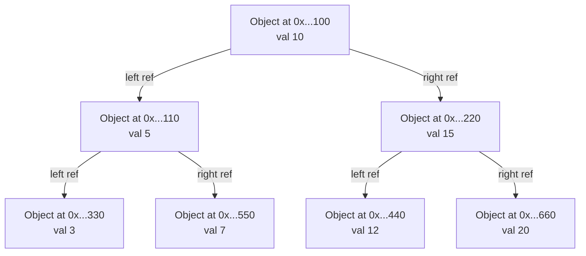
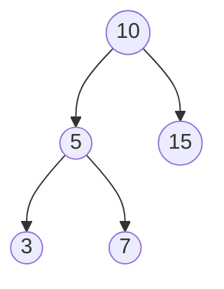
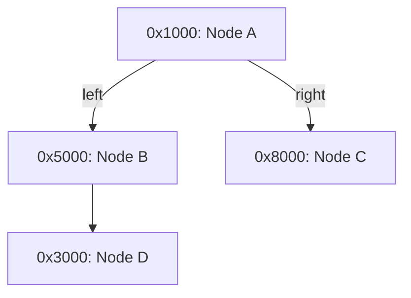

# 🔬 PART 0: DEEP INTERNALS - HOW TREES & GRAPHS WORK AT CPU/MEMORY LEVEL

> **Navigation**: [Chapter overview](../05_Trees.md) | [Binary Tree Fundamentals →](02_binary_tree_fundamentals.md)
> Page 1 of 6 in **TREES - Complete Guide**


TREES & GRAPHS AT THE HARDWARE LEVEL - WHAT REALLY HAPPENS

Understanding the PHYSICAL reality of trees and graphs:

- How nodes are stored in memory
- What happens during tree traversal at CPU level
- Recursion stack deep dive
- Why tree operations are often cache-unfriendly
- Graph representation memory comparison

## 🧠 Tree Node Memory Layout

### Binary tree node: memory representation

```java
class TreeNode {
    int val;
    TreeNode left;
    TreeNode right;
}
```

**Memory layout** (64-bit JVM with compressed pointers):

| Offset | Size | Field | Value |
| --- | --- | --- | --- |
| 0 | 8 | Mark word | Object header (GC, locks) |
| 8 | 4 | Class pointer | → `TreeNode.class` |
| 12 | 4 | `val` (int) | e.g. 42 |
| 16 | 4 | `left` (reference) | → left child |
| 20 | 4 | `right` (reference) | → right child |
| 24 | 0 | Padding | Object is aligned to 8 bytes |

**Total: 24 bytes per `TreeNode`.**

**Tree structure in memory.** The logical tree has root 10, with children 5 and 15; 5 has children 3 and 7, and 15 has children 12 and 20. In memory each node is a separate heap object, and the links are references:



**How to read this diagram.** The addresses are made up to make the point: the nodes are **scattered** across the heap. A parent and its children are not guaranteed to sit next to each other in memory, so following a pointer is likely to touch a new cache line. **This causes cache misses during traversal.**

## 📚 Recursion Stack — What Actually Happens

### Recursive traversal: stack visualization

```java
void inorder(TreeNode root) {
    if (root == null) return;
    inorder(root.left);
    System.out.println(root.val);
    inorder(root.right);
}
```

The tree: root 10, with children 5 and 15; node 5 has children 3 and 7.



**How to read this diagram.** Node 10 is the root. The traversal below visits the left subtree (5, with 3 and 7) first.

**Call-stack evolution** (the top of the stack is the last frame listed):

| Step | Event | Stack (bottom → top) |
| --- | --- | --- |
| 1 | `inorder(10)` | `inorder(10)` |
| 2 | `inorder(10).left` → `inorder(5)` | `inorder(10)`, `inorder(5)` |
| 3 | `inorder(5).left` → `inorder(3)` | `inorder(10)`, `inorder(5)`, `inorder(3)` |
| 4 | `inorder(3).left` → `inorder(null)` returns immediately | same |
| 5 | Print **3** | same |
| 6 | `inorder(3).right` → `inorder(null)` returns immediately | same |
| 7 | `inorder(3)` pops; resume `inorder(5)` | `inorder(10)`, `inorder(5)` |
| 8 | Print **5** | same |
| 9 | `inorder(5).right` → `inorder(7)` | `inorder(10)`, `inorder(5)`, `inorder(7)` |
| … | Continues until all nodes are visited | |

Final output: `3, 5, 7, 10, 15` (inorder of a BST is sorted).

**Stack frame size.** Each frame holds a return address, the `root` parameter (a reference) and saved registers. The exact size varies by JVM and by whether the method is JIT-compiled; a rough figure is a few tens of bytes, so about 50 bytes per frame is a fair planning number.

| Tree | Height `h` | Approximate stack use |
| --- | --- | --- |
| Balanced, 1 million nodes | ≈ log₂ n ≈ 20 | about 1 KB. Safe. |
| Skewed, 1 million nodes | n = 1,000,000 | about 50 MB. The default thread stack is around 1 MB, so this is a **stack overflow**. |

Stack size ≈ h × frame size.

## 📚 Iterative Traversal — Explicit Stack

## Iterative Vs Recursive - Memory Comparison

**Recursive Inorder**:

```java
void inorder(TreeNode root) {
    if (root == null) return;
    inorder(root.left);
    visit(root);
    inorder(root.right);
}
```

Uses CALL STACK: ~48 bytes per frame (includes return address, saved regs)

**Iterative Inorder**:

```java
void inorderIterative(TreeNode root) {
    Stack<TreeNode> stack = new Stack<>();
    TreeNode curr = root;
    while (curr != null || !stack.isEmpty()) {
        while (curr != null) {
            stack.push(curr);
            curr = curr.left;
        }
        curr = stack.pop();
        visit(curr);
        curr = curr.right;
    }
}
```

Uses HEAP STACK: ~8 bytes per node reference
MEMORY COMPARISON (tree height h = 20):

| Method | Memory Used | Notes |
|---|---|---|
| Recursive | 20 × 48 = 960 B | Uses call stack (limited) |
| Iterative | 20 × 8 = 160 B | Uses heap (flexible) |

For SKEWED tree (h = 100,000):

- Recursive: 100,000 × 48 = 4.8 MB → STACK OVERFLOW on 1MB stack
- Iterative: 100,000 × 8 = 800 KB → Works fine on heap

**Recommendation**: Use iterative for production code with unknown tree shapes

## 🌳 Cache Behavior in Tree Traversal

### Why tree traversal is cache-unfriendly

**Memory layout comparison**

**Array (cache-friendly)**

| Address | 0x1000 | 0x1004 | 0x1008 | 0x100C | 0x1010 | 0x1014 | 0x1018 |
| --- | --- | --- | --- | --- | --- | --- | --- |
| **Index** | [0] | [1] | [2] | [3] | [4] | [5] | [6] |

- Access `arr[0]`: the CPU loads a whole cache line, `[0]` to `[15]` (64 bytes).
- Access `arr[1]`: already in cache, a **cache hit**.
- Access `arr[2]`: already in cache, a **cache hit**.

**Tree (cache-unfriendly)**



**How to read this diagram.** The addresses are illustrative. Each node was allocated at a different time and place, so following a pointer jumps to a distant address.

- Access Node A: the CPU loads the cache line around `0x1000`.
- Access Node B: `0x5000` is **not** in cache, so it is a **cache miss** and a new line must be loaded.
- Access Node D: `0x3000` is **not** in cache, so it is another **cache miss**.

**Cache miss penalty** (typical orders of magnitude; they vary by CPU)

| Level | Latency |
| --- | --- |
| L1 cache hit | ~4 cycles |
| L2 cache hit | ~12 cycles |
| L3 cache hit | ~40 cycles |
| RAM (miss) | ~200 cycles |

On a large tree whose nodes do not fit in cache, traversal can approach the RAM cost per node. Array iteration is mostly L1 hits, around a few cycles per element. **This is why an array-based heap is faster than a pointer-based tree.**

**Optimization: van Emde Boas layout.** Store tree nodes in memory in a cache-friendly order:

- Keep subtrees together in contiguous memory.
- B+ trees in databases rely on the same idea: wide nodes that fill cache lines or pages.
- Trade-off: a complex implementation that is harder to update.

## 🧠 Graph Representation — Memory Deep Dive

---

[Chapter overview](../05_Trees.md) | [Binary Tree Fundamentals →](02_binary_tree_fundamentals.md)
