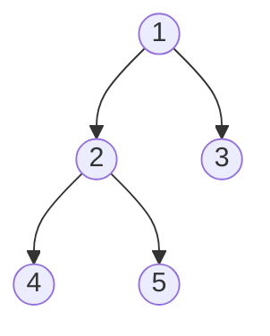

# 🌳 Part 2: Tree Traversals

> **Navigation**: [← Binary Tree Fundamentals](02_binary_tree_fundamentals.md) | [Chapter overview](../05_Trees.md) | [Advanced Tree Algorithms →](04_advanced_tree_algorithms.md)
> Page 3 of 6 in **TREES - Complete Guide**


## The Three DFS Traversals

**Tree Traversals - When & WHY to USE Each**

REMEMBER BY: When do you PROCESS the current node?

| Traversal | Order | When the current node is processed |
| --- | --- | --- |
| Preorder | Process → Left → Right | **Before** its children |
| Inorder | Left → Process → Right | **Between** its children |
| Postorder | Left → Right → Process | **After** its children |

**Example tree**



**How to read this diagram.** Node 1 is the root. Node 2 has children 4 and 5, and node 3 is a leaf.

| Traversal | Result | Note |
| --- | --- | --- |
| Preorder | 1 → 2 → 4 → 5 → 3 | Root first, then the subtrees |
| Inorder | 4 → 2 → 5 → 1 → 3 | Left, root, right. Sorted order for a BST |
| Postorder | 4 → 5 → 2 → 3 → 1 | Children first, then the root |

### When to USE Each Traversal?

PREORDER (Root → Left → Right):

```text
USE FOR: Copying/cloning a tree
         Serializing tree to file/string
         Creating prefix expressions
         Getting directory structure (ls -R)

WHY: You need to create parent BEFORE children
     (Can't have children without parent first!)
```

INORDER (Left → Root → Right):

```text
USE FOR: Getting sorted elements from BST
         Validating if tree is BST
         Finding kth smallest/largest element
         Creating infix expressions

WHY: For BST, left < root < right, so this gives sorted order
     It's the "natural" reading order (left to right)
```

POSTORDER (Left → Right → Root):

```text
USE FOR: Deleting a tree (must delete children before parent)
         Calculating folder sizes (need children sizes first)
         Evaluating expression trees
         Finding height of tree
         Garbage collection algorithms

WHY: You need children's result before you can compute parent's
     (Can't calculate total until you have subtotals!)
```

**Level Order (BFS)**:

```text
USE FOR: Finding shortest path in unweighted tree
         Printing tree level by level
         Finding nodes at specific depth
         Connecting nodes at same level
         Zigzag traversal

WHY: Processes nodes by distance from root - perfect for
     "nearest" or "level" based questions
```

QUICK DECISION TABLE:

| Problem Type | Use Traversal |
| --- | --- |
| Get sorted elements (BST) | INORDER |
| Copy/clone tree | PREORDER |
| Delete tree safely | POSTORDER |
| Calculate subtree values | POSTORDER |
| Find by level/depth | LEVEL ORDER (BFS) |
| Serialize tree | PREORDER + marker |
| Check if valid BST | INORDER |
| Expression evaluation | POSTORDER |

## Traversal Code

```java
// PREORDER - Recursive
public void preorder(TreeNode root) {
    if (root == null) return;

    System.out.print(root.val + " ");  // Process
    preorder(root.left);                // Left
    preorder(root.right);               // Right
}

// INORDER - Recursive
public void inorder(TreeNode root) {
    if (root == null) return;

    inorder(root.left);                 // Left
    System.out.print(root.val + " ");  // Process
    inorder(root.right);                // Right
}

// POSTORDER - Recursive
public void postorder(TreeNode root) {
    if (root == null) return;

    postorder(root.left);               // Left
    postorder(root.right);              // Right
    System.out.print(root.val + " ");  // Process
}

// PREORDER - Iterative (using stack)
public List<Integer> preorderIterative(TreeNode root) {
    List<Integer> result = new ArrayList<>();
    if (root == null) return result;

    Stack<TreeNode> stack = new Stack<>();
    stack.push(root);

    while (!stack.isEmpty()) {
        TreeNode node = stack.pop();
        result.add(node.val);

        // Right first so left is processed first (LIFO)
        if (node.right != null) stack.push(node.right);
        if (node.left != null) stack.push(node.left);
    }

    return result;
}
```

## Level Order Traversal (BFS)

```
VISIT LEVEL BY LEVEL:

        [1]         Level 0: [1]
       /   \
     [2]   [3]      Level 1: [2, 3]
    /  \     \
  [4]  [5]   [6]    Level 2: [4, 5, 6]

OUTPUT: [[1], [2, 3], [4, 5, 6]]
```

```java
public List<List<Integer>> levelOrder(TreeNode root) {
    List<List<Integer>> result = new ArrayList<>();
    if (root == null) return result;

    Queue<TreeNode> queue = new LinkedList<>();
    queue.offer(root);

    while (!queue.isEmpty()) {
        int levelSize = queue.size();  // Nodes at current level
        List<Integer> currentLevel = new ArrayList<>();

        for (int i = 0; i < levelSize; i++) {
            TreeNode node = queue.poll();
            currentLevel.add(node.val);

            if (node.left != null) queue.offer(node.left);
            if (node.right != null) queue.offer(node.right);
        }

        result.add(currentLevel);
    }

    return result;
}
```

---

## 🌳 Part 3: Common Tree Problems

### Maximum Depth

```java
public int maxDepth(TreeNode root) {
    if (root == null) return 0;

    int leftDepth = maxDepth(root.left);
    int rightDepth = maxDepth(root.right);

    return 1 + Math.max(leftDepth, rightDepth);
}

// TRACE for tree:
//     [1]
//    /   \
//  [2]   [3]
//  /
// [4]
//
// maxDepth(4) = 1 + max(0, 0) = 1
// maxDepth(2) = 1 + max(1, 0) = 2
// maxDepth(3) = 1 + max(0, 0) = 1
// maxDepth(1) = 1 + max(2, 1) = 3
```

### Check if Balanced

```java
// A tree is balanced if height difference of subtrees <= 1

public boolean isBalanced(TreeNode root) {
    return checkHeight(root) != -1;
}

private int checkHeight(TreeNode node) {
    if (node == null) return 0;

    int leftHeight = checkHeight(node.left);
    if (leftHeight == -1) return -1;  // Left subtree unbalanced

    int rightHeight = checkHeight(node.right);
    if (rightHeight == -1) return -1;  // Right subtree unbalanced

    // Check current node balance
    if (Math.abs(leftHeight - rightHeight) > 1) {
        return -1;  // Unbalanced
    }

    return 1 + Math.max(leftHeight, rightHeight);
}
```

### Lowest Common Ancestor (LCA)

```java
// Find the lowest node that has both p and q as descendants

public TreeNode lowestCommonAncestor(TreeNode root, TreeNode p, TreeNode q) {
    if (root == null || root == p || root == q) {
        return root;
    }

    TreeNode left = lowestCommonAncestor(root.left, p, q);
    TreeNode right = lowestCommonAncestor(root.right, p, q);

    // If both sides found something, root is LCA
    if (left != null && right != null) {
        return root;
    }

    // Otherwise, return the non-null side
    return left != null ? left : right;
}

// INTUITION:
// If p and q are in different subtrees, root is LCA
// If both in same subtree, LCA is in that subtree
```

---

## 🌳 Part 4: Binary Search Tree (bst)

### BST Property

```
For every node:
- All values in LEFT subtree < node value
- All values in RIGHT subtree > node value

        [8]
       /   \
     [3]   [10]
    /  \      \
  [1]  [6]   [14]
      /  \
    [4]  [7]

INORDER traversal gives SORTED order: 1, 3, 4, 6, 7, 8, 10, 14
```

### BST Operations

```java
// SEARCH - O(log n) average, O(n) worst (skewed)
public TreeNode search(TreeNode root, int val) {
    if (root == null || root.val == val) {
        return root;
    }

    if (val < root.val) {
        return search(root.left, val);
    } else {
        return search(root.right, val);
    }
}

// INSERT - O(log n) average
public TreeNode insert(TreeNode root, int val) {
    if (root == null) {
        return new TreeNode(val);
    }

    if (val < root.val) {
        root.left = insert(root.left, val);
    } else {
        root.right = insert(root.right, val);
    }

    return root;
}

// VALIDATE BST
public boolean isValidBST(TreeNode root) {
    return validate(root, Long.MIN_VALUE, Long.MAX_VALUE);
}

private boolean validate(TreeNode node, long min, long max) {
    if (node == null) return true;

    if (node.val <= min || node.val >= max) {
        return false;
    }

    return validate(node.left, min, node.val) &&
           validate(node.right, node.val, max);
}
```

#### Why Balance Is Life-or-Death — and the Rotation That Saves It

Every BST operation above is "O(log n) average, O(n) worst." That gap between log n and n is not academic — it's the difference between a database query taking 30 comparisons and taking 1,000,000. Understand *where* the gap comes from and *how* balanced trees close it, and red-black/AVL trees stop being scary.

**The disaster: insert sorted data into a plain BST.** Insert 1, 2, 3, 4, 5 in order. Each new value is bigger than everything, so it always goes right:

```
1
 \
  2
   \
    3        ← this isn't a tree, it's a linked list wearing a tree costume
     \
      4
       \
        5
```

Height = n, not log n. Every "O(log n)" operation is now O(n). And sorted-ish input is *the common case* in production (timestamps, auto-increment IDs, already-sorted imports) — which is exactly why an unbalanced BST is a trap and why `TreeMap` uses a *self-balancing* red-black tree, never a plain BST. **Balance isn't a nice-to-have; it's the entire reason the structure is usable.**

**The fix is one operation — the rotation — and its one job is to reduce height while keeping the data sorted.** Here is the left rotation, the atom every balanced tree is built from:

```
     [P]                          [Q]
    /   \      left-rotate(P)     /   \
  [A]   [Q]    ───────────►     [P]   [C]
       /   \                   /   \
     [B]   [C]               [A]   [B]

P drops down to become Q's left child; Q rises to become the new subtree root;
B (Q's old left subtree) reattaches as P's new right child.
```

**The thing that makes rotations *work* — and feels like magic until you see it — is that a rotation preserves in-order order *exactly*.** Read both trees left-to-right (in-order):

```
Before:  A, P, B, Q, C
After:   A, P, B, Q, C        ← identical sorted sequence!
```

They're the *same sorted list*. That's not a coincidence — it's forced by the BST invariant. Look at the constraints that must hold in *both* shapes: `A < P < B < Q < C`. A left rotation just re-parents nodes while keeping every one of those orderings intact:
- `A < P` (A stays P's left) ✓
- `B` is between `P` and `Q` — before it's "right of P / left of Q," after it's still "right of P / left of Q," just reattached as P's right child. Its position in the sorted order is unchanged ✓
- `Q < C` (C stays Q's right) ✓

So a rotation is a **local re-shaping that the in-order traversal can't even detect** — the sorted sequence is invariant, only the *height* changes. That's the whole trick: you get to restructure the tree to fix balance *without ever violating the search property*, because the one thing rotations are guaranteed to preserve is the left-to-right order. AVL and red-black trees are then "just" rules for *when* to fire rotations (AVL: when a subtree's height differs by 2; red-black: when color invariants break) to keep height at `O(log n)` after every insert/delete. The rotation is the engine; the balance rules are the thermostat deciding when to run it.

> **The takeaway that survives forgetting the color rules:** balancing a BST never means rebuilding it or re-sorting — it means firing O(1) rotations, each of which provably leaves the sorted order untouched while pulling height down. "Self-balancing" = "automatically rotates to keep height ≈ log n." That single sentence is what `TreeMap`, `std::map`, and every database index rests on.

---

[← Binary Tree Fundamentals](02_binary_tree_fundamentals.md) | [Chapter overview](../05_Trees.md) | [Advanced Tree Algorithms →](04_advanced_tree_algorithms.md)
