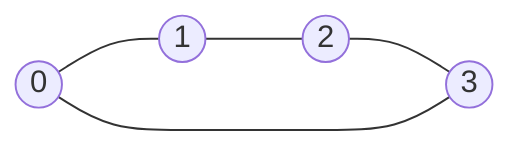
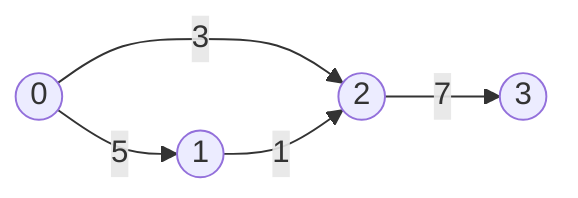
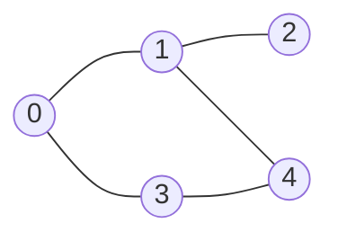

> **Navigation**: [← TREES](05_Trees.md) | [Chapter index](00_INDEX.md) | [Graphs Fundamentals →](05c_Graphs_Fundamentals.md)
🧠 **Mental Model**: See [Graph & Tree Thinking](../14_Mental_Models/03_Graph_Tree_Thinking.md) — traversal intuition and pattern recognition

---

# GRAPHS - Complete Guide

## From Fundamentals to Advanced Graph Algorithms

**Split from Trees_Graphs.md for better navigation**
See also: [Trees](05_Trees.md) | [Index](../00_MASTER_INDEX.md)

---

## 🔗 Bridge — Where This Chapter Fits

| Dimension | This chapter |
| --- | --- |
| **Builds on** | [Trees](05_Trees.md) |
| **You will learn** | Graph representations (adjacency list/matrix/edge list), memory layout, cache behaviour, density and complexity trade-offs |
| **Leads to** | [Graph Fundamentals](05c_Graphs_Fundamentals.md) |
| **Abstraction level** | L0–L4: representation decisions that decide performance |

> [!NOTE]
> The full gap-free reading order and dependency graph are in the [Learning Path](00_LEARNING_PATH.md).

---

## 💬 Explain It Like a Study Partner — Graph Internals

### 1. The bottom line

Pick the graph representation by density: adjacency lists for sparse graphs, matrices for dense ones.

### 2. The textbook core

- Adjacency list: O(V + E) space, iterate neighbours in O(deg).
- Adjacency matrix: O(V²) space, edge check O(1).
- Edge list: simplest, ideal for Kruskal and Bellman–Ford.
- Prefer primitive arrays (`int[]` CSR layout) over `List<List<Integer>>` for large graphs.

### 3. The real-world analogy

A **phone book of friends** (list per person) versus a **huge grid** of everyone against everyone (matrix).

### 4. Walkthrough

1. Graph with 1,000 nodes and 5,000 edges.
2. Matrix: 1,000 × 1,000 = 10⁶ cells even though only 5,000 are used.
3. List: about 5,000 × 2 entries.
4. Choose the list; BFS touches each edge twice.

> [!NOTE]
> **Quick check:** When is a matrix the better choice? *Dense graphs or when O(1) edge lookup is essential (e.g. Floyd–Warshall).*

---


### 5W1H: Mastering Graph Internals

> [!NOTE]
> **WHAT:** Memory models of graphs (Adjacency List vs Matrix), edge list storage, and internal CPU/Cache behavior during graph traversal algorithms.
>
> **WHY:** Incorrect graph representation leads to O(V²) memory blowouts or cache thrashing. Understanding memory layout defines performance.
>
> **WHO:** Performance-minded engineers deciding how to encode networks, paths, and dependencies in memory-constrained environments.
>
> **WHEN:** Adjacency List for sparse graphs (E < V²/2). Adj Matrix for dense graphs or O(1) edge lookups. Edge List for sorting edges (Kruskal's).
>
> **HOW:** By comparing memory overhead of Object-based adjacency lists vs flat 2D arrays, and selecting ArrayDeque over LinkedList for cache- friendly BFS/DFS queues.


### 5. Check yourself

**Q1.** Space of an adjacency list versus an adjacency matrix?

<details><summary>Answer</summary>

`O(V + E)` versus `O(V²)`.

</details>

**Q2.** Cost of BFS on a graph stored as adjacency lists?

<details><summary>Answer</summary>

`O(V + E)`.

</details>

---

## 🎓 University Proof Corner

> **MIT 6.042J (Math for CS) / KTH DD1352 / TU Munich layer** — The mathematical foundations of graphs, a proof that adjacency list is space-optimal, and why graph theory began with a walk across Königsberg's bridges.

### Handshaking Lemma (the founding theorem of graph theory)

**Claim**: In any undirected graph, the sum of vertex degrees equals twice the number of edges.

$$\sum_{v \in V} \deg(v) = 2|E|$$

**Proof**: Each edge {u, v} contributes exactly 1 to deg(u) and 1 to deg(v) — contributing 2 to the total sum. Summing over all |E| edges: total = 2|E|. ✓

**Corollary**: The number of odd-degree vertices is always even (an odd-sum total is impossible with even 2|E|).

**Why it matters**: Euler (1736) proved that an Eulerian circuit (visiting every edge once, returning to start) exists **if and only if every vertex has even degree** — using exactly this handshaking argument on the Königsberg bridges. This problem — "is there a route crossing each of 7 bridges exactly once?" — is the birth of graph theory.

### Adjacency List Space Complexity Proof

For an undirected graph with V vertices and E edges:
- Array of V list headers: O(V).
- Each undirected edge {u, v} appears in two lists (u's and v's): exactly 2E entries.
- **Total: O(V + E)** — provably space-optimal for representing every edge.

Adjacency matrix: O(V²) regardless of E — wastes O(V²−E) space on sparse graphs (roads, social networks). For dense graphs (E ≈ V²), both representations are O(V²).

**Rule of thumb**: Adjacency list when E ≪ V²; matrix when you need O(1) edge-existence queries or E ≈ V².

### Historical Evolution

**Leonhard Euler (1736)**: Königsberg bridge problem → invented graph theory. Proved no Eulerian circuit exists when odd-degree vertices > 0. **Arthur Cayley (1857)**: Introduced "trees" (connected acyclic graphs); Cayley's formula (V^(V−2) labelled trees on V vertices) was first proved by Borchardt (1860) and popularised by Cayley (1889). **Dénes Kőnig (1931, 1936)**: König's theorem (bipartite max-matching = min vertex cover, 1931) and the first graph-theory textbook (1936). **CLRS Introduction to Algorithms (1990)**: Standardized the adjacency list representation, BFS, DFS pseudocode now universal in CS education.

> BFS/Dijkstra proofs: [05c — Graphs Fundamentals](05c_Graphs_Fundamentals.md) | Lower bound for graph problems: [A3 — Lower Bounds & NP](A3_Lower_Bounds_And_NP.md)

- 📎 **Reference Anchor**: [Guava ImmutableGraph / Graph API](https://github.com/google/guava/blob/master/guava/src/com/google/common/graph/Graph.java) · [JGraphT AdjacencyList impl](https://github.com/jgrapht/jgrapht/blob/master/jgrapht-core/src/main/java/org/jgrapht/graph/AbstractBaseGraph.java)
- **Invariant learned**: Guava's `Graph<N>` API separates the *graph interface* (node/edge set, adjacency queries) from the *traversal algorithm* — the exact split the Handshaking Lemma makes. The API exposes `graph.edges()` returning a `Set<EndpointPair<N>>`, so |E| and ∑deg(v) can be computed directly from the contract without inspecting adjacency list internals.
- **Local rewrite**: This chapter's O(V+E) space proof (V list headers + 2E entries for undirected) maps directly to JGraphT's `AbstractBaseGraph` which stores one `vertexMap` (the V headers) and one `edgeMap` (the 2E directed-edge records that represent undirected pairs).
- **Constraint warning**: `HashMap`-backed adjacency lists (the default in JGraphT for `SimpleGraph`) do NOT guarantee iteration order of neighbors. If BFS/DFS results must be deterministic (e.g., in tests), use `LinkedHashMap`-backed graphs or explicitly sort the neighbor list.

---

### Historical Evolution

Graph theory as a mathematical discipline traces its formal origin to **Leonhard Euler's 1736 paper on the Seven Bridges of Königsberg** — Euler proved it impossible to cross all seven bridges exactly once by introducing the concept of vertices and edges as abstract graph elements, founding the entire field of topology. The adjacency list and adjacency matrix representations emerged from early computer implementations: **Warshall (1962)** and **Floyd** popularized matrix-based graph algorithms, while **adjacency lists** became the standard for sparse graphs in the 1970s as researchers like **Tarjan** (1972) developed depth-first search and its applications. The memory tradeoff between these representations (list: $O(V+E)$, matrix: $O(V^2)$) was first quantified in **Knuth's 1968 analysis of graph algorithms**, and remains the fundamental decision point in production graph systems. Modern practice (post-2010) extends these representations: CSR (Compressed Sparse Row) format for efficient graph processing in libraries like NetworkX and Pregel, distributed graph processing (Pregel/GraphX) that partitions adjacency lists across machines, and graph databases (Neo4j) that use adjacency list representations optimized for traversal patterns.

---

## 🧠 Graph Representation — Memory Deep Dive

### Adjacency list vs matrix: memory internals

The example graph is a 4-cycle: `0 — 1`, `1 — 2`, `2 — 3`, `3 — 0`.



**How to read this diagram.** Four vertices joined in a square, so vertex 0 is adjacent to 1 and 3, vertex 1 to 0 and 2, and so on.

#### Adjacency matrix memory layout

`int[][] matrix = new int[4][4];` is an outer array of references, each pointing to its own row array on the heap:

| Object | Contents |
| --- | --- |
| Outer `int[][]` | Header (16 bytes), then `row[0]`, `row[1]`, `row[2]`, `row[3]` references |
| `int[] row[0]` | Header (16 bytes), then `[0,0]=0`, `[0,1]=1`, `[0,2]=0`, `[0,3]=1` |
| `int[] row[1]`, `row[2]`, `row[3]` | Same shape, one array each |

**Total memory** (compressed pointers):

- Outer array: 16 + 4 × 4 = 32 bytes.
- Each row: 16 + 4 × 4 = 32 bytes.
- Total: 32 + 4 × 32 = 160 bytes for 4 vertices.

For `V` vertices that is O(V²) space **regardless of the number of edges**. With 1,000 vertices: 1000 × 1000 × 4 = 4 MB. With 1,000,000 vertices: about 4 TB, which is impossible.

#### Adjacency list memory layout

`List<List<Integer>> adj = new ArrayList<>();` is an outer `ArrayList` whose `elementData` array holds one inner `ArrayList` per vertex. Each inner list holds boxed `Integer` objects:

| Object | Contents |
| --- | --- |
| Outer `ArrayList` | Header, and an `Object[] elementData` → `[list0, list1, list2, list3]` |
| Inner `ArrayList` (vertex 0) | Header, and an `Object[]` → `[Integer(1), Integer(3), null, ...]` |
| Inner `ArrayList` (vertex 1) | Neighbors `[0, 2]`, and so on |

**Total memory** (rough):

- Outer `ArrayList`: about 32 bytes.
- Each inner `ArrayList`: about 32 bytes, plus its edges.
- Each `Integer` object: about 16 bytes (values from -128 to 127 are cached and shared).
- Total ≈ 32 + V × 32 + E × 16 = O(V + E).

| Graph | Matrix | List | Winner |
| --- | --- | --- | --- |
| Sparse (V = 1000, E = 5000) | 4 MB | about 112 KB (roughly 35× smaller) | List |
| Dense (V = 1000, E = 500,000) | 4 MB | about 8 MB | Matrix |

> [!TIP]
> **Rule:** use an adjacency list for sparse graphs (E < V²/2). Use an adjacency matrix for dense graphs, or when edge lookup is frequent.

## 📌 Edge List Representation

### Edge List - the Simplest Graph Representation

**Structure:** just a list of edges, each edge is `(src, dst, weight)`.

```java
int[][] edges = {{0, 1, 5}, {0, 2, 3}, {1, 2, 1}, {2, 3, 7}};
// Each row: [from, to, weight]
```



**How to read this diagram.** The graph described by the edge list above; each arrow is one row of the array and its label is the weight.


MEMORY: O(E) — just the edges, nothing more

**When to USE Edge List**:

- ✅ Bellman-Ford algorithm (iterates over ALL edges each relaxation)
- ✅ Kruskal's MST (sort edges by weight, process in order)
- ✅ When you just need to store/sort edges
- ✅ Problems that give input as edge list directly

**When NOT to USE**:

- ❌ Need to find neighbors of a vertex → O(E) scan each time!
- ❌ BFS/DFS (adjacency list is much better)
- ❌ Need edge existence check (adjacency matrix is O(1))

**Comparison of ALL Three**:

| Operation | Adj Matrix | Adj List | Edge List |
| --- | --- | --- | --- |
| Space | O(V²) | O(V + E) | O(E) |
| Add edge | O(1) | O(1) | O(1) |
| Edge exists? | O(1) | O(degree) | O(E) |
| All neighbors | O(V) | O(degree) | O(E) |
| All edges | O(V²) | O(V + E) | O(E) |
| Sort edges | O(V² log V) | O(E log E) | O(E log E) |

```java
// EDGE LIST — Java Implementation
// Simple: just an array of [src, dst, weight]

// Usage in Bellman-Ford:
int[][] edges = {{0,1,5}, {0,2,3}, {1,2,1}, {2,3,7}};
int V = 4;
int[] dist = new int[V];
Arrays.fill(dist, Integer.MAX_VALUE);
dist[0] = 0;

for (int i = 0; i < V - 1; i++) {          // V-1 relaxation rounds
    for (int[] edge : edges) {               // iterate ALL edges
        int u = edge[0], v = edge[1], w = edge[2];
        if (dist[u] != Integer.MAX_VALUE && dist[u] + w < dist[v])
            dist[v] = dist[u] + w;
    }
}

// Usage in Kruskal's MST:
Arrays.sort(edges, (a, b) -> a[2] - b[2]);  // sort by weight
// Then process with Union-Find...
```

## 🔬 BFS and DFS — Internal Operations

### BFS vs DFS: memory and CPU behavior

The example graph has edges `0—1`, `1—2`, `0—3`, `1—4` and `3—4`:



**How to read this diagram.** Vertex 0 connects to 1 and 3, vertex 1 connects to 0, 2 and 4, and vertex 3 connects to 0 and 4.

#### BFS using a queue

```java
Queue<Integer> queue = new LinkedList<>();
queue.offer(0);
visited[0] = true;
```

| Step | Queue after the step | Action |
| --- | --- | --- |
| 1 | `[0]` | Visit 0, add its neighbors |
| 2 | `[1, 3]` | Visit 1 |
| 3 | `[3, 2, 4]` | Visit 3 |
| 4 | `[2, 4]` | Visit 2 |
| 5 | `[4]` | Visit 4 |
| 6 | `[]` | Done |

Visit order: **0, 1, 3, 2, 4** (level by level). Memory: the queue holds O(V) nodes in the worst case (a wide graph).

#### DFS using a stack (or recursion)

```java
Stack<Integer> stack = new Stack<>();
stack.push(0);
```

| Step | Stack after the step (top is rightmost) | Action |
| --- | --- | --- |
| 1 | `[0]` | Visit 0, push its neighbors |
| 2 | `[3, 1]` | Visit 1 |
| 3 | `[3, 4, 2]` | Visit 2 (deepest first!) |
| 4 | `[3, 4]` | Visit 4 |
| 5 | `[3]` | Visit 3 (a duplicate 3 pushed by vertex 4 is skipped once it is marked visited) |
| 6 | `[]` | Done |

Visit order: **0, 1, 2, 4, 3** (goes deep first). Memory: the stack holds O(V) nodes in the worst case (a deep graph).

#### CPU cache behavior

| | BFS | DFS |
| --- | --- | --- |
| Pattern | Visits nearby nodes first. Better for graphs with spatial locality. | Goes deep and may jump around in memory. |
| Queue/stack cost | `offer()` and `poll()` are O(1). | Recursive DFS has function-call overhead. |
| Container choice | `LinkedList` queue: poor cache locality (scattered nodes). `ArrayDeque` queue: better locality (contiguous array). | Iterative DFS with `ArrayDeque` is more cache-friendly. |

#### Recommendation

Use `ArrayDeque` instead of `LinkedList` or `Stack`. Its contiguous array has better cache locality, and the `ArrayDeque` Javadoc notes it is likely to be faster than `Stack` as a stack and faster than `LinkedList` as a queue.

```java
// Prefer this:
Queue<Integer> queue = new ArrayDeque<>();
Deque<Integer> stack = new ArrayDeque<>();

// Over this:
Queue<Integer> queue = new LinkedList<>();  // Slower
Stack<Integer> stack = new Stack<>();       // Slower, and synchronized
```

## 🔬 Shortest Path Algorithms — Internal Comparison

### Dijkstra vs Bellman-ford vs Floyd-warshall

DIJKSTRA'S ALGORITHM (Single source, non-negative weights):  
Time: O((V + E) log V) with binary heap  
Space: O(V) for distance array + O(V) for priority queue

**Internal Working**:

PriorityQueue<int[]> pq = new PriorityQueue<>((a,b) -> a[1] - b[1]);

- pq.offer(): O(log V) - bubble up in heap
- pq.poll(): O(log V) - bubble down in heap
- Each edge relaxed once: E times
- Total: O(E log V)

**WHY Negative Weights Break Dijkstra**:

Once a node is "done" (popped from PQ), Dijkstra assumes it won't improve  
Negative edge could make it shorter later → incorrect result!

BELLMAN-FORD (Single source, handles negative weights):  
Time: O(V × E)  
Space: O(V) for distance array

**Internal Working**:

```java
for (int i = 0; i < V - 1; i++) {           // V-1 iterations
    for (int[] edge : edges) {              // All E edges
        int u = edge[0], v = edge[1], w = edge[2];
        if (dist[u] + w < dist[v])
            dist[v] = dist[u] + w;          // Relax
    }
}
```

WHY V-1 ITERATIONS?
- Shortest path has at most V-1 edges
- Each iteration guarantees at least one more correct distance
- After V-1, all shortest paths found (if no negative cycle)

**Negative Cycle Detection**:

Run one more iteration - if any distance improves → negative cycle exists!

FLOYD-WARSHALL (All pairs shortest paths):  
Time: O(V³)  
Space: O(V²) for distance matrix

**Internal Working**:

```java
for (int k = 0; k < V; k++) {               // Intermediate vertex
    for (int i = 0; i < V; i++) {           // Source
        for (int j = 0; j < V; j++) {       // Destination
            dist[i][j] = min(dist[i][j], dist[i][k] + dist[k][j]);
        }
    }
}
```

KEY INSIGHT: After iteration k, dist[i][j] contains shortest path  
from i to j using only vertices 0 to k as intermediates

**Comparison Table**:

| Algorithm | Time | Space | Neg. Edges | Use Case |
| --- | --- | --- | --- | --- |
| Dijkstra | O(E log V) | O(V) | No | Single source |
| Bellman-Ford | O(V × E) | O(V) | Yes | Neg. edges |
| Floyd-Warshall | O(V³) | O(V²) | Yes | All pairs |
| BFS (unweight) | O(V + E) | O(V) | N/A | Unweighted |

---

## 📐 Modeling Problems as Graphs (Skiena's Approach)

In _The Algorithm Design Manual_, Steven Skiena emphasizes that the hardest part of graph algorithms isn't the algorithm itself (BFS/DFS/Dijkstra)—it's **recognizing that the problem is a graph problem** and defining the vertices and edges correctly.

### The 3 Core Questions to Ask:

1. **What are the Vertices?** (States, objects, configurations)
2. **What are the Edges?** (Transitions, relationships, dependencies)
3. **Are the edges Directed or Undirected? Weighted or Unweighted?**

### Classic Modeling Archetypes

#### 1. The State Space Graph (Implicit Graphs)

**Problem:** Word Ladder (transform "hit" to "cog" changing one letter at a time).
**Model:**

- **Vertices:** Every possible valid word in the dictionary.
- **Edges:** An undirected, unweighted edge connects two words if they differ by exactly one character.
- **Algorithm:** BFS to find the shortest path (minimum transitions).
- _Key Insight:_ You don't build the entire graph upfront! You generate neighbors dynamically (Implicit Graph).

#### 2. The Dependency Graph

**Problem:** Course Schedule (take courses given prerequisites).
**Model:**

- **Vertices:** The courses.
- **Edges:** A directed edge from Course A to Course B if A is a prerequisite for B.
- **Algorithm:** Topological Sort (DFS or Kahn's). Cycle detection (if cycle exists, graduation is impossible).

#### 3. The Grid Graph

**Problem:** Number of Islands, Maze Solving.
**Model:**

- **Vertices:** Each `(row, col)` cell in the 2D matrix.
- **Edges:** Implicit undirected edges connecting a cell to its Up, Down, Left, Right neighbors (if they are valid/passable).
- **Algorithm:** BFS/DFS.
- _Key Insight:_ A 2D matrix _is_ a graph. You don't need an Adjacency List to traverse it; just use a `int[][] directions = {{0,1}, {1,0}, {0,-1}, {-1,0}}` array.

#### 4. The Compatibility Graph

**Problem:** Bipartite Matching (Assigning workers to jobs, scheduling exams without conflicts).
**Model:**

- **Vertices:** Entities (e.g., Workers and Jobs).
- **Edges:** An undirected edge if Worker A can do Job B.
- **Algorithm:** Bipartite Graph checking (Coloring) or Maximum Flow.

---

## When It Breaks -- Graph Internals

### 1. HashMap Adjacency List — Non-Deterministic Traversal Order

**What breaks**: `Map<Integer, Set<Integer>> adj` with `HashSet` for neighbors. BFS/DFS iteration order is non-deterministic between JVM runs (hash seeds differ since Java 8). Tests that assert a specific traversal order pass locally and fail in CI.
**Fix**: Use `LinkedHashSet` to preserve insertion order, or `TreeSet` for sorted order. For competitive programming: use `List<Integer>` (insertion order, fastest iteration).

### 2. Directed vs Undirected — Adding Edge Only Once

**What breaks**: For an undirected graph, forgetting to add the reverse edge: `adj.get(u).add(v)` without `adj.get(v).add(u)`. Result: a directed graph masquerading as undirected. BFS from u reaches v, but BFS from v doesn't reach u.
**Debug signal**: If `|edges from A| != |edges from B|` for a "symmetric" graph, one direction is missing.

### 3. DFS Stack Overflow on Dense Graphs

**What breaks**: Recursive DFS on a path graph with 10⁵ nodes causes `StackOverflowError` (JVM default stack ~8k–15k frames). Happens specifically on star graphs, path graphs, or any graph with high depth.
**Fix**: Convert to iterative DFS with an explicit `ArrayDeque<Integer>` stack. The stack mirrors the recursion stack but lives on the heap.

### 4. Forgetting to Initialize All Nodes in the Adjacency List

**What breaks**: Calling `adj.get(node)` for an isolated node (no edges) returns `null` if you only initialized nodes that appear in edge lists. `NullPointerException` on `.size()` or `.iterator()`.
**Fix**: Always pre-initialize: `for (int i = 0; i < n; i++) adj.add(new ArrayList<>())` before adding edges.

---

## Brute Force → Optimal: Graph Traversal

### Problem: Find if Path Exists Between Two Nodes

**Brute Force — O(V! ) try all permutations:**
Enumerate every possible sequence of nodes, check if any forms a valid path. Obviously impractical.

**Naive — O(V+E) DFS, risk of infinite loop without visited set:**
```java
boolean dfs(int u, int target, boolean[] visited, List<List<Integer>> adj) {
    if (u == target) return true;
    visited[u] = true;
    for (int v : adj.get(u))
        if (!visited[v] && dfs(v, target, visited, adj)) return true;
    return false;
}
```

**Optimal for connectivity — O(α(n)) Union-Find:**
Build DSU once from all edges, then answer `connected(src, dst)` in O(1) per query after O(E·α(V)) build. For repeated queries, Union-Find dominates BFS/DFS by 10–100× on query throughput.


---

## 🏢 Enterprise Lens — Graph Internals

| Area | What top-tier engineering looks like |
| ---- | ------------------------------------ |
| **Where it runs in production** | Social/road/dependency graphs, build systems, recommendation graphs; CSR formats in graph databases and analytics engines |
| **Failure modes** | Using a matrix for a million-node sparse graph (memory blow-up); boxing overhead; undirected edges added once instead of twice |
| **Testing and verification** | Unit-test with isolated nodes, self-loops, parallel edges, disconnected components |

---

## Reality Check

**"Adjacency list and adjacency matrix give the same BFS/DFS results"** → Same traversal order with deterministic neighbor ordering. But time complexity differs: BFS/DFS with adjacency list = O(V + E). BFS/DFS with adjacency matrix = O(V²) because you always scan all V possible neighbors even if the vertex has degree 2. For sparse graphs (E << V²), adjacency list is dramatically faster. For dense graphs (E ≈ V²), adjacency matrix is equivalent and often faster due to cache-friendly sequential access.

**"'Visited' array size should be V (number of vertices)"** → Yes for dense graphs with vertices labeled 0..V-1. For graphs with string/arbitrary keys, use a HashSet as visited. For multi-state problems (coloring graph nodes 0=unvisited, 1=in-progress, 2=done to detect back edges in directed graph cycle detection), use an int array. For problems where you visit the same node multiple times with different state (e.g., 0/1 BFS — visited[node][fuel_remaining]), you need a 2D visited array or a set of (node, state) tuples.

**"Adding an edge to an undirected graph in adjacency list requires one line"** → Undirected edges require TWO insertions: `adj[u].add(v)` AND `adj[v].add(u)`. Forgetting the second insert is a common bug that creates a directed graph instead of undirected. For weighted undirected graphs: both `adj[u].add((v, w))` and `adj[v].add((u, w))`. For directed graphs: only `adj[u].add(v)`. Always check after building the graph: sum of all adjacency list sizes should equal 2E for undirected, E for directed.

**"Disconnected graphs break standard BFS/DFS"** → Standard BFS/DFS from a single source only visits the source's connected component. For disconnected graphs, wrap the BFS/DFS in a loop: `for each vertex v: if not visited[v]: BFS(v)`. This pattern processes all connected components. Problems where this matters: counting connected components, detecting cycles in the full graph (not just from one source), finding all nodes in any component. Not wrapping the outer loop is a common bug for disconnected graph problems.

**"Cycle detection in directed graphs is the same as in undirected graphs"** → Different algorithms for different properties. Undirected: BFS/DFS — mark visited, if you reach a visited node that isn't the parent → cycle. Directed: DFS with 3-color marking (white=unvisited, gray=in-progress, black=done) — if you reach a gray node → back edge → cycle. The parent-check trick for undirected graphs doesn't work for directed graphs: a directed graph with edges A→B, A→C, B has no cycle, but A→B→C and A→C→... — the directed reachability is different. Union-Find detects cycles in undirected only.
