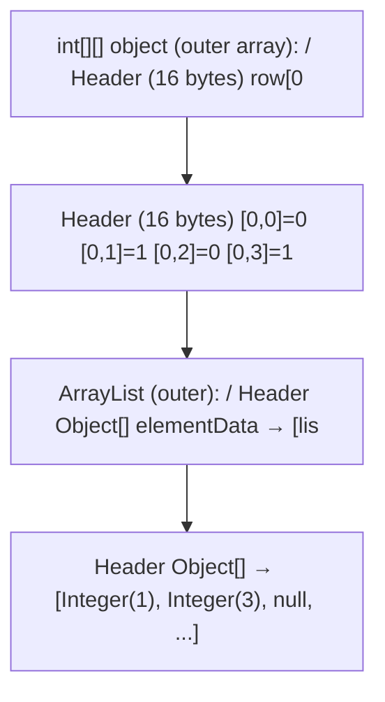
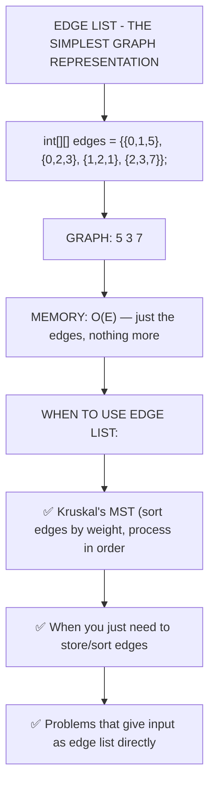
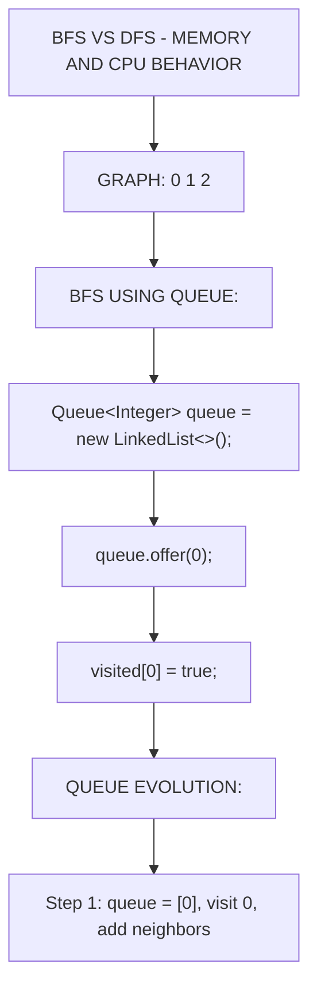
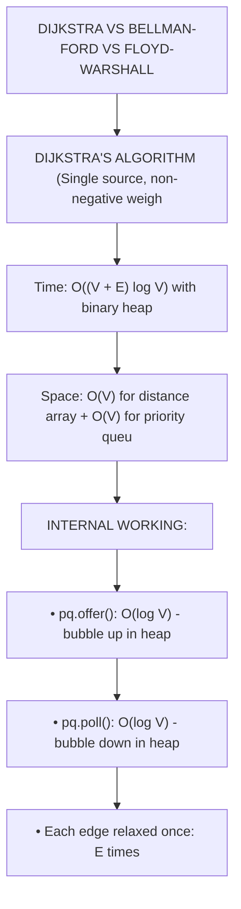

> **Navigation**: [Back to Index](../00_MASTER_INDEX.md) | [Next Chapter >](05c_Graphs_Fundamentals.md)
> 🧠 **Mental Model**: See [Graph & Tree Thinking](../14_Mental_Models/03_Graph_Tree_Thinking.md) — traversal intuition and pattern recognition

---

# GRAPHS - Complete Guide
## From Fundamentals to Advanced Graph Algorithms

> **Split from Trees_Graphs.md for better navigation**
> See also: [Trees](05_Trees.md) | [Index](../00_MASTER_INDEX.md)

---


> 🔬 **Section Challenge — From Fundamentals to Advanced Graph Algorithms**
>
> **Challenge 1 (Reasoning):** BFS finds shortest path in unweighted graphs but not in weighted graphs. Why exactly?
> <details><summary>Answer</summary>
>
> BFS explores by 'hop count' (number of edges). Each level = one more edge away from source. All edges are treated as weight=1. In a weighted graph, the 'shortest by hop count' path may not be 'shortest by weight sum'. Example: A→B (weight 1, 1 hop) vs A→C→B (weight 0.1+0.1=0.2, 2 hops). BFS finds A→B (1 hop), Dijkstra finds A→C→B (lower total weight). BFS is optimal ONLY when all edges have equal weight.
> </details>
>
> **Challenge 2 (Design):** Detect if a directed graph has a cycle. Write the algorithm and explain why we need 3 states (not 2).
> <details><summary>Answer</summary>
>
> 3 states: UNVISITED, IN_PROGRESS (currently in DFS path), DONE. DFS: mark node IN_PROGRESS before visiting neighbors. If we reach an IN_PROGRESS node → cycle found. Mark DONE when all neighbors processed. Why 3 states: with 2 (visited/unvisited), we'd get false positives — reaching a VISITED node that was processed in a DIFFERENT DFS subtree is not a cycle. IN_PROGRESS specifically marks nodes in the CURRENT DFS path (potential back edge).
> </details>
>

## 🧠 Graph Representation — Memory Deep Dive

```
┌─────────────────────────────────────────────────────────────────────────────────┐
│                    ADJACENCY LIST VS MATRIX - MEMORY INTERNALS                  │
├─────────────────────────────────────────────────────────────────────────────────┤
│                                                                                 │
│  GRAPH:  0 ─── 1                                                                │
│          │     │                                                                │
│          3 ─── 2                                                                │
│                                                                                 │
│  ADJACENCY MATRIX MEMORY LAYOUT:                                                │
│  ─────────────────────────────────                                              │
│  int[][] matrix = new int[4][4];                                                │
│                                                                                 │
│  HEAP MEMORY:                                                                   │
│  ┌─────────────────────────────────────────────────────────────────────────┐    │
│  │ int[][] object (outer array):                                           │    │
│  │ ┌────────────────────────────────────────────────────────────────────┐  │    │
│  │ │ Header (16 bytes) │ row[0] ptr │ row[1] ptr │ row[2] ptr │ row[3] │  │     │
│  │ │                   │ 0x1000     │ 0x2000     │ 0x3000     │ 0x4000 │  │     │
│  │ └────────────────────────────────────────────────────────────────────┘  │    │
│  │                                                                         │    │
│  │ int[] row[0] at 0x1000:                                                 │    │
│  │ ┌────────────────────────────────────────────────────────────────────┐  │    │
│  │ │ Header (16 bytes) │ [0,0]=0 │ [0,1]=1 │ [0,2]=0 │ [0,3]=1 │        │  │    │
│  │ └────────────────────────────────────────────────────────────────────┘  │    │
│  │                                                                         │    │
│  │ int[] row[1] at 0x2000: ...                                            │     │
│  │ int[] row[2] at 0x3000: ...                                            │     │
│  │ int[] row[3] at 0x4000: ...                                            │     │
│  └─────────────────────────────────────────────────────────────────────────┘    │
│                                                                                 │
│  TOTAL MEMORY:                                                                  │
│  • Outer array: 16 + 4×4 = 32 bytes                                             │
│  • Each row: 16 + 4×4 = 32 bytes                                                │
│  • Total: 32 + 4×32 = 160 bytes for 4 vertices                                  │
│                                                                                 │
│  For V vertices: O(V²) space regardless of edges!                               │
│  1000 vertices: 1000 × 1000 × 4 = 4 MB                                          │
│  1,000,000 vertices: 4 TB (impossible!)                                         │
│                                                                                 │
│                                                                                 │
│  ADJACENCY LIST MEMORY LAYOUT:                                                  │
│  ────────────────────────────────                                               │
│  List<List<Integer>> adj = new ArrayList<>();                                   │
│                                                                                 │
│  HEAP MEMORY:                                                                   │
│  ┌─────────────────────────────────────────────────────────────────────────┐    │
│  │ ArrayList (outer):                                                      │    │
│  │ ┌────────────────────────────────────────────────────────────────────┐  │    │
│  │ │ Header │ Object[] elementData → [list0, list1, list2, list3]      │  │     │
│  │ └────────────────────────────────────────────────────────────────────┘  │    │
│  │                                                                         │    │
│  │ ArrayList (vertex 0): neighbors [1, 3]                                 │     │
│  │ ┌────────────────────────────────────────────────────────────────────┐  │    │
│  │ │ Header │ Object[] → [Integer(1), Integer(3), null, ...]           │  │     │
│  │ └────────────────────────────────────────────────────────────────────┘  │    │
│  │                                                                         │    │
│  │ ArrayList (vertex 1): neighbors [0, 2]  ...                            │     │
│  └─────────────────────────────────────────────────────────────────────────┘    │
│                                                                                 │
│  TOTAL MEMORY:                                                                  │
│  • Outer ArrayList: ~32 bytes                                                   │
│  • Each inner ArrayList: ~32 bytes + edges                                      │
│  • Each Integer: 16 bytes                                                       │
│  • Total: 32 + V×32 + E×16 = O(V + E)                                           │
│                                                                                 │
│  For sparse graph (V=1000, E=5000):                                             │
│  • Matrix: 4 MB                                                                 │
│  • List:   ~112 KB (35x smaller!)                                               │
│                                                                                 │
│  For dense graph (V=1000, E=500,000):                                           │
│  • Matrix: 4 MB                                                                 │
│  • List:   ~8 MB (matrix is smaller!)                                           │
│                                                                                 │
│  RULE: Use adjacency list for sparse graphs (E < V²/2)                          │
│        Use adjacency matrix for dense graphs or when edge lookup is frequent    │
│                                                                                 │
└─────────────────────────────────────────────────────────────────────────────────┘
```

**Flow:**
- int[][] object (outer array): / Header (16 bytes) row[0
- ↓
- Header (16 bytes) [0,0]=0 [0,1]=1 [0,2]=0 [0,3]=1
- ↓
- ArrayList (outer): / Header Object[] elementData
- ↓
- [lis
- ↓
- ArrayList (outer): / Header Object[] elementData
- ↓
- [lis
- ↓
- Header Object[]
- ↓
- [Integer(1), Integer(3), null, ...]




> 🔬 **Section Challenge — 🧠 Graph Representation — Memory Deep Dive**
>
> **Challenge 1 (Reasoning):** BFS finds shortest path in unweighted graphs but not in weighted graphs. Why exactly?
> <details><summary>Answer</summary>
>
> BFS explores by 'hop count' (number of edges). Each level = one more edge away from source. All edges are treated as weight=1. In a weighted graph, the 'shortest by hop count' path may not be 'shortest by weight sum'. Example: A→B (weight 1, 1 hop) vs A→C→B (weight 0.1+0.1=0.2, 2 hops). BFS finds A→B (1 hop), Dijkstra finds A→C→B (lower total weight). BFS is optimal ONLY when all edges have equal weight.
> </details>
>
> **Challenge 2 (Design):** Detect if a directed graph has a cycle. Write the algorithm and explain why we need 3 states (not 2).
> <details><summary>Answer</summary>
>
> 3 states: UNVISITED, IN_PROGRESS (currently in DFS path), DONE. DFS: mark node IN_PROGRESS before visiting neighbors. If we reach an IN_PROGRESS node → cycle found. Mark DONE when all neighbors processed. Why 3 states: with 2 (visited/unvisited), we'd get false positives — reaching a VISITED node that was processed in a DIFFERENT DFS subtree is not a cycle. IN_PROGRESS specifically marks nodes in the CURRENT DFS path (potential back edge).
> </details>
>

## 📌 Edge List Representation

```
┌─────────────────────────────────────────────────────────────────────────────────┐
│                    EDGE LIST - THE SIMPLEST GRAPH REPRESENTATION                │
├─────────────────────────────────────────────────────────────────────────────────┤
│                                                                                 │
│  STRUCTURE: Just a list of edges — each edge is (src, dst, weight)              │
│                                                                                 │
│  int[][] edges = {{0,1,5}, {0,2,3}, {1,2,1}, {2,3,7}};                          │
│  // Each row: [from, to, weight]                                                │
│                                                                                 │
│  GRAPH:       5       3       7                                                 │
│         0 ------→ 1     0 ----→ 2 ----→ 3                                       │
│                    ↑    1                                                       │
│                    └────┘                                                       │
│                                                                                 │
│  MEMORY: O(E) — just the edges, nothing more                                    │
│                                                                                 │
│  ─────────────────────────────────────────────────────────────────────────────  │
│                                                                                 │
│  WHEN TO USE EDGE LIST:                                                         │
│  ✅ Bellman-Ford algorithm (iterates over ALL edges each relaxation)             │
│  ✅ Kruskal's MST (sort edges by weight, process in order)                       │
│  ✅ When you just need to store/sort edges                                       │
│  ✅ Problems that give input as edge list directly                               │
│                                                                                 │
│  WHEN NOT TO USE:                                                               │
│  ❌ Need to find neighbors of a vertex → O(E) scan each time!                    │
│  ❌ BFS/DFS (adjacency list is much better)                                      │
│  ❌ Need edge existence check (adjacency matrix is O(1))                         │
│                                                                                 │
│  ─────────────────────────────────────────────────────────────────────────────  │
│                                                                                 │
│  COMPARISON OF ALL THREE:                                                       │
│  ┌──────────────────┬──────────────┬────────────────┬──────────────────────┐    │
│  │ Operation        │ Adj Matrix   │ Adj List       │ Edge List            │    │
│  ├──────────────────┼──────────────┼────────────────┼──────────────────────┤    │
│  │ Space            │ O(V²)       │ O(V + E)       │ O(E)                 │     │
│  │ Add edge         │ O(1)         │ O(1)           │ O(1)                 │    │
│  │ Edge exists?     │ O(1)         │ O(degree)      │ O(E)                 │    │
│  │ All neighbors    │ O(V)         │ O(degree)      │ O(E)                 │    │
│  │ All edges        │ O(V²)       │ O(V + E)       │ O(E)                 │     │
│  │ Sort edges       │ O(V² log V) │ O(E log E)     │ O(E log E)           │     │
│  └──────────────────┴──────────────┴────────────────┴──────────────────────┘    │
│                                                                                 │
└─────────────────────────────────────────────────────────────────────────────────┘
```

**Flow:**
- EDGE LIST - THE SIMPLEST GRAPH REPRESENTATION
- ↓
- int[][] edges = {{0,1,5}, {0,2,3}, {1,2,1}, {2,3,7}};
- ↓
- GRAPH: 5 3 7
- ↓
- MEMORY: O(E) — just the edges, nothing more
- ↓
- WHEN TO USE EDGE LIST:
- ↓
- ✅ Kruskal's MST (sort edges by weight, process in order
- ↓
- ✅ When you just need to store/sort edges



```java
// EDGE LIST — Java Implementation
// Simple: just an array of [src, dst, weight]

// Usage in Bellman-Ford:
int[][] edges = {{0,1,5}, {0,2,3}, {1,2,1}, {2,3,7}};
int V = 4;
int[] dist = new int[V];
Arrays.fill(dist, Integer.MAX_VALUE);
dist[0] = 0;

for (int i = 0; i < V - 1; i++) {          // V-1 relaxation rounds
    for (int[] edge : edges) {               // iterate ALL edges
        int u = edge[0], v = edge[1], w = edge[2];
        if (dist[u] != Integer.MAX_VALUE && dist[u] + w < dist[v])
            dist[v] = dist[u] + w;
    }
}

// Usage in Kruskal's MST:
Arrays.sort(edges, (a, b) -> a[2] - b[2]);  // sort by weight
// Then process with Union-Find...
```

## 🔬 BFS and DFS — Internal Operations

```
┌─────────────────────────────────────────────────────────────────────────────────┐
│                    BFS VS DFS - MEMORY AND CPU BEHAVIOR                         │
├─────────────────────────────────────────────────────────────────────────────────┤
│                                                                                 │
│  GRAPH:    0 ─── 1 ─── 2                                                        │
│            │     │                                                              │
│            3 ─── 4                                                              │
│                                                                                 │
│  BFS USING QUEUE:                                                               │
│  ─────────────────                                                              │
│  Queue<Integer> queue = new LinkedList<>();                                     │
│  queue.offer(0);                                                                │
│  visited[0] = true;                                                             │
│                                                                                 │
│  QUEUE EVOLUTION:                                                               │
│  Step 1: queue = [0], visit 0, add neighbors                                    │
│  Step 2: queue = [1, 3], visit 1                                                │
│  Step 3: queue = [3, 2, 4], visit 3                                             │
│  Step 4: queue = [2, 4], visit 2                                                │
│  Step 5: queue = [4], visit 4                                                   │
│  Step 6: queue = [], done!                                                      │
│                                                                                 │
│  Visit order: 0, 1, 3, 2, 4 (level by level)                                    │
│                                                                                 │
│  MEMORY: Queue holds O(V) nodes worst case (wide graph)                         │
│                                                                                 │
│                                                                                 │
│  DFS USING STACK (or recursion):                                                │
│  ───────────────────────────────                                                │
│  Stack<Integer> stack = new Stack<>();                                          │
│  stack.push(0);                                                                 │
│                                                                                 │
│  STACK EVOLUTION:                                                               │
│  Step 1: stack = [0], visit 0, push neighbors                                   │
│  Step 2: stack = [3, 1], visit 1                                                │
│  Step 3: stack = [3, 4, 2], visit 2 (deepest first!)                            │
│  Step 4: stack = [3, 4], visit 4                                                │
│  Step 5: stack = [3], visit 3                                                   │
│  Step 6: stack = [], done!                                                      │
│                                                                                 │
│  Visit order: 0, 1, 2, 4, 3 (goes deep first)                                   │
│                                                                                 │
│  MEMORY: Stack holds O(V) nodes worst case (deep graph)                         │
│                                                                                 │
│                                                                                 │
│  CPU CACHE BEHAVIOR:                                                            │
│  ────────────────────                                                           │
│  ┌─────────────────────────────────────────────────────────────────────────┐    │
│  │ BFS:                                                                    │    │
│  │ • Visits nearby nodes first                                            │     │
│  │ • Better for graphs with spatial locality                              │     │
│  │ • Queue operations: offer() and poll() - O(1)                         │      │
│  │ • LinkedList queue: Poor cache locality (scattered nodes)             │      │
│  │ • ArrayDeque queue: Better cache locality (contiguous array)          │      │
│  │                                                                        │     │
│  │ DFS:                                                                    │    │
│  │ • Goes deep, may jump around in memory                                 │     │
│  │ • Recursive DFS has function call overhead                            │      │
│  │ • Iterative DFS with ArrayDeque is cache-friendlier                   │      │
│  └─────────────────────────────────────────────────────────────────────────┘    │
│                                                                                 │
│                                                                                 │
│  RECOMMENDATION:                                                                │
│  ───────────────                                                                │
│  • Use ArrayDeque instead of LinkedList for Queue/Stack                         │
│  • ArrayDeque is 2-3x faster due to better cache locality                       │
│                                                                                 │
│  // Prefer this:                                                                │
│  Queue<Integer> queue = new ArrayDeque<>();                                     │
│  Deque<Integer> stack = new ArrayDeque<>();                                     │
│                                                                                 │
│  // Over this:                                                                  │
│  Queue<Integer> queue = new LinkedList<>();  // Slower!                         │
│  Stack<Integer> stack = new Stack<>();       // Slower + synchronized!          │
│                                                                                 │
└─────────────────────────────────────────────────────────────────────────────────┘
```

**Flow:**
- BFS VS DFS - MEMORY AND CPU BEHAVIOR
- ↓
- GRAPH: 0 1 2
- ↓
- BFS USING QUEUE:
- ↓
- Queue<Integer> queue = new LinkedList<>();
- ↓
- queue.offer(0);
- ↓
- visited[0] = true;
- ↓
- QUEUE EVOLUTION:




## 🔬 Shortest Path Algorithms — Internal Comparison

```
┌─────────────────────────────────────────────────────────────────────────────────┐
│                    DIJKSTRA VS BELLMAN-FORD VS FLOYD-WARSHALL                   │
├─────────────────────────────────────────────────────────────────────────────────┤
│                                                                                 │
│  DIJKSTRA'S ALGORITHM (Single source, non-negative weights):                    │
│  ──────────────────────────────────────────────────────────                     │
│  Time: O((V + E) log V) with binary heap                                        │
│  Space: O(V) for distance array + O(V) for priority queue                       │
│                                                                                 │
│  INTERNAL WORKING:                                                              │
│  PriorityQueue<int[]> pq = new PriorityQueue<>((a,b) -> a[1] - b[1]);           │
│                                                                                 │
│  • pq.offer(): O(log V) - bubble up in heap                                     │
│  • pq.poll(): O(log V) - bubble down in heap                                    │
│  • Each edge relaxed once: E times                                              │
│  • Total: O(E log V)                                                            │
│                                                                                 │
│  WHY NEGATIVE WEIGHTS BREAK DIJKSTRA:                                           │
│  Once a node is "done" (popped from PQ), Dijkstra assumes it won't improve      │
│  Negative edge could make it shorter later → incorrect result!                  │
│                                                                                 │
│                                                                                 │
│  BELLMAN-FORD (Single source, handles negative weights):                        │
│  ─────────────────────────────────────────────────────────                      │
│  Time: O(V × E)                                                                 │
│  Space: O(V) for distance array                                                 │
│                                                                                 │
│  INTERNAL WORKING:                                                              │
│  for (int i = 0; i < V - 1; i++) {           // V-1 iterations                  │
│      for (int[] edge : edges) {              // All E edges                     │
│          int u = edge[0], v = edge[1], w = edge[2];                             │
│          if (dist[u] + w < dist[v])                                             │
│              dist[v] = dist[u] + w;          // Relax                           │
│      }                                                                          │
│  }                                                                              │
│                                                                                 │
│  WHY V-1 ITERATIONS?                                                            │
│  • Shortest path has at most V-1 edges                                          │
│  • Each iteration guarantees at least one more correct distance                 │
│  • After V-1, all shortest paths found (if no negative cycle)                   │
│                                                                                 │
│  NEGATIVE CYCLE DETECTION:                                                      │
│  Run one more iteration - if any distance improves → negative cycle exists!     │
│                                                                                 │
│                                                                                 │
│  FLOYD-WARSHALL (All pairs shortest paths):                                     │
│  ──────────────────────────────────────────                                     │
│  Time: O(V³)                                                                    │
│  Space: O(V²) for distance matrix                                               │
│                                                                                 │
│  INTERNAL WORKING:                                                              │
│  for (int k = 0; k < V; k++) {               // Intermediate vertex             │
│      for (int i = 0; i < V; i++) {           // Source                          │
│          for (int j = 0; j < V; j++) {       // Destination                     │
│              dist[i][j] = min(dist[i][j], dist[i][k] + dist[k][j]);             │
│          }                                                                      │
│      }                                                                          │
│  }                                                                              │
│                                                                                 │
│  KEY INSIGHT: After iteration k, dist[i][j] contains shortest path              │
│  from i to j using only vertices 0 to k as intermediates                        │
│                                                                                 │
│                                                                                 │
│  COMPARISON TABLE:                                                              │
│  ┌────────────────┬──────────────┬────────────┬────────────┬─────────────────┐  │
│  │ Algorithm      │ Time         │ Space      │ Neg. Edges │ Use Case        │  │
│  ├────────────────┼──────────────┼────────────┼────────────┼─────────────────┤  │
│  │ Dijkstra       │ O(E log V)   │ O(V)       │ No         │ Single source   │  │
│  │ Bellman-Ford   │ O(V × E)     │ O(V)       │ Yes        │ Neg. edges      │  │
│  │ Floyd-Warshall │ O(V³)        │ O(V²)      │ Yes        │ All pairs       │  │
│  │ BFS (unweight) │ O(V + E)     │ O(V)       │ N/A        │ Unweighted      │  │
│  └────────────────┴──────────────┴────────────┴────────────┴─────────────────┘  │
│                                                                                 │
└─────────────────────────────────────────────────────────────────────────────────┘
```

**Flow:**
- DIJKSTRA VS BELLMAN-FORD VS FLOYD-WARSHALL
- ↓
- DIJKSTRA'S ALGORITHM (Single source, non-negative weigh
- ↓
- Time: O((V + E) log V) with binary heap
- ↓
- Space: O(V) for distance array + O(V) for priority queu
- ↓
- INTERNAL WORKING:
- ↓
- • pq.offer(): O(log V) - bubble up in heap
- ↓
- • pq.poll(): O(log V) - bubble down in heap



---

---


---


## 🏋️ Practice & Interview Questions — Algorithms

### Sorting
**Q1.** Which sorting algorithm does Java use for `Arrays.sort(int[])`? Why not MergeSort?
<details><summary>Answer</summary>

**Dual-Pivot QuickSort** — for primitives. MergeSort requires O(N) extra space. QuickSort is in-place and cache-friendly. Stability doesn't matter for primitives (equal ints are indistinguishable). For objects (`Arrays.sort(Object[])`), Java uses **TimSort** (stable, O(N log N) worst).
</details>

**Q2.** Trace Merge Sort on `[4,2,7,1]`.
<details><summary>Answer</summary>

Split: `[4,2]` `[7,1]` → Split: `[4]` `[2]` `[7]` `[1]` → Merge: `[2,4]` `[1,7]` → Merge: `[1,2,4,7]`
</details>

**Q3.** ⭐⭐ Sort Colors (Dutch National Flag — 3-way partition).
<details><summary>Solution</summary>

```java
int lo=0, mid=0, hi=n-1;
while(mid<=hi){
    if(nums[mid]==0) swap(nums,lo++,mid++);
    else if(nums[mid]==1) mid++;
    else swap(nums,mid,hi--);
}
```
</details>

### Binary Search
**Q4.** ⭐ Search in Rotated Sorted Array.
<details><summary>Solution</summary>

```java
int lo=0, hi=n-1;
while(lo<=hi){
    int mid=(lo+hi)/2;
    if(nums[mid]==target) return mid;
    if(nums[lo]<=nums[mid]){ // left half sorted
        if(nums[lo]<=target&&target<nums[mid]) hi=mid-1; else lo=mid+1;
    } else { // right half sorted
        if(nums[mid]<target&&target<=nums[hi]) lo=mid+1; else hi=mid-1;
    }
}
return -1;
```
</details>

**Q5.** ⭐ Find First and Last Position (binary search twice).
<details><summary>Solution</summary>

```java
// First: find leftmost with while(lo<hi){ if arr[mid]>=target hi=mid else lo=mid+1 }
// Last: find rightmost with while(lo<hi){ if arr[mid]<=target lo=mid+1 else hi=mid } return lo-1
```
</details>

**Q6.** ⭐⭐ Koko Eating Bananas — binary search on answer.
<details><summary>Key insight</summary>

Binary search the eating speed k in range [1, max(piles)]. For each k, calculate hours needed. Find minimum k where hours ≤ H.
</details>

### Dynamic Programming
**Q7.** ⭐ Climbing Stairs — n steps, 1 or 2 at a time. How many ways?
<details><summary>Solution</summary>

```java
// Fibonacci sequence! dp[i] = dp[i-1] + dp[i-2]
int a=1, b=1;
for(int i=2;i<=n;i++){ int c=a+b; a=b; b=c; }
return b;
```
</details>

**Q8.** ⭐ Coin Change — minimum coins for amount.
<details><summary>Solution</summary>

```java
int[] dp = new int[amount+1]; Arrays.fill(dp, amount+1);
dp[0]=0;
for(int i=1;i<=amount;i++)
    for(int c:coins) if(c<=i) dp[i]=Math.min(dp[i],dp[i-c]+1);
return dp[amount]>amount?-1:dp[amount];
```
</details>

**Q9.** ⭐⭐ Longest Common Subsequence.
<details><summary>Solution</summary>

```java
int[][] dp=new int[m+1][n+1];
for(int i=1;i<=m;i++) for(int j=1;j<=n;j++){
    if(text1.charAt(i-1)==text2.charAt(j-1)) dp[i][j]=dp[i-1][j-1]+1;
    else dp[i][j]=Math.max(dp[i-1][j],dp[i][j-1]);
}
return dp[m][n];
```
</details>

**Q10.** ⭐⭐ Word Break — can string be segmented using dictionary words?
<details><summary>Solution</summary>

```java
boolean[] dp=new boolean[n+1]; dp[0]=true;
for(int i=1;i<=n;i++) for(String w:wordDict)
    if(i>=w.length()&&dp[i-w.length()]&&s.substring(i-w.length(),i).equals(w)) dp[i]=true;
return dp[n];
```
</details>

**Q11.** ⭐⭐⭐ Edit Distance (Levenshtein).
<details><summary>Solution</summary>

```java
int[][] dp=new int[m+1][n+1];
for(int i=0;i<=m;i++) dp[i][0]=i;
for(int j=0;j<=n;j++) dp[0][j]=j;
for(int i=1;i<=m;i++) for(int j=1;j<=n;j++){
    if(word1.charAt(i-1)==word2.charAt(j-1)) dp[i][j]=dp[i-1][j-1];
    else dp[i][j]=1+Math.min(dp[i-1][j-1],Math.min(dp[i-1][j],dp[i][j-1]));
}
```
</details>

### Graph Algorithms
**Q12.** ⭐ Number of Islands (BFS/DFS grid traversal).
<details><summary>Solution</summary>

```java
for each cell (i,j) if grid[i][j]=='1': count++; BFS/DFS to mark all connected land as visited
```
</details>

**Q13.** ⭐⭐ Course Schedule — detect cycle in directed graph (Topological sort).
<details><summary>Solution</summary>

```java
// Kahn's algorithm: indegree array + BFS queue
// If result size == numCourses → no cycle → can finish
```
</details>

**Q14.** ⭐⭐ Dijkstra's Shortest Path.
<details><summary>Solution</summary>

```java
PriorityQueue<int[]> pq=new PriorityQueue<>((a,b)->a[1]-b[1]); // [node, dist]
pq.offer(new int[]{src,0}); dist[src]=0;
while(!pq.isEmpty()){
    int[] curr=pq.poll(); int u=curr[0],d=curr[1];
    if(d>dist[u]) continue; // stale
    for(int[] neighbor:graph[u]) if(dist[u]+neighbor[1]<dist[neighbor[0]]){
        dist[neighbor[0]]=dist[u]+neighbor[1]; pq.offer(new int[]{neighbor[0],dist[neighbor[0]]});
    }
}
```
</details>

### MCQ Rapid Fire
| # | Question | Answer |
|---|---|---|
| 1 | QuickSort avg/worst | O(N log N) avg, O(N²) worst |
| 2 | MergeSort space complexity | O(N) |
| 3 | HeapSort space complexity | O(1) (in-place) |
| 4 | Binary search precondition | Sorted array |
| 5 | BFS time complexity on graph | O(V+E) |
| 6 | DFS space complexity | O(V) (recursion stack) |
| 7 | Dijkstra fails on | Negative weight edges |
| 8 | Bellman-Ford handles | Negative weights, detects negative cycles |
| 9 | Floyd-Warshall use case | All-pairs shortest path, O(V³) |
| 10 | Topological sort requires | Directed Acyclic Graph (DAG) |


---

## 🧠 Deep Conceptual Questions — Algorithm Design & Analysis

**C1. What does O(N log N) "feel like" and why is it the complexity barrier for comparison-based sorting?**
<details><summary>Deep Answer</summary>

O(N log N) for N=1M ≈ 20M operations. O(N²) ≈ 1 trillion. The difference is 50,000x. **Comparison sort lower bound**: any comparison-based sort must distinguish between N! possible orderings. Each comparison has 2 outcomes. A decision tree with N! leaves needs ≥ log₂(N!) height ≈ N log N (Stirling's approximation). Therefore NO comparison sort can beat O(N log N) in the worst case. Non-comparison sorts (counting sort, radix sort, bucket sort) break this bound by using non-comparison operations — but require constraints on input (e.g., integer range bounded by N).
</details>

**C2. Greedy algorithms: when do they work and what must be proven?**
<details><summary>Deep Answer</summary>

A greedy algorithm makes the locally optimal choice at each step. Works when problem has: (1) **Greedy choice property**: local optimal leads to global optimal — the choice never needs to be revised. (2) **Optimal substructure**: optimal solution to the problem contains optimal solutions to subproblems. To PROVE greedy is correct: use "exchange argument" — assume optimal solution differs from greedy, show you can swap greedy's choice in without making it worse, contradiction. Greedy FAILS when: future choices depend on current choice in complex ways (use DP instead). Classic works: interval scheduling, Huffman coding, Dijkstra. Classic fails: 0-1 knapsack (use DP).
</details>

**C3. Dynamic Programming: what is "overlapping subproblems" and why does it matter?**
<details><summary>Deep Answer</summary>

Overlapping subproblems: the same sub-computation appears multiple times. Fibonacci: `fib(5)` calls `fib(4)` and `fib(3)`. `fib(4)` also calls `fib(3)`. Without memoization: `fib(3)` computed exponentially many times → O(2^N). With memoization: each sub-result computed once and stored → O(N). DP is valuable SPECIFICALLY when: (1) problem has optimal substructure AND (2) subproblems overlap. If no overlap: just use divide-and-conquer (merge sort's subproblems don't overlap → no DP needed). DP = "smart recursion" = avoid recomputing.
</details>

**C4. Top-down (memoization) vs Bottom-up (tabulation) DP — when to choose each?**
<details><summary>Deep Answer</summary>

**Top-down (memoization)**: Write natural recursion + cache results. Easy to implement, only computes needed subproblems (sparse computation). Cons: recursion overhead and stack depth risk. Use when: problem is naturally recursive, only a fraction of subproblems needed. **Bottom-up (tabulation)**: Fill DP table iteratively from base cases. No recursion overhead, better cache performance, easier space optimization. Use when: need all subproblems (or most of them), want to optimize space (can often reduce to 1D from 2D). Rule: start with top-down for correctness verification, optimize to bottom-up for performance.
</details>

**C5. Dijkstra's Algorithm: why does it fail on negative weights?**
<details><summary>Deep Answer</summary>

Dijkstra assumes: once a node is "settled" (extracted from the priority queue with its final shortest distance), that distance is optimal. With negative weights: settling node A at distance 5 might not be final — a path through B (distance 7) → C (edge -10) → A gives distance -3. But A was already settled! Dijkstra doesn't revisit settled nodes. Bellman-Ford handles negatives by relaxing ALL edges N-1 times — no "settled" assumption. For graphs with negative cycles: Bellman-Ford detects them (if distances still decrease after N-1 rounds, there's a negative cycle).
</details>

**C6. Union-Find: why is path compression + union by rank/size nearly O(1)?**
<details><summary>Deep Answer</summary>

**Path compression**: when finding the root of element x, make every node on the path point directly to the root. Flattens the tree. Future finds on those paths: O(1). **Union by rank**: always attach the smaller tree under the larger → limits tree height to O(log N). Combined: inverse Ackermann function α(N) amortized — so slow-growing it's practically constant (α(10^80) = 4). Neither alone is optimal: path compression without union by rank → O(log N) amortized. Union by rank without path compression → O(log N). Together → α(N) ≈ O(1) amortized. Used in: Kruskal's MST, cycle detection, connected components.
</details>

**C7. Binary Search on the Answer — what types of problems does it apply to?**
<details><summary>Deep Answer</summary>

When the answer space is **monotone**: "if X is achievable, then all values less extreme than X are also achievable." Problems: minimize the maximum (aggressive cows, split array), find minimum valid threshold (Koko bananas, minimum days to bloom), divide-and-conquer feasibility. Template: binary search on the answer range [lo, hi], for each mid check `isFeasible(mid)` in O(N) or O(N log N). Total: O(N log(answer_range)). Key insight: reframe "find optimal value" as "find smallest X where condition holds" → enables binary search on a non-array space.
</details>

**C8. Why does merge sort guarantee stability while quicksort doesn't?**
<details><summary>Deep Answer</summary>

**Merge sort stability**: during merge, when two elements are equal, we always take from the LEFT array first → preserves original relative order. **QuickSort instability**: the partition step swaps elements across the pivot without regard to original order. Two equal elements may be placed on opposite sides of the pivot, reversing their order. QuickSort CAN be made stable (Lomuto partition with careful implementation) but loses performance. Java uses TimSort for objects (stable), dual-pivot quicksort for primitives (stability irrelevant since primitives without fields).
</details>

**C9. Backtracking: what's the difference from plain DFS and when to use vs DP?**
<details><summary>Deep Answer</summary>

**Backtracking vs DFS**: DFS visits every path. Backtracking prunes paths early when a constraint is violated — avoids exploring infeasible branches. Same asymptotic but drastically different practical performance with good pruning. **Backtracking vs DP**: backtracking for **combinatorial/enumeration** problems (find all solutions, permutations, subsets). DP for **optimization** problems (find optimal single solution). Backtracking produces exponential solutions in worst case but is necessary when you need ALL solutions. DP finds the optimal in polynomial time when overlapping subproblems exist.
</details>

**C10. What is amortized analysis and how does it differ from average-case analysis?**
<details><summary>Deep Answer</summary>

**Amortized**: analyzes the average cost per operation over a SEQUENCE of operations — in the worst case. No probability involved. Guarantees: N operations ALWAYS take O(N·T) total, even if some individual operations are O(N·T). Example: ArrayList append is O(N) when resizing, but amortized O(1) because resizing is rare. **Average-case**: analyzes expected cost of a SINGLE operation assuming random input. QuickSort is O(N log N) average-case (random pivot). Amortized is a stronger guarantee — it holds even for adversarial input sequences.
</details>


> **Navigation**: [< Previous](05_Trees.md) | [Back to Index](../00_MASTER_INDEX.md) | [Next >](05c_Graphs_Fundamentals.md)