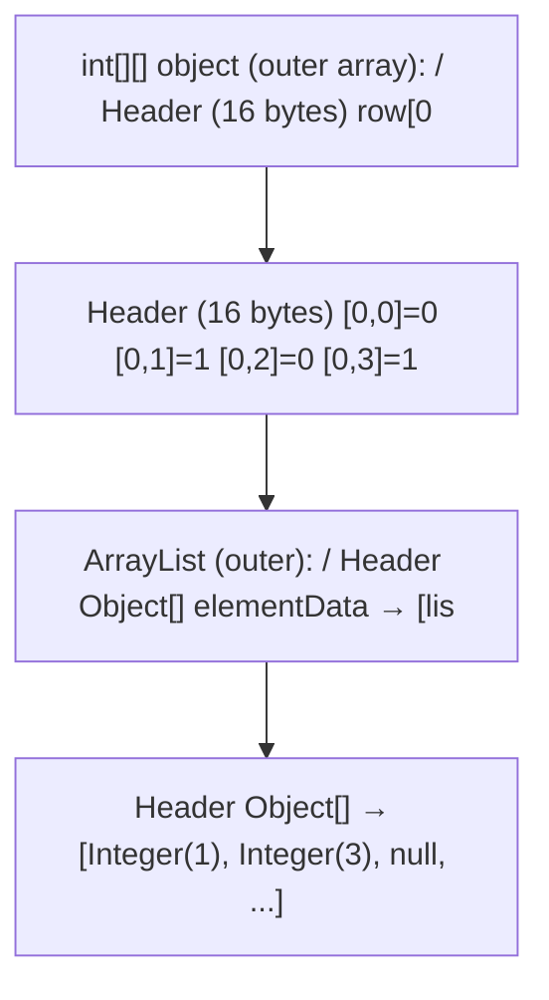
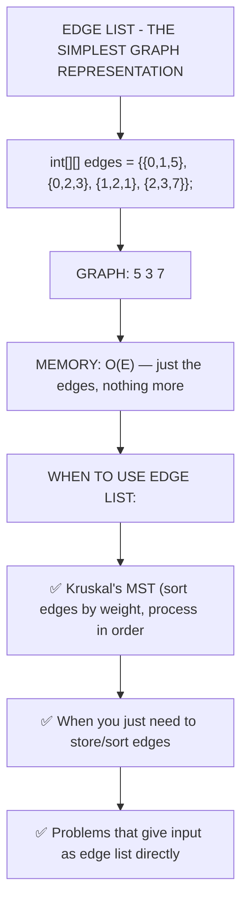
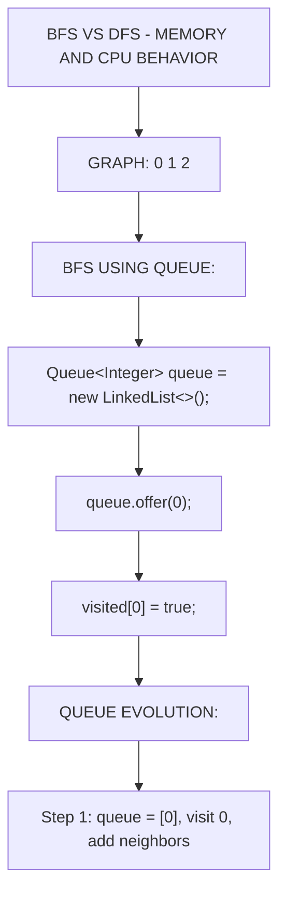
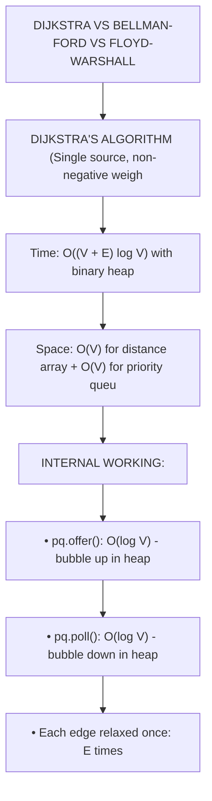

> **Navigation**: [Back to Index](../00_MASTER_INDEX.md) | [Next Chapter >](05c_Graphs_Fundamentals.md)
> 🧠 **Mental Model**: See [Graph & Tree Thinking](../14_Mental_Models/03_Graph_Tree_Thinking.md) — traversal intuition and pattern recognition

---

# GRAPHS - Complete Guide
## From Fundamentals to Advanced Graph Algorithms

> **Split from Trees_Graphs.md for better navigation**
> See also: [Trees](05_Trees.md) | [Index](../00_MASTER_INDEX.md)

---

## 🧠 Graph Representation — Memory Deep Dive

```
┌─────────────────────────────────────────────────────────────────────────────────┐
│                    ADJACENCY LIST VS MATRIX - MEMORY INTERNALS                  │
├─────────────────────────────────────────────────────────────────────────────────┤
│                                                                                 │
│  GRAPH:  0 ─── 1                                                                │
│          │     │                                                                │
│          3 ─── 2                                                                │
│                                                                                 │
│  ADJACENCY MATRIX MEMORY LAYOUT:                                                │
│  ─────────────────────────────────                                              │
│  int[][] matrix = new int[4][4];                                                │
│                                                                                 │
│  HEAP MEMORY:                                                                   │
│  ┌─────────────────────────────────────────────────────────────────────────┐    │
│  │ int[][] object (outer array):                                           │    │
│  │ ┌────────────────────────────────────────────────────────────────────┐  │    │
│  │ │ Header (16 bytes) │ row[0] ptr │ row[1] ptr │ row[2] ptr │ row[3] │  │     │
│  │ │                   │ 0x1000     │ 0x2000     │ 0x3000     │ 0x4000 │  │     │
│  │ └────────────────────────────────────────────────────────────────────┘  │    │
│  │                                                                         │    │
│  │ int[] row[0] at 0x1000:                                                 │    │
│  │ ┌────────────────────────────────────────────────────────────────────┐  │    │
│  │ │ Header (16 bytes) │ [0,0]=0 │ [0,1]=1 │ [0,2]=0 │ [0,3]=1 │        │  │    │
│  │ └────────────────────────────────────────────────────────────────────┘  │    │
│  │                                                                         │    │
│  │ int[] row[1] at 0x2000: ...                                            │     │
│  │ int[] row[2] at 0x3000: ...                                            │     │
│  │ int[] row[3] at 0x4000: ...                                            │     │
│  └─────────────────────────────────────────────────────────────────────────┘    │
│                                                                                 │
│  TOTAL MEMORY:                                                                  │
│  • Outer array: 16 + 4×4 = 32 bytes                                             │
│  • Each row: 16 + 4×4 = 32 bytes                                                │
│  • Total: 32 + 4×32 = 160 bytes for 4 vertices                                  │
│                                                                                 │
│  For V vertices: O(V²) space regardless of edges!                               │
│  1000 vertices: 1000 × 1000 × 4 = 4 MB                                          │
│  1,000,000 vertices: 4 TB (impossible!)                                         │
│                                                                                 │
│                                                                                 │
│  ADJACENCY LIST MEMORY LAYOUT:                                                  │
│  ────────────────────────────────                                               │
│  List<List<Integer>> adj = new ArrayList<>();                                   │
│                                                                                 │
│  HEAP MEMORY:                                                                   │
│  ┌─────────────────────────────────────────────────────────────────────────┐    │
│  │ ArrayList (outer):                                                      │    │
│  │ ┌────────────────────────────────────────────────────────────────────┐  │    │
│  │ │ Header │ Object[] elementData → [list0, list1, list2, list3]      │  │     │
│  │ └────────────────────────────────────────────────────────────────────┘  │    │
│  │                                                                         │    │
│  │ ArrayList (vertex 0): neighbors [1, 3]                                 │     │
│  │ ┌────────────────────────────────────────────────────────────────────┐  │    │
│  │ │ Header │ Object[] → [Integer(1), Integer(3), null, ...]           │  │     │
│  │ └────────────────────────────────────────────────────────────────────┘  │    │
│  │                                                                         │    │
│  │ ArrayList (vertex 1): neighbors [0, 2]  ...                            │     │
│  └─────────────────────────────────────────────────────────────────────────┘    │
│                                                                                 │
│  TOTAL MEMORY:                                                                  │
│  • Outer ArrayList: ~32 bytes                                                   │
│  • Each inner ArrayList: ~32 bytes + edges                                      │
│  • Each Integer: 16 bytes                                                       │
│  • Total: 32 + V×32 + E×16 = O(V + E)                                           │
│                                                                                 │
│  For sparse graph (V=1000, E=5000):                                             │
│  • Matrix: 4 MB                                                                 │
│  • List:   ~112 KB (35x smaller!)                                               │
│                                                                                 │
│  For dense graph (V=1000, E=500,000):                                           │
│  • Matrix: 4 MB                                                                 │
│  • List:   ~8 MB (matrix is smaller!)                                           │
│                                                                                 │
│  RULE: Use adjacency list for sparse graphs (E < V²/2)                          │
│        Use adjacency matrix for dense graphs or when edge lookup is frequent    │
│                                                                                 │
└─────────────────────────────────────────────────────────────────────────────────┘
```

> **Flow**: int[][] object (outer array): / Header (16 bytes) row[0 → Header (16 bytes) [0,0]=0 [0,1]=1 [0,2]=0 [0,3]=1 | Header (16 bytes) [0,0]=0 [0,1]=1 [0,2]=0 [0,3]=1 → ArrayList (outer): / Header Object[] elementData → [lis | ArrayList (outer): / Header Object[] elementData → [lis → Header Object[] → [Integer(1), Integer(3), null, ...]



## 📌 Edge List Representation

```
┌─────────────────────────────────────────────────────────────────────────────────┐
│                    EDGE LIST - THE SIMPLEST GRAPH REPRESENTATION                │
├─────────────────────────────────────────────────────────────────────────────────┤
│                                                                                 │
│  STRUCTURE: Just a list of edges — each edge is (src, dst, weight)              │
│                                                                                 │
│  int[][] edges = {{0,1,5}, {0,2,3}, {1,2,1}, {2,3,7}};                          │
│  // Each row: [from, to, weight]                                                │
│                                                                                 │
│  GRAPH:       5       3       7                                                 │
│         0 ------→ 1     0 ----→ 2 ----→ 3                                       │
│                    ↑    1                                                       │
│                    └────┘                                                       │
│                                                                                 │
│  MEMORY: O(E) — just the edges, nothing more                                    │
│                                                                                 │
│  ─────────────────────────────────────────────────────────────────────────────  │
│                                                                                 │
│  WHEN TO USE EDGE LIST:                                                         │
│  ✅ Bellman-Ford algorithm (iterates over ALL edges each relaxation)             │
│  ✅ Kruskal's MST (sort edges by weight, process in order)                       │
│  ✅ When you just need to store/sort edges                                       │
│  ✅ Problems that give input as edge list directly                               │
│                                                                                 │
│  WHEN NOT TO USE:                                                               │
│  ❌ Need to find neighbors of a vertex → O(E) scan each time!                    │
│  ❌ BFS/DFS (adjacency list is much better)                                      │
│  ❌ Need edge existence check (adjacency matrix is O(1))                         │
│                                                                                 │
│  ─────────────────────────────────────────────────────────────────────────────  │
│                                                                                 │
│  COMPARISON OF ALL THREE:                                                       │
│  ┌──────────────────┬──────────────┬────────────────┬──────────────────────┐    │
│  │ Operation        │ Adj Matrix   │ Adj List       │ Edge List            │    │
│  ├──────────────────┼──────────────┼────────────────┼──────────────────────┤    │
│  │ Space            │ O(V²)       │ O(V + E)       │ O(E)                 │     │
│  │ Add edge         │ O(1)         │ O(1)           │ O(1)                 │    │
│  │ Edge exists?     │ O(1)         │ O(degree)      │ O(E)                 │    │
│  │ All neighbors    │ O(V)         │ O(degree)      │ O(E)                 │    │
│  │ All edges        │ O(V²)       │ O(V + E)       │ O(E)                 │     │
│  │ Sort edges       │ O(V² log V) │ O(E log E)     │ O(E log E)           │     │
│  └──────────────────┴──────────────┴────────────────┴──────────────────────┘    │
│                                                                                 │
└─────────────────────────────────────────────────────────────────────────────────┘
```

> **Flow**: EDGE LIST - THE SIMPLEST GRAPH REPRESENTATION → int[][] edges = {{0,1,5}, {0,2,3}, {1,2,1}, {2,3,7}}; | int[][] edges = {{0,1,5}, {0,2,3}, {1,2,1}, {2,3,7}}; → GRAPH: 5 3 7 | GRAPH: 5 3 7 → MEMORY: O(E) — just the edges, nothing more | MEMORY: O(E) — just the edges, nothing more → WHEN TO USE EDGE LIST: | WHEN TO USE EDGE LIST: → ✅ Kruskal's MST (sort edges by weight, process in order | ✅ Kruskal's MST (sort edges by weight, process in order → ✅ When you just need to store/sort edges | ...+1 more



```java
// EDGE LIST — Java Implementation
// Simple: just an array of [src, dst, weight]

// Usage in Bellman-Ford:
int[][] edges = {{0,1,5}, {0,2,3}, {1,2,1}, {2,3,7}};
int V = 4;
int[] dist = new int[V];
Arrays.fill(dist, Integer.MAX_VALUE);
dist[0] = 0;

for (int i = 0; i < V - 1; i++) {          // V-1 relaxation rounds
    for (int[] edge : edges) {               // iterate ALL edges
        int u = edge[0], v = edge[1], w = edge[2];
        if (dist[u] != Integer.MAX_VALUE && dist[u] + w < dist[v])
            dist[v] = dist[u] + w;
    }
}

// Usage in Kruskal's MST:
Arrays.sort(edges, (a, b) -> a[2] - b[2]);  // sort by weight
// Then process with Union-Find...
```

## 🔬 BFS and DFS — Internal Operations

```
┌─────────────────────────────────────────────────────────────────────────────────┐
│                    BFS VS DFS - MEMORY AND CPU BEHAVIOR                         │
├─────────────────────────────────────────────────────────────────────────────────┤
│                                                                                 │
│  GRAPH:    0 ─── 1 ─── 2                                                        │
│            │     │                                                              │
│            3 ─── 4                                                              │
│                                                                                 │
│  BFS USING QUEUE:                                                               │
│  ─────────────────                                                              │
│  Queue<Integer> queue = new LinkedList<>();                                     │
│  queue.offer(0);                                                                │
│  visited[0] = true;                                                             │
│                                                                                 │
│  QUEUE EVOLUTION:                                                               │
│  Step 1: queue = [0], visit 0, add neighbors                                    │
│  Step 2: queue = [1, 3], visit 1                                                │
│  Step 3: queue = [3, 2, 4], visit 3                                             │
│  Step 4: queue = [2, 4], visit 2                                                │
│  Step 5: queue = [4], visit 4                                                   │
│  Step 6: queue = [], done!                                                      │
│                                                                                 │
│  Visit order: 0, 1, 3, 2, 4 (level by level)                                    │
│                                                                                 │
│  MEMORY: Queue holds O(V) nodes worst case (wide graph)                         │
│                                                                                 │
│                                                                                 │
│  DFS USING STACK (or recursion):                                                │
│  ───────────────────────────────                                                │
│  Stack<Integer> stack = new Stack<>();                                          │
│  stack.push(0);                                                                 │
│                                                                                 │
│  STACK EVOLUTION:                                                               │
│  Step 1: stack = [0], visit 0, push neighbors                                   │
│  Step 2: stack = [3, 1], visit 1                                                │
│  Step 3: stack = [3, 4, 2], visit 2 (deepest first!)                            │
│  Step 4: stack = [3, 4], visit 4                                                │
│  Step 5: stack = [3], visit 3                                                   │
│  Step 6: stack = [], done!                                                      │
│                                                                                 │
│  Visit order: 0, 1, 2, 4, 3 (goes deep first)                                   │
│                                                                                 │
│  MEMORY: Stack holds O(V) nodes worst case (deep graph)                         │
│                                                                                 │
│                                                                                 │
│  CPU CACHE BEHAVIOR:                                                            │
│  ────────────────────                                                           │
│  ┌─────────────────────────────────────────────────────────────────────────┐    │
│  │ BFS:                                                                    │    │
│  │ • Visits nearby nodes first                                            │     │
│  │ • Better for graphs with spatial locality                              │     │
│  │ • Queue operations: offer() and poll() - O(1)                         │      │
│  │ • LinkedList queue: Poor cache locality (scattered nodes)             │      │
│  │ • ArrayDeque queue: Better cache locality (contiguous array)          │      │
│  │                                                                        │     │
│  │ DFS:                                                                    │    │
│  │ • Goes deep, may jump around in memory                                 │     │
│  │ • Recursive DFS has function call overhead                            │      │
│  │ • Iterative DFS with ArrayDeque is cache-friendlier                   │      │
│  └─────────────────────────────────────────────────────────────────────────┘    │
│                                                                                 │
│                                                                                 │
│  RECOMMENDATION:                                                                │
│  ───────────────                                                                │
│  • Use ArrayDeque instead of LinkedList for Queue/Stack                         │
│  • ArrayDeque is 2-3x faster due to better cache locality                       │
│                                                                                 │
│  // Prefer this:                                                                │
│  Queue<Integer> queue = new ArrayDeque<>();                                     │
│  Deque<Integer> stack = new ArrayDeque<>();                                     │
│                                                                                 │
│  // Over this:                                                                  │
│  Queue<Integer> queue = new LinkedList<>();  // Slower!                         │
│  Stack<Integer> stack = new Stack<>();       // Slower + synchronized!          │
│                                                                                 │
└─────────────────────────────────────────────────────────────────────────────────┘
```

> **Flow**: BFS VS DFS - MEMORY AND CPU BEHAVIOR → GRAPH: 0 1 2 | GRAPH: 0 1 2 → BFS USING QUEUE: | BFS USING QUEUE: → Queue&lt;Integer&gt; queue = new LinkedList&lt;&gt;(); | Queue&lt;Integer&gt; queue = new LinkedList&lt;&gt;(); → queue.offer(0); | queue.offer(0); → visited[0] = true; | visited[0] = true; → QUEUE EVOLUTION: | ...+1 more



## 🔬 Shortest Path Algorithms — Internal Comparison

```
┌─────────────────────────────────────────────────────────────────────────────────┐
│                    DIJKSTRA VS BELLMAN-FORD VS FLOYD-WARSHALL                   │
├─────────────────────────────────────────────────────────────────────────────────┤
│                                                                                 │
│  DIJKSTRA'S ALGORITHM (Single source, non-negative weights):                    │
│  ──────────────────────────────────────────────────────────                     │
│  Time: O((V + E) log V) with binary heap                                        │
│  Space: O(V) for distance array + O(V) for priority queue                       │
│                                                                                 │
│  INTERNAL WORKING:                                                              │
│  PriorityQueue<int[]> pq = new PriorityQueue<>((a,b) -> a[1] - b[1]);           │
│                                                                                 │
│  • pq.offer(): O(log V) - bubble up in heap                                     │
│  • pq.poll(): O(log V) - bubble down in heap                                    │
│  • Each edge relaxed once: E times                                              │
│  • Total: O(E log V)                                                            │
│                                                                                 │
│  WHY NEGATIVE WEIGHTS BREAK DIJKSTRA:                                           │
│  Once a node is "done" (popped from PQ), Dijkstra assumes it won't improve      │
│  Negative edge could make it shorter later → incorrect result!                  │
│                                                                                 │
│                                                                                 │
│  BELLMAN-FORD (Single source, handles negative weights):                        │
│  ─────────────────────────────────────────────────────────                      │
│  Time: O(V × E)                                                                 │
│  Space: O(V) for distance array                                                 │
│                                                                                 │
│  INTERNAL WORKING:                                                              │
│  for (int i = 0; i < V - 1; i++) {           // V-1 iterations                  │
│      for (int[] edge : edges) {              // All E edges                     │
│          int u = edge[0], v = edge[1], w = edge[2];                             │
│          if (dist[u] + w < dist[v])                                             │
│              dist[v] = dist[u] + w;          // Relax                           │
│      }                                                                          │
│  }                                                                              │
│                                                                                 │
│  WHY V-1 ITERATIONS?                                                            │
│  • Shortest path has at most V-1 edges                                          │
│  • Each iteration guarantees at least one more correct distance                 │
│  • After V-1, all shortest paths found (if no negative cycle)                   │
│                                                                                 │
│  NEGATIVE CYCLE DETECTION:                                                      │
│  Run one more iteration - if any distance improves → negative cycle exists!     │
│                                                                                 │
│                                                                                 │
│  FLOYD-WARSHALL (All pairs shortest paths):                                     │
│  ──────────────────────────────────────────                                     │
│  Time: O(V³)                                                                    │
│  Space: O(V²) for distance matrix                                               │
│                                                                                 │
│  INTERNAL WORKING:                                                              │
│  for (int k = 0; k < V; k++) {               // Intermediate vertex             │
│      for (int i = 0; i < V; i++) {           // Source                          │
│          for (int j = 0; j < V; j++) {       // Destination                     │
│              dist[i][j] = min(dist[i][j], dist[i][k] + dist[k][j]);             │
│          }                                                                      │
│      }                                                                          │
│  }                                                                              │
│                                                                                 │
│  KEY INSIGHT: After iteration k, dist[i][j] contains shortest path              │
│  from i to j using only vertices 0 to k as intermediates                        │
│                                                                                 │
│                                                                                 │
│  COMPARISON TABLE:                                                              │
│  ┌────────────────┬──────────────┬────────────┬────────────┬─────────────────┐  │
│  │ Algorithm      │ Time         │ Space      │ Neg. Edges │ Use Case        │  │
│  ├────────────────┼──────────────┼────────────┼────────────┼─────────────────┤  │
│  │ Dijkstra       │ O(E log V)   │ O(V)       │ No         │ Single source   │  │
│  │ Bellman-Ford   │ O(V × E)     │ O(V)       │ Yes        │ Neg. edges      │  │
│  │ Floyd-Warshall │ O(V³)        │ O(V²)      │ Yes        │ All pairs       │  │
│  │ BFS (unweight) │ O(V + E)     │ O(V)       │ N/A        │ Unweighted      │  │
│  └────────────────┴──────────────┴────────────┴────────────┴─────────────────┘  │
│                                                                                 │
└─────────────────────────────────────────────────────────────────────────────────┘
```

> **Flow**: DIJKSTRA VS BELLMAN-FORD VS FLOYD-WARSHALL → DIJKSTRA'S ALGORITHM (Single source, non-negative weigh | DIJKSTRA'S ALGORITHM (Single source, non-negative weigh → Time: O((V + E) log V) with binary heap | Time: O((V + E) log V) with binary heap → Space: O(V) for distance array + O(V) for priority queu | Space: O(V) for distance array + O(V) for priority queu → INTERNAL WORKING: | INTERNAL WORKING: → • pq.offer(): O(log V) - bubble up in heap | • pq.offer(): O(log V) - bubble up in heap → • pq.poll(): O(log V) - bubble down in heap | ...+1 more



---

---

> **Navigation**: [< Previous](05_Trees.md) | [Back to Index](../00_MASTER_INDEX.md) | [Next >](05c_Graphs_Fundamentals.md)