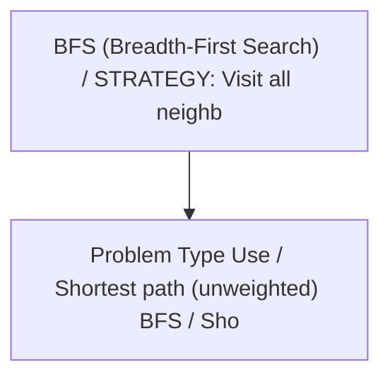
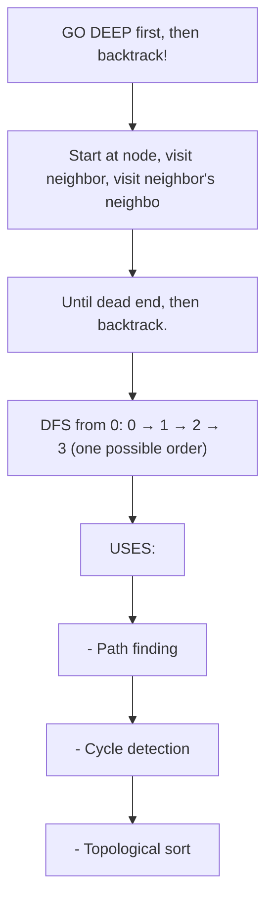
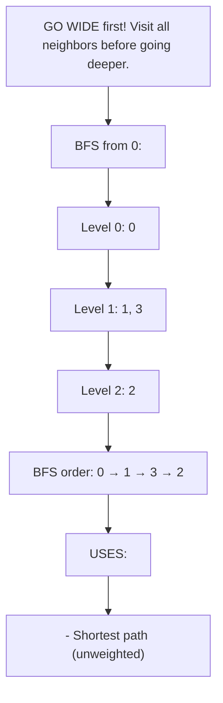
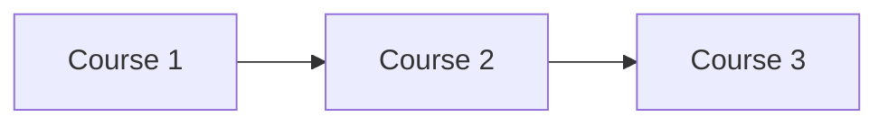

**Navigation**: [< Previous Chapter](05b_Graphs_Internals.md) | [Back to Index](../00_MASTER_INDEX.md) | [Next Chapter >](05d_Graphs_Advanced_Algos.md)
🧠 **Mental Model**: See [Graph & Tree Thinking](../14_Mental_Models/03_Graph_Tree_Thinking.md) — BFS/DFS decision framework and cycle detection

---

## 🔗 JIT Connection — When You Need This

**Arrived here from a graph or tree problem? Use this decision table:**


| Problem Signal | Algorithm to use | Time Complexity |
|---|---|---|
| Shortest path, unweighted | **BFS** (level-by-level) | O(V+E) |
| Shortest path, weighted (+ve) | **Dijkstra** (min-heap) | O((V+E) log V) |
| Detect cycle in directed graph | **DFS** (WHITE/GRAY/BLACK) | O(V+E) |
| Topological sort (prerequisites) | **Kahn's BFS** or DFS postorder | O(V+E) |
| Find all islands / components | **DFS or BFS** from each unvisited | O(V+E) |
| Minimum spanning tree | **Kruskal** (sort edges) or **Prim** | O(E log E) |


**BFS vs DFS in one line:**
```
BFS = "Shortest path / minimum steps"    → Queue  → O(V+E)
DFS = "Exists? / Cycles / Components"   → Stack/Recursion → O(V+E)
```

🔗 **Jump to practice:** [Graphs PS](../05_Problem_Solving/10_Graphs.md) | [Trees PS](../05_Problem_Solving/09_Trees.md)
📋 **All Patterns Hub:** [00_PATTERN_MASTER_GUIDE.md](../04_Patterns_Templates/00_PATTERN_MASTER_GUIDE.md)

---

# 🕸️ Part 5: Graph Fundamentals

## Complete Understanding of Graphs

```
╔══════════════════════════════════════════════════════════════════════════════╗
║                    GRAPHS - COMPLETE UNDERSTANDING                           ║
╚══════════════════════════════════════════════════════════════════════════════╝

┌──────────────────────────────────────────────────────────────────────────────┐
│ WHAT IS A GRAPH?                                                             │
├──────────────────────────────────────────────────────────────────────────────┤
│ A graph G = (V, E) consists of:                                              │
│ • V = Set of VERTICES (nodes)                                                │
│ • E = Set of EDGES (connections between vertices)                            │
│                                                                              │
│ Unlike trees, graphs can have:                                               │
│ • CYCLES (paths that return to starting point)                               │
│ • Multiple paths between any two nodes                                       │
│ • Disconnected components                                                    │
│                                                                              │
│ HISTORY: Graph theory started with Euler's "Seven Bridges of Königsberg"     │
│ problem in 1736 - can you cross all bridges exactly once?                    │
└──────────────────────────────────────────────────────────────────────────────┘

┌──────────────────────────────────────────────────────────────────────────────┐
│ WHAT PROBLEMS DO GRAPHS SOLVE?                                               │
├──────────────────────────────────────────────────────────────────────────────┤
│ CORE PROBLEM: Modeling RELATIONSHIPS between entities                        │
│                                                                              │
│ REAL-WORLD EXAMPLES:                                                         │
│ • Social Networks: People = nodes, Friendships = edges                       │
│   "Find friends of friends" = BFS from a person                              │
│                                                                              │
│ • Navigation/Maps: Intersections = nodes, Roads = edges                      │
│   "Shortest route" = Dijkstra's algorithm                                    │
│                                                                              │
│ • Internet: Routers = nodes, Connections = edges                             │
│   "Best path for data" = Routing algorithms                                  │
│                                                                              │
│ • Dependencies: Tasks = nodes, Prerequisites = edges                         │
│   "Order to complete tasks" = Topological sort                               │
│                                                                              │
│ • Games: Game states = nodes, Moves = edges                                  │
│   "Can we win?" = Graph search                                               │
│                                                                              │
│ • Molecular structures: Atoms = nodes, Bonds = edges                         │
└──────────────────────────────────────────────────────────────────────────────┘

┌──────────────────────────────────────────────────────────────────────────────┐
│ WHY GRAPHS INSTEAD OF OTHER DATA STRUCTURES?                                 │
├──────────────────────────────────────────────────────────────────────────────┤
│                                                                              │
│ ┌────────────────────────┬───────────────────────────────────────────────┐   │
│ │ Structure              │ Relationship Type                             │   │
│ ├────────────────────────┼───────────────────────────────────────────────┤   │
│ │ Array                  │ Sequential, by position                       │   │
│ │ Tree                   │ Hierarchical, parent-child                    │   │
│ │ Graph                  │ ANY relationship! ⭐ Most flexible           │     │
│ └────────────────────────┴───────────────────────────────────────────────┘   │
│                                                                              │
│ Trees are actually SPECIAL CASES of graphs (connected, acyclic)!             │
│                                                                              │
│ USE GRAPH WHEN:                                                              │
│ • Relationships aren't hierarchical (peer-to-peer, many-to-many)             │
│ • Cycles are possible (road networks, social connections)                    │
│ • Need to model complex dependencies                                         │
│ • Multiple paths between entities exist                                      │
└──────────────────────────────────────────────────────────────────────────────┘

┌──────────────────────────────────────────────────────────────────────────────┐
│ WHEN TO USE WHICH REPRESENTATION?                                            │
├──────────────────────────────────────────────────────────────────────────────┤
│                                                                              │
│ ADJACENCY LIST:                                                              │
│ ┌───────────────────────────────────────────────────────────────┐            │
│ │ USE WHEN: Sparse graph (E << V²)                              │            │
│ │ Space: O(V + E)                                               │            │
│ │ Check edge exists: O(degree)                                  │            │
│ │ Iterate neighbors: O(degree) ✅ FAST                          │             │
│ │ BEST FOR: Most real-world graphs (social networks, roads)     │            │
│ └───────────────────────────────────────────────────────────────┘            │
│                                                                              │
│ ADJACENCY MATRIX:                                                            │
│ ┌───────────────────────────────────────────────────────────────┐            │
│ │ USE WHEN: Dense graph (E ≈ V²) or need O(1) edge lookup       │            │
│ │ Space: O(V²)                                                  │            │
│ │ Check edge exists: O(1) ✅ FAST                               │             │
│ │ Iterate neighbors: O(V)                                       │            │
│ │ BEST FOR: Small dense graphs, weighted graphs, Floyd-Warshall │            │
│ └───────────────────────────────────────────────────────────────┘            │
│                                                                              │
│ RULE OF THUMB: Use adjacency LIST unless you have specific reason not to!    │
└──────────────────────────────────────────────────────────────────────────────┘

┌──────────────────────────────────────────────────────────────────────────────┐
│ DIFFICULTIES & COMMON MISTAKES                                               │
├──────────────────────────────────────────────────────────────────────────────┤
│ 1. INFINITE LOOPS (Forgetting visited check):                                │
│    Graphs have cycles! ALWAYS track visited nodes.                           │
│    Solution: boolean[] visited or Set<Integer> visited                       │
│                                                                              │
│ 2. DIRECTED VS UNDIRECTED CONFUSION:                                         │
│    Undirected: Add edge both ways (A→B AND B→A)                              │
│    Directed: Add edge one way only                                           │
│                                                                              │
│ 3. 0-INDEXED VS 1-INDEXED:                                                   │
│    Problem gives "1 to N" nodes but array is 0-indexed                       │
│    Solution: Either use size N+1 or subtract 1 from all indices              │
│                                                                              │
│ 4. DISCONNECTED COMPONENTS:                                                  │
│    Single DFS/BFS won't visit all nodes if graph disconnected!               │
│    Solution: Loop through all nodes, start new traversal if unvisited        │
│                                                                              │
│ 5. NOT HANDLING WEIGHTS:                                                     │
│    BFS gives shortest path in UNWEIGHTED graphs only                         │
│    For weighted: Use Dijkstra (non-negative) or Bellman-Ford                 │
└──────────────────────────────────────────────────────────────────────────────┘

┌──────────────────────────────────────────────────────────────────────────────┐
│ EXPECTED OUTPUTS & COMPLEXITY                                                │
├──────────────────────────────────────────────────────────────────────────────┤
│                                                                              │
│ TRAVERSAL COMPLEXITY (V = vertices, E = edges):                              │
│ • DFS: O(V + E) time, O(V) space (visited + stack)                           │
│ • BFS: O(V + E) time, O(V) space (visited + queue)                           │
│                                                                              │
│ COMMON ALGORITHM COMPLEXITIES:                                               │
│ ┌────────────────────────────┬──────────────────────┬────────────────────┐   │
│ │ Algorithm                  │ Time                 │ Space              │   │
│ ├────────────────────────────┼──────────────────────┼────────────────────┤   │
│ │ DFS/BFS                    │ O(V + E)             │ O(V)               │   │
│ │ Dijkstra (binary heap)     │ O((V+E) log V)       │ O(V)               │   │
│ │ Bellman-Ford               │ O(V × E)             │ O(V)               │   │
│ │ Floyd-Warshall             │ O(V³)                │ O(V²)              │   │
│ │ Topological Sort           │ O(V + E)             │ O(V)               │   │
│ │ Kruskal's MST              │ O(E log E)           │ O(V)               │   │
│ │ Prim's MST                 │ O((V+E) log V)       │ O(V)               │   │
│ │ Cycle Detection            │ O(V + E)             │ O(V)               │   │
│ └────────────────────────────┴──────────────────────┴────────────────────┘   │
│                                                                              │
│ TYPICAL OUTPUTS:                                                             │
│ • Path finding: List of nodes from source to destination                     │
│ • Shortest path: Distance value or path + distance                           │
│ • Cycle detection: Boolean (exists?) or List (the cycle)                     │
│ • Topological sort: Ordered list of all vertices                             │
│ • Connected components: Number of components or list of component nodes      │
└──────────────────────────────────────────────────────────────────────────────┘
```

🔬 **Section Challenge — Complete Understanding of Graphs**

**Challenge 1 (Reasoning):** BFS finds shortest path in unweighted graphs but not in weighted graphs. Why exactly?
<details><summary>Answer</summary>

BFS explores by 'hop count' (number of edges). Each level = one more edge away from source. All edges are treated as weight=1. In a weighted graph, the 'shortest by hop count' path may not be 'shortest by weight sum'. Example: A→B (weight 1, 1 hop) vs A→C→B (weight 0.1+0.1=0.2, 2 hops). BFS finds A→B (1 hop), Dijkstra finds A→C→B (lower total weight). BFS is optimal ONLY when all edges have equal weight.
</details>

**Challenge 2 (Design):** Detect if a directed graph has a cycle. Write the algorithm and explain why we need 3 states (not 2).
<details><summary>Answer</summary>

3 states: UNVISITED, IN_PROGRESS (currently in DFS path), DONE. DFS: mark node IN_PROGRESS before visiting neighbors. If we reach an IN_PROGRESS node → cycle found. Mark DONE when all neighbors processed. Why 3 states: with 2 (visited/unvisited), we'd get false positives — reaching a VISITED node that was processed in a DIFFERENT DFS subtree is not a cycle. IN_PROGRESS specifically marks nodes in the CURRENT DFS path (potential back edge).
</details>


## Graph Representations

```
ADJACENCY LIST (Preferred for sparse graphs):

Graph:
    0 --- 1
    |     |
    3 --- 2

List representation:
0: [1, 3]
1: [0, 2]
2: [1, 3]
3: [0, 2]

Code:
List<List<Integer>> graph = new ArrayList<>();
// Add neighbors for each node
graph.get(0).add(1);  // Edge 0-1
graph.get(0).add(3);  // Edge 0-3
...

ADJACENCY MATRIX (For dense graphs):

    0  1  2  3
0 [ 0  1  0  1 ]
1 [ 1  0  1  0 ]
2 [ 0  1  0  1 ]
3 [ 1  0  1  0 ]

1 = edge exists, 0 = no edge
```

🔬 **Section Challenge — Graph Representations**

**Challenge 1 (Reasoning):** BFS finds shortest path in unweighted graphs but not in weighted graphs. Why exactly?
<details><summary>Answer</summary>

BFS explores by 'hop count' (number of edges). Each level = one more edge away from source. All edges are treated as weight=1. In a weighted graph, the 'shortest by hop count' path may not be 'shortest by weight sum'. Example: A→B (weight 1, 1 hop) vs A→C→B (weight 0.1+0.1=0.2, 2 hops). BFS finds A→B (1 hop), Dijkstra finds A→C→B (lower total weight). BFS is optimal ONLY when all edges have equal weight.
</details>

**Challenge 2 (Design):** Detect if a directed graph has a cycle. Write the algorithm and explain why we need 3 states (not 2).
<details><summary>Answer</summary>

3 states: UNVISITED, IN_PROGRESS (currently in DFS path), DONE. DFS: mark node IN_PROGRESS before visiting neighbors. If we reach an IN_PROGRESS node → cycle found. Mark DONE when all neighbors processed. Why 3 states: with 2 (visited/unvisited), we'd get false positives — reaching a VISITED node that was processed in a DIFFERENT DFS subtree is not a cycle. IN_PROGRESS specifically marks nodes in the CURRENT DFS path (potential back edge).
</details>


## Graph Types

```
UNDIRECTED: Edges have no direction (friendship)
DIRECTED: Edges have direction (following on Twitter)
WEIGHTED: Edges have values (road distances)
UNWEIGHTED: All edges equal
CYCLIC: Contains cycles
ACYCLIC: No cycles (DAG = Directed Acyclic Graph)
CONNECTED: All nodes reachable from any node
```

---

🔬 **Section Challenge — Graph Types**

**Challenge 1 (Reasoning):** BFS finds shortest path in unweighted graphs but not in weighted graphs. Why exactly?
<details><summary>Answer</summary>

BFS explores by 'hop count' (number of edges). Each level = one more edge away from source. All edges are treated as weight=1. In a weighted graph, the 'shortest by hop count' path may not be 'shortest by weight sum'. Example: A→B (weight 1, 1 hop) vs A→C→B (weight 0.1+0.1=0.2, 2 hops). BFS finds A→B (1 hop), Dijkstra finds A→C→B (lower total weight). BFS is optimal ONLY when all edges have equal weight.
</details>

**Challenge 2 (Design):** Detect if a directed graph has a cycle. Write the algorithm and explain why we need 3 states (not 2).
<details><summary>Answer</summary>

3 states: UNVISITED, IN_PROGRESS (currently in DFS path), DONE. DFS: mark node IN_PROGRESS before visiting neighbors. If we reach an IN_PROGRESS node → cycle found. Mark DONE when all neighbors processed. Why 3 states: with 2 (visited/unvisited), we'd get false positives — reaching a VISITED node that was processed in a DIFFERENT DFS subtree is not a cycle. IN_PROGRESS specifically marks nodes in the CURRENT DFS path (potential back edge).
</details>


# 🕸️ Part 6: Graph Traversals

## DFS vs BFS - When to Use Which

```
╔══════════════════════════════════════════════════════════════════════════════╗
║                    DFS vs BFS - COMPLETE COMPARISON                          ║
╚══════════════════════════════════════════════════════════════════════════════╝

┌──────────────────────────────────────────────────────────────────────────────┐
│ DFS (Depth-First Search)                                                     │
├──────────────────────────────────────────────────────────────────────────────┤
│ STRATEGY: Go as DEEP as possible first, then backtrack                       │
│                                                                              │
│ USE DFS WHEN:                                                                │
│ • Finding ANY path (not necessarily shortest)                                │
│ • Detecting cycles                                                           │
│ • Topological sorting (DAG)                                                  │
│ • Finding connected components                                               │
│ • Solving mazes/puzzles (explore all options)                                │
│ • Problem requires backtracking                                              │
│ • Tree problems (most tree traversals are DFS)                               │
│                                                                              │
│ IMPLEMENTATION: Stack (explicit or recursion call stack)                     │
└──────────────────────────────────────────────────────────────────────────────┘

┌──────────────────────────────────────────────────────────────────────────────┐
│ BFS (Breadth-First Search)                                                   │
├──────────────────────────────────────────────────────────────────────────────┤
│ STRATEGY: Visit all neighbors at current level before going deeper           │
│                                                                              │
│ USE BFS WHEN:                                                                │
│ • Finding SHORTEST path in unweighted graph ⭐                                │
│ • Level-order traversal needed                                               │
│ • Finding nodes at distance k                                                │
│ • "Minimum steps/moves" problems                                             │
│ • Spreading/flooding problems (infection, fire)                              │
│ • Finding nearest X                                                          │
│                                                                              │
│ IMPLEMENTATION: Queue (FIFO)                                                 │
└──────────────────────────────────────────────────────────────────────────────┘

┌──────────────────────────────────────────────────────────────────────────────┐
│ QUICK DECISION TABLE                                                         │
├──────────────────────────────────────────────────────────────────────────────┤
│ ┌─────────────────────────────────────┬───────────────────────────────────┐  │
│ │ Problem Type                        │ Use                               │  │
│ ├─────────────────────────────────────┼───────────────────────────────────┤  │
│ │ Shortest path (unweighted)          │ BFS                               │  │
│ │ Shortest path (weighted)            │ Dijkstra/Bellman-Ford             │  │
│ │ Any path exists?                    │ DFS (simpler) or BFS              │  │
│ │ All paths                           │ DFS with backtracking             │  │
│ │ Cycle detection                     │ DFS                               │  │
│ │ Topological sort                    │ DFS (or Kahn's BFS)               │  │
│ │ Connected components                │ DFS or BFS                        │  │
│ │ Level/distance from source          │ BFS                               │  │
│ │ Island counting                     │ DFS or BFS                        │  │
│ │ Word ladder (transformation)        │ BFS                               │  │
│ └─────────────────────────────────────┴───────────────────────────────────┘  │
└──────────────────────────────────────────────────────────────────────────────┘
```

**Flow:**
1. BFS (Breadth-First Search) / STRATEGY: Visit all neighb
2. Problem Type Use / Shortest path (unweighted) BFS / Sho



## DFS (Depth-First Search)

```
GO DEEP first, then backtrack!

Start at node, visit neighbor, visit neighbor's neighbor...
Until dead end, then backtrack.

    0 --- 1
    |     |
    3 --- 2

DFS from 0: 0 → 1 → 2 → 3 (one possible order)

USES:
- Path finding
- Cycle detection
- Topological sort
- Connected components
```

**Flow:**
1. GO DEEP first, then backtrack!
2. Start at node, visit neighbor, visit neighbor's neighbo Until dead end, then backtrack. DFS from 0: 0 1 2 3 (one possible order) DFS from 0: 0 1 2 3 (one possible order) USES: - Path finding - Cycle detection



```java
// RECURSIVE DFS
public void dfs(int node, List<List<Integer>> graph, boolean[] visited) {
    visited[node] = true;
    System.out.print(node + " ");

    for (int neighbor : graph.get(node)) {
        if (!visited[neighbor]) {
            dfs(neighbor, graph, visited);
        }
    }
}

// ITERATIVE DFS (using stack)
public void dfsIterative(int start, List<List<Integer>> graph) {
    boolean[] visited = new boolean[graph.size()];
    Stack<Integer> stack = new Stack<>();

    stack.push(start);

    while (!stack.isEmpty()) {
        int node = stack.pop();

        if (!visited[node]) {
            visited[node] = true;
            System.out.print(node + " ");

            for (int neighbor : graph.get(node)) {
                if (!visited[neighbor]) {
                    stack.push(neighbor);
                }
            }
        }
    }
}

// TIME: O(V + E) where V = vertices, E = edges
// SPACE: O(V) for visited array and stack/recursion
```

🔬 **Section Challenge — DFS (Depth-First Search)**

**Challenge 1 (Reasoning):** Binary search on `[1,3,5,7,9]` with `target=6`. Trace `lo`, `hi`, `mid` at each step and explain the final state.
<details><summary>Answer</summary>

lo=0,hi=4 → mid=2(val=5): 5<6 → lo=3. lo=3,hi=4 → mid=3(val=7): 7>6 → hi=2. lo(3)>hi(2): loop ends, return -1 (not found). Key insight: lo overtakes hi — this is the standard termination condition. `lo` ends at the insertion point where 6 would go.
</details>

**Challenge 2 (Design):** Binary search on a rotated array `[4,5,6,7,0,1,2]`. How do you determine which half is sorted?
<details><summary>Answer</summary>

Compare `nums[lo]` and `nums[mid]`. If `nums[lo] <= nums[mid]`: left half is sorted. Check if target is in `[nums[lo], nums[mid])` — if yes, search left; else search right. Otherwise right half is sorted. Check if target is in `(nums[mid], nums[hi]]` — if yes, search right; else search left. This always works because at least one half of a rotated sorted array is always sorted.
</details>


## BFS (Breadth-First Search)

```
GO WIDE first! Visit all neighbors before going deeper.

    0 --- 1
    |     |
    3 --- 2

BFS from 0:
Level 0: 0
Level 1: 1, 3
Level 2: 2

BFS order: 0 → 1 → 3 → 2

USES:
- Shortest path (unweighted)
- Level-order traversal
- Finding nearest neighbor
```

**Flow:**
1. GO WIDE first! Visit all neighbors before going deeper.
2. BFS from 0:
3. Level 0: 0
4. Level 1: 1, 3
5. Level 2: 2
6. BFS order: 0 1 3 2
7. USES:



```java
public void bfs(int start, List<List<Integer>> graph) {
    boolean[] visited = new boolean[graph.size()];
    Queue<Integer> queue = new LinkedList<>();

    visited[start] = true;
    queue.offer(start);

    while (!queue.isEmpty()) {
        int node = queue.poll();
        System.out.print(node + " ");

        for (int neighbor : graph.get(node)) {
            if (!visited[neighbor]) {
                visited[neighbor] = true;
                queue.offer(neighbor);
            }
        }
    }
}

// SHORTEST PATH (unweighted graph)
public int shortestPath(int start, int end, List<List<Integer>> graph) {
    boolean[] visited = new boolean[graph.size()];
    Queue<int[]> queue = new LinkedList<>();  // [node, distance]

    visited[start] = true;
    queue.offer(new int[]{start, 0});

    while (!queue.isEmpty()) {
        int[] curr = queue.poll();
        int node = curr[0], dist = curr[1];

        if (node == end) return dist;

        for (int neighbor : graph.get(node)) {
            if (!visited[neighbor]) {
                visited[neighbor] = true;
                queue.offer(new int[]{neighbor, dist + 1});
            }
        }
    }

    return -1;  // No path found
}
```

---

🔬 **Section Challenge — BFS (Breadth-First Search)**

**Challenge 1 (Reasoning):** Binary search on `[1,3,5,7,9]` with `target=6`. Trace `lo`, `hi`, `mid` at each step and explain the final state.
<details><summary>Answer</summary>

lo=0,hi=4 → mid=2(val=5): 5<6 → lo=3. lo=3,hi=4 → mid=3(val=7): 7>6 → hi=2. lo(3)>hi(2): loop ends, return -1 (not found). Key insight: lo overtakes hi — this is the standard termination condition. `lo` ends at the insertion point where 6 would go.
</details>

**Challenge 2 (Design):** Binary search on a rotated array `[4,5,6,7,0,1,2]`. How do you determine which half is sorted?
<details><summary>Answer</summary>

Compare `nums[lo]` and `nums[mid]`. If `nums[lo] <= nums[mid]`: left half is sorted. Check if target is in `[nums[lo], nums[mid])` — if yes, search left; else search right. Otherwise right half is sorted. Check if target is in `(nums[mid], nums[hi]]` — if yes, search right; else search left. This always works because at least one half of a rotated sorted array is always sorted.
</details>


# 📌 Part 7: Cycle Detection

## In Undirected Graph

```java
// DFS approach
public boolean hasCycle(List<List<Integer>> graph) {
    boolean[] visited = new boolean[graph.size()];

    for (int i = 0; i < graph.size(); i++) {
        if (!visited[i]) {
            if (dfsHasCycle(i, -1, graph, visited)) {
                return true;
            }
        }
    }
    return false;
}

private boolean dfsHasCycle(int node, int parent,
                           List<List<Integer>> graph, boolean[] visited) {
    visited[node] = true;

    for (int neighbor : graph.get(node)) {
        if (!visited[neighbor]) {
            if (dfsHasCycle(neighbor, node, graph, visited)) {
                return true;
            }
        } else if (neighbor != parent) {
            // Visited neighbor that's not parent = cycle!
            return true;
        }
    }
    return false;
}
```

🔬 **Section Challenge — In Undirected Graph**

**Challenge 1 (Reasoning):** BFS finds shortest path in unweighted graphs but not in weighted graphs. Why exactly?
<details><summary>Answer</summary>

BFS explores by 'hop count' (number of edges). Each level = one more edge away from source. All edges are treated as weight=1. In a weighted graph, the 'shortest by hop count' path may not be 'shortest by weight sum'. Example: A→B (weight 1, 1 hop) vs A→C→B (weight 0.1+0.1=0.2, 2 hops). BFS finds A→B (1 hop), Dijkstra finds A→C→B (lower total weight). BFS is optimal ONLY when all edges have equal weight.
</details>

**Challenge 2 (Design):** Detect if a directed graph has a cycle. Write the algorithm and explain why we need 3 states (not 2).
<details><summary>Answer</summary>

3 states: UNVISITED, IN_PROGRESS (currently in DFS path), DONE. DFS: mark node IN_PROGRESS before visiting neighbors. If we reach an IN_PROGRESS node → cycle found. Mark DONE when all neighbors processed. Why 3 states: with 2 (visited/unvisited), we'd get false positives — reaching a VISITED node that was processed in a DIFFERENT DFS subtree is not a cycle. IN_PROGRESS specifically marks nodes in the CURRENT DFS path (potential back edge).
</details>


## In Directed Graph

```java
// Using colors: WHITE (unvisited), GRAY (in progress), BLACK (done)
public boolean hasCycleDirected(List<List<Integer>> graph) {
    int[] color = new int[graph.size()];  // 0=WHITE, 1=GRAY, 2=BLACK

    for (int i = 0; i < graph.size(); i++) {
        if (color[i] == 0) {
            if (dfsHasCycleDirected(i, graph, color)) {
                return true;
            }
        }
    }
    return false;
}

private boolean dfsHasCycleDirected(int node, List<List<Integer>> graph, int[] color) {
    color[node] = 1;  // GRAY - in progress

    for (int neighbor : graph.get(node)) {
        if (color[neighbor] == 1) {
            // Found GRAY node = back edge = cycle!
            return true;
        }
        if (color[neighbor] == 0) {
            if (dfsHasCycleDirected(neighbor, graph, color)) {
                return true;
            }
        }
    }

    color[node] = 2;  // BLACK - done
    return false;
}
```

---

🔬 **Section Challenge — In Directed Graph**

**Challenge 1 (Reasoning):** BFS finds shortest path in unweighted graphs but not in weighted graphs. Why exactly?
<details><summary>Answer</summary>

BFS explores by 'hop count' (number of edges). Each level = one more edge away from source. All edges are treated as weight=1. In a weighted graph, the 'shortest by hop count' path may not be 'shortest by weight sum'. Example: A→B (weight 1, 1 hop) vs A→C→B (weight 0.1+0.1=0.2, 2 hops). BFS finds A→B (1 hop), Dijkstra finds A→C→B (lower total weight). BFS is optimal ONLY when all edges have equal weight.
</details>

**Challenge 2 (Design):** Detect if a directed graph has a cycle. Write the algorithm and explain why we need 3 states (not 2).
<details><summary>Answer</summary>

3 states: UNVISITED, IN_PROGRESS (currently in DFS path), DONE. DFS: mark node IN_PROGRESS before visiting neighbors. If we reach an IN_PROGRESS node → cycle found. Mark DONE when all neighbors processed. Why 3 states: with 2 (visited/unvisited), we'd get false positives — reaching a VISITED node that was processed in a DIFFERENT DFS subtree is not a cycle. IN_PROGRESS specifically marks nodes in the CURRENT DFS path (potential back edge).
</details>


# 🔄 Part 8: Topological Sort

```
ORDER TASKS RESPECTING DEPENDENCIES
Only for DAGs (Directed Acyclic Graphs)

Example: Course prerequisites
Course 1 → Course 2 → Course 3
       ↘    Course 4 ↗

Valid orders: [1, 2, 4, 3] or [1, 4, 2, 3]
```

**Flow:**
1. Course 1
2. Course 2
3. Course 3



```java
// Kahn's Algorithm (BFS approach)
public List<Integer> topologicalSort(int numCourses, int[][] prerequisites) {
    // Build graph and calculate in-degrees
    List<List<Integer>> graph = new ArrayList<>();
    int[] inDegree = new int[numCourses];

    for (int i = 0; i < numCourses; i++) {
        graph.add(new ArrayList<>());
    }

    for (int[] pre : prerequisites) {
        graph.get(pre[1]).add(pre[0]);  // pre[1] → pre[0]
        inDegree[pre[0]]++;
    }

    // Add nodes with in-degree 0 to queue
    Queue<Integer> queue = new LinkedList<>();
    for (int i = 0; i < numCourses; i++) {
        if (inDegree[i] == 0) {
            queue.offer(i);
        }
    }

    List<Integer> result = new ArrayList<>();

    while (!queue.isEmpty()) {
        int node = queue.poll();
        result.add(node);

        for (int neighbor : graph.get(node)) {
            inDegree[neighbor]--;
            if (inDegree[neighbor] == 0) {
                queue.offer(neighbor);
            }
        }
    }

    // If result doesn't contain all nodes, there's a cycle
    return result.size() == numCourses ? result : new ArrayList<>();
}
```

---

# 📌 Part 9: Shortest Path Algorithms

## Dijkstra's Algorithm

```
SHORTEST PATH from source to all nodes (weighted, non-negative)

IDEA: Greedy approach
- Start with source distance = 0, all others = infinity
- Always process the closest unvisited node
- Update distances through this node

    (0)---4---(1)
     |         |
     2         1
     |         |
    (2)---3---(3)

From node 0:
- dist[0] = 0, dist[1] = ∞, dist[2] = ∞, dist[3] = ∞
- Process 0: dist[1] = 4, dist[2] = 2
- Process 2 (closest): dist[3] = 2 + 3 = 5
- Process 1: dist[3] = min(5, 4+1) = 5
- Process 3: done

Final: dist = [0, 4, 2, 5]
```

```java
public int[] dijkstra(int n, List<int[]>[] graph, int source) {
    int[] dist = new int[n];
    Arrays.fill(dist, Integer.MAX_VALUE);
    dist[source] = 0;

    // Priority queue: [distance, node]
    PriorityQueue<int[]> pq = new PriorityQueue<>((a, b) -> a[0] - b[0]);
    pq.offer(new int[]{0, source});

    while (!pq.isEmpty()) {
        int[] curr = pq.poll();
        int d = curr[0], node = curr[1];

        if (d > dist[node]) continue;  // Skip if outdated

        for (int[] edge : graph[node]) {
            int neighbor = edge[0], weight = edge[1];
            int newDist = dist[node] + weight;

            if (newDist < dist[neighbor]) {
                dist[neighbor] = newDist;
                pq.offer(new int[]{newDist, neighbor});
            }
        }
    }

    return dist;
}

// TIME: O((V + E) log V) with priority queue
// SPACE: O(V)
```

---

# 💪 Part 10: Practice Problems

## Trees

```
EASY:
1. Maximum depth of binary tree
2. Invert binary tree
3. Same tree
4. Symmetric tree

MEDIUM:
1. Validate BST
2. Lowest common ancestor
3. Binary tree level order traversal
4. Construct binary tree from preorder/inorder

HARD:
1. Binary tree maximum path sum
2. Serialize and deserialize binary tree
```

## Graphs

```
EASY:
1. Find if path exists in graph
2. Find center of star graph

MEDIUM:
1. Number of islands (grid as graph)
2. Clone graph
3. Course schedule (topological sort)
4. Pacific Atlantic water flow

HARD:
1. Word ladder
2. Alien dictionary
3. Shortest path in binary matrix
```

---

---

---

🔬 **Section Challenge — Graphs**

**Challenge 1 (Reasoning):** BFS finds shortest path in unweighted graphs but not in weighted graphs. Why exactly?
<details><summary>Answer</summary>

BFS explores by 'hop count' (number of edges). Each level = one more edge away from source. All edges are treated as weight=1. In a weighted graph, the 'shortest by hop count' path may not be 'shortest by weight sum'. Example: A→B (weight 1, 1 hop) vs A→C→B (weight 0.1+0.1=0.2, 2 hops). BFS finds A→B (1 hop), Dijkstra finds A→C→B (lower total weight). BFS is optimal ONLY when all edges have equal weight.
</details>

**Challenge 2 (Design):** Detect if a directed graph has a cycle. Write the algorithm and explain why we need 3 states (not 2).
<details><summary>Answer</summary>

3 states: UNVISITED, IN_PROGRESS (currently in DFS path), DONE. DFS: mark node IN_PROGRESS before visiting neighbors. If we reach an IN_PROGRESS node → cycle found. Mark DONE when all neighbors processed. Why 3 states: with 2 (visited/unvisited), we'd get false positives — reaching a VISITED node that was processed in a DIFFERENT DFS subtree is not a cycle. IN_PROGRESS specifically marks nodes in the CURRENT DFS path (potential back edge).
</details>


## 🏋️ Practice & Interview Questions — Algorithms

### Sorting

**Q1.** Which sorting algorithm does Java use for `Arrays.sort(int[])`? Why not MergeSort?
<details><summary>Answer</summary>

**Dual-Pivot QuickSort** — for primitives. MergeSort requires O(N) extra space. QuickSort is in-place and cache-friendly. Stability doesn't matter for primitives (equal ints are indistinguishable). For objects (`Arrays.sort(Object[])`), Java uses **TimSort** (stable, O(N log N) worst).
</details>

**Q2.** Trace Merge Sort on `[4,2,7,1]`.
<details><summary>Answer</summary>

Split: `[4,2]` `[7,1]` → Split: `[4]` `[2]` `[7]` `[1]` → Merge: `[2,4]` `[1,7]` → Merge: `[1,2,4,7]`
</details>

**Q3.** ⭐⭐ Sort Colors (Dutch National Flag — 3-way partition).
<details><summary>Solution</summary>

```java
int lo=0, mid=0, hi=n-1;
while(mid<=hi){
    if(nums[mid]==0) swap(nums,lo++,mid++);
    else if(nums[mid]==1) mid++;
    else swap(nums,mid,hi--);
}
```
</details>

### Binary Search

**Q4.** ⭐ Search in Rotated Sorted Array.
<details><summary>Solution</summary>

```java
int lo=0, hi=n-1;
while(lo<=hi){
    int mid=(lo+hi)/2;
    if(nums[mid]==target) return mid;
    if(nums[lo]<=nums[mid]){ // left half sorted
        if(nums[lo]<=target&&target<nums[mid]) hi=mid-1; else lo=mid+1;
    } else { // right half sorted
        if(nums[mid]<target&&target<=nums[hi]) lo=mid+1; else hi=mid-1;
    }
}
return -1;
```
</details>

**Q5.** ⭐ Find First and Last Position (binary search twice).
<details><summary>Solution</summary>

```java
// First: find leftmost with while(lo<hi){ if arr[mid]>=target hi=mid else lo=mid+1 }
// Last: find rightmost with while(lo<hi){ if arr[mid]<=target lo=mid+1 else hi=mid } return lo-1
```
</details>

**Q6.** ⭐⭐ Koko Eating Bananas — binary search on answer.
<details><summary>Key insight</summary>

Binary search the eating speed k in range [1, max(piles)]. For each k, calculate hours needed. Find minimum k where hours ≤ H.
</details>

### Dynamic Programming

**Q7.** ⭐ Climbing Stairs — n steps, 1 or 2 at a time. How many ways?
<details><summary>Solution</summary>

```java
// Fibonacci sequence! dp[i] = dp[i-1] + dp[i-2]
int a=1, b=1;
for(int i=2;i<=n;i++){ int c=a+b; a=b; b=c; }
return b;
```
</details>

**Q8.** ⭐ Coin Change — minimum coins for amount.
<details><summary>Solution</summary>

```java
int[] dp = new int[amount+1]; Arrays.fill(dp, amount+1);
dp[0]=0;
for(int i=1;i<=amount;i++)
    for(int c:coins) if(c<=i) dp[i]=Math.min(dp[i],dp[i-c]+1);
return dp[amount]>amount?-1:dp[amount];
```
</details>

**Q9.** ⭐⭐ Longest Common Subsequence.
<details><summary>Solution</summary>

```java
int[][] dp=new int[m+1][n+1];
for(int i=1;i<=m;i++) for(int j=1;j<=n;j++){
    if(text1.charAt(i-1)==text2.charAt(j-1)) dp[i][j]=dp[i-1][j-1]+1;
    else dp[i][j]=Math.max(dp[i-1][j],dp[i][j-1]);
}
return dp[m][n];
```
</details>

**Q10.** ⭐⭐ Word Break — can string be segmented using dictionary words?
<details><summary>Solution</summary>

```java
boolean[] dp=new boolean[n+1]; dp[0]=true;
for(int i=1;i<=n;i++) for(String w:wordDict)
    if(i>=w.length()&&dp[i-w.length()]&&s.substring(i-w.length(),i).equals(w)) dp[i]=true;
return dp[n];
```
</details>

**Q11.** ⭐⭐⭐ Edit Distance (Levenshtein).
<details><summary>Solution</summary>

```java
int[][] dp=new int[m+1][n+1];
for(int i=0;i<=m;i++) dp[i][0]=i;
for(int j=0;j<=n;j++) dp[0][j]=j;
for(int i=1;i<=m;i++) for(int j=1;j<=n;j++){
    if(word1.charAt(i-1)==word2.charAt(j-1)) dp[i][j]=dp[i-1][j-1];
    else dp[i][j]=1+Math.min(dp[i-1][j-1],Math.min(dp[i-1][j],dp[i][j-1]));
}
```
</details>

### Graph Algorithms

**Q12.** ⭐ Number of Islands (BFS/DFS grid traversal).
<details><summary>Solution</summary>

```java
for each cell (i,j) if grid[i][j]=='1': count++; BFS/DFS to mark all connected land as visited
```
</details>

**Q13.** ⭐⭐ Course Schedule — detect cycle in directed graph (Topological sort).
<details><summary>Solution</summary>

```java
// Kahn's algorithm: indegree array + BFS queue
// If result size == numCourses → no cycle → can finish
```
</details>

**Q14.** ⭐⭐ Dijkstra's Shortest Path.
<details><summary>Solution</summary>

```java
PriorityQueue<int[]> pq=new PriorityQueue<>((a,b)->a[1]-b[1]); // [node, dist]
pq.offer(new int[]{src,0}); dist[src]=0;
while(!pq.isEmpty()){
    int[] curr=pq.poll(); int u=curr[0],d=curr[1];
    if(d>dist[u]) continue; // stale
    for(int[] neighbor:graph[u]) if(dist[u]+neighbor[1]<dist[neighbor[0]]){
        dist[neighbor[0]]=dist[u]+neighbor[1]; pq.offer(new int[]{neighbor[0],dist[neighbor[0]]});
    }
}
```
</details>

### MCQ Rapid Fire

| # | Question | Answer |
|---|---|---|
| 1 | QuickSort avg/worst | O(N log N) avg, O(N²) worst |
| 2 | MergeSort space complexity | O(N) |
| 3 | HeapSort space complexity | O(1) (in-place) |
| 4 | Binary search precondition | Sorted array |
| 5 | BFS time complexity on graph | O(V+E) |
| 6 | DFS space complexity | O(V) (recursion stack) |
| 7 | Dijkstra fails on | Negative weight edges |
| 8 | Bellman-Ford handles | Negative weights, detects negative cycles |
| 9 | Floyd-Warshall use case | All-pairs shortest path, O(V³) |
| 10 | Topological sort requires | Directed Acyclic Graph (DAG) |

---

## 🧠 Deep Conceptual Questions — Algorithm Design & Analysis

**C1. What does O(N log N) "feel like" and why is it the complexity barrier for comparison-based sorting?**
<details><summary>Deep Answer</summary>

O(N log N) for N=1M ≈ 20M operations. O(N²) ≈ 1 trillion. The difference is 50,000x. **Comparison sort lower bound**: any comparison-based sort must distinguish between N! possible orderings. Each comparison has 2 outcomes. A decision tree with N! leaves needs ≥ log₂(N!) height ≈ N log N (Stirling's approximation). Therefore NO comparison sort can beat O(N log N) in the worst case. Non-comparison sorts (counting sort, radix sort, bucket sort) break this bound by using non-comparison operations — but require constraints on input (e.g., integer range bounded by N).
</details>

**C2. Greedy algorithms: when do they work and what must be proven?**
<details><summary>Deep Answer</summary>

A greedy algorithm makes the locally optimal choice at each step. Works when problem has: (1) **Greedy choice property**: local optimal leads to global optimal — the choice never needs to be revised. (2) **Optimal substructure**: optimal solution to the problem contains optimal solutions to subproblems. To PROVE greedy is correct: use "exchange argument" — assume optimal solution differs from greedy, show you can swap greedy's choice in without making it worse, contradiction. Greedy FAILS when: future choices depend on current choice in complex ways (use DP instead). Classic works: interval scheduling, Huffman coding, Dijkstra. Classic fails: 0-1 knapsack (use DP).
</details>

**C3. Dynamic Programming: what is "overlapping subproblems" and why does it matter?**
<details><summary>Deep Answer</summary>

Overlapping subproblems: the same sub-computation appears multiple times. Fibonacci: `fib(5)` calls `fib(4)` and `fib(3)`. `fib(4)` also calls `fib(3)`. Without memoization: `fib(3)` computed exponentially many times → O(2^N). With memoization: each sub-result computed once and stored → O(N). DP is valuable SPECIFICALLY when: (1) problem has optimal substructure AND (2) subproblems overlap. If no overlap: just use divide-and-conquer (merge sort's subproblems don't overlap → no DP needed). DP = "smart recursion" = avoid recomputing.
</details>

**C4. Top-down (memoization) vs Bottom-up (tabulation) DP — when to choose each?**
<details><summary>Deep Answer</summary>

**Top-down (memoization)**: Write natural recursion + cache results. Easy to implement, only computes needed subproblems (sparse computation). Cons: recursion overhead and stack depth risk. Use when: problem is naturally recursive, only a fraction of subproblems needed. **Bottom-up (tabulation)**: Fill DP table iteratively from base cases. No recursion overhead, better cache performance, easier space optimization. Use when: need all subproblems (or most of them), want to optimize space (can often reduce to 1D from 2D). Rule: start with top-down for correctness verification, optimize to bottom-up for performance.
</details>

**C5. Dijkstra's Algorithm: why does it fail on negative weights?**
<details><summary>Deep Answer</summary>

Dijkstra assumes: once a node is "settled" (extracted from the priority queue with its final shortest distance), that distance is optimal. With negative weights: settling node A at distance 5 might not be final — a path through B (distance 7) → C (edge -10) → A gives distance -3. But A was already settled! Dijkstra doesn't revisit settled nodes. Bellman-Ford handles negatives by relaxing ALL edges N-1 times — no "settled" assumption. For graphs with negative cycles: Bellman-Ford detects them (if distances still decrease after N-1 rounds, there's a negative cycle).
</details>

**C6. Union-Find: why is path compression + union by rank/size nearly O(1)?**
<details><summary>Deep Answer</summary>

**Path compression**: when finding the root of element x, make every node on the path point directly to the root. Flattens the tree. Future finds on those paths: O(1). **Union by rank**: always attach the smaller tree under the larger → limits tree height to O(log N). Combined: inverse Ackermann function α(N) amortized — so slow-growing it's practically constant (α(10^80) = 4). Neither alone is optimal: path compression without union by rank → O(log N) amortized. Union by rank without path compression → O(log N). Together → α(N) ≈ O(1) amortized. Used in: Kruskal's MST, cycle detection, connected components.
</details>

**C7. Binary Search on the Answer — what types of problems does it apply to?**
<details><summary>Deep Answer</summary>

When the answer space is **monotone**: "if X is achievable, then all values less extreme than X are also achievable." Problems: minimize the maximum (aggressive cows, split array), find minimum valid threshold (Koko bananas, minimum days to bloom), divide-and-conquer feasibility. Template: binary search on the answer range [lo, hi], for each mid check `isFeasible(mid)` in O(N) or O(N log N). Total: O(N log(answer_range)). Key insight: reframe "find optimal value" as "find smallest X where condition holds" → enables binary search on a non-array space.
</details>

**C8. Why does merge sort guarantee stability while quicksort doesn't?**
<details><summary>Deep Answer</summary>

**Merge sort stability**: during merge, when two elements are equal, we always take from the LEFT array first → preserves original relative order. **QuickSort instability**: the partition step swaps elements across the pivot without regard to original order. Two equal elements may be placed on opposite sides of the pivot, reversing their order. QuickSort CAN be made stable (Lomuto partition with careful implementation) but loses performance. Java uses TimSort for objects (stable), dual-pivot quicksort for primitives (stability irrelevant since primitives without fields).
</details>

**C9. Backtracking: what's the difference from plain DFS and when to use vs DP?**
<details><summary>Deep Answer</summary>

**Backtracking vs DFS**: DFS visits every path. Backtracking prunes paths early when a constraint is violated — avoids exploring infeasible branches. Same asymptotic but drastically different practical performance with good pruning. **Backtracking vs DP**: backtracking for **combinatorial/enumeration** problems (find all solutions, permutations, subsets). DP for **optimization** problems (find optimal single solution). Backtracking produces exponential solutions in worst case but is necessary when you need ALL solutions. DP finds the optimal in polynomial time when overlapping subproblems exist.
</details>

**C10. What is amortized analysis and how does it differ from average-case analysis?**
<details><summary>Deep Answer</summary>

**Amortized**: analyzes the average cost per operation over a SEQUENCE of operations — in the worst case. No probability involved. Guarantees: N operations ALWAYS take O(N·T) total, even if some individual operations are O(N·T). Example: ArrayList append is O(N) when resizing, but amortized O(1) because resizing is rare. **Average-case**: analyzes expected cost of a SINGLE operation assuming random input. QuickSort is O(N log N) average-case (random pivot). Amortized is a stronger guarantee — it holds even for adversarial input sequences.
</details>

**Navigation**: [< Previous](05b_Graphs_Internals.md) | [Back to Index](../00_MASTER_INDEX.md) | [Next >](05d_Graphs_Advanced_Algos.md)
