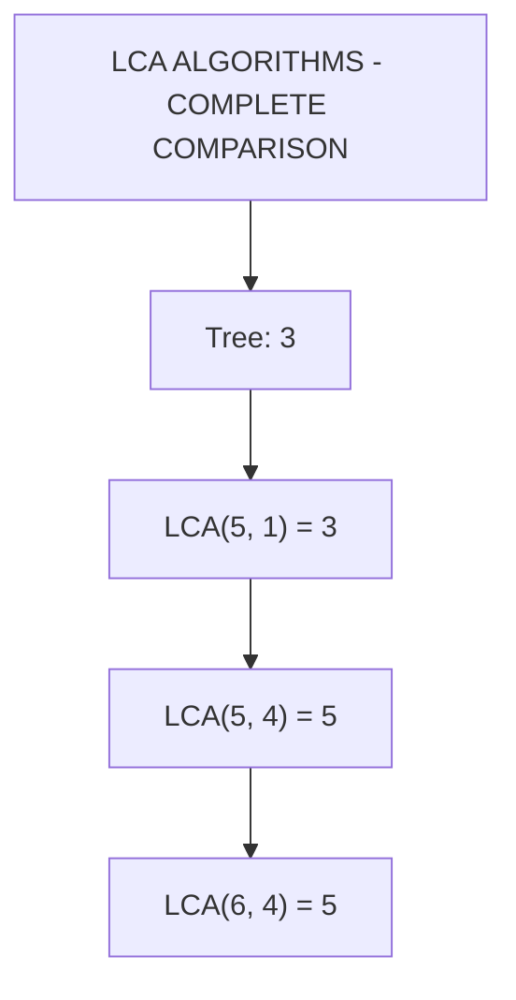
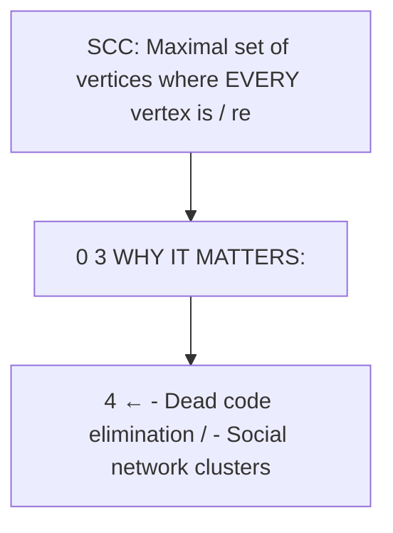
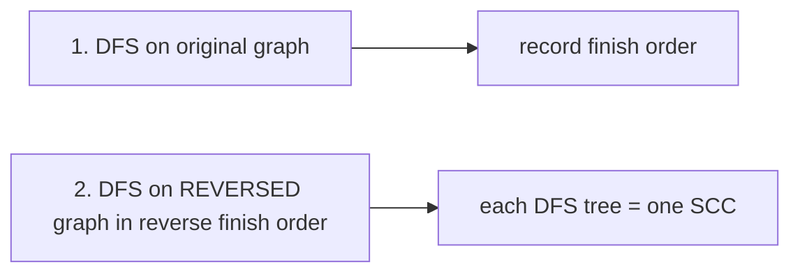
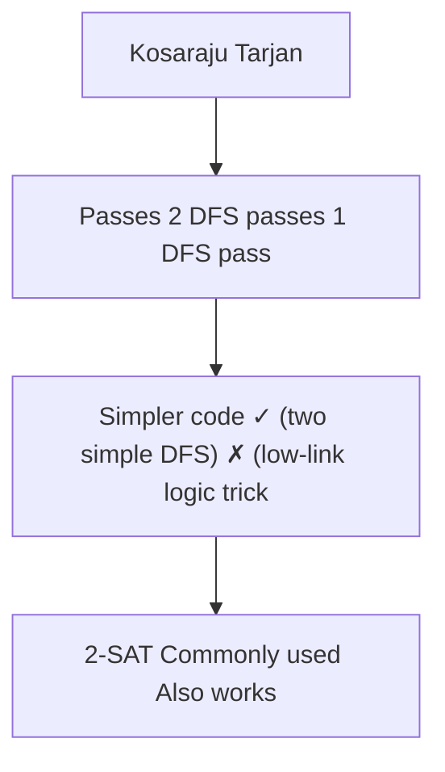
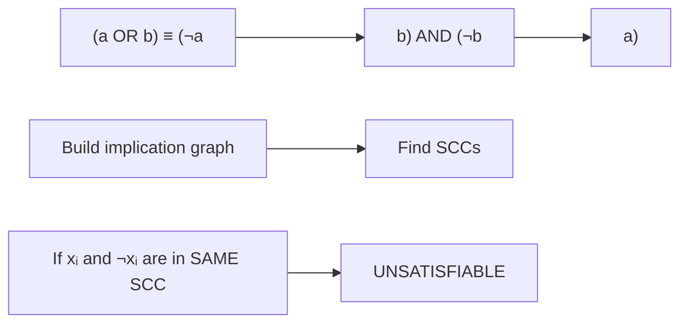
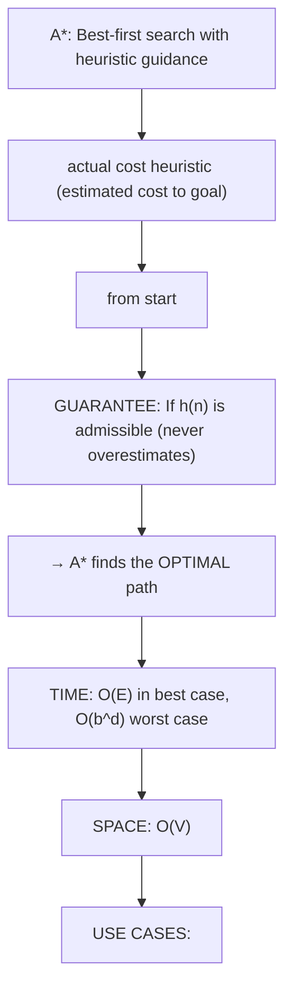
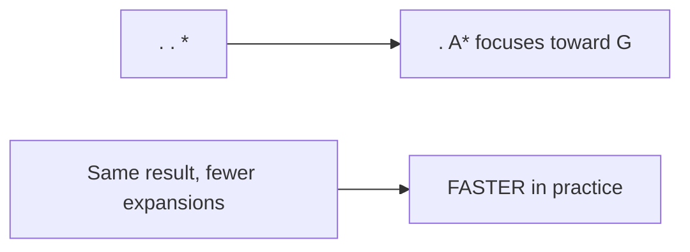
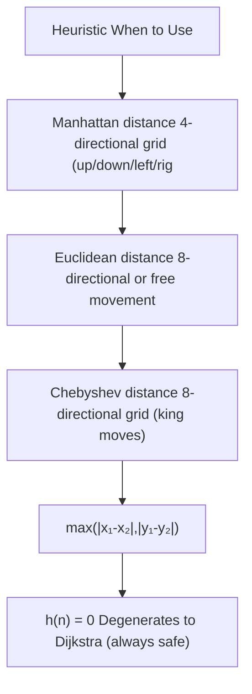
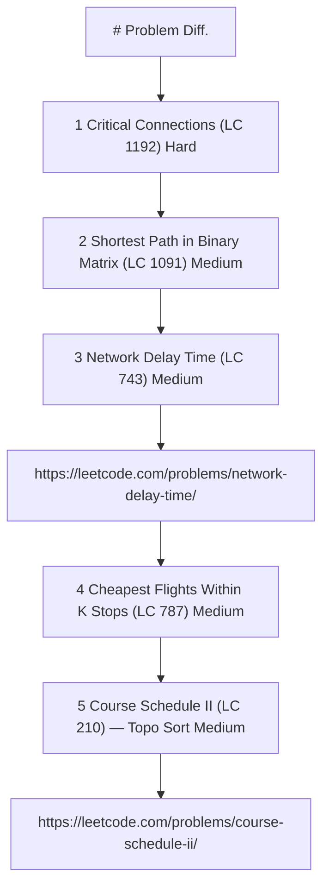

> **Navigation**: [< Previous Chapter](05c_Graphs_Fundamentals.md) | [Back to Index](../00_MASTER_INDEX.md) | [Next Chapter >](05e_Graphs_Patterns.md)
> 🧠 **Mental Model**: See [Graph & Tree Thinking](../14_Mental_Models/03_Graph_Tree_Thinking.md) — shortest path and MST mental models

---

## 🔗 JIT Connection — Advanced Graph Algorithms

> **Arrived here from a problem that needs more than basic BFS/DFS?**
>

| When you need this algorithm | Problem Type | Key Signal |
|---|---|---|
| **Bellman-Ford** | Shortest path with negative edges | "negative weights", "detect negative cycle" |
| **Floyd-Warshall** | All-pairs shortest path | "distances between ALL pairs", small graph (n≤500) |
| **Prim's MST** | Minimum spanning tree, dense graph | "connect all nodes minimum cost" |
| **Kruskal's MST** | Minimum spanning tree, sparse graph | sort edges + Union-Find |
| **Articulation Point/Bridge** | Network vulnerability | "critical connection", "remove vertex" |
| **Multi-Source BFS** | Distance from multiple sources | "distance to nearest 0-cell", "01 matrix" |
| **Bidirectional BFS** | Word Ladder, fastest transformation | "minimum steps between two states" |

>
> **Choose the right algorithm:**
> ```
> Negative weights?        → Bellman-Ford  O(VE)
> All-pairs shortest?      → Floyd-Warshall O(V³)
> MST (dense graph)?       → Prim  O((V+E) log V) with heap
> MST (sparse graph)?      → Kruskal  O(E log E)
> Multiple start points?   → Multi-Source BFS
> ```
>
> 🔗 **Practice problems:** [Graphs PS](../05_Problem_Solving/10_Graphs.md)
> 📋 **All Patterns Hub:** [00_PATTERN_MASTER_GUIDE.md](../04_Patterns_Templates/00_PATTERN_MASTER_GUIDE.md)

---


> 🔬 **Section Challenge — 🔗 JIT Connection — Advanced Graph Algorithms**
>
> **Challenge 1 (Reasoning):** BFS finds shortest path in unweighted graphs but not in weighted graphs. Why exactly?
> <details><summary>Answer</summary>
>
> BFS explores by 'hop count' (number of edges). Each level = one more edge away from source. All edges are treated as weight=1. In a weighted graph, the 'shortest by hop count' path may not be 'shortest by weight sum'. Example: A→B (weight 1, 1 hop) vs A→C→B (weight 0.1+0.1=0.2, 2 hops). BFS finds A→B (1 hop), Dijkstra finds A→C→B (lower total weight). BFS is optimal ONLY when all edges have equal weight.
> </details>
>
> **Challenge 2 (Design):** Detect if a directed graph has a cycle. Write the algorithm and explain why we need 3 states (not 2).
> <details><summary>Answer</summary>
>
> 3 states: UNVISITED, IN_PROGRESS (currently in DFS path), DONE. DFS: mark node IN_PROGRESS before visiting neighbors. If we reach an IN_PROGRESS node → cycle found. Mark DONE when all neighbors processed. Why 3 states: with 2 (visited/unvisited), we'd get false positives — reaching a VISITED node that was processed in a DIFFERENT DFS subtree is not a cycle. IN_PROGRESS specifically marks nodes in the CURRENT DFS path (potential back edge).
> </details>
>

# PART 12: Advanced Graph Algorithms

## Bellman-Ford Algorithm (Negative Weights)

```
CONCEPT:
Find shortest paths from source to all vertices.
Works with negative edge weights.
Can detect negative cycles.

TIME: O(V * E)
```

```java
public int[] bellmanFord(int n, int[][] edges, int source) {
    int[] dist = new int[n];
    Arrays.fill(dist, Integer.MAX_VALUE);
    dist[source] = 0;

    // Relax all edges V-1 times
    for (int i = 0; i < n - 1; i++) {
        boolean updated = false;
        for (int[] edge : edges) {
            int u = edge[0], v = edge[1], w = edge[2];
            if (dist[u] != Integer.MAX_VALUE && dist[u] + w < dist[v]) {
                dist[v] = dist[u] + w;
                updated = true;
            }
        }
        if (!updated) break;  // Early termination
    }

    // Check for negative cycles
    for (int[] edge : edges) {
        int u = edge[0], v = edge[1], w = edge[2];
        if (dist[u] != Integer.MAX_VALUE && dist[u] + w < dist[v]) {
            return null;  // Negative cycle detected
        }
    }

    return dist;
}
```

## Floyd-Warshall Algorithm (All-Pairs Shortest Path)

```
CONCEPT:
Find shortest paths between ALL pairs of vertices.
Uses dynamic programming.

TIME: O(V³)
SPACE: O(V²)
```

```java
public int[][] floydWarshall(int[][] graph) {
    int n = graph.length;
    int[][] dist = new int[n][n];

    // Initialize
    for (int i = 0; i < n; i++) {
        for (int j = 0; j < n; j++) {
            dist[i][j] = graph[i][j];
        }
    }

    // Try each vertex as intermediate
    for (int k = 0; k < n; k++) {
        for (int i = 0; i < n; i++) {
            for (int j = 0; j < n; j++) {
                if (dist[i][k] != Integer.MAX_VALUE &&
                    dist[k][j] != Integer.MAX_VALUE &&
                    dist[i][k] + dist[k][j] < dist[i][j]) {
                    dist[i][j] = dist[i][k] + dist[k][j];
                }
            }
        }
    }

    return dist;
}

// Visual for k=1 (using vertex 1 as intermediate):
// dist[0][2] = min(dist[0][2], dist[0][1] + dist[1][2])
```

## Minimum Spanning Tree - Prim's Algorithm

```java
public int primMST(int n, List<int[]>[] graph) {
    boolean[] inMST = new boolean[n];
    // PQ: [weight, node]
    PriorityQueue<int[]> pq = new PriorityQueue<>((a, b) -> a[0] - b[0]);
    pq.offer(new int[]{0, 0});  // Start from node 0

    int totalWeight = 0;
    int edgesAdded = 0;

    while (!pq.isEmpty() && edgesAdded < n) {
        int[] curr = pq.poll();
        int weight = curr[0], node = curr[1];

        if (inMST[node]) continue;

        inMST[node] = true;
        totalWeight += weight;
        edgesAdded++;

        for (int[] edge : graph[node]) {
            int neighbor = edge[0], edgeWeight = edge[1];
            if (!inMST[neighbor]) {
                pq.offer(new int[]{edgeWeight, neighbor});
            }
        }
    }

    return edgesAdded == n ? totalWeight : -1;
}
```


## Minimum Spanning Tree - Kruskal's Algorithm

```java
public int kruskalMST(int n, int[][] edges) {
    // Sort edges by weight
    Arrays.sort(edges, (a, b) -> a[2] - b[2]);

    UnionFind uf = new UnionFind(n);
    int totalWeight = 0;
    int edgesAdded = 0;

    for (int[] edge : edges) {
        int u = edge[0], v = edge[1], w = edge[2];

        if (uf.union(u, v)) {
            totalWeight += w;
            edgesAdded++;
            if (edgesAdded == n - 1) break;
        }
    }

    return edgesAdded == n - 1 ? totalWeight : -1;
}
```


## Articulation Points and Bridges

```
CONCEPT:
Articulation Point: A vertex whose removal disconnects the graph.
Bridge: An edge whose removal disconnects the graph.

USE CASES:
- Network vulnerability analysis
- Finding critical connections
```

```java
public class ArticulationPointsBridges {
    private int timer = 0;
    private List<Integer> articulationPoints = new ArrayList<>();
    private List<int[]> bridges = new ArrayList<>();

    public void find(List<List<Integer>> adj) {
        int n = adj.size();
        boolean[] visited = new boolean[n];
        int[] tin = new int[n];   // Discovery time
        int[] low = new int[n];   // Lowest reachable time

        for (int i = 0; i < n; i++) {
            if (!visited[i]) {
                dfs(i, -1, adj, visited, tin, low);
            }
        }
    }

    private void dfs(int node, int parent, List<List<Integer>> adj,
                     boolean[] visited, int[] tin, int[] low) {
        visited[node] = true;
        tin[node] = low[node] = timer++;
        int children = 0;

        for (int neighbor : adj.get(node)) {
            if (neighbor == parent) continue;

            if (visited[neighbor]) {
                // Back edge
                low[node] = Math.min(low[node], tin[neighbor]);
            } else {
                // Tree edge
                children++;
                dfs(neighbor, node, adj, visited, tin, low);
                low[node] = Math.min(low[node], low[neighbor]);

                // Check for articulation point
                if (parent != -1 && low[neighbor] >= tin[node]) {
                    articulationPoints.add(node);
                }

                // Check for bridge
                if (low[neighbor] > tin[node]) {
                    bridges.add(new int[]{node, neighbor});
                }
            }
        }

        // Special case: root with multiple children is articulation point
        if (parent == -1 && children > 1) {
            articulationPoints.add(node);
        }
    }
}
```

---


# PART 13: Graph Problem Patterns

## Pattern 1: Multi-Source BFS

```java
// Find distance from any '0' cell to each cell in grid
public int[][] multiSourceBFS(int[][] grid) {
    int m = grid.length, n = grid[0].length;
    int[][] dist = new int[m][n];
    Queue<int[]> queue = new LinkedList<>();

    // Add all sources to queue initially
    for (int i = 0; i < m; i++) {
        for (int j = 0; j < n; j++) {
            if (grid[i][j] == 0) {
                queue.offer(new int[]{i, j});
                dist[i][j] = 0;
            } else {
                dist[i][j] = Integer.MAX_VALUE;
            }
        }
    }

    int[][] dirs = {{0, 1}, {0, -1}, {1, 0}, {-1, 0}};

    while (!queue.isEmpty()) {
        int[] cell = queue.poll();
        int x = cell[0], y = cell[1];

        for (int[] dir : dirs) {
            int nx = x + dir[0], ny = y + dir[1];
            if (nx >= 0 && nx < m && ny >= 0 && ny < n &&
                dist[x][y] + 1 < dist[nx][ny]) {
                dist[nx][ny] = dist[x][y] + 1;
                queue.offer(new int[]{nx, ny});
            }
        }
    }

    return dist;
}
```


## Pattern 2: Bidirectional BFS

```java
// Word Ladder: Find shortest transformation sequence
public int ladderLength(String beginWord, String endWord, List<String> wordList) {
    Set<String> dict = new HashSet<>(wordList);
    if (!dict.contains(endWord)) return 0;

    Set<String> startSet = new HashSet<>();
    Set<String> endSet = new HashSet<>();
    startSet.add(beginWord);
    endSet.add(endWord);

    int length = 1;

    while (!startSet.isEmpty() && !endSet.isEmpty()) {
        // Always expand smaller set
        if (startSet.size() > endSet.size()) {
            Set<String> temp = startSet;
            startSet = endSet;
            endSet = temp;
        }

        Set<String> nextSet = new HashSet<>();

        for (String word : startSet) {
            char[] chars = word.toCharArray();

            for (int i = 0; i < chars.length; i++) {
                char original = chars[i];

                for (char c = 'a'; c <= 'z'; c++) {
                    if (c == original) continue;
                    chars[i] = c;
                    String newWord = new String(chars);

                    if (endSet.contains(newWord)) {
                        return length + 1;
                    }

                    if (dict.contains(newWord)) {
                        nextSet.add(newWord);
                        dict.remove(newWord);
                    }
                }

                chars[i] = original;
            }
        }

        startSet = nextSet;
        length++;
    }

    return 0;
}
```


## Pattern 3: Topological Sort with Kahn's Algorithm

```java
// Course Schedule II: Return order to take courses
public int[] findOrder(int numCourses, int[][] prerequisites) {
    List<List<Integer>> adj = new ArrayList<>();
    int[] inDegree = new int[numCourses];

    for (int i = 0; i < numCourses; i++) {
        adj.add(new ArrayList<>());
    }

    for (int[] pre : prerequisites) {
        adj.get(pre[1]).add(pre[0]);
        inDegree[pre[0]]++;
    }

    Queue<Integer> queue = new LinkedList<>();
    for (int i = 0; i < numCourses; i++) {
        if (inDegree[i] == 0) {
            queue.offer(i);
        }
    }

    int[] result = new int[numCourses];
    int index = 0;

    while (!queue.isEmpty()) {
        int course = queue.poll();
        result[index++] = course;

        for (int next : adj.get(course)) {
            if (--inDegree[next] == 0) {
                queue.offer(next);
            }
        }
    }

    return index == numCourses ? result : new int[0];
}
```


## Pattern 4: Cycle Detection in Directed Graph (Three Colors)

```java
public boolean hasCycle(int n, List<List<Integer>> adj) {
    int[] color = new int[n];  // 0: white, 1: gray, 2: black

    for (int i = 0; i < n; i++) {
        if (color[i] == 0 && dfs(i, adj, color)) {
            return true;
        }
    }

    return false;
}

private boolean dfs(int node, List<List<Integer>> adj, int[] color) {
    color[node] = 1;  // Mark as visiting (gray)

    for (int neighbor : adj.get(node)) {
        if (color[neighbor] == 1) return true;  // Back edge = cycle
        if (color[neighbor] == 0 && dfs(neighbor, adj, color)) {
            return true;
        }
    }

    color[node] = 2;  // Mark as visited (black)
    return false;
}
```

---


> 🔬 **Section Challenge — Pattern 4: Cycle Detection in Directed Graph (Three Colors)**
>
> **Challenge 1 (Reasoning):** BFS finds shortest path in unweighted graphs but not in weighted graphs. Why exactly?
> <details><summary>Answer</summary>
>
> BFS explores by 'hop count' (number of edges). Each level = one more edge away from source. All edges are treated as weight=1. In a weighted graph, the 'shortest by hop count' path may not be 'shortest by weight sum'. Example: A→B (weight 1, 1 hop) vs A→C→B (weight 0.1+0.1=0.2, 2 hops). BFS finds A→B (1 hop), Dijkstra finds A→C→B (lower total weight). BFS is optimal ONLY when all edges have equal weight.
> </details>
>
> **Challenge 2 (Design):** Detect if a directed graph has a cycle. Write the algorithm and explain why we need 3 states (not 2).
> <details><summary>Answer</summary>
>
> 3 states: UNVISITED, IN_PROGRESS (currently in DFS path), DONE. DFS: mark node IN_PROGRESS before visiting neighbors. If we reach an IN_PROGRESS node → cycle found. Mark DONE when all neighbors processed. Why 3 states: with 2 (visited/unvisited), we'd get false positives — reaching a VISITED node that was processed in a DIFFERENT DFS subtree is not a cycle. IN_PROGRESS specifically marks nodes in the CURRENT DFS path (potential back edge).
> </details>
>

# PART 15: Complete Graph Problems with Solutions

## Problem 1: Clone Graph

```java
public Node cloneGraph(Node node) {
    if (node == null) return null;

    Map<Node, Node> visited = new HashMap<>();
    return clone(node, visited);
}

private Node clone(Node node, Map<Node, Node> visited) {
    if (visited.containsKey(node)) {
        return visited.get(node);
    }

    Node copy = new Node(node.val);
    visited.put(node, copy);

    for (Node neighbor : node.neighbors) {
        copy.neighbors.add(clone(neighbor, visited));
    }

    return copy;
}
```


> 🔬 **Section Challenge — Problem 1: Clone Graph**
>
> **Challenge 1 (Reasoning):** BFS finds shortest path in unweighted graphs but not in weighted graphs. Why exactly?
> <details><summary>Answer</summary>
>
> BFS explores by 'hop count' (number of edges). Each level = one more edge away from source. All edges are treated as weight=1. In a weighted graph, the 'shortest by hop count' path may not be 'shortest by weight sum'. Example: A→B (weight 1, 1 hop) vs A→C→B (weight 0.1+0.1=0.2, 2 hops). BFS finds A→B (1 hop), Dijkstra finds A→C→B (lower total weight). BFS is optimal ONLY when all edges have equal weight.
> </details>
>
> **Challenge 2 (Design):** Detect if a directed graph has a cycle. Write the algorithm and explain why we need 3 states (not 2).
> <details><summary>Answer</summary>
>
> 3 states: UNVISITED, IN_PROGRESS (currently in DFS path), DONE. DFS: mark node IN_PROGRESS before visiting neighbors. If we reach an IN_PROGRESS node → cycle found. Mark DONE when all neighbors processed. Why 3 states: with 2 (visited/unvisited), we'd get false positives — reaching a VISITED node that was processed in a DIFFERENT DFS subtree is not a cycle. IN_PROGRESS specifically marks nodes in the CURRENT DFS path (potential back edge).
> </details>
>

## Problem 2: Pacific Atlantic Water Flow

```java
public List<List<Integer>> pacificAtlantic(int[][] heights) {
    int m = heights.length, n = heights[0].length;
    boolean[][] pacific = new boolean[m][n];
    boolean[][] atlantic = new boolean[m][n];

    // Start from edges and work inward
    for (int i = 0; i < m; i++) {
        dfs(heights, pacific, i, 0);       // Pacific left edge
        dfs(heights, atlantic, i, n - 1);  // Atlantic right edge
    }
    for (int j = 0; j < n; j++) {
        dfs(heights, pacific, 0, j);       // Pacific top edge
        dfs(heights, atlantic, m - 1, j);  // Atlantic bottom edge
    }

    List<List<Integer>> result = new ArrayList<>();
    for (int i = 0; i < m; i++) {
        for (int j = 0; j < n; j++) {
            if (pacific[i][j] && atlantic[i][j]) {
                result.add(Arrays.asList(i, j));
            }
        }
    }

    return result;
}

private void dfs(int[][] heights, boolean[][] visited, int i, int j) {
    int m = heights.length, n = heights[0].length;
    visited[i][j] = true;

    int[][] dirs = {{0, 1}, {0, -1}, {1, 0}, {-1, 0}};
    for (int[] dir : dirs) {
        int ni = i + dir[0], nj = j + dir[1];
        if (ni >= 0 && ni < m && nj >= 0 && nj < n &&
            !visited[ni][nj] && heights[ni][nj] >= heights[i][j]) {
            dfs(heights, visited, ni, nj);
        }
    }
}
```

## Problem 3: Network Delay Time (Dijkstra)

```java
public int networkDelayTime(int[][] times, int n, int k) {
    // Build adjacency list
    List<int[]>[] graph = new ArrayList[n + 1];
    for (int i = 0; i <= n; i++) {
        graph[i] = new ArrayList<>();
    }
    for (int[] time : times) {
        graph[time[0]].add(new int[]{time[1], time[2]});
    }

    // Dijkstra
    int[] dist = new int[n + 1];
    Arrays.fill(dist, Integer.MAX_VALUE);
    dist[k] = 0;

    PriorityQueue<int[]> pq = new PriorityQueue<>((a, b) -> a[1] - b[1]);
    pq.offer(new int[]{k, 0});

    while (!pq.isEmpty()) {
        int[] curr = pq.poll();
        int node = curr[0], time = curr[1];

        if (time > dist[node]) continue;

        for (int[] edge : graph[node]) {
            int next = edge[0], weight = edge[1];
            if (dist[node] + weight < dist[next]) {
                dist[next] = dist[node] + weight;
                pq.offer(new int[]{next, dist[next]});
            }
        }
    }

    int maxTime = 0;
    for (int i = 1; i <= n; i++) {
        if (dist[i] == Integer.MAX_VALUE) return -1;
        maxTime = Math.max(maxTime, dist[i]);
    }

    return maxTime;
}
```


> 🔬 **Section Challenge — Problem 3: Network Delay Time (Dijkstra)**
>
> **Challenge 1 (Reasoning):** Two-pointer pattern reduces O(N²) brute force to O(N). What is the KEY invariant that makes this safe?
> <details><summary>Answer</summary>
>
> The invariant: all pairs we SKIP are guaranteed to not contain the answer. In 3Sum: once we fix `nums[i]` and use l/r pointers, we can safely skip because the array is sorted. If `sum > 0`: decreasing r decreases the sum (smaller right value). If `sum < 0`: increasing l increases the sum (larger left value). We never skip a valid pair because monotonicity guarantees it.
> </details>
>

## Problem 4: Cheapest Flights Within K Stops

```java
public int findCheapestPrice(int n, int[][] flights, int src, int dst, int k) {
    // BFS with level tracking (Bellman-Ford style)
    int[] dist = new int[n];
    Arrays.fill(dist, Integer.MAX_VALUE);
    dist[src] = 0;

    for (int i = 0; i <= k; i++) {
        int[] temp = dist.clone();
        for (int[] flight : flights) {
            int u = flight[0], v = flight[1], price = flight[2];
            if (dist[u] != Integer.MAX_VALUE) {
                temp[v] = Math.min(temp[v], dist[u] + price);
            }
        }
        dist = temp;
    }

    return dist[dst] == Integer.MAX_VALUE ? -1 : dist[dst];
}
```

---

---


# 🔬 PART FINAL: ADVANCED TREE & GRAPH ALGORITHMS - DEEP DIVE

## 🌳 Advanced Tree Algorithms

### 📌 1. Lowest Common Ancestor (lca) — Multiple Approaches

```
┌─────────────────────────────────────────────────────────────────────────────────┐
│                    LCA ALGORITHMS - COMPLETE COMPARISON                         │
├─────────────────────────────────────────────────────────────────────────────────┤
│                                                                                 │
│  Problem: Find the lowest common ancestor of two nodes p and q in a tree        │
│                                                                                 │
│  Tree:         3                                                                │
│              /   \                                                              │
│             5     1                                                             │
│            / \   / \                                                            │
│           6   2 0   8                                                           │
│              / \                                                                │
│             7   4                                                               │
│                                                                                 │
│  LCA(5, 1) = 3                                                                  │
│  LCA(5, 4) = 5                                                                  │
│  LCA(6, 4) = 5                                                                  │
│                                                                                 │
└─────────────────────────────────────────────────────────────────────────────────┘
```

**Flow:**
- LCA ALGORITHMS - COMPLETE COMPARISON
- ↓
- Tree: 3
- ↓
- LCA(5, 1) = 3
- ↓
- LCA(5, 4) = 5
- ↓
- LCA(6, 4) = 5



```java
// APPROACH 1: RECURSIVE (O(n) time, O(h) space)
// Works for general binary tree
public TreeNode lowestCommonAncestor(TreeNode root, TreeNode p, TreeNode q) {
    // Base case: null or found p or q
    if (root == null || root == p || root == q) {
        return root;
    }

    // Search in both subtrees
    TreeNode left = lowestCommonAncestor(root.left, p, q);
    TreeNode right = lowestCommonAncestor(root.right, p, q);

    // If both sides found something, root is LCA
    if (left != null && right != null) {
        return root;
    }

    // Otherwise, LCA is on the side that found something
    return left != null ? left : right;
}

/*
 * TRACE for LCA(5, 4):
 *
 * lowestCommonAncestor(3, 5, 4)
 *   ├─ lowestCommonAncestor(5, 5, 4) = 5 (found 5!)
 *   │    └─ (short-circuits, returns immediately)
 *   └─ lowestCommonAncestor(1, 5, 4) = null
 *
 * left = 5, right = null
 * Return: 5 (the LCA!)
 */

// APPROACH 2: ITERATIVE WITH PARENT POINTERS
// O(n) time, O(n) space
public TreeNode lcaWithParents(TreeNode root, TreeNode p, TreeNode q) {
    Map<TreeNode, TreeNode> parent = new HashMap<>();
    Deque<TreeNode> stack = new ArrayDeque<>();

    parent.put(root, null);
    stack.push(root);

    // Build parent map until both p and q are found
    while (!parent.containsKey(p) || !parent.containsKey(q)) {
        TreeNode node = stack.pop();
        if (node.left != null) {
            parent.put(node.left, node);
            stack.push(node.left);
        }
        if (node.right != null) {
            parent.put(node.right, node);
            stack.push(node.right);
        }
    }

    // Collect ancestors of p
    Set<TreeNode> ancestors = new HashSet<>();
    while (p != null) {
        ancestors.add(p);
        p = parent.get(p);
    }

    // First ancestor of q that's also ancestor of p is LCA
    while (!ancestors.contains(q)) {
        q = parent.get(q);
    }

    return q;
}

// APPROACH 3: FOR BST (O(h) time, O(1) space)
public TreeNode lcaBST(TreeNode root, TreeNode p, TreeNode q) {
    while (root != null) {
        if (p.val < root.val && q.val < root.val) {
            root = root.left;   // Both in left subtree
        } else if (p.val > root.val && q.val > root.val) {
            root = root.right;  // Both in right subtree
        } else {
            return root;        // Split point = LCA
        }
    }
    return null;
}

// APPROACH 4: BINARY LIFTING (For multiple LCA queries)
// Preprocessing: O(n log n)
// Each query: O(log n)
class LCABinaryLifting {
    int[][] parent;  // parent[i][j] = 2^j-th ancestor of node i
    int[] depth;
    int LOG;

    public void preprocess(int n, int[][] edges) {
        LOG = (int)(Math.log(n) / Math.log(2)) + 1;
        parent = new int[n][LOG];
        depth = new int[n];

        // Build tree and compute depths
        List<List<Integer>> adj = buildAdjList(n, edges);
        dfs(0, -1, 0, adj);

        // Binary lifting table
        for (int j = 1; j < LOG; j++) {
            for (int i = 0; i < n; i++) {
                if (parent[i][j-1] != -1) {
                    parent[i][j] = parent[parent[i][j-1]][j-1];
                } else {
                    parent[i][j] = -1;
                }
            }
        }
    }

    private void dfs(int u, int par, int d, List<List<Integer>> adj) {
        parent[u][0] = par;
        depth[u] = d;
        for (int v : adj.get(u)) {
            if (v != par) {
                dfs(v, u, d + 1, adj);
            }
        }
    }

    public int lca(int u, int v) {
        // Make u deeper
        if (depth[u] < depth[v]) {
            int temp = u; u = v; v = temp;
        }

        // Lift u to same depth as v
        int diff = depth[u] - depth[v];
        for (int j = 0; j < LOG; j++) {
            if (((diff >> j) & 1) == 1) {
                u = parent[u][j];
            }
        }

        if (u == v) return u;

        // Lift both until they meet
        for (int j = LOG - 1; j >= 0; j--) {
            if (parent[u][j] != parent[v][j]) {
                u = parent[u][j];
                v = parent[v][j];
            }
        }

        return parent[u][0];
    }
}
```

### 🌳 2. Tree Diameter and Center

```java
/*
 * TREE DIAMETER: Longest path between any two nodes
 *
 *           1
 *          /|\
 *         2 3 4
 *        /|   |
 *       5 6   7
 *      /
 *     8
 *
 * Diameter = path from 8 to 7 = 5 edges
 */

// APPROACH 1: Two BFS (works for general tree)
// O(n) time, O(n) space
public int treeDiameter(int n, int[][] edges) {
    List<List<Integer>> adj = buildAdjList(n, edges);

    // BFS from any node to find farthest node (one endpoint)
    int farthest = bfsGetFarthest(0, adj, n);

    // BFS from that node to find diameter
    return bfsGetMaxDist(farthest, adj, n);
}

private int bfsGetFarthest(int start, List<List<Integer>> adj, int n) {
    int[] dist = new int[n];
    Arrays.fill(dist, -1);
    Queue<Integer> queue = new ArrayDeque<>();
    queue.offer(start);
    dist[start] = 0;

    int farthest = start;
    while (!queue.isEmpty()) {
        int u = queue.poll();
        for (int v : adj.get(u)) {
            if (dist[v] == -1) {
                dist[v] = dist[u] + 1;
                queue.offer(v);
                if (dist[v] > dist[farthest]) {
                    farthest = v;
                }
            }
        }
    }
    return farthest;
}

// For Binary Tree: DFS approach
// O(n) time, O(h) space
int diameter = 0;

public int diameterOfBinaryTree(TreeNode root) {
    depth(root);
    return diameter;
}

private int depth(TreeNode node) {
    if (node == null) return 0;

    int left = depth(node.left);
    int right = depth(node.right);

    // Diameter passing through this node
    diameter = Math.max(diameter, left + right);

    // Return depth of this subtree
    return 1 + Math.max(left, right);
}

/*
 * TREE CENTER: Node(s) that minimize max distance to any other node
 *
 * For a tree, center is either:
 * - Middle node of diameter (if diameter is even)
 * - Two middle nodes (if diameter is odd)
 *
 * ALGORITHM: Remove leaves layer by layer until 1 or 2 nodes remain
 */

public List<Integer> findCenter(int n, int[][] edges) {
    if (n == 1) return Arrays.asList(0);

    List<Set<Integer>> adj = new ArrayList<>();
    for (int i = 0; i < n; i++) adj.add(new HashSet<>());

    for (int[] edge : edges) {
        adj.get(edge[0]).add(edge[1]);
        adj.get(edge[1]).add(edge[0]);
    }

    // Start with leaves
    Queue<Integer> leaves = new ArrayDeque<>();
    for (int i = 0; i < n; i++) {
        if (adj.get(i).size() == 1) {
            leaves.offer(i);
        }
    }

    int remaining = n;
    while (remaining > 2) {
        int leafCount = leaves.size();
        remaining -= leafCount;

        for (int i = 0; i < leafCount; i++) {
            int leaf = leaves.poll();
            int neighbor = adj.get(leaf).iterator().next();
            adj.get(neighbor).remove(leaf);

            if (adj.get(neighbor).size() == 1) {
                leaves.offer(neighbor);
            }
        }
    }

    return new ArrayList<>(leaves);
}
```

### 🌳 3. Tree DP — Comprehensive Patterns

```java
/*
 * TREE DP PATTERN: Compute answer for each subtree
 *
 * Common patterns:
 * 1. Root-to-leaf: Pass information DOWN
 * 2. Leaf-to-root: Return information UP
 * 3. Rerooting: Combine both directions
 */

// PATTERN 1: House Robber III
// Can't rob two directly connected houses
public int rob(TreeNode root) {
    int[] result = robHelper(root);
    return Math.max(result[0], result[1]);
}

// Returns [maxWithoutRoot, maxWithRoot]
private int[] robHelper(TreeNode node) {
    if (node == null) return new int[]{0, 0};

    int[] left = robHelper(node.left);
    int[] right = robHelper(node.right);

    // Without current node: take max of children (can include or exclude them)
    int without = Math.max(left[0], left[1]) + Math.max(right[0], right[1]);

    // With current node: must exclude children's values
    int with = node.val + left[0] + right[0];

    return new int[]{without, with};
}

// PATTERN 2: Binary Tree Maximum Path Sum
// Path can start and end anywhere
int maxPathSum = Integer.MIN_VALUE;

public int maxPathSum(TreeNode root) {
    maxGain(root);
    return maxPathSum;
}

private int maxGain(TreeNode node) {
    if (node == null) return 0;

    // Max gain from left and right (ignore negative)
    int leftGain = Math.max(maxGain(node.left), 0);
    int rightGain = Math.max(maxGain(node.right), 0);

    // Path through current node
    int pathSum = node.val + leftGain + rightGain;
    maxPathSum = Math.max(maxPathSum, pathSum);

    // Return max gain if continuing upward
    return node.val + Math.max(leftGain, rightGain);
}

// PATTERN 3: Rerooting DP
// Find sum of distances from each node to all other nodes
public int[] sumOfDistancesInTree(int n, int[][] edges) {
    List<List<Integer>> adj = new ArrayList<>();
    for (int i = 0; i < n; i++) adj.add(new ArrayList<>());

    for (int[] edge : edges) {
        adj.get(edge[0]).add(edge[1]);
        adj.get(edge[1]).add(edge[0]);
    }

    int[] count = new int[n];  // Subtree size
    int[] result = new int[n]; // Sum of distances

    // DFS 1: Calculate for root 0
    dfs1(0, -1, adj, count, result);

    // DFS 2: Reroot to calculate for all nodes
    dfs2(0, -1, adj, count, result, n);

    return result;
}

private void dfs1(int u, int parent, List<List<Integer>> adj,
                  int[] count, int[] result) {
    count[u] = 1;
    for (int v : adj.get(u)) {
        if (v != parent) {
            dfs1(v, u, adj, count, result);
            count[u] += count[v];
            result[u] += result[v] + count[v];
        }
    }
}

private void dfs2(int u, int parent, List<List<Integer>> adj,
                  int[] count, int[] result, int n) {
    for (int v : adj.get(u)) {
        if (v != parent) {
            // Moving root from u to v:
            // - count[v] nodes get 1 closer
            // - (n - count[v]) nodes get 1 farther
            result[v] = result[u] - count[v] + (n - count[v]);
            dfs2(v, u, adj, count, result, n);
        }
    }
}
```

## 🕸️ Advanced Graph Algorithms

### 🔄 4. Topological Sort — All Approaches

```java
/*
 * TOPOLOGICAL SORT: Linear ordering where for every edge (u,v), u comes before v
 * Only works for DAG (Directed Acyclic Graph)
 *
 *     5 → 2 → 3
 *     ↓   ↓   ↓
 *     0 ← 4 → 1
 *
 * Valid orderings: [5, 4, 2, 3, 1, 0], [5, 4, 0, 2, 3, 1], etc.
 */

// APPROACH 1: Kahn's Algorithm (BFS, uses in-degree)
public int[] topologicalSortKahn(int n, int[][] edges) {
    List<List<Integer>> adj = new ArrayList<>();
    int[] inDegree = new int[n];

    for (int i = 0; i < n; i++) adj.add(new ArrayList<>());

    for (int[] edge : edges) {
        adj.get(edge[0]).add(edge[1]);
        inDegree[edge[1]]++;
    }

    Queue<Integer> queue = new ArrayDeque<>();
    for (int i = 0; i < n; i++) {
        if (inDegree[i] == 0) queue.offer(i);
    }

    int[] result = new int[n];
    int index = 0;

    while (!queue.isEmpty()) {
        int u = queue.poll();
        result[index++] = u;

        for (int v : adj.get(u)) {
            if (--inDegree[v] == 0) {
                queue.offer(v);
            }
        }
    }

    // If not all nodes included, cycle exists
    return index == n ? result : new int[0];
}

// APPROACH 2: DFS with reverse postorder
public int[] topologicalSortDFS(int n, int[][] edges) {
    List<List<Integer>> adj = new ArrayList<>();
    for (int i = 0; i < n; i++) adj.add(new ArrayList<>());

    for (int[] edge : edges) {
        adj.get(edge[0]).add(edge[1]);
    }

    int[] visited = new int[n];  // 0=unvisited, 1=visiting, 2=visited
    Deque<Integer> stack = new ArrayDeque<>();

    for (int i = 0; i < n; i++) {
        if (visited[i] == 0) {
            if (!dfs(i, adj, visited, stack)) {
                return new int[0];  // Cycle detected
            }
        }
    }

    int[] result = new int[n];
    int index = 0;
    while (!stack.isEmpty()) {
        result[index++] = stack.pop();
    }
    return result;
}

private boolean dfs(int u, List<List<Integer>> adj,
                   int[] visited, Deque<Integer> stack) {
    visited[u] = 1;  // Visiting

    for (int v : adj.get(u)) {
        if (visited[v] == 1) return false;  // Back edge = cycle
        if (visited[v] == 0 && !dfs(v, adj, visited, stack)) {
            return false;
        }
    }

    visited[u] = 2;  // Visited
    stack.push(u);   // Add to result in reverse postorder
    return true;
}
```

### 🧩 5. Strongly Connected Components (scc)

```
SCC: Maximal set of vertices where EVERY vertex is
reachable from EVERY other vertex in the set

   ┌──→ 1 ──→ 2 ──┐        SCCs: {0}, {1, 2, 3, 4}
   │    ↑    ↓    │
   0    │    3    │        WHY IT MATTERS:
        │    ↓    │        - 2-SAT satisfiability
        └─── 4 ←──┘        - Dead code elimination
                            - Social network clusters
                            - Condensing digraph to DAG
TIME: O(V + E)   SPACE: O(V)
```

**Flow:**
- SCC: Maximal set of vertices where EVERY vertex is / re
- ↓
- 0 3 WHY IT MATTERS:
- ↓
- 4 ← - Dead code elimination / - Social network clusters



#### Kosaraju's Algorithm (Two-Pass DFS)
```
IDEA: If we reverse ALL edges, the SCCs remain the same.
1. DFS on original graph → record finish order
2. DFS on REVERSED graph in reverse finish order → each DFS tree = one SCC
```

**Flow:**
- 1. DFS on original graph
- ↓
- record finish order
- ↓
- 2. DFS on REVERSED graph in reverse finish order
- ↓
- each DFS tree = one SCC



```java
public class KosarajuSCC {
    public List<List<Integer>> findSCCs(int n, int[][] edges) {
        List<List<Integer>> adj = new ArrayList<>(), radj = new ArrayList<>();
        for (int i = 0; i < n; i++) { adj.add(new ArrayList<>()); radj.add(new ArrayList<>()); }
        for (int[] e : edges) { adj.get(e[0]).add(e[1]); radj.get(e[1]).add(e[0]); }

        // Pass 1: DFS on original → collect finish order
        boolean[] visited = new boolean[n];
        Deque<Integer> order = new ArrayDeque<>();
        for (int i = 0; i < n; i++)
            if (!visited[i]) dfs1(i, adj, visited, order);

        // Pass 2: DFS on reversed in reverse finish order
        visited = new boolean[n];
        List<List<Integer>> sccs = new ArrayList<>();
        while (!order.isEmpty()) {
            int u = order.pop();
            if (!visited[u]) {
                List<Integer> scc = new ArrayList<>();
                dfs2(u, radj, visited, scc);
                sccs.add(scc);
            }
        }
        return sccs;
    }

    private void dfs1(int u, List<List<Integer>> adj, boolean[] vis, Deque<Integer> order) {
        vis[u] = true;
        for (int v : adj.get(u)) if (!vis[v]) dfs1(v, adj, vis, order);
        order.push(u);
    }

    private void dfs2(int u, List<List<Integer>> radj, boolean[] vis, List<Integer> scc) {
        vis[u] = true;
        scc.add(u);
        for (int v : radj.get(u)) if (!vis[v]) dfs2(v, radj, vis, scc);
    }
}
```

#### Tarjan's Algorithm (Single-Pass DFS with Low-Link)
```
IDEA: Use discovery time + low-link value. A node is SCC root
when its low-link equals its own id. Pop stack to get the SCC.
```

```java
public class TarjanSCC {
    private int id = 0, sccCount = 0;
    private int[] ids, low;
    private boolean[] onStack;
    private Deque<Integer> stack = new ArrayDeque<>();
    private List<List<Integer>> sccs = new ArrayList<>();

    public List<List<Integer>> findSCCs(int n, List<List<Integer>> adj) {
        ids = new int[n]; low = new int[n]; onStack = new boolean[n];
        Arrays.fill(ids, -1);
        for (int i = 0; i < n; i++)
            if (ids[i] == -1) dfs(i, adj);
        return sccs;
    }

    private void dfs(int at, List<List<Integer>> adj) {
        ids[at] = low[at] = id++;
        stack.push(at);
        onStack[at] = true;

        for (int to : adj.get(at)) {
            if (ids[to] == -1) {
                dfs(to, adj);
                low[at] = Math.min(low[at], low[to]);
            } else if (onStack[to]) {
                low[at] = Math.min(low[at], ids[to]);
            }
        }

        if (ids[at] == low[at]) {  // Root of SCC
            List<Integer> scc = new ArrayList<>();
            while (true) {
                int node = stack.pop();
                onStack[node] = false;
                scc.add(node);
                if (node == at) break;
            }
            sccs.add(scc);
            sccCount++;
        }
    }
}
```

#### Kosaraju vs Tarjan — When to Use Which
```
╔══════════════╦══════════════════════════════╦═══════════════════════════════╗
║              ║ Kosaraju                     ║ Tarjan                        ║
╠══════════════╬══════════════════════════════╬═══════════════════════════════╣
║ Passes       ║ 2 DFS passes                ║ 1 DFS pass                     ║
║ Extra memory ║ Reversed graph O(V+E)        ║ Stack + low-link arrays O(V)  ║
║ Simpler code ║ ✓ (two simple DFS)          ║ ✗ (low-link logic tricky)      ║
║ Better for   ║ Dense graphs, simple impl    ║ Online/streaming, less memory ║
║ 2-SAT        ║ Commonly used                ║ Also works                    ║
╚══════════════╩══════════════════════════════╩═══════════════════════════════╝
```

**Flow:**
- Kosaraju Tarjan
- ↓
- Passes 2 DFS passes 1 DFS pass
- ↓
- Simpler code ✓ (two simple DFS) ✗ (low-link logic trick
- ↓
- 2-SAT Commonly used Also works



#### 2-SAT via SCC
```
CONCEPT: Determine if boolean formula (x₁ OR x₂) AND (¬x₃ OR x₄) ...
is satisfiable when each clause has exactly 2 literals.

KEY INSIGHT:
  (a OR b) ≡ (¬a → b) AND (¬b → a)

Build implication graph → Find SCCs
If xᵢ and ¬xᵢ are in SAME SCC → UNSATISFIABLE
Otherwise: xᵢ = true if SCC(xᵢ) has higher topological order than SCC(¬xᵢ)
```

**Flow:**
- (a OR b) ≡ (¬a
- ↓
- b) AND (¬b
- ↓
- a)
- ↓
- Build implication graph
- ↓
- Find SCCs
- ↓
- If xᵢ and ¬xᵢ are in SAME SCC
- ↓
- UNSATISFIABLE



### 🔍 6. A* Search Algorithm

```
╔════════════════════════════════════════════════════════════════╗
║  A*: Best-first search with heuristic guidance                 ║
║                                                                ║
║  f(n) = g(n) + h(n)                                            ║
║         ↑         ↑                                            ║
║    actual cost   heuristic (estimated cost to goal)            ║
║    from start                                                  ║
║                                                                ║
║  GUARANTEE: If h(n) is admissible (never overestimates)        ║
║             AND consistent (h(a) ≤ cost(a,b) + h(b))           ║
║             → A* finds the OPTIMAL path                        ║
║                                                                ║
║  TIME: O(E) in best case, O(b^d) worst case                    ║
║  SPACE: O(V)                                                   ║
║                                                                ║
║  USE CASES:                                                    ║
║  - Grid shortest path (game AI, robotics)                      ║
║  - Navigation / GPS routing                                    ║
║  - Sliding puzzle (15-puzzle)                                  ║
╚════════════════════════════════════════════════════════════════╝
```

**Flow:**
- A*: Best-first search with heuristic guidance
- ↓
- actual cost heuristic (estimated cost to goal)
- ↓
- from start
- ↓
- GUARANTEE: If h(n) is admissible (never overestimates)
- ↓
- A* finds the OPTIMAL path
- ↓
- TIME: O(E) in best case, O(b^d) worst case
- ↓
- SPACE: O(V)



#### A* vs Dijkstra — The Key Difference
```
Dijkstra explores in ALL directions (expanding circle):

     . . . . .
     . . * . .    * = start, G = goal
     . . . . .    Dijkstra checks ALL dots
     . . . G .

A* uses heuristic to focus toward goal (expanding cone):

     . . . . .
     . . * → .    A* focuses toward G
     . . . ↘ .    Fewer nodes explored!
     . . . G .

Same result, fewer expansions → FASTER in practice
```

**Flow:**
- . . *
- ↓
- . A* focuses toward G
- ↓
- Same result, fewer expansions
- ↓
- FASTER in practice



```java
public class AStar {
    // Grid-based A* (most common interview variant)
    static int[][] dirs = {{0,1},{0,-1},{1,0},{-1,0}};

    public int shortestPath(int[][] grid, int[] start, int[] goal) {
        int m = grid.length, n = grid[0].length;
        int[][] gScore = new int[m][n];
        for (int[] row : gScore) Arrays.fill(row, Integer.MAX_VALUE);
        gScore[start[0]][start[1]] = 0;

        // PQ ordered by f(n) = g(n) + h(n)
        PriorityQueue<int[]> pq = new PriorityQueue<>(
            (a, b) -> (gScore[a[0]][a[1]] + heuristic(a, goal))
                     - (gScore[b[0]][b[1]] + heuristic(b, goal))
        );
        pq.offer(start);

        while (!pq.isEmpty()) {
            int[] cur = pq.poll();
            int r = cur[0], c = cur[1];

            if (r == goal[0] && c == goal[1]) return gScore[r][c];

            for (int[] d : dirs) {
                int nr = r + d[0], nc = c + d[1];
                if (nr < 0 || nr >= m || nc < 0 || nc >= n) continue;
                if (grid[nr][nc] == 1) continue;  // Wall

                int newG = gScore[r][c] + 1;  // Edge weight = 1 for grid
                if (newG < gScore[nr][nc]) {
                    gScore[nr][nc] = newG;
                    pq.offer(new int[]{nr, nc});
                }
            }
        }
        return -1;  // No path
    }

    // Manhattan distance heuristic (admissible for 4-directional grid)
    private int heuristic(int[] a, int[] b) {
        return Math.abs(a[0] - b[0]) + Math.abs(a[1] - b[1]);
    }
}
```

#### Common Heuristics
```
╔════════════════════╦══════════════════════════════════════════╗
║ Heuristic          ║ When to Use                              ║
╠════════════════════╬══════════════════════════════════════════╣
║ Manhattan distance ║ 4-directional grid (up/down/left/right)  ║
║ |x₁-x₂| + |y₁-y₂|║                                            ║
╠════════════════════╬══════════════════════════════════════════╣
║ Euclidean distance ║ 8-directional or free movement           ║
║ √((x₁-x₂)²+(y₁-y₂)²)                                          ║
╠════════════════════╬══════════════════════════════════════════╣
║ Chebyshev distance ║ 8-directional grid (king moves)          ║
║ max(|x₁-x₂|,|y₁-y₂|)                                          ║
╠════════════════════╬══════════════════════════════════════════╣
║ h(n) = 0          ║ Degenerates to Dijkstra (always safe)     ║
╚════════════════════╩══════════════════════════════════════════╝
```

**Flow:**
- Heuristic When to Use
- ↓
- Manhattan distance 4-directional grid (up/down/left/rig
- ↓
- Euclidean distance 8-directional or free movement
- ↓
- Chebyshev distance 8-directional grid (king moves)
- ↓
- max(
- ↓
- x₁-x₂
- ↓
- ,
- ↓
- y₁-y₂
- ↓
- )
- ↓
- max(
- ↓
- x₁-x₂
- ↓
- ,
- ↓
- y₁-y₂
- ↓
- )
- ↓
- h(n) = 0 Degenerates to Dijkstra (always safe)



### Curated Practice — Advanced Graph Algorithms
```
╔════╦══════════════════════════════════════════════════════════════╦═══════════════════════════════════════════════╗
║  # ║ Problem                                                     ║ Diff.                                          ║
╠════╬══════════════════════════════════════════════════════════════╬═══════════════════════════════════════════════╣
║  1 ║ Critical Connections (LC 1192)                               ║ Hard                                          ║
║    ║ https://leetcode.com/problems/critical-connections-in-a-network/ ║                                           ║
╠════╬══════════════════════════════════════════════════════════════╬═══════════════════════════════════════════════╣
║  2 ║ Shortest Path in Binary Matrix (LC 1091)                    ║ Medium                                         ║
║    ║ https://leetcode.com/problems/shortest-path-in-binary-matrix/ ║                                              ║
╠════╬══════════════════════════════════════════════════════════════╬═══════════════════════════════════════════════╣
║  3 ║ Network Delay Time (LC 743)                                 ║ Medium                                         ║
║    ║ https://leetcode.com/problems/network-delay-time/            ║                                               ║
╠════╬══════════════════════════════════════════════════════════════╬═══════════════════════════════════════════════╣
║  4 ║ Cheapest Flights Within K Stops (LC 787)                    ║ Medium                                         ║
║    ║ https://leetcode.com/problems/cheapest-flights-within-k-stops/ ║                                             ║
╠════╬══════════════════════════════════════════════════════════════╬═══════════════════════════════════════════════╣
║  5 ║ Course Schedule II (LC 210) — Topo Sort                     ║ Medium                                         ║
║    ║ https://leetcode.com/problems/course-schedule-ii/            ║                                               ║
╠════╬══════════════════════════════════════════════════════════════╬═══════════════════════════════════════════════╣
║  6 ║ Path with Maximum Probability (LC 1514) — Max Dijkstra      ║ Medium                                         ║
║    ║ https://leetcode.com/problems/path-with-maximum-probability/ ║                                               ║
╠════╬══════════════════════════════════════════════════════════════╬═══════════════════════════════════════════════╣
║  7 ║ Minimum Cost to Make at Least One Valid Path (LC 1368)      ║ Hard                                           ║
║    ║ https://leetcode.com/problems/minimum-cost-to-make-at-least-one-valid-path-in-a-grid/ ║                      ║
╠════╬══════════════════════════════════════════════════════════════╬═══════════════════════════════════════════════╣
║  8 ║ Redundant Connection II (LC 685) — Directed graph cycle     ║ Hard                                           ║
║    ║ https://leetcode.com/problems/redundant-connection-ii/       ║                                               ║
╠════╬══════════════════════════════════════════════════════════════╬═══════════════════════════════════════════════╣
║  9 ║ Swim in Rising Water (LC 778) — Binary Search + BFS/UF     ║ Hard                                            ║
║    ║ https://leetcode.com/problems/swim-in-rising-water/          ║                                               ║
╠════╬══════════════════════════════════════════════════════════════╬═══════════════════════════════════════════════╣
║ 10 ║ Find the City (LC 1334) — Floyd-Warshall                   ║ Medium                                          ║
║    ║ https://leetcode.com/problems/find-the-city-with-the-smallest-number-of-neighbors-at-a-threshold-distance/ ║ ║
╚════╩══════════════════════════════════════════════════════════════╩═══════════════════════════════════════════════╝
```

**Flow:**
- # Problem Diff.
- ↓
- 1 Critical Connections (LC 1192) Hard
- ↓
- 2 Shortest Path in Binary Matrix (LC 1091) Medium
- ↓
- 3 Network Delay Time (LC 743) Medium
- ↓
- https://leetcode.com/problems/network-delay-time/
- ↓
- 4 Cheapest Flights Within K Stops (LC 787) Medium
- ↓
- 5 Course Schedule II (LC 210) — Topo Sort Medium




---


---


> 🔬 **Section Challenge — 🕸️ Advanced Graph Algorithms**
>
> **Challenge 1 (Reasoning):** BFS finds shortest path in unweighted graphs but not in weighted graphs. Why exactly?
> <details><summary>Answer</summary>
>
> BFS explores by 'hop count' (number of edges). Each level = one more edge away from source. All edges are treated as weight=1. In a weighted graph, the 'shortest by hop count' path may not be 'shortest by weight sum'. Example: A→B (weight 1, 1 hop) vs A→C→B (weight 0.1+0.1=0.2, 2 hops). BFS finds A→B (1 hop), Dijkstra finds A→C→B (lower total weight). BFS is optimal ONLY when all edges have equal weight.
> </details>
>
> **Challenge 2 (Design):** Detect if a directed graph has a cycle. Write the algorithm and explain why we need 3 states (not 2).
> <details><summary>Answer</summary>
>
> 3 states: UNVISITED, IN_PROGRESS (currently in DFS path), DONE. DFS: mark node IN_PROGRESS before visiting neighbors. If we reach an IN_PROGRESS node → cycle found. Mark DONE when all neighbors processed. Why 3 states: with 2 (visited/unvisited), we'd get false positives — reaching a VISITED node that was processed in a DIFFERENT DFS subtree is not a cycle. IN_PROGRESS specifically marks nodes in the CURRENT DFS path (potential back edge).
> </details>
>

## 🏋️ Practice & Interview Questions — Algorithms

### Sorting
**Q1.** Which sorting algorithm does Java use for `Arrays.sort(int[])`? Why not MergeSort?
<details><summary>Answer</summary>

**Dual-Pivot QuickSort** — for primitives. MergeSort requires O(N) extra space. QuickSort is in-place and cache-friendly. Stability doesn't matter for primitives (equal ints are indistinguishable). For objects (`Arrays.sort(Object[])`), Java uses **TimSort** (stable, O(N log N) worst).
</details>

**Q2.** Trace Merge Sort on `[4,2,7,1]`.
<details><summary>Answer</summary>

Split: `[4,2]` `[7,1]` → Split: `[4]` `[2]` `[7]` `[1]` → Merge: `[2,4]` `[1,7]` → Merge: `[1,2,4,7]`
</details>

**Q3.** ⭐⭐ Sort Colors (Dutch National Flag — 3-way partition).
<details><summary>Solution</summary>

```java
int lo=0, mid=0, hi=n-1;
while(mid<=hi){
    if(nums[mid]==0) swap(nums,lo++,mid++);
    else if(nums[mid]==1) mid++;
    else swap(nums,mid,hi--);
}
```
</details>

### Binary Search
**Q4.** ⭐ Search in Rotated Sorted Array.
<details><summary>Solution</summary>

```java
int lo=0, hi=n-1;
while(lo<=hi){
    int mid=(lo+hi)/2;
    if(nums[mid]==target) return mid;
    if(nums[lo]<=nums[mid]){ // left half sorted
        if(nums[lo]<=target&&target<nums[mid]) hi=mid-1; else lo=mid+1;
    } else { // right half sorted
        if(nums[mid]<target&&target<=nums[hi]) lo=mid+1; else hi=mid-1;
    }
}
return -1;
```
</details>

**Q5.** ⭐ Find First and Last Position (binary search twice).
<details><summary>Solution</summary>

```java
// First: find leftmost with while(lo<hi){ if arr[mid]>=target hi=mid else lo=mid+1 }
// Last: find rightmost with while(lo<hi){ if arr[mid]<=target lo=mid+1 else hi=mid } return lo-1
```
</details>

**Q6.** ⭐⭐ Koko Eating Bananas — binary search on answer.
<details><summary>Key insight</summary>

Binary search the eating speed k in range [1, max(piles)]. For each k, calculate hours needed. Find minimum k where hours ≤ H.
</details>

### Dynamic Programming
**Q7.** ⭐ Climbing Stairs — n steps, 1 or 2 at a time. How many ways?
<details><summary>Solution</summary>

```java
// Fibonacci sequence! dp[i] = dp[i-1] + dp[i-2]
int a=1, b=1;
for(int i=2;i<=n;i++){ int c=a+b; a=b; b=c; }
return b;
```
</details>

**Q8.** ⭐ Coin Change — minimum coins for amount.
<details><summary>Solution</summary>

```java
int[] dp = new int[amount+1]; Arrays.fill(dp, amount+1);
dp[0]=0;
for(int i=1;i<=amount;i++)
    for(int c:coins) if(c<=i) dp[i]=Math.min(dp[i],dp[i-c]+1);
return dp[amount]>amount?-1:dp[amount];
```
</details>

**Q9.** ⭐⭐ Longest Common Subsequence.
<details><summary>Solution</summary>

```java
int[][] dp=new int[m+1][n+1];
for(int i=1;i<=m;i++) for(int j=1;j<=n;j++){
    if(text1.charAt(i-1)==text2.charAt(j-1)) dp[i][j]=dp[i-1][j-1]+1;
    else dp[i][j]=Math.max(dp[i-1][j],dp[i][j-1]);
}
return dp[m][n];
```
</details>

**Q10.** ⭐⭐ Word Break — can string be segmented using dictionary words?
<details><summary>Solution</summary>

```java
boolean[] dp=new boolean[n+1]; dp[0]=true;
for(int i=1;i<=n;i++) for(String w:wordDict)
    if(i>=w.length()&&dp[i-w.length()]&&s.substring(i-w.length(),i).equals(w)) dp[i]=true;
return dp[n];
```
</details>

**Q11.** ⭐⭐⭐ Edit Distance (Levenshtein).
<details><summary>Solution</summary>

```java
int[][] dp=new int[m+1][n+1];
for(int i=0;i<=m;i++) dp[i][0]=i;
for(int j=0;j<=n;j++) dp[0][j]=j;
for(int i=1;i<=m;i++) for(int j=1;j<=n;j++){
    if(word1.charAt(i-1)==word2.charAt(j-1)) dp[i][j]=dp[i-1][j-1];
    else dp[i][j]=1+Math.min(dp[i-1][j-1],Math.min(dp[i-1][j],dp[i][j-1]));
}
```
</details>

### Graph Algorithms
**Q12.** ⭐ Number of Islands (BFS/DFS grid traversal).
<details><summary>Solution</summary>

```java
for each cell (i,j) if grid[i][j]=='1': count++; BFS/DFS to mark all connected land as visited
```
</details>

**Q13.** ⭐⭐ Course Schedule — detect cycle in directed graph (Topological sort).
<details><summary>Solution</summary>

```java
// Kahn's algorithm: indegree array + BFS queue
// If result size == numCourses → no cycle → can finish
```
</details>

**Q14.** ⭐⭐ Dijkstra's Shortest Path.
<details><summary>Solution</summary>

```java
PriorityQueue<int[]> pq=new PriorityQueue<>((a,b)->a[1]-b[1]); // [node, dist]
pq.offer(new int[]{src,0}); dist[src]=0;
while(!pq.isEmpty()){
    int[] curr=pq.poll(); int u=curr[0],d=curr[1];
    if(d>dist[u]) continue; // stale
    for(int[] neighbor:graph[u]) if(dist[u]+neighbor[1]<dist[neighbor[0]]){
        dist[neighbor[0]]=dist[u]+neighbor[1]; pq.offer(new int[]{neighbor[0],dist[neighbor[0]]});
    }
}
```
</details>

### MCQ Rapid Fire
| # | Question | Answer |
|---|---|---|
| 1 | QuickSort avg/worst | O(N log N) avg, O(N²) worst |
| 2 | MergeSort space complexity | O(N) |
| 3 | HeapSort space complexity | O(1) (in-place) |
| 4 | Binary search precondition | Sorted array |
| 5 | BFS time complexity on graph | O(V+E) |
| 6 | DFS space complexity | O(V) (recursion stack) |
| 7 | Dijkstra fails on | Negative weight edges |
| 8 | Bellman-Ford handles | Negative weights, detects negative cycles |
| 9 | Floyd-Warshall use case | All-pairs shortest path, O(V³) |
| 10 | Topological sort requires | Directed Acyclic Graph (DAG) |


---

## 🧠 Deep Conceptual Questions — Algorithm Design & Analysis

**C1. What does O(N log N) "feel like" and why is it the complexity barrier for comparison-based sorting?**
<details><summary>Deep Answer</summary>

O(N log N) for N=1M ≈ 20M operations. O(N²) ≈ 1 trillion. The difference is 50,000x. **Comparison sort lower bound**: any comparison-based sort must distinguish between N! possible orderings. Each comparison has 2 outcomes. A decision tree with N! leaves needs ≥ log₂(N!) height ≈ N log N (Stirling's approximation). Therefore NO comparison sort can beat O(N log N) in the worst case. Non-comparison sorts (counting sort, radix sort, bucket sort) break this bound by using non-comparison operations — but require constraints on input (e.g., integer range bounded by N).
</details>

**C2. Greedy algorithms: when do they work and what must be proven?**
<details><summary>Deep Answer</summary>

A greedy algorithm makes the locally optimal choice at each step. Works when problem has: (1) **Greedy choice property**: local optimal leads to global optimal — the choice never needs to be revised. (2) **Optimal substructure**: optimal solution to the problem contains optimal solutions to subproblems. To PROVE greedy is correct: use "exchange argument" — assume optimal solution differs from greedy, show you can swap greedy's choice in without making it worse, contradiction. Greedy FAILS when: future choices depend on current choice in complex ways (use DP instead). Classic works: interval scheduling, Huffman coding, Dijkstra. Classic fails: 0-1 knapsack (use DP).
</details>

**C3. Dynamic Programming: what is "overlapping subproblems" and why does it matter?**
<details><summary>Deep Answer</summary>

Overlapping subproblems: the same sub-computation appears multiple times. Fibonacci: `fib(5)` calls `fib(4)` and `fib(3)`. `fib(4)` also calls `fib(3)`. Without memoization: `fib(3)` computed exponentially many times → O(2^N). With memoization: each sub-result computed once and stored → O(N). DP is valuable SPECIFICALLY when: (1) problem has optimal substructure AND (2) subproblems overlap. If no overlap: just use divide-and-conquer (merge sort's subproblems don't overlap → no DP needed). DP = "smart recursion" = avoid recomputing.
</details>

**C4. Top-down (memoization) vs Bottom-up (tabulation) DP — when to choose each?**
<details><summary>Deep Answer</summary>

**Top-down (memoization)**: Write natural recursion + cache results. Easy to implement, only computes needed subproblems (sparse computation). Cons: recursion overhead and stack depth risk. Use when: problem is naturally recursive, only a fraction of subproblems needed. **Bottom-up (tabulation)**: Fill DP table iteratively from base cases. No recursion overhead, better cache performance, easier space optimization. Use when: need all subproblems (or most of them), want to optimize space (can often reduce to 1D from 2D). Rule: start with top-down for correctness verification, optimize to bottom-up for performance.
</details>

**C5. Dijkstra's Algorithm: why does it fail on negative weights?**
<details><summary>Deep Answer</summary>

Dijkstra assumes: once a node is "settled" (extracted from the priority queue with its final shortest distance), that distance is optimal. With negative weights: settling node A at distance 5 might not be final — a path through B (distance 7) → C (edge -10) → A gives distance -3. But A was already settled! Dijkstra doesn't revisit settled nodes. Bellman-Ford handles negatives by relaxing ALL edges N-1 times — no "settled" assumption. For graphs with negative cycles: Bellman-Ford detects them (if distances still decrease after N-1 rounds, there's a negative cycle).
</details>

**C6. Union-Find: why is path compression + union by rank/size nearly O(1)?**
<details><summary>Deep Answer</summary>

**Path compression**: when finding the root of element x, make every node on the path point directly to the root. Flattens the tree. Future finds on those paths: O(1). **Union by rank**: always attach the smaller tree under the larger → limits tree height to O(log N). Combined: inverse Ackermann function α(N) amortized — so slow-growing it's practically constant (α(10^80) = 4). Neither alone is optimal: path compression without union by rank → O(log N) amortized. Union by rank without path compression → O(log N). Together → α(N) ≈ O(1) amortized. Used in: Kruskal's MST, cycle detection, connected components.
</details>

**C7. Binary Search on the Answer — what types of problems does it apply to?**
<details><summary>Deep Answer</summary>

When the answer space is **monotone**: "if X is achievable, then all values less extreme than X are also achievable." Problems: minimize the maximum (aggressive cows, split array), find minimum valid threshold (Koko bananas, minimum days to bloom), divide-and-conquer feasibility. Template: binary search on the answer range [lo, hi], for each mid check `isFeasible(mid)` in O(N) or O(N log N). Total: O(N log(answer_range)). Key insight: reframe "find optimal value" as "find smallest X where condition holds" → enables binary search on a non-array space.
</details>

**C8. Why does merge sort guarantee stability while quicksort doesn't?**
<details><summary>Deep Answer</summary>

**Merge sort stability**: during merge, when two elements are equal, we always take from the LEFT array first → preserves original relative order. **QuickSort instability**: the partition step swaps elements across the pivot without regard to original order. Two equal elements may be placed on opposite sides of the pivot, reversing their order. QuickSort CAN be made stable (Lomuto partition with careful implementation) but loses performance. Java uses TimSort for objects (stable), dual-pivot quicksort for primitives (stability irrelevant since primitives without fields).
</details>

**C9. Backtracking: what's the difference from plain DFS and when to use vs DP?**
<details><summary>Deep Answer</summary>

**Backtracking vs DFS**: DFS visits every path. Backtracking prunes paths early when a constraint is violated — avoids exploring infeasible branches. Same asymptotic but drastically different practical performance with good pruning. **Backtracking vs DP**: backtracking for **combinatorial/enumeration** problems (find all solutions, permutations, subsets). DP for **optimization** problems (find optimal single solution). Backtracking produces exponential solutions in worst case but is necessary when you need ALL solutions. DP finds the optimal in polynomial time when overlapping subproblems exist.
</details>

**C10. What is amortized analysis and how does it differ from average-case analysis?**
<details><summary>Deep Answer</summary>

**Amortized**: analyzes the average cost per operation over a SEQUENCE of operations — in the worst case. No probability involved. Guarantees: N operations ALWAYS take O(N·T) total, even if some individual operations are O(N·T). Example: ArrayList append is O(N) when resizing, but amortized O(1) because resizing is rare. **Average-case**: analyzes expected cost of a SINGLE operation assuming random input. QuickSort is O(N log N) average-case (random pivot). Amortized is a stronger guarantee — it holds even for adversarial input sequences.
</details>


> **Navigation**: [< Previous](05c_Graphs_Fundamentals.md) | [Back to Index](../00_MASTER_INDEX.md) | [Next >](05e_Graphs_Patterns.md)