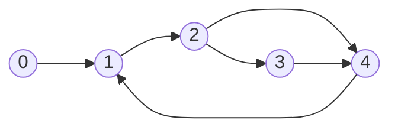

# 🕸️ Advanced Graph Algorithms

> **Navigation**: [← PART FINAL: ADVANCED TREE & GRAPH…](05_final_advanced_tree_graph_algorithms_deep.md) | [Chapter overview](../05d_Graphs_Advanced_Algos.md)
> Page 6 of 6 in **Graphs Advanced Algos**


## 🔄 4. Topological Sort — All Approaches

```java
/*
 * TOPOLOGICAL SORT: Linear ordering where for every edge (u,v), u comes before v
 * Only works for DAG (Directed Acyclic Graph)
 *
 *     5 → 2 → 3
 *     ↓   ↓   ↓
 *     0 ← 4 → 1
 *
 * Valid orderings: [5, 4, 2, 3, 1, 0], [5, 4, 0, 2, 3, 1], etc.
 */

// APPROACH 1: Kahn's Algorithm (BFS, uses in-degree)
public int[] topologicalSortKahn(int n, int[][] edges) {
    List<List<Integer>> adj = new ArrayList<>();
    int[] inDegree = new int[n];

    for (int i = 0; i < n; i++) adj.add(new ArrayList<>());

    for (int[] edge : edges) {
        adj.get(edge[0]).add(edge[1]);
        inDegree[edge[1]]++;
    }

    Queue<Integer> queue = new ArrayDeque<>();
    for (int i = 0; i < n; i++) {
        if (inDegree[i] == 0) queue.offer(i);
    }

    int[] result = new int[n];
    int index = 0;

    while (!queue.isEmpty()) {
        int u = queue.poll();
        result[index++] = u;

        for (int v : adj.get(u)) {
            if (--inDegree[v] == 0) {
                queue.offer(v);
            }
        }
    }

    // If not all nodes included, cycle exists
    return index == n ? result : new int[0];
}

// APPROACH 2: DFS with reverse postorder
public int[] topologicalSortDFS(int n, int[][] edges) {
    List<List<Integer>> adj = new ArrayList<>();
    for (int i = 0; i < n; i++) adj.add(new ArrayList<>());

    for (int[] edge : edges) {
        adj.get(edge[0]).add(edge[1]);
    }

    int[] visited = new int[n];  // 0=unvisited, 1=visiting, 2=visited
    Deque<Integer> stack = new ArrayDeque<>();

    for (int i = 0; i < n; i++) {
        if (visited[i] == 0) {
            if (!dfs(i, adj, visited, stack)) {
                return new int[0];  // Cycle detected
            }
        }
    }

    int[] result = new int[n];
    int index = 0;
    while (!stack.isEmpty()) {
        result[index++] = stack.pop();
    }
    return result;
}

private boolean dfs(int u, List<List<Integer>> adj,
                   int[] visited, Deque<Integer> stack) {
    visited[u] = 1;  // Visiting

    for (int v : adj.get(u)) {
        if (visited[v] == 1) return false;  // Back edge = cycle
        if (visited[v] == 0 && !dfs(v, adj, visited, stack)) {
            return false;
        }
    }

    visited[u] = 2;  // Visited
    stack.push(u);   // Add to result in reverse postorder
    return true;
}
```

## 🧩 5. Strongly Connected Components (scc)

**Strongly connected component (SCC):** a maximal set of vertices where **every** vertex is reachable from **every** other vertex in the set.



**How to read this diagram.** Vertex 0 can reach everything but nothing returns to it, so `{0}` is its own SCC. Vertices 1, 2, 3 and 4 can all reach each other (for example `1 → 2 → 3 → 4 → 1`), so the SCCs are `{0}` and `{1, 2, 3, 4}`.

**Why it matters**

- 2-SAT satisfiability
- Dead code elimination
- Social network clusters
- Condensing a digraph into a DAG

**Time:** O(V + E). **Space:** O(V).

### Kosaraju's Algorithm (Two-Pass DFS)

```
IDEA: If we reverse ALL edges, the SCCs remain the same.
1. DFS on original graph → record finish order
2. DFS on REVERSED graph in reverse finish order → each DFS tree = one SCC
```

```java
public class KosarajuSCC {
    public List<List<Integer>> findSCCs(int n, int[][] edges) {
        List<List<Integer>> adj = new ArrayList<>(), radj = new ArrayList<>();
        for (int i = 0; i < n; i++) { adj.add(new ArrayList<>()); radj.add(new ArrayList<>()); }
        for (int[] e : edges) { adj.get(e[0]).add(e[1]); radj.get(e[1]).add(e[0]); }

        // Pass 1: DFS on original → collect finish order
        boolean[] visited = new boolean[n];
        Deque<Integer> order = new ArrayDeque<>();
        for (int i = 0; i < n; i++)
            if (!visited[i]) dfs1(i, adj, visited, order);

        // Pass 2: DFS on reversed in reverse finish order
        visited = new boolean[n];
        List<List<Integer>> sccs = new ArrayList<>();
        while (!order.isEmpty()) {
            int u = order.pop();
            if (!visited[u]) {
                List<Integer> scc = new ArrayList<>();
                dfs2(u, radj, visited, scc);
                sccs.add(scc);
            }
        }
        return sccs;
    }

    private void dfs1(int u, List<List<Integer>> adj, boolean[] vis, Deque<Integer> order) {
        vis[u] = true;
        for (int v : adj.get(u)) if (!vis[v]) dfs1(v, adj, vis, order);
        order.push(u);
    }

    private void dfs2(int u, List<List<Integer>> radj, boolean[] vis, List<Integer> scc) {
        vis[u] = true;
        scc.add(u);
        for (int v : radj.get(u)) if (!vis[v]) dfs2(v, radj, vis, scc);
    }
}
```

### Tarjan's Algorithm (Single-Pass DFS with Low-Link)

```
IDEA: Use discovery time + low-link value. A node is SCC root
when its low-link equals its own id. Pop stack to get the SCC.
```

```java
public class TarjanSCC {
    private int id = 0, sccCount = 0;
    private int[] ids, low;
    private boolean[] onStack;
    private Deque<Integer> stack = new ArrayDeque<>();
    private List<List<Integer>> sccs = new ArrayList<>();

    public List<List<Integer>> findSCCs(int n, List<List<Integer>> adj) {
        ids = new int[n]; low = new int[n]; onStack = new boolean[n];
        Arrays.fill(ids, -1);
        for (int i = 0; i < n; i++)
            if (ids[i] == -1) dfs(i, adj);
        return sccs;
    }

    private void dfs(int at, List<List<Integer>> adj) {
        ids[at] = low[at] = id++;
        stack.push(at);
        onStack[at] = true;

        for (int to : adj.get(at)) {
            if (ids[to] == -1) {
                dfs(to, adj);
                low[at] = Math.min(low[at], low[to]);
            } else if (onStack[to]) {
                low[at] = Math.min(low[at], ids[to]);
            }
        }

        if (ids[at] == low[at]) {  // Root of SCC
            List<Integer> scc = new ArrayList<>();
            while (true) {
                int node = stack.pop();
                onStack[node] = false;
                scc.add(node);
                if (node == at) break;
            }
            sccs.add(scc);
            sccCount++;
        }
    }
}
```

### Kosaraju vs Tarjan — When to Use Which

|  | Kosaraju | Tarjan |
| --- | --- | --- |
| Passes | 2 DFS passes | 1 DFS pass |
| Extra memory | Reversed graph O(V+E) | Stack + low-link arrays O(V) |
| Simpler code | ✓ (two simple DFS) | ✗ (low-link logic tricky) |
| Better for | Dense graphs, simple impl | Online/streaming, less memory |
| 2-SAT | Commonly used | Also works |

### 2-SAT via SCC

```
CONCEPT: Determine if boolean formula (x₁ OR x₂) AND (¬x₃ OR x₄) ...
is satisfiable when each clause has exactly 2 literals.

KEY INSIGHT:
  (a OR b) ≡ (¬a → b) AND (¬b → a)

Build implication graph → Find SCCs
If xᵢ and ¬xᵢ are in SAME SCC → UNSATISFIABLE
Otherwise: xᵢ = true if SCC(xᵢ) has higher topological order than SCC(¬xᵢ)
```

## 🔍 6. A\* Search Algorithm

```text
A*: Best-first search with heuristic guidance

f(n) = g(n) + h(n)
       ↑         ↑
  actual cost   heuristic (estimated cost to goal)
  from start

GUARANTEE: If h(n) is admissible (never overestimates)
           AND consistent (h(a) ≤ cost(a,b) + h(b))
           → A* finds the OPTIMAL path

TIME: O(E) in best case, O(b^d) worst case
SPACE: O(V)

USE CASES:
- Grid shortest path (game AI, robotics)
- Navigation / GPS routing
- Sliding puzzle (15-puzzle)
```

### A\* vs Dijkstra — The Key Difference

```
Dijkstra explores in ALL directions (expanding circle):

     . . . . .
     . . * . .    * = start, G = goal
     . . . . .    Dijkstra checks ALL dots
     . . . G .

A* uses heuristic to focus toward goal (expanding cone):

     . . . . .
     . . * → .    A* focuses toward G
     . . . ↘ .    Fewer nodes explored!
     . . . G .

Same result, fewer expansions → FASTER in practice
```

```java
public class AStar {
    // Grid-based A* (most common interview variant)
    static int[][] dirs = {{0,1},{0,-1},{1,0},{-1,0}};

    public int shortestPath(int[][] grid, int[] start, int[] goal) {
        int m = grid.length, n = grid[0].length;
        int[][] gScore = new int[m][n];
        for (int[] row : gScore) Arrays.fill(row, Integer.MAX_VALUE);
        gScore[start[0]][start[1]] = 0;

        // PQ ordered by f(n) = g(n) + h(n)
        PriorityQueue<int[]> pq = new PriorityQueue<>(
            (a, b) -> (gScore[a[0]][a[1]] + heuristic(a, goal))
                     - (gScore[b[0]][b[1]] + heuristic(b, goal))
        );
        pq.offer(start);

        while (!pq.isEmpty()) {
            int[] cur = pq.poll();
            int r = cur[0], c = cur[1];

            if (r == goal[0] && c == goal[1]) return gScore[r][c];

            for (int[] d : dirs) {
                int nr = r + d[0], nc = c + d[1];
                if (nr < 0 || nr >= m || nc < 0 || nc >= n) continue;
                if (grid[nr][nc] == 1) continue;  // Wall

                int newG = gScore[r][c] + 1;  // Edge weight = 1 for grid
                if (newG < gScore[nr][nc]) {
                    gScore[nr][nc] = newG;
                    pq.offer(new int[]{nr, nc});
                }
            }
        }
        return -1;  // No path
    }

    // Manhattan distance heuristic (admissible for 4-directional grid)
    private int heuristic(int[] a, int[] b) {
        return Math.abs(a[0] - b[0]) + Math.abs(a[1] - b[1]);
    }
}
```

### Common Heuristics

| Heuristic | When to Use |
| --- | --- |
| Manhattan distance<br>\|x₁-x₂\| + \|y₁-y₂\| | 4-directional grid (up/down/left/right) |
| Euclidean distance<br>√((x₁-x₂)²+(y₁-y₂)²) | 8-directional or free movement |
| Chebyshev distance max(\|x₁-x₂\|,\|y₁-y₂\|) | 8-directional grid (king moves) |
| h(n) = 0 | Degenerates to Dijkstra (always safe) |

## Curated Practice — Advanced Graph Algorithms

| # | Problem | Diff. |
| --- | --- | --- |
| 1 | Critical Connections (LC 1192) https://leetcode.com/problems/critical-connections-in-a-network/ | Hard |
| 2 | Shortest Path in Binary Matrix (LC 1091) https://leetcode.com/problems/shortest-path-in-binary-matrix/ | Medium |
| 3 | Network Delay Time (LC 743) https://leetcode.com/problems/network-delay-time/ | Medium |
| 4 | Cheapest Flights Within K Stops (LC 787) https://leetcode.com/problems/cheapest-flights-within-k-stops/ | Medium |
| 5 | Course Schedule II (LC 210) — Topo Sort https://leetcode.com/problems/course-schedule-ii/ | Medium |
| 6 | Path with Maximum Probability (LC 1514) — Max Dijkstra https://leetcode.com/problems/path-with-maximum-probability/ | Medium |
| 7 | Minimum Cost to Make at Least One Valid Path (LC 1368) https://leetcode.com/problems/minimum-cost-to-make-at-least-one-valid-path-in-a-grid/ | Hard |
| 8 | Redundant Connection II (LC 685) — Directed graph cycle https://leetcode.com/problems/redundant-connection-ii/ | Hard |
| 9 | Swim in Rising Water (LC 778) — Binary Search + BFS/UF https://leetcode.com/problems/swim-in-rising-water/ | Hard |
| 10 | Find the City (LC 1334) — Floyd-Warshall https://leetcode.com/problems/find-the-city-with-the-smallest-number-of-neighbors-at-a-threshold-distance/ | Medium |

---

---

---

## 📎 Reference Anchor

**JGraphT — production graph algorithms library (Java)**
- `JGraphT BellmanFordShortestPath`: [BellmanFordShortestPath.java](https://github.com/jgrapht/jgrapht/blob/master/jgrapht-core/src/main/java/org/jgrapht/alg/shortestpath/BellmanFordShortestPath.java) — handles negative edges. **Invariant**: After V-1 relaxation rounds, all shortest paths found (no negative cycle). Vth round detects negative cycles.
- `JGraphT KosarajuStrongConnectivity`: two-pass DFS. First pass orders by finish time on G; second pass traverses transpose G in reverse finish order. Each DFS tree in second pass = one SCC.
- **Constraint warning**: Guava `Graphs.reachableNodes()` returns a lazy `Set` — materialise with `new HashSet<>(...)` if you need repeated `contains()` calls.

---

## Brute Force → Optimal: Shortest Path on Weighted Graphs

**Brute Force — O(V!) enumerate all paths:** Exponential. Impractical for V > 10.

**Naive — Bellman-Ford O(VE):** V-1 relaxation rounds over all E edges. Correct with negative weights; slow for dense graphs.

**Optimal — Dijkstra O((V+E) log V):** Greedy expansion from minimum-distance unfinalized node. Requires non-negative weights.

| Condition | Algorithm | Complexity |
|-----------|-----------|-----------|
| Unweighted | BFS | O(V+E) |
| Non-negative weights | Dijkstra | O((V+E) log V) |
| Negative weights, no negative cycles | Bellman-Ford | O(VE) |
| All-pairs, small V | Floyd-Warshall | O(V³) |
| DAG (any weights) | Topo-order relaxation | O(V+E) |

---

[← PART FINAL: ADVANCED TREE & GRAPH…](05_final_advanced_tree_graph_algorithms_deep.md) | [Chapter overview](../05d_Graphs_Advanced_Algos.md)
