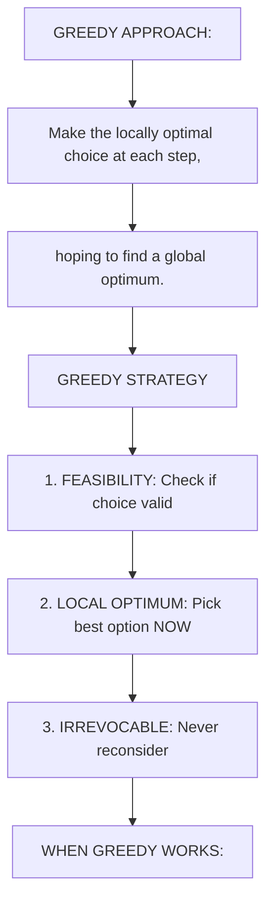

> **Navigation**: [Back to Index](../00_MASTER_INDEX.md) | [Next Chapter >](06c_Advanced_Algo_Deep.md)
> 🧠 **Mental Model**: See [Greedy vs DP Decision](../14_Mental_Models/11_Greedy_vs_DP_Decision.md) — when greedy works and when you need DP

---

# 🎯 Advanced Algorithms: Complete University Guide

## From Divide & Conquer to NP-Complete

---
> **Navigation**: [Part A: Core Techniques] | [Part B: Advanced Patterns](06e_Algorithm_Patterns.md)

---


# 🔬 PART 0: DEEP INTERNALS - HOW ALGORITHMS ACTUALLY WORK AT CPU/MEMORY LEVEL

## Cpu Instruction Execution - Deep Dive

Simple comparison: if (a > b)

**Java Bytecode**:
iload_1        // Load a from local variable slot 1 onto stack
iload_2        // Load b from local variable slot 2 onto stack
if_icmple L1   // If a <= b, jump to L1 (skip true branch)
JIT-COMPILED x86-64 ASSEMBLY:
mov     eax, [rsp+8]     ; Load a into register eax
cmp     eax, [rsp+12]    ; Compare eax with b
jle     .L1              ; Jump if less or equal

**Cpu Cycles**:
| Instruction      | Cycles | Notes |
| mov (L1 cache)   | 1-4    | If in cache |
| mov (RAM)        | ~200   | Cache miss penalty! |
| cmp              | 1      | Just sets flags |
| jle (predicted)  | 1      | If branch predicted correctly |
| jle (mispredicted)| 15-20 | Pipeline flush penalty! |

**Why This Matters For Algorithms**:
Binary Search (random access):
- Each comparison accesses random memory location
- High cache miss rate
- Unpredictable branches (50% each way)
- Real performance: ~60-80 cycles per comparison
Linear Search (sequential access):
- Sequential memory access → cache prefetching works
- Predictable branches (usually false until found)
- Real performance: ~4-5 cycles per comparison

**Surprising Result**:
For n < 64, linear search can be FASTER than binary search!
Because cache effects dominate for small n.


## Operation Costs - What They Don'T Teach You

INSTRUCTION LATENCIES (cycles on modern x86-64):
| Operation                    | Latency  | Throughput |
| Integer add/sub              | 1 cycle  | 4/cycle (superscalar) |
| Integer multiply             | 3 cycles | 1/cycle |
| Integer divide               | 20-80 c  | 1/20 cycles |
| Floating point add           | 3-4 c    | 2/cycle |
| Floating point multiply      | 5 c      | 2/cycle |
| Floating point divide        | 14-45 c  | 1/14 cycles |
| L1 cache load                | 4-5 c    | 2/cycle |
| L2 cache load                | 12-14 c  | 1/2 cycles |
| L3 cache load                | 40-50 c  | depends |
| RAM load                     | 200+ c   | limited by bandwidth |
| Branch (predicted)           | 1 c      | 1/cycle |
| Branch (mispredicted)        | 15-20 c  | pipeline flush |
| Function call                | ~5 c     | + stack operations |
| Virtual call (Java)          | ~15-25 c | vtable lookup |
| System call                  | 1000+ c  | context switch |

**Implications For Algorithm Design**:
1. Division is EXPENSIVE
- Avoid: n / 2
- Prefer: n >> 1 (right shift, 1 cycle)
- Compiler often optimizes, but not always
2. Memory access is the REAL bottleneck
- 1 cache miss = 200 cycles = 200 integer operations!
- Design algorithms for cache locality
3. Branch prediction matters
- Predictable patterns: for (i=0; i<n; i++) → ~99% predicted
- Unpredictable: if (random < 50%) → ~50% misprediction
- Binary search: ~log(n) mispredictions guaranteed
4. Function calls have overhead
- Recursive algorithms pay per recursion level
- Java virtual calls even more expensive
- JIT inlining helps but has limits
## What Actually Happens During Recursion

Java code:
int factorial(int n) {
if (n <= 1) return 1;
return n * factorial(n - 1);
}
STACK FRAME for each call:
OFFSET    │ CONTENT
+0        │ Return address (8 bytes on 64-bit)
+8        │ Previous frame pointer (8 bytes)
+16       │ Parameter n (4 bytes, padded to 8)
+24       │ Local variable space (if any)
+32       │ Saved callee-saved registers (varies)

**Minimum Frame Size**: ~32-48 bytes per call
CALL SEQUENCE for factorial(5):
═══════════════════════════════

**Stack Memory**:
High addresses
┌─────────────────────────────────┐
| | main() frame                    | |
├─────────────────────────────────┤
| | factorial(5) frame              | | ← 48 bytes |
| |   return addr = main+42         | |
| |   n = 5                         | |
├─────────────────────────────────┤
| | factorial(4) frame              | | ← 48 bytes |
| |   return addr = factorial+15    | |
| |   n = 4                         | |
├─────────────────────────────────┤
| | factorial(3) frame              | | ← 48 bytes |
├─────────────────────────────────┤
| | factorial(2) frame              | |
├─────────────────────────────────┤
| | factorial(1) frame              | | ← Stack pointer |
└─────────────────────────────────┘
Low addresses
Total stack for factorial(5): 5 × 48 = 240 bytes
Total stack for factorial(10000): 10000 × 48 ≈ 480 KB
Default Java stack: ~1 MB → STACK OVERFLOW at ~20,000 depth!

**Cpu Operations Per Recursive Call**:
Operation                           │ Cycles
Push return address                 │ 1-4
Push frame pointer                  │ 1-4
Allocate stack space                │ 1
Push parameter                      │ 1-4
Jump to function                    │ 1-3
Base case check                     │ 1-2
Recursive call (all above again)    │ ~15
Multiply result                     │ 3
Pop stack frame                     │ 1-3
Return                              │ 1-3
TOTAL per recursion level           │ ~30-40 cycles
For factorial(1000): ~35,000 cycles in overhead alone!


> 🔬 **Section Challenge — What Actually Happens During Recursion**
>
> **Challenge 1 (Reasoning):** Every recursive algorithm can be converted to iterative. What data structure replaces the call stack?
> <details><summary>Answer</summary>
>
> An explicit `Stack<State>` where State holds what the stack frame would hold (current node, remaining work, partial results). DFS → explicit stack. Factorial → accumulator variable (tail recursion → loop). Tree traversal → stack with nodes + 'visited' flag. When to use recursion vs iteration: recursion = cleaner code when tree/graph depth is bounded. Iteration = necessary when depth is unbounded (stack overflow risk) or when performance is critical.
> </details>
>
> **Challenge 2 (Bug Hunt):** ```java
void fib(int n) { return n<=1 ? n : fib(n-1) + fib(n-2); }
fib(50) // takes forever
```
Why and what are the 3 fixes?
> <details><summary>Answer</summary>
>
> Exponential time O(2^N) — `fib(n-1)` and `fib(n-2)` each recursively recompute the same subproblems billions of times. Fix 1: Memoization — `Map<Integer,Long> memo`, return early if computed. O(N) time, O(N) space. Fix 2: Bottom-up DP — array `dp[i] = dp[i-1] + dp[i-2]`. O(N) time, O(N) space. Fix 3: O(1) space — just track last two values with two variables. O(N) time, O(1) space.
> </details>
>

## Tail Call Optimization - What It Means


**Regular Recursion**: TAIL RECURSION:
int fact(int n) {                      int fact(int n, int acc) {
if (n <= 1) return 1;                  if (n <= 1) return acc;
return n * fact(n-1);  ←MUST           return fact(n-1, n*acc); ←LAST
}                      MULTIPLY            }                          THING
AFTER RETURN

**Stack Usage Comparison**:
Regular (n=5):           Tail-optimized (n=5):
| fact(5)        |       | fact(5, 1)     | → becomes: |
| | fact(4, 5)     | (reuses same frame) |
| fact(4)        |       | fact(3, 20) |
│ fact(2, 60)
| fact(3)        |       | fact(1, 120) |
fact(2)        │       Only 1 stack frame!
fact(1)
5 stack frames
JAVA DOES NOT IMPLEMENT TAIL CALL OPTIMIZATION!
Why? JVM stack frames are complex (security, profiling, exceptions)

**Solutions In Java**:
1. Convert to iterative (always works)
2. Use trampolining (functional pattern)
3. Increase stack size: java -Xss4m
// Iterative conversion:
int factIterative(int n) {
int result = 1;
for (int i = 2; i <= n; i++) {
result *= i;
}
return result;
}
// Trampolining:
interface Trampoline<T> {
T get();
default boolean complete() { return true; }
default Trampoline<T> bounce() { return this; }
}
Languages WITH tail call optimization:
- Scheme, Haskell, Scala (partial), Kotlin (tailrec keyword)
## Asymptotic Analysis - Rigorous Definitions

FORMAL DEFINITION OF BIG-O:
f(n) = O(g(n)) if and only if:
∃ c > 0, n₀ > 0 such that ∀ n ≥ n₀:
f(n) ≤ c · g(n)
In words: f(n) is bounded above by g(n) multiplied by some constant,
for all sufficiently large n.

**Example Proof**: 3n² + 5n + 7 = O(n²)
Need to find c and n₀ such that:
3n² + 5n + 7 ≤ c · n²
For n ≥ 1:
3n² + 5n + 7 ≤ 3n² + 5n² + 7n²  (since n² ≥ n ≥ 1)
= 15n²
So c = 15, n₀ = 1 works.
Therefore: 3n² + 5n + 7 = O(n²) ✓
FORMAL DEFINITION OF BIG-Ω:
f(n) = Ω(g(n)) if and only if:
∃ c > 0, n₀ > 0 such that ∀ n ≥ n₀:
f(n) ≥ c · g(n)
FORMAL DEFINITION OF BIG-Θ:
f(n) = Θ(g(n)) if and only if:
f(n) = O(g(n)) AND f(n) = Ω(g(n))
Equivalently:
∃ c₁, c₂, n₀ > 0 such that ∀ n ≥ n₀:
c₁ · g(n) ≤ f(n) ≤ c₂ · g(n)
LITTLE-o AND LITTLE-ω:
f(n) = o(g(n)) means: lim(n→∞) f(n)/g(n) = 0
"f(n) grows strictly slower than g(n)"
f(n) = ω(g(n)) means: lim(n→∞) f(n)/g(n) = ∞
"f(n) grows strictly faster than g(n)"

**Master Theorem For Recurrences**:
For recurrence: T(n) = aT(n/b) + f(n)
Let c_crit = log_b(a)
Case 1: If f(n) = O(n^(c_crit - ε)) for some ε > 0
Then T(n) = Θ(n^c_crit)
Case 2: If f(n) = Θ(n^c_crit · log^k(n))
Then T(n) = Θ(n^c_crit · log^(k+1)(n))
Case 3: If f(n) = Ω(n^(c_crit + ε)) and regularity condition holds
Then T(n) = Θ(f(n))

**Master Theorem Examples**:
| Recurrence              | a  | b  | c_crit | f(n)     | Result |
| T(n) = 2T(n/2) + n      | 2  | 2  | 1      | n=Θ(n¹)  | Θ(n log n) |
| T(n) = 2T(n/2) + n²     | 2  | 2  | 1      | n²=Ω(n¹⁺)| Θ(n²) |
| T(n) = 2T(n/2) + 1      | 2  | 2  | 1      | 1=O(n⁰)  | Θ(n) |
| T(n) = 4T(n/2) + n      | 4  | 2  | 2      | n=O(n¹)  | Θ(n²) |
| T(n) = T(n/2) + 1       | 1  | 2  | 0      | 1=Θ(n⁰)  | Θ(log n) |
| T(n) = 3T(n/2) + n      | 3  | 2  | 1.58   | n=O(n¹)  | Θ(n^1.58) |


## Amortized Analysis - Deep Understanding

WHAT IS AMORTIZED ANALYSIS?
Average cost per operation over a sequence of operations.
NOT the same as average-case analysis!
Key difference:
- Average-case: Random input distribution
- Amortized: Worst-case over sequence, any input
DYNAMIC ARRAY (ArrayList) EXAMPLE:
ArrayList starts with capacity 10. When full, doubles capacity.
Cost of n insertions:
| Insert # | Capacity | Is Resize? | Cost (copies + 1 insert) |
| 1-10     | 10       | No         | 1 each = 10 total |
| 11       | 10→20    | Yes        | 10 copies + 1 = 11 |
| 12-20    | 20       | No         | 1 each = 9 |
| 21       | 20→40    | Yes        | 20 copies + 1 = 21 |
| 22-40    | 40       | No         | 1 each = 19 |
| 41       | 40→80    | Yes        | 40 copies + 1 = 41 |
| ...      | ...      | ...        | ... |
Total cost for n inserts:
= n (for n inserts)
+ 10 + 20 + 40 + 80 + ... (for resizes)
= n + (10 + 20 + 40 + ... + n/2)
= n + n (geometric series ≈ n)
= 2n
Amortized cost per insert: 2n / n = O(1) amortized!

**Three Methods For Amortized Analysis**:
1. AGGREGATE METHOD:
Total cost for n operations / n
2. ACCOUNTING METHOD:
Charge each operation a fixed amount (amortized cost)
Save surplus as "credit" for expensive operations
For ArrayList: charge 3 per insert
- 1 for the insert itself
- 2 saved for future resize (pay for moving this element twice)
3. POTENTIAL METHOD:
Define potential function Φ(state)
Amortized cost = actual cost + ΔΦ
For ArrayList: Φ = 2(size - capacity/2)
- After resize: Φ = 2(n/2 - n/2) = 0
- Just before resize: Φ = 2(n - n/2) = n
- Resize cost n, but Φ drops by n, so amortized = 0

---

> ⚠️ **MOVED**: Unit 1 (Algorithm Analysis + Divide & Conquer + Binary Search + Master Theorem)
> has been extracted to its own dedicated file for discoverability:
> **→ [02c_Divide_And_Conquer.md](02c_Divide_And_Conquer.md)**

---


# 🎯 Unit 2: the Greedy Method

## The General Method

```
GREEDY APPROACH:
Make the locally optimal choice at each step,
hoping to find a global optimum.

┌─────────────────────────────────────────┐
│           GREEDY STRATEGY               │
├─────────────────────────────────────────┤
│                                         │
│  1. FEASIBILITY: Check if choice valid  │
│  2. LOCAL OPTIMUM: Pick best option NOW │
│  3. IRREVOCABLE: Never reconsider       │
│                                         │
└─────────────────────────────────────────┘

WHEN GREEDY WORKS:
✓ Greedy Choice Property: Local optimal → Global optimal
✓ Optimal Substructure: Optimal solution contains optimal subsolutions

WHEN GREEDY FAILS:
```

**Flow:**
- GREEDY APPROACH:
- ↓
- Make the locally optimal choice at each step,
- ↓
- hoping to find a global optimum.
- ↓
- GREEDY STRATEGY
- ↓
- 1. FEASIBILITY: Check if choice valid
- ↓
- 2. LOCAL OPTIMUM: Pick best option NOW
- ↓
- 3. IRREVOCABLE: Never reconsider




---


---

## 🏋️ Practice & Interview Questions — Algorithms

### Sorting
**Q1.** Which sorting algorithm does Java use for `Arrays.sort(int[])`? Why not MergeSort?
<details><summary>Answer</summary>

**Dual-Pivot QuickSort** — for primitives. MergeSort requires O(N) extra space. QuickSort is in-place and cache-friendly. Stability doesn't matter for primitives (equal ints are indistinguishable). For objects (`Arrays.sort(Object[])`), Java uses **TimSort** (stable, O(N log N) worst).
</details>

**Q2.** Trace Merge Sort on `[4,2,7,1]`.
<details><summary>Answer</summary>

Split: `[4,2]` `[7,1]` → Split: `[4]` `[2]` `[7]` `[1]` → Merge: `[2,4]` `[1,7]` → Merge: `[1,2,4,7]`
</details>

**Q3.** ⭐⭐ Sort Colors (Dutch National Flag — 3-way partition).
<details><summary>Solution</summary>

```java
int lo=0, mid=0, hi=n-1;
while(mid<=hi){
    if(nums[mid]==0) swap(nums,lo++,mid++);
    else if(nums[mid]==1) mid++;
    else swap(nums,mid,hi--);
}
```
</details>

### Binary Search
**Q4.** ⭐ Search in Rotated Sorted Array.
<details><summary>Solution</summary>

```java
int lo=0, hi=n-1;
while(lo<=hi){
    int mid=(lo+hi)/2;
    if(nums[mid]==target) return mid;
    if(nums[lo]<=nums[mid]){ // left half sorted
        if(nums[lo]<=target&&target<nums[mid]) hi=mid-1; else lo=mid+1;
    } else { // right half sorted
        if(nums[mid]<target&&target<=nums[hi]) lo=mid+1; else hi=mid-1;
    }
}
return -1;
```
</details>

**Q5.** ⭐ Find First and Last Position (binary search twice).
<details><summary>Solution</summary>

```java
// First: find leftmost with while(lo<hi){ if arr[mid]>=target hi=mid else lo=mid+1 }
// Last: find rightmost with while(lo<hi){ if arr[mid]<=target lo=mid+1 else hi=mid } return lo-1
```
</details>

**Q6.** ⭐⭐ Koko Eating Bananas — binary search on answer.
<details><summary>Key insight</summary>

Binary search the eating speed k in range [1, max(piles)]. For each k, calculate hours needed. Find minimum k where hours ≤ H.
</details>

### Dynamic Programming
**Q7.** ⭐ Climbing Stairs — n steps, 1 or 2 at a time. How many ways?
<details><summary>Solution</summary>

```java
// Fibonacci sequence! dp[i] = dp[i-1] + dp[i-2]
int a=1, b=1;
for(int i=2;i<=n;i++){ int c=a+b; a=b; b=c; }
return b;
```
</details>

**Q8.** ⭐ Coin Change — minimum coins for amount.
<details><summary>Solution</summary>

```java
int[] dp = new int[amount+1]; Arrays.fill(dp, amount+1);
dp[0]=0;
for(int i=1;i<=amount;i++)
    for(int c:coins) if(c<=i) dp[i]=Math.min(dp[i],dp[i-c]+1);
return dp[amount]>amount?-1:dp[amount];
```
</details>

**Q9.** ⭐⭐ Longest Common Subsequence.
<details><summary>Solution</summary>

```java
int[][] dp=new int[m+1][n+1];
for(int i=1;i<=m;i++) for(int j=1;j<=n;j++){
    if(text1.charAt(i-1)==text2.charAt(j-1)) dp[i][j]=dp[i-1][j-1]+1;
    else dp[i][j]=Math.max(dp[i-1][j],dp[i][j-1]);
}
return dp[m][n];
```
</details>

**Q10.** ⭐⭐ Word Break — can string be segmented using dictionary words?
<details><summary>Solution</summary>

```java
boolean[] dp=new boolean[n+1]; dp[0]=true;
for(int i=1;i<=n;i++) for(String w:wordDict)
    if(i>=w.length()&&dp[i-w.length()]&&s.substring(i-w.length(),i).equals(w)) dp[i]=true;
return dp[n];
```
</details>

**Q11.** ⭐⭐⭐ Edit Distance (Levenshtein).
<details><summary>Solution</summary>

```java
int[][] dp=new int[m+1][n+1];
for(int i=0;i<=m;i++) dp[i][0]=i;
for(int j=0;j<=n;j++) dp[0][j]=j;
for(int i=1;i<=m;i++) for(int j=1;j<=n;j++){
    if(word1.charAt(i-1)==word2.charAt(j-1)) dp[i][j]=dp[i-1][j-1];
    else dp[i][j]=1+Math.min(dp[i-1][j-1],Math.min(dp[i-1][j],dp[i][j-1]));
}
```
</details>

### Graph Algorithms
**Q12.** ⭐ Number of Islands (BFS/DFS grid traversal).
<details><summary>Solution</summary>

```java
for each cell (i,j) if grid[i][j]=='1': count++; BFS/DFS to mark all connected land as visited
```
</details>

**Q13.** ⭐⭐ Course Schedule — detect cycle in directed graph (Topological sort).
<details><summary>Solution</summary>

```java
// Kahn's algorithm: indegree array + BFS queue
// If result size == numCourses → no cycle → can finish
```
</details>

**Q14.** ⭐⭐ Dijkstra's Shortest Path.
<details><summary>Solution</summary>

```java
PriorityQueue<int[]> pq=new PriorityQueue<>((a,b)->a[1]-b[1]); // [node, dist]
pq.offer(new int[]{src,0}); dist[src]=0;
while(!pq.isEmpty()){
    int[] curr=pq.poll(); int u=curr[0],d=curr[1];
    if(d>dist[u]) continue; // stale
    for(int[] neighbor:graph[u]) if(dist[u]+neighbor[1]<dist[neighbor[0]]){
        dist[neighbor[0]]=dist[u]+neighbor[1]; pq.offer(new int[]{neighbor[0],dist[neighbor[0]]});
    }
}
```
</details>

### MCQ Rapid Fire
| # | Question | Answer |
|---|---|---|
| 1 | QuickSort avg/worst | O(N log N) avg, O(N²) worst |
| 2 | MergeSort space complexity | O(N) |
| 3 | HeapSort space complexity | O(1) (in-place) |
| 4 | Binary search precondition | Sorted array |
| 5 | BFS time complexity on graph | O(V+E) |
| 6 | DFS space complexity | O(V) (recursion stack) |
| 7 | Dijkstra fails on | Negative weight edges |
| 8 | Bellman-Ford handles | Negative weights, detects negative cycles |
| 9 | Floyd-Warshall use case | All-pairs shortest path, O(V³) |
| 10 | Topological sort requires | Directed Acyclic Graph (DAG) |


---

## 🧠 Deep Conceptual Questions — Algorithm Design & Analysis

**C1. What does O(N log N) "feel like" and why is it the complexity barrier for comparison-based sorting?**
<details><summary>Deep Answer</summary>

O(N log N) for N=1M ≈ 20M operations. O(N²) ≈ 1 trillion. The difference is 50,000x. **Comparison sort lower bound**: any comparison-based sort must distinguish between N! possible orderings. Each comparison has 2 outcomes. A decision tree with N! leaves needs ≥ log₂(N!) height ≈ N log N (Stirling's approximation). Therefore NO comparison sort can beat O(N log N) in the worst case. Non-comparison sorts (counting sort, radix sort, bucket sort) break this bound by using non-comparison operations — but require constraints on input (e.g., integer range bounded by N).
</details>

**C2. Greedy algorithms: when do they work and what must be proven?**
<details><summary>Deep Answer</summary>

A greedy algorithm makes the locally optimal choice at each step. Works when problem has: (1) **Greedy choice property**: local optimal leads to global optimal — the choice never needs to be revised. (2) **Optimal substructure**: optimal solution to the problem contains optimal solutions to subproblems. To PROVE greedy is correct: use "exchange argument" — assume optimal solution differs from greedy, show you can swap greedy's choice in without making it worse, contradiction. Greedy FAILS when: future choices depend on current choice in complex ways (use DP instead). Classic works: interval scheduling, Huffman coding, Dijkstra. Classic fails: 0-1 knapsack (use DP).
</details>

**C3. Dynamic Programming: what is "overlapping subproblems" and why does it matter?**
<details><summary>Deep Answer</summary>

Overlapping subproblems: the same sub-computation appears multiple times. Fibonacci: `fib(5)` calls `fib(4)` and `fib(3)`. `fib(4)` also calls `fib(3)`. Without memoization: `fib(3)` computed exponentially many times → O(2^N). With memoization: each sub-result computed once and stored → O(N). DP is valuable SPECIFICALLY when: (1) problem has optimal substructure AND (2) subproblems overlap. If no overlap: just use divide-and-conquer (merge sort's subproblems don't overlap → no DP needed). DP = "smart recursion" = avoid recomputing.
</details>

**C4. Top-down (memoization) vs Bottom-up (tabulation) DP — when to choose each?**
<details><summary>Deep Answer</summary>

**Top-down (memoization)**: Write natural recursion + cache results. Easy to implement, only computes needed subproblems (sparse computation). Cons: recursion overhead and stack depth risk. Use when: problem is naturally recursive, only a fraction of subproblems needed. **Bottom-up (tabulation)**: Fill DP table iteratively from base cases. No recursion overhead, better cache performance, easier space optimization. Use when: need all subproblems (or most of them), want to optimize space (can often reduce to 1D from 2D). Rule: start with top-down for correctness verification, optimize to bottom-up for performance.
</details>

**C5. Dijkstra's Algorithm: why does it fail on negative weights?**
<details><summary>Deep Answer</summary>

Dijkstra assumes: once a node is "settled" (extracted from the priority queue with its final shortest distance), that distance is optimal. With negative weights: settling node A at distance 5 might not be final — a path through B (distance 7) → C (edge -10) → A gives distance -3. But A was already settled! Dijkstra doesn't revisit settled nodes. Bellman-Ford handles negatives by relaxing ALL edges N-1 times — no "settled" assumption. For graphs with negative cycles: Bellman-Ford detects them (if distances still decrease after N-1 rounds, there's a negative cycle).
</details>

**C6. Union-Find: why is path compression + union by rank/size nearly O(1)?**
<details><summary>Deep Answer</summary>

**Path compression**: when finding the root of element x, make every node on the path point directly to the root. Flattens the tree. Future finds on those paths: O(1). **Union by rank**: always attach the smaller tree under the larger → limits tree height to O(log N). Combined: inverse Ackermann function α(N) amortized — so slow-growing it's practically constant (α(10^80) = 4). Neither alone is optimal: path compression without union by rank → O(log N) amortized. Union by rank without path compression → O(log N). Together → α(N) ≈ O(1) amortized. Used in: Kruskal's MST, cycle detection, connected components.
</details>

**C7. Binary Search on the Answer — what types of problems does it apply to?**
<details><summary>Deep Answer</summary>

When the answer space is **monotone**: "if X is achievable, then all values less extreme than X are also achievable." Problems: minimize the maximum (aggressive cows, split array), find minimum valid threshold (Koko bananas, minimum days to bloom), divide-and-conquer feasibility. Template: binary search on the answer range [lo, hi], for each mid check `isFeasible(mid)` in O(N) or O(N log N). Total: O(N log(answer_range)). Key insight: reframe "find optimal value" as "find smallest X where condition holds" → enables binary search on a non-array space.
</details>

**C8. Why does merge sort guarantee stability while quicksort doesn't?**
<details><summary>Deep Answer</summary>

**Merge sort stability**: during merge, when two elements are equal, we always take from the LEFT array first → preserves original relative order. **QuickSort instability**: the partition step swaps elements across the pivot without regard to original order. Two equal elements may be placed on opposite sides of the pivot, reversing their order. QuickSort CAN be made stable (Lomuto partition with careful implementation) but loses performance. Java uses TimSort for objects (stable), dual-pivot quicksort for primitives (stability irrelevant since primitives without fields).
</details>

**C9. Backtracking: what's the difference from plain DFS and when to use vs DP?**
<details><summary>Deep Answer</summary>

**Backtracking vs DFS**: DFS visits every path. Backtracking prunes paths early when a constraint is violated — avoids exploring infeasible branches. Same asymptotic but drastically different practical performance with good pruning. **Backtracking vs DP**: backtracking for **combinatorial/enumeration** problems (find all solutions, permutations, subsets). DP for **optimization** problems (find optimal single solution). Backtracking produces exponential solutions in worst case but is necessary when you need ALL solutions. DP finds the optimal in polynomial time when overlapping subproblems exist.
</details>

**C10. What is amortized analysis and how does it differ from average-case analysis?**
<details><summary>Deep Answer</summary>

**Amortized**: analyzes the average cost per operation over a SEQUENCE of operations — in the worst case. No probability involved. Guarantees: N operations ALWAYS take O(N·T) total, even if some individual operations are O(N·T). Example: ArrayList append is O(N) when resizing, but amortized O(1) because resizing is rare. **Average-case**: analyzes expected cost of a SINGLE operation assuming random input. QuickSort is O(N log N) average-case (random pivot). Amortized is a stronger guarantee — it holds even for adversarial input sequences.
</details>


> **Navigation**: [< Previous](05e_Graphs_Patterns.md) | [Back to Index](../00_MASTER_INDEX.md) | [Next >](06c_Advanced_Algo_Deep.md)