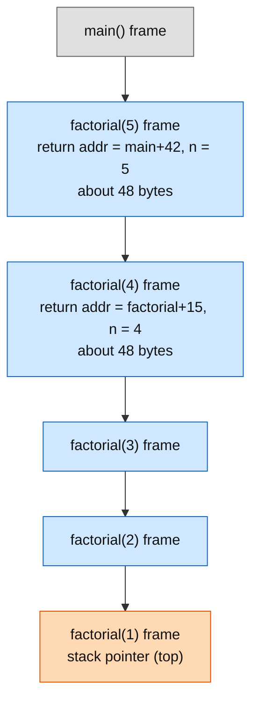

> **Navigation**: [← Online, Approximation &…](25_Online_Approximation_And_Linear_Programming.md) | [Chapter index](00_INDEX.md) | [Algorithms in the Real World… →](13_Algorithms_In_Production.md)
🧠 **Mental Model**: See [Greedy vs DP Decision](../14_Mental_Models/11_Greedy_vs_DP_Decision.md) — when greedy works and when you need DP

---

<details>
<summary><b>🧠 5W1H: Advanced Algorithms & Low-Level Internals</b></summary>

- **What**: The deep internal mechanics of algorithm execution (CPU cycles, cache, recursion stack, and amortized complexity) combined with Advanced Greedy/Matroid patterns.
- **Why**: High-level complexity (Big-O) hides massive constant-factor performance differences. To engineer high-performance systems or solve advanced constraints, we must understand the hardware and math that underpins algorithms.
- **When**: Use this knowledge when $O(n)$ is still too slow due to cache misses, when deep recursion risks a StackOverflow, or when choosing between greedy and DP.
- **Where**: Embedded systems, low-latency platforms (HFT), game engines, and production algorithm engineering.
- **Who**: Algorithm engineers, performance tuners, and senior developers.
- **How**: By analyzing execution in CPU cycles, replacing implicit call stacks with explicit data structures, applying Amortized Math, and using Matroid theory for Greedy proofs.
</details>

---

# 🎯 Advanced Algorithms: Complete University Guide

## From Divide & Conquer to NP-Complete

---

## 🔗 Bridge — Where This Chapter Fits

| Dimension | This chapter |
| --- | --- |
| **Builds on** | [Complexity (A2)](A2_Complexity_FirstPrinciples.md), [Recursion Internals](03a_Recursion_Internals.md) |
| **You will learn** | CPU-level cost of operations, recursion and tail calls, rigorous asymptotic definitions, amortized analysis, the greedy method and matroid view |
| **Leads to** | [Greedy](12_Greedy_Algorithms_Complete.md), [Advanced Algo Deep](06c_Advanced_Algo_Deep.md) |
| **Abstraction level** | L0–L2: reference deep-dive across levels |

> [!NOTE]
> The full gap-free reading order and dependency graph are in the [Learning Path](00_LEARNING_PATH.md).

---

## 💬 Explain It Like a Study Partner — Advanced Algorithms University Guide

### 1. The bottom line

This is the "how it really works" companion: what instructions run, how analysis is defined rigorously, and why greedy works.

### 2. The textbook core

- Operation costs differ by orders of magnitude (cache hit vs RAM, add vs divide).
- Formal definitions: `f = O(g)` iff ∃c, n₀ such that f ≤ c·g for n ≥ n₀.
- Amortized analysis (aggregate/accounting/potential) bounds the average cost per operation over a worst-case sequence.
- Greedy correctness via exchange arguments or the matroid structure.

### 3. The real-world analogy

Looking **under the hood of a car**: you can drive without it, but it explains why some roads are slow.

### 4. Walkthrough

1. Compare 1,000 recursive calls to a loop.
2. Each call costs about 30–40 cycles of overhead (frame setup and teardown).
3. The loop has no frames.
4. So the loop is several times faster even with the same Big-O.

> [!NOTE]
> **Quick check:** Does Java eliminate tail calls? *No; the JVM does not perform tail-call optimization.*

---


### 5. Check yourself

**Q1.** Which greedy choice maximises the number of non-overlapping intervals?

<details><summary>Answer</summary>

Sort by finish time and always take the interval that ends earliest.

</details>

**Q2.** What does `x & -x` return?

<details><summary>Answer</summary>

The lowest set bit of `x` (for `x = 12` it is 4).

</details>

---

## 🔬 PART 0: DEEP INTERNALS - HOW ALGORITHMS ACTUALLY WORK AT CPU/MEMORY LEVEL

### Cpu Instruction Execution - Deep Dive

Simple comparison: if (a > b)

**Java Bytecode**:
iload_1 // Load a from local variable slot 1 onto stack
iload_2 // Load b from local variable slot 2 onto stack
if_icmple L1 // If a <= b, jump to L1 (skip true branch)
JIT-COMPILED x86-64 ASSEMBLY:
mov eax, [rsp+8] ; Load a into register eax
cmp eax, [rsp+12] ; Compare eax with b
jle .L1 ; Jump if less or equal

**Cpu Cycles**:

| Instruction | Cycles | Notes |
|---|---|---|
| mov (L1 cache) | 1-4 | If in cache |
| mov (RAM) | ~200 | Cache miss penalty! |
| cmp | 1 | Just sets flags |
| jle (predicted) | 1 | If branch predicted correctly |
| jle (mispredicted)| 15-20 | Pipeline flush penalty! |

**Why This Matters For Algorithms**:
Binary Search (random access):

- Each comparison accesses random memory location
- High cache miss rate
- Unpredictable branches (50% each way)
- Real performance: ~60-80 cycles per comparison
  Linear Search (sequential access):
- Sequential memory access → cache prefetching works
- Predictable branches (usually false until found)
- Real performance: ~4-5 cycles per comparison

**Surprising Result**:
For n < 64, linear search can be FASTER than binary search!
Because cache effects dominate for small n.

### Operation Costs - What They Don'T Teach You

INSTRUCTION LATENCIES (cycles on modern x86-64):

| Operation | Latency | Throughput |
|---|---|---|
| Integer add/sub | 1 cycle | 4/cycle (superscalar) |
| Integer multiply | 3 cycles | 1/cycle |
| Integer divide | 20-80 c | 1/20 cycles |
| Floating point add | 3-4 c | 2/cycle |
| Floating point multiply | 5 c | 2/cycle |
| Floating point divide | 14-45 c | 1/14 cycles |
| L1 cache load | 4-5 c | 2/cycle |
| L2 cache load | 12-14 c | 1/2 cycles |
| L3 cache load | 40-50 c | depends |
| RAM load | 200+ c | limited by bandwidth |
| Branch (predicted) | 1 c | 1/cycle |
| Branch (mispredicted) | 15-20 c | pipeline flush |
| Function call | ~5 c | + stack operations |
| Virtual call (Java) | ~15-25 c | vtable lookup |
| System call | 1000+ c | context switch |

**Implications For Algorithm Design**:

1. Division is EXPENSIVE

- Avoid: n / 2
- Prefer: n >> 1 (right shift, 1 cycle)
- Compiler often optimizes, but not always

1. Memory access is the REAL bottleneck

- 1 cache miss = 200 cycles = 200 integer operations!
- Design algorithms for cache locality

1. Branch prediction matters

- Predictable patterns: for (i=0; i<n; i++) → ~99% predicted
- Unpredictable: if (random < 50%) → ~50% misprediction
- Binary search: ~log(n) mispredictions guaranteed

1. Function calls have overhead

- Recursive algorithms pay per recursion level
- Java virtual calls even more expensive
- JIT inlining helps but has limits

### What Actually Happens During Recursion

```java
int factorial(int n) {
    if (n <= 1) return 1;
    return n * factorial(n - 1);
}
```

**Stack frame for each call:**

| Offset | Content |
| ------ | ------- |
| +0 | Return address (8 bytes on 64-bit) |
| +8 | Previous frame pointer (8 bytes) |
| +16 | Parameter `n` (4 bytes, padded to 8) |
| +24 | Local variable space (if any) |
| +32 | Saved callee-saved registers (varies) |

**Minimum frame size:** ~32–48 bytes per call.

**Call sequence for `factorial(5)`:**



**How to read this diagram.** The stack grows from high addresses (top of the diagram, `main`) towards low addresses (bottom). Each recursive call adds one frame; the deepest call, `factorial(1)`, is the current top.

- Total stack for `factorial(5)`: 5 × 48 = 240 bytes
- Total stack for `factorial(10000)`: 10,000 × 48 ≈ 480 KB
- Default Java stack: ~1 MB → **`StackOverflowError` at roughly 20,000 depth**

**CPU operations per recursive call:**

| Operation | Cycles |
| --------- | ------ |
| Push return address | 1–4 |
| Push frame pointer | 1–4 |
| Allocate stack space | 1 |
| Push parameter | 1–4 |
| Jump to function | 1–3 |
| Base case check | 1–2 |
| Multiply result | 3 |
| Pop stack frame | 1–3 |
| Return | 1–3 |
| **Total per recursion level** | **~30–40 cycles** |

For `factorial(1000)` that is ~35,000 cycles of overhead alone.

### Tail Call Optimization - What It Means

| Regular recursion | Tail recursion |
| ----------------- | -------------- |
| The multiply happens **after** the recursive call returns, so the frame must stay alive. | The recursive call is the **last thing** done; nothing is left to do afterwards. |

```java
// Regular: must multiply AFTER the call returns
int fact(int n) {
    if (n <= 1) return 1;
    return n * fact(n - 1);
}

// Tail recursive: the recursive call is the LAST thing done
int fact(int n, int acc) {
    if (n <= 1) return acc;
    return fact(n - 1, n * acc);
}
```

**Stack usage comparison (n = 5):**

| Call depth | Regular recursion | Tail recursion (if optimized) |
| ---------- | ----------------- | ----------------------------- |
| 1 | `fact(5)` | `fact(5, 1)` becomes `fact(4, 5)`... |
| 2 | `fact(4)` | `fact(3, 20)` |
| 3 | `fact(3)` | `fact(2, 60)` |
| 4 | `fact(2)` | `fact(1, 120)` |
| 5 | `fact(1)` | (the same single frame is reused) |
| **Frames used** | **5** | **1** |

> [!WARNING]
> **Java does not implement tail-call optimization!**
Why? JVM stack frames are complex (security, profiling, exceptions)

**Solutions In Java**:

1. Convert to iterative (always works)
2. Use trampolining (functional pattern)
3. Increase stack size: java -Xss4m
   // Iterative conversion:

```java
int factIterative(int n) {
    int result = 1;
    for (int i = 2; i <= n; i++) {
        result \*= i;
    }
    return result;
}
// Trampolining:
interface Trampoline<T> {
    T get();
    default boolean complete() { return true; }
    default Trampoline<T> bounce() { return this; }
}
```

   Languages WITH tail call optimization:

- Scheme, Haskell, Scala (partial), Kotlin (tailrec keyword)

### Asymptotic Analysis - Rigorous Definitions

FORMAL DEFINITION OF BIG-O:
f(n) = O(g(n)) if and only if:
∃ c > 0, n₀ > 0 such that ∀ n ≥ n₀:
f(n) ≤ c · g(n)
In words: f(n) is bounded above by g(n) multiplied by some constant,
for all sufficiently large n.

**Example Proof**: 3n² + 5n + 7 = O(n²)
Need to find c and n₀ such that:
3n² + 5n + 7 ≤ c · n²
For n ≥ 1:
3n² + 5n + 7 ≤ 3n² + 5n² + 7n² (since n² ≥ n ≥ 1)
= 15n²
So c = 15, n₀ = 1 works.
Therefore: 3n² + 5n + 7 = O(n²) ✓
FORMAL DEFINITION OF BIG-Ω:
f(n) = Ω(g(n)) if and only if:
∃ c > 0, n₀ > 0 such that ∀ n ≥ n₀:
f(n) ≥ c · g(n)
FORMAL DEFINITION OF BIG-Θ:
f(n) = Θ(g(n)) if and only if:
f(n) = O(g(n)) AND f(n) = Ω(g(n))
Equivalently:
∃ c₁, c₂, n₀ > 0 such that ∀ n ≥ n₀:
c₁ · g(n) ≤ f(n) ≤ c₂ · g(n)
LITTLE-o AND LITTLE-ω:
f(n) = o(g(n)) means: lim(n→∞) f(n)/g(n) = 0
"f(n) grows strictly slower than g(n)"
f(n) = ω(g(n)) means: lim(n→∞) f(n)/g(n) = ∞
"f(n) grows strictly faster than g(n)"

**Master Theorem For Recurrences**:
For recurrence: T(n) = aT(n/b) + f(n)
Let c_crit = log_b(a)
Case 1: If f(n) = O(n^(c_crit - ε)) for some ε > 0
Then T(n) = Θ(n^c_crit)
Case 2: If f(n) = Θ(n^c_crit · log^k(n))
Then T(n) = Θ(n^c_crit · log^(k+1)(n))
Case 3: If f(n) = Ω(n^(c_crit + ε)) and regularity condition holds
Then T(n) = Θ(f(n))

**Master Theorem Examples**:

| Recurrence | a | b | c_crit | f(n) | Result |
|---|---|---|---|---|---|
| T(n) = 2T(n/2) + n | 2 | 2 | 1 | n=Θ(n¹) | Θ(n log n) |
| T(n) = 2T(n/2) + n² | 2 | 2 | 1 | n²=Ω(n¹⁺)| Θ(n²) |
| T(n) = 2T(n/2) + 1 | 2 | 2 | 1 | 1=O(n⁰) | Θ(n) |
| T(n) = 4T(n/2) + n | 4 | 2 | 2 | n=O(n¹) | Θ(n²) |
| T(n) = T(n/2) + 1 | 1 | 2 | 0 | 1=Θ(n⁰) | Θ(log n) |
| T(n) = 3T(n/2) + n | 3 | 2 | 1.58 | n=O(n¹) | Θ(n^1.58) |

### Amortized Analysis - Deep Understanding

WHAT IS AMORTIZED ANALYSIS?
Average cost per operation over a sequence of operations.
NOT the same as average-case analysis!
Key difference:

- Average-case: Random input distribution
- Amortized: Worst-case over sequence, any input
  DYNAMIC ARRAY (ArrayList) EXAMPLE:
  ArrayList starts with capacity 10. When full, doubles capacity.
  Cost of n insertions:
  | Insert # | Capacity | Is Resize? | Cost (copies + 1 insert) |
  | 1-10 | 10 | No | 1 each = 10 total |
  | 11 | 10→20 | Yes | 10 copies + 1 = 11 |
  | 12-20 | 20 | No | 1 each = 9 |
  | 21 | 20→40 | Yes | 20 copies + 1 = 21 |
  | 22-40 | 40 | No | 1 each = 19 |
  | 41 | 40→80 | Yes | 40 copies + 1 = 41 |
  | ... | ... | ... | ... |
  Total cost for n inserts:
  = n (for n inserts)

* 10 + 20 + 40 + 80 + ... (for resizes)
  = n + (10 + 20 + 40 + ... + n/2)
  = n + n (geometric series ≈ n)
  = 2n
  Amortized cost per insert: 2n / n = O(1) amortized!

**Three Methods For Amortized Analysis**:

1. AGGREGATE METHOD:
   Total cost for n operations / n
2. ACCOUNTING METHOD:
   Charge each operation a fixed amount (amortized cost)
   Save surplus as "credit" for expensive operations
   For ArrayList: charge 3 per insert

- 1 for the insert itself
- 2 saved for future resize (pay for moving this element twice)

3. POTENTIAL METHOD:
   Define potential function Φ(state)
   Amortized cost = actual cost + ΔΦ
   For ArrayList: Φ = 2(size - capacity/2)

- After resize: Φ = 2(n/2 - n/2) = 0
- Just before resize: Φ = 2(n - n/2) = n
- Resize cost n, but Φ drops by n, so amortized = 0

---

🔬 **Section Challenge — Amortized Analysis**

**Challenge 1 (Reasoning):** If an `ArrayList` increased its capacity by adding a constant `+10` elements each time it was full instead of doubling, what would the amortized cost of an insertion be?

<details><summary>Answer</summary>

$O(n)$. For $n$ insertions, it would resize $n/10$ times. The cost of resizes would be $10 + 20 + 30 + ... + n$. This is an arithmetic series summing to $O(n^2)$. Dividing the total cost $O(n^2)$ by $n$ insertions gives an amortized cost of $O(n)$ per insertion. Doubling (geometric series) is mathematically required to achieve $O(1)$ amortized cost.

</details>

---

⚠️ **MOVED**: Unit 1 (Algorithm Analysis + Divide & Conquer + Binary Search + Master Theorem)
has been extracted to its own dedicated file for discoverability:
**→ [02c_Divide_And_Conquer.md](02c_Divide_And_Conquer.md)**

---

## 🎯 Unit 2: the Greedy Method

### The General Method

```
GREEDY APPROACH:
Make the locally optimal choice at each step,
hoping to find a global optimum.

┌─────────────────────────────────────────┐
│           GREEDY STRATEGY               │
├─────────────────────────────────────────┤
│                                         │
│  1. FEASIBILITY: Check if choice valid  │
│  2. LOCAL OPTIMUM: Pick best option NOW │
│  3. IRREVOCABLE: Never reconsider       │
│                                         │
└─────────────────────────────────────────┘

WHEN GREEDY WORKS:
✓ Greedy Choice Property: Local optimal → Global optimal
✓ Optimal Substructure: Optimal solution contains optimal subsolutions

WHEN GREEDY FAILS:
✗ Subproblems overlap in ways that restrict future choices (e.g., 0/1 Knapsack)
✗ Non-monotonic conditions (e.g., Coin change with arbitrary denominations)
```

### 🔬 Deep Dive: The Matroid Connection (Why Greedy Actually Works)

While the "Exchange Argument" proves greedy works for a _specific_ problem, **Matroid Theory** explains the underlying mathematical structure that makes greedy work for an entire _class_ of problems. If a problem's solution space forms a weighted Matroid, the standard Greedy algorithm is **guaranteed** to find the optimal solution.

#### What is a Matroid?

A Matroid is a structure $M = (S, I)$ where $S$ is a finite set of elements, and $I$ is a family of "independent" subsets of $S$, satisfying two critical axioms:

1. **Hereditary Property:** If subset $B \in I$ and $A \subset B$, then $A \in I$. _(Every subset of a valid set is also valid)._
2. **Exchange Property:** If $A, B \in I$ and $|A| < |B|$, there exists some element $x \in B \setminus A$ such that $A \cup \{x\} \in I$. _(You can always grow a smaller valid set by borrowing an element from a larger valid set)._

#### How it connects to the Greedy Algorithm:

If your problem can be mapped to finding the maximum-weight independent set of a Matroid, the canonical Greedy Algorithm works flawlessly:

1. Sort all elements in $S$ by weight descending.
2. Initialize an empty set $A$.
3. For each element $x$ in sorted order: if $A \cup \{x\}$ is independent (maintains constraints), add $x$ to $A$.

#### Classic Matroid Successes:

- **Kruskal's MST:** The set $S$ is graph edges. Independent sets $I$ are acyclic edge sets (forests). Because graphs satisfy the exchange property (graphic matroids), sorting edges by weight and adding them if they don't form a cycle _mathematically guarantees_ the MST.
- **Task Scheduling with Deadlines & Penalties:** Tasks are $S$. A set of tasks is independent if there exists a valid schedule where _all_ of them meet their deadlines. This forms a transversal matroid. Sorting by penalty and greedily scheduling guarantees the minimum penalty.

#### Why Greedy Fails (Not a Matroid):

- **0/1 Knapsack:** Let capacity be 10kg. Suppose $A=\{6kg\}$ and $B=\{5kg, 5kg\}$. Both sets are valid (weight $\le 10$). Notice $|A| = 1$ and $|B| = 2$, so $|A| < |B|$. According to the Matroid Exchange Property, we should be able to take a 5kg item from $B$ and add it to $A$ to get a valid set. But $\{6kg\} \cup \{5kg\} = 11kg$, which exceeds capacity and is INVALID. The exchange property fails! Therefore, the knapsack problem does not form a matroid, and the greedy algorithm is doomed to fail, requiring Dynamic Programming instead.

---

🔬 **Section Challenge — The Greedy Method & Matroids**

**Challenge 1 (Design):** In the Fractional Knapsack problem (where you can take fractions of items), greedy works perfectly (sort by value/weight ratio). Why does Fractional Knapsack satisfy the Matroid Exchange property when 0/1 Knapsack does not?

<details><summary>Answer</summary>

In Fractional Knapsack, the domain of items is infinitely divisible. If we have a valid set $A$ (e.g. 6kg of item X) and a larger valid set $B$ (e.g. 5kg of Y, 5kg of Z), we don't have to take a _whole_ item from $B$. We can take exactly enough of an item from $B$ (e.g., 4kg) to fill $A$ up to the capacity limit. This continuous nature restores the Exchange Property (we can always exchange a fraction to grow $A$ towards $B$'s size without violating capacity). Thus, it's a matroid structure and greedy is optimal.

</details>

---

### 📎 Reference Anchor

**OpenJDK `PriorityQueue` — greedy's core data structure**
- `PriorityQueue`: [PriorityQueue.java](https://github.com/openjdk/jdk/blob/master/src/java.base/share/classes/java/util/PriorityQueue.java) — min-heap backed by `Object[]`. **Invariant**: `queue[k] <= queue[2k+1]` and `queue[k] <= queue[2k+2]` for all valid k (binary heap property). `offer/poll` are O(log n); `peek` is O(1).
- **Local rewrite rule**: `PriorityQueue.iterator()` does NOT return elements in priority order — it returns in arbitrary (heap array) order. To drain in order, use `while (!pq.isEmpty()) pq.poll()`.
- **Constraint warning**: `PriorityQueue.remove(Object)` is O(n) (linear scan, not log n). For Dijkstra, avoid `decrease-key` via `remove()` — use lazy deletion instead (insert the new priority pair, skip stale entries on poll).

---

### When It Breaks -- Greedy + Bit Manipulation

#### 1. Greedy — Exchange Argument Assumed Without Verification
**What breaks**: Applying greedy to a problem where the greedy choice property does NOT hold. E.g., "minimum number of operations to reduce n to 1" — greedy "always halve if even, subtract 1 if odd" fails for n=15: greedy does 15→14→7→6→3→2→1 (6 steps), but optimal is 15→16→8→4→2→1 (5 steps via +1 first).
**Fix**: Always try to construct a counterexample before committing to greedy. If you can't find one in 5 minutes AND you can sketch an exchange argument, then trust greedy.

#### 2. Bit Shift Precedence in Compound Expressions
**What breaks**: `int result = 1 << n + 1` evaluates as `1 << (n+1)` not `(1 << n) + 1` — addition has higher precedence than `<<`. This is correct if you want `2^(n+1)`, but wrong if you want `2^n + 1`.
**Fix**: Always parenthesize shift expressions: `(1 << n) + 1`.

---

### Brute Force → Optimal: Greedy Pattern

#### Problem: Minimum Platforms (Interval Scheduling)

**Brute Force — O(n²):**
For each train's arrival time, count how many other trains are currently at the station. Track the max.

**Optimal — O(n log n) sorting + two pointers:**
Sort arrivals and departures separately. Use two pointers: if `arrival[i] <= departure[j]`, a new train arrives before one departs → need one more platform (i++). Otherwise a train leaves first (j++). The max simultaneous count is the answer.

**Why greedy works**: Platforms are fungible. We never need to know WHICH platform — only HOW MANY are simultaneously occupied. Sorting lets us process events in chronological order and greedily reuse freed platforms.

---

### Proof Corner: Greedy Exchange Argument Template

**Template for proving a greedy algorithm is correct**:

1. **Assume** an optimal solution OPT differs from the greedy solution G at some step k.
2. **Swap**: modify OPT to match G's choice at step k → call this OPT'.
3. **Show OPT' is no worse than OPT**: cost(OPT') ≤ cost(OPT).
4. **Conclude by induction**: after n swaps, OPT has been transformed into G without getting worse → G is optimal.

**Worked example — Activity Selection (maximize non-overlapping intervals)**:
- Greedy: always pick the activity with earliest finish time.
- Exchange: Suppose OPT picks activity a (finish f_a) when greedy picks b (finish f_b ≤ f_a). Swap a for b in OPT: since f_b ≤ f_a, no later activity in OPT is blocked by b that wasn't already blocked by a. So OPT' is still valid with ≥ as many activities. The exchange never hurts. □


---

## 🏢 Enterprise Lens — Advanced Algorithms University Guide

| Area | What top-tier engineering looks like |
| ---- | ------------------------------------ |
| **Where it runs in production** | Performance engineering and profiling reviews; teaching material for onboarding engineers |
| **Failure modes** | Treating Big-O as a stopwatch; ignoring cache/branch costs in hot loops |
| **Testing and verification** | Micro-benchmark with JMH; do not guess |

---

## Reality Check

**"Greedy algorithms are educated guesses"** → Greedy algorithms require PROOF that the greedy choice is optimal. The exchange argument (swapping any non-greedy choice with the greedy choice does not worsen the solution) or matroid theory provides this proof. Without proof, a greedy approach is a heuristic that may fail on specific inputs. Activity selection, Huffman coding, and Dijkstra are provably optimal greedy algorithms.

**"Bit manipulation is a niche optimization"** → Bit operations are fundamental: checking if a number is a power of 2 (n & (n-1) == 0), finding the single non-duplicate in an array (XOR all elements), extracting subsets (iterating from 0 to 2^n-1), and implementing permission flags (read|write|execute as bits). These patterns appear in system programming, competitive programming, and database indexing.

**"XOR is just a curiosity"** → XOR has unique properties: a ^ a = 0 (self-inverse), a ^ 0 = a (identity), and associativity/commutativity. These enable: finding the single element that appears once when all others appear twice (XOR all elements), swapping two variables without a temporary (a ^= b; b ^= a; a ^= b), and detecting bit differences between two numbers (a ^ b gives differing bit positions).

**"Bitmask DP is too complex for interviews"** → Bitmask DP appears in problems involving: visiting all nodes in a graph (Traveling Salesman), assigning tasks to workers (assignment problem), and choosing subsets with constraints. The pattern is consistent: state is a bitmask representing which elements are included, transition adds one element. With n up to 20, the 2^n states fit in memory. This is a standard interview pattern at senior level.

**"Bit shifts are just multiplication and division by 2"** → Left shift (<<) multiplies by 2 but can overflow silently. Right shift has two variants: >> (arithmetic, preserves sign bit) and >>> (logical, fills with zeros). -1 >> 1 equals -1 in Java (sign-extending), while -1 >>> 1 equals Integer.MAX_VALUE (zero-filling). Using the wrong shift on negative numbers produces unexpected results.
