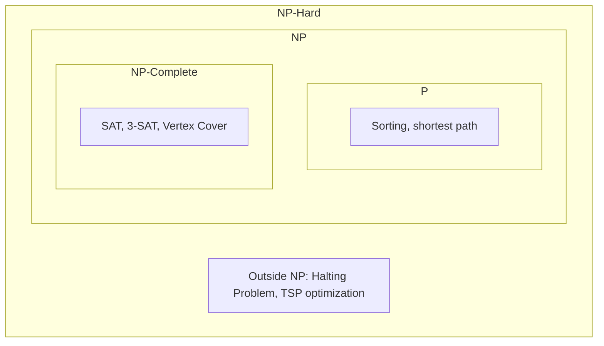

# NP-HARD AND NP-COMPLETE

> **Navigation**: [← UNIT 5: BRANCH AND BOUND](03_unit_5_branch_and_bound.md) | [Chapter overview](../06c_Advanced_Algo_Deep.md)
> Page 4 of 4 in **Advanced Algo Deep**


## Basic Concepts

**Complexity classes**

| Class | Meaning | Examples |
| --- | --- | --- |
| **P** (polynomial) | Problems solvable in polynomial time | Sorting, searching, shortest path |
| **NP** (nondeterministic polynomial) | Solutions verifiable in polynomial time | SAT, Traveling Salesman (decision version), graph coloring |
| **NP-Complete** | The hardest problems in NP. If any NP-Complete problem is solved in P, then P = NP | SAT, 3-SAT, Vertex Cover, Hamiltonian Cycle |
| **NP-Hard** | At least as hard as NP-Complete. May not be in NP (a solution may not be verifiable in polynomial time) | Halting Problem, TSP optimization |



**How to read this diagram.** P sits inside NP, and NP-Complete is the part of NP that is also NP-Hard. NP-Hard extends beyond NP. This picture assumes P ≠ NP, which is believed but unproven.

## Cook's Theorem

**Cook's theorem (1971):** SAT (Boolean satisfiability) is NP-Complete.

**Significance**

- It was the first problem proven to be NP-Complete.
- All other NP-Complete proofs reduce *from* SAT (directly or through a chain).

**SAT problem.** Given a Boolean formula, is there an assignment of TRUE/FALSE to the variables that makes it TRUE?

- Example: `(x₁ ∨ ¬x₂) ∧ (¬x₁ ∨ x₃) ∧ (x₂ ∨ x₃)`
- Solution: `x₁ = TRUE`, `x₂ = FALSE`, `x₃ = TRUE`

**3-SAT:** each clause has exactly 3 literals. It is also NP-Complete.

**Proving NP-completeness**

1. Show the problem is in NP (a solution is verifiable in polynomial time).
2. Reduce a known NP-Complete problem *to* your problem.
3. The reduction must run in polynomial time.

## Famous NP-Complete Problems

| # | Problem | Input | Question |
| --- | --- | --- | --- |
| 1 | Satisfiability (SAT) | A Boolean formula | Is there a satisfying assignment? |
| 2 | Vertex Cover | Graph `G`, integer `k` | Is there a set of at most `k` vertices covering all edges? |
| 3 | Clique | Graph `G`, integer `k` | Is there a complete subgraph of size `k`? |
| 4 | Hamiltonian Cycle | Graph `G` | Is there a cycle visiting every vertex exactly once? |
| 5 | Subset Sum | A set of integers, target sum `S` | Is there a subset summing to `S`? |
| 6 | Graph Coloring | Graph `G`, integer `k` | Can the vertices be colored with `k` colors so that no adjacent vertices share a color? |

**Reduction chain:** SAT → 3-SAT → Clique → Vertex Cover → Hamiltonian Cycle → TSP

---

🔬 **Section Challenge — NP-Completeness**

**Challenge 1 (Reduction Logic):** If someone discovers an $O(N^3)$ algorithm for 3-SAT, why does this automatically mean TSP (Optimization) is solvable in polynomial time?

<details><summary>Answer</summary>

Because 3-SAT is NP-Complete, and TSP (Decision version) is in NP. By Cook's Theorem and Karp's reductions, any instance of TSP can be mathematically translated (reduced) into an instance of 3-SAT in polynomial time. If 3-SAT is solvable in $O(N^3)$, we can just translate TSP to 3-SAT, solve it, and translate the answer back, all in polynomial time. Therefore $P = NP$, and every problem in NP is solvable in polynomial time.

</details>

---

> **Next**: [Part B: Advanced Patterns & Competitive Programming](../06e_Algorithm_Patterns.md)

---


---

## Proof Corner -- Max-Flow Min-Cut Theorem

**Theorem** (Ford-Fulkerson / Menger 1927): The maximum flow from s to t in a network equals the minimum capacity of any s-t cut.

**Proof sketch (three equivalent conditions)**:

Let f* be a max flow. The following are equivalent:
1. f* is a maximum flow.
2. There is no augmenting path in the residual graph G_f*.
3. There exists an s-t cut (S, T) where capacity(S,T) = |f*|.

(1 => 2): If an augmenting path existed, we could increase |f|, contradicting maximality.
(2 => 3): Let S = {v reachable from s in G_f*}, T = V\S. t is not in S (no augmenting path). For every edge (u,v) with u in S, v in T: residual capacity = 0, so f(u,v) = c(u,v). For every edge (v,u) with v in T, u in S: f(v,u) = 0. Therefore |f*| = capacity(S,T).
(3 => 1): |f| <= capacity of any cut. If |f*| = min capacity, f* is maximum. QED.

---

## When It Breaks -- Advanced Algorithms

**1. Augmenting path with real-valued capacities** -- Ford-Fulkerson with irrational capacities can fail to terminate (Zwick 1995). Always use BFS-based Edmonds-Karp (O(VE^2)) or capacity scaling for non-integer inputs.

**2. Negative-weight edges in matching** -- Hungarian algorithm for min-cost matching requires edge weights >= 0 (or a valid potential function). Adding a large constant to make weights non-negative works if done correctly; wrong offset breaks the dual feasibility.

**3. Bipartite check wrong** -- running bipartite matching on a non-bipartite graph produces no valid matching or wrong count. Always verify bipartiteness first (2-coloring BFS). Symptom: matching cardinality lower than expected.

**4. Cycle detection in augmenting paths** -- Bellman-Ford for min-cost flow terminates if there are no negative cycles in the residual graph. A negative cycle means the flow can be reduced/rerouted to decrease cost indefinitely -- no optimal solution exists.

---

## Reference Anchor

**JGraphT -- production graph algorithm library**:
```java
// org.jgrapht.alg.flow.MaximumFlowAlgorithmBase
// PushRelabelMFImpl -- O(V^2 * sqrt(E)) max flow, used in production
// Source: jgrapht-core/src/main/java/org/jgrapht/alg/flow/
SimpleDirectedWeightedGraph<String, DefaultWeightedEdge> g =
    new SimpleDirectedWeightedGraph<>(DefaultWeightedEdge.class);
g.addVertex("s"); g.addVertex("t"); g.addVertex("A");
DefaultWeightedEdge e = g.addEdge("s", "A");
g.setEdgeWeight(e, 10.0);
MaximumFlowAlgorithm<String, DefaultWeightedEdge> mf =
    new EdmondsKarpMFImpl<>(g);
MaximumFlowAlgorithm.MaximumFlow<DefaultWeightedEdge> flow = mf.getMaximumFlow("s", "t");
System.out.println(flow.getValue()); // max flow value

// org.jgrapht.alg.matching.KuhnMunkresMinimalWeightBipartitePerfectMatching
// Hungarian algorithm for min-cost perfect bipartite matching -- O(n^3)
```

---


---

[← UNIT 5: BRANCH AND BOUND](03_unit_5_branch_and_bound.md) | [Chapter overview](../06c_Advanced_Algo_Deep.md)
